<!-- A3.R65 | source: papers_json/A3.R65/ -->

المحتويات متاحة على[ ScienceDirect](www.sciencedirect.com/science/journal/0003682X)

## Applied Acoustics

الصفحة الرئيسية للمجلة: [www.elsevier.com/locate/apacoust](https://www.elsevier.com/locate/apacoust)

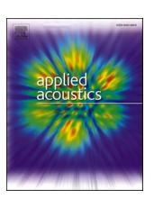

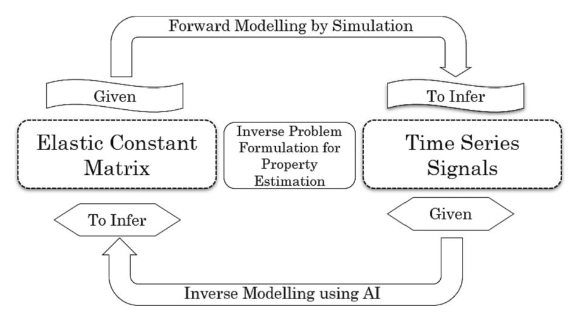

## تقدير الثوابت المرنة للمواد المركبة متعامدة الخواص باستخدام الموجات الموجهة ومسألة عكسية لتقدير الخصائص

Faeez Masurkar a,c , Saurabh Aggarwal ^a^ , Zi Wen Tham ^b^ , Lei Zhang ^b^ , Feng Yang ^a^ , Fangsen Cui a,*

- ^a^ *Institute of High-Performance Computing (IHPC), Agency for Science, Technology and Research (A*STAR), 1 Fusionopolis Way, #16-16 Connexis, Singapore 138632, * *Republic of Singapore *
- ^b^ *Institute of Materials Research and Engineering (IMRE), Agency for Science, Technology and Research (A*STAR), 2 Fusionopolis Way, Innovis, #08-03, Singapore * *138634, Republic of Singapore *
- ^c^ *Faculty of Engineering and IT, The British University in Dubai, Block 11, 1st, and 2nd Floors, Dubai International Academic City, Dubai PO Box 345015, United Arab * *Emirates *

## معلومات المقال

## *الكلمات المفتاحية: * مسألة عكسية، الثوابت المرنة، المواد المركبة، الموجات الموجهة، التعلم الآلي

## الملخص

يركز هذا البحث على تقدير الثوابت المرنة للصفائح متعامدة الخواص باستخدام الموجات الموجهة فوق الصوتية (GWs) المُستثارة عبر مستشعرات زركونات التيتانات الرصاصية (PZT) والمُلتقطة بواسطة مقياس اهتزاز ليزري أحادي البعد. تُعد الثوابت المرنة للمادة عاملاً حاسماً لفهم سلوكها الميكانيكي، وعادةً ما تُحدَّد من خلال الاختبار التجريبي. غير أن هذه العملية قد تكون مكلفة ومستهلكة للوقت. لذا، صاغ الباحثون هذه المسألة كمسألة عكسية لتقدير الخصائص. وفي هذا العمل، استُخدمت نماذج المحاكاة المزودة بمحولات PZT لتوليد سلاسل زمنية (TS) للموجات الموجهة للمادة متعامدة الخواص. بعد ذلك، دُرِّب نموذج تعلم آلي عكسي باستخدام مجموعة بيانات من السلاسل الزمنية تخص ثوابت مرنة مختلفة نُتجت عبر المحاكاة. يتكون النموذج العكسي من شبكات عصبية عميقة، مع تصميم دالة خسارة خاصة بهذا التطبيق. وأُجري عدد محدود من مجموعات المحاكاة الفريدة، واستُخدم 30% من البيانات المتاحة للتحقق. ولمزيد من اختبار النموذج، أُجري اختبار تجريبي أعمى، وقُدِّرت الثوابت المرنة المقابلة بمتوسط نسبة الخطأ المطلق (MAPE) قدره 12.89% وانحراف معياري قدره 5.47%. تُظهر النتائج أن صياغة تقدير الخصائص كمسألة عكسية قادرة على التنبؤ بدقة بالثوابت المرنة للمادة، باستخدام نموذج مدرَّب فقط على بيانات المحاكاة وكمية بيانات ضئيلة جداً. ولهذا النهج القدرة على تقليل الوقت الحسابي اللازم للتنبؤ بالثوابت المرنة بشكل كبير، وبالتالي قد يكون له تطبيقات واسعة في علوم وهندسة المواد.

## **1.** **المقدمة **

أصبحت مواد البلاستيك المقوى بألياف الكربون (CFRP) شائعة الاستخدام على نحو متزايد في صناعة الطيران، وتوربينات الرياح، ومختلف المعدات الرياضية، وصناعة السيارات، نظراً لقوتها العالية ووزنها الأخف مقارنة بمواد أخرى. غير أن آلية التلف في المواد المركبة معقدة نوعاً ما بسبب اختلاف المكوّنات التي يتألف منها المركب. وقد تُغيّر هذه الأضرار الخصائص الميكانيكية للمادة المركبة. لذا، من المهم توفر طرق اختبار للعينات المُصنَّعة وقيد الخدمة على حد سواء. ويمكن إجراء الاختبار باستخدام طرق مثل الموجات فوق الصوتية، والأشعة السينية، والتصوير الحراري، وتحليل التيار الدوامي، واختبار الجسيمات

المغناطيسية وفقاً لسيناريوهات مختلفة. ومن بين هذه الاختبارات كافة، استُخدمت طريقة الموجات فوق الصوتية على نطاق واسع من قبل الباحثين لوصف الخصائص الميكانيكية للمواد المركبة وكذلك للتحقق من سلامتها[ [1,2]](#page-13-0).

أصبحت أنظمة مراقبة الصحة الإنشائية (SHM) التي تستخدم بيانات فوق صوتية شائعة الاستخدام بشكل متزايد لتقدير خصائص المواد، واكتشاف العيوب والأضرار في أنواع عدة من المنشآت، مثل الجسور والمباني والغواصات والطائرات. ويرجع ذلك إلى أن الموجات فوق الصوتية يمكنها اختراق المواد واكتشاف التغيرات في خصائصها، مما يجعلها أداة مثالية للاختبار غير المتلف للمنشآت. ومن أبرز فوائد أنظمة SHM فوق الصوتية قدرتها على اكتشاف العيوب التي قد لا تكون مرئية بالعين المجردة. فعلى سبيل المثال، قد لا تكون الشقوق أو التآكل الداخلي في جسر أو مبنى مرئية على السطح، لكن الموجات فوق الصوتية قادرة على اكتشاف مثل هذه العيوب.

*عنوان البريد الإلكتروني: *[cuifs@ihpc.a-star.edu.sg](mailto:cuifs@ihpc.a-star.edu.sg) (F. Cui).

> ^*^ الباحث المُراسِل.

<!-- page 2 -->

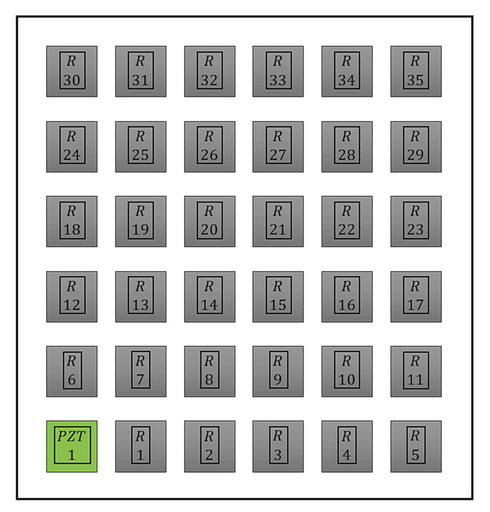
***الشكل 1.** البنية العامة لتقدير الخصائص عبر المسألة العكسية.*

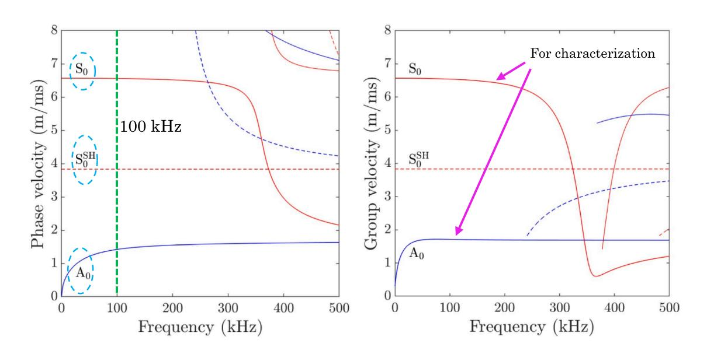
***الشكل 2.** البنية المقترحة للمسألة العكسية لتقدير الثوابت المرنة للمادة المركبة.*

<!-- page 3 -->

***الشكل 3.** العينة موضحاً عليها موقع محول PZT ونقاط الاستقبال.*

***الشكل 4.** منحنيات التشتت لعينة IM7/8552 المكونة من 32 طبقة.*

<!-- page 4 -->

***الشكل 5.** زمن انتشار الموجة الموجهة مقابل التردد عند مسافات انتشار مختلفة.*

***الشكل 6.** أنماط الإزاحة لنمطي الموجة الموجهة *A*0 و*S*0.*

<!-- page 5 -->

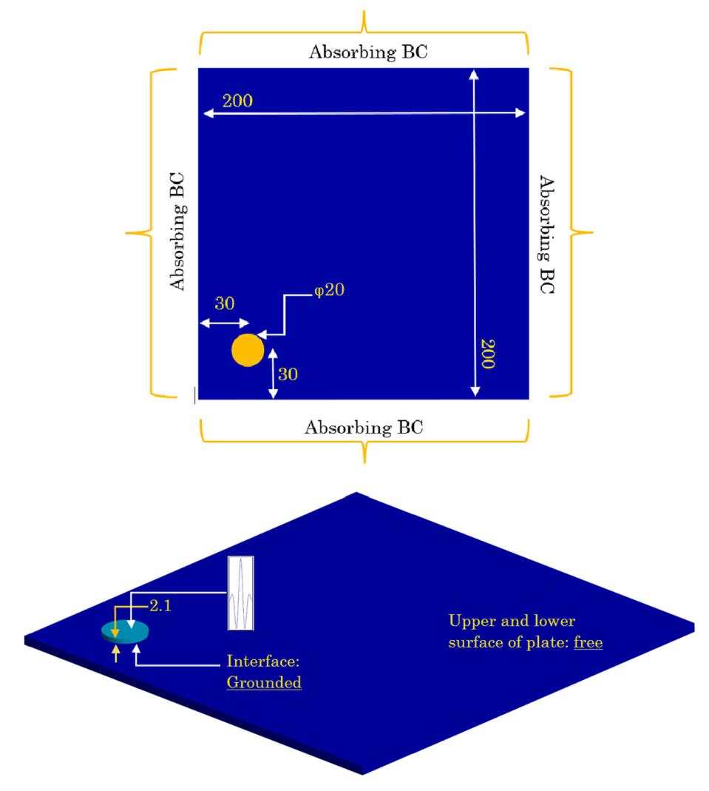
***الشكل 7.** رسم تخطيطي لنموذج المحاكاة بالعناصر المحددة ثلاثي الأبعاد (جميع الأبعاد بالملم ما لم يُذكر خلاف ذلك).*

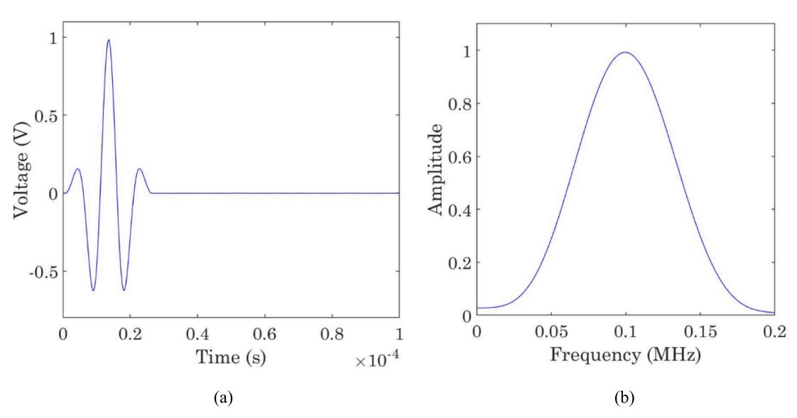
***الشكل 8.** إشارة الاستثارة المطبقة أعلى مستشعر PW (أ) المجال الزمني (ب) المجال الترددي.*

<!-- page 6 -->

| الثابت المرن | القيمة الحقيقية | التنبؤ | MAPE لمجموعة الاختبار (%) |
| --- | --- | --- | --- |
| C11 | 71.57 | 75.11 | 4.93 |
| C12 | 24.83 | 22.08 | 11.09 |
| C13 | 6.51 | 5.22 | 19.82 |
| C22 | 71.57 | 75.11 | 4.93 |
| C23 | 6.51 | 5.21 | 19.82 |
| C33 | 14.23 | 11.49 | 19.21 |
| C44 | 4.56 | 5.14 | 12.58 |
| C55 | 4.56 | 5.14 | 12.58 |
| C66 | 23.37 | 22.08 | 5.52 |
| متوسط الخطأ |  |  | 12.89 |

وميزة أخرى لأنظمة SHM فوق الصوتية هي قدرتها على توفير مراقبة آنية للمنشآت عبر اكتشاف التغير في الخصائص المرنة. ويتيح ذلك اكتشافاً مبكراً للعيوب والأضرار، وهو أمر بالغ الأهمية في منع حدوث أعطال كارثية. وعموماً، تُعد أنظمة SHM فوق الصوتية أداة قوية لضمان سلامة المنشآت وإطالة عمرها، ومن المرجح أن يزداد استخدامها في السنوات المقبلة. وعادةً ما تتضمن أنظمة SHM فوق الصوتية استخدام مستشعرات تصدر موجات فوق صوتية وتستقبل الانتقالات أو الانعكاسات من المنشأة الخاضعة للمراقبة. وتُعالج البيانات التي تجمعها المستشعرات بعد ذلك وتُحلَّل لتحديد أي عيوب أو أضرار في المنشأة[ [3].](#page-13-0)

وفي حالة المواد المركبة، من الضروري إجراء تحليل وتنبؤ لاستجابة الصفائح المركبة للأحمال الخارجية لأغراض التصميم. غير أن ذلك يتطلب فهماً ومعرفة دقيقين لخصائصها الميكانيكية بما في ذلك سلوكها التأسيسي. لذا، فإن وضع طريقة لتقييم مصفوفة المرونة

للمركب بوسيلة عكسية قد يكون مفيداً في تقييم الحالة الصحية للمنشأة المركبة. ويعود ذلك إلى أن قياس الثوابت المرنة بالطرق التقليدية والمتلفة أمر صعب وغالباً غير دقيق. لذا، فإن توفر طرق بديلة، ويُفضَّل أن تكون غير متلفة، لتحديد الثوابت المرنة للمادة سيكون مفيداً للغاية [[4] ](#page-13-0)وهو الهدف الأساسي لهذه الدراسة.

أُجريت مراجعة أدبيات شاملة لفحص مدى وطبيعة الأنشطة البحثية المُجراة في مجال تقدير الثوابت المرنة باستخدام الموجات الموجهة فوق الصوتية. طوّر Wu et al. [[5] ](#page-13-0) طريقة موجية مرنة هجينة لتحديد الثوابت متباينة الخواص لصفيحة مركبة رقيقة مقواة بالألياف. وتعتمد هذه الطريقة على قياسات سرعات الموجة الحجمية فوق الصوتية أحادية النمط بالإضافة إلى سرعات موجة لامب. وقدّم Barazanchy et al.[ [6]](#page-13-0) نهجاً لتحديد مكونات مصفوفة الصلابة بشكل غير متلف باستخدام تقنية الغمر فوق الصوتي، وهو نهج LAMSS. ويستفيد هذا النهج من مستويات التماثل داخل المادة متعامدة الخواص المتناحية النقل ومن نهج الزاوية الحرجة لتقسيم عملية استرجاع مصفوفة الصلابة إلى عدة خطوات لتقليل تعقيد العملية وزيادة دقة الحل. وأخيراً، قُورنت منحنيات تشتت السرعة الجماعية المتوقعة المستخلصة من مصفوفة الصلابة المبنية على الاختبار الميكانيكي وتقنية الغمر فوق الصوتي بالسرعات المُقاسة تجريبياً. واقترح Wang et al. [[7]](#page-13-0) عملية توصيف للثوابت المرنة للتحديد السريع للصفائح المركبة باستخدام الموجات الموجهة فوق الصوتية عبر نموذج تعلم عميق يُدعى شبكة المرونة (ENet)، وذلك بربط ثوابتها المرنة مباشرة بمنحنيات تشتت الموجة الموجهة. وباستخدام إشارتي موجة موجهة متجاورتين، تُغذَّى مقاطع منحنى التشتت المُعاد بناؤه المتصل إلى الشبكة المدرَّبة جيداً لإخراج عرض آني للخصائص الميكانيكية.

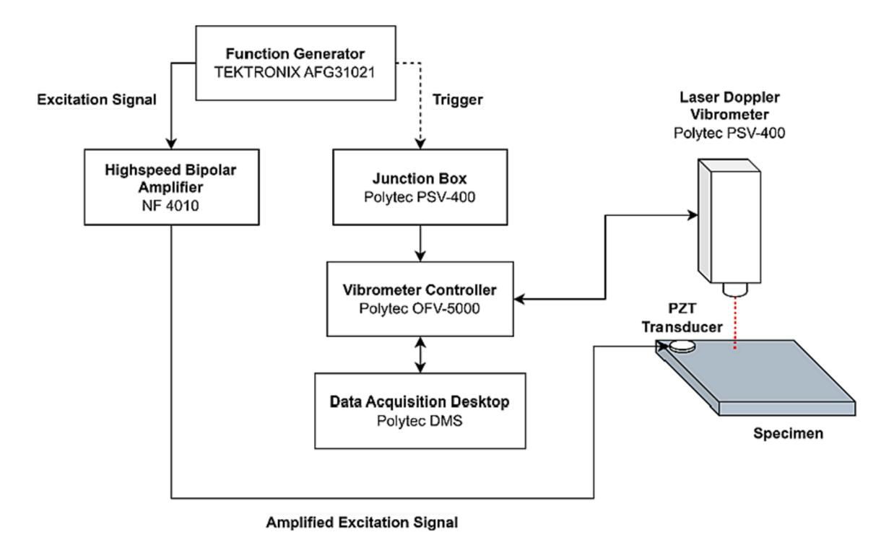
***الشكل 9.** إعداد مقياس اهتزاز دوبلر ليزري متزامن مع محول PZT مستثار بنبضة صوتية مضخمة.*

<!-- page 7 -->

حدد Paterson et al. [[3] ](#page-13-0)فجوة قائمة تتعلق بعدم وجود مراجعة أدبيات شاملة ترصد تطور طرق تحديد الثوابت المرنة للمركبات أحادية الاتجاه المقواة بألياف الكربون عبر تقنيات الموجات فوق الصوتية القائمة على الغمر والنقل. وقدّم Lasn et al. [[8] ](#page-14-0)إجراءً عكسياً لتحديد الثوابت المرنة لصفيحة متعامدة الخواص باستخدام بيانات تجريبية لانتشار موجة لامب وخوارزمية موائمة منحنى مبنية على طريقة Nelder–Mead للسمبلكس. وأُجريت التجارب على عينة مصنوعة من الزجاج-الإيبوكسي، واستُرجعت ثمانية من أصل تسعة ثوابت هندسية من قياسات انتشار موجة لامب في الاتجاهات الأساسية للمادة. وقدّم Araque et al. [[9] ](#page-14-0)تقنية مبنية على الموجات فوق الصوتية الموجهة مقترنة بتحليل عدم يقين مبني على الحساب الضبابي لتحديد القيم الاسمية لعدم يقين معرفي متأصل في ثوابت المواد للمركبات شبه متماثلة الخواص المقواة بالألياف.

وأبلغ Vishnuvardhan et al.[ [10]](#page-14-0) عن إجراء إعادة بناء مبني على الخوارزمية الجينية (GA) لتحديد الثوابت المرنة لصفيحة متعامدة الخواص من بيانات السرعة فوق الصوتية. وأُجريت قياسات

السرعة الطورية باستخدام تقنية الانعكاس الخلفي فوق الصوتي على صفائح مركبة من الغرافيت-الإيبوكسي أحادية الاتجاه وشبه متماثلة الخواص مقواة بالألياف. واستخدم Abell et al. [[11] ](#page-14-0)سرعة موجة السطح (رايلي) للحصول على الثابت المرن غير القطري. ولموجات رايلي المنتشرة على طول محاور التماثل سرعات طورية وجماعية متساوية للمواد الخالية من التشتت الترددي، مما يزيل الغموض. واستخدام معادلة سِكانتية نظرية تربط سرعة رايلي بالثوابت المرنة يمكّن من تحديد الثابت المرن غير القطري. وأُجريت قياسات مخبرية للثوابت المرنة في مواد متماثلة ومتباينة الخواص باستخدام محولات فوق صوتية (بتردد مركزي قدره 1 ميغاهرتز) لطريقة موجة رايلي وطريقة تصوير جبهة الموجة. ويقدم Cuartas et al.[ [12] ](#page-14-0)تقنية غمر لتحديد الخصائص الميكانيكية لمواد مركبة من ألياف الكربون.

وقدّم Wong et al. [[13]](#page-14-0) طريقة موقعية غير متلفة لتوصيف الخصائص المرنة لصفائح البوليمر المقوى بألياف الكربون (CFRP) باستخدام محول فوق صوتي مصفوفي ثنائي الأبعاد. واستُخلص زمن انتقال الموجة الحجمية بناءً على كشف الذروة لإشارات فوق صوتية، وحُسبت وفقاً لذلك الثوابت المرنة لصفائح CFRP بناءً على معادلة كريستوفل. واقترح Liu et al. [[14]](#page-14-0) استخدام نهج خوارزمية جينية (GA) لإعادة بناء مصفوفة صلابة CFRP باستخدام موجة موجهة مصفوفية (GW) مبنية على GA. وبمقارنة منحنيات تشتت GW المحسوبة عددياً مع مخطط تعدد الأعداد الموجية-الترددات التجريبي المحسوب باستخدام تحويل فورييه ثنائي الأبعاد (2D-FFT)، يُستخلص معامل المطابقة مباشرة كدالة هدف للخوارزمية الجينية، مما يتجنب عبء فرز أنماط GW المعنية.

واستخدم Wang et al.[ [7]](#page-13-0) 4800 نقطة محاكاة (80% من إجمالي نقاط المحاكاة والباقي للتحقق) واستخدم مسارات زمنية لانتشار موجتي *A*^0^ و*S*0. واستخدم Luo et al.[ [15]](#page-14-0) وZhu et al. [[16]](#page-14-0) 6000 نقطة بيانات من حساب سمات المجال الزمني والتحليل العددي. واستخدم Liu et al. [[17] ](#page-14-0) 900 نقطة بيانات واستخدم مزيجاً من الشبكة العصبية والخوارزمية الجينية. وقُورنت الأخطاء المُبلَّغ عنها في الدراسات المذكورة آنفاً[ [7,15](#page-13-0)–17] بالطريقة المقترحة وعُرضت في [الجدول 1](#page-1-0). وتجدر الإشارة إلى أنه رغم أن بعض نسب الخطأ في طريقتنا المقترحة تبلغ نحو 19.82% و19.21%، فإن الفرق بين الثوابت المرنة الحقيقية والمتنبأ بها لهذه الحالات صغير جداً كما هو موضح في [الجدول 4.](#page-5-0)

في هذا العمل، تُقترح تقنية فوق صوتية لتحديد الثوابت المرنة للمواد المركبة المقواة بالألياف من خلال تحليل سرعات الموجة الموجهة. وتتطلب هذه المسألة كمية كبيرة من بيانات المجال الزمني لمواد ذات خصائص مرنة متباينة لتدريب النموذج. غير أن توليد كمية كبيرة كهذه من البيانات عبر الطرق التجريبية مستهلك جداً للوقت ومكلف وربما أقل دقة. وبالنظر إلى أن الإعداد التجريبي يبقى ثابتاً، فإن الموجات الموجهة تكون دالة فقط للخصائص المرنة التي تتغير بين المحاكاات المختلفة. لذا، من الحكمة استخدام المعرفة المتوفرة لنماذج المحاكاة لتوليد إشارات الموجة الموجهة في المجال الزمني عبر تغيير الخصائص المرنة. وتُستخدم مجموعة بيانات كهذه من المحاكاة لبناء نموذج التعلم الآلي العكسي، حيث كان مدخل النظام هو الموجات الموجهة في المجال الزمني والمخرج هو الخصائص المرنة. وتُستخلص السمات المطلوبة المضمنة داخل استجابات المجال الزمني

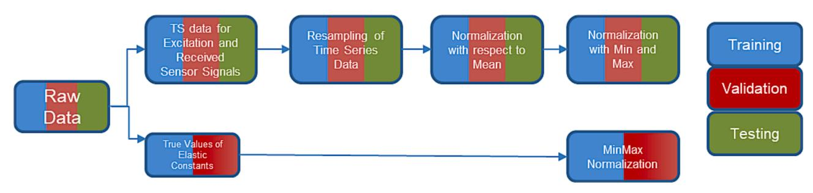
***الشكل 11.** خط أنابيب المعالجة المسبقة للبيانات.*

<!-- page 8 -->

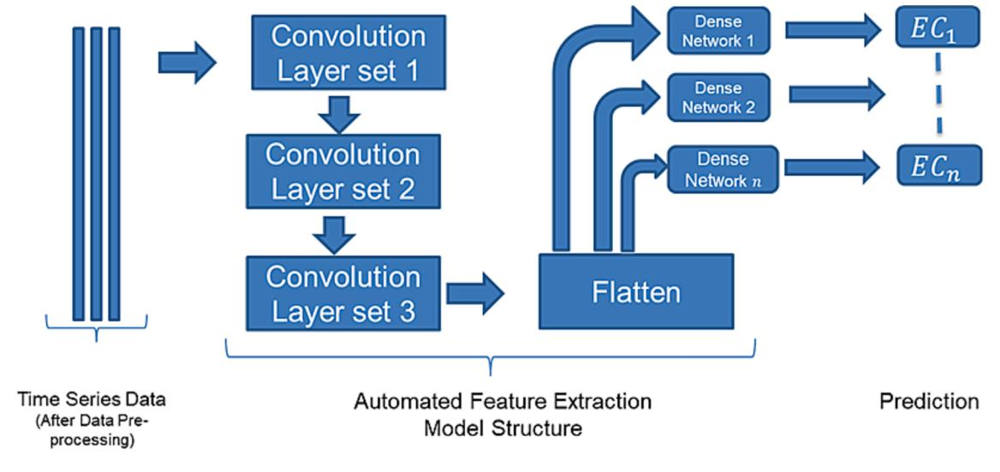
***الشكل 12.** بنية النموذج المستخدمة للتدريب.*

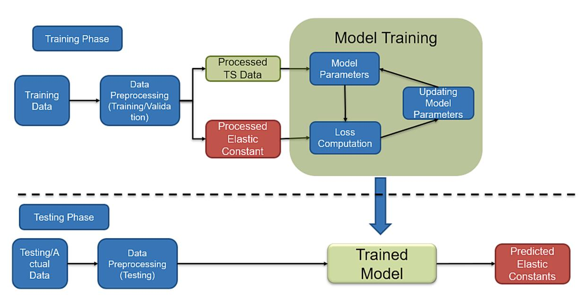
***الشكل 13.** مرحلتا التدريب والاختبار.*

المُستخدمة للتنبؤ بشكل تلقائي أثناء فترة تدريب النموذج، مما يحسّن الدقة. وفيما يلي أهم إسهامات هذه الورقة. أولاً، قدرة النظام على بناء نموذج تعلم آلي قادر على تقدير الخصائص المرنة بالاعتماد الكلي على البيانات المولّدة من المحاكاة. ثانياً، صياغة هذه المسألة قادرة على التنبؤ بالثوابت المرنة حتى لو كان انتشار الموجة الموجهة أثناء التجارب ذا استثارة واستشعار من جهة واحدة فقط من العينة. ثالثاً، يُستخدَم نمطان فقط من الموجات الموجهة، مستثارتان ومُستشعرتان عند تردد استثارة منخفض. رابعاً، استخدم الباحثون نماذج محاكاة لتوليد مجموعات البيانات التي عملت كمدخل تدريب لبناء نماذج التعلم الآلي. خامساً، دُرِّب النموذج بالاستناد إلى كمية ضئيلة جداً من البيانات. سادساً، تحسنت دقة التنبؤ العكسي للثوابت المرنة بشكل كبير، مما يساعد على التخلص من الاعتماد على الاختبارات المتلفة، ويستغرق وقتاً أقل في التنبؤ بالثوابت المرنة.

في هذه الورقة، يصف القسم 2 نهج صياغة المسألة بالتفصيل.[ ويصف القسم 3](#page-9-0) منهجية جمع البيانات المُستخدمة للتحقق من صحة نهجنا. كما يسلط الضوء على تحليل انتشار أنماط GW الذي يساعدنا على التمييز بين الأنماط المختلفة. [ويصف القسم 4 ](#page-11-0) استراتيجية التدريب لنموذج التعلم الآلي العكسي وإجراء

التنبؤ بالتفصيل. [ويعرض القسم 5 ](#page-12-0)النتائج والمناقشة. وتُقدَّم الاستنتاجات ومقترحات العمل المستقبلي في [القسم 6](#page-13-0).

## **2.** **صياغة المسألة العكسية لتقدير الخصائص **

تشير المسائل العكسية إلى مسائل استنتاج المعاملات أو الأسباب غير المعروفة لنظام ما من البيانات أو التأثيرات المُلاحَظة [[18]](#page-14-0). وتنشأ المسائل العكسية في مجالات عديدة من العلوم والهندسة، مثل الجيوفيزياء، والتصوير الطبي [[19]](#page-14-0)، وعلوم المواد، وتطبيقات الميكروويف [[20]](#page-14-0)، وميكانيكا الموائع [[21]](#page-14-0)، وعلم الفلك. ومن أبرز تحديات المسائل العكسية أنها غالباً ما تكون سيئة الوضع، بمعنى أنها لا تملك حلاً وحيداً أو مستقراً أو محدداً جيداً. لذا، طُوِّرت طرق متنوعة لضبط وتقسيم وحل المسائل العكسية بطريقة قوية وفعالة [[22]](#page-14-0).

ويُظهر [الشكل 1 ](#page-1-0)نظرة عامة على صياغة المسألة العكسية لتقدير الخصائص. ففي العالم الفيزيائي، نُجري ملاحظات مختلفة كلما تغيّرت الخصائص الأساسية. وفي النموذج الأمامي، نكون على دراية بالخصائص ونحاول التنبؤ بالملاحظات. أما في النموذج العكسي، فنستخدم الملاحظات لمعرفة الخصائص السببية. ولاستخدام النموذج العكسي، نحتاج إلى

<!-- page 9 -->

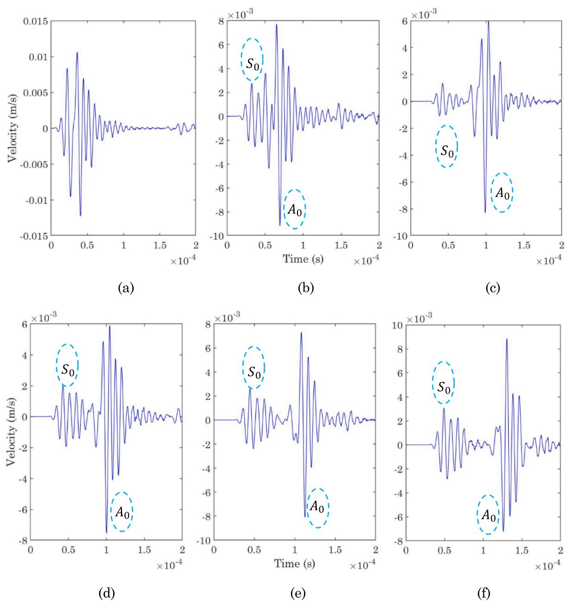
***الشكل 14.** إشارات المجال الزمني الملتقطة عند نقاط المسح للمجموعة 1 (تُظهر انتشار أنماط الموجة الموجهة الأساسية).*

مجموعة بيانات للملاحظات والخصائص السببية المقابلة.

في هذه الورقة، استخدمنا صياغة المسألة العكسية لتقدير خصائص عينة معينة كما هو موضح في[ الشكل 2.](#page-1-0) ونقدم نهجاً متكاملاً من البداية إلى النهاية لبناء نظام، حيث يلزم إجراء القياسات لعينات مختلفة بطريقة متكررة. ويمكن استخدام هذا النهج لتحديد الخصائص المرنة لأي مادة بطريقة غير متلفة.

ويتألف هذا النهج من خطوتين رئيسيتين:

• **جمع/توليد البيانات: **لاستخدام نهج المسألة العكسية، نحتاج إلى كمية كبيرة من البيانات. وفي حالتنا، الخصائص السببية هي الخصائص المرنة لعينة CFRP، والملاحظات هي الاستجابات في المجال الزمني للموجات الموجهة المُستثارة والمُستشعرة على عينة CFRP. ولتوليد مجموعة بيانات لهذا النظام تجريبياً، نحتاج إلى امتلاك عينات CFRP متعددة بثوابت مرنة مختلفة ثم استخدام إعداد الاستثارة لتوليد الاستجابات في المجال الزمني. غير أن كل تجربة لجمع نقطة بيانات مكلفة

- ومستهلكة للوقت. لذا، ابتكر الباحثون استراتيجية بديلة تعتمد على استخدام نماذج المحاكاة بدلاً من البيانات التجريبية الفعلية. وأُجريت تجربة عمياء واحدة فقط على إحدى صفائح CFRP. وتُشرح تفاصيل منهجية جمع البيانات في[ القسم 3.](#page-9-0)
- **تصميم النموذج العكسي وتطوير نموذج التعلم الآلي: **في هذه الخطوة، تُؤخذ مجموعة البيانات المولّدة وتُستخدم مجموعة فرعية من هذه الملاحظات (الاستجابات في المجال الزمني) كمدخل لتدريب النماذج. واستُخدمت الملاحظات المتبقية من المحاكاة للتحقق وضبط النموذج ومنع الإفراط في الملاءمة [[23].](#page-14-0)

وفي نهاية هاتين الخطوتين، يكون لدينا نموذج يأخذ استجابات المجال الزمني المُجمَّعة من سطح العينة كمدخل. وسيكون مخرج هذا النموذج هو الثوابت المرنة المُقدَّرة للعينة.

استُخدمت شبكات عصبية عميقة لنمذجة النموذج العكسي. ومع التطورات الحالية في وحدات المعالجة الرسومية، انخفض الزمن الحسابي بشكل كبير. ووفقاً لنظرية

<!-- page 10 -->

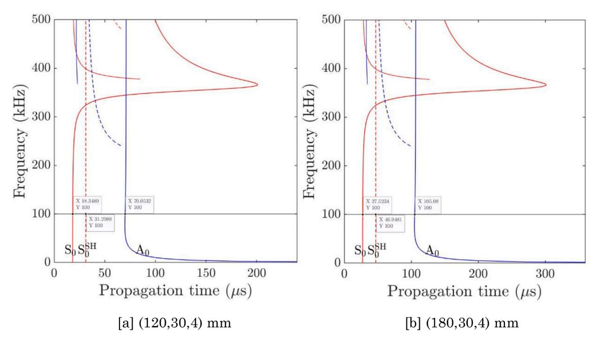
***الشكل 15.** زمن انتشار الموجة الموجهة مقابل التردد.*

التقريب الشامل[ [24,25]](#page-14-0)، يمكن للشبكات العصبية تقريب أي دالة. علاوة على ذلك، مع استخدام الشبكات العصبية الالتفافية (CNN) [[26]](#page-14-0)، يمكن استخلاص السمات الكامنة من الإشارة، مما قلل من عملية هندسة السمات المرهقة. وفي هذا البحث، يستخدم الباحثون شبكة CNN أحادية البعد [[27] ](#page-14-0)لتحديد الخصائص المرنة. وتبحث CNN بشكل أساسي عن معاملات مشتركة واتصالات متناثرة، بينما في الشبكة كاملة الاتصال [[28] ](#page-14-0)يتصل كل عصبون بكل عصبون آخر.

## **3.** **منهجية جمع البيانات **

في هذا العمل، تُقترح منهجية لتقدير الثوابت المرنة للصفائح متعامدة الخواص باستخدام الموجات الموجهة المُستثارة والمُستشعرة من جهة واحدة فقط من العينة. أولاً، تُقدَّر مصفوفة الصلابة الفعالة للعينة. ثم، حُصل عشوائياً على عدة تركيبات لثوابت مصفوفة الصلابة الفعالة وأُدخلت في نموذج المحاكاة للحصول على الاستجابات في المجال الزمني. وتُستخدم هذه الاستجابات بعد ذلك لتدريب نموذج التعلم الآلي كما هو موضح في [القسم 4.1 ](#page-11-0)للتنبؤ بمصفوفة الصلابة لمجموعة البيانات التجريبية في[ القسم 5](#page-12-0). أولاً، تُوصف المادة والعينة في القسم الفرعي التالي.

## *3.1.* *وصف المادة والعينة *

العينة هي مركب CFRP بتسلسل رصف [0*,* ±45*,* 90] ^4^*s*. والمادة الأحادية الطبقة هنا هي IM7/8552. وتحتوي الطبقة على 32 وريقة، سماكة كل وريقة 0.125 ملم، بحيث تبلغ سماكة الطبقة الإجمالية 4 ملم. والأبعاد ثلاثية الأبعاد للعينة هي 200 × 200 × 4 مم3. واختيرت الأبعاد بعناية لتسهيل المحاكاة ثلاثية الأبعاد من حيث تقليل الزمن الحسابي وتوفير الموارد. وتُظهر خصائص مادة الطبقة ذات الزاوية صفر درجة في[ الجدول 2 ](#page-1-0)في الصف المُسمى 00، بينما يمثل الصف المُسمى 'E*' الخصائص المادية الفعالة للصفيحة. وحُصل على خصائص مادة الطبقة 00 من الشركة المصنِّعة، بينما حُصل على الخصائص المادية الفعالة المُسماة 'E*' باستخدام طريقة التجانس المبنية على نظرية التحليل الماكرو-ميكانيكي للصفائح [[29]](#page-14-0). ويُظهر [الشكل 3 ](#page-2-0)موقع المحول والمستقبِلات على العينة المُستخدمة لتوليد بيانات السلاسل الزمنية في هذه الورقة. وتفصل كل نقطة على الشبكة مسافة 30 ملم في اتجاهي انتشار الموجة الأفقي والرأسي.

## *3.2.* *تحليل منحنى التشتت وانتشار الأنماط للموجة الموجهة *

من أجل اختيار تردد استثارة مناسب لإجراء التجارب والمحاكاة، من المهم إجراء تحليل مفصل لمنحنيات التشتت، وانتشار الأنماط، وأنماط الإزاحة. وحُصل على منحنيات التشتت الموضحة في [الشكل 4](#page-2-0) باستخدام مصفوفة الصلابة الفعالة الموضحة في [الجدول 1](#page-1-0). واستناداً إلى تحليل منحنى التشتت في [الشكل 4،](#page-2-0) اختير نمطا *A*0 و*S*0 للتوصيف العكسي لعينة CFRP متعامدة الخواص. علاوة على ذلك، اختيرت مسافة الفصل بين نقاط الاستقبال وفقاً لتحليل انتشار النمط كما هو موضح في[ الشكل 5.](#page-3-0) ويضمن ذلك أقل احتمالية لتداخل الأنماط بين أنماط الموجة المختلفة المنتشرة في العينة عند تردد 100 كيلوهرتز. وتبعاً لذلك، اختار الباحثون مسافة فصل قدرها 30 ملم. علاوة على ذلك، يُظهر تحليل الإزاحة لنمطي الموجة الموجهة *A*0 و*S*0 في[ الشكل 6 ](#page-3-0)أنه بالنسبة لنمط *A*0 ستكون الاستجابة خارج المستوى أكثر هيمنة، وبالنسبة لنمط *S*0 ستكون الاستجابة داخل المستوى أكثر هيمنة. غير أنه بما أن جهاز ليزر أحادي البعد يُستخدم لجمع البيانات، فمن المتوقع أن يكون لنمط *A*0 إزاحة مهيمنة مقارنة بنمط *S*0.

## *3.3.* *دراسة المحاكاة *

في المحاكاة، حُصل عشوائياً على عدة تركيبات لثوابت مصفوفة الصلابة الفعالة، والتي استُخدمت بعد ذلك للحصول على استجابات السلاسل الزمنية. وتُستخدم هذه الاستجابات بعد ذلك لتدريب نموذج CNN للتنبؤ بمصفوفة الصلابة. وتُعرض تفاصيل إعداد المحاكاة في القسم الفرعي التالي.

## *3.3.1.* *إعداد المحاكاة *

يُظهر [الشكل 7](#page-4-0) الرسم التخطيطي لنموذج المحاكاة. والنموذج مبني ثلاثي الأبعاد بالأبعاد الموصوفة في القسم 3.1. وتُنمذَج صفيحة مركبة أحادية الطبقة بخصائص فعالة، ويوضع فوقها مستشعر كهرضغطي لتوليد الموجة الموجهة فوق الصوتية. والسماكة الإجمالية للصفيحة 4 ملم. ويتمركز محول PZT (نوع PZT-5A) عند 30 ملم في اتجاهي x وy على سطح العينة. وتُطبَّق موجة جيبية بمقدار 2.5 دورة مُعدَّلة بدالة نافذة غاوسية، ينتج عنها إشارة نبضية صوتية شائعة الاستخدام في أنظمة اختبار NDT لجمع بيانات انتشار الموجة، على سطح PZT كما هو موضح في [الشكل 8](#page-4-0)، مع اعتبار واجهة PZT-الصفيحة كأرضي. وحُسب حجم العنصر والخطوة الزمنية وفقاً لـ [[2] ](#page-13-0)بقيمة 0.5 ملم و1 ×

<!-- page 11 -->

***الشكل 16.** إشارات المجال الزمني الملتقطة عند نقاط المسح للمجموعة 151.*

10^−^ 8 ثانية لضمان دقة معقولة. وأُجريت المحاكاة في برنامج المحاكاة السحابي On-Scale [[30].](#page-14-0) وكما ذُكر سابقاً، تُولَّد البيانات عبر تغيير ثوابت الصلابة في المحاكاة حول ثوابت الصلابة الحقيقية ضمن نطاق محدد، بإجمالي 150 تركيبة مختلفة. ويُعرض نطاق كل ثابت مرن مُختار في هذه الدراسة في [الجدول 3.](#page-5-0)

استُخدم حلّال صريح لحل مسألة انتشار الموجة، والزمن الإجمالي للتحليل هو 0.2 مللي ثانية. وسُجلت جميع بيانات انتشار الموجة على سطح العينة لتحقيق ارتباط جيد مع استراتيجية الاستشعار التجريبية. ويُترَك سطح العينة وحده حراً، وتُفرَض شروط حدية ماصة على جميع الجوانب المتبقية للعينة. وستُستخدم البيانات المُستخلصة من المحاكاة لتدريب نموذج التعلم الآلي. وسيكون مدخل النموذج مصفوفات الصلابة المرنة وبيانات السلاسل الزمنية المقابلة المُستخلصة عند هذه المصفوفات. بعد ذلك، وبمجرد تدريب النموذج، أُجريت تجربة عمياء على عينة مصنوعة من تسلسل رصف [0*,* ±45*,* 90] ^4^*s*

لتقدير مصفوفة صلابتها الفعالة لأغراض المقارنة والتحقق أكثر من دقة النموذج المدرَّب. وتُعرض تفاصيل الإعداد التجريبي في القسم الفرعي التالي.

## *3.4.* *الإعداد التجريبي *

يُظهر الشكل التخطيطي للإعداد التجريبي في [الشكل 9](#page-5-0). أُصدرت موجة جيبية نبضية موزعة غاوسياً بمقدار 2.5 دورة، بقيمة ذروة إلى ذروة 2 فولت (Vpp)، وبتردد مركزي قدره 100 كيلوهرتز، من مولد إشارة خارجي طراز TEKTRONIX AFG31021، وضُخِّمت بواسطة مضخم ثنائي القطبية عالي السرعة (NF 4010) بمعامل تضخيم قدره 200. ثم دُفعت موجة غاوسية بقيمة 400 Vpp إلى محول PZT، الذي أنتج الموجة الموجهة فوق الصوتية. واستُخدم رأس المسح لمقياس الاهتزاز الليزري LDV (طراز Polytec PSV-400) لقياس إشارات الموجة الموجهة خارج المستوى على طول نقاط المسح في الشبكة، وهو متزامن مع مولد موجة المحول للحصول على قياسات دقيقة لسرعة الموجة. ويمكن رؤية هذه العملية

<!-- page 12 -->

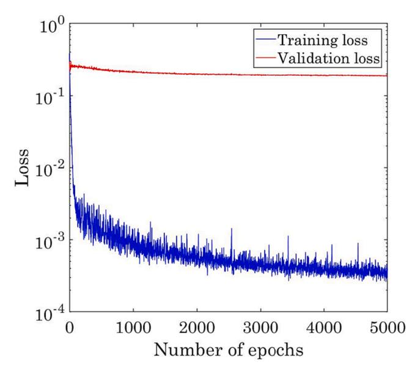
*الشكل 17. خسارة اللوغاريتم للتدريب والتحقق عند أعداد مختلفة من الحقب.*

أيضاً في شكل تخطيطي موضح في الشكل 3، حيث سيُستثار PZT وتُسجَّل الموجة الموجهة المنتشرة عند جميع النقاط الأخرى المُشار إليها من R1 إلى R35، وهي مواقع الاستشعار. وتُسجَّل البيانات بضبط مؤشر الليزر عند هذه المواقع. وباستخدام برنامج Polytec ومقياس الاهتزاز الليزري، يمكن توليد مجموعات متعددة من البيانات عبر تغيير موضع المستشعر الموجود على شبكة افتراضية على سطح العينة. وضُبطت حساسية السرعة والإزاحة لوحدة تحكم مقياس الاهتزاز (OFV-5000) على 50 و5 ملم/ثانية/فولت على التوالي. وبما أن إشارة نبضية بتردد 100 كيلوهرتز استُخدمت لتشغيل مصدر الاستثارة، ضُبط LDV بنطاق ترددي واسع من 1 إلى 1000 كيلوهرتز لقمع الاهتزازات ذات التردد المنخفض والضوضاء ذات التردد العالي. وتردد أخذ العينات المُستخدم كان 2.56 ميغاهرتز بفترة مجال زمني قدرها 400 مايكروثانية. واستُخدم قياس نقطة واحدة، وحُصل على كل بيانة عبر 100 متوسط لتحسين نسبة الإشارة إلى الضوضاء (SNR). واستُخلصت الاستجابة الزمنية المُلتقطة للموجة الموجهة بعد ذلك لمعالجة وتحليل الإشارة اللاحقة. ويُوصف إعداد العينة للتجارب في القسم الفرعي التالي.

## 3.4.1. إعداد العينة

كما هو موضح في الشكل 10، استُخدمت في هذه الدراسة عينة CFRP بألياف مُرصَّة بتوجيه [0,\pm45,90]_{4s} وأبعاد 200\times200\times4 مم³ لتطابق نماذج المحاكاة عن قرب. ولإدخال الموجة الموجهة فوق الصوتية، رُبط محول كهرضغطي مصنوع من زركونات-تيتانات الرصاص P43 (PZT) بقطر 20 ملم وسماكة 2.1 ملم بالعينة باستخدام شمع تثبيت QuickStick [31] عند موضع (30,30) ملم من حافة العينة. وبالإشارة إلى موقع PZT، رُسمت شبكة مسح بحجم 6×6 بفواصل 30 ملم بين نقاط المسح المتجاورة. ويوفر تخطيط الشبكة هذا نقطة استثارة واحدة و35 نقطة استشعار، حيث سيُستثار المحول، وسيقيس LDV نقاط الاستقبال الـ35.

## 4. تصميم النموذج العكسي وتطوير نموذج التعلم الآلي

هدف النموذج العكسي هو تقدير مصفوفة الصلابة المرنة لبنية مادية معينة. ولهذا الغرض، يُستخدم نموذج تعلم آلي يأخذ بيانات إشارة السلاسل الزمنية المُستلمة عند مستشعرات استقبال مختلفة، وتُستخدم إشارة الاستثارة لتدريب خط أنابيب التعلم الآلي. وبُني خط أنابيب التعلم الآلي لتحليل البيانات، ويتألف من المعالجة المسبقة للبيانات، وهندسة السمات، وبناء النموذج، وتقييم الأداء. وتُعرض الخطوات المفصلة المُتبعة في مرحلتي التدريب والاختبار لتدريب النموذج

بشكل تخطيطي في الشكل 11.

## 4.1. مرحلة التدريب

سيُدرَّب النموذج باستخدام بيانات المحاكاة المُسجَّلة عند نقاط استشعار مختلفة على سطح العينة، والتي ستُراعي أيضاً التباين في سرعات الموجة على طول اتجاهات انتشار مختلفة. وسيُستخدم "النموذج المدرَّب" في مرحلة الاختبار للتنبؤ بالثوابت المرنة. وفي مرحلة التدريب، تُقسَّم بيانات تدريب المحاكاة إلى بيانات تدريب وتحقق. وتُعالَج كل نقطة بيانات مسبقاً باستخدام خط أنابيب المعالجة المسبقة للبيانات كما هو موضح في الشكل 11. وتُظهر بنية النموذج المُستخدمة في الشكل 12. وفي هذا الشكل، يشير اللون الأزرق إلى خطوات المعالجة، ويرتبط اللون الأحمر بمتغيرات المخرج، ويرتبط اللون الأخضر بمتغيرات المدخل.

بالنسبة لبنية النموذج، يُستخدم مزيج من CNN أحادي البعد متبوعاً بطبقات خطية كثيفة لتحديد الثوابت المرنة. ومن أسباب استخدام CNN أحادي البعد أنه يتدرب بسرعة أكبر مقارنة بنماذج أخرى مثل الشبكات العصبية المتكررة. وتُستخدم مجموعة من طبقات الالتفاف لتحديد الاتصالات المتناثرة ومشاركة المعاملات. وفي الطبقة الخطية الكثيفة، يتفاعل كل عصبون مع كل عصبون آخر [28]. وإشارة السلاسل الزمنية هي تسلسل زمني طويل، ويمكن لـ CNN أحادي البعد استخلاص السمات الكامنة من إشارات كهذه. وتُظهر مخرجات طبقة التفاف واحدة في CNN أحادي البعد في المعادلة التالية [27,32].

$$
\begin{aligned} x_k^l &= b_k^l + \sum\nolimits_{i=1}^{N_{l-1}} conv1d \left(w_{ik}^{l-1}, s_i^{l-1}\right) \\ y_k^l &= f(x_k^l) \end{aligned} [1]
$$

حيث x_k^l هو المدخل، وb_i^l هو انحياز العصبون k^{th} عند الطبقة l، وs_i^{l-1} هو مخرج العصبون i^{th}، وw_{ik}^{l-1} هو وزن النواة الرابط بين العصبون i^{th} عند الطبقة l-1 والعصبون k^{th} عند الطبقة l. والدالة f() هي دالة تنشيط يمكن أن تكون ReLU، أو sigmoid، أو tanh، أو LeakyRelu، وغيرها. ونُفِّذت CNN أحادية البعد[27] والطبقة الخطية الكثيفة[33] باستخدام Pytorch [34].

تتضمن عملية تدريب شبكة عصبية عدة خطوات تستخدم بيانات التدريب والتحقق معاً. ففي البداية، تُزوَّد الشبكة ببيانات تدريب، تتألف من عينات مدخلة ومخرجاتها المرغوبة. وتُعيَّن أوزان الشبكة وانحيازاتها عشوائياً، ويبدأ التدريب. وأثناء التدريب، تحسب الشبكة مخرجها بناءً على المدخلات المُعطاة، ويُقاس الفرق بين المخرج المتنبأ به والمخرج المرغوب باستخدام دالة خسارة. وصُممت دالة الخسارة بطريقة مبتكرة. وتُشرح خوارزمية حساب دالة الخسارة في الخوارزمية 1.

*الخوارزمية 1. خوارزمية حساب دالة الخسارة المُستخدمة*

الخوارزمية: حساب دالة الخسارة
المدخل: C^T هي مصفوفة الثوابت المرنة الحقيقية؛ C^P هي مصفوفة الثوابت المرنة المتنبأ بها
1. تهيئة L=0

- 2. لكل i \in الثوابت المرنة:
- 3. \ E_i = MeanSquareError(C_i^T, C_i^P) \\
- 4. L = L + E_i
- 5. نهاية الحلقة
- 6. إرجاع L

تُستخدم بعد ذلك خوارزمية الانتشار الخلفي لحساب تدرجات دالة الخسارة بالنسبة لمعاملات الشبكة. وتستمر هذه العملية التكرارية عبر حقب متعددة، حيث تتعلم الشبكة تدريجياً الأنماط الكامنة في البيانات. ولتقييم قدرة الشبكة على التعميم ومنع الإفراط في الملاءمة، تُستخدم بيانات التحقق. وبعد كل حقبة، يُقيَّم أداء الشبكة على بيانات التحقق عبر حساب خسارة التحقق. وتعمل بيانات التحقق كدليل، يراقب تقدم الشبكة ويكتشف علامات الإفراط في الملاءمة، حيث تصبح الشبكة متخصصة أكثر من اللازم في بيانات التدريب. وتستمر عملية التدريب حتى يتحقق مستوى الأداء المرغوب أو يكتمل عدد محدد من الحقب. وبمجرد اكتمال التدريب، يمكن تطبيق الشبكة العصبية المدرَّبة على بيانات جديدة غير مرئية لإجراء تنبؤات في مرحلة الاختبار كما هو موضح

<!-- page 13 -->

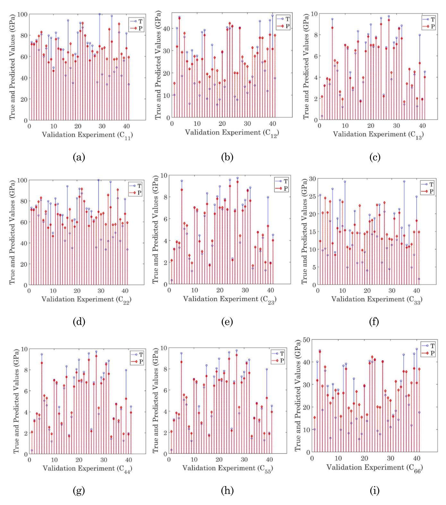
***الشكل 18.** القيم الحقيقية والمتنبأ بها لأعداد مختلفة من تجارب التحقق.*

## في [الشكل 13](#page-7-0).

## *4.2.* *خط أنابيب التنبؤ بالثوابت المرنة *

يضمن استخدام بيانات التدريب والتحقق تعلماً فعالاً، مما يتيح للشبكة التعميم جيداً وإجراء تنبؤات دقيقة على مدخلات غير مرئية. وأثناء مرحلة الاختبار، تُعالَج بيانات الاختبار/الفعلية بواسطة خط أنابيب المعالجة المسبقة للبيانات للحصول على بيانات السلاسل الزمنية المُعالجة.

وسيستخدم النموذج المدرَّب بيانات السلاسل الزمنية المُعالجة (من مرحلة التدريب) للتنبؤ بالثوابت المرنة. وتُناقَش النتائج في القسم التالي.

## **5.** **النتائج والمناقشة **

في هذا القسم، عُرضت أولاً إشارات المجال الزمني من المحاكاة لمجموعتين مختلفتين من البيانات لإظهار التغيرات المحتملة

<!-- page 14 -->

في انتشار الموجة عند حدوث تغير في الخصائص المادية كما يُرى في [الشكلين 14 و16.](#page-8-0) وإشارات المجال الزمني في[ الشكل 14 ](#page-8-0) هي للثوابت المرنة الحقيقية للصلابة التي أُجري لها تحليل منحنى التشتت. ويساعد ذلك على التحقق من صحة نموذج المحاكاة المُطوَّر. وكما يُرى من [الشكل 4 ](#page-2-0)(ب)، سرعة انتشار نمط *A*0 هي 1712.98 م/ثانية وسرعة نمط *S*0 هي 6539.89 م/ثانية. علاوة على ذلك، تجدر الإشارة إلى أن المقياس الزمني لـ[ الشكل 14 ](#page-8-0)يحتاج إلى تعديل بإضافة (*n**/*2*f*) حيث *n *هو 2.5 دورة و*f *هو تردد الاستثارة، بما أن الزمن الإضافي من إشارة النبضة المدخلة يُضاف. وفي [الشكل 14(](#page-8-0)أ)، يوجد تداخل محتمل بين نمطي الموجة الموجهة *A*^0^ و*S*0. وفي[ الشكل 14 ](#page-8-0)(ب) و(ج)، يمكن ملاحظة ارتباط جيد بين زمن وصول نمطي الموجة الموجهة *A*0 و*S*0. فعلى سبيل المثال، في حالة نمط الموجة الموجهة *S*0، من تحليل التشتت، ينبغي أن يكون زمن الوصول لحالتي 120 ملم و180 ملم (18.3489 + *n**/*2*f*) و(27.5234 + *n**/*2*f*) على التوالي (كما يُرى في[ الشكل 15](#page-9-0))، وهو ما يتطابق جيداً مع زمن الوصول المُلاحَظ في [الشكل 14](#page-8-0) (ب) و(ج). وهنا *n *هو 2.5 و*f *هو 100 كيلوهرتز.

بعد ذلك، صُممت دوال الخسارة، واستُخدمت القيم المحسوبة لهذه الدوال عند كل حقبة لتدريب النموذج. وتُستخدم دالة خسارة التدريب لتحسين/تحديث أوزان النموذج عند كل حقبة. وتُستخدم خسارة التحقق عند كل حقبة لتحديد أفضل نموذج من بين جميع الحقب ولمنع الإفراط في ملاءمة النموذج. وفي البداية، تُهيَّأ معاملات النموذج عشوائياً، لذا تُلاحَظ قيم عالية لخسارة كل من التحقق والتدريب في الحقب الأولية. ومع ازدياد عدد الحقب، يبدأ التدريب والتحقق بالاستقرار عند قيم أقل كما هو موضح في [الشكل 17.](#page-11-0) ويُبقى عدد الحقب كبيراً بما يكفي لاستقرار خسائر التدريب والتحقق.

في هذا العمل، استُخدم 30% من بيانات المحاكاة كمجموعة بيانات للتحقق. وتُظهر القيم الحقيقية والقيم المتنبأ بها التي حُصل عليها من إطار العمل المقترح للتعلم الآلي في [الشكل 18](#page-12-0). ويمكن ملاحظة أن القيم المتنبأ بها تتمتع بمستويات دقة عالية بالنظر إلى الكمية الضئيلة من مجموعة البيانات المُستخدمة هنا.

علاوة على ذلك، استُخدمت مجموعة البيانات التجريبية العمياء لتقدير الثوابت المرنة والتحقق أكثر من صحة إطار عمل نموذج التعلم الآلي المقترح. وحُسب متوسط نسبة الخطأ المطلق (MAPE) في هذه الدراسة وفقاً للتعبير الرياضي التالي [[35]](#page-14-0)،

$$
MAPE = \frac{1}{n} \sum_{i=1}^{n} \frac{|y_i - \hat{y}_i|}{\max(\epsilon, |y_i|)} (2)
$$

حيث *n *هو عدد الملاحظات، و*y *هو موتر القيم المستهدفة، و ̂*y *هو موتر التنبؤات. وحصل الباحثون على MAPE قدره 12.89% عبر جميع الثوابت المرنة، باستخدام عدد ضئيل جداً من نقاط البيانات. وتوفر هذه النتائج مقاييس موثوقة ودقيقة للثوابت المرنة باستخدام بيانات مولّدة من المحاكاة وتقنيات التعلم الآلي، بطريقة غير متلفة. ويُظهر MAPE للثوابت المرنة الفردية في[ الجدول 4](#page-5-0). وتُقدَّم الملاحظات الختامية ومقترحات البحث المستقبلي في القسم التالي.

## **6.** **الاستنتاجات ومقترحات العمل المستقبلي **

في هذا العمل، اقترح الباحثون منهجية جديدة مبنية على التعلم الآلي لتقدير الثوابت المرنة العكسية للمواد المركبة متعامدة الخواص. وحُصل على استجابات الموجة الموجهة فوق الصوتية لتركيبات مختلفة من الثوابت المرنة باستخدام محاكاة ثلاثية الأبعاد. واستُخدمت استجابات المجال الزمني المقابلة المُستخلصة كمدخل للنموذج، وكانت الثوابت المرنة المستقلة التسعة هي المخرج. ومن أصل بيانات المحاكاة الفريدة المتاحة، استُخدم 30% من البيانات للتحقق. وأظهرت النتائج المُحصَّلة دقة جيدة. علاوة على ذلك، أُجري أيضاً اختبار تجريبي أعمى، وكانت الثوابت المرنة المتنبأ بها باستخدام نموذج التعلم الآلي قريبة جداً من القيم الحقيقية. ويُظهر ذلك أن إطار العمل المقترح يتمتع بقدرة كبيرة على التنبؤ بالثوابت المرنة في زمن أقل مقارنة بالمنهجيات التقليدية. وفيما يلي بعض التحديات التي واجهها الباحثون أثناء تطوير النموذج. أولاً، وُلِّد إجمالي 135 مجموعة بيانات محاكاة فقط. واستُخدم نحو 70% (94 نقطة بيانات) لتدريب النموذج، وهو عدد قليل نوعاً ما

عملياً. واستُخدمت النسبة المتبقية 30% (41 نقطة بيانات) كمجموعات بيانات للتحقق. 2. ثانياً، يلزم تغيير جميع الثوابت المرنة التسعة لتوليد إشارات السلاسل الزمنية فوق الصوتية. ومع ذلك، بالنسبة للعدد المحدود من مجموعات البيانات، يمثل ذلك تحدياً لتدريب النموذج جيداً من أجل التنبؤ. ثالثاً، كان تباعد نقاط الاستشعار في التجارب ضئيلاً جداً. وأُبقي على ذلك عمداً لخلق حالة تحدٍّ لتدريب النموذج وتنبؤه. رابعاً، سُجلت البيانات من جهة واحدة فقط من العينة. وهذا قريب من معظم السيناريوهات العملية حيث يكون الوصول لجمع البيانات محدوداً أو معدوماً. ولمعالجة التحديات المذكورة أعلاه، فيما يلي الابتكارات في نهج النمذجة. أولاً، طوّر الباحثون دالة خسارة مخصصة جمعوا فيها خسائر الثوابت المرنة الفردية. بعد ذلك، بناءً على استكشاف البيانات وابتكار علاقات بين الثوابت المرنة المختلفة من مجموعات البيانات المحاكاة، قلّل الباحثون التعقيد الحسابي لنموذج الذكاء الاصطناعي. وأتاح ذلك العمل بعدد ضئيل من نقاط البيانات. وأخيراً، استخدم الباحثون تحسيناً مكثفاً للمعاملات الفائقة وتحسين وزن التدريب باستخدام معدل تعلم أمثل.

مستقبلاً، يمكن النظر في تخطيطات وأعداد طبقات مختلفة لعينات المركبات واختبارها مقابل المنهجية المقترحة. علاوة على ذلك، يمكن تغيير استراتيجية الاستثارة والاستشعار مثل استخدام الاستثارة والاستشعار الليزري لجمع البيانات ليصبح غير تلامسي بالكامل.

## **بيان مساهمة المؤلفين وفق CRediT **

**Faeez Masurkar: **التصور، المنهجية، كتابة المسودة الأصلية. **Saurabh Aggarwal: **التصور، المنهجية، كتابة المسودة الأصلية. **Zi Wen Tham: **. **Lei Zhang: **. **Feng Yang: ** المنهجية، التحقق من الصحة. **Fangsen Cui: **التصور، الحصول على التمويل، الموارد، الإشراف، كتابة المراجعة والتحرير.

## **الإفصاح عن تضارب المصالح **

يُقر المؤلفون بعدم وجود أي مصالح مالية متعارضة معروفة أو علاقات شخصية قد تبدو مؤثرة على العمل المُبلَّغ عنه في هذه الورقة.

## **إتاحة البيانات **

ستُتاح البيانات عند الطلب.

## **شكر وتقدير **

يُدعَم هذا البحث من قِبل وكالة العلوم والتكنولوجيا والبحث (A*STAR)، سنغافورة، في إطار برنامج صندوق مواءمة الصناعة RIE2020 AME – برنامج التموضع المسبق (IAF-PP) (أرقام المنح: A20F5a0043 وA19C9a0044).

## **المراجع **

- [1] [Masurkar FA, Yelve NP. Optimizing location of damage within an enclosed area ](http://refhub.elsevier.com/S0003-682X(23)00548-0/h0005) [defined by an algorithm based on the Lamb wave response data. Appl Acoust 2017; ](http://refhub.elsevier.com/S0003-682X(23)00548-0/h0005) [120:98](http://refhub.elsevier.com/S0003-682X(23)00548-0/h0005)–110.
- [2] [Masurkar F, Cui F. Damage detection in hybrid metal-composite plates using](http://refhub.elsevier.com/S0003-682X(23)00548-0/h0010) [ultrasonic guided waves based on outliers estimate. Struct Health Monitor 2023: ](http://refhub.elsevier.com/S0003-682X(23)00548-0/h0010) [158. 9APWSHM.](http://refhub.elsevier.com/S0003-682X(23)00548-0/h0010)
- [3] [Paterson DA, Ijomah W, Windmill JF. Elastic constant determination of ](http://refhub.elsevier.com/S0003-682X(23)00548-0/h0015) [unidirectional composite via ultrasonic bulk wave through transmission ](http://refhub.elsevier.com/S0003-682X(23)00548-0/h0015) [measurements: a review. Prog Mater Sci 2018;97:1](http://refhub.elsevier.com/S0003-682X(23)00548-0/h0015)–37.
- [4] [Karim MR, Mal AK, Bar-Cohen Y. Determination of the elastic constants of](http://refhub.elsevier.com/S0003-682X(23)00548-0/h0020) [composites through the inversion of leaky Lamb wave data. Rev Prog Quant ](http://refhub.elsevier.com/S0003-682X(23)00548-0/h0020) [Nondestruct Eval 1990:109](http://refhub.elsevier.com/S0003-682X(23)00548-0/h0020)–16.
- [5] [Wu TT, Liu YH. On the measurement of anisotropic elastic constants of fiber](http://refhub.elsevier.com/S0003-682X(23)00548-0/h0025)[reinforced composite plate using ultrasonic bulk wave and laser generated Lamb](http://refhub.elsevier.com/S0003-682X(23)00548-0/h0025) [wave. Ultrasonics 1999;37(6):405](http://refhub.elsevier.com/S0003-682X(23)00548-0/h0025)–12.
- [6] [Barazanchy D, Roth W, Giurgiutiu V. A non-destructive material characterization ](http://refhub.elsevier.com/S0003-682X(23)00548-0/h0030) [framework for retrieving a stiffness matrix using bulk waves. Compos Struct 2018; ](http://refhub.elsevier.com/S0003-682X(23)00548-0/h0030) [185:27](http://refhub.elsevier.com/S0003-682X(23)00548-0/h0030)–37.
- [7] [Wang S, Luo ZT, Jing J, Su ZH, Wu XK, Ni ZH, et al. Real-time determination of ](http://refhub.elsevier.com/S0003-682X(23)00548-0/h0035) [elastic constants of composites via ultrasonic guided waves and deep learning.](http://refhub.elsevier.com/S0003-682X(23)00548-0/h0035) [Measurement 2022;200:111680](http://refhub.elsevier.com/S0003-682X(23)00548-0/h0035).

<!-- page 15 -->

- [8] Lasn K, Klauson A, Chati F, D´[ecultot D. Experimental determination of elastic ](http://refhub.elsevier.com/S0003-682X(23)00548-0/h0040) [constants of an orthotropic composite plate by using lamb waves. Mech Compos ](http://refhub.elsevier.com/S0003-682X(23)00548-0/h0040) [Mater 2011;47:435](http://refhub.elsevier.com/S0003-682X(23)00548-0/h0040)–46.
- [9] [Araque L, Wang L, Mal A, Schaal C. Advanced fuzzy arithmetic for material ](http://refhub.elsevier.com/S0003-682X(23)00548-0/h0045) [characterization of composites using guided ultrasonic waves. Mech Syst Sig](http://refhub.elsevier.com/S0003-682X(23)00548-0/h0045) [Process 2022;171:108856](http://refhub.elsevier.com/S0003-682X(23)00548-0/h0045).
- [10] [Vishnuvardhan J, Krishnamurthy CV, Balasubramaniam K. Genetic algorithm ](http://refhub.elsevier.com/S0003-682X(23)00548-0/h0050) [reconstruction of orthotropic composite plate elastic constants from a single non](http://refhub.elsevier.com/S0003-682X(23)00548-0/h0050)[symmetric plane ultrasonic velocity data. Compos B Eng 2007;38(2):216](http://refhub.elsevier.com/S0003-682X(23)00548-0/h0050)–27.
- [11] [Abell BC, Shao S, Pyrak-Nolte LJ. Measurements of elastic constants in anisotropic ](http://refhub.elsevier.com/S0003-682X(23)00548-0/h0055) [media. Geophysics 2014;79(5):349](http://refhub.elsevier.com/S0003-682X(23)00548-0/h0055)–62.
- [12] [Cuartas VM, Perrin M, Pastor ML, Welemane H, Cantarel A, Karama M. ](http://refhub.elsevier.com/S0003-682X(23)00548-0/h0060) [Identification of the elastic properties of composite materials. International ](http://refhub.elsevier.com/S0003-682X(23)00548-0/h0060) [Conference on Structural Analysis of Advanced Materials. 2013.](http://refhub.elsevier.com/S0003-682X(23)00548-0/h0060)
- [13] [Wong VK, Hu Y, Tham ZW, Chen YF, Liu M, Lim KE, et al. Measurement of elastic ](http://refhub.elsevier.com/S0003-682X(23)00548-0/h0065) [constant matrix of carbon fiber composites with an ultrasonic 2D-Array transducer. ](http://refhub.elsevier.com/S0003-682X(23)00548-0/h0065) [IEEE Sens J 2022;22(6):5562](http://refhub.elsevier.com/S0003-682X(23)00548-0/h0065)–70.
- [14] [Liu M, Zhang Y, Li L, Chen G, Cui F. Reconstruction of composite stiffness matrix ](http://refhub.elsevier.com/S0003-682X(23)00548-0/h0070) [with array-guided wave-based genetic algorithm. Materials 2022;15(24):8715.](http://refhub.elsevier.com/S0003-682X(23)00548-0/h0070)
- [15] [Luo Z, Luo H, Wang S, Mao F, Yin G, Zhang H. The photothermal wave field and](http://refhub.elsevier.com/S0003-682X(23)00548-0/h0075) [high-resolution photothermal pulse compression thermography for ceramic/metal ](http://refhub.elsevier.com/S0003-682X(23)00548-0/h0075) [composite solids. Compos Struct 2022;282:115069](http://refhub.elsevier.com/S0003-682X(23)00548-0/h0075).
- [16] [Zhu L, Duan X, Yu Z. On the identification of elastic moduli of in-service rail by ](http://refhub.elsevier.com/S0003-682X(23)00548-0/h0080) [ultrasonic guided waves. Sensors 2020;20(6):1769.](http://refhub.elsevier.com/S0003-682X(23)00548-0/h0080)
- [17] [Liu GR, Lam KY, Han X. Determination of elastic constants of anisotropic laminated ](http://refhub.elsevier.com/S0003-682X(23)00548-0/h0085) [plates using elastic waves and a progressive neural network. J Sound Vib 2002;252 ](http://refhub.elsevier.com/S0003-682X(23)00548-0/h0085) [(2):239](http://refhub.elsevier.com/S0003-682X(23)00548-0/h0085)–59.
- [18] Arridge A, Maass P, Oktem ¨ O, Schonlieb ¨ [CB. Solving inverse problems using data](http://refhub.elsevier.com/S0003-682X(23)00548-0/h0090)[driven models. Acta Numer 2019.](http://refhub.elsevier.com/S0003-682X(23)00548-0/h0090)
- [19] [McCann MT, Jin KH, Unser M. Convolutional neural networks for inverse problems ](http://refhub.elsevier.com/S0003-682X(23)00548-0/h0095) [in imaging: a review. IEEE Signal Process Mag 2017;34(6):85](http://refhub.elsevier.com/S0003-682X(23)00548-0/h0095)–95.

- [20] [Jin J, Feng F, Na W, Yan S, Liu W, Zhu L, et al. Recent advances in neural network](http://refhub.elsevier.com/S0003-682X(23)00548-0/h0100)[based inverse modeling techniques for microwave applications. Int J Numer Model ](http://refhub.elsevier.com/S0003-682X(23)00548-0/h0100) [Electron Networks Devices Fields 2020;33(6).](http://refhub.elsevier.com/S0003-682X(23)00548-0/h0100)
- [21] [Cai S, Mao Z, Wang Z, Yin M, Karniadakis GE. Physics-informed neural networks ](http://refhub.elsevier.com/S0003-682X(23)00548-0/h0105) [(PINNs) for fluid mechanics: a review. Acta Mech Sin 2021;37:1727](http://refhub.elsevier.com/S0003-682X(23)00548-0/h0105)–38.
- [22] [Bal G. Introduction to Inverse Problems. University of Chicago; 2019](http://refhub.elsevier.com/S0003-682X(23)00548-0/h0110).
- [23] [Zhang H, Zhang L, Jiang Y. Overfitting and underfitting analysis for deep learning ](http://refhub.elsevier.com/S0003-682X(23)00548-0/h0115) [based end-to-end communication systems. International Conference on Wireless ](http://refhub.elsevier.com/S0003-682X(23)00548-0/h0115) [Communications and Signal Processing (WCSP). 2019.](http://refhub.elsevier.com/S0003-682X(23)00548-0/h0115)
- [24] [Barron A. Universal approximation bounds for superpositions of a sigmoidal ](http://refhub.elsevier.com/S0003-682X(23)00548-0/h0120) [function. IEEE Trans Inf Theory 1993;39(3):930](http://refhub.elsevier.com/S0003-682X(23)00548-0/h0120)–45.
- [25] [Telgarsky M. Benefits of depth in neural networks. Conference on learning theory. ](http://refhub.elsevier.com/S0003-682X(23)00548-0/h0125) [2016](http://refhub.elsevier.com/S0003-682X(23)00548-0/h0125).
- [26] [Lecun Y, Bottou L, Bengio Y, Haffner P. Gradient-based learning applied to](http://refhub.elsevier.com/S0003-682X(23)00548-0/h0130) [document recognition. Proc IEEE 1998;86(11):2278](http://refhub.elsevier.com/S0003-682X(23)00548-0/h0130)–324.
- [27] [Kiranyaz S, Avci O, Abdeljaber O, Ince T, Gabbouj M, Inman D. 1D convolutional ](http://refhub.elsevier.com/S0003-682X(23)00548-0/h0135) [neural networks and applications: A survey. Mech Syst Sig Process 2021;151](http://refhub.elsevier.com/S0003-682X(23)00548-0/h0135).
- [28] [Goodfellow I, Bengio Y, Courville A. Deep learning. MIT Press; 2016](http://refhub.elsevier.com/S0003-682X(23)00548-0/h0140).
- [29] [Sun CT, Li S. Three-dimensional effective elastic constants for thick laminates. ](http://refhub.elsevier.com/S0003-682X(23)00548-0/h0145) [J Compos Mater 1988 Jul;22(7):629](http://refhub.elsevier.com/S0003-682X(23)00548-0/h0145)–39.
- [30] https://onscale.com/.
- [31] https://www.forwardproducts.co.uk/product/quickstick-gluesticks-40g-large/.
- [32] [Abdeljaber O, Avci O, Kiranyaz S, Gabbouj M, Inman DJ. Real-time vibration-based ](http://refhub.elsevier.com/S0003-682X(23)00548-0/h0160) [structural damage detection using one-dimensional convolutional neural networks. ](http://refhub.elsevier.com/S0003-682X(23)00548-0/h0160) [J Sound Vib 2017;388:154](http://refhub.elsevier.com/S0003-682X(23)00548-0/h0160)–70.
- [33] Linear PyTorch 2.1 documentation.
- [34] PyTorch.
- [35] https://torchmetrics.readthedocs.io/en/stable/regression/mean_absolute_ percentage_error.html.
