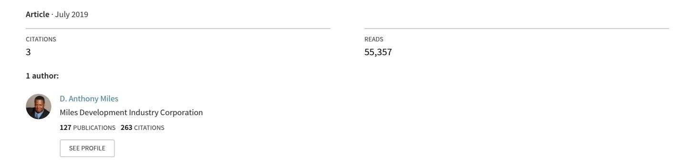

<!-- A3.R66 | source: papers_json/A3.R66/ -->

## [ARTICLE: "Research Methods and Strategies: Let's Stop the Madness Part 2:](https://www.researchgate.net/publication/334279571_ARTICLE_Research_Methods_and_Strategies_Let%27s_Stop_the_Madness_Part_2_Understanding_the_Difference_Between_Limitations_vs_Delimitations?enrichId=rgreq-26d968b9844277a1772873b5fad7ecbf-XXX&enrichSource=Y292ZXJQYWdlOzMzNDI3OTU3MTtBUzo3ODcyODIwMDUwOTQ0MDFAMTU2NDcxNDA2NTQ1Mg%3D%3D&el=1_x_3&_esc=publicationCoverPdf) Understanding the Difference Between Limitations vs. Delimitations"

<!-- page 2 -->

## **Let's Stop the Madness Part 2:** **Understanding the Difference Between ** **Limitations vs.** **Delimitations **

**D. Anthony Miles**

## **ABSTRACT**

الغرض من هذا المقال هو تقديم رؤية حول الفروق الواضحة بين المحددات (limitations) والمحددات النطاقية (delimitations). لقد أصبح الخلط بين المحددات والمحددات النطاقية مشكلة كبيرة ومتزايدة لكل من الباحثين ذوي الخبرة والباحثين المبتدئين. هذا الخلط عميق الجذور، وكان مشكلة عند طلاب الدكتوراه. هناك ميل إلى استخدام المصطلحين بالتبادل. هذا الخلط منتشر بمستويات مقلقة. كثير من الباحثين يخلطون بين الفرق بين المصطلحين. فهما ليسا شيئاً واحداً. لذلك، يحاول هذا المقال تقديم بعض الفهم للمصطلحين، ويقدم تعريفات واضحة وأمثلة توضح ما يسبب الخلط عادة. يقدم هذا المقال أهمية عملية للباحثين في العلوم الاجتماعية. يقدم هذا المقال معرفة ورؤية قيّمة للباحث حول الاستخدام الصحيح لهذين المصطلحين. أولاً، يقدم المقال تعريفات واضحة للمحددات والمحددات النطاقية. ثانياً، يقدم هذا المقال أمثلة على الفروق والخصائص بين المصطلحين. سيقدم هذا المقال وضوحاً تشتد الحاجة إليه للعديد من الباحثين الذين يخلطون بين المصطلحين ويسيئون استخدامهما في السياق.

<!-- page 3 -->

## **Introduction **

خلال سنوات عملي مع العديد من طلاب الدكتوراه، وجدت أن هناك خلطاً سائداً حتى الآن بين مصطلحي المحددات والمحددات النطاقية. وقد لاحظت أن هذا ينطبق على الباحثين ذوي الخبرة والباحثين المبتدئين على حد سواء. هناك نقص في مادة مناهج البحث المطلوبة لطلاب الدكتوراه. وبعد كل سنوات عملي في تحرير أعمال طلاب الدكتوراه، لا تزال هناك مشكلة سائدة. المشكلة أن معظمهم لا يعرفون الفرق بين المصطلحين، المحددات والمحددات النطاقية. فإما أنهم لم يتعلموا الفروق بين المصطلحين أبداً، أو تعلموا تعريفات بديلة زادتهم ارتباكاً. ومع ذلك، أعتقد أنني وجدت تعريفاً وأمثلة مفيدة تساعد الطلاب والباحثين على فهم الفروق بين المصطلحين. يقدم مخطط المقال معلومات حول الفروق بين المصطلحين. أولاً، سيقدم المقال تعريفات واضحة للمحدد والمحدد النطاقي. ثانياً، سيقدم المقال بعض الأمثلة على كيفية استخدامهما في جملة وفقرة. وأخيراً، سيقدم المقال أمثلة عليهما من مقالات ودراسات علمية.

## **Definition of a Limitation**

تُعرَّف المحددات (limitations) بأنها *قيود على دراستك مبنية على منهجية البحث وتصميمه*. المحددات هي قيود لا يمكنك التحكم بها في دراستك. بشكل أساسي، تتعلق المحددات بالقيود المفروضة على منهج البحث (Miles, 2017).

مع المحددات، يبقى منهج البحث والتصميم ثابتين. على سبيل المثال، بعد 30 عاماً من الآن، يمكن لباحث يرغب في تكرار دراستك أن يفعل ذلك باستخدام نفس منهج البحث. وسيواجه الباحث المستقبلي الذي يستخدم نفس المنهج نفس المحددات التي واجهتها أنت. وترتبط هذه بالوسائل التي اخترتها لجمع البيانات وتحليلها. المحددات هي تلك القيود التي أنشأتها منهجيتك. المحددات هي الحدود المتأصلة في المنهج الذي تستخدمه لاستكشاف سؤالك. إن كنت متأنياً وتحليلياً بشأن المنهج الذي اخترته، فلن تجد صعوبة في تحديد عوامل التصميم التي قد تنتج بيانات غير دقيقة أو مضللة، وقد تؤدي إلى استنتاجات خاطئة (Bryant, 2004).

هناك تعريف آخر للمحددات يقول إنها عيوب في التصميم. تحدد المحددات نقاط ضعف محتملة في تصميم البحث ومنهجيته للدراسة. تميل المحددات إلى العمل كمؤشر استباقي لعيوب الدراسة (Calabrese, 2006). المحددات هي قيود في الدراسة لا تملك أي سيطرة عليها. على سبيل المثال، قد تقتصر دراستك على شريحة ضيقة من السكان. تريد دراستهم، وقد تكون محدوداً في منهج البحث الذي تختار استخدامه (Rudestam & Newton, 2007). علاوة على ذلك، المحددات هي قيود خارجة عن سيطرة الباحث، وهي متأصلة في الدراسة، وقد تؤثر على إمكانية تعميم النتائج (Terrell, 2016).

المحدد هو عامل قد يؤثر أو سيؤثر على الدراسة، لكنه ليس تحت سيطرة الباحث. في الدراسات التي تستخدم الاستبيانات، من المحددات الشائعة استعداد الأفراد للرد أصلاً، والرد في وقت مناسب، والرد بدقة. المحددات مهمة بالنسبة للآثار المحتملة على نتائج الدراسة، وهي

**Source:** Miles, D.A. and Scott, L. (2017) *Workshop: Confessions of a Dissertation Chair Part 1: The Six Mistakes Doctoral Students * *Make With the Dissertation.* Presented at the 5th Annual 2017 Black Doctoral Network Conference in Atlanta, GA on October 26-29 2017.

<!-- page 4 -->

غير خاضعة لسيطرة الباحث. عادة ما تظهر المحددات كمتغيرات لا يستطيع الباحث التحكم بها، لكنها قد تحد من نتيجة الدراسة أو تؤثر عليها. يمكن أن تصبح المحددات مشكلة للطلاب إن لم يتم تحديدها (Mauch & Park, 2003).

عندما يناقش الباحث المحددات، فهو يناقش نقاط الضعف الممكنة والفعلية في تصميم بحثه. المحددات التي يصفها الباحث هي تلك التي قد تؤثر أو أثرت فعلاً على صلاحية الدراسة أو نتائجها. تميل المحددات إلى معالجة وعي الباحث وأوجه القصور في تصميم بحثه ونهجه المنهجي تجاه الدراسة، مما يضيف إلى مصداقية الباحث (Calabrese, 2009). انظر الشكل 1. وانظر أيضاً الأمثلة من 1 إلى 3.

## *Table 1.* **Introducing: The Statement Grid –** **for Limitations**

## **Overall Statement:**

"اقتصرت الدراسة على شروط معينة تم تحديدها لهذا الاستقصاء البحثي. حدد الباحث ثلاثة محددات رئيسية كأساس لهذه الدراسة."

## **Limitation** **1:**

أولاً، كان أحد المحددات الرئيسية استخدام بيانات مُبلَّغ عنها ذاتياً. عكست البيانات تصوّر المالك للعنف الأسري، وهو ما قد يكون مشوَّهاً أو ناقصاً. قد لا يكون بعض المشاركين قد فهموا موضوع الدراسة فهماً صحيحاً.

## **Limitation 2:**

ثانياً، كان محدد رئيسي آخر هو ضيق الوقت. كانت فترة جمع البيانات محدودة جداً (أقل من شهر). كان من الأفضل تخصيص وقت أطول لجمع استبيانات إضافية.

## **Limitation** **3:**

أخيراً، كان محدد رئيسي آخر هو طول أداة الاستبيان. كانت الأداة طويلة جداً، ورفض المشاركون إكمالها. كان هناك عدد من الاستبيانات غير المكتملة يُعزى إلى طول الاستبيان والوقت اللازم لتعبئته [Miles, 2016a].

<!-- page 5 -->

**Figure 1.* **Formula for Limitations***

## **Limitations = Methodology**

## **[Example 1]**

*المحددات.* تتكون المحددات من القيود التي فرضها اختيار الباحث للمنهجية. وهذه عوامل في الدراسة لا يستطيع الباحث التحكم بها. كأساس للدراسة، كانت المحددات ثلاثة.

- 1. المحدد الأول في هذه الدراسة هو الأداة. استخدمت هذه الدراسة أداة مغلقة لم تتضمن أسئلة مفتوحة.
- 2. المحدد الثاني هو جمع البيانات. استخدمت هذه الدراسة بيانات مجمَّعة تم جمعها من الولاية عبر وسيلة متاحة للعموم. وهذا محدود من حيث الإحصاء الوصفي.
- 3. المحدد الثالث كان المقرر الدراسي. برنامج "قيادة المراهقين" (Teen Leadership) هو أحد عدة برامج للتربية على الشخصية تُقدَّم في أنحاء الولاية. قد يوفر بحث إضافي في برامج أخرى رؤى مختلفة [Zeig, 2019].

<!-- page 6 -->

## **[Example 2]**

*المحددات.* المحددات هي نقاط ضعف محتملة خارجة عن سيطرة الباحث. وهي قيود متأصلة في منهجية البحث وتصميمه. وهذه الجوانب هي ما يجعل الدراسة تحقيقاً علمياً صارماً. كأساس لهذه الدراسة، حدد الباحث ثلاثة محددات:

- أولاً، اقتصرت هذه الدراسة على مقابلات شخصية مع المشاركين. وهذا يحد من كمية البيانات المجمَّعة، وبالتالي هناك قيد زمني على مقدار البيانات التي يمكن جمعها خلال فترة معينة.
- المحدد الثاني هو غياب الأسئلة المغلقة، مما ينتج عنه بيانات لا يمكن قياسها كمياً بدقة تجريبية.
- المحدد الثالث هو طريقة جمع البيانات. جميع الإجابات مُبلَّغ عنها ذاتياً، ويفترض الباحث أن جميع الإجابات صادقة [Kwapong, 2019].

<!-- page 7 -->

## **[Example 3]**

*المحددات.* تركز المحددات عادة على الصدق الداخلي والخارجي للدراسة. يتناول الصدق الداخلي مدى صرامة إجراء الدراسة، بينما يركز الصدق الخارجي على مدى قابلية تطبيق النتائج على مجموعات سكانية أكبر (التعميم). المحددات هي قيود متأصلة في منهجية البحث وتصميمه. وهذه الجوانب هي ما يجعل الدراسة تحقيقاً علمياً صارماً. تحتوي هذه الدراسة على المحددات التالية:

- 1. المحدد الأول هو المنهجية. تستخدم هذه الدراسة تصميم الاستبيان كأساس للبحث. وهذا محدد لأن أسئلة الاستبيان قد لا تجمع كل البيانات اللازمة. ولتقليل محدد المنهجية، سيجمع الباحث أكبر قدر ممكن من البيانات للحصول على تمثيل ممتاز للمجموعة السكانية.
- 2. المحدد الثاني هو محدد ضيق الوقت. قد لا يفهم الموظفون أسئلة الاستبيان بسبب ضيق الوقت لأن الاستبيان يحتوي على أسئلة كثيرة جداً. ولتقليل ضيق الوقت، سيمنح الباحث الوقت اللازم لجمع البيانات.
- 3. المحدد الثالث هو أن الدراسة ستُجرى فقط في وردية النهار ووردية الليل. ولتقليل محدد الورديات، سيحصل الباحث على بيانات من أكبر عدد ممكن من السكان خلال الورديات.
- 4. المحدد الأخير هو الأداة التي ستُستخدم لإجراء البحث. الأداة المستخدمة هي استبيان برنامج Baldrige National Quality Program مع إضافة أسئلة ديموغرافية. ولتقليل محدد الأداة، ستُقدَّم بيانات عن الموثوقية تُظهر أن الأداة موثوقة لإجراء الدراسة المقترحة [Morales, 2019].

<!-- page 8 -->

## **Definition of a Delimitation**

مشكلة ثانية يواجهها طلاب الدكتوراه تتعلق بمعنى المحددات النطاقية (delimitations). وكما ذُكر سابقاً، فهم يخلطون بين المحددات النطاقية والمحددات وكأنهما قابلان للتبادل. وقد كانت هذه مشكلة عند طلاب الدكتوراه.

تُعرَّف المحددات النطاقية بأنها تُعنى بشكل أساسي *بنطاق الدراسة*. تصف المحددات النطاقية نطاق الدراسة أو تحدد معاييرها. كما تمنعك المحددات النطاقية من القول إن نتائجك قابلة للتعميم على كامل السكان. المحددات النطاقية هي قيود ذاتية تفرضها على دراستك، مقارنة بالمحددات التي تكون قيوداً متأصلة في منهجيتك (Miles & Scott, 2017).

من الجوانب المثيرة للاهتمام أيضاً في المحددات النطاقية أنها تعني ضمناً قيوداً على المجموعات السكانية التي يمكن تعميم نتائج الدراسة عليها. على سبيل المثال، قد تقرر دراسة الذكور فقط، إما لأن النظرية التي تستند إليها فرضياتك لم تُدرس عند الإناث، أو لأن لديك مجموعة سكانية من الذكور متاحة بسهولة وليس من الإناث (Rudestam & Newton, 2007). فكّر في المحددات النطاقية على أنها حدود ذاتية تستخدمها لتحديد نطاق دراستك (Calabrese, 2006).

الحقيقة أن المحددات النطاقية تعمل أيضاً كإشارات، بمعنى أنها تمثل حدود الدراسة والطرق التي قد تفتقر فيها النتائج إلى إمكانية التعميم. عند التفكير في هذا، ينبغي أن تفحص اهتمامات مثل طبيعة العينة وحجمها، وتفرد البيئة، والفترة الزمنية التي أُجريت خلالها الدراسة، ومحددات المناهج المختارة تحديداً (Glatthorn, 1998).

المحددات النطاقية هي العوامل التي تمنعك من الادعاء بأن نتائجك صحيحة لجميع الناس في كل زمان ومكان. في الدراسة الكمية، هذه هي العوامل التي تحد من التعميم. وفي الدراسة النوعية، هذه هي العوامل التي تحد من صلة دراستك بمجموعات سكانية أو أفراد آخرين. فمثلاً، إن درست ممرضات ولاية أوريغون، فلن تتمكن من تمديد نتائجك إلى ممرضات ولاية أركنساس. والفكرة هي أن كثيراً من الدراسات الكمية تجمع البيانات في لحظة زمنية معينة. فمثلاً، إن أراد باحث بعد 30 عاماً من الآن أن يكرر دراستك، فسيتعين عليه أن يقرر ما هي العوامل التي ستقف عائقاً. وستكون تلك العوامل هي المحددات النطاقية (Bryant, 2004).

عندما يستخدم الباحث مصطلح *delimitation*، فهذا يعني أنه سيوضح كيف ضيّق نطاق دراسته للتركيز على جوانب محددة. سيبين الباحث كيف سيضيّق التركيز المحدد للدراسة من خلال تحديد نوع دقيق من منهجية البحث، أو خاصية المشاركين، أو السياق أو موقع البحث، أو الظاهرة المدروسة أثناء البحث (Calabrese, 2009). علاوة على ذلك، فإن المحددات النطاقية هي قيود إضافية يضعها الباحث بشكل فعّال للسيطرة على العوامل التي قد تؤثر على النتائج، أو للتركيز بشكل أكثر تحديداً على مشكلة ما (Terrell, 2016).

من الاعتبارات المهمة عند الباحث أن المحددات النطاقية يتحكم بها الباحث نفسه. في بعض الدراسات، من الشائع أن يكون هناك تحديد نطاقي لحجم أو طبيعة المجموعة التي تُستجوب. قد يكون الحجم مقتصراً على من يعملون في منطقة معينة. وقد يكون الحجم أيضاً مقتصراً على

<!-- page 9 -->

نسبة معينة في مجال أو قطاع. تساعد المحددات النطاقية كل الأطراف المعنية على التفكير في تصميم الدراسة. المحددات النطاقية جزء لا يتجزأ من التصميم لأنها تضع الحدود. فهي تخبر القارئ بما سيُدرج، وما سيُستبعد، ولماذا (Mauch & Park, 2003).

توضح المحددات النطاقية كل جوانب الدراسة التي لن تُدرج فيها. وهذه العملية هي بالضبط عملية "إبعاد" تلك الأجزاء التي تقع خارج نطاق الدراسة وأغراضها. تُعلم المحددات النطاقية القرّاء في مجال موضوعي معين بأن هناك توقعات أساسية معينة. وقد يرغب القراء في معرفة: (أ) معايير تحديد نطاق الدراسة؛ (ب) المصادر التي ستُستخدم لتحديد الخلفية البارزة للمجموعة السكانية المستهدفة؛ (ج) ما إذا كانت الفروق بين الجنسين مهمة؛ (د) كيف تُعرّف "الأشخاص المهمين"، على سبيل المثال لا الحصر. ومع ذلك، ستُخبر المحددات النطاقية القارئ المطّلع بما لا ينبغي توقعه، لكن يجب أن تلاحظ أنه لا يمكنك استخدام هذا القسم بشكل تعسفي. علاوة على ذلك، لا يمكنك استبعاد الجوانب التي يصعب بحثها لسبب ما. لا يمكنك تضييق نطاق الدراسة لراحتك الخاصة. لا يمكنك استخدام المحددات النطاقية لاستبعاد توقعات منطقية وموثوقة (Webster, 1998a).

ينبغي أن تستخدم المحددات النطاقية بحذر واعتدال. وفيما يلي محددات نطاقية شائعة في كثير من الدراسات البحثية: (أ) استبعادات متعلقة بالفروق بين الجنسين؛ (ب) استبعادات متعلقة بالخلفيات الاجتماعية والاقتصادية؛ (ج) عدم الاهتمام بحجم المدن أو المؤسسات أو مناطق المرافق أو المناطق التعليمية المدروسة؛ (د) استبعادات متعلقة بسنوات التدريب أو الخبرة (Webster, 1998b). انظر الشكل 2 أدناه. وانظر أيضاً الأمثلة من 4 إلى 6.

**Table 2.* **Introducing: The Statement Grid –** **for Delimitations***

## **Overall Statement:**

"احتوت هذه الدراسة على بعض المحددات النطاقية التي قيّدت الدراسة. حدد الباحث أربعة محددات نطاقية تتعلق بنطاق هذه الدراسة. اقتصرت الدراسة نطاقياً على شروط معينة تم تحديدها لهذا الاستقصاء البحثي."

| Delimitation 1: | Delimitation 2: | Delimitation 3: | Delimitation 4: |
| --- | --- | --- | --- |
| أولاً، اقتصرت الدراسة | ثانياً، اقتصرت | ثالثاً، اقتصرت | أخيراً، اقتصرت |
| نطاقياً على منطقة | الدراسة نطاقياً على | الدراسة نطاقياً على | الدراسة نطاقياً على |
| لوس أنجلوس. وقد لا | ضحايا العنف الأسري | استخدام عينة ملائمة | مجموعة سكانية |
| تكون النتائج قابلة | (DVV) كمجموعة سكانية | من مركز العنف | قوامها 25,456. |
| للتعميم بشكل عام على | مستهدفة لهذه الدراسة | الأسري في لوس | تم تجنيد عينة سكانية |
| مناطق جغرافية أخرى. | في ولاية كاليفورنيا. | أنجلوس. | قوامها 568 من ضحايا |
|  |  |  | العنف الأسري (DVV) من |
|  |  |  | منطقة الاستهداف، |
|  |  |  | مقاطعة لوس أنجلوس. |
|  |  |  |  |
|  |  |  |  |
|  |  |  |  |

<!-- page 10 -->

**Figure 2.* **Formula for Delimitations***

## **Delimitations =** **Scope**

## **[Example 4]**

*المحددات النطاقية***.** المحددات النطاقية لدراسة ما هي تلك الخصائص الناشئة عن قيود في نطاق الدراسة (تحديد الحدود)، وعن القرارات الواعية بالاستبعاد والإدراج التي تُتخذ أثناء إعداد خطة الدراسة (Simon & Goes, 2013). المحددات النطاقية هي تلك الخصائص التي تحد من النطاق وتحدد حدود دراستك (المرجع نفسه). فيما يلي المحددات النطاقية القائمة وقت إجراء هذه الدراسة:

- 1. تقتصر الدراسة نطاقياً على موظفي مؤسسات النقل الجوي، ولن تقيّم أنواعاً أخرى من المؤسسات في الموقع الجغرافي لبورتوريكو. وللتخفيف من محدد المؤسسات التي ستُجرى فيها الدراسة، سيجمع الباحث بيانات من أكبر عدد ممكن من شركات النقل الجوي.
- 2. تقتصر الدراسة نطاقياً على مؤسسات في بورتوريكو. ولتقليل محدد الموظفين، ستجمع الدراسة بيانات من موظفين في جميع المناصب داخل المؤسسة.
- 3. تقتصر الدراسة نطاقياً على موظفي الميدان، وموظفي المكاتب، والمديرين في موقع مؤسسة النقل الجوي. لن يُقيَّم في هذه الدراسة أي موظفين على مستوى القيادة العليا (الرئيس التنفيذي، نواب رئيس العمليات، إلخ) [Morales, 2017].

<!-- page 11 -->

## **[Example 5]**

*المحددات النطاقية.* المحددات النطاقية هي أوجه ضعف مرتبطة بنطاق الدراسات (Simon & Goes, 2013). فبينما لا تكون المحددات تحت سيطرة الباحث، فإن المحددات النطاقية عوامل يمكن التحكم بها. لاحظ الباحث ثلاثة محددات نطاقية تؤثر على هذه الدراسة:

- تقتصر الدراسة نطاقياً على مؤسسات مسيحية خاصة في جنوب كاليفورنيا.
- تقتصر الدراسة نطاقياً على الطلاب المشاركين في برنامج التوجيه بين الأقران AIM.
- تقتصر الدراسة نطاقياً على عينة سكانية مكونة من 10 طلاب دوليين و10 طلاب محليين [Kwapong, 2017].

<!-- page 12 -->

## **[Example 6]**

*المحددات النطاقية***. **المحددات النطاقية هي أمور يتحكم بها الباحث، مثل موقع الدراسة. فيما يلي المحددات النطاقية التي ستكون قائمة في الدراسة الحالية.

- 1. يقتصر استبيان الآباء نطاقياً على المدارس الحكومية في جنوب نيوجيرسي. يمنع نقص التمويل إجراء الدراسة على منطقة أوسع وأكثر انتشاراً. وهذا يحد من النطاق الجغرافي للعينة، مما يؤثر بدوره على قابلية تعميم النتائج. وقد يؤدي توسيع النطاق إلى نتائج أكثر قابلية للتعميم والتطبيق على مناطق أخرى.
- 2. ستقتصر الدراسة نطاقياً على عينة من 20-25 من آباء الطلاب الملتحقين بالمدارس الحكومية في نيوجيرسي بمنطقة جنوب نيوجيرسي، من مرحلة الروضة حتى الصف الثامن. ورغم أن هذا يحد من قابلية تطبيق الدراسة على آباء طلاب المرحلة الثانوية، فإن هدف الدراسة هو التركيز على ظاهرة مشاركة الآباء كما توجد في الصفوف الدنيا، كأساس لمساعدة الطلاب على تحقيق تحصيل أكاديمي جيد [Forbes, 2017].

<!-- page 13 -->

## Doctoral Student Workshop: Limitations vs. Delimitations

## **Conclusions**

ناقش هذا المقال الخلط بين مصطلحي المحددات والمحددات النطاقية. وتناول المقال ثلاث نقاط رئيسية لفهم الفرق بين المصطلحين والتمييز بينهما. وأبرز المقال التعريفات الأساسية للمحددات وخصائصها. كما ناقش المقال تعريف المحددات النطاقية وخصائصها. أولاً، عرّف المقال وناقش المعاني بين المصطلحين. ثانياً، قدم المقال بعض الأمثلة والخصائص بين المصطلحين. وأخيراً، ناقش المقال الفروق بين المصطلحين استناداً إلى سؤال البحث ومنهج جمع البيانات. نأمل أن يكون هذا المقال بمثابة دليل يساعد الباحثين على تعلم وفهم الفروق الواضحة بين مصطلحي المحددات والمحددات النطاقية. ويأمل الباحث أن يبني أساساً لتنوير كل من الباحثين ذوي الخبرة والباحثين المبتدئين حول المصطلحين، وتقليل الخلط بينهما.

<!-- page 14 -->

## **References**

- Bryant, M. T. (2004). *The Portable Dissertation Advisor*. Thousand Oaks, CA: Corwin Press, Inc.
- Calabrese, R. (2006). *The Elements of an Effective Dissertation and Thesis: A Step-by-Step * *Guide to Getting it Right the First Time*. Lanham, MD: Rowman & Littlefield Education, Inc.
- Calabrese, R. (2009). *The Dissertation Desk Reference: The Doctoral Student's Manual to * *Writing the Dissertation*. Lanham, MD: Rowman & Littlefield Education, Inc.
- Forbes, S. (2017). *Parental Involvement in Education: The Lived Experience *from ProQuest Dissertations and Theses database. (UMI No. 87569869).
- Glatthorn, A. (1998). *Writing the Winning Dissertation: A Step-by-Step Guide*. (1 st Ed.), Thousand Oaks, CA: Corwin Press, Inc.
- Jacobs, R. L. (2011). "Developing a Research Problem and Purpose Statement", in *The * *Handbook of Scholarly Writing and Publishing, *T. S. Rocco and T. Hatcher (eds.), San Francisco: Jossey-Bass, pp. 125-141.
- Kwapong, S. (2017). *Investigating the Experiences of International and Domestic * *Students in a Peer Mentoring Program and its Effects on Intercultural Competence * *At A University: A Qualitative Study *from ProQuest Dissertations and Theses database. (UMI No. 77854669).
- Madsen, D. (1990). *Successful Dissertations and Theses: A Guide To Graduate Student * *Research From Proposal To Completion*. San Francisco, CA: Jossey-Bass Publishers.
- Mauch, J. & Birch, Jack (1998). *Guide to the Successful Theses and Dissertation: A Handbook * *for Students and Faculty* (4th ed.) New York, NY: Marcel Dekker, Inc. Publishers.
- Miles, D.A. & Scott, L. (2017). *Workshop: Confessions of a Dissertation Chair Part 1: The * *Six Mistakes Doctoral Students Make With the Dissertation*. Presented at the 5th Annual 2017 Black Doctoral Network Conference in Atlanta, GA on October 26-29 2017.
- Miles, D.A. (2016a). *The One-Page Dissertation Proposal Matrix: A Guide for Developing The * *Dissertation Proposal.*
- Miles, D.A. (2016b). *The One-Page Literature Review Matrix: A Guide for Developing The * *Literature Review for The Dissertation*.
- Morales, L. (2017). *A Baldrige Assessment of an Organization: An Empirical Study of * *Baldrige Criteria and Organizational Performance in Air Transportation * *Organizations. *from ProQuest Dissertations and Theses database. (UMI No. 6529858).
- Newton, R. & Rudestam, K. (2007). *Surviving Your Dissertation: A Comprehensive Guide To * *Content and Process* (3rd Ed). Thousand Oaks, CA: Sage.
- Terrell, S. (2016). *Writing A Proposal for Your Dissertation: Guidelines and Examples*, New York, NY: The Guilford Press.
- Thomas, R.M. & Brubaker, D. (2000). *Theses and Dissertations: A Guide to Planning, * *Research, and Writing.* Westport, CT: Bergin and Garvey.
- Webster, W. (1998a). *21 Models for Developing and Writing Your Theses, Dissertations or * *Projects*. San Ramon, CA: Academic Scholarwrite Publishing.

<!-- page 15 -->

## Doctoral Student Workshop: Limitations vs. Delimitations

.

- Webster, W. (1998b). *Developing and Writing Your Thesis, Dissertation or Project*. San Ramon, CA: Academic Scholarwrite Publishing.
- Zeig, M. (2019). *Effects of a Character Education Course on Standardized Testing in Texas * *High Schools *from ProQuest Dissertations and Theses database. (UMI No. unknown).

**Source:** Miles, D.A. and Scott, L. (2017) *Workshop: Confessions of a Dissertation Chair Part 1: The Six Mistakes Doctoral Students * *Make With the Dissertation.* Presented at the 5th Annual 2017 Black Doctoral Network Conference in Atlanta, GA on October 26-29 2017.
