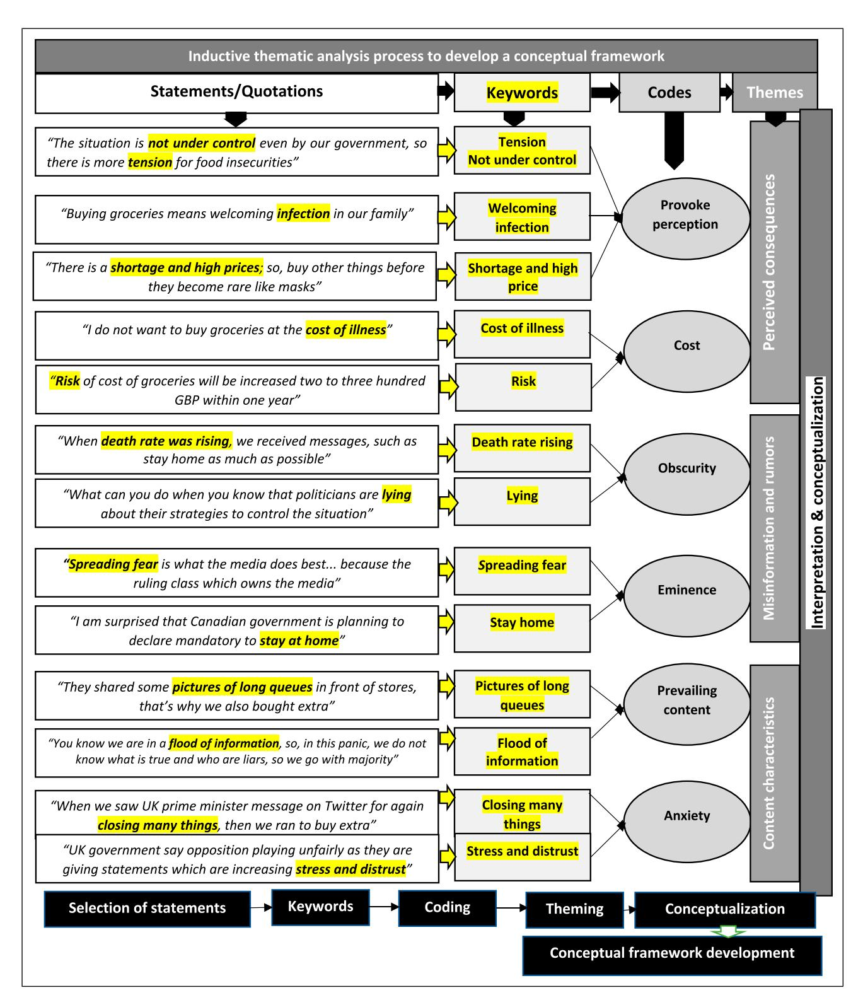
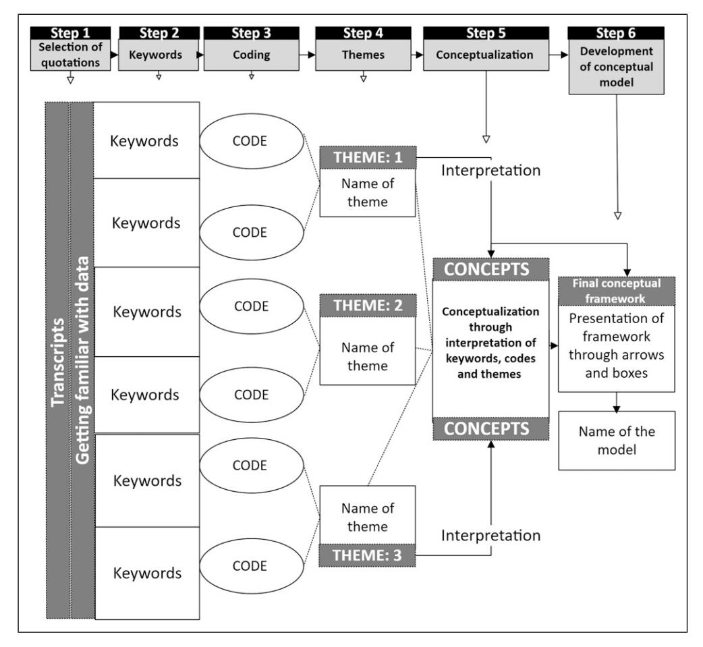

<!-- A3.R70 | source: papers_json/A3.R70/ -->

Regular Article

## عملية تحليل موضوعي خطوة بخطوة لبناء نموذج مفاهيمي في البحث النوعي

International Journal of Qualitative Methods Volume 22: 1–18 © The Author(s) 2023 DOI: 10.1177/16094069231205789 journals.sagepub.com/home/ijq

**S** Sage

Muhammad Naeem1, Wilson Ozuem2, Kerry Howell3, and Silvia Ranfagni4

## الملخص

يُعد التحليل الموضوعي تقنية شائعة جداً بين الباحثين النوعيين لتحليل البيانات النوعية، والتي عادة ما تتضمن بيانات وصفية غنية. ومع ذلك، ارتبط تطبيق واستخدام التحليل الموضوعي أيضاً بتعقيدات بسبب الالتباس حول كيفية عرض النتيجة النهائية كنموذج مفاهيمي. تطوّر هذه الورقة عملية تحليل موضوعي منهجية لبناء نموذج مفاهيمي من نتائج البحث النوعي. وتستكشف الورقة قابلية تكيّف العملية المقترحة عبر منهجيات بحثية متنوعة، منها المنهجيات البنائية، والمنهجيات الوضعية، والنظرية المتجذرة، والظاهراتية التأويلية، وتبرر تطبيقها. كما تميز الورقة بين مناهج الترميز الاستقرائي والاستنتاجي وتؤكد على مزايا كل منهما. وتقترح أن نموذج التحليل الموضوعي المنهجي المستخلص ذو قيمة عبر تخصصات متعددة، لا سيما في النظرية المتجذرة، والمناهج الإثنوغرافية، والمناهج السردية، مع إمكانية تكيّفه أيضاً مع منهجيات وصفية أكثر قائمة على الوضعية. ومن خلال تقديم خارطة طريق منهجية، تعزز هذه الدراسة دقة التحليل الموضوعي وقابليته للتكرار وتقدم استراتيجية شاملة للتصور النظري في البحث النوعي. ويتمثل إسهام هذه الورقة في عملية تحليل موضوعي منهجية من ست خطوات تؤدي إلى بناء نموذج مفاهيمي؛ وتُوصف كل خطوة بالتفصيل مع تقديم أمثلة عليها.

## **الكلمات المفتاحية **

qualitative, inductive, deductive, thematic analysis, codes, themes, conceptual model

## المقدمة

هدف هذه الورقة هو تقديم نموذج منهجي شامل للتحليل الموضوعي يفضي إلى بناء نموذج مفاهيمي يُجسّد نتائج الباحث. علاوة على ذلك، نقدم إرشادات عملية لكل

خطوة من خطوات عملية التحليل الموضوعي، ونناقش العوامل التي تعزز تطبيقها، ونوضح كيفية تحويل الظواهر الملاحَظة إلى رموز وموضوعات محتملة لتحليل أعمق. ولتأصيل نقاشنا بشكل عملي، نستخدم دراسة أجراها Naeem و Ozuem (2022a) كنموذج توضيحي لتقديم أمثلة ملموسة لكل خطوة من الخطوات الست

## **المؤلف المراسل: **

Muhammad Naeem, University of Gloucestershire, Cheltenham GL50 2RH, UK. Email: dr.muhammadnaeem222@gmail.com

Creative Commons Non Commercial CC BY-NC: This article is distributed under the terms of the Creative Commons Attribution-NonCommercial 4.0 License (https://creativecommons.org/licenses/by-nc/4.0/) which permits non-commercial use, reproduction and distribution of the work without further permission provided the original work is attributed as specified on the SAGE and

Open Access pages (https://us.sagepub.com/en-us/nam/open-access-at-sage).

تصويب (أكتوبر 2024): في هذه المقالة، تم تغيير عبارة "inductive methods" إلى "deductive methods" في الجملة "Positivism, which favours deductive methods, builds its model on top of previously established theories and conducts its experiments in an unbiased manner" الواردة في قسم "Step 6: Development of Conceptual Model. The development of a conceptual model has its own importance. "Theorizing is also work: often researchers make the mistake of submitting their study for publication without making the effort to do the conceptual work necessary for the development of theory".

> ^&^lt;sup>IUniversity of Gloucestershire, Cheltenham, UK

> ^&^lt;sup>2University of Cumbria, Lancaster, UK

> ^&^lt;sup>3Northumbria University, Newcastle upon Tyne, UK

> ^&^lt;sup>4University of Florence, Florence, Italy

<!-- page 2 -->

لعملية التحليل الموضوعي المقترحة. وتشمل هذه الخطوات اختيار الكلمات المفتاحية والاقتباسات، والترميز، وبناء الموضوعات، والتأويل، وبناء نموذج مفاهيمي. وتدافع هذه الورقة عن أهمية ملاحظة ظواهر محددة أثناء جمع البيانات وصقلها إلى رموز وموضوعات محتملة. ويساعد التعرّف اللاحق على الكلمات المفتاحية والرموز والموضوعات على تكوين افتراضات أولية يمكن تأويلها لاحقاً لبناء النموذج المفاهيمي النهائي. والواقع أننا نرى أن عملية التحليل الموضوعي التي بنيناها تُظهر قابلية كبيرة للتكيّف والاستخدام فيما يتعلق بالنظرية المتجذرة (GT)، والمناهج الإثنوغرافية، والمناهج السردية، وأن المنهجيات الوصفية الأكثر ارتباطاً بالوضعية يمكن أن تستفيد منها مع بعض التكييف.

التحليل الموضوعي هو طريقة بحثية تُستخدم لتحديد وتأويل الأنماط أو الموضوعات في مجموعة بيانات؛ وغالباً ما يؤدي إلى رؤى وفهم جديدين ([Boyatzis, 1998](#page-15-0); [Elliott, 2018;](#page-15-1) [Thomas, 2006](#page-17-0)). ومع ذلك، من الضروري أن يتجنب الباحثون السماح لأفكارهم المسبقة بالتأثير على تحديد الموضوعات الرئيسية ([Morse & Mitcham, 2002](#page-16-1); [Patton, 2015](#page-16-2)). ووفقاً لـ[Scriven (1991),](#page-17-1) فإن التقييم "الخالي من الأهداف" ينسجم جيداً مع البحث الاستقرائي حيث تُبنى النظريات من البيانات. ويطوّر مستخدمو التحليل الموضوعي مهارات أساسية لإجراء أنواع أخرى من التحليل النوعي [(Braun & Clarke, 2006](#page-15-2)). واستخدم [Naeem و](#page-16-0) [Ozuem (2022a)](#page-16-0) التحليل الموضوعي لبناء نموذج مفاهيمي لنتائجهما عبر سلسلة من الخطوات، شملت اختيار الكلمات المفتاحية والاقتباسات، والترميز، وبناء الموضوعات، والتأويل، وتطوير النموذج. وتقدم هذه الدراسة تقنية تحليل موضوعي من ست خطوات مستندة إلى منهجيتهما ليستخدمها الباحثون في بناء نموذج مفاهيمي لنتائجهم. ويتضمن هذا مراقبة الظواهر أثناء جمع البيانات، والعصف الذهني للرموز والموضوعات المحتملة، وصياغة عبارات أولية سيتم صقلها في نموذج نهائي. وتُستخدم دراسة [Naeem](#page-16-0) [وOzuem](#page-16-0) (2022a) لتوضيح عملية تحليل الموضوعات، وتُبرز الدراسة فوائد استخدام منهجيات مختلفة في كل مستوى.

## دراسة توضيحية: نظرة عامة وعملية التحليل الموضوعي

خلال جائحة كوفيد-19، درس [Naeem وOzuem (2022a)](#page-16-0) كيف ساهمت المعلومات المضللة والشائعات على وسائل التواصل الاجتماعي في ظاهرة "الشراء بدافع الذعر". واستخدم الباحثان تقنية تحليل موضوعي من ست مراحل لتفسير البيانات النوعية التي جمعاها من تويتر ويوتيوب والمقابلات.

بدأ الباحثان بقراءة البيانات لتكوين انطباع عنها، ثم قاما بتضييق نطاقها من خلال اختيار الكلمات المفتاحية والاقتباسات المناسبة. ونتيجة لذلك، حصلا على رموز وأمكن تنظيمها في فئات بناءً على خصائصها المشتركة. وتمكّنا من تفسير العلاقة بين شائعات وسائل التواصل الاجتماعي والشراء بدافع الذعر بفضل الأنماط والموضوعات المتكررة التي حددّاها. واستدلّا من بياناتهما لصياغة عبارات وتوصّلا في النهاية إلى نموذج "الشراء بدافع الذعر كممارسة اجتماعية". واستناداً إلى نظرية دافع الحماية (PMT) ونظرية انتقال الشائعات (TORT)، حلل هذا النموذج الدور الذي لعبته المعلومات الكاذبة والشائعات في إثارة موجة شراء محمومة.

وأنتجت دراسة [Naeem وOzuem](#page-16-0) (2022a)، الموضحة في [الشكل 1،](#page-2-0) ثلاثة موضوعات رئيسية من البيانات. تناول الموضوع الأول "النتائج المتصوَّرة"، المستمد من الرمزين "إثارة الإدراك" و"التكلفة"، النتائج المتصوَّرة للشراء بدافع الذعر. وأبرز الموضوع الثاني، "المعلومات المضللة والشائعات"، المستمد من الرمزين "الغموض" و"البروز"، دور مصادر المعلومات غير الواضحة والبارزة في نشر المعلومات المضللة. ونشأ الموضوع الثالث، "خصائص المحتوى"، من الرمزين "المحتوى السائد" و"القلق"، اللذين عكسا أنواع المعلومات السائدة والعوامل العاطفية المؤثرة في الشراء بدافع الذعر.

## عملية التحليل الموضوعي

تتصل مبادئ تقنية التحليل الموضوعي، مثل ترميز البيانات، والبحث عن الموضوعات، وصقل الموضوعات، والإبلاغ عن النتائج، بطرق نوعية أخرى، مثل تحليل الخطاب [(Flick, 2022](#page-15-3)). والتحليل الموضوعي طريقة لتحليل البيانات النوعية. ويتضمن تحديد الأنماط في مجموعة بيانات والإبلاغ عنها، ثم تأويلها لمعناها الكامن [(Braun & Clarke, 2006](#page-15-2); [Liebenberg et al., 2020;](#page-16-3) [Xu & Zammit, 2020)](#page-17-2)؛ ويمكن الكشف عن هذه الأنماط بناءً على فهم معنى الكلمات المفتاحية التي يستخدمها المشاركون. في هذه الورقة، نتناول التفاصيل الدقيقة لمنهج منهجي متين يُعرف بالتحليل الموضوعي المنهجي، حيث نفكك خطواته الست بشكل منظم: إنشاء النص المكتوب والتعرف على البيانات؛ وتحديد الكلمات المفتاحية؛ واختيار الرموز؛ وبناء الموضوعات؛ والتصور المفاهيمي من خلال تأويل الكلمات المفتاحية والرموز والموضوعات؛ وأخيراً، بناء نموذج مفاهيمي (انظر [الشكل 2](#page-3-0)). وتُشكل هذه الخطوات خارطة طريق لمعالجة البيانات النوعية بدقة؛ وهي تعزز صرامة عملية البحث وعمق نتائجه. وتُشرح كل خطوة من الخطوات الست للتحليل الموضوعي المنهجي بالتفصيل في الأقسام الفرعية الست التالية. وتقدم هذه الأقسام الفرعية تفصيلاً شاملاً لمنهجية كل خطوة؛ وتوضح وظيفة كل خطوة ضمن عملية التحليل الموضوعي المنهجي الأشمل، وتدعمها بمراجع علمية وأمثلة عملية من الدراسة التوضيحية.

تُسمى عملية التحليل الموضوعي الموصوفة في هذه الورقة "منهجية" لأنها تتبع نهجاً منظماً ومتسلسلاً لتفسير بيانات البحث. وتبني كل مرحلة على سابقتها، مما يؤدي إلى فهم شامل للبيانات. ويعزز هذا الأسلوب المنظم اتساق النتائج وقابليتها للتكرار، ويتيح روابط واضحة بين البيانات والتأويل والاستنتاجات النهائية. ويضمن هذا النهج المنهجي المنظم الشمولية ويحد من التحيز المحتمل.

## الخطوة 1: النسخ الكتابي، والتعرف على البيانات، واختيار الاقتباسات

هذه هي المرحلة الأولية من عملية التحليل الموضوعي. وتتضمن نسخ البيانات كتابياً والتعرف عليها. ويتعمق الباحثون في المحتوى لتمييز الموضوعات الأولية والأقسام المهمة. ثم يختارون الاقتباسات التي

<!-- page 3 -->

*Figure 1. Thematic approach used in exemplar study [(Naeem & Ozuem, 2022a](#page-16-0)).*

<!-- page 4 -->

*Figure 2. A systematic thematic analysis process: A novel six-step process for conceptual model development in qualitative research.*

تُحيي البيانات وتُمثل بدقة وجهات النظر والأنماط المتنوعة ذات الصلة بأهداف البحث.

## الخطوة 2: اختيار الكلمات المفتاحية

تتضمن هذه المرحلة فحصاً دقيقاً للبيانات، سواء كانت من المقابلات أو مجموعات التركيز أو المحتوى المرئي. ويحدد الباحثون الأنماط أو المصطلحات أو العناصر المرئية المتكررة ويعتبرونها كلمات مفتاحية. وتُجسّد هذه الكلمات المفتاحية تجارب المشاركين وتصوراتهم وتُشتق مباشرة من البيانات.

## الخطوة 3: الترميز

في الخطوة الثالثة، الترميز، تُخصَّص عبارات أو كلمات قصيرة، تُعرف بالرموز، لأجزاء من البيانات تُلخّص الرسالة الأساسية للبيانات أو أهميتها أو موضوعها. وتُبسّط هذه الخطوة البيانات النصية المعقدة من خلال تحويلها إلى صيغة نظرية، وتساعد في تحديد العناصر المرتبطة بأسئلة البحث. وتلعب الكلمات المفتاحية دوراً أساسياً في الترميز إذ تُشكّل عماد التحليل وتساعد في تحويل البيانات الخام إلى وحدات ذات مغزى يسهل التعامل معها.

## الخطوة 4: بناء الموضوعات

يتضمن بناء الموضوعات تنظيم الرموز في مجموعات ذات مغزى لتحديد الأنماط والعلاقات، وبالتالي تقديم رؤى حول سؤال البحث. وفي هذه الخطوة، ينتقل الباحث من تحليل تفصيلي للرموز والفئات إلى تأويل أكثر تجريداً عبر بناء الموضوعات. وتتجاوز هذه الموضوعات كونها مجرد عناصر متكررة لأنها تُجسّد معاني نمطية تربط بين أسئلة البحث والبيانات.

## الخطوة 5: التصور المفاهيمي من خلال تأويل الكلمات المفتاحية والرموز والموضوعات

تتضمن هذه الخطوة، التصور المفاهيمي، فهم وتحديد المفاهيم الناشئة من البيانات. ويحدد الباحثون الأنماط الاجتماعية ويصقلونها في تعريفات تنسجم مع بحثهم. ويستخدمون أدوات مثل المخططات أو النماذج لفهم العلاقات بين هذه المفاهيم. وتُقيَّم جودة هذه التعريفات بناءً على الوضوح والدقة والموثوقية وقابلية التطبيق ومساهمتها في النظرية والممارسة.

<!-- page 5 -->

## الخطوة 6: بناء النموذج المفاهيمي

الخطوة الأخيرة في التحليل الموضوعي هي بناء نموذج مفاهيمي. وتتضمن هذه العملية إنشاء تمثيل فريد للبيانات، وغالباً ما تسترشد بنظريات قائمة. ويخدم النموذج الإجابة عن أسئلة البحث وإبراز مساهمة الدراسة في المعرفة. وتُمثل هذه الخطوة تتويج التحليل؛ إذ تُجسّد جميع النتائج والرؤى المستمدة من البيانات.

الخطوة 1: النسخ الكتابي، والتعرف على البيانات، واختيار الاقتباسات. وفقاً للخطوات الست لمنهج التحليل الموضوعي عند [Braun وClarke (2006)](#page-15-2)، فإن التعرف على البيانات هو الخطوة الأولى. ولتوثيق المقابلة بشكل صحيح، يلزم تسجيل صوتي عالي الجودة، ويُفضّل نسخ كلمة بكلمة؛ ويمكن للباحث أيضاً أن يبرز الأنماط يدوياً في البيانات [(Tuckett, 2005](#page-17-3)) بهدف إيجاد العبارات الأكثر صلة. وقال [Ochs (1979](#page-16-4), p. 44) إن "النسخة الأكثر فائدة هي النسخة الأكثر انتقائية" (أي أن النسخة الانتقائية أكثر فائدة لأنها تحتوي فقط على المعلومات الأكثر صلة وأهمية). "توفر أهداف التقييم بؤرة أو مجال ملاءمة لإجراء التحليل، وليس مجموعة من التوقعات حول نتائج محددة" [(Thomas, 2006,](#page-17-0) p. 239). بعبارة أخرى، تُعد عملية اختيار أجزاء معينة من المقابلة وإغفال أجزاء أخرى مهمة لأنها تجعل النص المكتوب أكثر إيجازاً وأسهل في التحليل [(Brady, 2015;](#page-15-4) [Lamba et al., 2022)](#page-16-5). ومرحلة الانغماس في البيانات في التحليل الموضوعي لا تتعلق فقط بتوثيق كل شيء، بل تتضمن أيضاً تحديد المعلومات المهمة ذات الصلة بأهداف البحث. وكما ذكر [Thomas (2006),](#page-17-0) توفر هذه الأهداف مجالاً مركزاً للتحليل؛ فهي توجّه استخلاص البيانات الحاسمة من النصوص المكتوبة بدلاً من إملاء نتائج محددة. وبالتالي، فإن النسخ الكتابي الفعّال لا يتعلق بتضمين كل التفاصيل، بل باختيار الأجزاء ذات الصلة بأهداف التقييم، مما يُسهّل تحليلاً مركزاً وقابلاً للإدارة.

في المرحلة الأولية من النسخ الكتابي، من الأهمية بمكان اختيار الاقتباسات ذات الصلة وإبرازها بحكمة؛ فهذه العملية لا توفر الوقت فحسب، بل تستفيد أيضاً من الذكريات الطازجة للمحادثة التي لا تزال حاضرة في ذهن الباحث. وللاقتباسات، عند استخدامها بحكمة، القدرة على إحياء البيانات؛ فهي تقدم تصويراً حياً لموضوع الدراسة. وتؤكد الاعتبارات الأخلاقية ضرورة استخدام اقتباسات تحترم سرية المشاركين، ويجب أن يكون تطبيقها موثوقاً. ويحتاج الباحثون إلى إبراز الاقتباسات ذات الصلة التي تنسجم مع سياق المقابلة، وتُحيي السرد، وتحترم المعايير الأخلاقية. وينبغي أن يعكس هذا الاختيار أنماطاً قوية في البيانات، وأن يمثل وجهات نظر متنوعة للمشاركين، وأن يوازن بين سهولة القراءة والمصداقية [(Eldh et al., 2020;](#page-15-5) [Lingard, 2019)](#page-16-6).

يُشجَّع الباحثون على تكرار تفاعلهم مع النصوص المكتوبة لأن ذلك يعزز قدرتهم على تحديد الاقتباسات المناسبة. ويمكن للاقتباسات أن تعزز تفاعل القراء مع النص وتُبرز جوانب فريدة من البيانات. غير أنه من الضروري الامتناع عن اختيار اقتباسات

تُثير الجدل فحسب؛ بل ينبغي للباحثين التركيز على تلك التي توضح النتائج بصدق [(Eldh et al., 2020](#page-15-5)). وينبغي أن يرمز اختيار الاقتباسات إلى أنماط قوية داخل البيانات وأن يتضمن مجموعة متنوعة من أصوات المشاركين، مما يضمن تمثيلاً شاملاً [(Lingard, 2019](#page-16-6)). علاوة على ذلك، صنّف [Creswell (2012)](#page-15-6) الاقتباسات إلى ثلاثة أنواع تخدم كل منها وظيفة مميزة في البحث: الاقتباسات المنفصلة، والمدمجة، والطويلة. فالاقتباسات المنفصلة موجزة وتُسهم بوجهات نظر متنوعة، والاقتباسات المدمجة تحتوي على عبارات مقتبسة قصيرة يمكن أن تشير إلى تحوّل في النص، بينما تساعد الاقتباسات الطويلة، رغم قلة انتشارها بسبب قيود عدد الكلمات، في توضيح المفاهيم المعقدة.

ينبغي للباحثين تقديم سياق كافٍ لتمكين القراء من فهم جوهر الاقتباس بدقة. وقد يستلزم ذلك أحياناً تضمين سؤال الباحث إلى جانب إجابة المشارك [(Lingard,](#page-16-6) [2019](#page-16-6)). وغالباً ما تُستخدم الاقتباسات لتوضيح النتائج، بهدف رئيسي هو تنشيط النص وبث الحياة فيه. وينبع تبني الاقتباسات لإيضاح النتائج من الافتراضات المعرفية لمنهجية تأويلية [(Eldh et al., 2020](#page-15-5)).

ويعزز التمثيل الشفاف لاقتباسات المشاركين المتنوعة مصداقية النتائج ويسهم في موثوقية البحث ([Cotˆe & Turgeon, 2005](#page-15-7)). غير أن هناك حاجة ملحّة لإعادة النظر في تطبيق الاقتباسات من خلال معالجة أسئلة "إن كان" و"لماذا" و"كيف" و"متى" لاستخدامها. والواقع أن الاقتباسات قد تخدم أغراضاً متنوعة، منها الاستدلال، والتفسير، والتوضيح، والانطباع [(Lingard, 2019](#page-16-6))، والتمثيل [(Eldh et al., 2020](#page-15-5))، وتحسين سهولة القراءة. وينبغي أن يكون النشر الاستراتيجي للاقتباسات واعياً وشفافاً، مما يسهم في تحليل هادف وشامل. ويُشجَّع الباحثون على ممارسة التأمل الذاتي من خلال فحص معتقداتهم وقيمهم وافتراضاتهم باستمرار طوال عملية البحث ([Jackson & Mazzei, 2012)](#page-16-7). ويمكن تحقيق ذلك من خلال الاحتفاظ بمذكرة تأملية أو التدوين، مما يضمن ألا تتأثر تأويلاتهم بشكل مفرط بمواقف فلسفية أو نظرية مسبقة.

ويمكن أن يساعد فهم الافتراضات الفلسفية والمفاهيمية الكامنة وراء المناهج المختلفة للتحليل الموضوعي الباحثين في اختيار الطريقة المناسبة لبحثهم وضمان موثوقية وصحة نتائجهم [(Lin, 1998)](#page-16-8). ويمكن أن تساعد قراءة النص المكتوب بشكل متكرر الباحثين في اختيار العبارات المناسبة من البيانات ([Grundy et al., 2003;](#page-16-9) [Tracy, 2019)](#page-17-4)، لكن هذا الاقتراح ذاتي أكثر من اللازم. ولاحظ [Braun وClarke (2019)](#page-15-8) أن "الأسس الفلسفية للتحليل الموضوعي حاسمة، وأن المناهج الفلسفية والنظرية المختلفة لبناء المعرفة يمكن أن تؤدي إلى إجراءات مختلفة لإجراء التحليل الموضوعي" (p. 81). فعلى سبيل المثال، من المنظور البنائي، الذي يركز على التأويل الذاتي لمعنى المشارك وكيفية بنائه [(Tavares et al., 2021](#page-17-5))، يمكن استخدام مناهج مثل النظرية المتجذرة أو التحليل الموضوعي التأملي ([Timmermans](#page-17-6) [& Tavory, 2012)](#page-17-6). وينطوي هذا المنظور أيضاً على البنائية

<!-- page 6 -->

الاجتماعية. من ناحية أخرى، فإن الواقعية النقدية، التي تركز على الواقع الموضوعي وكيفية بنائه اجتماعياً [(Tavares et al., 2021)](#page-17-5)، قد تستخدم نمطاً مختلفاً من التحليل الموضوعي. ويسعى أنصار الواقعية النقدية إلى تفسيرات سببية للواقع ويستخدمون مناهج مثل التحليل الموضوعي النقدي [(Timmermans & Tavory, 2012](#page-17-6)).

وتقدم دراسات مثل تلك التي أجراها [Wiltshire و](#page-17-7) [Ronkainen (2021)](#page-17-7) و[Fryer (2022)](#page-15-9) رؤى حول كيفية تطبيق الواقعية النقدية في التحليل الموضوعي وتُظهر مساهمتها الفريدة في فهم البيانات النوعية من خلال موضوعات تجريبية واستدلالية ونزوعية. ويوجّه فهم الأسس الفلسفية والنظرية للتحليل الموضوعي الباحثين نحو اختيار اقتباسات مناسبة. ويعزز هذا الاختيار، الذي يعكس توجهاتهم الفلسفية والنظرية، موثوقية وصحة نتائجهم. ويُبرز هذا أيضاً أهمية التوجهات الفلسفية والنظرية للباحث في المرحلة الأولية من التحليل الموضوعي، خاصة في اختيار الاقتباسات ذات الصلة. وتؤكد ملاحظات [Braun و](#page-15-8) Clarke (2019) هذا من خلال بيان كيف يمكن للمعتقدات الفلسفية والنظرية المختلفة حول تكوين المعرفة أن تُملي إجراءات فريدة للتحليل الموضوعي. وبالتالي، فإن اختيار الاقتباسات ليس مجرد مهمة آلية بل يتأثر بالمنهج الفلسفي والنظري للباحث [(Jackson & Mazzei, 2012)](#page-16-7). فمثلاً، قد يختار الباحث البنائي، الذي يركز على صنع المعنى الذاتي لدى المشاركين، اقتباسات تصوّر بوضوح هذه الحقائق الذاتية. وعلى العكس من ذلك، قد يفضّل الباحث الواقعي النقدي، الذي يركز على البناء الاجتماعي للواقع الموضوعي، اقتباسات تعكس الآثار المجتمعية على التجارب الفردية أو تُبرز عناصر موضوعية من الواقع قيد الدراسة.

وفي دراستهما، تبنّى [Naeem وOzuem (2022a)](#page-16-0) منظوراً بنائياً اجتماعياً واستخدما TORT وPMT كأساس نظري لتحليل بياناتهما. وتضمنت المرحلة الأولى من تحليلهما قراءة متأنية للنصوص المكتوبة للتعرف على البيانات؛ واسترشدت هذه المرحلة بهاتين النظريتين لاستكشاف العوامل النفسية والسلوكية المؤثرة في الشراء بدافع الذعر خلال جائحة كوفيد-19. وساعد منهجهما البنائي الاجتماعي في تفسير النصوص المكتوبة وقدّم إطاراً نظرياً لفهم الشراء بدافع الذعر كظاهرة مبنية اجتماعياً؛ وتحقق ذلك من خلال فهم المعنى المبني اجتماعياً لكوفيد-19 الذي نشأ من التفاعلات والاتصالات الاجتماعية. ويُبرز هذا المنظور دور اللغة والخطاب في تشكيل فهمنا وأفعالنا.

وساعدت PMT في فهم كيفية إدراك الأفراد للتهديدات واستجابتهم لحماية أنفسهم، وسلّطت الضوء على التهديدات المتصوَّرة المرتبطة بكوفيد-19، مثل مخاوف العدوى أو القلق من نفاد الإمدادات الأساسية. أما TORT فساعدتنا في فهم كيف أثّرت الشائعات والمعلومات الكاذبة حول كوفيد-19 في قناعات الناس ومواقفهم الأساسية، مثل فكرة أن تخزين الطعام والماء سيحمينا في أوقات الأزمات. ويمكن استخلاص فهم عميق للتفاعل المعقد

بين العناصر النفسية والسلوكية المحركة للشراء بدافع الذعر خلال الجائحة من هذه الأسس النظرية. ومن خلال تبني منظور سوسيولوجي، تمكّنا من فهم ديناميكيات موجة الشراء المحمومة بشكل أفضل وتصورها كسلوك جماعي بدلاً من ردة فعل فردية.

الخطوة 2: اختيار الكلمات المفتاحية. يُستخدم التحليل الموضوعي عادة لتحليل بيانات المقابلات ومجموعات التركيز، لكن يمكن تطبيقه أيضاً على أشكال أخرى من البيانات مثل الصور ومقاطع الفيديو والمواد المرئية الأخرى [(Braun & Clarke, 2019](#page-15-8)). وعند استخدام التحليل الموضوعي مع البيانات المرئية، قد تتضمن عملية تحديد الموضوعات تحديد أنماط أو عناصر مرئية متكررة مثل الألوان أو الأشكال أو الرموز. إضافة إلى ذلك، قد يحلل الباحث المعلومات السياقية المحيطة بالبيانات المرئية لاكتساب فهم أعمق للمعنى الكامن وراء الصورة. ويهدف التحليل الموضوعي إلى تحديد الأنماط الأكثر تكراراً في البيانات والإبلاغ عنها [(Braun &](#page-15-2) [Clarke, 2006](#page-15-2); [Saldana, 2021](#page-17-8); [Wicks, 2017](#page-17-9)). ولتحليل بيانات المقابلات أو مجموعات التركيز، وفق الفهم الحالي للتحليل الموضوعي، تُختار الاقتباسات أو العبارات من البيانات وتُجمّع تحت رمز [(Saldana, 2021;](#page-17-8) [Simula, 2018](#page-17-10); [Tracy, 2019)](#page-17-4). "داخل الكلام معانٍ وتصورات تبني واقعنا" [(Oliver et al., 2005,](#page-16-10) p. 1274)، ويمكن أن يُفهم هذا على أن الكلمات المفتاحية (مجموعات الكلمات) ذات معنى أو مهمة للبحث.

ورغم أن الاقتباسات كدليل في البحث النوعي تعود للظهور بشكل دوري، فإننا ندعو إلى فحص أعمق للمبادئ الأساسية التي تدعم الصرامة العلمية، مثل الصدق والموثوقية. ويرى كثير من العلماء أن المصداقية توفر انسجاماً أفضل مع النظرة النوعية للعالم ([Noble & Smith,](#page-16-11) [2015)](#page-16-11). وأكد [Eldh وآخرون (2020)](#page-15-5) كذلك أن اختيار الاقتباسات ينسجم مع الموقف المعرفي للتأويلية والبنائية الاجتماعية، إذ تُستخدم هذه الاقتباسات في تأويل نتائج البحث. وأضاف [Naeem و](#page-16-0) [Ozuem (2022a)](#page-16-0) أن بإمكان الباحث بدء تحليل البيانات أثناء جمعها وتدوين الكلمات المفتاحية التي يستخدمها المشاركون بكثرة؛ ويمكن استخدام هذه الكلمات المفتاحية الشائعة لمناقشة نتائج البحث في مرحلة التصور المفاهيمي من تحليل البيانات. لذا، نُقدّم خطوة جديدة في التحليل الموضوعي: اختيار الكلمات المفتاحية من الاقتباس المختار. ويمهّد اختيار كلمات قوية وذات معنى وصلة من الاقتباسات ككلمات مفتاحية الطريق لتطوير الرموز والتأويل اللاحق للبيانات، ويعزز عمق وجودة التحليل الذي سيُناقش في الأقسام الفرعية التالية من هذه الورقة.

وتُعطي مناهج البحث التشاركي المجتمعي الأولوية للتعاون مع أفراد المجتمع طوال عملية البحث لضمان أن تكون النتائج ممثلة لاحتياجات المجتمع ووجهات نظره [(Burgess et al.,](#page-15-10) [2021;](#page-15-10) [Kyoon-Achan et al., 2018)](#page-16-12). وفي هذا النهج، يعمل الباحثون بالتعاون مع أفراد المجتمع لتشكيل مجتمع ممارسة لصياغة أسئلة البحث وجمع البيانات وتحليلها وتأويل النتائج. إضافة إلى ذلك، يمارس الباحثون التأمل الذاتي، الذي يستلزم

<!-- page 7 -->

تأملاً مستمراً في افتراضاتهم ونظرتهم للعالم. ويمكن للباحثين تحويل البيانات إلى مصطلحات جديدة تنسجم أكثر مع ممارسات المجتمع ومفرداته من خلال التفاعل والتعاون الفعّال مع أفراد المجتمع لاكتشاف العبارات أو الكلمات الرئيسية وتصنيفها. ولالتقاط وجهات النظر والاحتياجات المتنوعة للمجتمع بنجاح، يمكن استخدام الكلمات المفتاحية في إطار التحليل الموضوعي المجتمعي في البحث النوعي.

ووفقاً لـ[Naeem وOzuem (2022a)](#page-16-0)، فإن هذه الخطوة الأولى في البحث النوعي هي الأكثر أهمية. وفي البحث النوعي، يُعد اختيار العبارة أو المصطلح الصحيح ليمثل كلمة مفتاحية خطوة مهمة تستحق قدراً كبيراً من التفكير. ولتمثيل وجهات نظر المشاركين وتأويلاتهم بدقة، غالباً ما يستخدم الباحثون عدداً من الطرق المختلفة لاختيار العبارات أو المصطلحات الأكثر قبولاً. وفي البحث النوعي، تُعد الكلمات المفتاحية أساسية لبناء رموز تعكس بدقة المعنى الكامن للبيانات. وأثناء جمع البيانات، قد يدوّن الباحثون الكلمات المفتاحية الأكثر استخداماً من قبل المشاركين، كما اقترح [Naeem وOzuem (2022a)](#page-16-0). ولكي يكون التحليل منهجياً ودقيقاً ومستنداً إلى البيانات، فإنه يحتاج إلى كلمات مفتاحية، وهي مصطلحات أو عبارات تشير إلى مفاهيم أو أفكار أساسية في البيانات. ويضمن استخدام الكلمات المفتاحية للإشارة إلى المفاهيم والأفكار الموجودة في البيانات أن تكون الرموز المُنشأة صادقة تجاه البيانات. واقترح كثير من المؤلفين أن قراءة النص المكتوب بشكل متكرر يمكن أن تساعد الباحثين في اختيار العبارات المناسبة من البيانات [(Grundy et al., 2003;](#page-16-9) [Tracy, 2019)](#page-17-4)، لكن هذا الاقتراح ذاتي أكثر من اللازم. وعلى النقيض، اختار [Naeem وOzuem](#page-16-0) [(2022a)](#page-16-0) العبارات/الاقتباسات على أساس الكلمات المفتاحية ذات المعنى في هذه العبارات، ولهذا فإن اختيار الكلمات المفتاحية هو الخطوة الثانية في التحليل الموضوعي. وفي هذه الورقة نقترح أن الكلمات المفتاحية يمكن اختيارها على أساس الأحرف الستة (6Rs): الواقعية، والثراء، والتكرار، والمنطق، والرد اللبق، والسمو. وفيما يلي أمثلة على هذه الأحرف الستة استناداً إلى الدراسة التوضيحية.

- · الواقعية (Realness): عكست الكلمات المفتاحية التي اختارها الباحثان التجارب والتصورات الحقيقية للأفراد خلال جائحة كوفيد-19. وعبّرت هذه الكلمات المفتاحية عن مواقف حقيقية وتوترات ومخاوف عاشها الناس خلال الجائحة، مثل "فيضان المعلومات" و"خارج عن السيطرة" (انظر [الشكل 1)](#page-2-0). ومثّلت هذه الكلمات الهموم والمخاوف الفعلية التي كانت لدى الناس بشأن صحتهم وسلامتهم.
- · الثراء (Richness): كانت الكلمات المفتاحية المختارة غنية بالمعنى وساعدت في تقديم فهم مفصل للظاهرة قيد الدراسة. فعلى سبيل المثال، قدّمت الكلمة المفتاحية "الترحيب بالعدوى" فهماً غنياً للخوف والقلق اللذين شعر بهما الأفراد من الإصابة بكوفيد-19. وشملت الكلمة المفتاحية "تكلفة المرض" التكاليف المالية والجسدية والعاطفية المرتبطة بالشراء بدافع الذعر والمعلومات المضللة خلال الجائحة.
- · التكرار (Repetition): أشار تكرار كلمات معينة (سواء كانت الكلمات نفسها أو كلمات مختلفة تحمل المعنى ذاته لدى المشاركين) عبر البيانات إلى أهميتها وصلتها بـ

الدراسة، وتم اختيارها ككلمات مفتاحية. فعلى سبيل المثال، استُخدمت الكلمة المفتاحية "نشر الخوف" بشكل متكرر في البيانات للتأكيد على أثر المعلومات المضللة في سلوك الناس خلال الجائحة.

- · المنطق (Rationale): استندت أسس الدراسة النظرية في اختيار الكلمات المفتاحية. وتصف TORT كيف تنتشر الشائعات بسبب عجز الناس عن التعامل مع الغموض والخوف، بينما تدرس PMT كيف يُقيّم الناس التهديدات الفعلية ويستجيبون لها. ووجّهت الأفكار المختارة اختيار الكلمات المفتاحية ذات الصلة لدراسة دور وسائل التواصل الاجتماعي في دفع "الشراء بدافع الذعر" خلال الجائحة. وكان هناك ارتباط بين مصطلحي "الخطر" و"تكلفة المرض" والتكاليف والفوائد المتصوَّرة للشراء بدافع الذعر، في حين مثّلت الكلمتان المفتاحيتان "التوتر" و"الترحيب بالعدوى" التهديد المتصوَّر للجائحة.
- · الرد اللبق (Repartee): اختيرت الكلمات لترمز إلى اللحظات الأكثر تأثيراً أو "ذكاءً" في المحادثة، مما وفّر سياقاً إضافياً للدراسة. فعلى سبيل المثال، كانت الكلمة المفتاحية "ارتفاع معدل الوفيات" إشارة قوية على خوف الناس.
- · السمو (Regal): اختيرت الكلمات التي كانت حاسمة لفهم ظاهرة الشراء بدافع الذعر والمعلومات المضللة خلال جائحة كوفيد-19 ككلمات مفتاحية. وساعدت هذه الكلمات المفتاحية في ترسيخ أهمية الدراسة ومساهمتها في أدبيات هذا الموضوع. فعلى سبيل المثال، عكست الكلمتان المفتاحيتان "فيضان المعلومات" و"الكذب" على وسائل التواصل الاجتماعي جانباً حاسماً من الجائحة وأثرها في سلوك الأفراد.

ونقدم ملخصاً للأحرف الستة (6Rs) لاختيار الكلمات المفتاحية في البحث النوعي في [الجدول 1.](#page-7-0) ويحدد [الجدول 1](#page-7-0) كل حرف بإيجاز ويقدم رؤى حول كيفية اختيار الكلمات المفتاحية في سياق دراسة بحثية.

الخطوة 3: الترميز. أبرز [Creswell (2015)](#page-15-11) الحاجة إلى الترميز: "البيانات النصية بيانات كثيفة، ويستغرق فهمها وقتاً طويلاً" ([Creswell, 2015,](#page-15-11) p. 152). ويُمثل الترميز تخصيص عبارة قصيرة أو كلمة للبيانات. وهو يرمز إلى الصفة البارزة والملخِّصة والجوهرية للبيانات [(Saldana, 2016](#page-17-11)). وذكر [Richards](#page-17-12) [(2015)](#page-17-12) أن الترميز في الواقع هو فهرسة للبيانات. وببساطة، فإن الترميز هو عملية تصنيف المعلومات (الكلمات المفتاحية) وفق بنية محددة مسبقاً تؤدي إلى إكساب البيانات صيغة أكثر نظرية ومفاهيمية. وكما ذكر [Attride-Stirling (2001),](#page-15-12) تتضمن عملية الترميز تفكيك البيانات الحقيقية إلى أجزاء أصغر وأكثر قابلية للإدارة يمكن بعد ذلك تصنيفها وتحليلها بحثاً عن أنماط وموضوعات. ويُمكّن الترميز الباحثين من تحديد عناصر معينة من البيانات ذات الصلة بسؤال بحثهم، والتي يمكن استخدامها بعد ذلك لبناء فهم أشمل للمفاهيم والأفكار الكامنة ([Fereday & Muir-Cochrane, 2006](#page-15-13)).

وفي صياغة إجراء متماسك للتحليل الموضوعي، تطمح هذه المخطوطة إلى أن تكون منارة مفيدة

<!-- page 8 -->

للباحثين الراغبين في استكشاف بياناتهم بأسلوب دقيق منهجياً ومرن في الوقت ذاته. علاوة على ذلك، في وصفنا للتحليل الموضوعي المنهجي، نتناول العناصر الفلسفية في سياق المنهجين الاستقرائي والاستنتاجي، مما يُثري التحليل الموضوعي. ويؤدي البحث الاستقرائي، المستمد من ملاحظات الباحثين، إلى بناء نظرية من خلال بناء موضوعات أوسع من آراء المشاركين ([Braun & Clarke, 2006)](#page-15-2). وكما رأى [Braun و](#page-15-8) [Clarke (2019)](#page-15-8)، فإن فهم الأسس النظرية والفلسفية للتحليل الموضوعي يُمكّن الباحثين من تبني منهج مناسب، مما يضمن صحة وموثوقية النتائج [(Lin, 1998](#page-16-8)). ويمكن تحسين صحة وموثوقية نتائج التحليل الموضوعي من خلال النظر الدقيق في الكلمات المفتاحية المختارة في المرحلة الثانية، أو يمكن للباحث العودة إلى الاقتباس ذي الصلة لاختيار كلمات مفتاحية إضافية أو تغيير الكلمات المفتاحية ذات الصلة بالرموز. ويُعد الاختيار المتأني للكلمات المفتاحية واستخدامها أساسياً للترميز الفعّال، إذ تساعد في تحويل البيانات الخام إلى وحدات أكثر دلالة وقابلية للإدارة لمزيد من الفحص.

والكلمات المفتاحية في الترميز هي مصطلحات أو عبارات أساسية مستخلصة من البيانات وضرورية لفهم الموضوعات أو الأنماط داخلها. ويمكن أن تكون كلمات فعلية استخدمها المشاركون في دراسة، أو كلمات يستخدمها الباحثون لتلخيص البيانات أو تصنيفها. وفي عملية الترميز، يساعد النظر في الكلمات المفتاحية بطرق متعددة:

- 1. بناء الرموز: غالباً ما تكون الكلمات المفتاحية أساساً لبناء الرموز. فهي تُجسّد الفكرة أو الموضوع الأساسي لجزء معين من البيانات؛ وبالتالي تساعد الباحث في إنشاء رموز ذات معنى وموجزة.
- 2. التصنيف: يمكن استخدام الكلمات المفتاحية لتصنيف أجزاء متشابهة من البيانات معاً. وعندما تظهر كلمة مفتاحية معينة بشكل متكرر، فقد تشير إلى موضوع أو مفهوم مهم يمكن تجميعه لتحليل أعمق.
- 3. تحديد الأنماط: تساعد الكلمات المفتاحية الباحثين على تحديد الأنماط أو الاتجاهات داخل البيانات. ويمكن أن توجّه هذه الأنماط بناء موضوعات أو رؤى أوسع.

- 4. مقارنة البيانات: من خلال فحص وجود أو تكرار كلمات مفتاحية معينة، يمكن للباحثين مقارنة أجزاء مختلفة من البيانات، مما يُبرز التباينات أو أوجه التشابه أو العلاقات.
- 5. تعزيز الفهم: يمكن أن توفر الكلمات المفتاحية "لمحة" عن البيانات؛ فهي تمنح الباحثين فهماً مفاهيمياً سريعاً للأفكار أو المشاعر الكامنة.

وتوازن العملية التحليلية بين التحليل الوصفي، الذي يحدد الأنماط أو الاتجاهات، والتحليل التأويلي، الذي يقدم وجهات نظر ذاتية [(Miles &](#page-16-13) [Huberman, 1994](#page-16-13), p. 56). ويعتمد هذا التوازن على نموذج البحث، سواء كان ما بعد وضعي، يركز على الوصف، أو بنائياً، يركز على التأويل. ومع ذلك، قد يتناسب منهج التحليل الموضوعي أيضاً مع نموذج ما بعد وضعي [(Howell, 2012](#page-16-14), p. 30). ويعني هذا أن التحليل الموضوعي، بتوازنه بين التحليل الوصفي والتأويلي، ينسجم جيداً مع النموذج ما بعد الوضعي الذي يركز على أوصاف موضوعية للواقع. علاوة على ذلك، ذكر [Miles وHuberman (1994)](#page-16-13) أن مرونته تسمح بكل من المنهجين الاستقرائي والاستنتاجي، ويتوافق هذا الأخير مع الطبيعة المنظمة واختبار النظرية للبحث ما بعد الوضعي، مما يُرسّخ التحليل الموضوعي كأسلوب موثوق ودقيق ومرن في البحث الاستنتاجي.

وتحمل مرحلة الترميز في التحليل الموضوعي، حيث تُحدَّد الأنماط، تشابهاً مع التحليل الاستقرائي للبيانات. ويجب تأويل هذه الرموز المحددة لاحقاً وربطها بموضوعات ([Braun & Clarke, 2006)](#page-15-2). وفي المقابل، يستند التحليل الموضوعي الاستنتاجي، المعروف أيضاً بـ"التحليل الموضوعي النظري"، إلى نظرية أو إطار قائم مسبقاً يوجّه الترميز وبناء الموضوعات ([Braun &](#page-15-2) [Clarke, 2006](#page-15-2)). ويتضمن تطبيق إطار نظري أو مفاهيمي قائم لتنظيم البيانات وتأويلها. والمنهج الاستنتاجي مدفوع بالفرضية ويهدف إلى اختبار أو تأكيد نظريات قائمة [(Saldaña, 2016)](#page-17-11). والترميز الاستنتاجي، المرتبط بالتحليل الوصفي، هو نهج من أعلى إلى أسفل حيث توجّه النظريات أو النماذج أو الرموز القائمة مسبقاً تحليل البيانات ([Elo & Kyngas, 2008](#page-15-14)). ويتناسب هذا النهج

<!-- page 9 -->

مع نموذج ما بعد وضعي، يهدف إلى وصف واقع موضوعي واحد. ويُطبّق الباحث إطاره النظري على البيانات ويبني موضوعات استناداً إلى مفاهيم راسخة [(Crabtree, 1999)](#page-15-15). ويوازي هذا النظرية المتجذرة (GT)، إذ يستخدم كلاهما الترميز لبناء موضوعات أو فئات من مفاهيم تنشأ أثناء جمع البيانات. ويحدد التحليل الموضوعي الأنماط ويصفها، بينما تتوسع النظرية المتجذرة في التحليل الموضوعي لتوليد نظرية جوهرية من البيانات التجريبية. وتذهب النظرية المتجذرة خطوة أبعد باستخدام عملية الترميز هذه ليس فقط لتحديد الأنماط ووصفها، بل أيضاً لتوليد نظرية جوهرية من البيانات التجريبية، مما يضيف طبقة من البناء النظري إلى العملية [(Charmaz, 2014)](#page-15-16). لذا، في سياق النظرية المتجذرة، تتضمن مرحلة الترميز في التحليل الموضوعي تحديد الأنماط داخل البيانات، على غرار التحليل الاستقرائي للبيانات، والتي تُستخدم بعد ذلك كأساس لتأويل الموضوعات وبنائها.

ويشير الترميز الاستقرائي إلى عملية جمع الكلمات المفتاحية بهدف إنشاء قائمة منظمة من الرموز. ويتضمن الترميز الاستقرائي بناء رموز من البيانات نفسها للسماح للأنماط والموضوعات بالظهور من البيانات الحقيقية. وهذا النهج استكشافي ومستند إلى البيانات؛ إذ يتيح للباحث البقاء منفتحاً على أفكار وموضوعات جديدة قد تنشأ من البيانات ([Fereday & Muir-Cochrane, 2006)](#page-15-13). والترميز الاستقرائي، المرتبط بالتحليل التأويلي، هو نهج من أسفل إلى أعلى حيث تنشأ الرموز من البيانات وتعكس السياقات والتجارب الفريدة للمشاركين [(Thomas, 2006)](#page-17-0). وينغمس الباحث في البيانات ويسمح للموضوعات بالظهور عضوياً؛ وغالباً ما ينسجم هذا النهج مع نموذج بنائي يعترف بواقعيات متعددة وببناء مشترك للمعرفة بين الباحث والمشاركين [(Braun & Clarke, 2006)](#page-15-2). وفي جوهر الأمر، أبرز تحوّل النماذج المتعلقة بدرجات الذاتية والموضوعية المرونة الكامنة في منهجيات البحث، وأوضح أن أدوات التحليل هذه مرتبطة ارتباطاً وثيقاً بالطبيعة المميزة لتخصصات ومنظورات محددة، بل وتنشأ منها [(Lincoln & Guba, 1985)](#page-16-15).

ومن المعقول استخدام الترميز الاستقرائي أو الاستنتاجي بشكل مستقل ضمن سياق التحليل الموضوعي [(Naeem](#page-16-0) [& Ozuem, 2022a)](#page-16-0). وأوضح [Braun وClarke (2006)](#page-15-2) دور الترميز في التحليل الموضوعي وتشابهه مع التحليل الاستقرائي للبيانات. وفي الترميز الاستقرائي (أو المستند إلى البيانات) تُشتق الرموز من البيانات الحقيقية، بينما في الترميز الاستنتاجي (أو المستند إلى النظرية) في التحليل الموضوعي تُشتق الرموز من النظرية. وشملت دراسة [Naeem وOzuem](#page-16-0) (2022a) نهجاً استنتاجياً واستقرائياً معاً للتحليل الموضوعي، حيث استند الترميز وبناء الموضوعات إلى نظريتين قائمتين مسبقاً (TORT وPMT). فعلى سبيل المثال، يتماشى الرمزان "إثارة الإدراك" و"القلق" مع المبدأ المركزي لـPMT حول استجابة الفرد للتهديدات المتصوَّرة، حيث يمكن أن يؤثر مستوى قلق الشخص في دافعه لتبني سلوكيات وقائية. ويرتبط "التكلفة" و"البروز" بـTORT، حيث تؤثر التكاليف والفوائد المتصوَّرة (يمكن اعتبار البروز فائدة اجتماعية متصوَّرة) لسلوك ما في نية الفرد لأداء ذلك السلوك.

من ناحية أخرى، قد يمثل "الغموض" و"المحتوى السائد" رؤى جديدة اكتُسبت من البيانات لم تكن متوقعة في الأصل ضمن إطار TORT وPMT. ويمكن أن يمثل "الغموض" تجارب المشاركين وتصوراتهم للغموض أو نقص الوضوح في بيئتهم أو موقفهم. وبالمثل، قد يعكس "المحتوى السائد" تصورات المشاركين للسرديات أو المعتقدات أو المواقف السائدة أو الواسعة الانتشار في سياقهم الاجتماعي أو الثقافي. وفي المنهج الاستقرائي، تلعب الكلمات المفتاحية دوراً أساسياً في تكوين رموز جديدة لأنها توفر رؤى خاصة بالسياق تساعد في تشكيل معنى الرمز وتحديده وتمثل الأنماط الناشئة في البيانات. وعلى العكس، في المنهج الاستنتاجي، يمكن للكلمات المفتاحية أن تعزز الرموز النظرية القائمة وتُثبتها، مما يعزز صلتها وقابليتها للتطبيق على البيانات المحللة، من خلال ربط التعبيرات أو الأفكار المباشرة بالمفاهيم النظرية التي تمثلها.

وتوفر الكلمات المفتاحية نقاط انطلاق مهمة للترميز؛ ومع ذلك، قد لا تكفي وحدها لالتقاط اتساع وعمق البيانات النوعية في التحليل الموضوعي بشكل كامل. ونقترح ستة أحرف (6Rs) — القوة، والتأمل، والبهاء، والصلة، والجذرية، والاستقامة — تُشكّل استراتيجية ترميز شاملة تعالج تعقيد البيانات، والتفاعل بين النظريات والحقائق، والثراء الخاص بالسياق، والانسجام مع هدف البحث، وتجنّب التداخل، والاتساق المنطقي ضمن أجندة الترميز الأوسع. ويوضح ما يلي كل "حرف"، مع تحديد تعريفاته وتطبيقاته وأهميته من خلال أمثلة من الدراسة التوضيحية.

- · القوة (Robust): ينبغي أن ينقل الترميز الجوهر الحقيقي للبيانات بطريقة نظرية [(Nowell et al., 2017)](#page-16-16). ويُعد الرمز "إثارة الإدراك" مثالاً مثالياً على القوة إذ يُجسّد كلمات مفتاحية مثل "التوتر"، مما يوفر فهماً كبيراً للبيانات. ويُجسّد رمز آخر، "التكلفة"، جوانب متعددة للتكلفة، مثل "الخطر" و"تكلفة المرض"، مما يُظهر أن الرمز القوي متعدد الأوجه وشامل في تمثيل البيانات.
- · التأمل (Reflective): ينبغي أن ترمز الرموز إلى علاقة بين الحقائق والنظريات لخلق عدسة يمكن من خلالها تأويل الحقائق ([Guba & Lincoln, 1994](#page-16-17); [Sandelowski, 1986](#page-17-13); [Savage, 2000](#page-17-14)). فعلى سبيل المثال، يعكس الرمز "المحتوى السائد" التفكير النقدي حول جودة المعلومات خلال الجائحة.
- · البهاء (Resplendent): تقدم الرموز تفسيرات قوية ولافتة وشاملة للسياق قيد الدراسة [(Holton, 2011;](#page-16-18) [Punch, 2013](#page-17-15); [Rogers, 2018)](#page-17-16). فهي تُوضّح الثراء الضمني للبيانات وترسم صورة حية للسياق. ويُظهر الرمز "البروز" هذا البهاء من خلال إبراز الاستعجال والقلق خلال الجائحة.
- · الصلة (Relevant): ينبغي أن ترمز الرموز إلى بيانات استدلالية ووصفية تُجمَع أثناء البحث؛ وينبغي أن تُمثل البيانات باستخدام أنسب العبارات

<!-- page 10 -->

[(Corbin & Strauss, 2015](#page-15-17); [Cunningham, 2004](#page-15-18); [Saldana,](#page-17-11) [2016;](#page-17-11) [Sandelowski & Barroso, 2003)](#page-17-17). ويُعد الرمز "الغموض" مثالاً وثيق الصلة، إذ يركز على موضوع المعلومات المضللة خلال الجائحة. ويُعد التطبيق المتسق والتبرير المنطقي أساسيين لبناء رموز ذات صلة.

- · الجذرية (Radical): ينبغي أن تتجنب الرموز التداخل وأن تقدم رؤى فريدة، حتى عندما تتعارض مع السردية الرئيسية [(Boyatzis, 1998;](#page-15-0) [Braun & Clarke, 2006;](#page-15-2) [Creswell,](#page-15-11) [2015;](#page-15-11) [Sandelowski, 2010)](#page-17-18). ويقدم الرمز "إثارة الإدراك" منظوراً جذرياً من خلال تضمين كلمات مفتاحية غير تقليدية تتحدى الافتراضات التقليدية حول الشراء بدافع الذعر.
- · الاستقامة (Righteous): ينبغي أن تنسجم الرموز منطقياً ضمن إطار الترميز الأوسع وأن تتوافق مع هدف البحث [(Attride-Stirling, 2001;](#page-15-12) [Nowell et al., 2017;](#page-16-16) [Richards,](#page-17-12) [2015)](#page-17-12). ويضمن هذا اختيار الرموز باستقامة، أي بفهم واضح للقرارات المتخذة أثناء الترميز. فعلى سبيل المثال، يُجسّد الرمزان "المحتوى السائد" و"القلق" بدقة الكلمات المفتاحية المخصصة ويُظهران الاعتبارات الأخلاقية للباحثين.

ويقدم [الجدول 2](#page-9-0) نظرة عامة على مختلف الخصائص، المسماة "الأحرف"، التي ينبغي أن يجسدها الترميز الجيد في البحث النوعي. ويمثل كل "حرف" صفة فريدة، تتراوح من قوة الرموز وتأملها إلى بهائها وصلتها وجذريتها واستقامتها، مما يعزز عمق التحليل ووضوحه وتماسكه.

الخطوة 4: بناء الموضوعات. يمثل الموضوع معنى نمطياً داخل البيانات [(Braun & Clarke, 2006)](#page-15-2) مستمداً من البيانات التي تُثري سؤال البحث. علاوة على ذلك، فإن مجرد تكرار موضوع أو ظهوره بشكل متكرر في مجموعة بيانات لا يعني أنه محوري للمعنى الذي يُنقل [(Braun & Clarke, 2006](#page-15-2); [Nowell et al., 2017](#page-16-16)). ويهدف البحث إلى "مراجعة أجزاء النص في كل رمز (أو مجموعة من

الرموز ذات الصلة)، واستخلاص الموضوعات البارزة أو المشتركة أو المهمة في أجزاء النص المرمزة" ([Estrada, 2017](#page-15-19), p. 392). لذا، يحتاج الباحث إلى تجميع الرموز معاً بطريقة ذات معنى لتمثيل البيانات. ووفقاً لـ[Creswell](#page-15-20) [(2013)](#page-15-20)، فإن الفئات هي "مكونات من النص متشابهة في المعنى ومرتبطة بأسئلة البحث" (p. 186). والفئات أكثر تحديداً وملموسية من الموضوعات، وغالباً ما تُنشأ أثناء العملية الأولية لترميز البيانات. وقد تشمل الفئات تسميات وصفية أو واقعية تساعد في تنظيم البيانات وتصنيفها إلى مجموعات ذات معنى ([Creswell, 2013)](#page-15-20). وفي المقابل، تكون الموضوعات أكثر تجريداً من الفئات وتتضمن مستوى من التأويل والتصور المفاهيمي. وقد تشمل الموضوعات أنماطاً أو اتجاهات أو علاقات بين رموز مختلفة في التحليل الموضوعي وتوفر رؤى حول أسئلة البحث أو الظواهر قيد الدراسة ([Creswell, 2013)](#page-15-20). وغالباً ما تُستخدم الموضوعات لبناء إطار مفاهيمي أو نموذج نظري يوضح العلاقات بين الفئات وأسئلة البحث [(Braun & Clarke, 2006;](#page-15-2) [Fereday & Muir-](#page-15-13)[Cochrane, 2006](#page-15-13)).

والموضوع هو ما يوفر رابطاً مهماً بين أسئلة البحث والبيانات. ويستند الموضوع إلى تفكير الباحث وملاحظته الخاصة أثناء جمع البيانات؛ فملاحظات الباحث حول البيانات وفهمه النظري العميق يساعدانه في بناء الموضوعات من الرموز ([Carey, 2017](#page-15-21)). ومع ذلك، تُطبَّق الرموز على كامل البيانات من خلال تصنيف مقاطع البيانات برموز ذات صلة، مع تدوين أي ارتباط أو نمط محتمل بين العناصر قد يُثري لاحقاً بناء الموضوعات ([Braun & Clarke, 2006)](#page-15-2). ولاحظ [Braun وClarke](#page-15-2) [(2006)](#page-15-2) أنه يمكن تخصيص رموز متعددة لمقطع واحد. وبمجرد ترميز كامل البيانات، يمكن تجميعها والبدء بالبحث عن الموضوعات. ولاحظ [Varpio وآخرون (2019)](#page-17-19) أن الموضوعات ليست القيمة الظاهرية للبيانات، بل هي نتيجة عملية تحليلية ومقارنة يمارسها الباحث لتقديم البيانات بصيغة ذات معنى. ويتضمن بناء الموضوعات تجميع الرموز ذات الصلة بعناية لاستنباط

<!-- page 11 -->

أنماط ذات معنى توفر رؤية مهمة حول سؤال البحث. وتتطلب هذه العملية حكماً تحليلياً من الباحث وفهماً شاملاً للبيانات؛ إذ تُحوَّل الفئات من عملية الترميز إلى موضوعات أكثر تجريداً توفر سياقاً تأويلياً غنياً لمجموعة البيانات.

وتؤثر المنهجية المختارة بشكل كبير في بناء الموضوعات في البحث. وفي المنهج الاستقرائي، تنشأ الموضوعات من البيانات من خلال تحليل وصفي أو تأويلي، وبذلك يتحقق فهم شامل [(Braun & Clarke, 2006](#page-15-2)). وفي المنهج الاستقرائي، تنشأ الكلمات المفتاحية بشكل طبيعي من البيانات وتساعد في تحديد الموضوعات الأولية، مما يُسهم في فهم مستند إلى البيانات. وعلى العكس، يُطبّق البحث الاستنتاجي معرفة نظرية قائمة مسبقاً على البيانات، مما قد يؤثر في توليد الموضوعات [(Fereday & Muir-Cochrane, 2006](#page-15-13))؛ لذا، في البحث الاستنتاجي، غالباً ما تنسجم الكلمات المفتاحية المختارة مع مفاهيم أو فرضيات نظرية قائمة تساعد في تصنيف البيانات. وفي النظرية المتجذرة، تُبنى الموضوعات بشكل تكراري، مما يتيح المرونة للتكيف مع الرؤى المتطورة الناشئة من البيانات، مما يؤدي إلى فهم غني ومستند إلى النظرية [(Glaser & Strauss, 2017)](#page-15-22). لذا، في النظرية المتجذرة، تلعب الكلمات المفتاحية دوراً ديناميكياً؛ فهي تُستخدم في البداية استقرائياً لتحديد الرموز المفتوحة، لكن مع تقدم البحث تتماشى أكثر مع النظرية المتطورة وتساعد في بناء الرموز المحورية والانتقائية. وبالتالي، تعمل الكلمات المفتاحية كجسر حاسم بين البيانات والموضوعات في منهجيات مختلفة.

وفي عملية بناء الموضوعات، ينخرط الباحث في مستوى أعمق من التأويل؛ إذ يتجاوز الفئات الملموسة المستمدة من عملية الترميز الأولية لكشف أنماط أو اتجاهات أو علاقات مجردة تُلقي الضوء على أسئلة البحث [(Naeem, 2020)](#page-16-19). وتوفر الموضوعات الناتجة فهماً لبناء سردية متماسكة تربط الاقتباسات والكلمات المفتاحية والموضوعات معاً؛ مما يُتيح فهماً شاملاً للبيانات ويساعد في الإجابة عن سؤال البحث ([Naeem, 2021)](#page-16-20).

وبمجرد اختيار الكلمات المفتاحية، تصبح أداة أساسية في بناء الموضوعات. وتعمل هذه الكلمات المفتاحية كنقاط ارتكاز يمكن حولها تحديد أنماط أو أفكار أو موضوعات أوسع وبناؤها ([Naeem & Ozuem, 2022b)](#page-16-21). وتتضمن عملية بناء الموضوعات تجميع هذه الكلمات المفتاحية (والبيانات المرمزة المقابلة) في وحدات معنى أكبر. وعندما يبني الباحثون الموضوعات، يعودون إلى الكلمات المفتاحية وينظرون في كيفية ارتباطها أو صلتها ببعضها. وقد تنشأ هذه الروابط بسبب تشابه المعاني، أو السياق المشترك، أو العلاقات التي تظهر من البيانات. وبينما تتشكل الموضوعات، تُمنح عادة تسميات تعكس الأفكار الرئيسية التي تمثلها الكلمات المفتاحية داخلها.

ومن الجدير بالذكر أيضاً أن الكلمات المفتاحية تستمر في لعب دور في صقل الموضوعات وإتمامها. فأثناء مراجعة الموضوعات، يمكن فحص الكلمات المفتاحية داخل كل موضوع للتحقق من الاتساق والانسجام. وإذا كانت الكلمات المفتاحية داخل موضوع ما متباينة أو غير مترابطة، فقد يشير ذلك إلى أن الموضوع واسع جداً أو غير واضح ويحتاج إلى مزيد من الصقل. لذا، فإن الكلمات المفتاحية ليست

فقط لبنات الترميز، بل أيضاً البذور التي تنمو منها الموضوعات. فهي توفر العلامات الإرشادية الأولية التي توجّه عملية التحليل وتستمر في تشكيل بناء الموضوعات وصقلها.

ويتضمن تحديد الموضوعات في التحليل الموضوعي تأويلاً دقيقاً للأنماط والعلاقات بين الرموز، إلا أنه عرضة للغموض بسبب الطبيعة التأويلية للعملية. ويمكن أن يُثري النظر في الرموز والكلمات المفتاحية الموضوعات، لكنه قد لا يوضح عمقها وسياقها بالكامل. ونقترح أربعة أحرف (4Rs) — التبادلية، وقابلية التمييز، والاستجابة، وسعة الحيلة — لتعزيز عملية اتخاذ القرار المتعلقة بالموضوعات من خلال ضمان ترابط الرموز، وانسجام الموضوعات بشكل وثيق مع البيانات الأصلية، وصلتها بأهداف البحث، وتقديمها رؤى قيّمة؛ وبذلك نعالج مسائل الغموض في تحديد الموضوعات. وتُوصف هذه الخصائص الأربع للرموز (4Rs) على النحو التالي، وهي تُمكّن من تحديد الموضوعات.

- · التبادلية (Reciprocal): تُبنى الموضوعات في التحليل الموضوعي على أساس ارتباط متبادل بين رموز مختلفة [(Braun & Clarke, 2006](#page-15-2); [Denzin & Salvo, 2020](#page-15-23)). وتسمح هذه العلاقة التبادلية بين الرموز ببناء مفهوم جديد استناداً إلى رمزين أو أكثر. فعلى سبيل المثال، في الدراسة التوضيحية لـ[Naeem](#page-16-0) [وOzuem (2022a),](#page-16-0) بُني الرمزان "الغموض" و"البروز" على أساس الكلمات المفتاحية "الكذب" و"ارتفاع معدل الوفيات" وملاحظات أخرى. وجُمّع هذان الرمزان لاحقاً تحت الموضوع الثاني، "المعلومات المضللة والشائعات".
- · قابلية التمييز (Recognizable): توفر الموضوعات مساراً لبناء نموذج نظري أو مفاهيمي من خلال الانسجام الوثيق مع مجموعة البيانات الأصلية [(Braun & Clarke,](#page-15-2) [2006](#page-15-2)). ومن خلال تحليل الكلمات المفتاحية والرموز معاً، يمكن تحديد الأنماط أو الموضوعات المتكررة القابلة للتمييز استناداً إلى البيانات. وتُميَّز الموضوعات استناداً إلى انسجامها القوي مع البيانات الأصلية. وفي الدراسة التوضيحية، يُعد الموضوع "خصائص المحتوى" مثالاً رئيسياً على قابلية التمييز. فهذا الموضوع، برمزيه "المحتوى السائد" و"القلق"، يُميَّز بسهولة استناداً إلى الكلمات المفتاحية المستخدمة، مثل "فيضان المعلومات" و"التوتر وانعدام الثقة".
- · الاستجابة (Responsive): قد لا يتوافق الموضوع مباشرة مع الأسئلة الموجهة للمشاركين أو يعكس اهتمامات الباحث أو معتقداته. ومع ذلك، ينبغي أن يكون الموضوع مستجيباً لأهداف البحث وغاياته [(Merriam & Tisdell, 2016](#page-16-22); [Seale, 2013](#page-17-20)). وينبغي تدوين جميع الموضوعات الناشئة، حتى تلك التي تبدو غير مرتبطة بأسئلة البحث، ومراجعتها من حيث استجابتها لأهداف البحث [(Braun &](#page-15-2) [Clarke, 2006](#page-15-2); [Morse, 2016;](#page-16-23) [Thomas, 2006](#page-17-0)). وفي الدراسة التوضيحية، أُخذت جميع الموضوعات بعين الاعتبار، حتى تلك التي بدت غير مرتبطة بأسئلة البحث الأصلية. فعلى سبيل المثال، قد لا يتوافق الموضوع "النتائج المتصوَّرة" مباشرة مع

<!-- page 12 -->

أسئلة البحث، لكنه استجاب لأهداف البحث وغاياته.

· سعة الحيلة (Resourceful): يتضمن بناء الموضوعات فحص الرموز والمقاطع التي تُستمد منها ثم تجميع الرموز في موضوعات أوسع تُظهر أنماطاً ([Braun &](#page-15-2) [Clarke, 2006;](#page-15-2) [DeSantis & Ugarriza, 2000)](#page-15-24). وينبغي أن يكون الباحث أيضاً قادراً على سرد قصة متماسكة توضح كيف يمكن لهذه الرموز المجمّعة تحت موضوع واحد أن تحل مسألة البحث. ويتطلب هذا النظر في سعة حيلة الرموز، وتحليل كل موضوع من حيث صلته بسؤال البحث، وتحديد الرؤى القيّمة التي توفرها الموضوعات ([Elliott, 2018;](#page-15-1) [Harding, 2013](#page-16-24); [Lichtman, 2013;](#page-16-25) [Saldana, 2021)](#page-17-8). ويتضمن بناء الموضوعات ترتيب الرموز في موضوعات أوسع توفر رؤى مفيدة للإجابة عن سؤال البحث. فعلى سبيل المثال، في الدراسة التوضيحية، ساعد الموضوع "المعلومات المضللة والشائعات" في فهم دور الشائعات والمعلومات المضللة في إثارة الشراء بدافع الذعر خلال جائحة كوفيد-19، مما يُظهر سعة حيلة الموضوعات.

ويقدم [الجدول 3](#page-11-0) تعريفات للأحرف الأربعة (4Rs)، وهي خصائص مهمة تُستخدم في عملية بناء الموضوعات أثناء التحليل الموضوعي. وتمثل هذه الخصائص جوانب مهمة للموضوع، مثل ارتباطه المتبادل بالرموز الأخرى (التبادلية)، وانسجامه وقابليته للتمييز مع البيانات الأصلية (قابلية التمييز)، وقدرته على تلبية أهداف البحث (الاستجابة)، ودوره في تقديم إجابات ذات رؤية لسؤال البحث (سعة الحيلة). وطُوّرت تعريفات الأحرف الأربعة للموضوعات استناداً إلى المبررات أعلاه.

الخطوة 5: التصور المفاهيمي من خلال تأويل الكلمات المفتاحية والرموز والموضوعات. للباحثين المفاهيميين والنظريين جميعاً مصطلحاتهم الخاصة للحديث عن عملهم ([Tracy,](#page-17-21) [2013](#page-17-21)). ويُعرَّف المفهوم بأنه "تسمية نمط اجتماعي ناشئ مستند إلى بيانات البحث" [(Glaser, 2002](#page-16-26), p. 24). ويشير مصطلح "المفهوم" إلى أي تمثيل ذهني لظاهرة اجتماعية، مثل فكرة أو صورة أو تفكير أو عاطفة [(Oliver, 2021)](#page-16-27). ويُستخدم مصطلح "التصور المفاهيمي" لوصف

عملية بناء تعريف عملي وفهم مُصقل لمفاهيم البحث ([Arar,](#page-15-25) [2017](#page-15-25)). ويمكن للباحثين افتراض أو البحث عن بنية أو روابط أثناء انتقالهم من المحدد إلى العام؛ وستكون الوسائل البصرية، مثل الخرائط والمخططات والنماذج، النتائج النهائية للتصور المفاهيمي من خلال تأويل نتائج البحث ([Jackson & Mazzei, 2012](#page-16-7)). وسيُعرّف الباحث المفاهيم أولاً قبل الانتقال إلى تأويل البيانات ذات الصلة لبناء علاقات بين مفاهيم مختلفة لوضعها في نموذج [(Patton, 2015)](#page-16-2). ويوضح التأويل كيف بُني المفهوم من البيانات ([Leidner et al., 2018](#page-16-28)) ويتطلب التأويل: (1) تحديد نطاق التأويلات الممكنة (أي الأبعاد) لمفهوم ما ([Gupta & Awasthy, 2021](#page-16-29))، و(2) تحديد أنواع الأدلة (أي المؤشرات) التي قد تُلاحَظ (بشكل مباشر أو غير مباشر) لإثبات وجود مفهوم في البيانات أو غيابه ([Carey, 2017)](#page-15-21). ومن الممارسات الشائعة مراجعة أعمال الآخرين لفهم كيفية تعريف مفهوم ما ومناقشته بشكل أفضل قبل المضي في عملية التصور المفاهيمي لوضع المفهوم في سياق البحث القائم ([Morse,](#page-16-23) [2016](#page-16-23)). ورغم أنه قد يكون من الصعب معرفة ما إذا كان تعريف مفاهيمي معين ممتازاً أم لا، استخدم [Naeem وOzuem](#page-16-0) [(2022a)](#page-16-0) المعايير التالية لتقييم جودة التعريف:

- · هل يُوضّح التعريف معنى العبارات أو الكلمات المختارة كمفاهيم رئيسية؟
- · هل تساعد تعريفات الموضوعات كمفاهيم جديدة على فهم نتائج البحث؟
- · هل تعريفات وتفسيرات المفاهيم دقيقة وموثوقة؟
- · هل تعكس تعريفات المفاهيم السيناريو أو السياق الحقيقي للبحث؟
- · إلى أي مستوى من التحليل ينطبق مفهوم المشاركة والنظرية على هذه المفاهيم؟
- · كيف يمكن استخدام المفاهيم المختارة لتبرير نتائج البحث كمساهمات في النظرية والممارسة؟
- · هل جميع المفاهيم مرتبطة ببعضها بما يدعم بناء نموذج مفاهيمي؟

<!-- page 13 -->

وتشير مرحلة التأويل إلى فعل تحديد معنى المصطلحات (الموضوعات) المستخدمة في الدراسة (مثل عرض الموضوعات من خلال استخدام مفاهيم وكلمات). لذا، في هذه المرحلة يحتاج الباحث إلى وصف هذه المفاهيم (الموضوعات والرموز) في ضوء البحث السابق لتعريفها بشكل عام. "هذه النظريات غنية بالوصف، واشتُقت الحدود النظرية من السياق وليس من أهداف الباحث التعسفية لتحديد النطاق" ([Morse, 1997](#page-16-30), p. 188). واقترح [Jackson وMazzei (2012)](#page-16-7) أنه ينبغي مراعاة الإطار النظري للبحث عند تأويل نتائج البحث.

ومع ذلك، تقترح هذه الورقة أنه من المعتاد (والضروري) أن يستفسر الباحثون عن تصور مفهوم ما في سياق نتائج بحثهم. وفي هذه المرحلة، يمكن للباحث ربط مساهمة المفاهيم الجديدة بالرموز والكلمات المفتاحية كأمثلة. وفي سياق بناء علاقات مع العوامل المحددة، يُعد تصور العبارات أو الكلمات المستخدمة كموضوعات ورموز، والذي من شأنه زيادة قابلية تتبع المفاهيم عودة إلى البيانات الحقيقية، أمراً مهماً. وتشير البيانات الحقيقية إلى البيانات الفعلية التي جُمعت من المشاركين في البحث والبيئة قيد الدراسة، بدلاً من التأويلات أو الآراء أو الافتراضات. والبيانات الحقيقية هي البيانات التي يُحصل عليها من خلال الملاحظة المباشرة أو المقابلات أو الاستطلاعات أو طرق بحثية أخرى. والبيانات الحقيقية أساسية في البحث النوعي لأنها تُستخدم لتوليد رموز وموضوعات ومفاهيم مستندة إلى تجارب المشاركين وتصوراتهم، بدلاً من فرضها على البيانات من قبل الباحث. ومن خلال استخدام بيانات حقيقية، يسعى الباحثون إلى تعزيز مصداقية نتائجهم وموثوقيتها، إذ تعكس البيانات ثراء وتعقيد التجارب المعاشة للمشاركين. وينبغي للباحثين تطبيق المعايير المقترحة أعلاه لاختيار الكلمات المفتاحية والرموز والموضوعات التي تساعد في هذه المرحلة على تصور نتائج البحث الشاملة من خلال تأويل نتائج البحث بالرجوع إلى الأدبيات ذات الصلة.

الخطوة 6: بناء النموذج المفاهيمي. لبناء النموذج المفاهيمي أهمية خاصة به. "التنظير أيضاً عمل: غالباً ما يقع الباحثون في خطأ تقديم دراستهم للنشر دون بذل الجهد اللازم للقيام بالعمل المفاهيمي الضروري لبناء النظرية" (Jan, 1997, p. 163). ولتوضيح الفرق بين النموذج النظري والمفاهيمي، أشار [Camp (2001)](#page-15-26) إلى أن الإطار النظري يستند إلى نظرية (أو نظريات) راسخة مسبقاً في الأدبيات، خضعت لاختبار وتحقق صارمين من قبل باحثين آخرين وحظيت بقبول واسع في المجتمع الأكاديمي. وهذا المنظور هو عدسة الباحث لبحث المسألة قيد النظر [(Merriam, 1997)](#page-16-31). وبالتالي، يمكن أيضاً تطبيق الأسس النظرية للبحث لبناء النموذج المفاهيمي. واستخدم [Naeem وOzuem (2022a)](#page-16-0) TORT وPMT.

ووفقاً لـTORT، فإن نشر الشائعات يخدم في معظمه تهدئة مخاوف الناس غير المعالجة [(Buckner, 1965)](#page-15-27). وتقترح PMT

أن الهدف الأساسي لدافع الحماية هو تفسير سبب اختلاف استجابات الناس لنفس نداءات الخوف. ويشير مفهوم دافع الحماية إلى أن الناس يتخذون احتياطات استجابة لاعتبارين: شدة التهديد المتصوَّرة، والثقة بقدرتهم على التعامل معه بنجاح ([Maddux & Rogers, 1983)](#page-16-32). وساعد الأساس النظري في الدراسة التوضيحية أيضاً في تبرير المساهمة النظرية للدراسة: "من الناحية النظرية، تضيف هذه الدراسة بُعدين (الغموض والبروز) إلى TORT. أظهر البعد الأول (الغموض) أن تأويلات الجمهور لاتصالات الحكومات والمسؤولين الصحيين ولّدت شائعات عززت في النهاية سلوك الشراء بدافع الذعر الاجتماعي" [(Naeem & Ozuem, 2022a](#page-16-0), p. 4). لذا، ينبغي للباحثين توفير أساس نظري لنموذجهم المفاهيمي النهائي. وذكر [Grodal وآخرون (2021)](#page-16-33) أنه لتطبيق الأطر النظرية لبناء نموذج مفاهيمي، فمهمة الباحث هي بناء تطبيق جديد للنظرية (أو النظريات) المختارة في سياق محدد للإجابة عن أسئلة البحث. وبالتالي، وضعنا بناء النموذج المفاهيمي كالخطوة السادسة والأخيرة في عملية التحليل الموضوعي (انظر [الشكل 2)](#page-3-0). وفي هذه المرحلة الحاسمة، يصوغ الباحث نموذجاً مفاهيمياً مستنداً إلى نتائج البحث للإجابة الشاملة عن أسئلة البحث.

ولا تؤثر المنهجية المختارة في عملية التحليل الموضوعي فحسب، بل تُشكّل أيضاً تصور نموذج يُجسّد نتائج الدراسة. ويمكن أن يختلف استخدام المنهج الاستقرائي أو الاستنتاجي أو المختلط في التحليل الموضوعي وتصور النموذج اختلافاً كبيراً عبر المنهجيات. ويمكن أن تؤثر طبيعة المنهجية، وأسئلة البحث، ومجموعة البيانات، والموقف المعرفي للباحث جميعها في اختيار النهج. وتوجّه البنائية الاجتماعية، التي تفضّل نهجاً استقرائياً أكثر، بناء نموذج مفاهيمي استناداً إلى موضوعات ناشئة من البيانات، وتسمح بفهم ذاتي جديد للظواهر. والنهج الاستقرائي مستند بشكل أساسي إلى البيانات، حيث تُشتق الموضوعات من البيانات نفسها دون تأثير نظريات قائمة مسبقاً ([Braun & Clarke, 2006](#page-15-2)). ويُتبنى هذا النهج عادة في منهجيات تسعى إلى بناء نظريات أو نماذج جديدة، مثل النظرية المتجذرة أو البحث الظاهراتي. وتعمل المناهج الاستقرائية بشكل جيد في الحالات التي لم تُبنَ فيها نظرية سابقة لتفسير الظاهرة قيد التحقيق. ويظهر مثال ممتاز على التحليل الموضوعي الاستقرائي في دراسة [Naeem وOzuem (2022a),](#page-16-0) اللذين بنيا رمزي "الغموض" و"البروز".

وتبني الوضعية، التي تفضّل الطرق الاستنتاجية، نموذجها على نظريات راسخة سابقاً وتُجري تجاربها بطريقة غير متحيزة. ويعتمد المنهج الاستنتاجي بشكل كبير على النظرية. وتُؤوَّل البيانات من خلال عدسة نظرية أو نموذج مفاهيمي قائم [(Fereday & Muir-](#page-15-13)[Cochrane, 2006)](#page-15-13). وغالباً ما تتبنى هذا النهج منهجيات مثل البحث التجريبي وبحث دراسة الحالة، التي تهدف إلى التحقق من فرضيات قائمة مسبقاً أو إثباتها. واستخدم [Naeem](#page-16-0) [وOzuem (2022a)](#page-16-0) TORT وPMT لإجراء تحليل موضوعي استنتاجي

<!-- page 14 -->

لبياناتهما. وقد تجد المنهجيات التي تسعى إلى اكتشاف ظواهر جديدة والتحقق من نظريات قائمة أو بنائها نهجاً هجيناً، يجمع بين الإجراءات الاستقرائية والاستنتاجية، فعّالاً بشكل خاص. ويُسهّل هذا النهج فهماً شاملاً للمادة ويمكن أن يُنتج نتائج متطورة ودقيقة. وأنتجت الاستراتيجية متعددة الأوجه لـ[Naeem وOzuem](#page-16-0) (2022a) فهماً عميقاً ودقيقاً ومستنداً إلى النظرية للشراء بدافع الذعر ونموذجاً مفاهيمياً مفيداً. ويعزز دمج الثراء الاستقرائي والوضوح الاستنتاجي في التحليل الموضوعي، من خلال تفاعل النموذجين، الصرامة النظرية للبحث.

ويلعب موضوع البحث، وجمع البيانات، والمنهجية، والمنظور المعرفي للباحث جميعها دوراً في تحديد ما إذا كان النهج الاستقرائي أو الاستنتاجي أو الهجين هو الأنسب للتحليل الموضوعي وتصور النموذج. وفي هذه المرحلة المحورية، تُدمج نتائج التحليل الموضوعي وأساليب بحث أخرى في نموذج مفاهيمي موحد بهدف تقديم تفسير للظواهر قيد الدراسة. ويُعد التحليل الموضوعي أساسياً في بناء النموذج المفاهيمي النهائي ضمن إطار النظرية المتجذرة، والتقنيات الإثنوغرافية والسردية، والإجراءات المستندة إلى الوضعية.

ويُعد تحديد الموضوعات المحورية في البيانات وإجراء المقارنة المستمرة جزءاً لا يتجزأ من بناء نموذج مفاهيمي في النظرية المتجذرة [(Glaser & Strauss, 2017)](#page-15-22). ومن خلال المقارنة المتكررة وصقل النموذج المفاهيمي المتطور مع بيانات جديدة تُجمع، يمكن التوصل إلى فهم غني ودقيق للأحداث قيد الدراسة. ونتيجة لذلك، يتمكن النموذج من التقاط دقائق السياق الثقافي ويمنح الباحثين صورة أشمل عن الثقافة قيد التحقيق ([Lingard, 2019)](#page-16-6). وتؤثر الأنماط الثقافية والمعتقدات المشتركة المكتشفة أثناء تحليل الموضوع والمرتبطة بالكلمات المفتاحية المختارة في الخطوة الثانية من التحليل الموضوعي تأثيراً كبيراً في بناء نموذج مفاهيمي في سياق التحقيقات الإثنوغرافية.

وبالنسبة للمناهج السردية، يركز بناء النموذج المفاهيمي على التجارب الشخصية والعواطف وتاريخ الحياة [(Eldh et al., 2020)](#page-15-5). لذا، في المناهج السردية، توجّه الموضوعات المحددة في البيانات السردية بناء نموذج مفاهيمي يحترم وجهات النظر الفردية ويلتقط تعقيد التجارب الشخصية. وفي المنهجيات المستندة إلى الوضعية، يبدأ بناء النموذج المفاهيمي بتوليد فرضيات استناداً إلى الموضوعات المحددة. وبالتالي يوفر التحليل الموضوعي جسراً مفيداً بين الرؤى النوعية والتحقق الكمي في البحث الوضعي ([Fereday & Muir-Cochrane, 2006)](#page-15-13). ويمكن اختبار النموذج المبني على أساس عملية تحليل منهجية كمياً، مع مساعدة الموضوعات في تأويل النتائج. لذا، يمكن أن تستفيد المنهجيات المستندة إلى الوضعية من استخدام أساليب مختلطة لبناء نموذج في المرحلة الأولى ثم اختبار ذلك النموذج في المرحلة الثانية من البحث.

وفي جميع هذه المنهجيات، لا يمكن المبالغة في أهمية نموذج مفاهيمي جيد البناء. فهو يوفر دليلاً للتحقيق ويساعد الباحث على تحديد العوامل والعلاقات المهمة الموجودة في البيانات. ويُعد النموذج المفاهيمي، المستند إلى إطار نظري، أيضاً تبريراً للمساهمة النظرية للدراسة ([Naeem & Ozuem, 2022a)](#page-16-0). لذا، يجب على الباحثين ممارسة العناية والصرامة الفكرية في بناء نماذجهم المفاهيمية والاستفادة من نقاط قوة التحليل الموضوعي والمنهجية البحثية المحددة المستخدمة. وبالتالي، فإن بناء نموذج مفاهيمي من خلال استخدام النظرية المتجذرة، والمناهج الإثنوغرافية والسردية، والمنهجيات المستندة إلى الوضعية، يتيح أسلوب تحليل متيناً ومرناً ومستنداً إلى النظرية.

## معايير الموثوقية من خلال تطبيق التحليل الموضوعي المنهجي خطوة بخطوة في نماذج البحث النوعي

تنسجم الإرشادات المكونة من ست خطوات المقدَّمة في هذه الورقة مع هدف تعزيز موثوقية البحث النوعي من خلال التحليل الموضوعي، وهو ما يشابه هدف خطوات [Braun وClarke](#page-15-2) الست (2006) للتحليل الموضوعي. ومع ذلك، تبني الخطوات الست المُنقّحة في هذه الورقة على نهج [Braun و](#page-15-2) Clarke (2006)، وتوفر بنية ووضوحاً إضافيين، خاصة في المراحل اللاحقة من العملية، التي تشمل بناء الموضوعات، والتصور المفاهيمي من خلال التأويل، وبناء الأطر المفاهيمية.

خطوات [Braun وClarke](#page-15-2) (2006) هي: التعرف على البيانات، وبناء الرموز الأولية، وتحديد الموضوعات، ومراجعة الموضوعات، وتعريف الموضوعات وتسميتها، وإعداد التقرير. وبالمقارنة، تقدم الخطوات الست المقترحة هنا إطاراً أكثر تفصيلاً ومتانة، يركز تحديداً على اختيار الكلمات المفتاحية والاقتباسات، وعملية الترميز، وبناء الموضوعات، والتأويل المفاهيمي، والخطوة الأخيرة لبناء إطار مفاهيمي.

وعلى وجه الخصوص، يميز إدراج اختيار الكلمات المفتاحية (الخطوة 2) والإرشاد الصريح لبناء إطار مفاهيمي (الخطوة 6) هذه العملية الجديدة. ويمكن توجيه الباحثين نحو استراتيجية أكثر منهجية لتحليل البيانات إذا أولوا اعتباراً دقيقاً لاختيار كلماتهم المفتاحية. ويمكن أن يؤدي اختيار كلمات مفتاحية ذات أساس متين في البيانات ووثيقة الصلة بمسألة البحث إلى تحسين موثوقية الدراسة ككل [(Mischler, 1991)](#page-16-34). خامساً، يُبنى إطار مفاهيمي من خلال تحليل الكلمات المفتاحية والرموز والموضوعات. وتضمن هذه الطريقة أن يكون التحليل منهجياً ومستنداً إلى البيانات، وترسم خطة منظمة لاكتساب معلومات ذات صلة بمسائل تقييم محددة. وتضمن عملية بناء إطار مفاهيمي منهجية ودقيقة استخدام كلمات مفتاحية مختارة بعناية في تأويل الرموز والموضوعات. واستخدام مرونة الترميز الاستنتاجي والاستقرائي

<!-- page 15 -->

لاستخلاص استدلالات من البيانات بدلاً من الافتراضات المسبقة أو النماذج النظرية قد يمنح الباحثين سبباً أكبر للثقة بنتائج البحث النوعي.

وتتضمن الخطوة 6 البناء الصريح للأطر المفاهيمية، مما يساعد على تعزيز الصحة الإجمالية للبحث من خلال توفير تأويل جيد البنية للنتائج. ويوفر هذا التأويل المنظم كلاً من الأساس النظري لبحوث مستقبلية والأساس العملي لتحقيقات مستقبلية [(Crabtree, 1999](#page-15-15)). وأخيراً، يُبنى إطار نظري يمثل المفاهيم والموضوعات الرئيسية للدراسة. وهذه الصيغة مفيدة لفرز البيانات النظرية والأولية لأنها تضمن تقديم النتائج بأسلوب منطقي وقابل للدفاع عنه من خلال إقامة روابط بين المصطلحات والرموز والمفاهيم الشاملة ذات الصلة.

وبناءً على تقنية التحليل الموضوعي التي اقترحها [Braun وClarke (2006)](#page-15-2) وتحسينها، تقدم الاستراتيجية الجديدة المكونة من ست خطوات نهجاً منضبطاً ومتأنياً لفحص البيانات النوعية وتأويلها. ولا تضع هذه المنهجية المنظمة والدقيقة نفسها فقط كأساس محتمل للباحثين المستقبليين الراغبين في تعزيز صحة تحليلهم الموضوعي، بل تقدم أيضاً تقنية واضحة لزيادة موثوقية نتائج الدراسة. وإذا استند الباحثون في تحليلهم الموضوعي إلى البيانات، وفسّروا البيانات باتساق ودقة، وركزوا على المعلومات الأكثر صلة وأهمية، فيمكنهم الوثوق بنتائجهم. ويمكن استكشاف السياق النظري والأولي للنموذج المفاهيمي المُطوَّر باستخدام منهج التحليل الموضوعي هذا.

## المساهمة والخاتمة

باستخدام إطار شامل، تقدم هذه الورقة طريقة مرنة ومنهجية للتحليل الموضوعي في البحث النوعي. ويتجاوز هذا الإجراء المكون من ست مراحل التحليل الاستقرائي البحت للبيانات من خلال تضمين سمات استنتاجية. ومن الجدير بالذكر أن هذا الإطار يوفر وضوحاً للباحث النوعي ويعالج مخاوف شائعة مثل بناء الموثوقية، والاتساق في عملية التحليل الموضوعي، والقدرة على دعم النتائج بأدلة متينة. ويوجّه الباحث في الانتقال السلس من البيانات الخام إلى نموذج مفاهيمي متطور:

- · الخطوة 1: النسخ الكتابي، والتعرف على البيانات، واختيار الاقتباسات.
- · الخطوة 2: اختيار الكلمات المفتاحية.
- · الخطوة 3: ترميز البيانات.
- · الخطوة 4: بناء الموضوعات.
- · الخطوة 5: التصور المفاهيمي من خلال تأويل الكلمات المفتاحية والرموز والموضوعات.
- · الخطوة 6: بناء نموذج مفاهيمي.

ورغم وجود انسجام ظاهر مع التحليل الموضوعي التأملي لـ[Braun و](#page-15-2) Clarke (2006) في المراحل الأولية،

يُدخل نموذجنا معايير إضافية في كل خطوة تعزز شمولية التحليل. وتُقدَّم مفاهيم الأحرف الستة (6Rs) (للكلمات المفتاحية والرموز) والأحرف الأربعة (4Rs) (للموضوعات) في مراحل مختلفة لاختيار الاقتباسات والكلمات المفتاحية والرموز والموضوعات، وتضفي صرامة وصلة على العملية. ويتضمن نموذج عملية التحليل الموضوعي المنهجي أيضاً خطوة استثنائية للتصور المفاهيمي من خلال التأويل. وهو يشجع الباحثين على التعمق أكثر في بياناتهم والتعرف على الموضوعات والأنماط الكامنة، متجاوزين بذلك المنهج الوصفي التقليدي. ويتوّج الإطار ببناء نموذج مفاهيمي متين ومدعوم جيداً بالأدلة التجريبية. وفي نهاية المطاف، تكمن مساهمة هذه الورقة الفريدة في نهجها الدقيق وجيد البنية للتحليل الموضوعي. ولا تعزز هذه الطريقة عمق التحليل فحسب، بل تعزز أيضاً موثوقية النتائج لتشجيع بحث متين ومستند إلى الأدلة.

وقد قُدّمت عملية تحليل موضوعي منهجية خطوة بخطوة، يمكن استخدامها في البحث النوعي لبناء نموذج مفاهيمي استناداً إلى نتائج البحث. ويُعد تضمين عملية تحليل موضوعي خطوة بخطوة سمة أخرى تميز التحليل الموضوعي الاستقرائي عن عملية التحليل الموضوعي التأملي لـ[Braun وClarke](#page-15-2) (2006). ويمكن للباحث النوعي استخدام إرشاداتنا بعناية لإنتاج نموذج مفاهيمي. ويُمكّن التحليل الموضوعي الاستقرائي الباحث من استخدام خياله الإبداعي وعملياته المنهجية لبناء نموذج مفاهيمي، ويمكنهم الإجابة عن الأسئلة التالية.

- 1. كيف يمكن استخدام عملية التحليل الموضوعي هذه للمطالبة بالدقة في نتائج البحث النوعي؟
- 2. كيف يمكن استخدام خصائص النموذج المفاهيمي كتبرير لمساهمة البحث؟
- 3. كيف تُحسّن إرشادات القرار المقدَّمة لمختلف خطوات التحليل الموضوعي موثوقية نتائج البحث وأصالتها؟
- 4. كيف يمكن استخدام عملية التحليل الموضوعي المقدَّمة للتنقل في السياق النظري والأولي للبيانات ضمن النموذج المفاهيمي المُطوَّر؟
- 5. كيف يمكن استخدام الأحرف الستة (6Rs) للكلمات المفتاحية، والأحرف الستة (6Rs) للترميز، والأحرف الأربعة (4Rs) لبناء الموضوعات لتحسين دقة البحث النوعي وموثوقيته؟
- 6. كيف يمكن استخدام الأحرف الستة (6Rs) للكلمات المفتاحية، والأحرف الستة (6Rs) للترميز، والأحرف الأربعة (4Rs) لبناء الموضوعات من أجل التأمل الذاتي في التحليل الموضوعي؟

كان هدف هذه الورقة تقديم شرح أعمق للتحليل الموضوعي للقراء، حيث تُعتمد ست خطوات لبناء نموذج مفاهيمي استناداً إلى التحليل الموضوعي. وباختصار، تكمن المساهمات الفريدة للورقة في تضمين إرشادات محددة لاختيار الاقتباسات والكلمات المفتاحية، ونهج شامل لبناء الرموز والموضوعات، وإضافة خطوة التصور المفاهيمي، والتركيز على بناء نموذج مفاهيمي. وتوفر هذه الخطوات للباحثين نهجاً شاملاً ودقيقاً

<!-- page 16 -->

للتحليل الموضوعي في البحث النوعي. وتركز هذه الدراسة بشكل أساسي على تطبيق عملية تحليل موضوعي منهجية لبناء إطار مفاهيمي. ومع ذلك، قد تتطلب إمكانية استخدام هذه العملية في سياقات بحثية أخرى أو مع طرق كمية مزيداً من الاستكشاف. إضافة إلى ذلك، لم تُختبر كفاءة طريقتنا مقارنة بمناهج بناء نماذج أخرى تجريبياً.

## Declaration of Conflicting Interests

The author(s) declared no potential conflicts of interest with respect to the research, authorship, and/or publication of this article.

## Funding

The author(s) received no financial support for the research, authorship, and/or publication of this article.

## Ethical Statement

## Ethical Approval

This study has been ethically approved and is in compliance with ethical standards.

## ORCID iD

Wilson Ozuem [https://orcid.org/0000-0002-0337-1419](https://orcid.org/0000-0002-0337-1419)

## References

- Arar, K. (2017). The what's and why's of the how to of qualitative research. Qualitative Report, 22(11), 2956–2958.
- Attride-Stirling, J. (2001). Thematic networks: An analytic tool for qualitative research. Qualitative Research, 1(3), 385–405. [https://doi.org/10.1177/146879410100100307](https://doi.org/10.1177/146879410100100307)
- Boyatzis, R. E. (1998). Transforming qualitative information: Thematic analysis and code development. Sage.
- Brady, S. R. (2015). Utilizing and adapting the Delphi method for use in qualitative research. International Journal of Qualitative Methods, 14(5), 1609406915621381. [https://doi.org/10.1177/](https://doi.org/10.1177/1609406915621381) [1609406915621381](https://doi.org/10.1177/1609406915621381)
- Braun, V., & Clarke, V. (2006). Using thematic analysis in psychology. Qualitative Research in Psychology, 3(2), 77–101. [https://doi.org/10.1191/1478088706qp063oa](https://doi.org/10.1191/1478088706qp063oa)
- Braun, V., & Clarke, V. (2019). Reflecting on reflexive thematic analysis. Qualitative research in sport, exercise and health, 11(4), 589–597. [https://doi.org/10.1080/2159676x.2019.1628806](https://doi.org/10.1080/2159676x.2019.1628806)
- Buckner, H. T. (1965). A theory of rumor transmission. Public Opinion Quarterly, 29(1), 54–70. [https://doi.org/10.1086/267297](https://doi.org/10.1086/267297)
- Burgess, A., Bauer, E., Gallagher, S., Karstens, B., Lavoie, L., Ahrens, K., & O'Connor, A. (2021). Experiences of stigma among individuals in recovery from opioid use disorder in a rural setting: A qualitative analysis. Journal of Substance Abuse Treatment, 130(2–3), 108488. [https://doi.org/10.1016/j.jsat.](https://doi.org/10.1016/j.jsat.2021.108488) [2021.108488](https://doi.org/10.1016/j.jsat.2021.108488)

- Camp, W. G. (2001). Formulating and evaluating theoretical frameworks for career and technical education research. Journal of Vocational Education Research, 26(1), 27–39. [https://doi.org/](https://doi.org/10.5328/jver26.1.4) [10.5328/jver26.1.4](https://doi.org/10.5328/jver26.1.4)
- Carey, M. (2017). Qualitative research skills for social work: Theory and practice. Ashgate.
- Charmaz, K. (2014). Constructing grounded theory. Sage.
- Corbin, J., & Strauss, A. L. (2015). Basics of qualitative research techniques and procedures for developing Grounded Theory (4th ed.). Sage.
- Cotˆ e, L., & Turgeon, J. (2005). Appraising qualitative research ar- ´ ticles in medicine and medical education. Medical Teacher, 27(1), 71–75.
- Crabtree, B. F. (1999). Doing qualitative research. Sage.
- Creswell, J. (2015). 30 essential skills for the qualitative researcher. Sage.
- Creswell, J. W. (2012). Educational research. Pearson.
- Creswell, J. W. (2013). Steps in conducting a scholarly mixed methods study. DBER Speaker Series.
- Cunningham, D. (2004). Professional practice and perspectives in the teaching of historical empathy [Unpublished doctoral dissertation]. University of Oxford.
- Denzin, N. K., & Salvo, J. (2020). New directions in theorizing qualitative research: Theory as resistance. Myers Education Press.
- DeSantis, L., & Ugarriza, D. (2000). The concept of theme as used in qualitative nursing research. Western Journal of Nursing Research, 22(3), 351–372. [https://doi.org/10.1177/019394590002200308](https://doi.org/10.1177/019394590002200308)
- Eldh, A. C., Arestedt, L., & Berter ˚ o, C. (2020). Quotations in qualitative ¨ studies: Reflections on constituents, custom, and purpose. International Journal of Qualitative Methods, 19, 1609406920969268. [https://doi.org/10.1177/1609406920969268](https://doi.org/10.1177/1609406920969268)
- Elliott, V. (2018). Thinking about the coding process in qualitative data analysis. Qualitative Report, 23(11), 2850–2861. [https://](https://doi.org/10.46743/2160-3715/2018.3560) [doi.org/10.46743/2160-3715/2018.3560](https://doi.org/10.46743/2160-3715/2018.3560)
- Elo, S., & Kyngas, H. (2008). The qualitative content analysis ¨ process. Journal of Advanced Nursing, 62(1), 107–115. [https://](https://doi.org/10.1111/j.1365-2648.2007.04569.x) [doi.org/10.1111/j.1365-2648.2007.04569.x](https://doi.org/10.1111/j.1365-2648.2007.04569.x)
- Estrada, S. (2017). Qualitative analysis using R: A free analytic tool. Qualitative Report, 22(4), 956. [https://doi.org/10.46743/2160-](https://doi.org/10.46743/2160-3715/2017.2659) [3715/2017.2659](https://doi.org/10.46743/2160-3715/2017.2659)
- Fereday, J., & Muir-Cochrane, E. (2006). Demonstrating rigor using thematic analysis: A hybrid approach of inductive and deductive coding and theme development. International Journal of Qualitative Research, 5(1), 80–92. [https://doi.org/10.1177/](https://doi.org/10.1177/160940690600500107) [160940690600500107](https://doi.org/10.1177/160940690600500107)
- Flick, U. (2022). The Sage handbook of qualitative research design. Sage.
- Fryer, T. (2022). A critical realist approach to thematic analysis: Producing causal explanations. Journal of Critical Realism, 21(4), 365–384. [https://doi.org/10.1080/14767430.2022.2076776](https://doi.org/10.1080/14767430.2022.2076776)
- Glaser, B., & Strauss, A. (2017). Discovery of grounded theory: Strategies for qualitative research. Routledge.

<!-- page 17 -->

- Glaser, B. G. (2002). Conceptualization: On theory and theorizing using grounded theory. International Journal of Qualitative Methods, 1(2), 23–38. [https://doi.org/10.1177/160940690200100203](https://doi.org/10.1177/160940690200100203)
- Grodal, S., Anteby, M., & Holm, A. L. (2021). Achieving rigor in qualitative analysis: The role of active categorization in theory building. Academy of Management Review, 46(3), 591–612. [https://doi.org/10.5465/amr.2018.0482](https://doi.org/10.5465/amr.2018.0482)
- Grundy, A. L., Pollon, D. E., & McGinn, M. K. (2003). The participant as transcriptionist: Methodological advantages of a collaborative and inclusive research practice. International Journal of Qualitative Methods, 2(2), 23–32. [https://doi.org/10.](https://doi.org/10.1177/160940690300200203) [1177/160940690300200203](https://doi.org/10.1177/160940690300200203)
- Guba, E. G., & Lincoln, Y. S. (1994). Competing paradigms in qualitative research. Handbook of qualitative research, 2(163– 194), 105.
- Gupta, R. K., & Awasthy, R. (2021). Qualitative research in management: Methods and experiences. In R. K. Gupta, & R. Awasthy (Eds.), (1st ed.). Sage Publications India Pvt, Ltd.
- Harding, J. (2013). Qualitative data analysis from start to finish. Sage.
- Holton, J. A. (2011). The coding process and its challenges. In A. Bryant, & K. Charmaz (Eds.), The Sage handbook of grounded theory (pp. 265–290). Sage.
- Howell, K. E. (2012). An introduction to the philosophy of methodology. (pp. 1–248). Sage.
- Jackson, A. Y., & Mazzei, L. A. (2012). Thinking with theory in qualitative research: Viewing data across multiple perspectives (pp. 1–151). Routledge.
- Kyoon-Achan, G., Lavoie, J., Avery Kinew, K., Phillips-Beck, W., Ibrahim, N., Sinclair, S., & Katz, A. (2018). Innovating for transformation in First Nations health using community-based participatory research. Qualitative Health Research, 28(7), 1036–1049. [https://doi.org/10.1177/1049732318756056](https://doi.org/10.1177/1049732318756056)
- Lamba, N., Van Tonder, A., & Raghavan, A. (2022). Unpacking qualitative methodology to explore experiences of mothers with children with autism spectrum disorder in the UAE: A thematic analysis inquiry. International Journal of Qualitative Methods, 21(1), 16094069221110295. [https://doi.org/10.1177/16094069221110295](https://doi.org/10.1177/16094069221110295)
- Leidner, D., University, B., & University, L. (2018). Review and theory symbiosis: An introspective retrospective. Journal of the Association for Information Systems, 19(6), 552–567. [https://](https://doi.org/10.17705/1jais.00501) [doi.org/10.17705/1jais.00501](https://doi.org/10.17705/1jais.00501)
- Lichtman, M. (2013). Qualitative research in education: A user's guide (3rd ed.). Sage.
- Liebenberg, L., Jamal, A., & Ikeda, J. (2020). Extending youth voices in a participatory thematic analysis approach. International Journal of Qualitative Methods, 19, 1609406920934614. [https://doi.org/10.1177/1609406920934614](https://doi.org/10.1177/1609406920934614)
- Lin, A. C. (1998). Bridging positivist and interpretivist approaches to qualitative methods. Policy Studies Journal, 26(1), 162–180. [https://doi.org/10.1111/j.1541-0072.1998.tb01931.x](https://doi.org/10.1111/j.1541-0072.1998.tb01931.x)
- Lincoln, Y., & Guba, E. (1985). Naturalistic inquiry. Sage.
- Lingard, L. (2019). Beyond the default colon: Effective use of quotes in qualitative research. Perspectives on medical education, 8(6), 360–364. [https://doi.org/10.1007/s40037-019-00550-7](https://doi.org/10.1007/s40037-019-00550-7)

- Maddux, J. E., & Rogers, R. W. (1983). Protection motivation and self-efficacy: A revised theory of fear appeals and attitude change. Journal of Experimental Social Psychology, 19(5), 469–479. [https://doi.org/10.1016/0022-1031(83)90023-9](https://doi.org/10.1016/0022-1031(83)90023-9)
- Merriam, S. (1997). Qualitative research and case study applications in education. Jossey-Bass.
- Merriam, S. B., & Tisdell, E. J. (2016). Qualitative research: A guide to design and implementation (4th ed.). Jossey-Bass.
- Miles, M. B., & Huberman, A. M. (1994). Qualitative data analysis: An expanded sourcebook. Sage.
- Mischler, E. (1991). Representing discourse: The rhetoric of transcription. Journal of Narrative and Life History, 1(4), 255–280.
- Morse, J. M. (1997). Considering theory derived from qualitative research. Completing a qualitative project: Details and dialogue, 163–188.
- Morse, J. M. (2016). Qualitative health research: Creating a new discipline. Taylor & Francis Group.
- Morse, J. M., & Mitcham, C. (2002). Exploring qualitatively-derived concepts: Inductive—deductive pitfalls. International Journal of Qualitative Methods, 1(4), 28–35. [https://doi.org/10.1177/](https://doi.org/10.1177/160940690200100404) [160940690200100404](https://doi.org/10.1177/160940690200100404)
- Naeem, M. (2020). Uncovering the role of social motivational factors as a tool for enhancing brand-related content. Qualitative Market Research, 23(2), 287–307. [https://doi.org/10.1108/qmr-10-2019-0121](https://doi.org/10.1108/qmr-10-2019-0121)
- Naeem, M. (2021). The role of social media to generate social proof as engaged society for stockpiling behaviour of customers during Covid-19 pandemic. Qualitative Market Research, 24(3), 281–301. [https://doi.org/10.1108/qmr-04-2020-0050](https://doi.org/10.1108/qmr-04-2020-0050)
- Naeem, M., & Ozuem, W. (2022a). Understanding misinformation and rumors that generated panic buying as a social practice during COVID-19 pandemic: Evidence from twitter, YouTube and focus group interviews. Information Technology & People, 35(7), 2140–2166. [https://doi.org/10.1108/itp-01-2021-0061](https://doi.org/10.1108/itp-01-2021-0061)
- Naeem, M., & Ozuem, W. (2022b). Understanding the different types of UGC participants and social context for fashion brands: Insights from social media platforms. Qualitative Market Research, 25(2), 181–204. [https://doi.org/10.1108/qmr-02-2021-0028](https://doi.org/10.1108/qmr-02-2021-0028)
- Noble, H., & Smith, J. (2015). Issues of validity and reliability in qualitative research. Evidence-Based Nursing, 18(2), 34–35. [https://doi.org/10.1136/eb-2015-102054](https://doi.org/10.1136/eb-2015-102054)
- Nowell, L. S., Norris, J. M., White, D. E., & Moules, N. J. (2017). Thematic analysis: Striving to meet the trustworthiness criteria. International Journal of Qualitative Methods, 16(1), 1–13. [https://doi.org/10.1177/1609406917733847](https://doi.org/10.1177/1609406917733847)
- Ochs, E. (1979). Transcription as theory. In E. Ochs, & B. B. Schiefflin (Eds.), Developmental pragmatics (pp. 43–72). Academic.
- Oliver, D. G., Serovich, J. M., & Mason, T. L. (2005). Constraints and opportunities with interview transcription: Towards reflection in qualitative research. Social Forces, 84(2), 1273–1289. [https://](https://doi.org/10.1353/sof.2006.0023) [doi.org/10.1353/sof.2006.0023](https://doi.org/10.1353/sof.2006.0023)
- Oliver, P. (2021). Using qualitative methods to answer your research question (First). Open University Press.
- Patton, M. Q. (2015). Qualitative research & evaluation methods: Integrating theory and practice (fourth). Sage Publications, Inc. Qualitative research (pp. 273–290). Sage.

<!-- page 18 -->

- Punch, K. F. (2013). Introduction to social research: Quantitative and qualitative approaches. Sage.
- Richards, L. (2015). Handling qualitative data: A practical guide (3rd ed.). Sage.
- Rogers, R. (2018). Coding and writing analytic memos on qualitative data: A review of johnny saldaña's the coding manual for qualitative researchers. Qualitative Report, 23(4), 889–892.
- Saldana, J. (2021). The coding manual for qualitative researchers (Fourth). Sage.
- Saldana, J. M. (2016). The coding manual for qualitative researchers (4rd ed.). Sage Publications.
- Sandelowski, M. (1986). The problem of rigor in qualitative research. Advances in Nursing Science, 8(3), 27–37. [https://doi.org/10.](https://doi.org/10.1097/00012272-198604000-00005) [1097/00012272-198604000-00005](https://doi.org/10.1097/00012272-198604000-00005)
- Sandelowski, M. (2010). What's in a name? Qualitative description revisited. Research in Nursing & Health, 33(1), 77–84. [https://](https://doi.org/10.1002/nur.20362) [doi.org/10.1002/nur.20362](https://doi.org/10.1002/nur.20362)
- Sandelowski, M., & Barroso, J. (2003). Classifying the findings in qualitative studies. Qualitative Health Research, 13(7), 905–923. [https://doi.org/10.1177/1049732303253488](https://doi.org/10.1177/1049732303253488)
- Savage, J. (2000). One voice, different tunes: Issues raised by dual analysis of a segment of qualitative data. Journal of Advanced Nursing, 31(6), 1493–1500. [https://doi.org/10.1046/j.1365-](https://doi.org/10.1046/j.1365-2648.2000.01432.x) [2648.2000.01432.x](https://doi.org/10.1046/j.1365-2648.2000.01432.x)
- Scriven, M. (1991). Pros and cons about goal-free evaluation. Evaluation Practice, 12(1), 55–63. [https://doi.org/10.1016/](https://doi.org/10.1016/0886-1633(91)90024-r) [0886-1633(91)90024-r](https://doi.org/10.1016/0886-1633(91)90024-r)
- Seale, C. (2013). Qualitative research practice. In C. Seale, G. Gobo, J. Gubrium, & D. Silverman (Eds.), Concise paperback. Sage.
- Simula, B. L. (2018). Book review: The coding manual for qualitative researchers. In Teaching sociology (3rd ed., Vol. 46). Sage.
- Tavares, A., Crespo, C., Ferreira, L., & Ribeiro, M. T. (2021). Left behind parents: A qualitative study on the experience of parental

- abduction of a child in Portugal. Journal of Marital and Family Therapy, 47(3), 595–613. [https://doi.org/10.1111/jmft.12478](https://doi.org/10.1111/jmft.12478)
- Thomas, D. R. (2006). A general inductive approach for analyzing qualitative evaluation data. American Journal of Evaluation, 27(2), 237–246. [https://doi.org/10.1177/](https://doi.org/10.1177/1098214005283748) [1098214005283748](https://doi.org/10.1177/1098214005283748)
- Timmermans, S., & Tavory, I. (2012). Theory construction in qualitative research: From grounded theory to abductive analysis. Sociological Theory, 30(3), 167–186. [https://doi.org/10.](https://doi.org/10.1177/0735275112457914) [1177/0735275112457914](https://doi.org/10.1177/0735275112457914)
- Tracy, S. J. (2013). Qualitative research methods: Collecting evidence, crafting analysis, communicating impact. Wiley-Blackwell.
- Tracy, S. J. (2019). Qualitative research methods: Collecting evidence, crafting analysis, communicating impact (2nd ed.). Wiley Blackwell.
- Tuckett, A. G. (2005). Applying thematic analysis theory to practice: A researcher's experience. Contemporary Nurse, 19(1–2), 75–87. [https://doi.org/10.5172/conu.19.1-2.75](https://doi.org/10.5172/conu.19.1-2.75)
- Varpio, L., Young, M., Uijtdehaage, S., & Paradis, E. (2019). Articulating the distinctions between theory, theoretical framework, and conceptual framework. Academic Medicine, 95(7), 1.
- Wicks, D. (2017). The coding manual for qualitative researchers (3rd edition). Qualitative Research in Organizations and Management, 12(2), 169–170. [https://doi.org/10.1108/qrom-08-2016-1408](https://doi.org/10.1108/qrom-08-2016-1408)
- Wiltshire, G., & Ronkainen, N. (2021). A realist approach to thematic analysis: Making sense of qualitative data through experiential, inferential and dispositional themes. Journal of Critical Realism, 20(2), 159–180. [https://doi.org/10.1080/14767430.2021.](https://doi.org/10.1080/14767430.2021.1894909) [1894909](https://doi.org/10.1080/14767430.2021.1894909)
- Xu, W., & Zammit, K. (2020). Applying thematic analysis to education: A hybrid approach to interpreting data in practitioner research. International Journal of Qualitative Methods, 19, 1609406920918810. [https://doi.org/10.1177/1609406920918810](https://doi.org/10.1177/1609406920918810)
</content>
