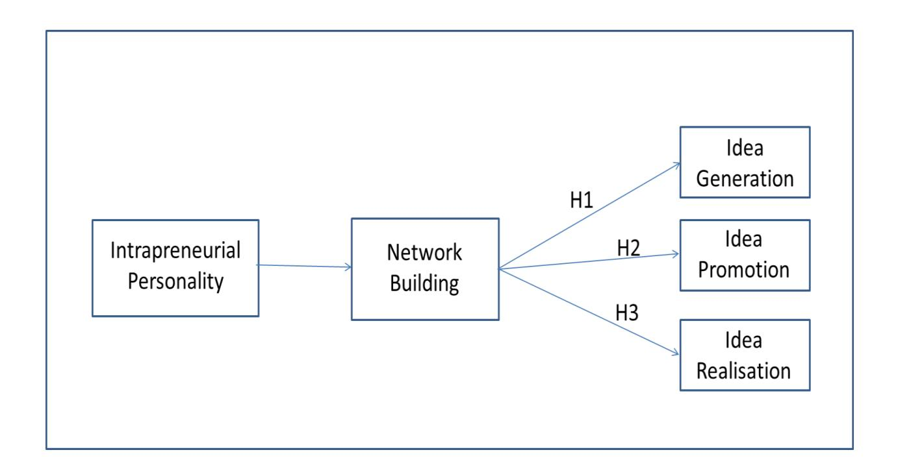
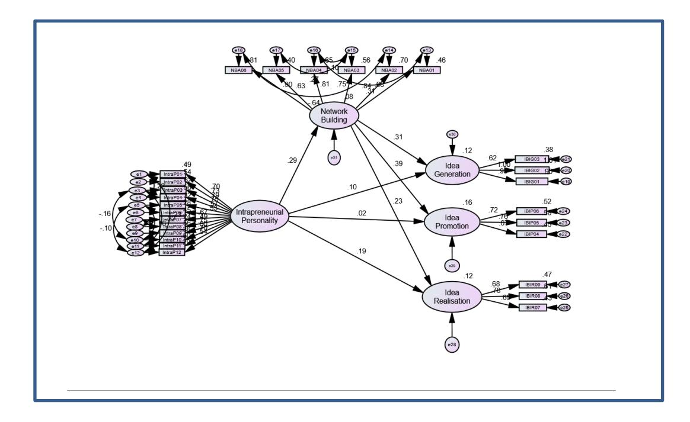

<!-- A3.R71 | source: papers_json/A3.R71/ -->

## *Intrapreneurial personality and individual innovation behaviour in * *service organisations: Network building ability as a mediator*

## *Abstract*

يستكشف هذا البحث العلاقة بين الشخصية الريادية الداخلية (intrapreneurial personality) والسلوك الابتكاري للأفراد في قطاع الخدمات. ودمج البحث منظوري الشخصية ورأس المال الاجتماعي لفحص الدور الوسيط لقدرة بناء الشبكات (network building ability) في العلاقة بين الشخصية الريادية الداخلية والمراحل الرئيسية الثلاث للسلوك الابتكاري للموظفين: توليد الأفكار، وترويج الأفكار، وتحقيق الأفكار. واعتُمدت منهجية بحثية كمية بجمع 410 استبيانات من موظفين في قطاع الخدمات بدولة الإمارات، وحُللت لاحقًا باستخدام نمذجة المعادلات البنيوية. ووجد البحث علاقة مباشرة ذات دلالة إحصائية بين الشخصية الريادية الداخلية ومرحلة تحقيق الأفكار، ولا توجد علاقة مباشرة مع مرحلتي توليد الأفكار وترويجها. بالإضافة إلى ذلك، تبيّن أن قدرة بناء الشبكات تتوسط هذه العلاقات، مما يؤكد أهمية بناء الشبكات للموظفين الرياديين الداخليين من أجل الابتكار. وقد تُثري هذه النتائج، عبر المراحل الرئيسية الثلاث للسلوك الابتكاري للأفراد، مهاراتنا القابلة للتعليم لتحسين السلوك الابتكاري للأفراد.

*Keywords:* Service innovation, individuals' innovative work behaviour; network building ability; Intrapreneurial personality.

## *Introduction*

يُعد قطاع الخدمات لبنة أساسية في الاقتصاد، إذ يشكل نحو 50٪ من الناتج المحلي الإجمالي للدول المتقدمة (Ratny, Arshad & Gaoliang, 2017). ومع عدد موظفين أكبر من قطاع الصناعة، يلعب قطاع الخدمات دورًا حاسمًا في نمو الاقتصادات (Un & Montoro-Sanchez, 2010). لذلك، فإن استكشاف ظواهر قطاع الخدمات لن ينعكس فقط على صناعات الخدمات، بل أيضًا على الأداء الاقتصادي على المستويين الوطني والعالمي (Zainal & Matore, 2019). وعلى وجه الخصوص، اكتسب فهم كيفية إدارة الابتكار بفعالية اهتمامًا كبيرًا في مؤسسات الخدمات لأنه يسهم بشكل كبير في استمرار المؤسسة وقدرتها على المنافسة في السوق (Ratny, Arshad & Gaoliang, 2017). ومع ذلك، ركزت أدبيات الابتكار السابقة على صناعات التصنيع أكثر من صناعات الخدمات (Li & Hsu, 2016). وعلى الرغم من أن مؤسسات الخدمات تُظهر خصائص مختلفة عن مؤسسات التصنيع (Drejer, 2004)، لا يزال الفهم الحالي لابتكار قطاع الخدمات مبنيًا على ابتكار قطاع التصنيع. ويركز عدد محدود من الدراسات على الابتكار في قطاع الخدمات (Rubalcaba 2007).

يوصف الأفراد الذين يمتلكون سمة الشخصية الريادية الداخلية بأنهم أشخاص يعيّنون أنفسهم للمهام، ومحددون ذاتيًا، وواضعو أهداف، ومبادِرون ذاتيًا، وواثقون من أنفسهم، وموجهون نحو الفعل (Pinchot 1985). ويجمع الأفراد الرياديون الداخليون بين الرؤية والفعل معًا (Zhu, Djurjagina & Leker 2014). وكيف

<!-- page 2 -->

تكون هذه السمة الشخصية قادرة على الابتكار هو محور تركيز هذه الدراسة. ويُعرَّف السلوك الابتكاري للفرد بأنه "...الإنشاء المتعمد وتقديم وتطبيق أفكار جديدة ضمن دور عمل، أو مجموعة، أو مؤسسة" (Janssen 2000, p. 288). وتنبع أهمية السلوك الابتكاري لعمل الأفراد بشكل رئيسي من العالم سريع التغير الذي تتموضع فيه مؤسسات اليوم. وينبغي أن تعمل المؤسسات كمراكز للإبداع والابتكار لضمان بقائها وفعاليتها واستمرار قدرتها التنافسية في أسواقها (Omachonu & Einspruch 2010). لذلك، تحتاج المؤسسات إلى موظفين مبدعين قادرين على توليد أفكار ومنتجات وعمليات جديدة، وقادرين على متابعة تنفيذ هذه الأفكار الجديدة عمليًا (Scott & Bruce 1994; Zainal & Matore 2019).

وعلى وجه الخصوص، جذبت سمة الشخصية الريادية الداخلية اهتمام عدد محدود من الدراسات التي فحصت تأثيرها على المستوى الفردي (Blanka, 2018). ولوحظت علاقة إيجابية بين سمة الشخصية الريادية الداخلية والسلوك الابتكاري للأفراد (Amo & Kolvereid, 2005). وفي دراسة لاحقة، اقترح Amo (2010) منظورًا مدمجًا بين الابتكار الريادي الداخلي من أسفل إلى أعلى والابتكار الريادي المؤسسي من أعلى إلى أسفل في تفسير السلوك الابتكاري للموظفين. وأشار إلى أن الأبحاث المستقبلية ينبغي أن تراعي دور المتغيرات الوسيطة أو المعدِّلة في تفسير عملية الابتكار. وفي هذه الدراسة، نستكشف الدور الوسيط لقدرة بناء الشبكات (NBA) (Ferris et al. 2005)، وهو مفهوم مستمد من نظرية رأس المال الاجتماعي يقيس قدرة الفرد على بناء شبكات اجتماعية (Thompson, 2005). وتُعرَّف قدرة بناء الشبكات بأنها قدرة الأفراد على تكوين حلفاء وربط أنفسهم بآخرين يشغلون مواقع مؤثرة ويمتلكون سلطة في مجتمعهم (Ferris et al., 2005). وستُختبر قدرة بناء الشبكات كوسيط للعلاقة بين الشخصية الريادية الداخلية والسلوك الابتكاري للأفراد.

بالإضافة إلى ذلك، وبينما اعتبرت الدراسات السابقة في الأدبيات السلوك الابتكاري للأفراد بناءً واحدًا (Scott & Bruce 1994)، تستكشف هذه الدراسة منظورًا أحدث يرى أن السلوك الابتكاري للأفراد يتكون من ثلاث مراحل: توليد الأفكار، وترويج الأفكار، وتحقيق الأفكار (Janssen, 2000). وسيجيب هذا الفصل في التحليل عن دعوة حديثة للتمييز بين المراحل الثلاث لسلوكيات الابتكار، إذ قد تتطلب كل مرحلة محددات وسوابق مختلفة (Wisse, Barelds & Rietzschel 2015, Woods et al. 2017; Rodrigues & Rebelo 2019; Nasaj 2020; Nasaj & Badi, 2021; Nasaj, 2021). ويقدم هذا النهج رؤية إضافية حول الآليات المشمولة عبر الأنشطة المتعددة وغير المتصلة المؤدية إلى الابتكار في مؤسسات الخدمات.

## *Literature Review*

## *Innovation in the Service Sector*

نظرًا لبيئة السوق سريعة التغير، أصبح الابتكار عاملًا رئيسيًا يؤثر في أداء مؤسسات الخدمات (Campo, Díaz & Yagüe 2014; Coombs and Miles, 2000; Li &

<!-- page 3 -->

Hsu, 2016). وعادة ما تنشئ المؤسسات منتجات وخدمات جديدة لتلبية احتياجات العملاء الحالية أو المحتملة (Forsman 2011). ويُعد ابتكار الخدمة جانبًا مهمًا من نجاح المؤسسة وتنافسيتها في السوق (Komaladewi et al., 2012). ومن الخصائص الجوهرية لابتكار الخدمة التفاعل مع العميل (Sundbo & Gallouj 2000). ويهدف ابتكار الخدمة إلى تقديم حلول ابتكارية للعملاء، ويركز عادة على نقاط ضعف الخدمة لتحديد حلول ابتكارية لهذه المسائل وكسب قاعدة عملاء أكبر (Miles, Miles & Snow 2006; Hertog et al., 2010). وينتقد باحثون آخرون نهج التركيز على العميل كمصدر للابتكار لأن ذلك سيحصر الابتكار في الخدمات الحالية بدلًا من نقل الابتكار إلى المنحنى التالي من دورة الابتكار، وفتح احتياجات عملاء جديدة أو حتى غير معروفة (Slater & Narver 1998).

عادة ما تكون الخدمة عملية قائمة على التجربة، حيث يلعب الجانب الإنساني عمومًا دورًا مهمًا في تقديم الخدمات. ويمكن تعريف الخدمة على أفضل وجه بأنها عملية تتضمن واجهة تفاعل مع العميل إما من خلال تفاعلات بشرية أو تقنية (Bitner, Ostrom & Morgan 2008). وبافتراض نهج من أسفل إلى أعلى لعملية الابتكار، يوضح Sundbo (1997) صعوبة قياس وإدارة ابتكار الخدمة، ويعزو هذه الصعوبات إلى دور الرياديين الداخليين في المؤسسات ((Pinchot 1985; Amo & Kolvereid 2005). وفي هذا المنظور، يبدأ الابتكار من قبل الأفراد العاملين في المؤسسات وليس من الإدارة العليا. وتشير هذه الفكرة إلى الجانب الإنساني للابتكار في قطاع الخدمات. وتؤكد على أن السلوك الابتكاري للأفراد أمر حيوي في الإسهام بابتكار الخدمات بسبب الجوانب الإنسانية لتقديم الخدمة، مما يجعل التمييز بين الخدمة وعملية تقديمها أمرًا يصعب تأكيده (Bitner, Ostrom & Morgan 2008).

## *Individuals'* *Innovative Behaviours in the Service Sector*

يعتمد الابتكار على الأفكار الجديدة، والموظفون هم مطورو هذه الأفكار وحاملوها ومنفذوها ومعدّلوها (Sebastiani & Paiola 2010). ويُعد فهم السلوك الابتكاري للموظفين أمرًا بالغ الأهمية لإدارة الابتكار بنجاح في المؤسسات (Scott & Bruce 1994; Gallouj 2002). لذلك، يُعد السلوك الابتكاري للموظفين عنصرًا أساسيًا يسهم في نجاح المؤسسة وبقائها (Komaladewi et al., 2012; Zainal & Matore 2019). وقد حظي السلوك الابتكاري للأفراد باهتمام أقل في الأدبيات الحالية مقارنة بدراسات الابتكار على مستوى الفريق والمؤسسة (Li & Hsu 2016). ويُعرَّف السلوك الابتكاري للفرد بأنه السلوك الفردي الذي يسهم في تطوير منتجات جديدة، أو أسواق جديدة، أو تحسين العمليات التجارية في مؤسساتهم (Amo 2005). ويرتبط السلوك الابتكاري للفرد بمجموعة معقدة من السلوكيات التي تهدف إلى توليد وترويج وتحقيق أفكار جديدة في مكان العمل (Madrid et al. 2014). واعتُبرت هذه السلوكيات مفيدة لعمل المؤسسة (Yuan & Woodman 2010). ويتطلب السلوك الابتكاري لعمل الأفراد استعدادًا لتحدي الوضع الراهن في مكان العمل (Yuan & Woodman 2010) وبذل جهد لتبني أفكار جديدة (Kanter 1988). وتزداد أهمية السلوك الابتكاري للفرد وضوحًا في المؤسسات الموجهة نحو خدمة العملاء، لأن طبيعة توقعات العملاء تتغير باستمرار، ما يستلزم موظفين ذوي توجه ابتكاري لإرضاء عملائهم (Bani-Melhem et al., 2018).

<!-- page 4 -->

كثيرًا ما يُصاغ الابتكار مفاهيميًا على أنه يشمل ثلاث مراحل رئيسية: توليد الأفكار، وترويج الأفكار، وتحقيق الأفكار (Janssen 2000; Scott & Bruce 1994). وكما يوضح Janssen (2000)، سيولّد الفرد أفكارًا جديدة في مرحلة توليد الأفكار، ويبحث عن طرق جديدة لأداء الأشياء، ويولد حلولًا مبتكرة للمشكلات (Janssen, 2000). وبعد ذلك، وفي مرحلة ترويج الأفكار، سيجمع الفرد الدعم لأفكاره الجديدة، ويحصل على الموافقات اللازمة، ويحفز الأعضاء المهمين في مؤسسته على تبني الفكرة الابتكارية. وفيما بعد، وفي مرحلة تحقيق الأفكار، تُحوَّل الأفكار الجديدة إلى تطبيقات مفيدة، مع إدخال الأفكار الأصلية بشكل منهجي في مكان العمل وتقييم فائدة الأفكار الجديدة (Janssen, 2000). وتجريبيًا، غالبًا ما تُقاس هذه السلوكيات الثلاثة المتمايزة كبناء واحد في دراسات السلوك الابتكاري الفردي (Scott & Bruce 1994). بيد أن هذا النهج قد لا يكون كافيًا لالتقاط التعقيد متعدد الأبعاد للسلوك الابتكاري. وبالفعل، هناك دعوات حديثة في الأدبيات لفحص السلوك الابتكاري كبناء متعدد الأبعاد (توليد الأفكار، وترويجها، وتحقيقها). فكل مرحلة من المراحل الثلاث قد تتأثر بمجموعة فريدة من السوابق والعوامل (Wisse, Barelds & Rietzschel 2015; Woods et al. 2017; Rodrigues and Rebelo 2019). وسيُعتمد هذا النهج متعدد الأبعاد في هذه الدراسة لتقديم فهم دقيق لتعدد السلوك الابتكاري للأفراد في مؤسسات الخدمات.

## *Intrapreneurial Personality Trait*

في الأدبيات السابقة، قُدِّمت ريادة الأعمال الداخلية في المؤسسات على ثلاثة مستويات رئيسية: المستوى المؤسسي (Camelo-Ordaz et al. 2012)، ومستوى الفريق (Iacobucci & Rosa 2010)، والمستوى الفردي (Douglas & Fitzsimmons 2013). وأدت هذه المنظورات الثلاثة إلى نشوء مفاهيم مختلفة تتناول ريادة الأعمال في المؤسسات. وظهرت مفاهيم جديدة، مثل ريادة الأعمال المؤسسية، والاستثمار الريادي المؤسسي، والتوجه الريادي، والريادة الداخلية، مما أحدث ارتباكًا بسبب نقص التصنيف الواضح (Christensen 2005). ولذلك، فإن تعريف الريادة الداخلية كمفهوم غير متسق في الأدبيات (Amo & Kolvereid 2005; Christensen 2005; Blanka 2018). بالإضافة إلى ذلك، ركزت دراسات الريادة الداخلية بشكل رئيسي على المستوى المؤسسي أكثر من المستوى الفردي (De Jong & Wennekers, 2008). وفشلت أبحاث ريادة الأعمال في المؤسسات القائمة في تحديد الأفراد وراء عملية الريادة الداخلية، ودورهم، وكيف يمكن إدارة سلوكياتهم بفعالية؟ (De Jong & Wennekers, 2008). لذلك، ستسهم هذه الدراسة الجديدة في معرفتنا الحالية بالمستوى الفردي لريادة أعمال الموظف، أي سمة الشخصية الريادية الداخلية للموظفين.

سمات الشخصية هي ميول للاتساق في الخصائص والانفعالات والأفكار والسلوكيات الثابتة مع مرور الوقت، وتصف سلوكيات الأفراد في مواقف متنوعة (Barrick, Parks & Mount 2005). كما عُرّفت الشخصية بأنها "مجموع الطرق التي يتفاعل بها الفرد ويتواصل بها مع الآخرين" (Robbins and Judge, 2015 p.175). وتعمل سمات الشخصية كمفهوم موحِّد يوفر معنى واتجاهًا وتفسيرًا لميول سلوكيات الأفراد (Morris, Davis & Allen 1994). واستُخدمت نظرية الشخصية على نطاق واسع كمنبئ صالح لأداء الأفراد الوظيفي (Leutner et al., 2014).

<!-- page 5 -->

يركز هذا البحث على سمة الشخصية الريادية الداخلية. وقُدِّمت الريادة الداخلية كسمة شخصية في البداية بواسطة Pinchot (1985)، الذي طوّر 12 مقياسًا يحدد ما إذا كان الفرد يتمتع بمستوى مرتفع من الريادة الداخلية أم لا. ويصف Pinchot (1985) الفرد ذا السمات الريادية الداخلية المرتفعة بأنه واضع أهداف محدد ذاتيًا، ويأخذ المبادرة، وواثق من نفسه، وموجه نحو الفعل. وتحتوي سمة الشخصية الريادية الداخلية على سلوكيات مثل الاستباقية، والسعي وراء الفرصة، والتحديد الذاتي، والثقة، وتحمل المخاطر، وتحدي القواعد، وعدم تفضيل الأنظمة البيروقراطية (Sinha & Srivastava, 2013). وقد بحثت عدة دراسات في السلوك التنظيمي في سمة الشخصية الريادية الداخلية للموظفين، مثل Amo and Kolvereid (2005)؛ وPinchot and Pellman (1999). واختبر Amo and Kolvereid (2005) العلاقة بين سمة الشخصية الريادية الداخلية لـ634 خريجًا في إدارة الأعمال يعملون في مؤسسات نرويجية مختلفة وسلوكهم الابتكاري. ووجدا علاقة ذات دلالة إحصائية بين الاثنين؛ بيد أنهما دعيا إلى مزيد من التحسين لمقاييس سمات الشخصية الريادية الداخلية. وتعميم دراسة Amo and Kolvereid's (2005) محدود لأن البيانات جُمعت من عينة خريجين متجانسة نسبيًا. لذلك، هناك حاجة إلى مزيد من التحقق من نتائجهما في ثقافات وأفراد آخرين من خلفيات تعليمية مختلفة.

## *The Role of Social Network Building Ability*

يُعد رأس المال الاجتماعي من أكثر النظريات دراسة في علم الاجتماع (Thompson 2005). وعُرّف رأس المال الاجتماعي بأنه "موارد متضمَّنة في بنية اجتماعية يُصل إليها و/أو تُعبّأ في أفعال هادفة" (Lin, Fu & Hsung 2001, p.29). وحدد هذا التعريف ثلاثة عناصر لرأس المال الاجتماعي، وهي: الموارد المتضمَّنة في بنية اجتماعية (التضمين)، وإمكانية الوصول إلى هذه الموارد الاجتماعية (الفرصة)، واستخدام هذه الموارد الاجتماعية (التعبئة) (Thompson 2005). وتحدد هذه الموارد الاجتماعية المتضمَّنة في شبكة علاقات الفرد مدى قدرته على الوصول إلى المعلومات، وامتلاك التأثير، وتنفيذ التغيير بفعالية (Coleman 2000; Burt 2009). لذلك، ستتيح الشبكة الاجتماعية الكبيرة التي يتموضع فيها الأفراد وصولهم إلى المعلومات والدعم الاجتماعي.

وبالفعل، يُعد بناء الشبكات قدرة أساسية للفرد على إنشاء شبكات اجتماعية كبيرة والاستفادة من هذه الشبكات. وطوّر Ferris et al. (2005) هذا البناء في البداية كمهارة سياسية رئيسية تساعد الأفراد على البحث عن حلفاء وربط أنفسهم بأفراد آخرين يشغلون مواقع نفوذ وسلطة في مجتمعاتهم. وبشكل أساسي، سيكون الفرد ذو القدرة العالية على بناء الشبكات ماهرًا في تطوير علاقات مع صانعي قرار مؤثرين في عمله وتأمين دعمهم لإنجاز الأمور (Ferris et al., 2005). واستنادًا إلى المناقشة أعلاه، تهدف هذه الدراسة إلى الإجابة عن سؤالين بحثيين رئيسيين: ما العلاقة بين سمة الشخصية الريادية الداخلية والابتكار؟ وهل تعمل قدرة بناء الشبكات كآلية وسيطة للتأثير؟

## *Research Conceptual Framework and Hypotheses*

مرحلة توليد الأفكار هي المرحلة المبكرة من الابتكار (Janssen, 2000). وسيولّد الفرد أفكارًا جديدة، ويبحث عن طرق جديدة لأداء الأشياء، ويولّد حلًا مبتكرًا للمشكلات. وفي

<!-- page 6 -->

مراجعتها لأدبيات الريادة الداخلية على المستوى الفردي، جادلت Blanka (2018) بأن الرياديين الداخليين استباقيون في إقامة العلاقات وبناء الشبكات داخل المؤسسة وخارجها. وتمكّن هذه العلاقات الرياديين الداخليين من الانفتاح الذهني، واكتشاف الفرص التجارية، وتطوير كفاءات الوساطة.

تُعرَّف شبكة الفرد بالعلاقات والروابط القائمة على الثقة (Granovetter 1983). وتوضح نظرية الشبكات أن الروابط بأشخاص مختلفين أو رأس المال الاجتماعي للفرد يقيمان في هذه العلاقات (Coleman 1988). وبما أن قدرة بناء الشبكات ستساعد الأفراد على بناء شبكتهم، فكلما زادت روابط الأفراد، زادت قدرتهم على خلق مجموعة من المعلومات الموثوقة التي تسهم في توليد أفكار جديدة وتحسين الابتكار (Milliken, Bartel & Kurtzberg 2003). وبعبارة أخرى، كلما زاد عدد الروابط التي يمتلكها الفرد، زادت الفرصة للوصول إلى معلومات متنوعة من مصادر معرفة مختلفة تمكّنهم من تحديد فرص جديدة تسهّل توليد أفكار جديدة (Baer et al., 2015). وبالفعل، خلال مرحلة توليد الأفكار المبكرة، يحتاج مبتكرو الأفكار الجديدة إلى مرونة معرفية للجمع بمهارة بين مجموعة من المعارف في تركيبة ناجحة جديدة (Perry-Smith & Mannucci, 2017). ويمكن دعم مبتكري الأفكار الجديدة اجتماعيًا خلال هذه المرحلة من خلال روابط شبكية ضعيفة تجمع بين وجهات نظر ومنظورات متنوعة (Perry-Smith & Mannucci 2017). بالإضافة إلى ذلك، يسعى الرياديون الداخليون بشكل استباقي إلى إقامة العلاقات وبناء الشبكات داخل شركاتهم وخارجها (Blanka, 2018). وتتيح هذه العلاقات للرياديين الداخليين الانفتاح الذهني، واكتشاف الفرص التجارية، وتطوير كفاءات الوساطة. وتساعد كفاءات الوساطة هذه الفرد على جمع البيانات من داخل المؤسسة وخارجها، متبنيًا دور حارس البوابة في مصطلحات الشبكات. وبعد ذلك، يمكن أن تُترجم تركيبات القطع المختلفة من المعرفة التي يحصل عليها الوسيط من خلال التشبيك بسهولة إلى ابتكار (Bjornali & Støren 2012). لذلك، تُقترح الفرضية التالية:

## *H1: Network building ability mediates* *the relation between * *intrapreneurial personality* *traits* *and idea generation.*

علاوة على ذلك، عادةً ما يحصل الرياديون الداخليون على الموارد من أينما استطاعوا ويختارون الأفراد ليكونوا في فرق المشاريع الجديدة بناءً على معرفتهم وتفانيهم (Pinchot & Pellman, 1999). وبعبارة أخرى، سينخرط الرياديون الداخليون في أنشطة التشبيك. وعرّف Thompson (2005) التشبيك بأنه محاولات الأفراد لتطوير والحفاظ على علاقات مع آخرين لديهم القدرة على مساعدتهم في عملهم أو مسارهم المهني. وتوفر الشبكات مزايا مفيدة عديدة مثل الوصول إلى المعلومات أو الموارد، وتحديد الفرص، ورأس المال الاجتماعي (Thompson 2005). وفي مرحلة ترويج الأفكار، سيحاول الموظفون الابتكاريون تطوير فكرتهم الجديدة من خلال التواصل الاجتماعي وبناء ائتلاف داعم لأفكارهم. وسيحدد الموظف الحلفاء والداعمين الذين يمتلكون السلطة اللازمة لتقديم أفكارهم داخل المؤسسة (Kanter 1988). ويستلزم ترويج فكرة جديدة

<!-- page 7 -->

أفرادًا مؤثرين يراهم صانعو القرار أفرادًا شرعيين وأكفاء (Perry-Smith & Mannucci 2017). وأفضل طريقة لتحقيق ذلك هي أن يكون الفرد متضمَّنًا في شبكة متناثرة غنية بالفجوات البنيوية (Perry-Smith & Mannucci 2017). واستنادًا إلى المناقشة أعلاه، قد تتوسط قدرة بناء الشبكات العلاقة بين سمة الشخصية الريادية الداخلية ومرحلة ترويج الأفكار. لذلك، اقترحت الدراسة الفرضية التالية:

## *H2: Network building ability mediates* *the relation between * *intrapreneurial personality traits* *and idea promotion.*

تحقيق الأفكار هو المرحلة الثالثة والأخيرة في عملية الابتكار. وتهدف هذه المرحلة إلى إنتاج نموذج أولي أو نموذج للفكرة الجديدة يمكن تنفيذه وممارسته ضمن دور وظيفي، أو فريق، أو الشركة بأكملها (Kanter 1988). وتُوصف سمة الشخصية الريادية الداخلية بأنها مزيج من المفكر والفاعل والمخطط والعامل، لذا فإن الأفراد ذوي المستوى المرتفع من الشخصية الريادية الداخلية يمتلكون الرؤية والفعل (Zhu, Djurjagina & Leker 2014). وترتبط هذه السمات بالسلوك الابتكاري للأفراد (Amo & Kolvereid 2005)؛ بيد أن Baruah and Ward (2015) أكدا أهمية التزام الإدارة العليا لدعم ابتكار الرياديين الداخليين. وتلعب كل من الإدارة العليا والإدارة الوسطى دورًا مهمًا في دعم وتشجيع الرياديين الداخليين. ويُوجَّه تحقيق فكرة جديدة بفهم ورؤية مشتركين بين الأفراد داخل الشركة (Perry-Smith & Mannucci, 2017). لذلك، يدعم إغلاق الشبكة (network closure) (Coleman 1988) والروابط الخارجية خارج الفريق (Tortoriello & Krackhardt 2010) تحقيق الأفكار على أفضل وجه. بالإضافة إلى ذلك، ستساعد شبكات الأفراد في تأمين تعاون زملائهم، وتنسيق سلس للمهام، ونقل أسهل للمعرفة، والحصول على الموارد اللازمة للتنفيذ (Obstfeld 2005; McFadyen, Semadeni & Cannella 2009). واستنادًا إلى المناقشات أعلاه، تُقترح الفرضية التالية:

## *H3: Network building ability mediates* *the relation between * *intrapreneurial personality trait and idea realisation.*

يوضح الشكل 1 النموذج المفاهيمي للدراسة.

<!-- page 8 -->

## *Methodology*

بحث هذا البحث العلاقة بين الشخصية الريادية الداخلية، وقدرة بناء الشبكات، والسلوك الابتكاري للأفراد. لذلك سيكون النهج المنهجي الكمي مناسبًا لاستنتاج طبيعة العلاقات بين المتغيرات.

## *Data Collection and Sample*

اختارت الدراسة موظفي قطاع الخدمات في دولة الإمارات لتمثيل مجتمعها البحثي، نظرًا لأهميته لدولة الإمارات كاقتصاد قائم على الخدمات (Augustine, 2016). ويشكل قطاع الخدمات 53.11٪ من الناتج المحلي الإجمالي للدولة (Statista, 2020). وتهدف حكومة الإمارات إلى إلهام الابتكار في جميع القطاعات. لذلك شكّل قطاع الخدمات الإماراتي سياقًا غنيًا لفحص الابتكار (Rodrigues, Sarabdeen & Balasubramanian, 2016; Nasaj & Al Marri, 2018; Bani-Melhem, Zeffane & Albaity, 2018; Al-Hawari et al., 2019; Nasaj, 2020; Nasaj, 2021). واتُبعت تقنية أخذ عينات عشوائية لتقليل احتمالية التحيز في البيانات المجمّعة (Kothari, 2004). واختار البحث مؤسستين من القطاعات الفرعية التالية: المصرفية، والرعاية الصحية، والتعليم، والفنادق، والاتصالات. وطُلب من مديري الموارد البشرية في كل مؤسسة توزيع استبيان المسح الإلكتروني للبحث بشكل عشوائي على الموظفين من أقسام مختلفة (100 استبيان في كل مؤسسة). وورد ما مجموعه 570 ردًا، أُكمل منها 410 وكانت قابلة للاستخدام. لذلك حقق البحث معدل استجابة فعالًا بنسبة 41٪. واستُخدم برنامجا SPSS v23.0 وAmos v23.0 لإجراء تحليل البيانات.

## *Research Measures*

<!-- page 9 -->

اعتُمدت المقاييس التالية لتفعيل متغيرات الدراسة. وتستند جميع المقاييس المستخدمة إلى مقاييس مُحقَّقة سابقًا من الأدبيات الحالية. وترد جميع عناصر المقاييس في الملحق 1.

*Individuals'* *Innovative Behaviours: *من المهم أن يُقيّم الأفراد سلوكهم الابتكاري بأنفسهم بدلًا من تقييم الزملاء أو المشرفين (Janssen, 2000). فبما أن الأفراد يمتلكون معلومات أكثر عن أنشطة عملهم اليومية من مشرفيهم أو أقرانهم، سيكونون أكثر دقة في تقييم هذه الأنشطة. بالإضافة إلى ذلك، عندما يُطلب من المشرفين تقييم ابتكارية موظفيهم، قد يتجاهلون جوانب من الابتكار لأنهم سيقيّمون فقط السلوكيات التي تركت انطباعًا لديهم، إذ يُعد السلوك الابتكاري حساسًا لخصائص الفرد. وقيست السلوكيات الابتكارية للأفراد عبر استبيان التقييم الذاتي المكوَّن من تسعة عناصر لـJanssen (2000)، الذي يعتمد ثلاثة عناصر لقياس كل من السلوكيات الابتكارية الثلاث للموظفين (توليد الأفكار، وترويج الأفكار، وتحقيق الأفكار). وتراوح معامل ألفا كرونباخ بين 0.74 و0.88.

*Network Building Ability: *اقترح Ferris et al. (2005) مقياسًا للتقييم الذاتي مكونًا من ستة عناصر يقيس قدرة الفرد على إنشاء شبكات والاستفادة من الأشخاص في شبكاته كأحد أوجه المهارات السياسية. وكان معامل ألفا كرونباخ 0.89 (انظر الجدول 2).

*Intrapreneurial Personality Trait: *اقترح Amo and Kolvereid (2005) 12 عنصرًا مستمدة من عمل Pinchot (1985) الذي قدّم اختبار "هل أنت ريادي داخلي؟" وجمع Amo and Kolvereid (2005) بياناتهما من 634 خريج ماجستير في إدارة الأعمال من كلية في النرويج. وكان معامل ألفا كرونباخ 0.90 (انظر الجدول 2). ويمكن العثور على تفاصيل العناصر المستخدمة في الملاحق.

*Demographic Variables: *جُمعت بيانات عن عمر المشاركين وجنسهم وخبراتهم وتعليمهم لأنها قد تؤثر بشكل كبير على تصورات الموظفين لعملهم، مما قد يؤثر على موقفهم الوظيفي وعمليتهم وأدائهم (Kirkman, Tesluk & Rosen, 2004; Pelled, Xin & Weiss, 2004). وأُدرج الجنس كمتغير وهمي (ذكر = 1 وأنثى = 0). وقيس العمر بالسنوات (1 = 18-25 سنة، 2 = 26-33 سنة، 3 = 34-41 سنة، 4 = 42-49 سنة، 5 = أكثر من 50 سنة). أما بالنسبة لسنوات الخبرة (1 = أقل من سنة، 2 = 1-3 سنوات، 3 = 3-6 سنوات، 4 = 6-10 سنوات، 5 = أكثر من 10 سنوات). وقيست الخلفية التعليمية وفق النقاط التالية للمقياس (1 = الثانوية العامة، 2 = دبلوم، 3 = بكالوريوس، 4 = ماجستير، 5 = دكتوراه). ويلخص الجدول 1 ملف المشاركين في البحث.

<!-- page 10 -->

|  | Female | 158 | 38.54 |
| --- | --- | --- | --- |
| Age | 18 – 25 | 55 | 13.41 |
|  | 26 – 33 | 130 | 31.71 |
|  | 34 – 41 | 163 | 39.76 |
|  | 42 – 49 | 42 | 10.24 |
|  | < 50 | 20 | 4.88 |
| Experience | > 1 | 27 | 6.59 |
|  | 1 – 3 | 42 | 10.24 |
|  | 4 – 6 | 51 | 12.44 |
|  | 7 – 10 | 84 | 20.49 |
|  | < 10 | 206 | 50.24 |
| Education | High School | 44 | 10.73 |
|  | Diploma | 45 | 10.98 |
|  | Bachelor | 191 | 46.59 |
|  | Master | 112 | 27.32 |
|  | Doctorate | 18 | 4.39 |

## *Data Analysis*

## *Common Method Bias*

في الوقت الحاضر، يشدد أكاديميو بحوث الأعمال على أهمية اختبار تحيز الطريقة المشتركة (common method bias) (Williams et al., 2010)، خاصة في بحوث المسح ذاتية الإدارة (Chang et al., 2010). وأُجري اختبار Harman للعامل الواحد لتحيز الطريقة المشتركة (Podsakoff & Organ, 1986) لأنه شائع الاستخدام في الأدبيات (Fuller et al., 2016). وتظهر النتائج أن العامل الواحد يفسّر فقط 26.514٪ من البيانات المجمّعة، وهي نسبة أقل من 50٪. لذلك، لا تعاني الدراسة من مشكلة تحيز الطريقة المشتركة.

## *Validity and Reliability*

فُحصت موثوقية البنى عبر إجراء مجموعة من الاختبارات. وكان الاختبار الأول معامل ألفا كرونباخ، حيث أظهرت النتائج مقاييس موثوقة لأن جميع البنى حققت نتائج أعلى من 0.7 (Mallory & George 2003). كما طُبّق اختبار Kaiser-Meyer-Olkin (KMO) الذي يقيس كفاية العينة. وبالنسبة لاختبار KMO، كلما اقتربت القيمة من 1.0، زادت موثوقية المقياس، بينما تشير قيمة أقل من 0.50 إلى أن المقياس غير موثوق (Morgan et al., 2004). وتظهر النتائج أن (KMO = .868). وكان الاختبار الأخير اختبار Bartlett للكروية، الذي يفحص وجود الارتباطات؛ وتشير دلالة هذا الاختبار إلى مقاييس موثوقة (Hair et al., 2010). وتوضح النتائج أن اختبار Bartlett للكروية = (.000). وأكدت الاختبارات الثلاثة للموثوقية أن مقاييس البحث موثوقة. ويوضح الجدول 2 مصفوفة الارتباط والإحصاءات الوصفية لمتغيرات البحث.

<!-- page 11 -->

| 2-Age | 2.61 | 1.003 | - | 216** | - |  |  |  |  |  |  |  |
| --- | --- | --- | --- | --- | --- | --- | --- | --- | --- | --- | --- | --- |
| 3-Experience | 3.98 | 1.278 | - | 330** | .684** | - |  |  |  |  |  |  |
| 4-Education | 3.04 | .994 | - | 140** | .237** | .287** | - |  |  |  |  |  |
| 5-Intraprenuerial Pers | 3.146 | .623 | .900 | 050 | .232** | .253** | .342** | (.692) |  |  |  |  |
| 6-Network Building | 3.675 | 1.082 | .895 | 075 | .045 | .106* | .045 | .264** | (.811) |  |  |  |
| 7-Idea Generation | 4.243 | .791 | .883 | 069 | .108* | .140** | .122* | .192** | .312** | (.904) |  |  |
| 8-Idea Promotion | 4.217 | .668 | .759 | 125* | .089 | .153** | .118* | .147** | .343** | .229** | (.822) |  |
| 9-Idea Realisation | 4.410 | .602 | .745 | 032 | .004 | .020 | .008 | .195** | .247** | .289** | .424** | (.806) |

Note: N= 406. *p<.05, **p<.01.

Notes: AVE is shown in diagonal and between brackets

أُجري تحليل عاملي للتحقق من صحة متغيرات البحث. وأُجري تحليل عاملي استكشافي باعتماد تحليل المكونات الرئيسية كطريقة استخراج وvarimax كطريقة تدوير. ويظهر مخطط الانحدار الحاد (scree plot) الموضح في الشكل (2) أن البحث لديه خمسة متغيرات كامنة تمتلك قيمًا ذاتية (Eigenvalues) أكبر من 1. وتتطابق النتائج مع عدد البنى في هذا البحث.

***Figure 2: Scree plot diagram***

بالإضافة إلى ذلك، تُظهر نتائج التحليل العاملي الاستكشافي أن جميع عناصر الاستبيان تحمّلت على بناها وحققت قيمًا مقبولة أكبر من 0.45 (Field, 2013). وترد نتائج التحليل العاملي الاستكشافي في الجدول 3.

<!-- page 12 -->

Extraction Method: Principal Component Analysis.

Rotation Method: Varimax with Kaiser Normalization.

من حيث التحليل العاملي التوكيدي (CFA)، تُظهر النتائج أن نموذج البحث نموذج جيد لأن جميع المؤشرات حققت قيمًا مقبولة: χ2/df = 2.290 (Schreiber et al. 2006), RMR = .065 (Browne & Cudeck, 1993), CFI = .931 (Byrne, 2010), IFI = 0.932 (Bentler, 2007), TLI = .922 (Marsh et al., 2004), RMSEA = .056 (Steiger, 2007).

> a. Rotation converged in 6 iterations.

<!-- page 13 -->

وأخيرًا، أُجري فحص للصدق التقاربي والتمييزي لمقاييس القياس. واعتُمدت معايير الحد الأدنى الأكبر من 0.5 لكفاية النتائج (Hair et al., 2006). ولفحص الصدق التمييزي للبنى، قُورن الجذر التربيعي لمتوسط التباين المستخرج (AVE) بارتباطات ما بين البنى. وعندما يكون الجذر التربيعي لـAVE أكبر من الارتباط ما بين البنى، يثبت الصدق التمييزي للبنى (Hair et al., 2006). وتُظهر النتائج الموضحة في الجدول 2 أن الصدق التقاربي والتمييزي قد تحققا.

## *Results*

يبحث هذا البحث الدور الوسيط لقدرة بناء الشبكات في العلاقة بين الشخصية الريادية الداخلية والسلوك الابتكاري للأفراد. وأُجريت نمذجة معادلات بنيوية باستخدام تقدير الإمكان الأعظم القوي (robust maximum likelihood) لفحص فرضيات البحث. ويوضح الشكل 3 نموذج المعادلات البنيوية.

***Figure 3: Structural equation model***

أظهرت مؤشرات ملاءمة نموذج SEM للبحث ملاءمة جيدة للنموذج: χ2/df = 2.352, RMR = .067, CFI = .928, IFI = 0.929, TLI = .918, RMSEA = .057. وتوضح نتائج العلاقات المباشرة بين البنى في الجدول (4)

**Table 4** SEM Direct Relations Results

<!-- page 14 -->

|  | Paths |  | Estimate | S.E. | C.R. | P |
| --- | --- | --- | --- | --- | --- | --- |
| Intrapreneurial Personality | > | Network Building | .310 | .058 | 5.342 | *** |
| Network Building | > | Idea Generation | .233 | .039 | 6.021 | *** |
| Network Building | > | Idea Promotion | .214 | .034 | 6.333 | *** |
| Network Building | > | Idea Realisation | .116 | .029 | 3.943 | *** |
| Intrapreneurial Personality | > | Idea Generation | .079 | .042 | 1.877 | .061 |
| Intrapreneurial Personality | > | Idea Promotion | .012 | .034 | .358 | .720 |
| Intrapreneurial Personality | > | Idea Realisation | .103 | .032 | 3.186 | .001 |

أظهرت النتائج أن الشخصية الريادية الداخلية ترتبط بشكل ذي دلالة إحصائية بقدرة بناء الشبكات وتحقيق الأفكار عند مستوى ثقة 99٪، بينما لا ترتبط بشكل ذي دلالة إحصائية بتوليد الأفكار وترويجها عند مستوى ثقة 95٪. بالإضافة إلى ذلك، ترتبط قدرة بناء الشبكات بشكل ذي دلالة إحصائية عند مستوى ثقة 99٪ بكل سلوك من السلوكيات الابتكارية للأفراد. لذلك، يُفترض دور وسيط محتمل.

فحصت طريقة التمهيد الذاتي (bootstrapping) (Preacher & Hayes, 2004) الأثر غير المباشر للتحقق أكثر من الدور الوسيط لقدرة بناء الشبكات، وهي طريقة موصى بها لفحص المتغيرات الوسيطة (MacKinnon et al., 2012; Hayes, 2017). وتضمنت طريقة التمهيد الذاتي 5000 عينة متكررة استُخدمت للحصول على فترات ثقة 95٪ للآثار غير المباشرة للشخصية الريادية الداخلية على توليد الأفكار وترويجها وتحقيقها. وتوضح نتائج العلاقات غير المباشرة في الجدول 5.

<!-- page 15 -->

توضح نتائج العلاقة غير المباشرة بين الشخصية الريادية الداخلية وتوليد الأفكار أن (الحد الأدنى .038، الحد الأعلى .122) وأن الصفر غير مدرج ضمن فترة النتائج، مما يعني أن H1 مدعومة. وبما أنه لا توجد علاقة مباشرة ذات دلالة إحصائية بين الشخصية الريادية الداخلية وتوليد الأفكار، يمكن القول بأمان إن قدرة بناء الشبكات وسيط كامل للعلاقة بين الشخصية الريادية الداخلية وتوليد الأفكار.

وبالنسبة لـH2، تشير نتائج العلاقة غير المباشرة بين الشخصية الريادية الداخلية وترويج الأفكار إلى أن (الحد الأدنى .034، الحد الأعلى .114)، لأن الصفر غير مدرج ضمن فترة النتائج. لذلك فإن H2 مدعومة. ومع غياب علاقة ذات دلالة إحصائية بين الشخصية الريادية الداخلية وترويج الأفكار، تفترض قدرة بناء الشبكات دور وسيط كامل بين الاثنين.

وأخيرًا، بالنسبة لـH3، فإن نتائج العلاقة غير المباشرة بين الشخصية الريادية الداخلية وتحقيق الأفكار هي (الحد الأدنى .013، الحد الأعلى .072)، والصفر غير مدرج ضمن فترة النتائج. لذلك فإن H3 مدعومة. وتتوسط قدرة بناء الشبكات جزئيًا العلاقة بين الشخصية الريادية الداخلية وتحقيق الأفكار لأن هناك علاقة مباشرة ذات دلالة إحصائية بين الشخصية الريادية الداخلية وتحقيق الأفكار.

## *Discussion* *and conclusion*

هدفت هذه الدراسة إلى الإجابة عن سؤالين بحثيين رئيسيين، في سياق صناعات الخدمات في دولة الإمارات:

*What is the relationship between an intrapreneurial personality trait and innovation, and does * *network building ability act as a mediating mechanism of influence?*

استجابة للسؤال الأول، برزت نتيجتان مهمتان من الدراسة. أولًا، وُجدت علاقة مباشرة بين سمة الشخصية الريادية الداخلية ومرحلة تحقيق الأفكار. ثانيًا، لم تُوجد علاقة مباشرة بين سمة الشخصية الريادية الداخلية والمرحلتين الأخريين من عملية الابتكار: توليد الأفكار وترويجها. ودعمًا لادعاء Sinha and Srivastava's (2013) بأن الرياديين الداخليين ليسوا مولّدي أفكار، تؤكد النتائج أن الرياديين الداخليين يمكنهم تحويل الأفكار إلى نتائج مهمة لتحفيز الابتكار من خلال تحقيق الأفكار.

استجابة للسؤال الثاني، وُجدت علاقة مباشرة بين سمة الشخصية الريادية الداخلية وقدرة بناء الشبكات. وتدعم هذه النتيجة كذلك عمل Blanka (2018)، الذي أشار إلى أن الرياديين الداخليين يسعون بنشاط لإقامة علاقات وبناء شبكات داخل المؤسسة وخارجها. بالإضافة إلى ذلك، تدعم هذه النتيجة كذلك عمل De Jong and Wennekers (2008) الذي أكدا فيه الدور المهم لرأس المال الاجتماعي في مساعدة البحث النشط للرياديين الداخليين عن المعلومات. فكلما جمع الرياديون الداخليون معلومات أكثر من شبكتهم، زادت قدرتهم على ربط الأفكار معًا وتطوير أفكار جديدة لحل مشكلاتهم. وهذا يدعم أهداف ابتكار الخدمة في تقديم حلول ابتكارية للعملاء (Miles, Miles & Snow 2006; Hertog et al., 2010).

علاوة على ذلك، تشير النتائج إلى أن الرياديين الداخليين يعتمدون على بناء الشبكات لتنمية رأس المال الاجتماعي الذي يستخدمونه لتوليد أفكارهم الابتكارية وترويجها وتحقيقها. وتجيب نتيجة الدراسة -التي تشير إلى أهمية قدرة بناء الشبكات لابتكار الرياديين الداخليين- عن

<!-- page 16 -->

السؤال الذي طرحته مراجعة أدبيات Neessen's et al. (2019). وأشار Neessen's et al. (2019) إلى أن قياس ريادية الفرد الداخلية بثلاثة سلوكيات: الابتكارية، والاستباقية، وتحمل المخاطر غير كافٍ، وأوصوا بإدراج التشبيك ضمن هذا المقياس واختبار ما إذا كان هذا السلوك يعوّض الدرجة المنخفضة للسلوكيات الأخرى. واستنادًا إلى نتائج الدراسة، تأكد ذلك حيث وجدت الدراسة أن قدرة بناء الشبكات يمكن أن تعوّض غياب العلاقة المباشرة بين سمة الشخصية الريادية الداخلية ومرحلتي توليد الأفكار وترويجها من الابتكار. بالإضافة إلى ذلك، أشار De Jong and Wennekers (2008)، في تعريفهما للريادة الداخلية، إلى أن الرياديين الداخليين، من خلال السلوك الاستباقي، يركزون على متابعة الفرصة بغض النظر عن الموارد التي يسيطرون عليها حاليًا. ومع ذلك، يبدو أن الرياديين الداخليين يجدون دائمًا بطريقة ما وسيلة للقيام بذلك. وقد تشير هذه الدراسة إلى أن الطريقة التي يتكيف بها الرياديون الداخليون لتنفيذ أفكارهم وتعبئة الموارد اللازمة تكون من خلال بناء شبكات اجتماعية. بالإضافة إلى ذلك، أحد الفروق بين الرياديين والرياديين الداخليين هو أن الرياديين الداخليين يستخدمون موارد المؤسسة التي يعملون بها، بينما يعتمد الرياديون على مواردهم الخاصة؛ وهذا يعني أن الرياديين الداخليين يستخدمون الموارد الحالية للمؤسسة ويعملون أساسًا ضمن سياسات مؤسساتهم (Camelo-Ordaz et al. 2012; Baruah & Ward 2015). واستنادًا إلى ذلك، فإن إقامة علاقات مع صانعي القرار والمديرين والزملاء أمر بالغ الأهمية للرياديين الداخليين. وتمكّن هذه العلاقات الرياديين الداخليين من تعبئة الموارد اللازمة داخل شركتهم لترويج أو تحقيق أفكارهم الابتكارية، لأن الرياديين الداخليين أساسًا لا يستخدمون مواردهم الخاصة، ويحتاجون إلى موافقات ليتمكنوا من استخدام موارد المؤسسة. وتوضح هذه النتيجة كذلك آلية كيفية ابتكار الرياديين الداخليين في مؤسساتهم وكسب التزام إدارتهم العليا والوسطى لدعمهم، وهو عنصر أساسي لنمو الريادة الداخلية في المؤسسات (Lankinen et al. 2013; Baruah & Ward 2015). وأخيرًا، تسهم المناقشة السابقة في الزخم الأكاديمي المتنامي للتحقيق في المنظور المشترك التطور الذي يفسر السلوكيات من الموقفين النفسي والاجتماعي معًا (Snyder & Deaux, 2012; Anderson et al., 2014; Tasselli et al., 2015; Fang et al., 2015; Baer et al., 2015; Landis, 2016; Nasaj & Badi, 2021; Nasaj, 2021).

## *Managerial* *Implications, Limitations and Future Research Directions*

يقدم البحث عدة إسهامات عملية لمديري قطاع الخدمات. أولًا، لمديري التوظيف الذين يحاولون دعم شركاتهم بموظفين قادرين على الابتكار. تُبرز الدراسة أن سمات الشخصية الريادية الداخلية مرتبطة بالابتكار؛ لذلك قد يحسّن مديرو الموارد البشرية ممارسات التوظيف لديهم من خلال تطبيق اختبارات شخصية تقييم ذاتي أو تقييم مراقب لسمة IP (Connolly, Kavanagh & Viswesvaran 2007). ثانيًا، يوضح النموذج البحثي التكاملي للشخصية والتشبيك أن توظيف أفراد بسمات شخصية مناسبة لا يكفي لضمان ابتكاريتهم دون أي دعم من محيطهم. لذلك، ينبغي لمديري قطاع الخدمات محاولة إنشاء فعاليات تشبيك بين موظفيهم، إذ تُظهر النتائج أنه كلما بنى الموظفون شبكات أكثر مع مديريهم وزملائهم، ازدادت فرصهم في الوصول إلى المعلومات والتوصل إلى أفكار وحلول جديدة للمشكلات الحالية. ومن خصائص ابتكار الخدمة مشاركة العميل (Chen, Tsou & Ching 2011)، مما يُضبب الحدود بين العملاء والموظفين إلى درجة اعتبار العملاء موظفين وموارد جزئية للسلوك الابتكاري (Duverger 2012). لذلك، فإن تنظيم فعاليات اجتماعية تسهّل إقامة علاقات بين موظفي الخط الأمامي وعملاء الشركة سيزيد فرصة الموظفين في تحديد المشكلات وتحفيزهم على التوصل إلى حلول ابتكارية. علاوة على ذلك، مع التأكيد على أهمية قدرة

<!-- page 17 -->

بناء الشبكات لدى الأفراد للابتكار، قد يحدد مديرو الموارد البشرية الوظائف التي تتطلب مهارات ابتكارية ويخصصون أنشطة ومهام في وصف وظائفهم تشجع على التواصل الاجتماعي والتشبيك مع العملاء والزملاء. وبينما تُفهم الشخصية الريادية الداخلية كسمة ثابتة (يمتلكها الأفراد أو لا يمتلكونها)، فإن قدرة بناء الشبكات مهارة يمكن تعليمها؛ لذلك ينبغي لمديري الموارد البشرية إدراج بناء مهارات التشبيك في خططهم التدريبية السنوية لزيادة ابتكارية موظفيهم.

يخضع البحث لعدة قيود ينبغي إبرازها. أولًا، قد تترك الطبيعة المقطعية (cross-sectional) للبيانات مجالات لافتراضات بخصوص السببية بين المتغيرات. لذلك، للتحقق من نتائج البحث، تُقترح دراسة طولية. ثانيًا، من القيود الأخرى الاستبيان ذاتي الإدارة المعتمد الذي قد يترك فرصة لتحيز المشاركين. ومع ذلك، فإن طلب تقييم الأفراد لابتكاريتهم بأنفسهم مدافع عنه (Amo, 2005). فقد يتصرف الفرد بشكل ابتكاري بناءً على خصائصه لسببين رئيسيين: إما بتأثير من مؤسسته أو إدارته ليكون مبتكرًا، أو كمبادرة شخصية لا تحظى بالضرورة بموافقة إدارته. لذلك، قد لا يكون طلب تقييم رؤساء الأفراد أو زملائهم لسلوكهم الابتكاري عادلًا من جانب الأفراد لأن المقيّم سيصنّفهم بناءً على السلوكيات التي يحبونها ويوافقون عليها فقط، وليس على مبادرة الأفراد الشخصية. وأخيرًا، يمتلك الموظفون معلومات أكثر عن وظائفهم اليومية من مديريهم (Janssen, 2000). لذلك، سيقيّم الموظفون ابتكاريتهم بدقة أكبر من مديريهم.

علاوة على ذلك، قد يتجاهل التقييم الإداري لابتكارية الموظفين الابتكار الجوهري للموظفين لأنهم سيقيّمون فقط السلوكيات التي تركت انطباعًا لديهم، إذ يُعد السلوك الابتكاري حساسًا للغاية لفروق الأفراد. بالإضافة إلى ذلك، يُعد استخدام استبيانات التقرير الذاتي شائعًا جدًا في أدبيات الريادة الداخلية (Monsen & Boss 2009; Wakkee et al. 2010; Bosma et al. 2012; Moriano et al. 2014). ومع ذلك، قد تعتمد الأبحاث المستقبلية أساليب إبلاغ مختلفة لإضافة مزيد من التحقق من نتائج البحث. اختار البحث قطاع الخدمات الإماراتي كمجتمع دراسة. لذلك، قد يكون تعميم نتائج البحث محدودًا لأن الفروق الثقافية قد تؤثر على ابتكار الأفراد. فمثلًا، ترتبط ميل الفرد لتحمل المخاطر إيجابيًا بالسلوك الابتكاري للفرد (Angel Ferrero & Bessière 2018). ومع ذلك، قد تؤثر بعض الثقافات على ميل الفرد لتحمل المخاطر أو تجنبها أكثر من ثقافات أخرى (Hofstede 2001). لذلك، قد تؤثر هذه الفروق الثقافية على السلوك الابتكاري للفرد. لذلك، تقترح الدراسة أن تبحث الدراسات المستقبلية الإطار المفاهيمي للدراسة في ثقافات أخرى للتحقق من نتائجها. وأخيرًا، يُعد هذا البحث خطوة مبكرة على طريق سد الفجوة النفسية-الاجتماعية من خلال بحث يفحص الأثر الوسيط أو المعدِّل لمتغيرات العلوم الاجتماعية على سمات الشخصية أو متغيرات نفسية أخرى لتوضيح حجم سلوكيات العمل الحديثة في المؤسسات. لذلك، قد تنظر الأبحاث المستقبلية في متغيرات مختلفة للشخصية أو العلوم الاجتماعية من شأنها تحسين فهمنا للمنظور المشترك التطور النفسي-الاجتماعي.

## *References*

Al-Hawari, M.A., Bani-Melhem, S. and Shamsudin, F.M. (2019), "Determinants of frontline employee service innovative behavior: The moderating role of co-worker socializing and service

<!-- page 18 -->

climate", Management Research Review, Vol. 42 No. 9, pp. 1076-1094. https://doi.org/10.1108/MRR-07-2018-0266

Åmo, B.W. & Kolvereid, L. (2005). Organisational strategy, individual personality and innovation behavior. *Journal of Enterprising Culture*, vol.13(01), pp.7-19.

Åmo, B.W. (2005). *Employee innovation behavior.* *Doctoral thesis (Ph.D.) –* *Bodø Graduate * *School of Business.*

Amo, B.W. (2010). Corporate entrepreneurship and intrapreneurship related to innovation behaviour among employees*. International Journal of Entrepreneurial Venturing,* vol. 2(2), pp.144-158.

Anderson, N., Potočnik, K. & Zhou, J. (2014). Innovation and creativity in organisations: A state-of-the-science review, prospective commentary, and guiding framework. *Journal of * *Management, *vol. 40(5), pp.1297-1333.

Angel Ferrero, M.C. & Bessière, V. (2018). Individual innovation: an experimental study on the role of confidence and risk taking. *In Academy of Management Proceedings, *vol. 2018(1), pp. 12407. Briarcliff Manor, NY 10510: Academy of Management.

Augustine, B.D. (2016). Services sector to become key driver of UAE's trade growth between now and 2030, *Gulf News*, 15 December 15 (online), available at: [https://gulfnews.com/business/servicessector-](https://gulfnews.com/business/servicessector-%20to-become-key-driver-of-uaes-trade-growth-between-now-and-2030-1.1947070) to-become-key-driver-of-uaes-trade-growth[between-now-and-2030-1.1947070](https://gulfnews.com/business/servicessector-%20to-become-key-driver-of-uaes-trade-growth-between-now-and-2030-1.1947070)

Baer, M.Evans, K., Oldham, G.R. & Boasso, A. (2015). The social network side of individual Innovation: A meta-analysis and path-analytic integration*. Organisational Psychology Review*, vol. 5(3), pp.191-223.

Bani-Melhem, S., Zeffane, R. and Albaity, M. (2018), "Determinants of employees' innovative behavior", International Journal of Contemporary Hospitality Management, Vol. 30 No. 3, pp. 1601-1620. https://doi.org/10.1108/IJCHM-02-2017-0079

Barrick, M.R., Parks, L. & Mount, M.K. (2005). Self‐monitoring as a moderator of the relationships between personality traits and performance. *Personnel Psychology*, vol.58(3), pp.745-767.

Baruah, B. & Ward, A. (2015). Metamorphosis of intrapreneurship as an effective organisational strategy. *International entrepreneurship and management journal* vol. 11(4), pp.811-822.

Bentler, P.M. (2007). On tests and indices for evaluating structural models. *Personality and * *Individual differences, *vol.42 (5), pp.825-829.

<!-- page 19 -->

Bitner, M.J., Ostrom, A.L. & Morgan, F.N. (2008). Service blueprinting: a practical technique for service innovation*. California management review*, vol. 50(3), pp.66-94.

Bjornali, E.S. & Støren, L.A.(2012) . Examining competence factors that encourage innovative behaviour by European higher education graduate professionals. *Journal of Small Business and * *Enterprise Development.*

Blanka, C. (2018). An individual-level perspective on intrapreneurship: a review and ways forward. *Review of Managerial Science*, vol.13 (5), pp.1-43.

Block, Z. and I. MacMillan (1993). Corporate Venturing. Harvard Business School Press, Boston, MA

Bosma, N., Wennekers, S., & Amorós, J. E. (2012). Global enterprenerurship monitor 2011 extended report: Entrepreneurs and entrepreneurial employees across the globe*. Global * *Entrepreneurship Monitor*, vol. 59, pp.1-239.

Browne, M.W. & Cudeck, R. (1993). Alternative ways of assessing model fit. *Sage focus * *editions*, vol.154, pp.136-136..

Burt, R.S. (2009). Structural holes: The social structure of competition. *Harvard university press*.

Byrne, B., M. (2010) Structural equation modeling with AMOS: Basic concepts, applications and programming, New Jersey. Lawrence Erlbaum Associates Publishers.

Camelo-Ordaz, C., Fernández-Alles, M., Ruiz-Navarro, J. & Sousa-Ginel, E.( 2012). The intrapreneur and innovation in creative firms. *International Small Business Journal*,vol. 30(5), pp.513-535.

Campo, S., M. Díaz, A. and J. Yagüe, M. (2014), "Hotel innovation and performance in times of crisis", International Journal of Contemporary Hospitality Management, Vol. 26 No. 8, pp. 1292- 1311. https://doi.org/10.1108/IJCHM-08-2013-0373

Chang, S.J., Van Witteloostuijn, A. & Eden, L. (2010). From the editors: Common method variance in international business research*. Journal of International Business Studies*, vol. 41 (2), pp.178–184

Chen, J.S., Tsou, H.T. and Ching, R.K., 2011. Co-production and its effects on service innovation. *Industrial Marketing Management*, Vol 40(8), pp.1331-1346.

Christensen, K.S. (2005). Enabling intrapreneurship: the case of a knowledge‐intensive industrial company*. European Journal of Innovation Management*.

Coleman, J. S. (1988) . Social capital in the creation of human capital*. American Journal of * *Sociology*, vol. 94, pp. S95–S120.

<!-- page 20 -->

Coleman, J.S.(2000). Social capital in the creation of human capital*. In knowledge and social * *capital,* pp. 17-41.

Connolly, J. J., Kavanagh, E. J., & Viswesvaran, C. (2007). The convergent validity between self and observer ratings of personality: A meta‐analytic review. *International Journal of Selection * *and Assessment*, vol. 15(1), pp.110-117.

Coombs, R. & Miles, I.( 2000). Innovation, measurement and services: the new problematique'a. *In Innovation systems in the service economy,* pp.85-103. Springer, Boston, MA.

Drejer, I. (2004). Identifying innovation in surveys of services: a Schumpeterian perspective. *Research policy,* vol. 33(3), pp.551-562.

Duverger, P. (2012). Using dissatisfied customers as a source for innovative service ideas*. * *Journal of Hospitality & Tourism Research*, vol. 36(4), pp.537-563.

De Jong, J. & Wennekers, S. (2008). Intrapreneurship; conceptualising entrepreneurial employee behaviour (No. H200802*). EIM Business and Policy Research*.

Den Hertog, P., Van der Aa, W. & De Jong, M.W. (2010) . Capabilities for managing service innovation: towards a conceptual framework. *Journal of service Management*, vol. 21(4), pp.490-514.

Douglas, E.J. & Fitzsimmons, J.R. (2013). Intrapreneurial intentions versus entrepreneurial intentions: distinct constructs with different antecedents. *Small business economics*, vol. 41(1), pp.115-132.

Fang, R., Landis, B., Zhang, Z., Anderson, M.H., Shaw, J.D. & Kilduff, M.( 2015). Integrating personality and social networks: A meta-analysis of personality, network position, and work outcomes in organisations. *Organization Science*, vol. 26(4), pp.1243-1260.

Ferris, G.R., Treadway, D.C., Kolodinsky, R.W., Hochwarter, W.A., Kacmar, C.J., Douglas, C. & Frink, D.D.(2005). Development and validation of the political skill inventory. *Journal of * *Management,* vol. 31(1), pp.126-152.

Field, A. (2013). Discovering statistics using IBM SPSS statistics. sage.

Forsman, H. (2011). Innovation capacity and innovation development in small enterprises. A comparison between the manufacturing and service sectors. *Research Policy*, vol. 40(5), pp.739- 750.

Fuller, C.M., Simmering, M.J., Atinc, G., Atinc, Y. & Babin, B.J. (2016). Common methods variance detection in business research. *Journal of Business Research*, vol. 69(8), pp.3192-3198.

<!-- page 21 -->

Gallouj, F. (2002) Innovation in services and the attendant old and new myths*. The Journal of * *Socio-Economics, *vol. 31(2), pp.137-154.

Granovetter, M.S.(1983). The strength of weak ties: A network theory revisited. *Sociological * *theory*, pp.201-233.

Hair, J.F., Black, W.C., Babin, B.J., Anderson, R.E. & Tatham, R.L.(1998) *Multivariate data * *analysis *vol. 5(3), pp. 207-219. Upper Saddle River, NJ: Prentice hall.

Hair, J.F., Black, W.C., Babin, B.J., Anderson, R.E. & Tatham, R.L.(2006). Multivariate data analysis, 6th Edition. Pearson Prentice Hall. New Jersey. humans: Critique and reformulation. *Journal of Abnormal Psychology*, vol. 87, pp.49-74.

Hair, J.F., Black, W.C., Babin, B.J. and Anderson, R.E. ( 2010). *Multivariate data analysis*: Global edition.

Hayes, A.F. (2017). Introduction to mediation, moderation, and conditional process analysis: A regression-based approach. Guilford publications.

Hofstede, G. (2001). Culture's consequences: Comparing values, behaviors, institutions and organisations across nations. Sage publications.

Iacobucci, D. & Rosa, P. (2010). The growth of business groups by habitual entrepreneurs: The role of entrepreneurial teams. *Entrepreneurship Theory and Practice*, vol. 34(2), pp.351-377.

Janssen, O., 2000. Job demands, perceptions of effort‐reward fairness and innovative work behaviour. *Journal of Occupational and organisational psychology*, vol. 73(3), pp.287-302.

Kanter, R. (1988). When a thousand flowers bloom: Structural, collective, and social conditions for innovation in organisations. In B. M. Staw & L. L. Cummings (Eds.), *Research in * *organisational behaviour,* vol. 10, pp.169–211. Greenwich, CT: JAI Press.

Kirkman, B., Tesluk, P., & Rosen, B. 2004. The impact of demographic heterogeneity and team leader–team member demographic fit on team empowerment and effectiveness. *Group & * *Organization Management*, vol. 29, pp.334-368.

Komaladewi, R., Nanere, M., Suryan, Y. & Rufaidah, P. (2012). Service innovation in banking industry: A literature survey. *World Journal of social sciences,* vol. 2(7), pp. 1- 8.

Kothari, C.R., 2004. Research methodology: Methods and techniques. New Age International.

Landis, B.(2016). Personality and social networks in organisations: A review and future directions. *Journal of Organizational *Behavior, vol. 37, pp.S107-S121.

Lankinen, L., Taimela, E., Toskovic, T. & Wallin, G.( 2013). *Intrapreneurship-act different.*

<!-- page 22 -->

Leutner, F., Ahmetoglu, G., Akhtar, R. & Chamorro-Premuzic, T.(2014). The relationship between the entrepreneurial personality and the Big Five personality traits. *Personality and * *individual differences*, vol. 63, pp.58-63.

Li, M. and Hsu, C.H.C. (2016), "A review of employee innovative behavior in services", International Journal of Contemporary Hospitality Management, Vol. 28 No. 12, pp. 2820-2841. https://doi.org/10.1108/IJCHM-04-2015-0214

Lin, N., Fu, Y.C. & Hsung, R.M.( 2001). Measurement techniques for investigations of social capital. *Social capital: theory and research*, pp.57-81. New York.

MacKinnon, D.P., Cheong, J. and Pirlott, A.G., 2012. Statistical mediation analysis.

Madrid, H.P., Patterson, M.G., Birdi, K.S., Leiva, P.I. & Kausel, E.E.(2014). The role of weekly high‐activated positive mood, context, and personality in innovative work behavior: A multilevel and interactional model. *Journal of Organizational Behavior*, vol. 35(2), pp.234-256.

Mallery, P. & George, D. (2003). SPSS for Windows step by step: a simple guide and reference. Allyn, Bacon, Boston,.

Marsh, H.W., Hau, K.T. & Wen, Z. (2004). In search of golden rules: Comment on hypothesistesting approaches to setting cut-off values for fit indexes and dangers in overgeneralising Hu and Bentler's (1999) findings. *Structural equation modeling*, vol. 11(3), pp.320-341.

McFadyen, M.A., Semadeni, M. & Cannella Jr, A.A.(2009). Value of strong ties to disconnected others: Examining knowledge creation in biomedicine. *Organisation science*, vol. 20(3), pp.552- 564.

Miles, R.E., Miles, G. & Snow, C.C.( 2006). Collaborative Entrepreneurship: A Business Model for Continuous Innovation. *Organizational Dynamics*, vol. 35(1), pp.1-11.

Milliken, F. J., Bartel, C. A., & Kurtzberg, T. R. (2003). Diversity and creativity in work groups: A dynamic perspective on the affective and cognitive processes that link diversity and performance. In P. B. Paulus & B. A. Nijstad (Eds.), Group creativity: Innovation through collaboration (pp. 32–62). Oxford University Press. https://doi.org/10.1093/acprof:oso/9780195147308.003.0003

Monsen, E. & Wayne Boss, R.(2009). The impact of strategic entrepreneurship inside the organisation: Examining job stress and employee retention. *Entrepreneurship theory and * *practice,* vol. 33(1), pp.71-104.

Morgan, G., Leech, N., Gloeckner, G. & Barrett, K. (2004). SPSS for introductory statistics. 2nd edn. Mahwah, New Jersey:*Lawrence Erlbaum Associate Publishers.*

<!-- page 23 -->

Moriano, J.A., Molero, F., Topa, G. & Mangin, J.P.L.( 2014). The influence of transformational leadership and organisational identification on intrapreneurship. *International Entrepreneurship * *and Management Journal*, vol.10(1), pp.103-119.

Morris, M.H., Davis, D.L. & Allen, J.W.(1994). Fostering corporate entrepreneurship: Crosscultural comparisons of the importance of individualism versus collectivism*. Journal of * *International Business Studies*, pp.65-89.

Nasaj, M. (2021). Proactive personality and employees' innovative behaviours: The role of network building ability. International Journal of Innovation Management., p. 2150086. DOI: 10.1142/S1363919621500869

Nasaj, M. and Badi, S., 2021. The Influence Of Network Building On The Innovative Work Behaviour Of Self-Monitoring Individuals: Integrating Personality And Social Capital Perspectives. International Journal of Innovation Management, 25(04), p.2150038.

Nasaj, M., 2020. Understanding Individual's Innovative Behaviours: Integrated Personality Traits and Social Capital Perspective (Doctoral dissertation, The British University in Dubai (BUiD)).

Nasaj, M.I. & Al Marri, K. (2018), November. The Influence of Soft and Hard Quality Management on Innovation Performance in UAE Service Sector. *In International Triple Helix * *Summit* (pp. 307-321). *Springer, Cham.*

Neessen, P.C., Caniëls, M.C., Vos, B. & De Jong, J.P.(2019). The intrapreneurial employee: toward an integrated model of intrapreneurship and research agenda. *International * *Entrepreneurship and Management Journal,* vol. 15(2), pp.545-571.

Obstfeld, D.(2005). Social networks, the tertius iungens orientation, and involvement in innovation. *Administrative science quarterly*, vol. 50(1), pp.100-130.

Omachonu, V.K. & Einspruch, N.G.(2010). Innovation in healthcare delivery systems: a conceptual framework. *The Innovation Journal: The Public Sector Innovation Journal*, vol.15(1), pp.1-20.

Pelled, L., Xin, K., & Weiss, A. (2004). No es como mi: Relational demography and conflict in a Mexican production facility. *Journal of Occupational and Organizational Psychology,* vol.74, pp.63-84..

Perry-Smith, J. E., & Mannucci, P. V. (2017). From creativity to Innovation: The social network drivers of the four phases of the idea journey. *Academy of Management Review*, vol.42(1), pp.53-79.

Pinchot III, G.(1985). Intrapreneuring: Why you don't have to leave the corporation to become an entrepreneur. University of Illinois at Urbana-Champaign's Academy for Entrepreneurial

<!-- page 24 -->

Leadership Historical Research Reference in Entrepreneurship, Available at SSRN: https://ssrn.com/abstract=1496196

Pinchot, G. & Pellman, R. (1999). Intrapreneuring in action: A handbook for business innovation. Berrett-Koehler Publishers.

Podsakoff, P.M. & Organ, D.W. (1986). Self-reports in organisational research: Problems and prospects. *Journal of management*, vol. 12(4), pp.531-544.

Preacher, K.J. and Hayes, A.F., 2004. SPSS and SAS procedures for estimating indirect effects in simple mediation models. Behavior research methods, instruments, & computers, 36(4), pp.717-731.

Ratny, S., Arshad, A.M. & Gaoliang, T.( 2017). The effect of service-driven market orientation on service innovation: Literature review and new research framework*. Journal of Applied * *Business Research (*JABR), vol. 33(5), pp.999-1012.

Rigtering, J.P.C. & Weitzel, U.(2013). Work context and employee behaviour as antecedents for intrapreneurship. *International Entrepreneurship and Management Journal*, vol.9(3), pp.337- 360.

Robbins, S.P & Judge, T.A. (2015), Organizational Behavior, 17th Global Edition. Harlow, UK: Pearson Education.

Rodrigues, G., Sarabdeen, J. & Balasubramanian, S.(2016). Factors that influence consumer adoption of e-government services in the UAE: A UTAUT model perspective*. Journal of * *Internet Commerce,* vol. 15(1), pp.18-39.

Rodrigues, N. & Rebelo, T.(2019). Predicting innovative performance through proactive personality: Examining its criterion validity and incremental validity over the five‐factor model. *International Journal of Selection and Assessment*, vol. 27(1), pp.1-8.

Rubalcaba, L.( 2007). "The New Service Economy," Books, Edward Elgar Publishing, number 3975. <https://ideas.repec.org/b/elg/eebook/3975.html>

Saunders, M., Lewis, P. & Thornhill, A. (2016). Research methods for business students.7th edn. UK: Pearson Education Limited.

Schreiber, J.B., Nora, A., Stage, F.K., Barlow, E.A. & King, J. (2006). Reporting structural equation modeling and confirmatory factor analysis results: A review. *The Journal of * *educational research*, vol.99(6), pp.323-338.

Scott, S. G., & Bruce, R. A.( 1994). Determinants of innovative behavior: A path model of individual innovation in the workplace. *Academy of Management Journal,* vol. 37, pp. 580-607.

<!-- page 25 -->

Sebastiani, R. & Paiola, M. (2010). Rethinking service innovation: four pathways to evolution. *International Journal of Quality and Service Sciences*, vol. 2(1), pp.79-94.

Sinha, N. & Srivastava, K.B. (2013). Association of personality, work values and socio-cultural factors with intrapreneurial orientation. *The Journal of Entrepreneurship*, vol.22(1), pp.97-113.

Slater, S.F. & Narver, J.C. (1998). Customer-led and market-oriented: Let's not confuse the two. *Strategic management journal*, pp.1001-1006.

Snyder, M. & Deaux, K. (2012). Personality and social psychology: Crossing boundaries and integrating perspectives. *In The Oxford handbook of personality and social psychology*. *Oxford * *University Press.*

Steiger, J.H. (2007) . Understanding the limitations of global fit assessment in structural equation modeling*. Personality and Individual differences*, vol. 42(5), pp.893-898.

Sundbo, J. & Gallouj, F. (2000). Innovation as a loosely coupled system in services. *International Journal of Services Technology and Management*, vol. 1(1), pp.15-36.

Sundbo, J. (1997). Management of Innovation in services. *Service Industries Journal*, vol. 17(3), pp.432-455.

Tasselli, S., Kilduff, M. & Menges, J.I. (2015). The microfoundations of organisational social networks: A review and an agenda for future research. *Journal of Management*, vol. 41(5), pp.1361-1387.

Thompson, J.A.(2005). Proactive personality and job performance: A social capital perspective*. * *Journal of Applied psychology*, vol. 90(5), p.1011.

Tortoriello, M., & Krackhardt, D. (2010). Activating cross boundary knowledge: The role of Simmelian ties in the generation of innovations. *Academy of Management Journal*, vol. 53, pp.167–181.

Un, C.A. & Montoro-Sanchez, A. (2010). Public funding for product, process and organisational innovation in service industries. *The Service Industries Journal*, vol. 30(1), pp.133-147.

Wakkee, I., Elfring, T. & Monaghan, S.( 2010). Creating entrepreneurial employees in traditional service sectors*. International Entrepreneurship and Management Journal*, vol. 6(1), pp.1-21.

Williams, L.J., Hartman, N. & Cavazotte, F.(2010). Method variance and marker variables: A review and comprehensive CFA marker technique. *Organisational research methods*, vol. 13(3), pp.477-514.

<!-- page 26 -->

Wisse, B., Barelds, D.P. & Rietzschel, E.F.( 2015). How innovative is your employee? The role of employee and supervisor Dark Triad personality traits in supervisor perceptions of employee innovative behavior. *Personality and Individual Differences*, vol. 82, pp.158-162.

Woods, S.A., Mustafa, M.J., Anderson, N., & Sayer, B. (2017). Innovative work behavior and personality traits: Examining the moderating effects of organisational tenure. *Journal of * *Managerial Psychology*. Vol. 33(1), pp.29-42.

Yuan, F. & Woodman, R.W. (2010). Innovative behavior in the workplace: The role of performance and image outcome expectations*. Academy of Management Journal*, vol. 53(2), pp.323-342.

Zainal, M.A. & Matore, M.E.E.M. (2019). Factors Influencing Teachers' Innovative Behaviour: A Systematic Review. *Creative education*, vol. 10(12), p.2869.

Zhu, H., Djurjagina, K. & Leker, J. (2014). Innovative behaviour types and their influence on individual crowdsourcing performances. *International Journal of Innovation Management*, vol.18(06), p.1440015.
