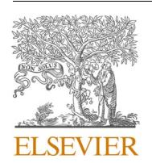
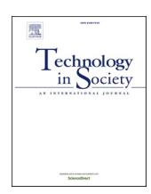
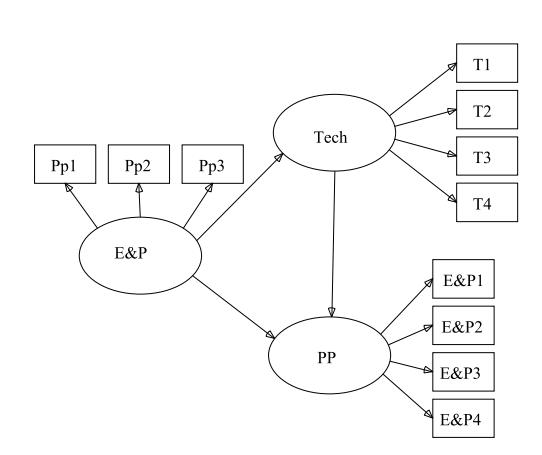
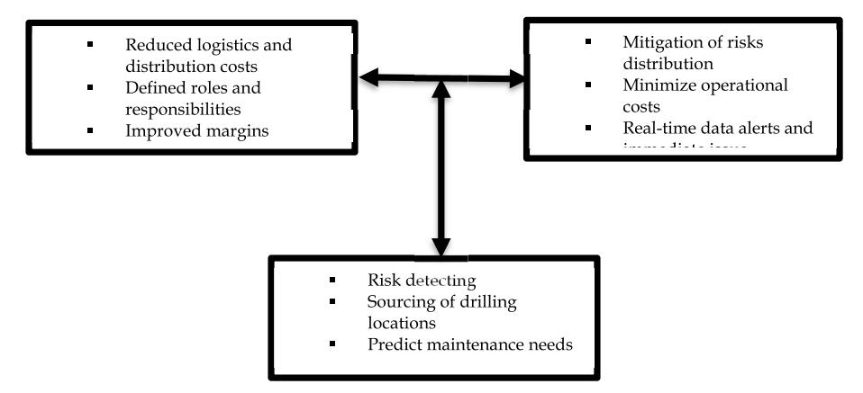
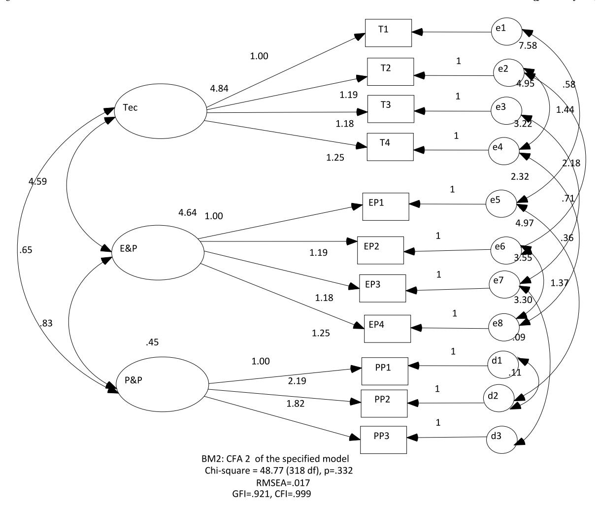
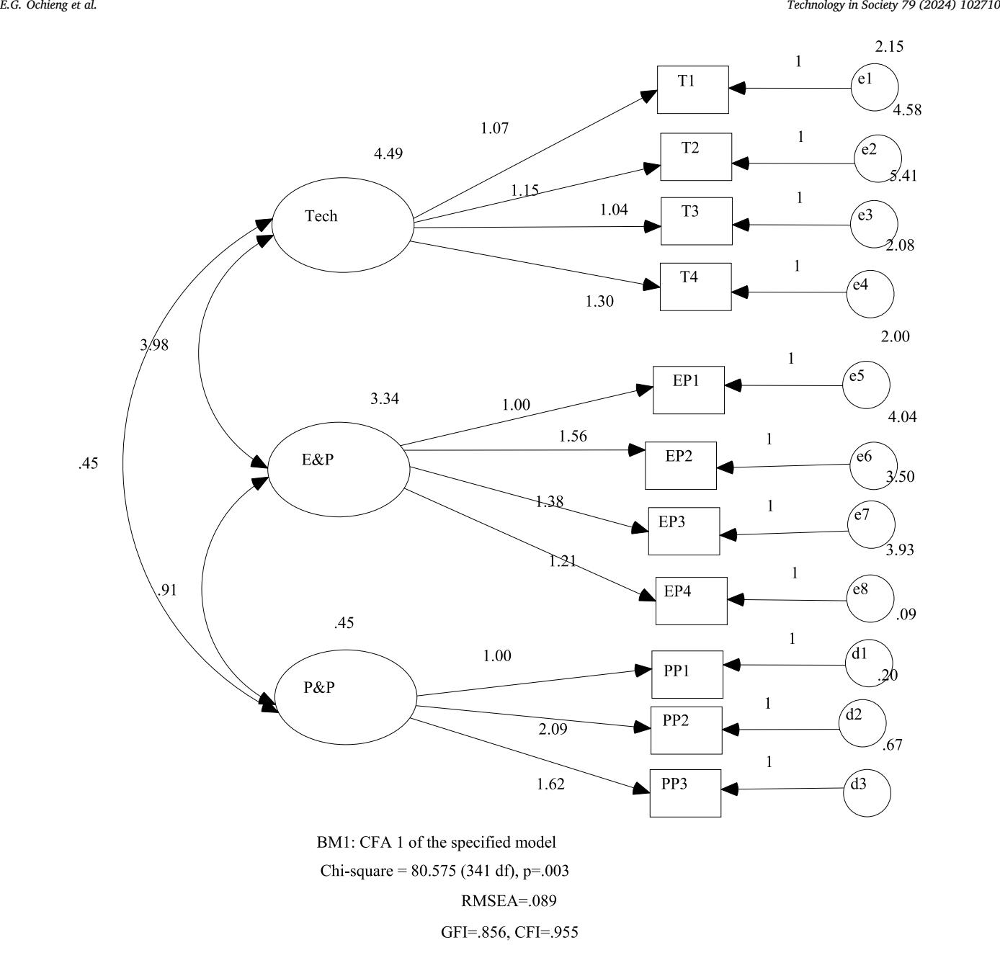
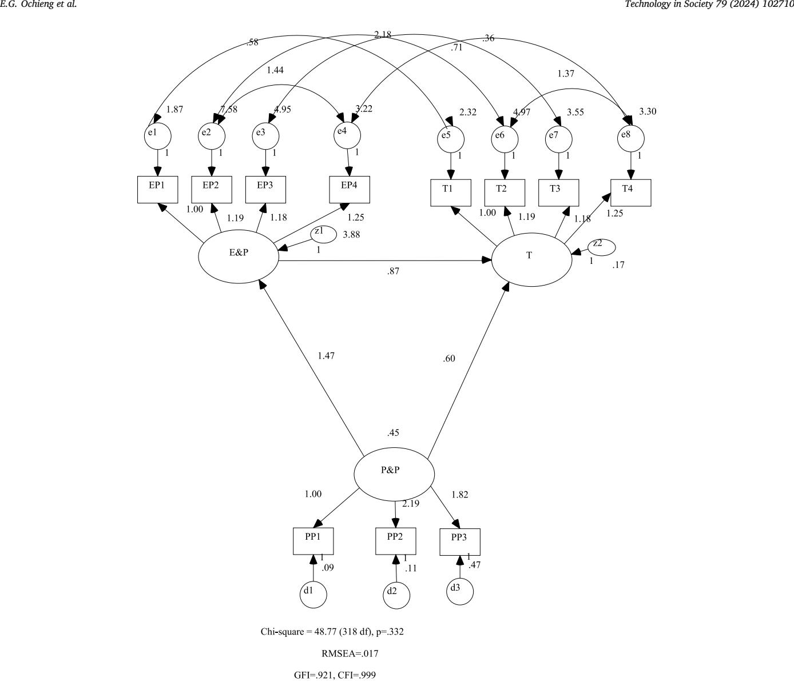

<!-- A3.R73 | source: papers_json/A3.R73/ -->

قوائم المحتويات متاحة على[ ScienceDirect](www.sciencedirect.com/science/journal/0160791X)

## Technology in Society

الصفحة الرئيسية للمجلة: [www.elsevier.com/locate/techsoc](https://www.elsevier.com/locate/techsoc)

## التطبيق المحتمل للذكاء الاصطناعي التوليدي وخوارزميات التعلم الآلي في قطاع النفط والغاز: الفوائد والآفاق المستقبلية

Edward G. Ochieng a,* , Diana Ominde ^b^ , Tarila Zuofa ^c^

- ^a^ *Professor of Project Management, Faculty of Business and Law, The British University in Dubai (BUiD), Dubai, United Arab Emirates*
- ^b^ *Strathmore University, Strathmore Business School, Off Ole Sangale Road, Nairobi, Kenya*
- ^c^ *University of Wisconsin-Parkside, College of Business, Economics, and Computing, Somers, WI USA, United States*

## ARTICLE INFO

## *Keywords:*

Generative artificial intelligence Machine learning algorithm Value chain operations Oil and gas Productivity performance Risk management

## ABSTRACT

مع التقدم السريع للتكنولوجيا والمجتمعات، أصبح قطاع الطاقة العالمي يدرك الآن أن دمج التقنيات الرقمية الحديثة في عملياته وقدراته يمكن أن يحسّن ميزته التنافسية وأداءه في الابتكار وعملياته. علاوة على ذلك، يواجه مشغلو الطاقة أيضًا مهمة كبيرة: كيفية استخدام وتأمين كميات كبيرة من البيانات بأفضل شكل بما يعزز الأداء الإنتاجي المستدام ويقلل التهديدات المحتملة في سلسلة قيمة النفط والغاز وعمليات المشاريع. وفي ضوء ما سبق، تكتسب جوانب مختلفة مثل الذكاء الاصطناعي التوليدي (GAI) وخوارزميات التعلم الآلي (MLA) شعبية متزايدة داخل عمليات قطاع النفط والغاز. لذلك، استكشفنا كيف يمكن لـ GAI وخوارزميات التعلم الآلي أن تعزز الأداء الإنتاجي لسلسلة قيمة النفط والغاز. استُخدم تحليل المكونات الرئيسية (PCA) لتحديد المتغيرات المهمة الخاصة بـ GAI وMLA المؤثرة في الأداء ضمن سلسلة قيمة النفط والغاز، بينما استُخدمت نمذجة المعادلات البنيوية (SEM) لاختبار معادلات الانحدار المرتبطة بتطبيقها. وجدت الدراسة أنه يمكن تقييم محافظ وملامح المخاطر عبر سلسلة القيمة بالاستفادة الفعالة من GAI وخوارزميات التعلم الآلي في العمليات الأولية والوسطى والنهائية. وبينما تحمل هذه النتائج أهمية وتترتب عليها آثار كبيرة للممارسة الحالية، تدعو الورقة إلى أن هناك مجموعة من التقنيات الرقمية بخلاف GAI والتعلم الآلي لا تزال بحاجة إلى الدراسة في الأبحاث المستقبلية لإظهار منظور شامل حول كيفية تحقيق التحول الرقمي عبر سلسلة قيمة قطاع الطاقة وعمليات المشاريع.

## **1.** **Introduction**

يُعد توليد الطاقة واستهلاكها من العناصر المهمة في التنمية الوطنية، إذ يلعبان دورًا حيويًا في النمو الاقتصادي لأي بلد (Mombekova et al. [[1]](#page-12-0). ومع اقتراب العديد من حقول الطاقة الحالية من ذروتها، لا تزال الحاجة العالمية إلى موارد الطاقة في تزايد مستمر. وقد دفع هذا الطلب المتصاعد صناعة النفط والغاز إلى الانتقال نحو مواقع أكثر تعقيدًا لعمليات الاستكشاف والإنتاج، مما نتج عنه العديد من التداعيات واللحظات التحويلية المهمة لأصحاب المصلحة. من بين هذه التداعيات موازنة المفاضلات في السعي لتحقيق ميزة تنافسية مع توسيع العائد على الاستثمارات. كما أن المراقبة الآنية للخزانات وعمليات الآبار باتت تولد اليوم مجموعات بيانات ضخمة، الأمر الذي يستلزم أدوات معالجة وتحليل عالية الكفاءة لاتخاذ القرارات المتعلقة بسلسلة قيمة النفط والغاز [[2](#page-12-0)–4]. وبينما يُعد الذكاء الاصطناعي تقنية متقدمة تمكّن الآلات من محاكاة السلوك البشري، فإن التعلم الآلي (وهو فرع من الذكاء الاصطناعي) يعتمد على خوارزميات ونماذج للتعلم

من البيانات السابقة أو المعرفة الحالية. وكما لوحظ من الأدبيات المستعرضة [[5]](#page-12-0)، أدركت الشركات التجارية إمكانات هذه التطبيقات في تعزيز عملياتها وتحقيق أهدافها التجارية بفعالية. وفي قطاع الطاقة، هناك تبني تدريجي لجوانب متعددة من GAI والتعلم الآلي، وهو عامل يواصل الإسهام في نمو القطاع [[6]](#page-12-0). وقد أكدت دراسات سابقة (انظر المرجع [[7]](#page-12-0)؛ Li et al.*, *2021) أن صناعة الطاقة تتبنى بشكل متزايد جوانب ناشئة من GAI والتعلم الآلي، وهو اتجاه لوحظ أنه أسهم بشكل كبير في توسع الحيز التجاري في الصناعة. وقد أدى ارتفاع قبول هذه المفاهيم التكنولوجية في صناعة الطاقة إلى تحسين عملياتها بشكل ملحوظ على جبهات مختلفة ([[8](#page-12-0),[9](#page-12-0)]; [[10](#page-12-0)]; [[11]](#page-12-0)).

ومن الجدير بالذكر أن صناعة النفط والغاز تواجه مجموعة كبيرة من التحديات في عملياتها التشغيلية [[12](#page-12-0)]. أشار Patel وPatwardhan [[13](#page-12-0)] إلى أن أوجه القصور التشغيلية في العمليات السفلى والوسطى والعليا لا تزال تتزايد تعقيدًا، مما يستلزم تبني نموذج جديد من حيث

*E-mail addresses: *[Edward.ochieng@buid.ac.ae](mailto:Edward.ochieng@buid.ac.ae) (E.G. Ochieng),[ dominde@strathmore.edu](mailto:dominde@strathmore.edu) (D. Ominde), [zuofa@uwp.edu](mailto:zuofa@uwp.edu) (T. Zuofa).

> ^*^ Corresponding author.

<!-- page 2 -->

تحسين العمليات. وبدءًا من البيئات غير المترابطة التي تؤدي إلى عمليات منفصلة، مرورًا بتكرار توقف التشغيل وضعف تنسيق مسائل الصيانة للآلات، فإن قطاع النفط والغاز يحتاج بالتأكيد إلى نهج أكثر عقلانية لتحسين عملياته. وفي تقييم للتحديات النظامية للعمليات في القطاعين الوسيط والعلوي في صناعة النفط والغاز، يرى Brekke [[12](#page-12-0)] أن هناك دفعًا متزايدًا نحو تبني تطبيقات تكنولوجية متقدمة. وتشير مقارنة للتآكل التكنولوجي في الصناعة إلى أن قطاع النفط والغاز استثمر بشكل أقل في دمج تقنيات GAI والتعلم الآلي في عملياته. ومن الملاحظ أن هناك تبنيًا حثيثًا لمفاهيم تكنولوجية متقدمة مثل GAI والتعلم الآلي في عمليات صناعة النفط والغاز لتحقيق طفرات تكنولوجية في الاستكشاف والتطوير والإنتاج.

كما ثبت من أدبيات الطاقة المستعرضة، قيّم عدد من الباحثين تطبيق الذكاء الاصطناعي والتعلم الآلي في سياقات مختلفة. فعلى سبيل المثال، قدم Sircar et al. [[14](#page-12-0)] مراجعة شاملة لتطبيقات التعلم الآلي والذكاء الاصطناعي. وأظهرت دراستهم كيف يمكن استخدام التعلم الآلي والذكاء الاصطناعي في معالجة وتفسير البيانات في قطاعات مختلفة من صناعة النفط والغاز. وركز Koroteev وTekic [[15](#page-12-0)] على القطاع الأولي (upstream) وحدّدا أحدث اتجاهات الأدوات القائمة على الذكاء الاصطناعي وتأثيرها في تسريع تقليل المخاطر في قطاع النفط والغاز. ولتعزيز قيمة البيانات، ستحتاج مؤسسات النفط والغاز إلى إعادة تصميم وتعديل هياكلها التنظيمية وعملياتها [[15]](#page-12-0). وفي تحليلهم للذكاء الاصطناعي، ركز Aung et al. [[16]](#page-12-0) على ثلاثة مجالات رئيسية: تفسير البيانات الجيولوجية، والتنبؤ بالأسعار، والتنبؤ بنظام التدفق. وكما أكدت دراستهم، سيزيد الذكاء الاصطناعي من كفاءة العمل في الاستكشاف والإنتاج على حد سواء. وسيمكّن هذا الفاعلين في القطاع من تحقيق نتائج أفضل بتكلفة أقل. وقيّم Abdlhamid et al. [[17]](#page-12-0) الأبحاث القائمة على الذكاء الاصطناعي في نطاق الأنشطة الأولية، والتقييم الجيولوجي للخزانات، وتحسين الحفر، وهندسة الخزانات، وتطوير الحقول، وتحسين الإنتاج. وكما جادلوا في دراستهم، يستخدم Abdlhamid et al. [[17]](#page-12-0) الذكاء الاصطناعي بفعالية في العمليات والإنتاج؛ وسيُطلب من القطاع دعم تطوير البنية التحتية للذكاء الاصطناعي (الخوارزميات ومجموعات البيانات) وتخصيص أدوات تعزز الطيوف الستة المذكورة أعلاه. علاوة على ذلك، لاحظ الباحثون أن الذكاء الاصطناعي والتعلم الآلي سيسرّعان العمليات ويقللان المخاطر في العديد من العمليات التجارية في القطاع. جمع Sattari et al. [[18](#page-12-0)] بين المعرفة الخبيرة وتحليلات البيانات (الذكاء الاصطناعي، التعلم الآلي، وتحليل الكلمات المفتاحية) لإنتاج شبكة تفاعل لإدارة سلامة الأصول (AIM). ووفقًا لـ Sattari et al. [[18]](#page-12-0)، يمكن استخدام الذكاء الاصطناعي لتحديد أهم المحددات المؤثرة في إدارة سلامة الأصول. ودعا Lichun et al. [[19]](#page-12-0) إلى أن تقنية الذكاء الاصطناعي ستوفر زخمًا جديدًا للاختراقات العلمية عبر السلسلة الصناعية الكاملة للنفط والغاز. ووفقًا لـ Lichun et al. [[19]](#page-12-0)، سيشمل اتجاه التطوير المستقبلي القطاعات التالية: المعدات الذكية، وتعزيز إدارة البيانات، وتحسين تدريب المواهب، وتعزيز التعاون والمشاركة.

بالنظر إلى الدراسات المذكورة أعلاه، هدفت هذه الورقة إلى تقييم كيف يمكن لـ GAI والتعلم الآلي تعزيز الأداء الإنتاجي في سلسلة قيمة قطاع النفط والغاز. وكان السؤال البحثي الرئيسي الذي تتناوله هذه الدراسة هو: كيف يمكن لتطبيقات GAI والتعلم الآلي أن تعزز الأداء الإنتاجي في سلسلة قيمة النفط والغاز؟ ولتحقيق الهدف والإجابة عن السؤال البحثي، اعتمدنا أساليب بحثية إجرائية للتحقق من تطبيق GAI والتعلم الآلي في تعزيز الأداء الإنتاجي في سلسلة قيمة النفط والغاز. علاوة على ذلك، وفي سياق التطور النظري، صُغنا وطبّقنا GAI والتعلم الآلي باستخدام فروع فرعية موجودة مسبقًا لكليهما. وبذلك، اعتمدنا خمس مراحل من توضيح النظرية، وهي: المقارنة الأفقية، والمقارنة العمودية، وتحديد بناء جديد، وهيكلة علاقات محددة، وهيكلة علاقات متسلسلة، وهيكلة علاقات تكرارية [[20]](#page-12-0). وتجريبيًا، استخدمنا SEM للتحقق من تطبيق GAI والتعلم الآلي في تعزيز الأداء الإنتاجي في سلسلة قيمة النفط والغاز. ومن خلال اعتماد عملية الهندسة العكسية والتوضيح النظري، نقدم توضيحًا نظريًا لـ GAI والتعلم الآلي في سلسلة قيمة النفط والغاز.

## **2.** **Background**

## *2.1.* *GAI and ML in the oil industry value chain*

تظل صناعة النفط والغاز والجوانب الأساسية لسلسلة قيمتها (الأولية، والوسطى، والنهائية) بالغة الأهمية لتلبية الطلب العالمي على الوقود الأحفوري، لكنها ترتبط أيضًا بمخاطر وتعقيدات فريدة تتطلب نُهجًا تكنولوجية مبتكرة. وعلى نطاق واسع، برز الذكاء الاصطناعي (AI) كتقنية واعدة لإدارة بعض هذه التعقيدات. وتُعد خوارزميات GAI والتعلم الآلي أساسية لتعزيز المرونة، خصوصًا في بيئات متنوعة وغير متوقعة مثل سلسلة قيمة صناعة النفط، من خلال توفير استراتيجيات موثوقة ومدروسة جيدًا.

يضم القطاع الأولي أنشطة تتعلق أساسًا بالتعدين والاستكشاف وتطوير الحقول وإنتاج النفط الخام. ولتحقيق ذلك جميعًا، يطبق القطاع طرقًا متنوعة لصنع قرارات تجارية مستنيرة يمكن أن تزيد حجم الإنتاج، وتقلل التكاليف، وتعزز السلامة، وتحسن الأداء التشغيلي، وتحمي البيئة [21–[23]](#page-12-0). ومن الجدير بالذكر أن معظم الأنشطة الموصوفة أعلاه تنطوي على مشكلات صنع قرار معقدة تتضمن حالات عدم يقين، مع الحاجة إلى مدخلات كبيرة من أصحاب المصلحة الأوسع في الصناعة. وتشير الأدبيات المستعرضة ([[21](#page-12-0),[22]](#page-12-0); Sheremetov et al.*, *2013) إلى توافر مجموعة من طرق دعم صنع القرار النوعية والكمية (DMS) لدعم أصحاب المصلحة في القطاع الأولي. وقد أدى تطبيق هذه الطرق إلى فهم أفضل لخصائص الحقل والخزان، وكيفية تبني استراتيجيات إنتاج بديلة مثل تقنيات الإنتاج منخفض الكربون التي تقود في نهاية المطاف قرارات تجارية أكثر تبريرًا لتطوير الحقول الجديدة والقائمة. ووفقًا لـ Bratvold et. al [[24](#page-12-0)]، يمكن لطرق DMS تسهيل الامتثال لمتطلبات التنظيم وإدارة المخاطر مع دعم أداء الاختبارات الفنية والتشخيصية للمعدات. وتشمل طرق DMS الشائعة المستخدمة في القطاع الأولي أساليب البحث العملياتي مثل البرمجة الخطية، وطرق التحليل الاقتصادي، وتحليل التكلفة والعائد، وتحليل الخيارات الحقيقية، وطرق التقييم البيئي. وعلى الرغم من أن Strantzali وAravossis [[25](#page-12-0)] أشارا إلى أن النُهج أحادية المعيار هيمنت تاريخيًا على صنع القرار في القطاع الأولي، فإن التعقيدات والمصالح المتباينة في عملية صنع القرار أدت أيضًا إلى تطبيق أوسع لتقنيات التقييم متعددة المعايير. ويمكن لهذه التقنيات أن تراعي في آن واحد سمات متعددة تتعلق بمشكلة صنع قرار ما، مثل تقنية الحفر أو اختيار السفينة، واختيار استراتيجيات الصيانة المناسبة لأنظمة ومكونات مختلفة على منصات النفط والغاز، وتحديد أنسب عمليات إيقاف التشغيل للمرافق في القطاع الأولي. ومع ذلك، ولمراعاة أوجه عدم اليقين المرتبطة بالتصور والخبرة الذاتية للممارسين، وعدد من التعقيدات المذكورة سابقًا، أصبحت العمليات الأولية تُدمَج تدريجيًا بأشكال متنوعة من GAI والتعلم الآلي لتعزيز أداء سلاسل القيمة. فمثلًا، لتحسين الاستخلاص وإطالة الجدوى الاقتصادية، أقرّ Chavan et al. [[26](#page-12-0)] بأن تقنية الاستخلاص المعزز للنفط (EOR) بالغة الأهمية لاستخراج كميات كبيرة من الهيدروكربونات من الخزانات المتراجعة في الحقول القائمة والناضجة. لذلك حدّدوا خمس خوارزميات تعلم آلي لتطوير منهجية قياسية قائمة على البيانات لفرز EOR. ومن بين الخوارزميات الخمس، أشارت نتائج دراستهم إلى أن مصنف الغابة العشوائية أظهر أفضل أداء تنبؤي مقارنة بطرق التصنيف الأخرى.

طوّر Temirchev et al. [[27]](#page-12-0) نهجًا للتنبؤ بأداء الخزان، يتيح التنبؤ بمعدل التدفق وإدارة ديناميكيات الضغط وتشبع السوائل داخل الخزانات. وأسفر جزء من نتائج دراستهم عن زيادة سرعة نمذجة الخزان، مما يشهد على كيفية تغيير ابتكارات الذكاء الاصطناعي للمشهد الأولي. ولمزيد من التوضيح لتزايد شعبية GAI والتعلم الآلي في العمليات الأولية، حدّد Sneed [[28]](#page-12-0) العوامل الرئيسية وراء أعطال المضخات الكهربائية الغاطسة (ESP) (وهي مشكلة تشغيلية مكلفة) وتحقق مما إذا كان بالإمكان التنبؤ بعمر

<!-- page 3 -->

المضخة بدقة باستخدام تقنيات النمذجة التنبؤية. ولتحقيق ذلك، استخدم Sneed [[28](#page-12-0)] تطبيقات التعلم الآلي لتنفيذ الصيانة التنبؤية للمضخات الكهربائية الغاطسة واختيار أنظمة التشغيل المثلى المتعلقة بتكاليف الإنتاج مقابل التشغيل. وبالمثل، طبّق Hedge وGray [[29](#page-12-0)] استخدام التعلم الآلي للتنبؤ بمعدل الاختراق وزيادته بفعالية. وهدفت دراستهما إلى ضمان أفضل تواصل بين الجزء المنتج من التطوير، وبئر الحفر، والسرعة العليا لبناء البئر عند أدنى خطر للفشل. وأدى هذا إلى خفض الوقت غير المربح إلى ما بين 20 و50٪ في المتوسط مع انخفاض قدره نحو 90٪ في حالات الفشل مع نمو وتطبيق التعلم الآلي. وحدد Koroteev وTekic [[15]](#page-12-0) ثلاث فرص رئيسية لتطبيق GAI في هندسة الخزانات. تتعلق الأولى بالحسابات التي تُجرى بأدوات نمذجة الخزانات التقليدية. وارتبطت الفرصة التالية بالتوسع الترتيبي (upscaling)، الذي يعني نقل المعلومات المكتسبة من مقاييس مختلفة للدراسات الجيوفيزيائية إلى نموذج جيولوجي وهيدروديناميكي واحد للخزان. أما الفرصة الثالثة، المشابهة للتوسع الترتيبي، فتتضمن استخدام التعلم الآلي أو العميق لجعل مطابقة التاريخ (history matching) أسرع وأقل تحيزًا. وإلى جانب تطبيق GAI في هندسة الخزانات، أظهرا أيضًا كيف يقلل ذلك بشكل إيجابي من الأثر المحتمل للكوارث المرتبطة بصحة الموظفين وسلامتهم وبيئة عملهم.

وبالانتقال إلى القطاع الوسيط، يركز هذا القطاع أساسًا على نقل المنتجات (المكررة وشبه المكررة وغير المكررة). وكما أوضح Marchenko وBabyr [[30](#page-12-0)]، لا يزال اختيار وسيلة النقل للمنتجات يشكل تحديًا خطيرًا عبر سلسلة الإنتاج في صناعة النفط والغاز. ولمعالجة هذه المسألة، أشارت دراستهما إلى أهمية تحديد مسار توصيل عقلاني لتبرير اختيار وسيلة نقل معينة مع مراعاة توقيت تسليم المنتجات واعتبارات التكلفة. وعلى الرغم من أن إحدى الطرق الحالية لنقل منتجات البترول تتم عبر خطوط الأنابيب، فقد لاحظ Kraidi et al. [[31](#page-12-0)] أنه رغم شعبيتها وسلامتها واقتصاديتها، لا تزال هناك مخاوف تتعلق بالسلامة والأمن في بعض أجزاء العالم ذات البيئات غير الآمنة تاريخيًا وسجلات السلامة الضعيفة. لذلك، وللحفاظ على قطاع وسيط مزدهر في ظل هذه الظروف، هناك حاجة إلى تبني مستمر لتقنيات مبتكرة يمكنها الاستجابة الاستباقية للبيئات التشغيلية المتغيرة. ومع ذلك، ونظرًا للتعقيدات الكامنة، قد يكون التكامل الإلكتروني الشائع للأدوات التي تدعم إمداد المنتجات، وتوزيع السفن، وجدولة خطوط الأنابيب، والتخزين غير كافٍ بسبب التعقيدات المتأصلة في القطاع الوسيط. بل إن المطلوب هو نهج موحد لتحسين القطاع الوسيط باستخدام GAI والتعلم الآلي. وبناءً عليه، هناك أيضًا العديد من الفرص لتطبيق GAI والتعلم الآلي في القطاع الوسيط. وفي الولايات المتحدة، أدرك Xiao et. al [[32](#page-12-0)] الإسهام الحاسم لخطوط أنابيب الغاز الطبيعي في تحقيق هدف المناخ الطموح المتمثل في خفض انبعاثات غازات الدفيئة بحلول عام 2030. وبناءً عليه، طوّروا نموذجًا فعالًا وموثوقًا للتنبؤ بأعطال خطوط أنابيب نقل الغاز باستخدام بيانات الأعطال التاريخية. وقد عزز نموذجهم دقة التنبؤ بأعطال خطوط أنابيب الغاز، مما وفر رؤى قيمة لتحسين ممارسات السلامة وإدارة المخاطر.

ومن المجالات الأخرى ذات الاهتمام لـ GAI والتعلم الآلي في القطاع الوسيط إدارة سلامة خطوط الأنابيب (PIM). ووفقًا لـ Kishawy وGabbar [[33]](#page-12-0)، تشمل PIM فحص خطوط الأنابيب واختبارها وإصلاحها وتقييمها وصيانتها. وفي حين أن هذه الأنشطة بالغة الأهمية لسلامة وعمر البنية التحتية للقطاع الوسيط، فإنها تولد مجموعات بيانات ضخمة بسبب عوامل مثل طول خط الأنابيب وعدد المستشعرات والأدوات المطلوبة لتقييم حالة خط الأنابيب والبنية التحتية الأخرى. ومن المهم الإشارة إلى أن توليد مجموعات بيانات ضخمة من أنشطة PIM يؤدي عادة إلى تحديات في إدارة البيانات ومعالجتها بسبب حجمها وتنوعها وسرعتها. ويمكن أن يترتب على ذلك تحليل يدوي معقد قد يكون مستهلكًا للوقت وعرضة للأخطاء. ومع ذلك، وعلى جانب إيجابي، كشف Xing et al. [[34]](#page-12-0) أنه يمكن تطبيق التعلم الآلي لاستيعاب مجموعات البيانات الضخمة واستخراج المعلومات والمعرفة منها. وأكدت دراسات أخرى أجراها Loebbecke وPicot [[35](#page-12-0)] أن خوارزميات التعلم الآلي يمكن أن تنشئ عمليات

إدارة سلامة خطوط أنابيب مبسّطة من خلال تعزيز الإنتاجية، وتوفير معالجة معلومات مستقلة، وتقليل الاعتماد على التحليل اليدوي والتقليدي للبيانات.

ومع تصاعد النشاط المسلح والسلوك المارق في بعض مناطق النفط والغاز حول العالم، اقترح Osegi (n.d.) نظام مراقبة تنبؤي قائمًا على الذكاء الاصطناعي قادرًا على التصنيف التنبؤي والتعرف على الأنماط في مجموعات بيانات خطوط الأنابيب. وبالمثل، طوّر Eze et. al [[36](#page-12-0)] نظامًا متكاملًا لمراقبة خطوط أنابيب النفط والتخفيف من الحوادث (IOPMIMS)، لمراقبة خطوط الأنابيب بفعالية وتوفير معلومات قابلة للتنفيذ عبر تطبيق أطر موزعة ونهج تفكير قائم على الحالات. وقدّم Canelon et. al [[37](#page-12-0)] مخططًا إشرافيًا قائمًا على أنظمة متعددة الوكلاء كمنهجية للإشراف الذكي على العمليات الصناعية ذات التحكمات التغذوية المتعددة. وكان أحد الأجزاء الجديدة في هذا المخطط الإداري المُحسَّن بالتعلم الآلي إدخال وكيل مشرف عام لديه القدرة على وضع آليات تضمن تحقيق الأهداف العامة للعملية الصناعية بأكملها. واستخدم Sinha et al. [[38](#page-13-0)] نظام وكلاء متعدد كمجال أساسي للذكاء الاصطناعي للتعامل مع عمليات سلسلة إمداد البترول. وبالمقارنة مع ممارسات سلسلة الإمداد التقليدية، أدى تطبيق تقنية الوكلاء المتعددين إلى سلسلة إمداد أسرع. وكجزء من نموذجهم، قادت وكلاء الإمداد وكلاءُ داعمون رتّبوا لتعزيز تكلفة النظام الفرعي المحددة مسبقًا، مما أنتج شبكة مخزون أقل تكلفة. ولاحظ Julka et al. [[39]](#page-13-0) أن أنظمة دعم القرار الخاصة بالمصافي (DSSs) لا تدمج جميع عمليات صنع القرار في المصافي للتواصل مع أنظمة أخرى تدعم أقسامًا مختلفة في آن واحد. لذلك، اقترحوا نموذجًا ومحاكيًا متكاملًا لسلسلة إمداد مصافي البترول (PRISMS)، وهو إطار قائم على الوكلاء لأنظمة دعم القرار في سلسلة الإمداد يحاكي سلسلة إمداد المصفاة ويدعم شراء النفط الخام. ومقارنة بالأنظمة القائمة التي تستخدم البرمجة الرياضية، كان النهج الذي اعتمده Julka et al.*, * *(*2002) أكثر مرونة والتقط بشكل مباشر الطبيعة النوعية والمعاملاتية لسلسلة الإمداد في صناعة النفط والغاز.

القطاع الأخير من صناعة النفط والغاز قيد الدراسة هو القطاع النهائي (downstream). يركز هذا القطاع على العملية المتعلقة بتكرير النفط والغاز وتحويلهما إلى منتجات نهائية. وأشارت روايات Patel et al.*, *(2020) إلى أن القطاع النهائي هو مجال أعمال معقد وقائم على المعلومات مع أحجام متزايدة أضعافًا مضاعفة من المعلومات. وفي الآونة الأخيرة، برزت الحاجة إلى أن يتعامل القطاع مع التقاط ومراقبة قدر أكبر من المعلومات واستخراج البيانات المفيدة من المعلومات المتاحة. كما رأت دراستهم أن التطورات والابتكارات ضمن هذا القطاع أدت إلى خفض التكاليف التشغيلية، وتحسين جودة المخرجات، وتقليل الأثر السلبي على البيئة [[40]](#page-13-0).

هناك العديد من الأمثلة الأخرى التي توضح الأثر الإيجابي لـ GAI على الأداء في القطاع النهائي. طبّق Qing [[41](#page-13-0)] GAI في التخطيط والجدولة، وتحسين وحدة العمليات، والصيانة الوقائية للمعدات في العمليات النهائية. وتوصل جزء من الدراسة إلى أن أنظمة التخطيط والجدولة المتقدمة على المستوى الجزيئي يمكن أن تحقق قياس أداء التكلفة بحسب مخططات إنتاج مختلفة لأنواع متنوعة من النفط الخام القابل للمعالجة. وأخيرًا، ونظرًا لأن التنبؤ بالطلب على الغاز الطبيعي يُعد من أهم خطوات التخطيط والتشغيل السليم لأنظمة إمداد الغاز الطبيعي، أوضح Sharma et al. [[42](#page-13-0)] أهمية موازنة العرض والطلب على الغاز الطبيعي باستمرار. لذلك طوّروا نموذجًا هجينًا قصير الأجل للتنبؤ بالغاز الطبيعي باستخدام خوارزميات تعلم آلي متنوعة.

وكما لاحظ الباحثون [[9,](#page-12-0)[43]](#page-13-0)، فإن رقمنة جميع الأنشطة الاقتصادية تحدث بسرعة كبيرة. وحتى الآن، تشير مجموعة مختارة من الدراسات المستعرضة من الأدبيات إلى أن هذا ينطبق على صناعة النفط والغاز. فعلى سبيل المثال، لاحظ Waqar et al.*, *(2023) أن استثمارات كبيرة قد أُجريت عالميًا، بما في ذلك 52.9 مليار دولار من الولايات المتحدة، و4.6 مليار دولار من المملكة المتحدة، و17.2 مليار دولار من الصين، لتعزيز تطبيقات الذكاء الاصطناعي في مختلف القطاعات الصناعية، بما فيها النفط والغاز. وعلى وجه التحديد، لاحظ Kuang et. al [[5](#page-12-0)] أن العديد من عمالقة النفط العالميين قد استفادوا الآن من GAI لتوليد حلول لمختلف مراحل تصميمهم وإنتاجهم

<!-- page 4 -->

بأنشطتهم. ويمكن الخلوص إلى أن GAI يحمل العديد من السمات الإيجابية في سلسلة قيمة صناعة النفط لأنه يعزز ابتكار المنتجات، ويزيد كفاءة الطاقة، ويدعم تحسينات تحويل طاقة الهيدروكربونات. وأخيرًا، توقّع تقرير US EIA [[44]](#page-13-0) أن يشهد استهلاك الطاقة العالمي نموًا مطردًا حتى عام 2050. ومن هذا التوقع، نعتقد أن استخدام GAI والتعلم الآلي سيستمر في التزايد في صناعة النفط والغاز في المستقبل المنظور، إذ ستكون هناك حاجة لتبني تقنيات متنوعة لتطوير الحقول القائمة والناشئة. وعلى الرغم من هذه الإمكانات، لاحظ Tariq et. al [[45](#page-13-0)] أن هناك عدة عيوب مرتبطة بنماذج التعلم الآلي. ويتمثل أحد التحديات في توافر البيانات ودقتها المستخدمة لبناء النماذج واختبارها. ويجب أن تكون البيانات دقيقة لإنتاج نماذج مفيدة. لذلك، نؤكد أن البحث في GAI وتطبيقه لتعزيز الأداء الإنتاجي في سلسلة قيمة النفط والغاز سيظل مجالًا واعدًا. والقسم التالي مخصص لمنهج البحث، والنتائج، والمناقشة، والاستنتاجات.

## **3.** **Method and empirical setting**

قُسّم القسم التالي الخاص بالمنهج إلى خمسة أجزاء.

- Data collection and sampling protocols
- Principal component analysis
- Structural equation modelling analysis
- Manifest variables
- General structural equation model hypothesised

## *3.1.* *Data collection and sampling protocols*

أُجري جمع البيانات على ثلاث مراحل، هي: تضييق نطاق المحددات كما حُددت أثناء مراجعة الأدبيات، وتصميم الاستبيان، وإجراء دراسة تجريبية، وتوزيع استبيان المسح. ورُتّبت عملية تجريبية من ثلاث مراحل: أُعطيت نسخة أولية من الاستبيان لأكاديميين اثنين: أحدهما متخصص في التحليل الإحصائي والآخر متخصص في تصميم الاستبيانات الإلكترونية. وكان الستة أكاديميين ذوو الخبرة الآخرون على دراية بمجال إدارة المشاريع، وGAI، والتعلم الآلي، وعمليات النفط والغاز. وتم تلقي ملاحظات من كل أكاديمي وأُجريت التعديلات وفقًا لذلك. وفي المرحلة الثانية، وُزّع الاستبيان الإلكتروني المعدّل على خمسة وعشرين ممارسًا كبيرًا ذا خبرة في مجال النفط والغاز. وكان الغرض من الدراسة التجريبية تقييم وضوح الأسئلة وملاءمة المستجيبين وضمان تحديد ودمج متغيرات الإنتاجية الرئيسية. وأُجري تصميم الاستبيان مع الاهتمام الواجب بمجالات التركيز في الاستبيان، والصياغة، والتسلسل، والعرض العام. وضم المستجيبون مديري مشاريع، ومديري مشاريع تنفيذيين، ومخططي مشاريع، ومهندسي طاقة، ومهندسي حفر، وكيميائيين جيولوجيين، ومهندسي تعدين، ومهندسي بترول، ومديري سلسلة إمداد. ووفّر اختيار هؤلاء المستجيبين تمثيلًا للأجزاء الرئيسية من سلسلة قيمة صناعة النفط والغاز. كما مكّن ذلك من التحقق، واستيعاب وجهات النظر التكميلية، وتعديل التحيزات المحتملة للمستجيبين الأفراد. ولضمان تحقيق العدد المناسب من الاستبيانات المكتملة، حُدد هامش الخطأ عند 5٪ ومستوى الثقة عند 95٪. ووُزّع ما مجموعه 500 استبيان إلكتروني على المستجيبين في المملكة المتحدة، والشرق الأوسط، وأفريقيا، وآسيا، وأمريكا الجنوبية؛ وورد 178 ردًا وتم تحليلها كما هو مبيّن أدناه.

أُجريت نمذجة معادلات بنيوية لتقييم عدد من معادلات الانحدار المرتبطة بتطبيق GAI والتعلم الآلي في سلسلة قيمة النفط والغاز في آن واحد. وسبق تحليل SEM تقليصٌ لعدد المتغيرات في كل من الفئات الثلاث التي جرى تقييمها كمجالات محورية تأثرت فيها عمليات قطاع النفط والغاز بتطبيق GAI والتعلم الآلي. ولتحقيق ذلك، أُجري تحليل مكونات رئيسية (PCA) لاستكشاف المتغيرات التي تفسر بشكل ملحوظ المتغيرات المختبَرة. وبحسب

Choubey وKarmakar [[46]](#page-13-0)، فإن PCA طريقة لمعالجة أولية للبيانات عالية الأبعاد بهدف تقليل أبعادها، مما يسهّل دراستها باستخدام تقنيات النمذجة.

## *3.2.* *Principal component analysis*

قبل SEM، كان من الضروري تقليص عدد المتغيرات المستخدمة في الدراسة. طُبّق PCA للمتغيرات الترتيبية المقاسة وفق مقاييس ليكرت لتقييم تطبيق تقنيات GAI والتعلم الآلي في دعم صناعة النفط والغاز؛ وقيس ما مجموعه 12 متغيرًا وفق مقياس ليكرت من خمس نقاط. وكمعالجة لاحقة للبيانات، أُجري اختبار للخطية للمتغيرات الترتيبية. علاوة على ذلك، تم إثبات كفاية العينة عبر مقياس Kaiser-Meyer-Olkin (KMO) لكفاية أخذ العينات لمجموعة البيانات بأكملها.

## *3.2.1.* *GAI And ML techniques in supporting oil and gas industry*

- 1. Automate and optimise data-rich processes
- 2. Mitigation of risks
- 3. Planning of system downtime
- 4. Removal of redundancy
- 5. Minimise operational costs
- 6. Actionable information regarding the health of the equipment
- 7. Adherence to deliverables
- 8. Adherence to the digital process
- 9. Automated report generation and sharing
- 10. Real-time data alerts and immediate issue resolutions
- 11. Minimise operational costs
- 12. Clear key performance indicators

قيّمت الدراسة جوهر استراتيجية GAI والتعلم الآلي من عملية الاستكشاف وحتى مراحل الإنتاج في قطاع النفط والغاز. وفي هذا الصدد، استُخدمت 10 متغيرات فرعية وفق مقياس ليكرت من خمس نقاط. وأُجري PCA لتقليص هذه المتغيرات الفرعية واستبعاد المترابطة منها لاستخدامها في تحليل SEM.

## *3.2.2.* *GAI and ML strategy from exploration to production sub-variables*

- 1. Improve project design and evaluation
- 2. Enable unmanned drilling operations
- 3. Increase the reliability on the ecosystem
- 4. Predict maintenance needs
- 5. Rig diagnostic bots
- 6. Risk detecting
- 7. Sourcing of drilling locations
- 8. Reservoir management
- 9. Production parameter optimisation
- 10. Field equipment management

قيّمت المناقشة كذلك تطبيق GAI والتعلم الآلي في تحسين الأداء الإنتاجي. وفي هذا الصدد، استُخدم ما مجموعه عشرة متغيرات، قيست وفق مقياس ليكرت من خمس نقاط. وشملت هذه المتغيرات ما يلي.

## *3.2.3.* *Productivity performance*

- Drilling optimisation and automation
- Product optimisation
- Enhanced field operations
- Digitalised-enabled logistics
- Smart maintenance
- Reduced logistics and distribution costs
- Improved margins
- Defined roles and responsibilities
- Improved emissions management

<!-- page 5 -->

• Improved ability to assess and analyse competitor moves

## *3.3.* *Structural equation modelling (SEM) analysis*

أُجري تحليل SEM باستخدام وحدة SPSS AMOS. ويرتكز تحليل SEM على عدة افتراضات جرت مراعاتها أثناء هذا التحليل الإحصائي. ويرى Kelloway [[47]](#page-13-0) أن نمذجة المعادلات البنيوية (SEM) هي امتداد مرن لكنه مفصّل لتحليل النموذج الخطي العام. ولاحظ Bentler وChou [[48]](#page-13-0) أن هذه الافتراضات ينبغي التأكد منها أو تقريبها على الأقل حتى تكون نتيجة التحليل موثوقة وصالحة. ويُعد افتراض حجم العينة أساسيًا في تحليل SEM. واقترح Loehlin [[49]](#page-13-0) أن حجم عينة قدره 15 حالة لكل متنبئ هو الأنسب للانحدار المتعدد القياسي بطريقة المربعات الصغرى العادية (OLS). وقد جرى اعتماد هذا الاقتراح لتحليل SEM أيضًا كافتراض معقول. بيد أن Bentler وChou [[48]](#page-13-0)، في تقييمهما لصياغة المعايير القابلة للاستخدام في تحليل SEM، كشفا أن الباحثين الراغبين في إجراء تحليل SEM يمكنهم اعتبار عدد حالات يصل إلى خمس حالات فقط لكل تقدير معيار. إلا أن هذا يُنصح به فقط إذا كانت مجموعة البيانات موزعة توزيعًا طبيعيًا وخالية من القيم الشاذة أو الحالات المفقودة.

وكشفت ملاحظة دقيقة لمناقشات Barrett [[50](#page-13-0)] أنهم يذكرون خمس حالات لكل تقدير معيار بدلًا من كل متغير مقاس. ومن الجدير بالذكر أن Streiner [[51]](#page-13-0) يقر بأن المتغيرات المقاسة عادةً ما ترتبط بمعامل مسار واحد على الأقل مع متغير آخر في تحليل SEM، بالإضافة إلى تضمين حد بقايا أو تقدير للتباين. وما يعنيه هذا، في ضوء مناقشات Bentler وChou (2016)، هو أن تحليل SEM ينبغي أن يكون 15 حالة كحد أدنى لكل متغير مقاس. ومع ذلك، ومن منظور أعم، خلص Loehlin [[49](#page-13-0)]، أثناء عرضه نتائج دراسة محاكاة مونت كارلو من خلال تطبيق نموذج تحليل عاملي توكيدي، إلى أن الباحثين بحاجة إلى التخطيط لجمع 100 إدخال على الأقل في البحث. وتصبح صلاحية التحليل الإحصائي موضع شك إذا استُخدمت أحجام عينات أصغر. ويذكر Barrett [[50]](#page-13-0)، على سبيل المثال، حالات فشل التقارب وتقديرات التباين السلبية للخطأ الخاصة بالمتغيرات المقاسة في البحث. كما تأتي أحجام العينات الأصغر في تحليل SEM مصحوبة بمستوى دقة منخفض بشكل ملحوظ للمعايير. ومن الجدير بالذكر أن الأخطاء المعيارية في تحليلات SEM يمكن حسابها بشكل كافٍ عند اعتماد أحجام عينات أكبر. وقد رُوجعت مجموعة البيانات المختارة وتحققت جميع الافتراضات.

كان الهدف الذي رُوعي في نمذجة المعادلات البنيوية بالدراسة هو تحديد تطبيق GAI والتعلم الآلي في تعزيز الأداء الإنتاجي في سلسلة قيمة النفط والغاز. ورُوعيت عدة موضوعات أو عوامل رئيسية في تقييم تطبيق GAI والتعلم الآلي في عمليات النفط والغاز. وشملت هذه ما يلي.

- ⁃ Productivity performance;
- ⁃ GAI and ML strategy from exploration to production sub-variables; and
- ⁃ GAI and ML techniques in supporting the oil and gas industry.

ومن الجدير بالذكر أنه، من خلال PCA، استُخدم ما مجموعه ثلاثة متغيرات فرعية في كل من المجالات الموضوعية الثلاثة أعلاه. وشملت الرموز المضمّنة في النموذج لتمثيل العوامل المتنوعة المرتبطة بتطبيق GAI والتعلم الآلي في سلسلة قيمة النفط والغاز ما يلي (انظر الجداول 1–3).

**Sources: **Prepared by the authors (2024)

**Sources: **Prepared by the authors (2024)

**Sources: **Prepared by the authors (2024)

## *3.4.* *Manifest variables*

كانت المتغيرات المقاسة في مجموعة البيانات قيمًا فئوية قيست ضمن المحاور الفرعية الرئيسية الثلاثة. وقد صُنّفت ضمن ثلاثة مجالات موضوعية رئيسية كما أشير سابقًا في نموذج PCA. وكان المجال الموضوعي الأول هو تطبيق تقنيات GAI والتعلم الآلي في دعم صناعة النفط والغاز بإجمالي 12 مجالًا فرعيًا. وتحت الموضوع الأول، قيس ما مجموعه 12 متغيرًا ملحوظًا. ومع ذلك، وبعد PCA، اختيرت أربعة متغيرات للدراسة كمتغيرات مختارة في تقييم تطبيق GAI والتعلم الآلي في دعم صناعة النفط والغاز. وتُعد هذه المتغيرات الملحوظة، كما هو موضح في الجدول 3، موزعة توزيعًا طبيعيًا بما يتوافق مع ما كشف عنه Barrett [[50]](#page-13-0). وكان الموضوع الثاني هو تطبيق استراتيجية GAI والتعلم الآلي من الاستكشاف إلى الإنتاج في صناعة النفط والغاز. وقبل PCA، كان هناك ما مجموعه 10 متغيرات (ملحوظة) موجودة (الجدول 1)؛ ولكن بعد PCA، اختيرت ثلاثة متغيرات ملحوظة لاستخدامها في تحليل SEM لأنها فسّرت جزءًا كبيرًا من التباين فيما يتعلق بالمجال الموضوعي الثاني. وكان المجال الموضوعي الثالث هو تطبيق GAI والتعلم الآلي في الأداء الإنتاجي. وقلّل PCA عدد المتغيرات الملحوظة من 10 متغيرات أصلية إلى ثلاثة متغيرات تفسّر معظم التباين. وفي هذا الصدد، استُخدمت 9 متغيرات ملحوظة في تحليل SEM (انظر الجدول 2). وتم تأكيد أن المتغيرات الملحوظة في الدراسة موزعة توزيعًا طبيعيًا بما يتوافق مع ما كشف عنه Hoe [[52]](#page-13-0).

## *3.4.1.* *Latent variables*

كما هو موضح في[ الشكل 1،](#page-5-0) ترتبط المتغيرات الملحوظة في الدراسة معًا لتشكيل المتغيرات الكامنة. وتحت الموضوع الأول، كان المتغير الكامن هو المجال الموضوعي الأول، وهو تطبيق GAI والتعلم الآلي في قطاع النفط والغاز. وكان المتغير الكامن الثاني يمثل تطبيق GAI والتعلم الآلي في الأداء الإنتاجي لعمليات النفط والغاز. وكان المتغير الكامن الثالث هو تطبيق استراتيجية GAI والتعلم الآلي من الاستكشاف إلى الإنتاج. وكما أُشير سابقًا، توافقت المتغيرات الكامنة في الدراسة مع الافتراض الرئيسي في تحليل SEM من حيث توزيعها – فهي ذات توزيع طبيعي متعدد المتغيرات. وافتُرض وجود علاقة خطية بين المتغيرات الكامنة أثناء التحليل وعدم وجود تعدد خطية.

## *3.4.2.* *Endogenous and exogenous variables*

استُخدمت المجالات الموضوعية الثلاثة المصنّفة كمتغيرات كامنة كمتغيرات داخلية (endogenous). ويستند هذا التصنيف إلى فكرة أن المجالات الموضوعية الرئيسية المحددة في البحث (انظر[ الشكل 2](#page-5-0)) فُسّرت بواسطة المتغيرات الملحوظة (انظر [الشكل 1](#page-5-0)). وفي المقابل، صُنّفت المتغيرات الملحوظة

<!-- page 6 -->

***Fig. 1.** Observed variables. **Sources: **Prepared by the authors (2024)*

***Fig. 2.** Latent variables. **Sources: **Prepared by the authors (2024)*

في الشكل 1 كمتغيرات مستقلة في الدراسة لأنه لم يفسّرها أي متغير آخر. وكما اقترح Barrett [[50](#page-13-0)]، جرى استكشاف تباين مشترك بين المتغيرات المستقلة.

## *3.4.3.* *Convergent validity*

يشير الصدق التقاربي (convergent validity) إلى أن الارتباطات بين الأسئلة المكوّنة لبناء معين مرتفعة [[52]](#page-13-0). وفي طريقة نمذجة المعادلات البنيوية، من المنطقي تقييم نتائج التحليل العاملي التوكيدي (CFA) لتحديد الصدق التقاربي للمقاييس المطبقة في قياس الأبعاد التي تشكل النموذج المفاهيمي للبحث. وكان PCA أداة مهمة في تقييم الصدق التقاربي للدراسة. وأُجري اختبار Bartlett للكروية، إلى جانب مقياس Kaiser-Meyer-Olkin، لتحديد مدى ملاءمة مجموعة البيانات لتحليل المكونات الرئيسية.

## *3.5.* *General structural equation model hypothesised*

افترض تقييم تطبيق GAI والتعلم الآلي في عمليات النفط والغاز أن هذه العمليات تستفيد من تعلم GAI والتعلم الآلي بأشكال مختلفة. ويوضح الشكل 2 الفرضية التي طُوّرت لتقييم العلاقة بين العوامل العديدة والمساهمة العامة لهذه العوامل في تحسين عمليات النفط والغاز وإجراءاته.

يفترض النموذج المقترح ما يلي.

- ⁃ *H1: *يمكن تطبيق GAI والتعلم الآلي في عمليات النفط والغاز لتقليل التكاليف التشغيلية.
- ⁃ *H2: *يساعد GAI والتعلم الآلي في تفعيل التنبيهات الآنية للبيانات وحل المشكلات الفوري دعمًا لقطاع النفط والغاز.
- ⁃ *H3: *يحسّن GAI والتعلم الآلي أساليب التخفيف من المخاطر في صناعة النفط والغاز.
- ⁃ *H4: *يعزز GAI والتعلم الآلي الكشف عن المخاطر في الاستكشاف والإنتاج في عمليات النفط والغاز.
- ⁃ *H5: *تحسّن التخفيف من المخاطر في عمليات النفط والغاز من خلال تطبيق GAI والتعلم الآلي.
- ⁃ *H6: *حسّن GAI والتعلم الآلي عملية تحديد مواقع الحفر في عمليات الاستكشاف والإنتاج للنفط والغاز.
- ⁃ *H7: *قلّل تطبيق GAI والتعلم الآلي في عمليات النفط والغاز من تكاليف التوزيع واللوجستيات في عمليات النفط والغاز.
- ⁃ *H8: *تستفيد عمليات النفط والغاز من GAI والتعلم الآلي لتحديد الأدوار والمسؤوليات فيها.
- ⁃ *H9: *ساعد التطبيق الشامل لعمليات النفط والغاز في تحسين العوائد الهامشية في صناعة النفط والغاز.

عُبّر عن نموذج القياس في الدراسة بالمعادلات أدناه. ويمثل حد الخطأ خطأ القياس المتأصل في

<!-- page 7 -->

المتغيرات الملحوظة.

- 1. **Productivity performance **= reduced logistics and distribution costs + defined roles and responsibilities + improved margins + error.
- 2. **GAI and ML techniques in supporting oil and gas industry **= risk detecting + Sourcing of drilling locations + predict maintenance needs + error.
- 3. **GAI and ML strategy from exploration to production **= minimise operational costs + real-time data alerts and immediate issue resolutions + mitigation of risks + error.

## **4.** **Results and model development**

## *4.1.* *Productivity performance*

فيما يتعلق بالأداء الإنتاجي، اختيرت ثلاثة عوامل باعتبارها تفسّر بشكل ملحوظ تطبيق GAI في الأداء الإنتاجي. وكما هو مبيّن في الجدول 4 أعلاه، تشمل هذه: خفض تكاليف التنسيق والتوزيع *(23.2 %)، *وتحديد الأدوار والمسؤوليات *(16.4 %) *وتحسين الهوامش *(14.0 %).*

## *4.2.* *GAI and ML strategy from exploration to production*

فُسّر تطبيق GAI والتعلم الآلي من الاستكشاف إلى الإنتاج بأربعة عوامل بشكل ملحوظ. وكما يتضح في [الجدول 5](#page-7-0) أدناه، تشمل هذه العوامل التي فسّرت المتغير بشكل ملحوظ: الكشف عن المخاطر *(17.6 %)، *وتحديد مواقع الحفر *(15.0 %)، * والتنبؤ باحتياجات الصيانة *(13.9 %) *والالتزام بالمخرجات *(11.2 %). *ويوضح [الجدول 5](#page-7-0) أدناه الملخص الناتج.

## *4.3.* *GAI and ML techniques in supporting the oil and gas industry*

كما هو موضح في [الجدول 6](#page-7-0) أدناه، تشمل العوامل التي فسّرت بشكل ملحوظ تطبيق تقنيات GAI والتعلم الآلي في عمليات النفط والغاز: الكشف عن المخاطر *(29.2 %)، *وتحديد مواقع الحفر *(14.2 %)*، والتنبؤ باحتياجات الصيانة *(11.8 %)*، وتحسين تصميم المشروع وتقييمه *(10.7 %)*.

## *4.4.* *Structural equation modelling (SEM analysis)*

## *4.4.1.* *Specification of the model*

من *CFA، **χ**2 *(*3 44) *= *119.92، **ρ **< 0.05*؛ وكان خطأ تقريب متوسط جذر المربعات *(RMSEA) *= *0.05*. علاوة على ذلك، أشارت النتيجة إلى أن مؤشر الملاءمة التوكيدي (CFI) = 0.77 ومؤشر الملاءمة المعياري المقتصد *(PNFI) *= *0.56. *ومن الجدير بالذكر أن التقديرات المعيارية للمعايير المحللة هنا كانت ذات دلالة إحصائية *(**ρ **< **α**)*. وكان هذا متسقًا مع الفرضيات المحددة. كما حلّلت الدراسة المعايير الفردية التي شكّلت النموذج. وأشارت التنبؤات إلى أن المتغير الكامن، GAI والتعلم الآلي في دعم النفط

والغاز، ارتبط ارتباطًا إيجابيًا ذا دلالة إحصائية مع عوامل المؤشر: تقليل التكاليف التشغيلية *(T1) (r*= 0.76, ρ *<* 0.05)؛ والتنبيهات الآنية للبيانات وحل المشكلات الفوري *(T2) *= *(r*= *0.87, **ρ **< 0.05)؛ * والتخفيف من المخاطر *(T3) (r*=*0.92, **ρ **< 0.05)*. كما ارتبط المتغير الكامن، الإنتاجية والأداء، ارتباطًا إيجابيًا ذا دلالة إحصائية بمؤشرات العوامل؛ تحسين الهوامش (pp1) (r = 0.73, ρ *<* 0.05)؛ وتحديد الأدوار والمسؤوليات (pp2) (r = 0.69, ρ *<* 0.05)؛ وخفض تكاليف التنسيق والتوزيع *(Pp3) (r*=*0.89, **ρ **< 0.05)*. ومن الجدير بالذكر أن المتغير الكامن، استراتيجية GAI والتعلم الآلي من الاستكشاف إلى الإنتاج، ارتبط ارتباطًا إيجابيًا ذا دلالة إحصائية بالعوامل المرتبطة به؛ الكشف عن المخاطر *(E**&**P1) (r*=*0.78, **ρ **< 0.05)؛ *وتحديد مواقع الحفر (E&P2) (r = 0.69, ρ *<* 0.05)؛ والتنبؤ باحتياجات الصيانة (E&P3) (r = 0.87, ρ *<* 0.05).

## *4.5.* *Hypothesised model*

هناك إمكانية لعدة تطبيقات لـ GAI والتعلم الآلي في تعزيز الأداء الإنتاجي في قطاع النفط والغاز. ولتطبيقات GAI والتعلم الآلي القدرة على تعزيز التخطيط اللوجستي والتوزيعي في قطاع النفط والغاز. ويمكن تسهيل التنسيق بين الموردين والعملاء داخل الصناعة من خلال GAI والتعلم الآلي. علاوة على ذلك، فإن جوانب مثل التنبؤ بالطلب، وتخطيط الإمداد، وأتمتة المستودعات، وفحص الأضرار، والصيانة التنبؤية، والتسعير الديناميكي، هي بعض جوانب اللوجستيات والتوزيع التي يمكن تفعيلها بجوانب متنوعة من GAI. ويمكن أيضًا أن تكون تطبيقات GAI والتعلم الآلي أساسية في محفظة إدارة الموارد البشرية. ويمكن تصنيف تحديد الأدوار والمسؤوليات، كمفهوم في عمليات النفط والغاز، ضمن نطاق إدارة الموارد البشرية. ويرى النموذج المطور، كما هو موضح في[ الشكل 3،](#page-7-0) أن مفاهيم GAI والتعلم الآلي من المرجح أن توفر إطارًا مهمًا للتوظيف والتأهيل. علاوة على ذلك، فإنه يوفر إطارًا مهمًا لأتمتة المهام الإدارية فيه. وفي تطوير النموذج في[ الشكل 3](#page-7-0)، يمكن تصوّر مفهوم الموارد البشرية في GAI والتعلم الآلي من خلال هذين الجانبين لإدارة الموارد البشرية - أتمتة الأدوات الإدارية وإدارة الموظفين. وتساعد هذه الجوانب في إضافة قيمة إلى العمليات في قطاع النفط والغاز.

يعمل الأساس المنطقي لتطبيق GAI والتعلم الآلي في قطاع النفط والغاز على خفض التكاليف التشغيلية الإجمالية في القطاع [[21](#page-12-0), [53]](#page-13-0)؛ [[54](#page-13-0)]. ويحدد هذا النموذج مفهوم تحسين الهوامش كعامل حاسم في العمليات فيه. لكن بخلاف تحسين العوائد الهامشية في عمليات الصناعة، يمكن لصناعة النفط الاستفادة من GAI والتعلم الآلي في تبسيط عمليات السوق وكذلك الإدارة اللوجستية [[55](#page-13-0)]. وبالتالي، فإن الأثر العام يتمثل في أن تطبيق نماذج GAI والتعلم الآلي أمر بالغ الأهمية لتحسين الهوامش الإجمالية في الصناعة. وفي مناقشة تطبيق GAI والتعلم الآلي في الاستكشاف والإنتاج، أكد Li et al. [[56](#page-13-0)] أن مسألة المخاطر بالغة الأهمية. وتدمج الصناعة GAI والتعلم الآلي في عمليات الاستكشاف لتعزيز الدقة فيها [[11](#page-12-0),[56,57]](#page-13-0). وستعتمد آفاق النفط على GAI والتعلم الآلي لتقدير حجم احتمالات الهيدروكربونات والتفسير الزلزالي، وهو عامل خطر رئيسي في عمليات النفط والغاز.

**Extraction Method: **Principal Component Analysis.

**Sources: **Prepared by the authors (2024)

<!-- page 8 -->

**Extraction Method: **Principal Component Analysis.

**Sources: **Prepared by the authors (2024)

**Extraction Method: **Principal Component Analysis.

**Sources: **Prepared by the authors (2024)

***Fig. 3.** Hypothesised model. **Sources: **Prepared by the authors (2024)*

يقر هذا النموذج بأن إدارة المخاطر، وتحديد مواقع الحفر، وصيانة المعدات هي تطبيقات مهمة لـ GAI والتعلم الآلي في عمليات النفط والغاز.

كان الغرض من التشغيل الأول للنموذج، كما هو موضح في [الشكل 4](#page-8-0)، هو التأكد مما إذا كان النموذج المحدد نموذج قياس جيدًا. وكان نموذج القياس المعتمد هنا هو CFA التطابقي (congeneric)، ما يعني أن جميع العوامل في النموذج كانت لها علاقات ترابطية.

*4.6.* *Application of GAI and ML in oil and gas operations: measurement * *model*

## *4.6.1.* *Model re-specification*

تشير نتيجة التحليل إلى أن النموذج الموضح في [الشكل 4](#page-8-0) لا يلائم البيانات بشكل كافٍ.

وهذا يعني أن هناك حاجة للنظر في تحسين النموذج. أُجريت عدة تدخلات لتحسين النموذج

<!-- page 9 -->

***Fig. 4.** Measurement model. **Sources: **Prepared by the authors (2024)*

الأولي المحدد. أولًا، سُمح بأن تكون أخطاء القياس فيه، خاصة لنفس متغير المؤشر بين نقطتين زمنيتين، مرتبطة. وقد رُوعي هذا بشكل رئيسي حتى يتمكن النموذج، كما هو موضح في [الشكل 5](#page-9-0)، من تحديد الأخطاء الذاتية الارتباط (autoregressive errors) فيه بوضوح. ثانيًا، اعتبر النموذج السماح لمعامل المسار، الذي يربط متغير المؤشر بالعامل الداخلي، بامتلاك قيم متشابهة ضمن النقاط الزمنية. وكان التدخل الأخير الذي أُجري للنموذج هو السماح لعدة متغيرات مؤشر بامتلاك خطأ ارتباطي في آن واحد (T2, T4, EP2, EP 6 وPP7).

يمثل [الشكل 5](#page-9-0) أعلاه الحل الثاني؛ وتشير النتيجة إلى أن النموذج يلائم البيانات بشكل ممتاز (مربع كاي = 48.77، (318 درجة حرية)، ρ = 0.435). وأُجري كذلك تحليل SEM العام كتحليل مسار للبيانات، مع الاحتفاظ بخصائص القياس في النموذج الثاني أعلاه ([الشكل 5](#page-9-0)). ومن النموذج المعاد تحديده، أُجري SEM عام كتحليل مسار.[ ويوضح الشكل 6](#page-10-0) ذلك.

يمثل [الجدول 7](#page-11-0) معايير النموذج التي تفسّر نتيجة النموذج المعاد تحديده في [الشكل 6](#page-10-0). ويوضح مدى تفسير كل مقياس للمتغيرات للمتغيرات الكامنة قيد الدراسة، أي تقنيات GAI والتعلم الآلي في دعم صناعة النفط والغاز، والإنتاجية والأداء، واستراتيجية GAI والتعلم الآلي من الاستكشاف إلى الإنتاج.

## *4.6.2.* *Standardised coefficients*

قُدّر معامل المسار المعياري لـ PP على T بـ 0.186. وهذا يعني أن كل ارتفاع بوحدة واحدة من الانحراف المعياري لاستخدام GAI والتعلم الآلي في إنتاجية الإنتاج يزيد الانحراف المعياري لتقنيات GAI والتعلم الآلي في عمليات النفط والغاز بمقدار 0.186 وحدة انحراف معياري.

## *4.6.2.1.* *Direct, indirect, and total effects *

<!-- page 10 -->

***Fig. 5.** Re-specified model. **Sources:** Prepared by the authors (2024)*

Indirect effect of PP on T via E&P

$$
= (1.468)^*(.866) = 1.271 S.E. (indirect effect) = \sqrt{866^2.396^2 + 1.468^2.075^2} = .3602
$$

Critical Ratio (indirect effect) = 1.271/.3602 = 3.5286

## 5. Discussion

كما أوضحت هذه الدراسة، تشهد صناعة الطاقة العالمية تحولًا عميقًا نحو إنتاج وتوزيع طاقة منخفضة الكربون ولامركزية ورقمية. ومن الواضح أن GAI سيكتسب مكانة بارزة في جميع الجوانب التشغيلية لعمليات النفط والغاز، مثل خفض التكاليف، والتحسين، والاستكشاف، والحفر، واختبار الآبار، والتميز التشغيلي. ومن المرجح أن تُطبق مكونات متنوعة من نماذج GAI والتعلم الآلي في مناطق متعددة من عمليات النفط والغاز. علاوة على ذلك، وفي الآونة الأخيرة، وفرت هذه المفاهيم التكنولوجية تطبيقًا مهمًا في إدارة تسجيل البيانات داخل الآبار أثناء الحفر وكذلك في إدارة العمليات الهندسية في الخزان [58,59]. وقد ركزت الاتجاهات الناشئة في نماذج GAI والتعلم الآلي بشدة على تحسين الاستكشاف، وكفاءة الإنتاج، والسلامة، وإدارة المخاطر، وتعزيز الاستدامة البيئية. وبُذلت جهود متضافرة لإدارة المخاطر بفعالية في عمليات النفط والغاز. ويمكن تطبيق GAI والتعلم الآلي في العمليات النهائية والوسطى والأولية لفهم محفظة المخاطر بل وحتى إدارتها. وتشير الدراسة إلى أنه

يمكن تطبيق عناصر متعددة من GAI والتعلم الآلي لنمذجة ملامح المخاطر ليس فقط في العمليات الوسطى، بل عبر سلسلة القيمة بأكملها في عمليات قطاع النفط.

تتسم عمليات النفط والغاز بعمليات تشغيلية شديدة التعقيد ولكل منها تحديات فريدة [60–62]. وبالنظر إلى المشهد التجاري في قطاع النفط والغاز، فمن الضروري تحسين هذه العمليات. وفي هذا السياق، يمكن تسخير تقنيات GAI والتعلم الآلي لتحسين ضوابط العمليات. وقد بُذلت جهود كبيرة في عمليات النفط والغاز لمعالجة ليس فقط العمليات الفنية في قطاع النفط والغاز، بل أيضًا لمعالجة المسائل الإدارية المرتبطة بالعمليات فيه. ويمكن لعمليات صناعة النفط والغاز تبني مفاهيم GAI والتعلم الآلي في استخراج البيانات المعقدة في العمليات البحرية. ويمكن توجيه هذا نحو تحسين البنية التشغيلية العامة في سلسلة قيمة النفط والغاز. ومن الجدير بالذكر أنه يجري حاليًا تنفيذ حلول حوسبة حديثة لتعزيز إمكانية الوصول إلى البيانات الحيوية اللازمة لعمليات الصناعة للتأثير في عملية صنع القرار [63,64]. وقد وجدت هذه الجوانب التكنولوجية الرئيسية تطبيقًا مهمًا في اكتشاف فرص استكشاف أحدث، وبالتالي معالجة مسألة تكاليف العمليات في عمليات النفط والغاز.

وتشير الأدلة المستخلصة من المنشورات الحالية Balaji et al. [65] وQing [41] وSettemsdal et al. [66] إلى أن تطبيقات GAI والتعلم الآلي ستجد طريقها حتى في إدارة عمليات السوق في قطاع النفط والغاز. وفي حين أن التفعيل الشامل

<!-- page 11 -->

***Fig. 6.** Re-specified model. **Sources: **Prepared by the authors (2024)*

لهذا التطبيق عمل على جعل المشغلين أكثر تنافسية في السوق، فمن الملاحظ أيضًا أن تطبيق هذه البنى التحتية سيستمر في تعزيز مواقعهم في السوق. واقترح Khan et al. [[67](#page-13-0)] وKosanic وMilutinovic [[68](#page-13-0)] أن مفاهيم GAI والتعلم الآلي تُطبّق حاليًا لفهم ملف السوق في عمليات النفط والغاز. وتشير الاقتراحات هنا من البيانات إلى أنه يمكن تفعيل GAI والتعلم الآلي لنمذجة السوق في الصناعة؛ ويمكن أن يمكّن هذا العمليات فيها من امتلاك فهم أوسع لهيكلها السوقي العام، مما يمنحها سيطرة أقوى على كيفية الوصول إلى السوق. ومع بروز تحليلات البيانات الضخمة، يجد المشغلون في قطاع النفط والغاز باستمرار قيمة في تطبيق جوانب وتقنيات متنوعة مرتبطة بعمليات GAI والتعلم الآلي.

وفي تطوير إطار للتطبيق التكنولوجي في عمليات النفط والغاز، يشير Aminzadeh [[69](#page-13-0)] بإيجاز إلى أن الجانب التنبؤي لمفاهيم GAI والتعلم الآلي يمكن أن يقدم إسهامًا مهمًا في إدارة العمليات المالية في الصناعة. وأكد Khan et al.*, *(2019) أن الأثر العام لنماذج الذكاء الاصطناعي والتعلم الآلي سيسهم بشكل كبير في خفض النفقات الرأسمالية في عمليات النفط والغاز. واقترح Kandziora [[57]](#page-13-0) أن

المنصات الرقمية تساعد مشغلي الصناعة على تحسين مصفوفتهم التشغيلية من حيث عمليات التكلفة. وبناءً عليه، يمكن لتطبيقات العمليات والتقنيات التخريبية في عمليات النفط والغاز أن تخفض التكاليف بما يصل إلى 50 مليار دولار سنويًا في أنشطة النفط والغاز الأولية وحدها [[64]](#page-13-0). ومن الناحية المفاهيمية، إذن، من الملاحظ أن نماذج GAI والتعلم الآلي ستستمر في تحديد ملامح النظام البيئي التشغيلي في قطاع النفط والغاز، ليس فقط في العمليات الأولية بل بالتساوي في العمليات الوسطى والنهائية أيضًا [[69,70](#page-13-0)]. ولا يسعى المشغلون في الصناعة فقط إلى أتمتة وبالتالي تحسين المراحل الأولية من دورة حياة الاستكشاف والإنتاج، بل أيضًا في إدارة العمليات الوسطى [[71]](#page-13-0).

وتؤكد النتائج هنا تصريحات Mohan et al. [[71]](#page-13-0) بأن أهمية هذه التطبيقات التكنولوجية في قطاع النفط والغاز رفعت الطلب على هذه التطبيقات في الصناعة. واقترح Kosanic وMilutinovic [[68]](#page-13-0) أن معدل تبني هذه التقنيات سيزداد بشكل كبير في العقد القادم بما يصل إلى 22٪ استنادًا إلى أهميتها الحالية. وتشير هذه التقييمات إلى أن مستقبل الصناعة قائم على تطبيق هذه الجوانب التكنولوجية [[72]](#page-13-0). ومن الأمثلة الميدانية الأخرى التي توضح مزايا تطبيق GAI والتعلم الآلي تصنيف السحنات الجيولوجية

<!-- page 12 -->

**Sources: **Prepared by the authors (2024)

أو تصنيف الصخور البتروفيزيائية. علاوة على ذلك، تم تسهيل تقييم خصائص الصخور الزلزالية من خلال هذه التطبيقات. وتُطبّق حاليًا القدرة التنبؤية لـ GAI والتعلم الآلي في التنبؤ بالخصائص البتروفيزيائية أو الجيوميكانيكية أثناء عملية الإنتاج [[13]](#page-12-0). وفي حالات أخرى، تم تفعيل القدرة على نمذجة أدوات التسجيل ماديًا من خلال تطبيقات GAI والتعلم الآلي.

وكما بيّنت هذه الدراسة، يمتد تطبيق GAI والتعلم الآلي عبر العمليات الأولية والوسطى والنهائية. ويتمثل أحد أهم جوانب هذه التطبيقات، كما ذُكر سابقًا، في "تطبيق تقنيات GAI والتعلم الآلي في الأداء الإنتاجي لعمليات سلسلة قيمة النفط والغاز". ونعتقد أن مفاهيم GAI والتعلم الآلي ستستمر في إيجاد تطبيقات ذات معنى لدعم الصناعة من عملية الاستكشاف وحتى عمليات إضافة القيمة في الصناعة. وبمعنى ما، إذن، ستكون أهمية GAI والتعلم الآلي هائلة في القطاع.

## **6.** **Conclusion**

تُبرز الهيمنة العالمية للاحتياطيات البنية والخضراء المعقدة أهمية النهج التشغيلية ونماذج الأعمال المعاصرة في استكشاف الطاقة وإنتاجها. ولا تزال هذه النهج بحاجة إلى القدرة على ضمان ربحية مناسبة لإنتاج النفط والغاز؛ ولذلك صُممت هذه الدراسة لتقييم كيف يمكن استخدام GAI والتعلم الآلي للاستفادة من الأداء الإنتاجي في سلسلة قيمة النفط والغاز. وكما ثبت من الأدبيات المستعرضة، يُعد تحقيق الفعالية التشغيلية والأداء الإنتاجي أمرًا حاسمًا للفاعلين في صناعة النفط والغاز للبقاء مربحين والحفاظ على رضا عالٍ للعملاء. وكما بيّنت هذه الدراسة،

صُمم تطبيق GAI والتعلم الآلي في قطاع النفط والغاز لإحداث ثورة في سلسلة إمداد النفط والغاز عبر إعادة تشكيل المنافسة في الصناعة، وتحسين التنبؤ بالإنتاج عبر أصول عديدة، وتحسين الكفاءة التشغيلية ومخرجات حقول النفط. وتشير نتائج الدراسة إلى أن تطبيق نماذج GAI والتعلم الآلي سيستمر في توفير سبيل مهم للتخفيف من المخاطر في عمليات النفط والغاز، وخفض التكاليف التشغيلية فيها، وحل المشكلات الناشئة، وأتمتة العمليات الغنية بالبيانات.

وكما بيّنت هذه الدراسة، ستلعب خوارزميات GAI والتعلم الآلي دورًا مهمًا في وصف الخزانات ونمذجتها. وسيتيح هذا لمشغلي النفط والغاز القدرة على تحليل كميات هائلة من البيانات، بما فيها البيانات الزلزالية وبيانات الإنتاج. ومن خلال تطبيق خوارزميات GAI والتعلم الآلي، سيتمكن مشغلو النفط والغاز من التنبؤ بسلوك الخزان، وتقدير الاحتياطيات، وتحسين استراتيجيات الإنتاج. ويمكن أيضًا استخدام خوارزميات GAI والتعلم الآلي للتنبؤ بأعطال المعدات قبل حدوثها. ويتيح هذا خفض تكاليف الصيانة، والجدولة، وتقليل التوقف عن العمل، وتعزيز السلامة من خلال تجنب أعطال المعدات غير المتوقعة. علاوة على ذلك، وكما أشارت هذه الدراسة، يمكن استخدام خوارزميات GAI والتعلم الآلي لتحليل بيانات جيولوجية وجيوفيزيائية ضخمة. وسيتيح هذا لمشغلي النفط والغاز تحديد الأنماط والاتجاهات التي قد تشير إلى وجود رواسب نفط وغاز، مما يمكّن المشغلين من اتخاذ قرارات مستنيرة بشأن مواقع الحفر وكيفية توزيع تكاليف استكشافهم. وستلعب GAI والتعلم الآلي أيضًا دورًا حيويًا في تعزيز عمليات السلامة وإدارة المخاطر، مما يتيح للمشغلين تحديد المخاطر المحتملة، وتقييم المخاطر، وتطوير نهج أكثر فعالية للتخفيف من المخاطر. ومن خلال تقييم بيانات الإنتاج وتصنيف مناطق عدم الكفاءة، يمكن للمشغلين استخدام خوارزميات GAI والتعلم الآلي لتحسين عملياتهم، وتقليل استهلاكهم من الطاقة والمواد الخام، وخفض توليد النفايات. ومع تقدم خوارزميات GAI والتعلم الآلي التوليدية، سيصبح تطبيقها من قِبل أصحاب المصلحة في النفط والغاز لتحليل مجموعات البيانات المعقدة في الاستكشاف أكثر شيوعًا. وتحديدًا، في القطاع النهائي، يمكن توظيف خوارزميات GAI والتعلم الآلي لتحسين كل مرحلة من مراحل عملية الإنتاج، مما يؤدي إلى زيادة المخرجات، وتقليل النفايات، وتعزيز الربحية.

## *6.1.* *Theoretical contributions, empirical implications, future research * *directions and limitations*

لنتائج الدراسة عدة تداعيات على الممارسة المستقبلية. ولضمان استخلاص القيمة من عقود من البيانات لأداء الصيانة الوصفية وتحسين أداء الأصول، سيلزم العمل على تحديد كيفية تمكين خوارزميات GAI والتعلم الآلي لإدارة أصول النفط والغاز. وكما بيّنت هذه الدراسة، يتجاوز تطبيق خوارزميات GAI والتعلم الآلي إنشاء عمليات فعالة. وقد أظهرنا أن خوارزميات GAI والتعلم الآلي تمتلك إمكانية الاستفادة من الإنتاجية وتحقيق الفعالية الرأسمالية عبر سلسلة القيمة؛ من أنشطة الاستكشاف الأولية وحتى المستخدم النهائي. لم تُقيَّم بعض المحاور البحثية في هذه الدراسة، لكن جرى تحديدها كمحاور للبحث المستقبلي. وقد حُددت هذه المحاور بشكل خاص للبحث المستقبلي. ومن الضروري دراسة تطوير تطبيقات متكاملة لـ GAI والتعلم الآلي تكون مرنة في مواجهة تقلبات أسعار النفط. وكيف يمكن استخدام نماذج التوائم الرقمية (Digital Twins) تشغيليًا للتنبؤ بتدهور أداء الأصول وتشخيصه والتنبؤ به. وعلى الرغم من وجود أبحاث كبيرة في تطبيق الذكاء الاصطناعي والتعلم الآلي، لا تزال هناك حاجة لتحديد كيفية استخدام خوارزميات GAI والتعلم الآلي لتوسيع نطاق واستخراج بيانات آنية صالحة، خصوصًا من منظور الاكتشاف والتطوير. علاوة على ذلك، هناك حاجة لمزيد من البحث لتقييم أثر GA1 والتعلم الآلي مع الروبوتات والأتمتة على السلامة، والكفاءة التشغيلية، وتحسين الصيانة. بالإضافة إلى ذلك، هناك حاجة لدراسة كيف يمكن استخدام تقنيات رقمية أخرى بخلاف GAI والتعلم الآلي لتحسين قدرات التنبؤ في استكشاف النفط والغاز؛ أي كيف يمكن استخدام هذه التقنيات لتوفير تنبؤات أكثر دقة لسلوك الخزان، ومعدلات الإنتاج، وأداء المعدات. وسيمكّن هذا من اتخاذ قرارات أفضل، وتحسين استراتيجيات تطوير الحقول، وتعظيم كفاءة الإنتاج.

<!-- page 13 -->

وبعيدًا عن الاعتبارات التشغيلية الأساسية، تحتاج الدراسات المستقبلية إلى تطوير أطر لمعالجة المخاوف الأخلاقية ومخاطر الأمن السيبراني المرتبطة بالذكاء الاصطناعي والتعلم الآلي في قطاع الطاقة، بما يضمن نشرًا أكثر أمانًا ومسؤولية لهذه التقنيات. ومن خلال معالجة هذه الفجوات واستكشاف هذه الاتجاهات المستقبلية، يمكن للبحوث اللاحقة بناء فهم أكثر شمولًا لكيفية إحداث الذكاء الاصطناعي والتعلم الآلي ثورة محتملة في قطاع النفط والغاز ودفع الميزة التنافسية والابتكار.

## **Conflict of interest**

none.

## **Declarations**

none.

## **Funding**

none.

## **Disclosure statement**

The authors report there are no competing interests to declare.

## **Declaration of generative AI in scientific writing**

The authors confirm that GAI and AI assisted technologies have not been used in this manuscript.

## **CRediT authorship contribution statement**

**Edward G. Ochieng: **Writing – review & editing, Writing – original draft, Project administration, Methodology, Formal analysis, Conceptualization. **Diana Ominde: **Writing – original draft, Formal analysis, Data curation. **Tarila Zuofa: **Writing – review & editing.

## **Data availability**

Data will be made available on request.

## **Acknowledgements**

none'

## **References**

- [1] [G. Mombekova, M. Nuragabylov, A. Baimbetova, B. Keneshabayev, B. Izatullayeva, ](http://refhub.elsevier.com/S0160-791X(24)00258-6/sref1) [The relationship between energy consumption, population and economic growth in ](http://refhub.elsevier.com/S0160-791X(24)00258-6/sref1) [developing countries, Int. J. Energy Econ. Pol. 14 (3) (2024) 368](http://refhub.elsevier.com/S0160-791X(24)00258-6/sref1)–374.
- [2] [M. Mohammadpoor, F. Torabi, Big data analytics in oil and gas industry: an ](http://refhub.elsevier.com/S0160-791X(24)00258-6/sref2) [emerging trend, Petroleum 6 (4) (2020) 321](http://refhub.elsevier.com/S0160-791X(24)00258-6/sref2)–328.
- [3] [M.A. Wiering, M. Van Otterlo, Reinforcement learning, Adaptation Learning and ](http://refhub.elsevier.com/S0160-791X(24)00258-6/sref3) [Optimization 12 (3) (2012) 3](http://refhub.elsevier.com/S0160-791X(24)00258-6/sref3)–42.
- [4] [C. Zhan, S. Sankaran, V. LeMoine, J. Graybill, D.O.S. Mey, Application of machine ](http://refhub.elsevier.com/S0160-791X(24)00258-6/sref4) [learning for production forecasting for unconventional resources, in:](http://refhub.elsevier.com/S0160-791X(24)00258-6/sref4) [Unconventional Resources Technology Conference, Denver, Colorado, 22-24 July](http://refhub.elsevier.com/S0160-791X(24)00258-6/sref4) [2019, Society of Exploration Geophysicists, 2019, pp. 1945](http://refhub.elsevier.com/S0160-791X(24)00258-6/sref4)–1954. Unconventional [Resources Technology Conference (URTeC)](http://refhub.elsevier.com/S0160-791X(24)00258-6/sref4).
- [5] [L. Kuang, L.I.U. He, R.E.N. Yili, L.U.O. Kai, S.H.I. Mingyu, S.U. Jian, L.I. Xin,](http://refhub.elsevier.com/S0160-791X(24)00258-6/sref5) [Application and development trend of artificial intelligence in petroleum](http://refhub.elsevier.com/S0160-791X(24)00258-6/sref5) [exploration and development, Petrol. Explor. Dev. 48 (1) (2021) 1](http://refhub.elsevier.com/S0160-791X(24)00258-6/sref5)–14.
- [6] [J. Mendling, G. Decker, R. Hull, H.A. Reijers, I. Weber, How do machine learning, ](http://refhub.elsevier.com/S0160-791X(24)00258-6/sref6) [robotic process automation, and blockchains affect the human factor in business](http://refhub.elsevier.com/S0160-791X(24)00258-6/sref6) [process management? Commun. Assoc. Inf. Syst. 43 (1) (2018) 19.](http://refhub.elsevier.com/S0160-791X(24)00258-6/sref6)
- [7] [A.M. Al-Sabaeei, H. Alhussian, S.J. Abdulkadir, Jagadeesh, Prediction of oil and gas ](http://refhub.elsevier.com/S0160-791X(24)00258-6/sref7) [pipeline failures through machine learning approaches: a systematic review, ](http://refhub.elsevier.com/S0160-791X(24)00258-6/sref7) [Energy Rep. 10 (2023) 1313](http://refhub.elsevier.com/S0160-791X(24)00258-6/sref7)–1338.
- [8] [W.S. Ahmad, K. Salah, R. Jayaraman, I. Yagoob, M. Omar, Blockchain in oil and gas ](http://refhub.elsevier.com/S0160-791X(24)00258-6/sref8) [industry: applications, challenges and future trends, Technol. Soc. 68 (2022) ](http://refhub.elsevier.com/S0160-791X(24)00258-6/sref8) [101941.](http://refhub.elsevier.com/S0160-791X(24)00258-6/sref8)

- [9] [V. Brilliantova, T.W. Thurner, Blockchain in oil and gas industry: applications, ](http://refhub.elsevier.com/S0160-791X(24)00258-6/sref9) [challenges and future trends, Technol. Soc. 57 (2019) 38](http://refhub.elsevier.com/S0160-791X(24)00258-6/sref9)–45.
- [10] K.M. Hanga, Y Kovalchuk, Machine learning and multi-agent systems in oil and gas industry applications, Comput. Sci. Rev. 34 (2019) 100191, [https://doi.org/ ](https://doi.org/10.1016/j.cosrev.2019.08.002) [10.1016/j.cosrev.2019.08.002.](https://doi.org/10.1016/j.cosrev.2019.08.002)
- [11] [Y. Li, Y. Han, Decline curve analysis for production forecasting based on machine ](http://refhub.elsevier.com/S0160-791X(24)00258-6/sref10) [learning, in: SPE Symposium: Production Enhancement and Cost Optimisation,](http://refhub.elsevier.com/S0160-791X(24)00258-6/sref10) [OnePetro, 2017.](http://refhub.elsevier.com/S0160-791X(24)00258-6/sref10)
- [12] [J.S. Brekke, Machine Learning Effects on the Norwegian Oil and Gas Industry, ](http://refhub.elsevier.com/S0160-791X(24)00258-6/sref11) [Universidade Catolica Portuguesa, 2020. MSc Dissertation.](http://refhub.elsevier.com/S0160-791X(24)00258-6/sref11)
- [13] [K. Patel, R. Patwardhan, Machine learning in oil and gas industry: a novel ](http://refhub.elsevier.com/S0160-791X(24)00258-6/sref12) [application of clustering for oilfield advanced process control, in: SPE Middle East ](http://refhub.elsevier.com/S0160-791X(24)00258-6/sref12) [Oil and Gas Show and Conference, OnePetro, 2019.](http://refhub.elsevier.com/S0160-791X(24)00258-6/sref12)
- [14] A. Sircar, K. Yadav, K. Rayavarapu, N. Bist, H. Oza, Application of machine learning and artificial intelligence in oil and gas industry, Petrol. Res. 6 (4) (2021) 379–391, [https://doi.org/10.1016/j.ptlrs.2021.05.009.](https://doi.org/10.1016/j.ptlrs.2021.05.009)
- [15] D. Koroteev, T. Zeljko, Artificial intelligence in oil and gas upstream: trends, challenges, and scenarios for the future, Energy and AI 3 (2021) 10041. [https://](https://www.sciencedirect.com/science/article/pii/S2666546820300410) [www.sciencedirect.com/science/article/pii/S2666546820300410.](https://www.sciencedirect.com/science/article/pii/S2666546820300410)
- [16] Z. Aung, I.S. Mikhaylov, Y.T. Aung, Artificial intelligence methods application in oil industry,", in: 2020 IEEE Conference of Russian Young Researchers in Electrical and Electronic Engineering (EIConRus), 2020, pp. 563–567, [https://doi.org/](https://doi.org/10.1109/EIConRus49466.2020.9039330) [10.1109/EIConRus49466.2020.9039330.](https://doi.org/10.1109/EIConRus49466.2020.9039330) St. Petersburg and Moscow, Russia, 2020,[ https://ieeexplore.ieee.org/abstract/document/9039330.](https://ieeexplore.ieee.org/abstract/document/9039330)
- [17] K. Abdelhamid, T.B. Ammar, K. Laid, Artificial intelligent in upstream oil and gas industry: a review of applications, challenges and perspectives, in: B. Lejdel, E. Clementini, L. Alarabi (Eds.), Artificial Intelligence and its Applications. AIAP 2021, Lecture Notes in Networks and Systems, vol. 413, Springer, Cham, 2022, [https://doi.org/10.1007/978-3-030-96311-8_24](https://doi.org/10.1007/978-3-030-96311-8_24).
- [18] F. Sattari, L. Lefsrud, D. Kurian, R. Macciotta, A theoretical framework for datadriven artificial intelligence decision making for enhancing the asset integrity management system in the oil & gas sector, J. Loss Prev. Process. Ind. 74 (2022) 104648. [https://www.sciencedirect.com/science/article/abs/pii/S0950423 ](https://www.sciencedirect.com/science/article/abs/pii/S0950423021002552) [021002552](https://www.sciencedirect.com/science/article/abs/pii/S0950423021002552).
- [19] [L. Lichun Kuang, H. Liu, Y. Ren, K. Luo, M. Shi, J. Su, X. Li, Application and ](http://refhub.elsevier.com/S0160-791X(24)00258-6/sref17) [development trend of artificial intelligence in petroleum exploration and ](http://refhub.elsevier.com/S0160-791X(24)00258-6/sref17) [development, Petrol. Explor. Dev. 48 (1) (2021) 1](http://refhub.elsevier.com/S0160-791X(24)00258-6/sref17)–14.
- [20] [G. Fisher, H. Aguinis, Using theory elaboration to make theoretical advancements, ](http://refhub.elsevier.com/S0160-791X(24)00258-6/sref18) [Organisational Research Methods 20 (3) (2017) 438](http://refhub.elsevier.com/S0160-791X(24)00258-6/sref18)–464.
- [21] [M. Neuroth, P. MacConnell, F. Stronach, P. Vamplew, Improved modelling and ](http://refhub.elsevier.com/S0160-791X(24)00258-6/sref19) [control of oil and gas transport facility operations using artificial intelligence, in: ](http://refhub.elsevier.com/S0160-791X(24)00258-6/sref19) [Applications and Innovations in Intelligent Systems VII, Springer, London, 2000,](http://refhub.elsevier.com/S0160-791X(24)00258-6/sref19) [pp. 119](http://refhub.elsevier.com/S0160-791X(24)00258-6/sref19)–136.
- [22] [Y.P. Silitonga, Real options method vs discounted cash flow method to analyse ](http://refhub.elsevier.com/S0160-791X(24)00258-6/sref20) [upstream oil and gas projects, PM World Journal IV (VII) (2015) 1](http://refhub.elsevier.com/S0160-791X(24)00258-6/sref20)–26.
- [23] [L.B. Sheremetov, A. Gonzalez-S](http://refhub.elsevier.com/S0160-791X(24)00258-6/sref21) ´ anchez, ´ I. Lopez-Y ´ ´ anez, ˜ A.V. Ponomarev, Time [series forecasting: applications to the upstream oil and gas supply chain, IFAC Proc. ](http://refhub.elsevier.com/S0160-791X(24)00258-6/sref21) [Vol. 46 (9) (2013) 957](http://refhub.elsevier.com/S0160-791X(24)00258-6/sref21)–962.
- [24] [R.B. Bratvold, J.E. Bickel, A. Risk, H.P. Lohne, Value of information in the oil and ](http://refhub.elsevier.com/S0160-791X(24)00258-6/sref22) [gas industry: past, present, and future, SPE Reservoir Eval. Eng. 12 (4) (2009) ](http://refhub.elsevier.com/S0160-791X(24)00258-6/sref22) 630–[638.](http://refhub.elsevier.com/S0160-791X(24)00258-6/sref22)
- [25] [E. Strantzali, K. Aravossis, Decision making in renewable energy investments: a](http://refhub.elsevier.com/S0160-791X(24)00258-6/sref23) [review, Renew. Sustain. Energy Rev. 55 (2016) 885](http://refhub.elsevier.com/S0160-791X(24)00258-6/sref23)–898.
- [26] [H.K. Chavan, R.K. Sinharay, V. Kumar, D. Patel, An approach of using machine ](http://refhub.elsevier.com/S0160-791X(24)00258-6/sref24) [learning classification for screening of enhanced oil recovery techniques, Petrol. ](http://refhub.elsevier.com/S0160-791X(24)00258-6/sref24) [Sci. Technol. (2023) 1](http://refhub.elsevier.com/S0160-791X(24)00258-6/sref24)–19.
- [27] P. Temirchev, M. Simonov, R. Kostoev, E. Burnaev, I. Oseledets, A. Akhmetov, A. Margarit, A. Sitnikov, D. Koroteev, Deep neural networks predicting oil movement in a development unit, Journal of Petroleum Science Engineering 184 (2020) 106513, [https://doi.org/10.1016/j.petrol.2019.106513.](https://doi.org/10.1016/j.petrol.2019.106513)
- [28] [J. Sneed, Predicting ESP lifespan with machine learning, in: SPE/AAPG/SEG ](http://refhub.elsevier.com/S0160-791X(24)00258-6/sref26) [Unconventional. Resources Technology Conference 2017, 2017](http://refhub.elsevier.com/S0160-791X(24)00258-6/sref26).
- [29] [C. Hegde, K.E. Gray, Use of machine learning and data analytics to increase drilling ](http://refhub.elsevier.com/S0160-791X(24)00258-6/sref27) [efficiency for nearby wells, J. Nat. Gas Sci. Eng. 40 (2017) 327](http://refhub.elsevier.com/S0160-791X(24)00258-6/sref27)–335.
- [30] [R. Marchenko, A. Babyr, Digitalisation of arctic logistics management systems for ](http://refhub.elsevier.com/S0160-791X(24)00258-6/sref28) [oil transportation, Transport. Res. Procedia 54 (2021) 953](http://refhub.elsevier.com/S0160-791X(24)00258-6/sref28)–960.
- [31] [L. Kraidi, R. Shah, W. Matipa, F. Borthwick, An Investigation of mitigating the ](http://refhub.elsevier.com/S0160-791X(24)00258-6/sref29) [safety and security risks allied with oil and gas pipeline project: a case study in](http://refhub.elsevier.com/S0160-791X(24)00258-6/sref29) [Iraq, Journal of Pipeline Science and Engineering (2021) 1](http://refhub.elsevier.com/S0160-791X(24)00258-6/sref29)–29.
- [32] [R. Xiao, T. Zayed, M.A. Meguid, L. Sushama, Improving failure modelling for gas](http://refhub.elsevier.com/S0160-791X(24)00258-6/sref30) [transmission pipelines: a survival analysis and machine learning integrated](http://refhub.elsevier.com/S0160-791X(24)00258-6/sref30) [approach, Reliab. Eng. Syst. Saf. 241 (2024) 109672](http://refhub.elsevier.com/S0160-791X(24)00258-6/sref30).
- [33] [H.A. Kishawy, H.A. Gabbar, Review of pipeline integrity management practices, ](http://refhub.elsevier.com/S0160-791X(24)00258-6/sref31) [Int. J. Pres. Ves. Pip. 87 (2010) 373](http://refhub.elsevier.com/S0160-791X(24)00258-6/sref31)–380.
- [34] [E.P. Xing, Q. Ho, P. Xie, D. Wei, Strategies and principles of distributed machine](http://refhub.elsevier.com/S0160-791X(24)00258-6/sref32) [learning on big data, Engineering 2 (2) (2016) 170](http://refhub.elsevier.com/S0160-791X(24)00258-6/sref32)–195.
- [35] [C. Loebbecke, A. Picot, Reflection on societal and business model transformation](http://refhub.elsevier.com/S0160-791X(24)00258-6/sref33) [arising from digitization and big data analytics: a research agenda, J. Strat. Inf.](http://refhub.elsevier.com/S0160-791X(24)00258-6/sref33) [Syst. 24 (3) (2015) 149](http://refhub.elsevier.com/S0160-791X(24)00258-6/sref33)–157.
- [36] [J. Eze, C. Nwagboso, P. Georgakis, Framework for integrated oil pipeline ](http://refhub.elsevier.com/S0160-791X(24)00258-6/sref34) [monitoring and incident mitigation systems, Robot. Comput. Integrated Manuf. 47 ](http://refhub.elsevier.com/S0160-791X(24)00258-6/sref34) [(2017) 44](http://refhub.elsevier.com/S0160-791X(24)00258-6/sref34)–52.
- [37] M.R.A. Canelon, ´ [J. Davila, E.C. Morles, Intelligent supervision of petroleum ](http://refhub.elsevier.com/S0160-791X(24)00258-6/sref35) [processes based on multi-agent systems, WSEAS Trans. Syst. Control 4 (9) (2009) ](http://refhub.elsevier.com/S0160-791X(24)00258-6/sref35) 435–[444.](http://refhub.elsevier.com/S0160-791X(24)00258-6/sref35)

<!-- page 14 -->

- [38] [A.K. Sinha, H.K. Aditya, M.K. Tiwari, F.T.S. Chan, Multi-agent-based petroleum ](http://refhub.elsevier.com/S0160-791X(24)00258-6/sref36) [supply chain coordination: a Co-evolutionary Particle Swarm Optimization](http://refhub.elsevier.com/S0160-791X(24)00258-6/sref36) [approach, in: 2009 World Congress on Nature ](http://refhub.elsevier.com/S0160-791X(24)00258-6/sref36)& Biologically Inspired Computing [(NaBIC), 2009, pp. 1349](http://refhub.elsevier.com/S0160-791X(24)00258-6/sref36)–1354.
- [39] [N. Julka, I. Karimi, R. Srinivasan, Agent-based supply chain management](http://refhub.elsevier.com/S0160-791X(24)00258-6/sref37)—2: a refinery application"[, Comput. Chem. Eng. 26 (12) (2002) 1771](http://refhub.elsevier.com/S0160-791X(24)00258-6/sref37)–1781.
- [40] [H. Patel, D. Prajapati, D. Mahida, M. Shah, Transforming petroleum downstream](http://refhub.elsevier.com/S0160-791X(24)00258-6/sref38) [sector through big data: a holistic review, J. Pet. Explor. Prod. Technol. 10 (2020) ](http://refhub.elsevier.com/S0160-791X(24)00258-6/sref38) [2601](http://refhub.elsevier.com/S0160-791X(24)00258-6/sref38)–2611.
- [41] [W. Qing, Global practice of AI and big data in oil and gas industry, in: In Machine ](http://refhub.elsevier.com/S0160-791X(24)00258-6/sref39) [Learning and Data Science in the Oil and Gas Industry, Gulf Professional ](http://refhub.elsevier.com/S0160-791X(24)00258-6/sref39) [Publishing, 2021, pp. 181](http://refhub.elsevier.com/S0160-791X(24)00258-6/sref39)–210.
- [42] [V. Sharma, U. Cali, B. Sardan, M. Kuzlu, D. Banga, M. Pipattanasomporn, Data](http://refhub.elsevier.com/S0160-791X(24)00258-6/sref40)[driven short-term natural gas demand forecasting with machine learning ](http://refhub.elsevier.com/S0160-791X(24)00258-6/sref40) [techniques, J. Petrol. Sci. Eng. 206 (2021) 108979.](http://refhub.elsevier.com/S0160-791X(24)00258-6/sref40)
- [43] [E. Vigoda-Gadot, S. Mizrahi, The digital governance puzzle: towards integrative](http://refhub.elsevier.com/S0160-791X(24)00258-6/sref41) [theory of humans, machines, and organizations in public management, Technol.](http://refhub.elsevier.com/S0160-791X(24)00258-6/sref41) [Soc. 77 (2024) 102530.](http://refhub.elsevier.com/S0160-791X(24)00258-6/sref41)
- [44] US EIA, International energy outlook (2019) 2019. [https://fossil.energy.gov/app/ ](https://fossil.energy.gov/app/DocketIndex/docket/DownloadFile/627) [DocketIndex/docket/DownloadFile/627](https://fossil.energy.gov/app/DocketIndex/docket/DownloadFile/627). (Accessed 6 November 2023).
- [45] [Z. Tariq, M.S. Aljawad, A. Hasan, A systematic review of data science and machine ](http://refhub.elsevier.com/S0160-791X(24)00258-6/sref43) [learning applications to the oil and gas industry, J. Pet. Explor. Prod. Technol. 11 ](http://refhub.elsevier.com/S0160-791X(24)00258-6/sref43) [(2021) 4339](http://refhub.elsevier.com/S0160-791X(24)00258-6/sref43)–4374.
- [46] [S. Choubey, G.P. Karmakar, Artificial intelligence techniques and their application ](http://refhub.elsevier.com/S0160-791X(24)00258-6/sref44) [in oil and gas industry, Artif. Intell. Rev. 54 (2021) 3665](http://refhub.elsevier.com/S0160-791X(24)00258-6/sref44)–3683.
- [47] [E.K. Kelloway, Structural equation modelling in perspective, Journal of ](http://refhub.elsevier.com/S0160-791X(24)00258-6/sref45) [Organisational Behavior 16 (3) (1995) 215](http://refhub.elsevier.com/S0160-791X(24)00258-6/sref45)–224.
- [48] P.M. Bentler, C.P. Chou, Practical issues in structural modelling, Sociol. Methods Res. 16 (1) (1987) 78–117, [https://doi.org/10.1177/0049124187016001004L](https://doi.org/10.1177/0049124187016001004L).
- [49] [J.C. Loehlin. Latent variable models: An introduction to factor, path, and structural ](http://refhub.elsevier.com/S0160-791X(24)00258-6/optCog3gLx5Ag) [analysis, 2nd ed., Lawrence Erlbaum Associates, Inc, 1992.](http://refhub.elsevier.com/S0160-791X(24)00258-6/optCog3gLx5Ag)
- [50] [P. Barrett, Structural equation modelling: adjudging model fit, Pers. Indiv. Differ. ](http://refhub.elsevier.com/S0160-791X(24)00258-6/sref46) [42 (5) (2007) 815](http://refhub.elsevier.com/S0160-791X(24)00258-6/sref46)–824.
- [51] [D.L. Streiner, Building a better model: an introduction to structural equation](http://refhub.elsevier.com/S0160-791X(24)00258-6/sref47) [modelling, Can. J. Psychiatr. 51 (5) (2006) 317](http://refhub.elsevier.com/S0160-791X(24)00258-6/sref47)–324.
- [52] [S.L. Hoe, Issues and procedures in adopting structural equation modelling](http://refhub.elsevier.com/S0160-791X(24)00258-6/sref48) [technique, Journal of Quantitative Methods 3 (1) (2008) 76](http://refhub.elsevier.com/S0160-791X(24)00258-6/sref48).
- [53] [W. Kratsch, J. Manderscheid, M. Roglinger, ](http://refhub.elsevier.com/S0160-791X(24)00258-6/sref49)¨ J. Seyfried, Machine learning in [business process monitoring: a comparison of deep learning and classical ](http://refhub.elsevier.com/S0160-791X(24)00258-6/sref49) [approaches used for outcome prediction, Business and Information Systems](http://refhub.elsevier.com/S0160-791X(24)00258-6/sref49) [Engineering (2020) 1](http://refhub.elsevier.com/S0160-791X(24)00258-6/sref49)–16.
- [54] P.L. Quan, M. Sauzade, E. Brouzes, dPCR: A technology review, Sensors 18 (2018) 1271,[ https://doi.org/10.3390/s18041271](https://doi.org/10.3390/s18041271).
- [55] [F. Silva, S. Fernandes, J. Casacao, ](http://refhub.elsevier.com/S0160-791X(24)00258-6/sref50)˜ C. Liborio, ´ J. Almeida, S. Cersosimo, ´ C. R. Mendes, R. Brandao, ˜ [R. Cerqueira, Machine-learning in oil and gas exploration: ](http://refhub.elsevier.com/S0160-791X(24)00258-6/sref50) [a new approach to geological risk assessment, in: 81st EAGE Conference and](http://refhub.elsevier.com/S0160-791X(24)00258-6/sref50) [Exhibition 2019, European Association of Geoscientists and Engineers, 2019, ](http://refhub.elsevier.com/S0160-791X(24)00258-6/sref50) pp. 1–[5. Vol. 2019, No. 1.](http://refhub.elsevier.com/S0160-791X(24)00258-6/sref50)
- [56] [H. Li, H. Yu, N. Cao, H. Tian, S. Cheng, Applications of artificial intelligence in oil ](http://refhub.elsevier.com/S0160-791X(24)00258-6/sref51) [and gas development, Arch. Comput. Methods Eng. 28 (3) (2021) 937](http://refhub.elsevier.com/S0160-791X(24)00258-6/sref51)–949.
- [57] [C. Kandziora, Applying artificial intelligence to optimize oil and gas production, in: ](http://refhub.elsevier.com/S0160-791X(24)00258-6/sref52) [Offshore Technology Conference, OnePetro, 2019](http://refhub.elsevier.com/S0160-791X(24)00258-6/sref52).
- [58] [E. Bek-Pedersen, M. Lind, B.A. Asheim, AI based real-time decision making, in: Abu ](http://refhub.elsevier.com/S0160-791X(24)00258-6/sref53) [Dhabi International Petroleum Exhibition ](http://refhub.elsevier.com/S0160-791X(24)00258-6/sref53)& Conference, OnePetro, 2019.
- [59] [M.E.A.B. Seghier, B. Keshtegar, M. Taleb-Berrouane, R. Abbassi, N.T. Trung, ](http://refhub.elsevier.com/S0160-791X(24)00258-6/sref54) [Advanced intelligence frameworks for predicting maximum pitting corrosion depth ](http://refhub.elsevier.com/S0160-791X(24)00258-6/sref54) [in oil and gas pipelines, Process Saf. Environ. Protect. 147 (2021) 818](http://refhub.elsevier.com/S0160-791X(24)00258-6/sref54)–833.
- [60] [G. Braswell, Artificial intelligence comes of age in oil and gas, J. Petrol. Technol.](http://refhub.elsevier.com/S0160-791X(24)00258-6/sref55) [65 (1) (2013) 50](http://refhub.elsevier.com/S0160-791X(24)00258-6/sref55)–57.
- [61] [E.G. Ochieng, O.O. Ovbagbedia, R. Abdulai, W. Matipa, T. Zuofa, X. Ruan,](http://refhub.elsevier.com/S0160-791X(24)00258-6/sref56) [A. Oledinma, A. Utilising a systematic knowledge management-based system to](http://refhub.elsevier.com/S0160-791X(24)00258-6/sref56) [optimise project management operations in oil and gas organisations, Inf. Technol. ](http://refhub.elsevier.com/S0160-791X(24)00258-6/sref56) [People 31 (2) (2018) 1](http://refhub.elsevier.com/S0160-791X(24)00258-6/sref56)–29.
- [62] [R. Saravanan, P. Sujatha, A state of art techniques on machine learning algorithms: ](http://refhub.elsevier.com/S0160-791X(24)00258-6/sref57) [a perspective of supervised learning approaches in data classification](http://refhub.elsevier.com/S0160-791X(24)00258-6/sref57)", in: 2018 [Second International Conference on Intelligent Computing and Control Systems ](http://refhub.elsevier.com/S0160-791X(24)00258-6/sref57) [(ICICCS), IEEE, 2018, pp. 945](http://refhub.elsevier.com/S0160-791X(24)00258-6/sref57)–949.

- [63] [E.G. Ochieng, A.D.F. Price, T. Zuofa, C. Egbu, X. Ruan, Revitalising capital project ](http://refhub.elsevier.com/S0160-791X(24)00258-6/sref58) [development and execution strategies: lessons from the energy sector, Prod. Plann. ](http://refhub.elsevier.com/S0160-791X(24)00258-6/sref58) [Control: Manag. Oper. 27 (4) (2016) 237](http://refhub.elsevier.com/S0160-791X(24)00258-6/sref58)–248.
- [64] [R.G. Smith, J. Eckroth, Building AI applications: yesterday, today, and tomorrow, ](http://refhub.elsevier.com/S0160-791X(24)00258-6/sref59) [AI Mag. 38 (1) (2017) 6](http://refhub.elsevier.com/S0160-791X(24)00258-6/sref59)–22.
- [65] [K. Balaji, M. Rabiei, V. Suicmez, C.H. Canbaz, Z. Agharzeyva, S. Tek, U. Bulut,](http://refhub.elsevier.com/S0160-791X(24)00258-6/sref60) [C. Temizel, Status of data-driven methods and their applications in oil and gas ](http://refhub.elsevier.com/S0160-791X(24)00258-6/sref60) [industry, in: SPE Europec Featured at 80th EAGE Conference and Exhibition,](http://refhub.elsevier.com/S0160-791X(24)00258-6/sref60) [OnePetro, 2018.](http://refhub.elsevier.com/S0160-791X(24)00258-6/sref60)
- [66] [S. Settemsdal, Machine learning and artificial intelligence as a complement to ](http://refhub.elsevier.com/S0160-791X(24)00258-6/sref61) [condition monitoring in a predictive maintenance setting, in: SPE Oil and Gas India ](http://refhub.elsevier.com/S0160-791X(24)00258-6/sref61) [Conference and Exhibition, OnePetro, 2019](http://refhub.elsevier.com/S0160-791X(24)00258-6/sref61).
- [67] [W.A. Khan, S.H. Chung, M.U. Awan, X. Wen, Machine learning facilitated business ](http://refhub.elsevier.com/S0160-791X(24)00258-6/sref62) [intelligence (Part II): neural networks optimisation techniques and applications,](http://refhub.elsevier.com/S0160-791X(24)00258-6/sref62) [Ind. Manag. Data Syst. 120 (1) (2019) 128](http://refhub.elsevier.com/S0160-791X(24)00258-6/sref62)–163.
- [68] [M. Kosanic, V. Milutinovic, A survey on mathematical aspects of machine learning ](http://refhub.elsevier.com/S0160-791X(24)00258-6/sref63) [in geophysics: the cases of weather forecast, wind energy, wave energy, oil and gas ](http://refhub.elsevier.com/S0160-791X(24)00258-6/sref63) exploration, in: *[2021 10th Mediterranean Conference on Embedded Computing ](http://refhub.elsevier.com/S0160-791X(24)00258-6/sref63)* *(MECO)*, Budva, 2021, pp. 1–[6. MontenegroarXiv preprint arXiv:2102.03206](http://refhub.elsevier.com/S0160-791X(24)00258-6/sref63).
- [69] [F. Aminzadeh, Energy sustainability with artificial intelligence and machine](http://refhub.elsevier.com/S0160-791X(24)00258-6/sref64) [learning, Journal of Sustainable Energy Engineering 6 (2) (2018) 99](http://refhub.elsevier.com/S0160-791X(24)00258-6/sref64)–100.
- [70] [A. Ambituuni, E.G. Ochieng, J.M. Amezaga, Optimising the integrity of safety](http://refhub.elsevier.com/S0160-791X(24)00258-6/sref65) [critical petroleum assets: a project conceptual approach, IEEE Trans. Eng. Manag. ](http://refhub.elsevier.com/S0160-791X(24)00258-6/sref65) [66 (2) (2019) 1](http://refhub.elsevier.com/S0160-791X(24)00258-6/sref65)–16.
- [71] [R. Mohan, A. Hussein, A. Mawlod, B. Al Jaberi, V. Vesselinov, F. Abdul Salam, K. Al ](http://refhub.elsevier.com/S0160-791X(24)00258-6/sref66) [Hadidy, A. Pal, H. Al Yazeedi, K. Al Daghar, H. Mustapha, Data driven and AI ](http://refhub.elsevier.com/S0160-791X(24)00258-6/sref66) [methods to enhance collaborative well planning and drilling risk prediction, in:](http://refhub.elsevier.com/S0160-791X(24)00258-6/sref66) [Abu Dhabi International Petroleum Exhibition ](http://refhub.elsevier.com/S0160-791X(24)00258-6/sref66)& Conference, OnePetro, 2020.
- [72] [Z. Ma, E. Davani, X. Ma, H. Lee, I. Arslan, X. Zhai, H. Darabi, D. Castineira, ](http://refhub.elsevier.com/S0160-791X(24)00258-6/sref67) [Unlocking completion design pptimization using an augmented AI approach](http://refhub.elsevier.com/S0160-791X(24)00258-6/sref67)", in: [SPE Canada Unconventional Resources Conference, OnePetro, 2020](http://refhub.elsevier.com/S0160-791X(24)00258-6/sref67).

إدوارد أستاذ ورئيس برامج إدارة المشاريع في الجامعة البريطانية في دبي. تتركز اهتماماته البحثية أساسًا على إدارة المشاريع الكبرى. ويمتلك خبرة ومعرفة واسعة بالتحديات التنظيمية وتطوير الحلول لإدارة المشاريع الرأسمالية الكبرى ومشاريع الهندسة الثقيلة. حرّر 33 فصلًا من كتب، ونشر 4 كتب، و34 فصلًا من كتب، وأكثر من 120 ورقة محكّمة في مجلات ومؤتمرات محكّمة. أشرف على 21 طالب دكتوراه حتى إتمامهم بنجاح وأكثر من 300 مشروع بحثي لماجستير/ماجستير إدارة أعمال. ويشرف إدوارد حاليًا على 10 طلاب دكتوراه. كما عمل ممتحنًا داخليًا وخارجيًا لأكثر من 20 طالب دكتوراه في جامعات المملكة المتحدة وأستراليا والإمارات العربية المتحدة وتايلاند وماليزيا. وقد حصل على ما يقدر بـ 1,064,700 جنيه إسترليني من مجموعة من الجهات الممولة لعدة مشاريع واستشارات في إدارة المشاريع.

ديانا محاضِرة في كلية Strathmore لإدارة الأعمال. تحمل درجة الدكتوراه في إدارة الأعمال من جامعة Strathmore. ويتركز بحثها بشكل أساسي على إدارة أصحاب المصلحة، وخلق القيمة، وتحسين مشاريع تقنية المعلومات. وتشمل اهتماماتها البحثية تقييم المشاريع الضخمة، وتعقيد المشاريع الضخمة، وتكامل أصحاب المصلحة، وتحسين مشاريع تقنية المعلومات والاتصالات، والتعاون متعدد الشركاء، والتطوير التنظيمي القائم على المشاريع. وقد شاركت في أنشطة بحثية أكاديمية متنوعة، بما في ذلك المنشورات وعروض المؤتمرات. ويتجلى مزيد من الاعتراف بإنجازاتها البحثية في عدة أوراق قدمتها في مؤتمرات دولية، مثل الأكاديمية الأوروبية للإدارة، والأكاديمية البريطانية للإدارة، ومؤتمر إدارة المشاريع، حيث شاركت معرفتها حول تكامل أصحاب المصلحة، وتعقيد المشاريع، وتسليمها، والفعالية التشغيلية للمشاريع.

تاريلا أستاذ مشارك في إدارة المشاريع. يتركز اهتمامه البحثي الرئيسي على تطبيقات إدارة المشاريع في عمليات الهندسة الثقيلة. ويشمل بحث تاريلا أيضًا مجالات أخرى، مثل خلق قيمة المشروع والاستدامة. وقد حصل على أكثر من 100 ألف جنيه إسترليني من التمويل، بشكل أساسي من خلال المشاركة في مشاريع KTP. نشر تاريلا في عدة مجلات محكّمة في الأعمال والهندسة. وقد حرّر كتابًا وساهم في كتابة 3 فصول من كتب. أشرف على طالب دكتوراه واحد وأكثر من 150 طالب ماجستير حتى إتمامهم بنجاح. ويشرف تاريلا حاليًا على طالبَي دكتوراه آخرين. كما عمل ممتحنًا داخليًا وخارجيًا للدكتوراه في جامعات في المملكة المتحدة والإمارات العربية المتحدة.
