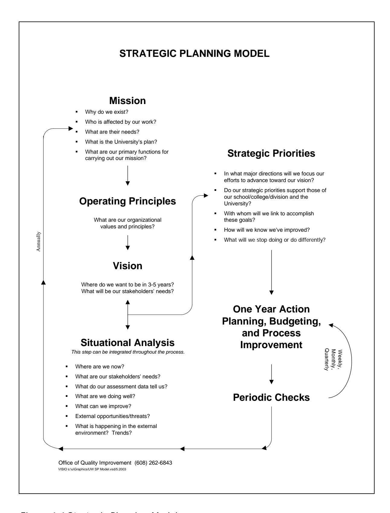

<!-- A3.R75 | source: papers_json/A3.R75/ -->

## **STRATEGIC** **PLANNING** **IN** **THE** **UNIVERSITY**

## **KATHLEEN** **A.** **PARIS,** **PH.D.,** **CONSULTANT**

November, 2003 Copyright © 2003 University of Wisconsin System Board of Regents

## **What is Strategic Planning? **

التخطيط الاستراتيجي وسيلة لتحديد الاتجاهات الرئيسية للجامعة أو الكلية أو القسم. من خلال التخطيط الاستراتيجي، تُركَّز الموارد في عدد محدود من الاتجاهات الرئيسية لتحقيق أقصى فائدة لأصحاب المصلحة، أي الجهات التي نخدمها والتي تتأثر بالخيارات التي نتخذها. في التعليم العالي، يشمل أصحاب المصلحة الطلاب، وأصحاب العمل الذين يوظفون الخريجين، والجهات الممولة، والمجتمع، إضافة إلى أصحاب المصلحة الداخليين مثل أعضاء هيئة التدريس والموظفين. التخطيط الاستراتيجي أسلوب منظم لاستشراف المستقبل و"استغلال ما هو حتمي". يجب أن يرسم الخطة الاستراتيجية المسار العام للمؤسسة بأكملها للسنوات الخمس القادمة. وهو عملية تضمن أن تتبع مخصصات الميزانية الخطة، لا العكس. التخطيط الاستراتيجي ليس مجرد خطة للنمو والتوسع. فقد توجّه الخطة الاستراتيجية غالبًا عمليات التقليص وإعادة توزيع الموارد.

يقول McConkey (1981) إن جوهر الاستراتيجية هو التمايز. ما الذي يجعل هذه الجامعة أو الكلية أو القسم مختلفًا عن غيره؟ يمكن للمؤسسات التعليمية، مثل غيرها من المنظمات الخدمية، أن تميز نفسها استنادًا إلى أنواع البرامج، وأنظمة التقديم، وفئة الطلاب، والموقع، وما شابه ذلك. وبالمثل، فإن أي قسم أو وحدة إدارية تشارك في التخطيط الاستراتيجي ستحدد مكانتها الفريدة داخل المجتمع الجامعي الأوسع، وتركّز مواردها على عدد محدود من الجهود الاستراتيجية، متخلية عن الأنشطة التي يمكن أو ينبغي أو يقوم بها آخرون بالفعل.

## **Why Is Strategic Planning Essential? **

نشأ التخطيط الاستراتيجي المنظم من ممارسات الميزانية في أمريكا خلال خمسينيات القرن العشرين، وانتشر بسرعة. وبحلول منتصف الستينيات وطوال السبعينيات، كان التخطيط الاستراتيجي، بأشكال متعددة، يجري في معظم الشركات الكبرى

<!-- page 2 -->

(Mintzberg, 1994). حتى الحكومة الفيدرالية استخدمت نظام التخطيط والبرمجة والميزنة (PPBS) خلال تلك الفترة.

أدركت المنظمات العامة وغير الربحية جدوى صياغة الاستراتيجية خلال ثمانينيات القرن العشرين، حين برزت فكرة التسويق للمنظمات العامة وغير الربحية. تعود جذور معظم النماذج المعروفة للتخطيط الاستراتيجي في القطاعين العام وغير الربحي إلى نموذج هارفارد للسياسات الذي طُوِّر في Harvard Business School (Bryson, 1988). ويُعد التحليل المنهجي لنقاط القوة والضعف والفرص والتهديدات (SWOT) أحد أبرز عناصر قوة نموذج هارفارد، وهو خطوة ضمن نموذج التخطيط الاستراتيجي المستخدم في UW-Madison (الشكل 1.1). ونظرًا لما يقارب ثلاثين عامًا من الممارسة في هذا البلد، فلماذا يُعد التخطيط الاستراتيجي ضروريًا الآن؟

نحن نعيش زمن تغير سريع. قال Will Rogers: "حتى لو كنت على المسار الصحيح، فسوف يدهسك القطار إن بقيت جالسًا فيه." لا يمكن لأي جامعة أو كلية أو قسم أن يبقى ثابتًا لفترة طويلة. كذلك لا يمكن لأي مؤسسة أن تستمر طويلًا بردود فعل عشوائية تجاه التغيير. ينبغي أن يقلل التخطيط الاستراتيجي من اتخاذ القرارات في حالات الأزمات.

<!-- page 3 -->

**Figure 1.1* Strategic Planning Model*

<!-- page 4 -->

نحن نعيش زمن تعقيد اجتماعي وثقافي. لا يمكن لمجموعة صغيرة في القمة أن تعرف احتياجات الطلاب وأصحاب العمل وسائر أصحاب المصلحة دون مدخلاتهم. كما يصعب على مجموعة داخلية صغيرة أن تلمّ بكل ما يجري في البيئة الخارجية مما قد يؤثر، إيجابًا أو سلبًا، على الجامعة أو الكلية.

هناك أيضًا زمن الترابط. يقدم Bryson (1988) ثلاثة أمثلة على ميادين كانت منفصلة سابقًا وأصبحت الآن مترابطة إلى حد كبير: المحلي والدولي؛ والعام والخاص وغير الربحي؛ والسياسات التعليمية والاقتصادية. وهذا التداخل بين الحدود يعني أنه رغم انخراط منظمات ومؤسسات كثيرة، لا توجد جهة واحدة مسؤولة تمامًا. وهذا الغموض البيئي المتزايد يفرض على المؤسسات التعليمية وسائر الكيانات العامة أن تفكر وتتصرف استراتيجيًا كما لم تفعل من قبل (Bryson, 1988).

من غير المرجح أن تزداد الموارد المالية التقليدية الداعمة للتعليم العالي. وأصبح التقليص هو القاعدة في التمويل التعليمي. ومع ذلك، يستمر الطلب على الخدمات في التوسع. يمنح التخطيط الاستراتيجي الجامعة والكلية والقسم والوحدة الإدارية فرصة رسم مسارها الخاص وتحديد مستقبلها. ويصف Jurinksi (1993) التخطيط الاستراتيجي بأنه تمرين فكري. ولهذا السبب، تناسب هذه العملية التعليم العالي بشكل فريد.

يتحدث Keller (1983) عن الاستراتيجية الأكاديمية الواعية كاستجابة مناسبة للاضطراب.

...The dogma of colleges as amiable, anarchic, self-correcting collectives of scholars with a small contingent of dignified caretakers at the unavoidable business edge is crumbling. A new era of conscious academic strategy is being born. The modern college and university scene is one that is no longer so fiercely disdainful of sound economics and financial planning or so derisive of strategic management. Professors and campus administrators are now uniting to design plans, programs, priorities, and expenditures in order to insure their futures and to keep American higher education among the world's best. (pp. viii-ix)

## **Strategic v. Long-Range Planning **

يُعتقد أحيانًا أن التخطيط الاستراتيجي مجرد مصطلح آخر للتخطيط طويل المدى. لكن هناك فروقًا رئيسية بين التخطيط الاستراتيجي

<!-- page 5 -->

والتخطيط طويل المدى التقليدي. أولًا، التخطيط الاستراتيجي أكثر حساسية للبيئة الخارجية من التخطيط طويل المدى. تقليديًا، كان التخطيط طويل المدى موجهًا نحو الداخل. وكانت الأهداف والغايات تُصاغ باهتمام محدود بالنظام الأوسع الذي تعمل فيه المؤسسة.

كان يمكن إجراء التخطيط طويل المدى التقليدي بمشاركة محدودة من أصحاب المصلحة، أي المتأثرين بالخطة. أما التخطيط الاستراتيجي، وخصوصًا النموذج الموضح في الشكل 1.1 الذي استُخدم في عدد من الأقسام والمكاتب والكليات في حرم UW-Madison، فيعتمد على معلومات من أصحاب المصلحة الداخليين والخارجيين حول احتياجاتهم وتوقعاتهم ومتطلباتهم كأساس للتخطيط.

ومما يرتبط بالفرق الأول أن التخطيط طويل المدى التقليدي يميل إلى الحفاظ على الوضع القائم مع مرور الوقت. وبافتراض أن المستقبل سيكون امتدادًا خطيًا للحاضر، يقضي المخططون عادة وقتًا قليلًا في محاولة إعادة تشكيل المنظمة. أما التخطيط الاستراتيجي فمن الأرجح أن يؤدي إلى تحول متعمد في الاتجاه أو إعادة تركيز للرسالة في ضوء التغيرات، الفعلية أو المتوقعة.

بما أن التخطيط طويل المدى كان موجهًا عمومًا نحو الحفاظ على الوضع القائم، لم يكن تصور الرؤية عنصرًا جوهريًا فيه. أما الخطط الاستراتيجية فتُبنى حول رؤية للنجاح أو رؤية للمستقبل المنشود. وتمثل هذه الصورة اللفظية المثالية أفضل مستقبل ممكن للمؤسسة. وتساعد الخطة على تحويل هذه الرؤية المشتركة إلى واقع.

يشير Bryson (1988) إلى فارق آخر. فالتخطيط طويل المدى يركز أكثر على تحديد الأهداف والغايات، في حين يركز التخطيط الاستراتيجي أكثر على تحديد القضايا وحلها. والواقع أن الأهداف والغايات التي تُعد جزءًا من التخطيط التشغيلي لا ينبغي وضعها قبل أن تُنهي الكلية أو الجامعة تخطيطها الاستراتيجي.

يقول Keller (1983) إن التخطيط الاستراتيجي يضع مصير المؤسسة فوق كل اعتبار آخر.

Strategic planning places the long-term vitality and excellence of the college or university first. It cares about traditions, faculty salaries, and programs in Greek, agriculture, and astrophysics. But it cares about institutional survival more, so that there will be places for scholars of Greek, agriculture, and astrophysics to teach and do their research. Scholars cannot easily hang their shingle out like physicians or architects.... Professors still need to unite as a universitas. (p. 151)

<!-- page 6 -->

## **Benefits of Strategic Planning **

يمكن أن يجني التخطيط الاستراتيجي الفعّال فوائد كثيرة للمنظمة. أولًا، فهو يمكّن المنظمة من أن تكون استباقية وأن تشكل مصيرها بنفسها. ولأن العملية تتطلب الانتباه إلى الاتجاهات والتطورات الخارجية، يصبح احتمال مفاجأة المؤسسة التعليمية أو القسم بمشكلة أو تطور جديد أقل.

يُشرَك أصحاب المصلحة، أي المتأثرون بالمنظمة، في عملية التخطيط. وبذلك تحصل المؤسسة أو القسم على تغذية راجعة قيّمة، سواء عن الجهود الناجحة أو عن المجالات التي تحتاج إلى تحسين.

ينبغي إشراك ممثلين عن هيئة التدريس والموظفين الأكاديميين والموظفين المصنفين، إذ تقدم كل فئة منظورًا فريدًا للعملية. وتساعد هذه المشاركة طوال العملية على ضمان أن يفهم من يتحمل مسؤوليات رئيسية في تنفيذ الخطة، الخطة نفسها والأسباب الكامنة وراءها. ويمكن أن تسهم المشاركة في عملية التخطيط إسهامًا كبيرًا في التزام الموظفين بالأهداف المشتركة وشعورهم بالوحدة التنظيمية.

وبالمثل، فإن المشاركة الفعّالة لأصحاب المصلحة في عملية التخطيط تخلق دعمًا خارجيًا للمنظمة. فأصحاب العمل، على سبيل المثال، أكثر ميلًا إلى دعم مبادرة تعليمية مثل برنامج درجة جديد أو منهج معاد تصميمه إذا كان لهم دور مباشر في عملية تخطيط جيدة التصميم. ولاحظ أن المصطلح هو "المشاركة الفعّالة". فقد اقتصر دور أصحاب المصلحة الخارجيين تقليديًا على الجوانب الاستشارية للمشروع التعليمي. أما المشاركة في التخطيط الاستراتيجي فهي أكثر جوهرية بكثير من الدور الاستشاري. وتُرسي مشاركتهم بشكل أساسي الأساس لاستمرار الدعم والمشاركة من أولئك أصحاب المصلحة.

من أبرز فوائد التخطيط الاستراتيجي في مؤسسات التعليم العالي أنه يمكن أن يمنح المنظمة استقرارًا رغم تواتر تغييرات القيادة بشكل متزايد. وجد Simmons and Pohl (1994) أن متوسط مدة بقاء العميد في منصبه بلغ خمس سنوات في University of Wisconsin-Madison بين عامي 1980 و1994. ولاحظا كذلك أن متوسط مدة بقاء القيادة كان يتناقص بشكل حاد كل عام. وكانت ملاحظتهما أن

Strategic planning creates a broad decision-making group by actively involving middle and operational levels of management. By pushing decision-making down, a system for strategic planning can help the organization maintain a core purpose during times of changing leadership. (p. 2)

<!-- page 7 -->

أشار Simmons and Pohl (1994) أيضًا إلى أن عملية تخطيط استراتيجي تشاركية واسعة القاعدة يمكن أن تستفيد فعليًا من تواتر تغييرات القيادة، من خلال الجمع بين المنظور الخارجي للقائد الجديد ومجموعة داخلية أساسية مستقرة وملتزمة بأهداف مشتركة ورؤية موحدة لمستقبل ناجح.

## **The Dark Side of Strategic Planning **

الجانب المظلم للتخطيط الاستراتيجي ليس مظلمًا جدًا في الحقيقة، لكنه يحمل بعض المخاطر الكامنة. يقول Jurinski (1993) إن جهود التخطيط الاستراتيجي التي تفشل غالبًا ما تفشل لأن المنظمة قللت من تقدير الوقت والجهد والمال اللازمين منذ البداية. تستغرق العملية وقتًا. من الصعب على أي منظمة أو مجموعة أن تمر بعملية تخطيط استراتيجي في أقل من يومين مكثفين، إضافة إلى جلسات تحضيرية أقصر واجتماع أو اجتماعات لاحقة لتنقيح الخطط بناءً على التغذية الراجعة. ويوضح الشكل 1.1 خطوات نموذج التخطيط الاستراتيجي المستخدم في University of Wisconsin-Madison. ومن يوم اتخاذ قرار وضع خطة استراتيجية، تُستغرق عادة عدة أشهر لإنجاز العملية. (ومعظم هذا الوقت هو وقت تحضيري لجدولة جلسة التخطيط الرئيسية.) وتمتد بعض جهود التخطيط على مدى شهور بل سنوات عديدة. وهذا الجدول الزمني الطويل غير مستحسن عمومًا ولا ضروري. فالناس يُصابون بالإرهاق من العملية، ويفقد الجهد زخمه.

عملية التخطيط الجيدة تكلف مالًا. فجمع الناس معًا يتطلب أماكن للاجتماع، وميسّرين، ووجبات ومرطبات، وتكاليف سفر، واستئجار معدات سمعية بصرية، وما شابه ذلك.

يمكن أن يكون التخطيط الاستراتيجي محفوفًا بالمخاطر لأنه يقوم على قرارات متعمدة لتركيز المنظمة أو إعادة تركيزها. وهذا يعني أن "شيئًا ما يجب أن يُلغى"، أو على أقل تقدير "شيئًا ما يجب أن يتغير". ومن سمات التخطيط الاستراتيجي البارزة الأساليب الجريئة والجديدة التي تتجاوز الحواجز. ومن الناحية المثالية، تدفع هذه الاستراتيجيات الجديدة المنظمة نحو رؤيتها. لكن في أسوأ السيناريوهات، يمكن أن تكون القرارات الاستراتيجية غير المدروسة كارثية. ومن أهداف إشراك مجموعة واسعة التمثيل من أصحاب المصلحة الداخليين والخارجيين المساعدة على تجنب القرارات التنظيمية التي قد تُعتبر لاحقًا أخطاء.

<!-- page 8 -->

## **Elements of a Successful Strategic Planning Process **

هناك خمسة عناصر أساسية لعملية تخطيط استراتيجي فعّالة: الأشخاص المناسبون، والبيانات الجيدة، والتحضير، وعملية منظمة، وموارد كافية من الوقت والمال. وسيُعاد تناول كل من هذه العناصر الخمسة لاحقًا.

## *People*

يعني وجود الأشخاص المناسبين أن جميع أصحاب المصلحة الرئيسيين ممثَّلون بشكل ما. وعادة ما يتحقق ذلك من خلال نظام تمثيلي، حيث يمثل كل مشارك في فعالية التخطيط فئة معينة من أصحاب المصلحة: الطلاب، وقطاع الأعمال، وهيئة التدريس، والموظفين المصنفين، والموظفين الأكاديميين، والوكالات التابعة، وما شابه ذلك. وتقع على عاتق جميع المشاركين مسؤولية نقل نتائج التخطيط الأولية إلى المجموعة التي يمثلونها للحصول على تغذية راجعة. ثم تُعاد هذه التغذية الراجعة، الإيجابية والسلبية على حد سواء، إلى المجموعة وتُستخدم لتنقيح مسودات الخطط.

## *Data*

من أوجه الارتباط بين التخطيط الاستراتيجي والتحسين المستمر للجودة الاعتماد على البيانات كأساس لاتخاذ القرار. وتُعد البيانات المتعلقة باحتياجات أصحاب المصلحة/العملاء وتقييمهم للخدمات القائمة ضرورية لعملية التخطيط. وكلما توفرت بيانات دقيقة أكثر لوصف الوضع الحالي، زادت فرص وضع خطة جيدة. وقد يكون التخطيط الاستراتيجي في غياب بيانات موثوقة أمرًا خطيرًا. ومع ذلك، ليس من غير المألوف أن نجد منظمات تخطط للمستقبل بمعلومات قليلة أو معدومة الموثوقية عن الوضع الحقيقي. وتجد بعض المنظمات، عند بدء عملية التخطيط الاستراتيجي، أنه يجب عليها وضع خطة مؤقتة أثناء جمع البيانات الأساسية التي سيُبنى عليها التخطيط الاستراتيجي اللاحق.

## *Preparation*

ينبغي أن يكون من يخططون لمستقبل قسمهم أو مدرستهم أو كليتهم أو مؤسستهم مستعدين بشكل كافٍ لهذه المهمة. ومن غير الحكمة التخطيط دون فكرة عن الاتجاهات البديلة المتعددة وما وجده الآخرون ناجحًا. ومن الشائع أن تدعو المؤسسة التعليمية مستشرفي المستقبل للتحدث إلى فريق التخطيط قبل فعالية التخطيط. ويساعد ذلك على دفع تفكير الأفراد إلى ما هو أبعد من قضايا اليوم، ثم يساعدهم لاحقًا على تكوين رؤية للمستقبل المنشود. وتتوفر أشرطة فيديو ممتازة عن التغيير وتحولات النماذج الفكرية. ومشاهدة هذه البرامج ومناقشتها تساعد الأفراد على الاستعداد لإجراء التغييرات الصغيرة والكبيرة الحتمية، سواء وُجدت خطة استراتيجية أم لا. وتخصص بعض مجموعات التخطيط جلسات موجزة لعرض كتب

<!-- page 9 -->

يعرض فيها كل عضو كتابًا حاليًا يُلقي الضوء على خيارات المنظمة. وتزور بعض المجموعات مؤسسات أخرى للاطلاع على ما ينجح في أماكن أخرى. والتحضير الذي يوسّع تصور المجموعة لما هو ممكن ومرغوب يُنتج أكثر الخطط ابتكارًا وجرأة.

## *A Structured Planning Process*

حضر معظمنا اجتماعًا واحدًا على الأقل تحدث فيه الجميع، لكن حين انتهى، لم يتحقق شيء. وتوضح هذه التجربة الشائعة الحاجة إلى عملية تخطيط منظمة. ويعني التنظيم وجود أنشطة محددة ومتسلسلة مثل العصف الذهني، والعمل في مجموعات صغيرة، والتصنيف، والتلخيص، وترتيب الأولويات، وما شابه ذلك. ويتطلب التنظيم ميسّرًا مسؤولًا عن إدارة العملية دون أن يكون له إسهام في المحتوى. وتتيح عملية التخطيط المنظمة لجميع الحضور المشاركة الكاملة، مع الحد من هيمنة الأعضاء ذوي الفصاحة والمكانة العالية.

يمثل النهج المستخدم في التخطيط الاستراتيجي في مختلف الأقسام والمكاتب في University of Wisconsin-Madison مزيجًا من نموذج التخطيط الاستراتيجي ذي الخطوات الثماني للمنظمات العامة وغير الربحية الذي وضعه Bryson (1988)، ونهج Technology of Participation (ToP) الذي طوّره Institute of Cultural Affairs في Chicago (Spencer, 1989). ويستخدم ميسّرو المعهد منهجية ورشة عمل ToP في جميع أنحاء العالم لأغراض تخطيط التنمية المجتمعية.

يعكس النموذج في الشكل 1.1 إيمانًا بالاندماج الفكري، أي أنه عندما يجتمع أشخاص من ذوي النوايا الحسنة للتخطيط، وتُتاح لهم بنية للعمل معًا، تكون النتائج أفضل بكثير مما يمكن أن ينتجه أي فرد بمفرده في المجموعة. وتساعد بنية العملية الموصوفة هنا على التخفيف من ظاهرة "الجمل الذي صممته لجنة"، والتي تنشأ بسبب التسويات المفرطة. وفي النموذج المعروض هنا، تسعى المجموعة إلى التوافق، بدءًا من الأفراد، ثم المجموعات الصغيرة، ثم المجموعة ككل.

في التوافق، يلتزم الأعضاء بدعم نتائج عمل المجموعة حتى لو لم يتفقوا مع كل نقطة في الخطة. ويستند هذا الدعم إلى قناعة الفرد بأن "رغم أن هذا ليس خياري المفضل، سأدعمه لأنني أعتقد أنني حظيت بفرصة كافية لمناقشة آرائي، وهذا الخيار هو الأفضل لنا في هذا الوقت". كما يساعد الميسّر الماهر المجموعة

<!-- page 10 -->

على مقاومة تجميع عدد كبير جدًا من الأفكار بحيث يضيع التفكير الأصلي لكل منها.

الأفراد الذين كانوا في البداية غير متحمسين لعملية التخطيط المنظمة غالبًا ما يعبّرون عن رضاهم وأحيانًا سرورهم في نهاية فعالية التخطيط، سواء بسبب التحفيز الفكري أو النتائج الملموسة.

*Resources of Time and Dollars* تمت مناقشة تكاليف عملية التخطيط السليمة والوقت اللازم للتخطيط الأمثل سابقًا. فكل من الوقت غير الكافي والوقت المفرط يضران بالعملية.

## **The Role of the Leader in Strategic Planning **

كان التخطيط دائمًا أحد الوظائف التقليدية للإدارة. ويشعر بعض القادة في البداية بعدم الارتياح تجاه فكرة إشراك جميع مستويات الموظفين في التخطيط. وقد يرى البعض أن إشراك جميع مستويات الموظفين في التخطيط تنازل عن مسؤوليتهم. لكن مسؤولية القائد هي ضمان حدوث عملية تخطيط سليمة وأن تتبع الميزانية الخطة. وبذلك يتمثل دور القائد في إنشاء بنية للتخطيط والمشاركة الكاملة في العملية. وعلّق James Renier، من Honeywell Corporation، على المشاركة الواسعة في التخطيط:

*At some point you've go to loosen the reins, delegate. It's almost like being * *on a battlefield in a fog. It's too much to ask the commander to describe the * *terrain as if the fog wasn't there...we've got to be willing to listen and say, * *well, someone else has seen through part of the fog so we'd better listen * *carefully to that person.*

يستخدم Senge (1990) استعارة الباخرة العابرة للمحيط لمناقشة القيادة في المنظمة المتعلمة. ويرى أن قائد المنظمة ليس القبطان أو الملاح، بل مصمم الباخرة. ويقول Senge إن مهمة القيادة هي تصميم عمليات التعلّم التي تمكّن أفراد المنظمة من التعامل بإنتاجية مع القضايا الحرجة وتطوير الإتقان في تخصصات التعلّم. يقول Senge:

This is new work for most experienced managers, many of whom rose to the top because of their decision-making and problem-solving skills, not their skills in mentoring, coaching and helping others learn. (p.345)

<!-- page 11 -->

يتسق وصف تنفيذ عملية تخطيط سليمة بأنه مسؤولية القائد مع استعارة المصمم. فالقادة، رغم أنه ينبغي عليهم المشاركة الفعّالة، لا ينبغي أن يعملوا ميسّرين لعمليات التخطيط في منظماتهم. فقد تُعيق أفكارهم و/أو أسلوبهم المشاركة الكاملة للمجموعة. وبالمثل، نادرًا ما يُنصح بأن يشارك أي ميسّر تخطيط كعضو في فريق التخطيط. فأدوار الميسّر والمشارك غير متوافقة عمومًا، والتيسير بحد ذاته يتطلب تركيزًا كاملًا من الشخص.

## **Relationship of Strategic Planning to Continuous Quality ** **Improvement **

يمكن تعريف الجودة بأنها تلبية احتياجات أصحاب المصلحة وتجاوز توقعاتهم. من الصعب تخيل منظمة ملتزمة بالتحسين المستمر لخدماتها أو منتجاتها دون أن تملك خطة استراتيجية. ومن أهم متطلبات W. Edwards Deming للتحسين المستمر للجودة ثبات الغرض (Gabor, 1990). ومن اللافت أن جميع نماذج التخطيط الاستراتيجي تقريبًا تبدأ بمراجعة بيان الرسالة أو تنقيحه أو صياغته استنادًا إلى أصحاب المصلحة واحتياجاتهم. ثم يصبح بيان الرسالة الأساس الذي يُبنى عليه كل التخطيط اللاحق.

التخطيط الاستراتيجي عملية لتحديد بعض الاتجاهات المشتركة للقسم أو الشعبة أو المدرسة أو الكلية استنادًا إلى احتياجات أصحاب المصلحة الخارجيين والداخليين. وفي بيئة الجودة، يتشارك جميع الموظفين بعض الفهم والالتزامات المشتركة حول ما يرغبون في تحقيقه معًا لأصحاب المصلحة. وهذا لا يعني أن النشاط الريادي لا يمكن أن يحدث، لكنه يعني وجود مستوى أدنى من الجهد المشترك وبعض الاتجاهات المشتركة. ويمكن أن يحقق التعاون الأكبر فوائد هائلة للأفراد في القسم أو المنظمة.

تميل عمليات تحسين الجودة إلى التركيز على الطرف التشغيلي من نموذج التخطيط الموضح في الشكل 1.1، وخاصة على العمليات الحرجة أو الأساسية التي تُنفَّذ يوميًا تقريبًا. وتُستخدم أدوات الجودة لتحسين العمليات والعمليات الفرعية داخل المنظمة، في حين يعمل التخطيط الاستراتيجي على تركيز جهود المنظمة ككل. وبذلك، توفر عملية تخطيط استراتيجي فعّالة إطارًا يمكن من خلاله استخدام أدوات الجودة وعملياتها (Gibson, 1994). وإذا جُمع التخطيط الاستراتيجي والتحسين المستمر للجودة معًا، فيمكنهما

<!-- page 12 -->

أن يحسّنا بشكل كبير قدرة المنظمة على تلبية احتياجات أصحاب المصلحة الداخليين والخارجيين.

## **Tying the Budget to the Plan **

*Budgets are basically links between financial resources and human behavior * *in order to accomplish policy objectives or in other words, budgets are a * *series of goals with price tags attached. *

Aaron Wildavsky (1984)

قيمة الخطة الاستراتيجية محدودة ما لم تُستخدم في عملية إعداد الميزانية. وليس من غير المألوف أن نجد مؤسسات تكون فيها عمليات التخطيط ضعيفة الصلة أو منعدمة الصلة بعمليات إعداد الميزانية. وأسباب ذلك معقدة، وتشمل عوامل مثل النمط التاريخي لاتخاذ القرارات المالية، وتوافر بيانات مالية دقيقة في أنحاء المنظمة. وفي بعض الحالات، لا تملك المنظمات ببساطة وسيلة للربط بين التخطيط وإعداد الميزانية بشكل جيد. وبالنسبة للمنظمات التي ترغب في تركيز مواردها المالية عبر عملية تخطيط استراتيجي، يوفر هذا النموذج بنية وعملية غير معقدة نسبيًا للقيام بذلك. ويوضح المثال المقدم هنا كيف تُربط عمليات التخطيط وإعداد الميزانية في أحد الأقسام. ويمثل الشكل 1.2 نموذجًا لاستمارة ميزانية، وهي استمارة "خطط البرنامج وطلبات الميزانية" التي يُكملها كل برنامج (أو مركز تكلفة أو وحدة فرعية) داخل القسم. ولاحظ أن كل برنامج مطالب بإجراء حد أدنى من التقييم الذاتي وتحديد أهداف سنوية. وتمثل هذه الأهداف أنشطة تساعد القسم على التحرك في الاتجاهات الاستراتيجية المحددة في عملية التخطيط.

وتُشكل هذه العملية أسلوبًا لإعداد ميزانية البرامج. ففي إعداد ميزانية البرامج، بدلًا من تقديم طلبات الميزانية على شكل بنود تفصيلية للمستلزمات والصيانة والموظفين، كما هو الحال في إعداد الميزانية التقليدي التراكمي، تُقدَّم الطلبات على شكل أهداف أو نواتج نهائية. ويُنظر إلى إعداد ميزانية البرامج على أنه مفيد لربط الغايات بالوسائل، والتأكيد على الآثار السياساتية للميزانية.

تصبح عملية إعداد الميزانية الموصوفة هنا نشاطًا علنيًا وواضحًا للغاية، خلافًا لإعداد الميزانية التقليدي على أساس البنود، والذي يرى Wildavsky أنه يقلل من أهمية التعارض العلني بين البرامج المتنافسة. فالعملية التي تسعى إلى تقليل التعارض العلني، كما يقول، "تشجّع المداولات السرية، وغياب التحيز الحزبي، وتوظيف أشخاص يشعرون بالراحة في تجنب قرارات السياسات معظم الوقت" (p. 137).

<!-- page 13 -->

يوضح Wildavsky (1984) أن إعداد ميزانية البرامج يكشف عن تعارض أكثر علنية. ويقول: "من الأسهل بكثير الاتفاق على زيادة أو تخفيض صغير من مقارنة قيمة برنامج واحد [أو هدف واحد] بقيمة جميع البرامج الأخرى" (p. 136). ويساعد نموذج التخطيط المعروض هنا على التخفيف من حجم التعارض في الميزانية، من خلال وضع اتجاهات استراتيجية وأهداف مرتبة بحسب الأولوية بشكل مسبق، عبر عملية يشارك فيها الجميع، بشكل مباشر أو غير مباشر.

يمكن تخصيص جزء معين من إجمالي الميزانية لأنشطة انتهازية أو ريادية لا تتماشى بالضرورة مع الخطة الاستراتيجية. وتمثل الميزانية التقديرية نسبة صغيرة نسبيًا من الإجمالي، إذ تشكل الرواتب معظم الميزانية في أغلب مؤسسات التعليم العالي. وحاليًا، ليس من غير المعتاد أن تُستخدم كامل الميزانية التقديرية لقسم ما في أنشطة ريادية، مع تركيز محدود أو منعدم على مستوى القسم.

يلاحظ أنه في استمارة "خطط البرنامج وطلبات الميزانية" الموضحة في الشكل 1.2، تُقدَّم طلبات الوظائف والمعدات والمواد التي تتجاوز قيمتها $500 كموارد مطلوبة لتحقيق الأهداف. وقد جرت العادة في University of Colorado at Boulder على عدم الموافقة على أي وظيفة جديدة دون خطة استراتيجية رسمية توضح كيف ستعزز الوظيفة فعالية الخطة. وتقدم البرامج الفردية أو التخصصات أو الوحدات الفرعية الأخرى خططها وطلبات ميزانيتها باستخدام الاستمارة الموضحة في الشكل 1.2.

<!-- page 14 -->

## **PROGRAM PLANS AND BUDGET REQUESTS **

**Program(s): **

**Department: **

## **Submitted by: **

## **1. Major Accomplishments: **

(Anticipated status at the end of the semester. List appropriate data and/or projected accomplishments related to last year's plans.)

## **2. Strengths and Opportunities: **

(What are the major strengths of the program? What opportunities exist because of these strengths? What external factors contribute to these strengths and opportunities?)

## **3. Limitations, Barriers, Weaknesses: **

(What factors limit progress? What barriers limit future development? Identify any weaknesses that should be addressed in planning for the future.)

**4. What are your 3-5 year goals for this program? **

## **5. Objectives: **

| List objectives proposed for | What College and/or University Strategic |
| --- | --- |
| next year: | Directions are addressed by each objective? |

- **6. What are the curriculum or program changes for the upcoming year? **
- **7. What are the projected enrollments for the program? **
- **8. List new staff needed **(in priority order)**: **
- **9. List new major equipment required **(in priority order, $500 and up)**: **
- **10. List new/modified facilities needed **(for capital exercise)**: **
- **11. Identify other major budget changes including activities and ** **expenses from last year which have been deleted in this budget. **

**Figure 1.2* Program plans and budget requests*

<!-- page 15 -->

## **DEPARTMENT CHAIR'S PLANNING AND BUDGET PRIORITIES **

## **Department: **

## **Programs/Cost Centers Included: **

## **Chair: **

**1. Major Accomplishments: **(What has the department achieved in the past year?)

## **2. Strengths and Opportunities: **

(What are the major strengths and vitality of this department? What opportunities exist because of these strengths? What external factors contribute to these strengths and opportunities?)

## **3. Limitations, Barriers, Weaknesses: **

(What factors limit progress? What barriers limit future development? Which of these are under our control? Identify any weaknesses which should be addressed in planning for the future.)

## **4. Long-Range Goals and Objectives: **

(Where is this department moving in the next 3-5 years? What are the long-range directions? What changes will be needed over the next few years? Will this department grow/decline/remain the same in terms of students, staff, and faculty?)

## **5. Objectives: **

| List objectives proposed for | What College and/or University Strategic Directions are |
| --- | --- |
| next year: | addressed by each objective? |

## **6. New Personnel Priorities: **

| Identify personnel priorities. | How do these priorities relate to the goals/objectives of |
| --- | --- |
|  | the department? |

## **7. New Equipment Priorities: **

| Identify equipment priorities. | How do these priorities relate to the goals/objectives of |
| --- | --- |
|  | the department? |

## **8. Facility Change/Capital Exercise Priorities: **

| Identify your facility change/ | How do these priorities relate to the goals/objectives of |
| --- | --- |
| capital exercise priorities. | the department? |

## **9. What are the implications for other departments or services? **(Attach a separate sheet for this. It will be distributed to the appropriate departments.)

**Figure 1.3* Department chair's planning and budget priorities*

<!-- page 16 -->

## **Chair's Role **

الشكل 1.3 هو استمارة "أولويات القسم التخطيطية والميزانوية لرئيس القسم". وهذه خطة أولويات رئيس القسم التي تتضمن طلبات الموارد. ويلاحظ أن الأهداف المقترحة تُعرض بالنسبة إلى اتجاه استراتيجي معين. وبذلك، يظل رئيس القسم (و/أو اللجنة المعنية) هو من يتخذ القرارات المتعلقة بالميزانية، غير أن معايير هذه القرارات معروفة مسبقًا، وتصبح عملية اتخاذ القرار المالي واضحة صراحة.

في المدرسة أو الكلية، يُطلب من الأقسام توضيح كيف تدعم أنشطتها المقترحة الاتجاهات الاستراتيجية للمدرسة أو الكلية. وتحدد المدرسة أو الكلية أي محاور أو اتجاهات استراتيجية جامعية تُعالَج من خلال اتجاهاتها الاستراتيجية و/أو أهدافها.

## **Self-Evaluation of Strategic Planning Process **

فيما يلي أربعة عشر سؤالًا يمكن لمن يتحملون مسؤولية التخطيط في قسم أو مدرسة أو كلية أو شعبة أو مؤسسة تعليمية عليا ككل طرحها بشأن عملية التخطيط الاستراتيجي والسنوي. وكلما أمكن الإجابة عن هذه الأسئلة بالإيجاب بصدق أكبر، زادت فعالية تمرين التخطيط على الأرجح. وتوجد هذه الأسئلة أيضًا في الشكل 1.4.

## 1. **Does the mission concisely state what will be done for whom?**

بيان رسالة موجز يوضح ما تفعله المنظمة ولمن هو البداية المثالية لأي خطة استراتيجية. وإذا لم تكن هذه الرسالة واضحة ومتفقًا عليها، ستكون بقية العملية غير مُرضية. وبيان الرسالة المتشعب أقل فعالية من بيان دقيق ومحدد. وتُفسَّر رسالة University of Wisconsin-Madison على النحو التالي: "خلق المعرفة ودمجها ونقلها وتطبيقها."

## 2. **Is the vision a descriptive statement of where and what the ** **organization wants to be in the future?**

ينبغي أن يكون بيان الرؤية حيويًا بما يكفي ليتمكن صاحب المصلحة من إدراك نوايا المؤسسة. فمثلًا، عبارة "أن نكون الأفضل..." لا تقول ما يكفي. فمثل هذا البيان لا يزودنا بمعلومات عن كيف سيبدو أن نكون "الأفضل". وينبغي أن يرسم بيان الرؤية

<!-- page 17 -->

صورة لفظية لما تأمل المؤسسة أن تصبح عليه. وينبغي أن يدفع المؤسسة نحو التغيير دون أن يكون مستحيل التحقيق.

3. **Is there evidence that representatives of employees at all levels ** **(faculty, academic staff, support staff, administration) ** **participated in a meaningful way in strategic and annual planning?**

رغم أنه لا يمكن عادة لكل فرد في المنظمة المشاركة في جميع مراحل عملية التخطيط، يمكن للجميع المشاركة في مرحلة ما من العملية. والنموذج المعروض هنا هو نموذج ديمقراطية تمثيلية، تُكلَّف فيه مجموعة (مجلس التخطيط) مختارة لتمثيل الجميع بوضع الخطة الاستراتيجية. وتقع على عاتق جميع أعضاء مجلس التخطيط مسؤولية إبلاغ النتائج الأولية والتماس التغذية الراجعة من الفئات التي يمثلونها، سواء كانوا هيئة تدريس أو موظفين أو إدارة أو موظفي دعم أو طلابًا. إضافة إلى ذلك، يمكن لنتائج استطلاعات الموظفين أو مدخلات الموظفين الأخرى أن تُثري التحليل الظرفي. وفي مرحلة التخطيط السنوي وإعداد الميزانية، يشارك جميع الموظفين في تحديد الأهداف والغايات والأنشطة والاحتياجات الميزانوية لمجموعة عملهم أو وحدتهم للسنة القادمة. ويشارك جميع الموظفين في تحديد التطوير المهني اللازم استنادًا إلى الأهداف والغايات التي تُطوَّر بشكل تعاوني.

4. **Is there evidence that data on the needs of all the stakeholders ** **but especially those from outside of the organization were sought ** **and used in the planning process?**

مثل جميع العمليات القائمة على الجودة، يعتمد نموذج التخطيط هذا على معلومات موثوقة. وإذا لم تكن المعلومات عن احتياجات أصحاب المصلحة ورضاهم متوفرة عند وضع الخطة الحالية، ينبغي أن تتضمن الخطة آليات لجمع مثل هذه البيانات ضمن السنة المالية الحالية.

## 5. **Are goals prioritized annually?**

من الصعب عادة ترتيب الاتجاهات الاستراتيجية والأهداف الرئيسية بأولوية دائمة، لأنه قد يكون هناك قدر كبير من التفاعل بينها. غير أنه من المفيد ترتيب الاتجاهات الاستراتيجية و/أو الأهداف بأولوية سنويًا، مع التركيز أولًا على الإجراءات التي تدفع باقي الإجراءات. والمهم هو أن يتمكن كل موظف من ترتيب الأنشطة الأكثر أهمية للتركيز عليها في سنة معينة.

<!-- page 18 -->

## 6. **Are limitations, barriers and weaknesses addressed in goals and ** **objectives?**

في خضم حماسة التخطيط للمستقبل، ليس من الصعب أن ننسى المشكلات والحواجز. وبعض هذا "النسيان" ضروري في الواقع لتجاوز الحاضر والانتقال إلى المستقبل. غير أنه من المهم إعادة النظر في المشكلات والحواجز عند وضع الاتجاهات الاستراتيجية. والسؤال الذي تطرحه المجموعات على نفسها هو: "ما الذي لدينا في صالحنا (نقطة قوة أو فرصة) يمكن أن يساعدنا على تجاوز هذا الحاجز أو الالتفاف حوله أو اختراقه؟" وليس من الضروري وجود اتجاه استراتيجي لكل حاجز، غير أن أفضل الاستراتيجيات تعالج عدة مشكلات في آن واحد. كذلك من المفيد تحديد الحواجز أو المشكلات الأكثر ضررًا في وقت مبكر من العملية، بحيث يمكن، عند تحديد الاتجاهات الاستراتيجية، التحقق من معالجة أكثر المشكلات أو الحواجز خطورة في الخطة.

## 7. **Is there evidence in strategic and operational plans that planners ** **looked beyond immediate day-to-day concerns and into the ** **future?**

من الأمور التي تميز التخطيط الاستراتيجي عن التخطيط طويل المدى التقليدي افتراض أن المستقبل لن يكون امتدادًا خطيًا للماضي. وتستشرف عملية التخطيط الجيدة المستقبل المحتمل من خلال جمع معلومات من مصادر داخلية وخارجية. وتستضيف بعض المجموعات مستشرف مستقبل للحديث عن الاتجاهات المستقبلية. وتُجري بعض المجموعات عروض كتب قبل فعالية التخطيط. وتأخذ بعض المجموعات أرقام التسجيل و/أو الإيرادات الحالية وتوضح كيف ستؤثر سيناريوهات مستقبلية مختلفة على المؤسسة. وينبغي أن تتضمن عملية التخطيط نفسها جهدًا منظمًا ورسميًا لاستشراف الاتجاهات المستقبلية والاحتياجات المتغيرة لأصحاب المصلحة.

## 8. **Does the plan show that choices have been made in terms of types ** **of service or activities, delivery system, who will be served, ** **geographic scope, processes used, and the like?**

يتطلب التخطيط الاستراتيجي استعدادًا لتركيز الموارد. لذا من غير المرجح أن تستمر المنظمة في فعل كل ما فعلته في الماضي بالطريقة نفسها إذا كانت جادة في التخطيط الاستراتيجي.

<!-- page 19 -->

## 9. **Do measures of success test the underlying hypotheses about ** **cause-and-effect relationships?**

يفترض هذا السؤال أن مقاييس النجاح قد حُدِّدت للأهداف و/أو الأنشطة الرئيسية. وينبغي أن تتجاوز مقاييس النجاح هذه مقاييس "العملية" مثل "اكتمال التقرير" أو "إعادة تصميم المقرر"، رغم أن هذه المقاييس الإجرائية مهمة أيضًا. يصف Kaplan and Norton (1996) الاستراتيجية بأنها مجموعة من الفرضيات حول علاقات السبب والنتيجة. وينبغي أن تكون التغذية الراجعة (التي يُطلق عليها هنا "مقاييس النجاح") قادرة على "اختبار الفرضيات الكامنة في...الاستراتيجية والتحقق منها وتعديلها" (p. 84). فعلى سبيل المثال، يستند قرار قسم أكاديمي بإعادة تصميم مقرر أو مقررات إلى افتراض أن شيئًا ما سيتحسن نتيجة لذلك. وإذا لم تُبذل محاولة لتحديد ما الذي تغيّر نتيجة للجهد (هل استوعب الطلاب المفاهيم الأساسية كما تنعكس في درجات الامتحانات؟ هل ارتفعت نسبة الطلاب الذين أكملوا المقرر بنجاح؟ هل استطاع الطلاب إظهار مستويات أعمق من الفهم والإتقان؟)، فلن يكون لدى القسم وسيلة لمعرفة ما إذا كانت فرضيته صحيحة وما إذا كان جهد إعادة التصميم يستحق العناء. والأهم من ذلك، إذا لم يُتعلَّم شيء عن آثار إعادة التصميم غير أنها حدثت، فلن تملك هيئة التدريس معلومات جديدة تبني عليها قراراتها المستقبلية بشأن إعادة تصميم المقررات.

## 10. **Do annual plans show evidence of cooperation, collaboration ** **and/or integration of resources?**

من النتائج المتوقعة الأخرى للتخطيط الاستراتيجي أن الناس، من خلال تخصيص الوقت لدراسة المنظمة والبيئة التي تعمل فيها وفهمهما بشكل أفضل، يبدؤون في رؤية إمكانات جديدة لتوظيف مواردهم إلى جانب موارد المجموعات الأخرى. وخاصة في التعليم العالي، حيث يؤثر انخفاض التمويل العام على معظم الأقسام والوحدات بشكل ما، توجد وفورات يمكن تحقيقها من خلال التعاون أو التشارك في الموارد. فعلى سبيل المثال، من السيناريوهات الشائعة وجود مقرر مماثل يُقدَّم من قسمين، وكل مقرر بعدد تسجيل منخفض. وقد يؤدي اتفاق تعاوني بين القسمين لتقديم المقرر بالتناوب (كل فصل دراسي أو كل سنة) إلى تفريغ أعضاء هيئة التدريس في أحد القسمين للبحث أو تدريس مقررات أخرى أو تطوير المناهج أو الخدمة أو أنشطة أخرى. وفي سيناريو آخر، يمكن للأقسام الصغيرة جدًا أن تتشارك الموظفين الإداريين والخدمات. (وقد يكون تشارك التكاليف الإدارية مع أقسام أخرى الوسيلة الوحيدة التي تمكّن بعض الأقسام المتخصصة الصغيرة جدًا من الاستمرار في الوجود.) ويمكن للوحدات الإدارية الجامعية تجميع الأموال لأنشطة مثل التطوير المهني أو المواد الإعلامية المطبوعة.

<!-- page 20 -->

نادرًا ما تظهر هذه الفرص في العمليات اليومية، لكنها قد تصبح ممكنة بوضوح من خلال عملية التخطيط.

## 11. **Are formal progress reports presented at least once during each ** **year?**

لضمان إحراز تقدم نحو تحقيق الأهداف التي تحرك المنظمة في اتجاهاتها الاستراتيجية، من الضروري تقديم تقارير تقدم للمنظمة مرة واحدة على الأقل في كل سنة مالية. وتساعد مساءلة الأفراد عن أنشطة محددة على ضمان عدم نسيان الخطة. والواقع أنه ينبغي تحديد تواريخ للمراجعة لكل هدف أو نشاط رئيسي في وقت مبكر من عملية التخطيط.

## 12. **Is there a copy of the strategic plan (or a summary) in the hands ** **of every full-time staff member?**

لا ينبغي فقط أن يمتلك الموظفون ورقة تلخص رسالة قسمهم أو مدرستهم/كليتهم/شعبتهم أو مؤسستهم ورؤيتها واتجاهها الاستراتيجي، بل ينبغي أن يكون بمقدورهم التعبير عن محاورها الرئيسية. فإذا تعذر على من يحوّلون الخطة الاستراتيجية إلى واقع فهمها بشكل عام، فلن تكون خطة ذات قيمة كبيرة.

اعتمدت مؤسسات كثيرة العناصر الرئيسية لعملية تخطيطها الاستراتيجي، وأنتجت كتيبًا للرسالة/الرؤية/الاستراتيجية يوزَّع على جميع الموظفين لتعزيز الالتزام ببعض الاتجاهات أو الأهداف المشتركة. (بعد عملية تخطيط استراتيجي، أضافت إحدى المناطق التعليمية بيان الرسالة إلى قرطاسيتها، ورسمت الرسالة على جدار الصالة الرياضية كتذكير للجميع.)

## 13. **When a major decision must be made, is the strategic plan ** **consulted?**

من أهم أسباب المرور بعملية تخطيط المساعدة على تركيز جهود المنظمة. وسيكون من غير المجدي اتخاذ تلك القرارات ثم تجاهلها في أوقات الأزمة أو الضغط. وبما أن فرصًا ومشكلات جديدة ستظهر باستمرار، ينبغي أن تكون الخطة دليلًا للتعامل معها. وإذا لم تقدم الخطة توجيهًا بشأن القضايا أو الاحتياجات التي ينبغي متابعتها أو معالجتها وتلك التي ينبغي تركها للآخرين، فهناك نقص ما. فإما أن قدرة الخطة على توجيه اتخاذ القرار لم تتحقق بشكل كامل، أو أن الخطة نفسها مجردة أكثر من اللازم لتكون مفيدة، أو أن هناك فرصًا

<!-- page 21 -->

ومشكلات لم تُتوقع في مراحل التحليل الظرفي والمسح البيئي من العملية.

## 14. **Does the budget follow the plan?**

كما أُشير سابقًا، من الضروري أن تتبع الميزانية الخطة. فإذا لم تكن هناك نية لمواءمة الموارد مع عملية التخطيط، أو لم توجد آلية عملية للقيام بذلك، فليس هناك جدوى كبيرة من المشاركة في هذا التمرين. ويمكن أن يصبح الأطراف الداخليون والخارجيون متشككين وعدائيين إذا كرّسوا وقتهم وجهدهم لمهمة لا تؤثر فعليًا على قرارات الموارد.

يقدم Bryson (1988) نصيحة جيدة بشأن جدوى التخطيط: "التفكير والتصرف الاستراتيجيان هما المهمان، لا التخطيط الاستراتيجي." ويقول إن أي نشاط تخطيط استراتيجي يعيق التفكير والتصرف الاستراتيجيين ينبغي التخلي عنه (p. 2).

<!-- page 22 -->

<!-- page 23 -->

## **References **

- Bryson, J. (1988). *Strategic planning for public and nonprofit organizations.* San Francisco: Jossey-Bass, Inc.
- Gabor, A. (1990). *The man who discovered quality.* New York: Random House.
- Gibson, J. (1994). *Continuous improvement on a tradition of excellence: * *Lessons from the study tour on total quality in a university setting.* Ottawa, Ontario: The Conference Board of Canada.
- Jurinski, J. (1993). *Strategic planning.* Saranac Lake, NY: American Management Association.
- Kaplan, R. and Norton, D. (January-February, 1996) Using the balanced scorecard as a strategic management system. *Harvard Business Review.* pp.75-85.
- Keller, G. (1983). *Academic strategy: The management revolution in * *American Higher Education.* Baltimore: Johns Hopkins University Press.
- McConkey, D. (1981). Strategic planning in nonprofit organizations. *Business * *Quarterly* (School of Business, University of Western Ontario). 46(2), 24-33.
- Mintzberg, H. (1994). *The rise and fall of strategic planning.* New York: Macmillan, Inc.
- Simmons & Pohl. (1994). *Leveraging areas for strategic planning in a * *university setting.* Unpublished manuscript, Office of Quality Improvement, University of Wisconsin- Madison.
- Senge, P. M. (1990). *The fifth discipline.* New York: Doubleday.
- Spencer, L. (1989) *Winning through participation.* Dubuque: Kendall-Hunt.
- Wildavsky, A. (1984). *The politics of the budgetary process.* (4th ed.). Boston: Little, Brown.
