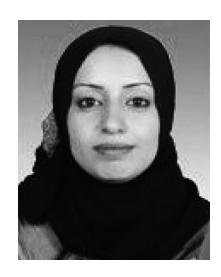
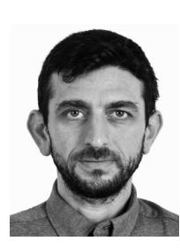
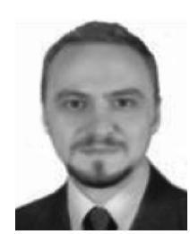
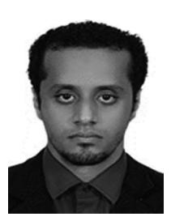
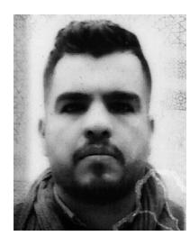
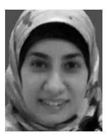

<!-- A3.R80 | source: papers_json/A3.R80/ -->

## Novel Multi Security and Privacy Benchmarking Framework for Blockchain-Based IoT Healthcare Industry 4.0 Systems

Sarah Qahtan, Khaironi Yatim Sharif, A. A. Zaidan , H. A. Alsattar, O. S. Albahri, B. B. Zaidan, Hazura Zulzalil, M. H. Osman, A. H. Alamoodi, and R. T. Mohammed

الملخص—يمثل التقييم والأهمية وطبيعة التباين لخصائص الأمان والخصوصية المتعددة القضايا الرئيسية التي تجعل عملية المقارنة المرجعية (benchmarking) لأنظمة الرعاية الصحية القائمة على blockchain وIoT في Industry 4.0 تندرج ضمن مشكلة اتخاذ القرار متعدد المعايير (MCDM). وفي هذه المقالة، تُعد إحدى طرق الترجيح الحديثة في MCDM المسماة fuzzy weighted with zero inconsistency (FWZIC) فعالة في ترجيح معايير التقييم بشكل ذاتي دون أي مشكلات عدم اتساق. ومع ذلك، ونظرًا لمزايا المجموعات الضبابية الكروية (spherical fuzzy sets) في توفير نطاق واسع من الخيارات لصانعي القرار والتعامل بكفاءة مع الغموض والتردد وعدم اليقين، صاغت هذه المقالة نسخة جديدة من FWZIC لترجيح خصائص الأمان والخصوصية، وهي spherical FWZIC (S-FWZIC). علاوة على ذلك، طُوّر إطار MCDM متكامل للمقارنة المرجعية لأنظمة الرعاية الصحية القائمة على blockchain وIoT في Industry 4.0 استنادًا إلى خصائص الأمان والخصوصية المتعددة. وفي المرحلة الأولى من المنهجية، تُصاغ مصفوفة قرار استنادًا إلى تقاطع "أنظمة الرعاية الصحية القائمة على blockchain وInternet of Things في Industry 4.0" مع "خصائص الأمان والخصوصية" (أي،

Manuscript received September 30, 2021; revised November 19, 2021, December 22, 2021, and December 26, 2021; accepted January 8, 2022. Date of publication January 25, 2022; date of current version June 13, 2022. Paper no. TII-21-3904. (Corresponding author: A. A. Zaidan.)

Sarah Qahtan is with the Department of Software Engineering and Information Systems, Faculty of Computer Science and Information Technology, Universiti Putra Malaysia, Serdang 43400, Malaysia, and also with the Department of Computer Center, Middle Technical University, Baghdad 06800, Iraq (e-mail: sarah.qahttan@gmail.com).

Khaironi Yatim Sharif, Hazura Zulzalil, and M. H. Osman are with the Department of Software Engineering and Information Systems, Faculty of Computer Science and Information Technology, Universiti Putra Malaysia, Serdang 43400, Malaysia (e-mail: khaironiii@upm.edu.my; hazuraaa@upm.edu.my; hafeezzerr@upm.edu.my).

- A. A. Zaidan is with the Faculty of Engineering and IT, British University in Dubia, Dubai 345015, United Arab Emirates (e-mail: aws.alaa@gmail.com).
- H. A. Alsattar, O. S. Albahri, and A. H. Alamoodi are with the Department of Computing, Universiti Pendidikan Sultan Idris, Tanjong Malim 35900, Malaysia (e-mail: hassansattarr@gmail.com; osamah@fskik.upsi.edu.my; alamoodi@fskik.upsi.edu.my).
- B. B. Zaidan is with the Future Technology Research Center, National Yunlin University of Science and Technology, Douliou 64002, Taiwan (e-mail: bilalbaha@fskik.upsi.edu.my).
- R. T. Mohammed is with the Department of Computer Science, Faculty of Science, Komar University of Science and Technology, Sulaymaniyah 16278, Iraq (e-mail: rawiatahrirdds@gmail.com).

Color versions of one or more figures in this article are available at https://doi.org/10.1109/TII.2022.3143619.

Digital Object Identifier 10.1109/TII.2022.3143619

user authentication وaccess control وprivacy protection وintegrity وavailability وanonymity). وفي المرحلة الثانية، تُحسب أوزان كل خاصية من خصائص الأمان والخصوصية باستخدام طريقة S-FWZIC. بعد ذلك، تُستخدم هذه الأوزان للمقارنة المرجعية لأنظمة الرعاية الصحية القائمة على blockchain وIoT في Industry 4.0 من خلال الجمع بين grey relational analysis-technique for order of preference by similarity to ideal solution (GRA-TOPSIS) وطريقة التحسين bald eagle search (BES). وتشير النتائج إلى ما يلي: أولاً، تُرجّح طريقة S-FWZIC خصائص الأمان والخصوصية بكفاءة، مبينةً أن access control يحمل أعلى وزن أهمية (0.2070)، بينما يحمل integrity أدنى وزن (0.0646)؛ وثانيًا، يُصنّف الجمع بين GRA-TOPSIS وطريقة تحسين BES الأنظمة بفعالية. وأُجري التقييم باستخدام تحليل الحساسية، الذي كشف عن نتائج ترابط عالية عبر جميع السيناريوهات التي نوقشت لتغيير أوزان المعايير. ويمكن أن تساعد تضمينات هذه المقالة إداريي المؤسسات الطبية على اختيار النظام الأكثر أمانًا وملاءمة، كما يمكن أن تساعد مطوري هذه الأنظمة في التوجهات المستقبلية.

Index Terms—Blockchain, healthcare industry 4.0 systems, security and privacy.

## I. المقدمة

يُعد Healthcare industry 4.0 أحد أسرع الصناعات نموًا وأكثرها بروزًا في العالم. غير أن هذه الصناعة واجهت قضايا اجتماعية-اقتصادية خطيرة في العديد من الدول خلال العقد الأخير. وقد استقصى واستعرض العديد من الأكاديميين، مثل [1]، تأثير تقنية blockchain على Healthcare Industry 4.0، بينما ركّز [2]–[4] على التحسن الكبير في الخصوصية والأمان ومشاركة البيانات ومنع المستخدمين غير المصرح لهم من خلال تقنية blockchain. وفي هذه المقالة، حدّدت الدراسة [1] أنظمة remote patient monitoring systems (RPMSs) بوصفها إحدى الفئات الناشئة لأنظمة الرعاية الصحية. وبمساعدة Internet of Things (IoT)، شهدت أنظمة Healthcare Industry 4.0 (وتحديدًا RPMSs) تحولًا ملحوظًا من خلال النقل الفعال لبيانات المرضى عبر wireless body area network وأجهزة الاستشعار الحيوية والتخزين السحابي.

ووفقًا لـ [1]، يمكن تقييم أنظمة الرعاية الصحية القائمة على blockchain وIoT في Industry 4.0 باستخدام العديد من خصائص الأمان والخصوصية: user authentication وaccess control وprivacy preservation وintegrity وavailability وanonymity. غير أن الأدبيات تعرض آراءً متباينة بشأن استخدام هذه الخصائص

1551-3203 © 2022 IEEE. Personal use is permitted, but republication/redistribution requires IEEE permission. See https://www.ieee.org/publications/rights/index.html for more information.

<!-- page 2 -->

في أنظمة الرعاية الصحية القائمة على blockchain وIoT في Industry 4.0. فعلى سبيل المثال، استخدم [5] access control وintegrity، بينما اعتمد [6] authentication وaccess control وprivacy preservation وintegrity وavailability. وعلى الرغم من كل هذه الجهود اللافتة، لم يُقدَّم بعد تطبيق موحد يجمع كل الخصائص المرغوبة.

إن إجراء تحديد النظام الأنسب معقّد، لكن يمكن معالجته من خلال تقييم أنظمة الرعاية الصحية القائمة على blockchain وIoT في Industry 4.0 ومقارنتها مرجعيًا. وقد قيّم عمل سابق [1] هذه الأنظمة؛ غير أنه لم يُقدَّم أي تقرير مقارنة مرجعية، وهو ما يُعد فجوة بحثية. وتُعد المقارنة المرجعية لأنظمة الرعاية الصحية القائمة على blockchain وIoT في Industry 4.0 لتحديد النظام الأكثر أمانًا وخصوصية أمرًا حاسمًا وصعبًا في آنٍ واحد. وعلى الرغم من كثرة الأنظمة المتاحة في الأدبيات، لا يوجد نظام متفوق يستوفي جميع الخصائص الأساسية. وتُعقّد التركيبات المختلفة لخصائص الأمان والخصوصية في هذه الأنظمة هذه المهمة. وتُعالَج ثلاث قضايا حرجة في المقارنة المرجعية لأنظمة الرعاية الصحية القائمة على blockchain وIoT في Industry 4.0 لسد الفجوة البحثية المحددة: تعدد معايير التقييم؛ وأهمية المعايير؛ وتباين البيانات. وقد استُخدمت بعض المعايير في تصميم هذه الأنظمة في دراسات سابقة. لذلك، ينبغي مراعاة معايير متعددة عند إجراء المقارنة المرجعية لهذه التصاميم. وتتفاوت أيضًا أهمية هذه المعايير إذ تجمعها الدراسات بطرق مختلفة [5]، [6]. بالإضافة إلى ذلك، يتفاوت توفر هذه المعايير في كل نظام من أنظمة Healthcare Industry 4.0، ويزداد هذا التباين مع تعقيد المهام في كل نظام. لذلك، ستنشأ مشكلات معقدة لاتخاذ القرار متعدد المعايير (MCDM) عند إجراء المقارنة المرجعية لأنظمة الرعاية الصحية القائمة على blockchain وIoT في Industry 4.0 استنادًا إلى القضايا المذكورة أعلاه. لذلك، ستنشأ مشكلات MCDM معقدة عند إجراء المقارنة المرجعية لأنظمة الرعاية الصحية القائمة على blockchain وIoT في Industry 4.0 استنادًا إلى القضايا المذكورة أعلاه. وبالتالي، هناك حاجة إلى نهج MCDM لسد هذه الفجوة وحل تعقيد المشكلة.

وقد طُوّرت طرق MCDM عديدة وطُبّقت في مجالات مختلفة، بما في ذلك ترتيب البدائل وترجيح المعايير، مثل [7]. وتُعد technique for order of preference by similarity to ideal solution (TOPSIS) إحدى طرق الترتيب الأعلى استخدامًا من قبل العديد من الباحثين لتحديد أي البدائل هو الأفضل أو الأمثل [8]، [9]. غير أن المسافة الإقليدية المطبقة في طريقة TOPSIS التقليدية تعاني من بعض أوجه القصور [10]: تشويه المعلومات الأصلية؛ وعدم الحساسية للقيم الصغيرة؛ ومسافة صغيرة نسبيًا بين الحل المثالي الإيجابي والسلبي؛ وعيوب انعكاس الترتيب. وقد قُدّمت نسخ محسّنة عديدة من TOPSIS في الأدبيات للتغلب على هذه العيوب. واقتُرحت Canberra distance وcontact vector distance وhamming distance وM-TOPSIS وgeneralised hybrid distance جميعها كبدائل للمسافة الإقليدية. ولنفس الغرض، دمجت مجموعات أخرى من الأكاديميين grey relational analysis (GRA) مع TOPSIS. وتشمل الفوائد الرئيسية لطريقة GRA إتاحة حسابات سهلة ومباشرة، والاعتماد على المعلومات الأصلية في اتخاذ القرارات، كما تُعد طريقة GRA من أكثر الطرق فعالية في اتخاذ قرارات الأعمال. بالإضافة إلى ذلك، يمكن لـ GRA التعامل مع مواقف اتخاذ قرار معقدة (مثل البيانات الناقصة وغير الدقيقة والغامضة) [11]. ومؤخرًا، قدّم Liu *et al.* [12]

طريقة ترتيب هجينة لتقييم ومقارنة الأداء اليومي لسوق الكهرباء. وحسّنت هذه الطريقة GRA-TOPSIS باستخدام نموذج تحسين لإيجاد القرب النهائي بين عينة التقييم والحلول المثالية، وهو ما يُعد مشكلة تحسين. ووفقًا لـ [13]، يتفوق خوارزمية bald eagle search (BES) على الخوارزميات الميتاهيوريستيكية المتقدمة والنهج التقليدية من خلال إدخالها لآليات أكثر تعقيدًا ودمجها لمشغّلات قوية مع أساليب استكشاف أخرى. لذلك، اعتُمد في هذه المقالة الجمع بين GRA-TOPSIS وطريقة تحسين BES للمقارنة المرجعية لبدائل أنظمة Healthcare Industry 4.0.

علاوة على ذلك، لا يستطيع الجمع بين GRA-TOPSIS وطريقة تحسين BES ترجيح المعايير، مما يتطلب طريقة خارجية لإنجاز هذه المهمة [14]. وقد نظرت دراسات عديدة في دمج analytic hierarchy process (AHP) مع الجمع بين GRA-TOPSIS وطريقة التحسين. وقد أظهر نهجا AHP وbest–worst method (BWM) درجة عالية من النجاح في ترجيح المعايير. غير أن عدم اتساق طرق الترجيح الخاصة بهما يظل قضية حرجة [14]. علاوة على ذلك، عندما تُؤخذ في الاعتبار العلاقة والترابط بين العناصر عالية المستوى ومنخفضة المستوى، لا يمكن تنظيم العديد من قضايا اتخاذ القرار بشكل هرمي. وتتطلب BWM مقارنات ثنائية أقل من AHP وتنتج درجة اتساق أعلى لترجيح معيار ما [15]. والصعوبة الوحيدة في BWM هي تحديد أفضل وأسوأ المعايير، بما في ذلك الأهمية النسبية لجميع المعايير مقارنة بالأفضل والأسوأ لمعايير محددة [16]. وبالتالي، يُعد تبني أحد هذين النهجين لتقييم أنظمة الرعاية الصحية القائمة على blockchain وIoT في Industry 4.0 غير عملي.

ومؤخرًا، اقتُرحت طريقة fuzzy weighted with zero inconsistency (FWZIC) لتحديد معاملات ترجيح المعايير بعدم اتساق صفري بغض النظر عن عددها [17]، [18]. وتحقق طريقة FWZIC عدم الاتساق الصفري من خلال حساب قيم معاملات الترجيح المحلية والعالمية لجميع المعايير بدقة وبشكل منفرد عند مستوى هرمي معين. بالإضافة إلى ذلك، يمكن لطريقة FWZIC حساب مستوى أهمية كل معيار في عملية اتخاذ القرار وفقًا لتفضيلات الخبراء. وتُعد طريقة FWZIC أفضل طريقة لترجيح المعايير لتقييم خصائص الأمان والخصوصية لأنظمة الرعاية الصحية القائمة على blockchain وIoT في Industry 4.0 لأنها تحل بنجاح مشكلة عدم الاتساق. غير أنه في النسخة الأصلية من طريقة FWZIC [17]، تُستخدم triangular fuzzy numbers (TFNs) لكنها تجعل كل مدخل درجة عضوية قيمةً حادة (crisp). وتفشل TFNs في نمذجة آثار عدم يقين البيانات والتخفيف منها بشكل مباشر. وطوّرت المجموعة نفسها من الباحثين امتدادًا جديدًا لطريقة FWZIC باستخدام trapezoidal fuzzy numbers (TrFNs) [18]. ويمكن لـ TrFNs تعريف دالة العضوية الدقيقة، ونمذجة أوجه عدم اليقين من الدرجة الثانية، وإتاحة حسابات سهلة. غير أن TrFNs تجعل جميع درجات العضوية الوسيطة خطية [23]، وهو ما قد يكون غير مناسب عند التركيز على درجة معينة من عدم اليقين، باستثناء 0 أو 1. وفي MCDM، تؤثر قضايا الغموض والتردد وعدم اليقين بشكل كبير في الدرجة النهائية المخصصة للبدائل. وعادةً ما تنشأ هذه القضايا من آراء صانعي القرار. وبناءً على ذلك، قُدّمت FWZIC في أوراق بحثية مع توسيعها في بيئات ضبابية مختلفة،

<!-- page 3 -->

C1 = User Authentication, C2 = Access Control, C3 = Privacy Protection, C4 = Integrity, C5 = Availability, C6 = Anonymity.

بما في ذلك Pythagorean fuzzy sets [20]، وT-spherical fuzzy sets (SFSs) [21]، وq-rung orthopair fuzzy sets [22].

علاوة على ذلك، توجد نظريات مجموعات ضبابية مختلفة يمكن استخدامها لتعريف الغموض والتردد وعدم اليقين في المعلومات والتقاطها. وتستخدم SFSs المسافة غير الخطية بين درجة العضوية وعدم العضوية والتردد، وقد يكون مجموعها أكبر من واحد، لكن ينبغي أن يكون مجموع مربعاتها بين 0 و1 [23]. وتزيد SFSs من ذكاء (المقارَب لقرار الإنسان) عملية اتخاذ القرار، مما يؤدي إلى دقة عالية في تقييم البدائل. لذلك، تُستخدم SFSs على نطاق واسع نظرًا لإمكاناتها في تزويد صانعي القرار بنطاق واسع من الخيارات للتعامل مع الغموض والتردد وعدم اليقين بنجاح وكفاءة أكبر من الطرق الأخرى [24].

ويمكن أن تساعد تضمينات هذه المقالة إداريي المؤسسات الطبية على اختيار النظام الأكثر أمانًا وخصوصية، وتساعد مطوري هذه الأنظمة على تصميم أنظمة آمنة.

وتُلخّص النقاط التالية مساهمات الدراسة.

- 1) طوّرت هذه المقالة صياغة جديدة لطريقة FWZIC ضمن البيئة الضبابية الكروية، أي طريقة spherical FWZIC (S-FWZIC).
- 2) طوّرت هذه المقالة طريقة تجمع بين GRA-TOPSIS وطريقة تحسين BES.
- 3) استنادًا إلى خصائص الأمان والخصوصية المتعددة، طوّرت هذه المقالة إطار MCDM جديدًا استنادًا إلى دمج S-FWZIC في الجمع بين GRA-TOPSIS وطريقة تحسين BES للمقارنة المرجعية لأنظمة الرعاية الصحية القائمة على blockchain وIoT في Industry 4.0.

وتُنظَّم بقية هذه المقالة كما يلي. تُقترح منهجية المقارنة المرجعية لأنظمة الرعاية الصحية القائمة على blockchain وIoT في Industry 4.0 في القسم الثاني. وفي القسم الثالث، تُعرض نتائج المقارنة المرجعية وتُناقش. ويُعرض تقييم الطريقة المقترحة في القسم الرابع. وأخيرًا، يختتم القسم الخامس هذه المقالة.

## II. المنهجية

في هذا القسم، يُشرح الإطار المقترح المستخدم في المقارنة المرجعية لأنظمة الرعاية الصحية القائمة على blockchain وIoT في Industry 4.0 استنادًا إلى منهجية من مرحلتين.

## *A. المرحلة الأولى: تحديد مصفوفة القرار*

في الإطار المقترح، تُعد مصفوفة القرار (DM) المكون الرئيسي المصمم والمنفَّذ للمقارنة المرجعية لأنظمة الرعاية الصحية القائمة على blockchain وIoT في Industry 4.0. ويُستخدم تقاطع معايير التقييم (مثل خصائص الأمان والخصوصية) مع البدائل لعرض DM، كما هو موضح في الجدول الأول (Table I).

اعتمدت هذه المقالة أنظمة الرعاية الصحية القائمة على blockchain وIoT في Industry 4.0 من دراسة سابقة [1]. وحُدِّدت ست خصائص للأمان والخصوصية في هذه الأنظمة، وهي: access control وuser authentication وprivacy protection وintegrity وavailability وanonymity. وقيّمت الدراسة السابقة [1] هذه الخصائص وصنّفتها كمعايير ثنائية (binomial) تُقاس إما بـ "Yes = 1" أو "No = 0". وفي هذه المقالة، تعكس القيمتان 1 و0 على التوالي وجود المعيار أو غيابه في كل نظام. وتُشكَّل DM لأنظمة الرعاية الصحية القائمة على blockchain وIoT في Industry 4.0 كما يلي استنادًا إلى المعايير والبدائل المحددة. وتُنشأ DM من خلال تقاطع البدائل (أي مجموعة أنظمة الرعاية الصحية القائمة على blockchain وIoT في Industry 4.0) مع خصائص الأمان والخصوصية (المعايير).

## *B. المرحلة الثانية: التطوير*

يعرض هذا القسم تفاصيل تطوير الإطار المقترح المستخدم للمقارنة المرجعية لأنظمة الرعاية الصحية القائمة على blockchain وIoT في Industry 4.0. وتُوصف الأقسام الفرعية التالية في إطار MCDM المقترح بالتفصيل.

- *1) طريقة S-FWZIC لترجيح معايير الأمان والخصوصية:* تُعد طريقة S-FWZIC امتدادًا جديدًا لطريقة FWZIC [17] باستخدام SFSs، وتتألف من خمس خطوات أساسية كما يلي. أ) *الخطوة 1. تعريف المعايير*: تُعرَّف معايير التقييم في هذه الخطوة، بينما يُحدَّد لجنة الخبراء ويُختار لتقييم المعايير في الخطوة التالية.ب) *الخطوة 2. الحكم الخبير المنظم* (SEJ): تحدد هذه الخطوة وتختار متخصصين في مجال أمان وخصوصية أنظمة الرعاية الصحية. ثم يُطوَّر نموذج تقييم. وتُعد هذه المهمة خطوة حيوية في جمع البيانات من الخبراء. ويُختبر موثوقية الاستبيان وصلاحيته من قبل الخبراء الذين اختيروا في الخطوة السابقة. ثم يُحدَّد مستوى الأهمية. ويحدد الخبراء مستوى أهمية/دلالة المعايير باستخدام مقياس ليكرت (Likert) من خمس نقاط. وأخيرًا، تُحوَّل المصطلحات اللغوية

<!-- page 4 -->

إلى مقاييس تسجيل رقمية معادلة، كما هو موضح في الجدول الثاني (Table II).

- ج) الخطوة 3. بناء مصفوفة قرار الخبراء (EDM): تُنشئ هذه الخطوة EDM تحتوي على معايير القرار (أي خصائص الأمان والخصوصية) والبدائل (أي أنظمة الرعاية الصحية القائمة على blockchain وIoT في Industry 4.0). ويُنشأ تقاطع بين خصائص الأمان والخصوصية ولجنة SEJ. ويُقاطَع كل معيار مع كل خبير مختار يُحدد مستوى الأهمية/الدلالة لجميع المعايير.
- د) الخطوة 4. تطبيق دالة العضوية الضبابية: تُطبَّق دالة عضوية SFS وعملية إزالة الضبابية اللاحقة على بيانات EDM. ونتيجة هذه الخطوة هي EDM من نوع SFS تُحسّن دقة البيانات وبساطتها للتحليل المستقبلي. غير أن مشكلات MCDM غير مؤكدة وغير دقيقة بسبب صعوبة تخصيص معدل تفضيل محدد لأي معيار معين. وللتغلب على هذه المشكلات، تُستخدم الطرق الضبابية لتحديد قيمة المعيار باستخدام أعداد غامضة بدلاً من أعداد حادة (crisp) [14]. وكما ذُكر، يمكن لـ S-FWZIC التغلب على عدم الاتساق وتحقيق دقة عالية. وتُعرض SFS في [26] وتُصاغ في المعادلات التالية. تُصاغ SFS \tilde{A}_s لمجال الخطاب U كما يلي:

$$
\tilde{A}_{s} = \left\{ u, \ \mu_{\tilde{A}_{s}}(u), \ \nu_{\tilde{A}_{s}}(u), \ \pi_{\tilde{A}_{s}}(u) \right\} 
where \mu_{\tilde{A}_{s}}(u) : U \to [0, 1], \ \nu_{\tilde{A}_{s}}(u) : U \to [0, 1], \pi_{\tilde{A}_{s}}(u) : U \to [0, 1]
(1)
$$

و

$$
0 \le \mu_{\tilde{A}_S}^2(u) + v_{\tilde{A}_S}^2(u) + \pi_{\tilde{A}_S}^2(u) \le 1 \forall_u \in U. (2)
$$

بالنسبة لكل u، تمثل \mu_{\tilde{A}_s}(u) وnu_{\tilde{A}_s}(u) وpi_{\tilde{A}_s}(u) درجات العضوية وعدم العضوية والتردد لـ u تجاه \tilde{A}_s، على التوالي. ويمثل \chi_{\tilde{A}_s} = (1 - \mu_{\tilde{A}_s}^2(u) - \nu_{\tilde{A}_s}^2(u) - \pi_{\tilde{A}_s}^2(u))^{1/2} درجة الرفض (refusal degree).

تُمثَّل عمليات SFS المستخدمة في التعريفات التالية [26].

لتكن SFSs هي \tilde{A}_s = (\mu_{\tilde{A}_s}, \ \nu_{\tilde{A}_s}, \ \pi_{\tilde{A}_s}) و\tilde{B}_s = (\mu_{\tilde{B}_s}, \ \nu_{\tilde{B}_s}, \ \pi_{\tilde{B}_s}).

الضرب بعدد قياسي: لـ \lambda \geq 0

$$
\lambda \cdot \tilde{A}_{s} = \left\{ \begin{pmatrix} \left(1 - \left(1 - \mu_{\tilde{A}_{s}}^{2}\right)^{\lambda}\right)^{\frac{1}{2}}, \ \nu_{\tilde{A}_{s}}^{\lambda}, \\ \left(\left(1 - \mu_{\tilde{A}_{s}}^{2}\right)^{\lambda} - \left(1 - \mu_{\tilde{A}_{s}}^{2} - \pi_{\tilde{A}_{s}}^{2}\right)^{\lambda}\right)^{\frac{1}{2}}, \\ \left(\left(1 - \mu_{\tilde{A}_{s}}^{2}\right)^{\lambda} - \left(1 - \mu_{\tilde{A}_{s}}^{2} - \pi_{\tilde{A}_{s}}^{2}\right)^{\lambda}\right)^{\frac{1}{2}}, \\ (3)
$$

القسمة [27]: إذا \frac{\mu_{\bar{B}_s}^2}{\mu_{\bar{A}_s}^2} \geq \frac{1-\pi_{\bar{B}_s}^2 1+\pi_{\bar{A}_s}^2}{1-\pi_{\bar{A}_s}^2 1+\pi_{\bar{B}_s}^2} \geq 1

$$
\tilde{A}_{s} \oslash \tilde{B}_{s} = \begin{pmatrix} \left( \frac{(\mu_{\tilde{A}_{s}}^{2}(2-\mu_{\tilde{B}_{s}}^{2})}{1-(1-\mu_{\tilde{A}_{s}}^{2})\cdot(1-\mu_{\tilde{B}_{s}}^{2})} \right)^{\frac{1}{2}}, \frac{(v_{\tilde{A}_{s}}^{2}-v_{\tilde{B}_{s}}^{2})^{\frac{1}{2}}}{(1-v_{\tilde{A}_{s}}^{2}\cdot v_{\tilde{B}_{s}}^{2})^{\frac{1}{2}}}, \\ \frac{(\pi_{\tilde{A}_{s}}^{2}\cdot\pi_{\tilde{B}_{s}}^{2})^{\frac{1}{2}}}{(1-\pi_{\tilde{A}_{s}}^{2}\cdot\pi_{\tilde{B}_{s}}^{2})^{\frac{1}{2}}} \end{pmatrix}. \tag{4}
$$

عرّفت المجموعة نفسها من المؤلفين spherical weighted arithmetic mean (SWAM) لـ SFS بالنسبة إلى w =

$$ (w_1, w_2..., w_n); w_i \in [01]; \sum_{i=1}^n w_i = 1 $$

SWAM_w(\tilde{A}_{S1}, \dots, \tilde{A}_{Sn}) = w_1 \tilde{A}_{S1} + w_1 \tilde{A}_{S1} + \dots + w_n \tilde{A}_{Sn}

$$
= \left\{ \left[ 1 - \prod_{i=1}^{n} \left( 1 - \mu_{\tilde{A}_{Si}}^{2} \right)^{w_{i}} \right]^{1/2}, \prod_{i=1}^{n} \nu_{\tilde{A}_{Si}}^{w_{i}}
$$

$$
\left[\prod_{i=1}^{n} \left(1 - \mu_{\tilde{A}_{Si}}^{2}\right)^{w_{i}} - \prod_{i=1}^{n} \left(1 - \mu_{\tilde{A}_{Si}}^{2} - \pi_{\tilde{A}_{Si}}^{2}\right)^{w_{i}}\right]^{1/2}\right\}.
(5)
$$

تُعرَّف القيمة المزالة الضبابية (crisp) لـ SFSs كما يلي [23]:

$$
Def \left(\tilde{A}_s\right) = \left(\mu_{\tilde{A}_s} - \pi_{\tilde{A}_s}\right)^2 - \left(\nu_{\tilde{A}_s} - \pi_{\tilde{A}_s}\right)^2. (6)
$$

يعطي الجدول الثاني (Table II) قيمة كل مصطلح لغوي والعدد الضبابي الكروي المقابل له [25].

- هـ) الخطوة 5. حساب القيم النهائية لمعاملات ترجيح معايير التقييم: تحسب هذه الخطوة القيم النهائية لمعاملات الترجيح لخصائص الأمان والخصوصية (w_1, w_2, \ldots, w_n)^T باستخدام البيانات المُضَبَّبة من الخطوة السابقة كما يلي.
- ط) حساب نسبة البيانات المُضَبَّبة باستخدام (7) الموضحة في أسفل الصفحة التالية، و(4). ولهذا الغرض، تُعدَّل (5) إلى (7) بحذف الوزن لأنه لم يُخصَّص للخبراء في الطريقة المقترحة. وتُصاغ الشكل الرمزي للعملية الفعلية كما يلي

$$
\widetilde{E}_{\widetilde{t}}: \ \widetilde{C}_{ij} = \frac{\operatorname{Imp}\widetilde{E1}\left(C1\right)}{\sum_{j=1}^{n} \operatorname{Imp}\widetilde{E1}\left(C1\right)} (8)
$$

حيث يمثل \widetilde{\mathrm{Imp}(E_{ij}/C_{ij})} العدد الضبابي لـ Imp (E_{ij}/C_{ij})، حيث i=1,2,3,\ldots,m، وj=1,2,3,\ldots,n

ط ط) تُحسب القيم المتوسطة للحصول على القيم النهائية لمعاملات ترجيح خصائص الأمان والخصوصية (\widetilde{w1},\widetilde{w2},\ldots,\widetilde{wn})^T. وفي هذه الخطوة، من الهياكل الأساسية لـ FWZIC قسمة القيم المجمّعة على ثابت. لذلك، تُعدَّل (3) باستخدام معكوس الثابت كما هو موضح في (9). ثم تُحسب كل قيمة من EDM من نوع SFS بواسطة (7) و(9). ويُعطى التمثيل الرمزي للعملية الفعلية لهذه الخطوة كما يلي

$$
\tilde{A}_{s}\lambda = \left\{ \begin{pmatrix} \left(1 - \left(1 - \mu_{\tilde{A}_{s}}^{2}\right)^{\frac{1}{\lambda}}\right)^{\frac{1}{2}}, & \nu_{\tilde{A}_{s}}^{\frac{1}{\lambda}}, \\ \left(\left(1 - \mu_{\tilde{A}_{s}}^{2}\right)^{1/\lambda} - \left(1 - \mu_{\tilde{A}_{s}}^{2} - \pi_{\tilde{A}_{s}}^{2}\right)^{1/\lambda}\right)^{1/2} \right\} 
(9)
$$

$$
\widetilde{w_j} = \left(\sum_{i=1}^m \tilde{E}_{ij} : \tilde{C}_{ij}\right)/m) for i = 1, 2, 3, \dots, m, and j = 1, 2, 3, \dots, n. (10)
$$

ط ط ط) تُوجد القيمة النهائية للوزن من خلال إزالة الضبابية، حيث تُستخدم (6) لإزالة ضبابية قيم الوزن في SFSs إلى قيمها الحادة (crisp). ولتحديد معاملات الترجيح النهائية، ينبغي تخصيص وزن

<!-- page 5 -->

كل معيار وفقًا لمجموع أوزان جميع المعايير لأغراض إعادة القياس.

- 2) الجمع بين GRA-TOPSIS وطريقة تحسين BES: يعرض هذا القسم استراتيجية الترتيب لقياس نتائج التقييم استنادًا إلى الجمع بين GRA-TOPSIS وطريقة تحسين BES. وتُوصف طريقة GRA-TOPSIS بالخطوات التالية [28].
- 1) الخطوة 1: TOPSIS: تُستخدم TOPSIS في هذه المقالة لتحديد NISs الإيجابية. وتُعرض العمليات الأساسية لـ TOPSIS كما يلي. أ) بناء DM موحدة القياس (normalised). (11) صيغة شائعة الاستخدام

$$ S_{ij} = x_{ij} / \left(\sum_{i=1}^{k} (x_{ij})^2\right)^{1/2} (11) $$

حيث x_{ij} هي قيمة الخلية عند تقاطع الصف i_{th} (الأنظمة) والعمود j_{th} (خصائص الأمان والخصوصية) في DM. وليكن k يمثل العدد الإجمالي لأنظمة الرعاية الصحية القائمة على blockchain وIoT في Industry 4.0 المدروسة، وm يمثل العدد الإجمالي لخصائص الأمان والخصوصية. وتنتج هذه العملية DM موحدة القياس كما يلي:

$$
S = \begin{bmatrix} S_{11} & S_{12} & \dots & S_{1m} \\ S_{21} & S_{22} & \dots & S_{2m} \\ \vdots & \vdots & \vdots & \vdots \\ S_{k1} & S_{k2} & \dots & S_{km} \end{bmatrix} . \tag{12}
$$

ب) حساب المصفوفة المرجَّحة. يمكن إنجاز هذه الخطوة بضرب مجموعة الأوزان w = w_1, w_2, \dots, w_m المحسوبة بواسطة S-FWZIC في DM موحدة القياس، كما هو موضح في

$$
V_{ij} = w_i * S_{ij}, \text{ whwre } w = \begin{bmatrix} w_1 & w_2 & \dots & w_m \end{bmatrix} (13) \begin{bmatrix} w_1 S_{11} & w_2 S_{12} & \dots & w_m S_{1m} \\ w_1 S_{21} & w_2 S_{22} & \dots & w_m S_{2m} \end{bmatrix} (14)
$$

$$
= \begin{bmatrix} w_1 S_{11} & w_2 S_{12} & \dots & w_m S_{1m} \\ w_1 S_{21} & w_2 S_{22} & \dots & w_m S_{2m} \\ \vdots & \vdots & \vdots & \vdots \\ w_1 S_{k1} & w_2 S_{k2} & \dots & w_m S_{km} \end{bmatrix} . \tag{14}
$$

ج) تحديد PIS وNIS. يُعرَّف الحل المثالي الإيجابي A^+ والحل المثالي السلبي A^- بواسطة (15) و(16) على التوالي، باستخدام DM المرجّحة الموحدة القياس V.

$$
A^{+} = (v_{1}^{+}, v_{2}^{+}, v_{3}^{+}, \dots, v_{m}^{+})= ((\max v_{ij} | j \in I), (\min v_{ij} | j \in J)) (15)
$$

$$
A^{-} = (v_{1}^{-}, v_{2}^{-}, v_{3}^{-}, \dots, v_{m}^{-})
= ((\min v_{ij} | j \in I), (\max v_{ij} | j \in J)) (16)
$$

حيث I يمثل معايير المنافع (benefits)؛ وJ يمثل معايير التكلفة (cost)؛ وi = 1, 2, 3, ..., k؛ وj = 1, 2, 3, ..., m.

د) حساب المسافة الإقليدية. تُحسب D_i^+ وD_i^- لكل نظام من أنظمة Healthcare Industry 4.0 في DM المرجّحة الموحدة القياس V من PIS وNIS من خلال

$$
D_i^{\mp} = \left(\sum_{j=1}^k \left(V_{ij} - v_j^{\mp}\right)^2\right)^{1/2}. (17)
$$

2) الخطوة 2: GRA: تُعد GRA طريقة بديلة لتحديد المسافة من خلال حساب مصفوفة معامل الارتباط الرمادي لـ PIS وNIS. وتُعطى المعادلة الرياضية لـ GRA (G_i^{\pm}) أدناه. ويمثل \rho عامل التحليل (resolution factor) ويُحدَّد عادةً بـ 0.5

$$ G_i^{\mp} = \frac{\sum_{j=1}^m r_{ij}^{\mp}}{m} \tag{18} $$

$$
r_{ij}^{\mp} = \frac{\min_{1 \le i \le k} \min_{1 \le j \le m} |v_j^{\mp} - V_{ij}| + \rho \max_{1 \le i \le k} \max_{1 \le j \le m} |v_j^{\mp} - V_{ij}|}{|v_j^{\mp} - V_{ij}| + \rho \max_{1 \le i \le k} \max_{1 \le j \le m} |v_j^{\mp} - V_{ij}|}.
(19)
$$

- 3) الخطوة 3: طريقة الترتيب الهجينة:
- أ) حساب المسافة الهجينة. تُحسب المسافة الهجينة باستخدام نموذج التحسين التالي استنادًا إلى مبدأ الحد الأدنى من الإنتروبيا المعلوماتية

$$
\min \mathbf{Z}_{i}^{\mp} = \Sigma_{i=1}^{k} \alpha \cdot H_{i}^{\mp} \ln \left( \frac{H_{i}^{\mp}}{\operatorname{nrm}(D_{i}^{\mp})} \right) + \Sigma_{i=1}^{k} (1 - \alpha) \cdot H_{i}^{\mp} \ln \left( \frac{H_{i}^{\mp}}{\operatorname{nrm}(G_{i}^{\mp})} \right). 
(20)
$$

بشرط أن:

$$
\sum_{i=1}^{k} H_i^{\mp} = 1, \ 0 \le H_i^{\mp} \le 1, \ 0 \le H_i^{\mp} 1. \ \text{and} \ \alpha = 0.5.
$$

تتضمن هذه المقالة خطوة حساب BES [13] لأن (20) تتطلب نموذج تحسين. وتُعرض خطوات BES في Algorithm 1.

ب) تُحسب القرب الهجين (Scorei) بالحصول على الفرق بين نظام i من أنظمة الرعاية الصحية القائمة على blockchain وIoT في Industry 4.0 والحلول المثالية (21). وتُرتَّب الأنظمة وفقًا لدرجاتها بترتيب تنازلي، ويُوصى بالنظام صاحب أعلى درجة. وتُرتَّب أنظمة الرعاية الصحية القائمة على blockchain وIoT في Industry 4.0 بواسطة **GRA-TOPSIS**

$$ Score_i = \frac{H_i^-}{H_i^+ + H_i^-} (21) $$

$$
\operatorname{SAM}(\tilde{A}_{S1}, \dots, \tilde{A}_{Sn}) = \tilde{A}_{S1} + \tilde{A}_{S1} + \dots + \tilde{A}_{Sn} \\ = \left\{ \left[ 1 - \prod_{i=1}^{n} \left( 1 - \mu_{\tilde{A}_{Si}}^{2} \right) \right]^{1/2}, \prod_{i=1}^{n} \nu_{\tilde{A}_{Si}}, \left[ \prod_{i=1}^{n} \left( 1 - \mu_{\tilde{A}_{Si}}^{2} \right) - \prod_{i=1}^{n} \left( 1 - \mu_{\tilde{A}_{Si}}^{2} - \pi_{\tilde{A}_{Si}}^{2} \right) \right]^{1/2} \right\} 
(7)
$$

<!-- page 6 -->

## Algorithm 1: BES Optimization Method.

- 1: Randomly initialise point Pi for n. Point;
- 2: Calculate the fitness value of initial Point: f(Pi);
- 3: WHILE (the termination conditions are not met) Selection step
- 4: For (each point i in the population)
- 5: P_{\text{new}} = P_{\text{best}} + \alpha 1 * r(P_{\text{mean}} P_i)
- 6: If f(P_{\text{new}}) < f(P_i)
- 7: P_i = P_{\text{new}}
- 8: If f(P_{\text{new}}) < f(P_{\text{best}})
- 9: P_{\text{best}} = P_{\text{new}}
- 10: End If
- 11: End If
- 12: End For Searching step
- 13: For (each point I in the population)
- 14: P_{\text{new}} =

$$ P_i + y(i) * (P_i - P_{i+1}) + x(i) * (P_i - P_{\text{mean}}) $$

- 15: If f(P_{\text{new}}) < f(P_i)
- 16: P_i = P_{\text{new}}
- 17: If f(X_{\text{new}}) < f(P_{\text{best}})
- 18: P_{\text{best}} = P_{\text{new}}
- 19: End If
- 20: End If
- 21: End For
- Swooping step
- 22: For (each point I in the population)
- 23: P_{\text{new}} = \text{rand} * P_{\text{best}} + x1(i) * (P_1 c_1 * P_{\text{mean}}) + y1(i) * (P_i c_2 * P_{\text{best}})
- 24: If f(P_{\text{new}}) < f(P_i)
- 25: P_i = P_{\text{new}}
- 26: If f(P_{\text{new}}) < f(P_{\text{best}})
- 27: P_{\text{best}} = P_{\text{new}}
- 28: End if
- 29: End if
- 30: End for
- 31: Set k := k+1
- 32: End while

## III. النتائج والمناقشة

## A. تحديد الأوزان باستخدام S-FWZIC

يعرض هذا القسم النتائج المرجَّحة لخصائص الأمان والخصوصية باستخدام طريقة S-FWZIC. وبعد إتمام الإجراءات المطلوبة، أنتجت طريقة S-FWZIC أوزانًا متسقة مجمّعة. والخطوة الأولى هي تحديد مجموعة المعايير (أي خصائص الأمان والخصوصية). وبعد ذلك، تُجمع البيانات من الخبراء (SEJ)، كما وُصف في الخطوة الثانية من طريقة S-FWZIC. وقد أكمل سبعة عشر متخصصًا في أنظمة الرعاية الصحية القائمة على blockchain وIoT في Industry 4.0 نموذج التقييم المُعَدّ لنقل خبرتهم في تحديد مستوى أهمية كل معيار من معايير الأمان والخصوصية. ثم تُحوَّل تفضيلات الخبراء من مصطلحات لغوية إلى مقاييسها الرقمية المعادلة كما هو موضح في الجدول الثاني (Table II). علاوة على ذلك، تُبنى EDM لأنظمة الرعاية الصحية القائمة على blockchain وIoT في Industry 4.0 كما ذُكر في الخطوة الثالثة. ووفقًا للخطوة

|  |  |  |  |  |  |  |  |  |
| --- | --- | --- | --- | --- | --- | --- | --- | --- |
|  | D+ | D- | G+ | G- | H+ | H- | score | rank |
| Sys1 | 0.082 | 0.040 | 0.115 | 0.000 | 0.007 | 0.036 | 0.830 | 13 |
| Sys2 | 0.072 | 0.063 | 0.077 | 0.052 | 0.021 | 0.028 | 0.565 | 9 |
| Sys3 | 0.040 | 0.100 | 0.000 | 0.159 | 0.048 | 0.007 | 0.133 | 1 |
| Sys4 | 0.082 | 0.040 | 0.115 | 0.000 | 0.007 | 0.036 | 0.830 | 13 |
| Sys5 | 0.040 | 0.100 | 0.000 | 0.159 | 0.048 | 0.007 | 0.133 | 1 |
| Sys6 | 0.071 | 0.065 | 0.076 | 0.053 | 0.022 | 0.027 | 0.555 | 8 |
| Sys7 | 0.065 | 0.075 | 0.042 | 0.100 | 0.032 | 0.020 | 0.380 | 5 |
| Sys8 | 0.082 | 0.040 | 0.115 | 0.000 | 0.007 | 0.036 | 0.830 | 13 |
| Sys9 | 0.040 | 0.100 | 0.000 | 0.159 | 0.048 | 0.007 | 0.133 | 1 |
| Sys10 | 0.081 | 0.042 | 0.114 | 0.001 | 0.008 | 0.036 | 0.822 | 12 |
| Sys11 | 0.065 | 0.075 | 0.042 | 0.100 | 0.032 | 0.020 | 0.380 | 5 |
| Sys12 | 0.078 | 0.051 | 0.111 | 0.005 | 0.010 | 0.035 | 0.770 | 11 |
| Sys13 | 0.073 | 0.062 | 0.078 | 0.052 | 0.021 | 0.028 | 0.570 | 10 |
| Sys14 | 0.060 | 0.081 | 0.039 | 0.106 | 0.034 | 0.018 | 0.347 | 4 |
| Sys15 | 0.071 | 0.066 | 0.076 | 0.054 | 0.022 | 0.027 | 0.550 | 7 |

4، تُستخدم دالة عضوية SFS لتحويل رموز المصطلحات اللغوية إلى أعداد ضبابية معادلة لأنظمة الرعاية الصحية القائمة على blockchain وIoT في Industry 4.0 كما هو موضح في الجدول الثاني (Table II). وبعد ذلك، تُحوَّل نتائج آراء الخبراء بشأن دلالة خصائص الأمان والخصوصية وتُضَبَّب. وتُحدَّد نسب معايير الأمان والخصوصية باستخدام (7) و(4). ثم يُشتق متوسط تفضيل الخبراء لكل معيار باستخدام (7) و(9) لتحديد الوزن الضبابي. ثم، كما هو موضح في الخطوة 5، تُستخدم (6) لتحديد الوزن النهائي لكل معيار من معايير الأمان والخصوصية. ويعطي الجدول الثالث (Table III) النسبة المحسوبة والقيمة الضبابية للأوزان النهائية لخصائص الأمان والخصوصية لأنظمة الرعاية الصحية القائمة على blockchain وIoT في Industry 4.0.

يعطي الجدول الثالث (Table III) النتائج النهائية لترجيح أنظمة الرعاية الصحية القائمة على blockchain وIoT في Industry 4.0، مبينًا مستوى أهمية معايير الأمان والخصوصية الستة وفقًا لطريقة S-FWZIC المقترحة. وخُصِّصت أعلى الأوزان لـ access control (C2) وuser authentication (C1) وprivacy protection (C3)، تلتها availability (C5) وanonymity (C6). ثم حصلت integrity (C4) على وزن ضئيل.

## B. نتائج المقارنة المرجعية

استُخدم الجمع بين GRA-TOPSIS وطريقة تحسين BES للمقارنة المرجعية لكل نظام من أنظمة Healthcare Industry 4.0. واستُخدمت الأوزان المستخلصة لمعايير التقييم (أي خصائص الأمان والخصوصية) كمدخل للجمع بين GRA-TOPSIS وطريقة تحسين BES مع DM (انظر الجدول الأول (Table I)) للمقارنة المرجعية لأنظمة الرعاية الصحية القائمة على blockchain وIoT في Industry 4.0. ويعطي الجدول الرابع (Table IV) النتائج الإجمالية لهذه الأنظمة. وتُحصل المسافات الإقليدية للحل المثالي (D_i^+) والحل السلبي (D_i^-) بواسطة (17)، وتُحسب مسافات GRA (درجة القرب العلائقي الرمادي) للحل المثالي (G_i^+) والحل السلبي (G_i^-) باستخدام (18). ثم تُستخدم هاتان المسافتان (أي المسافات الإقليدية ومسافات GRA) لحساب المسافة الهجينة، حيث تُستخدم D_i^+ وG_i^+ كمدخلات لنموذج التحسين (أي BES) كما هو موضح في (20)، والمخرج

<!-- page 7 -->

هو المسافة الهجينة إلى الحل المثالي (H_i^+). وفي الوقت نفسه، تُستخدم D_i^- وG_i^- كمدخلات لنموذج التحسين، والمخرج هو المسافة الهجينة إلى الحل السلبي (H_i^-). وإعدادات معاملات BES [13] في هذه المقالة هي كما يلي: c1, c2, \alpha = 2، وa1 = 10، وR = 1.5، وPop_{size} = 100. ثم تُحسب القرب النسبي الهجين H_i باستخدام (21) لتخصيص قيمة درجة لكل نظام من أنظمة Healthcare Industry 4.0. وتتراوح قيمة القرب النسبي بين 0 و1، وكلما اقتربت القيمة من 0 كان النظام أكثر استحسانًا؛ أي إن أفضل نظام يحمل أدنى درجة، بينما يحمل أسوأ نظام أعلى درجة. ويعطي الجدول الرابع (Table IV) قيم D_i^+، وD_i^-، وG_i^+، وG_i^-، وH_i^+، وH_i^-، ودرجات القرب النسبي، ونتائج الترتيب النهائي لأنظمة الرعاية الصحية القائمة على blockchain وIoT في Industry 4.0. ومن بين الأنظمة الخمسة عشر، تحمل الأنظمة 3 و5 و9 نفس الترتيب الأعلى (الترتيب = 1) لأنها استخدمت نفس معايير user authentication وaccess control وprivacy protection وintegrity وavailability. وبالتالي فإن درجة هذه الأنظمة هي 0.133. وبالمثل، تحمل الأنظمة 1 و4 و8 نفس الترتيب الأدنى (الترتيب = 13) لأنها استخدمت نفس معياري user authentication وintegrity. غير أن درجة هذه الأنظمة هي 0.830. وتتوزع رتب بقية الأنظمة بين النظامين الأعلى والأدنى.

وبشكل عام، تتأثر نتائج المقارنة المرجعية لأنظمة الرعاية الصحية القائمة على blockchain وIoT في Industry 4.0 تأثرًا كبيرًا بوزن كل معيار (أي خصائص الأمان والخصوصية). فعلى سبيل المثال، يمتلك النظام 15 ثلاثة معايير، وهي privacy protection (w = 0.1934)، وintegrity (w = 0.0646)، وanonymity (w = 0.1587). ويمتلك النظام 13 أيضًا ثلاثة معايير للأمان والخصوصية لكن بفروق طفيفة: user authentication (w =0.1977)، وaccess control (w = 0.2070)، وintegrity (w = 0.0646). وعلى الرغم من أن كلا النظامين يمتلكان نفس عدد المعايير، فإن النظام 15 أكثر استحسانًا (ترتيب أعلى) من النظام 13 (ترتيب أدنى). وبالتالي، يُعد تحديد أهمية المعايير خطوة ضرورية للاختيار السليم للمقارنة المرجعية لأنظمة الرعاية الصحية القائمة على blockchain وIoT في Industry 4.0. وأخيرًا، يُقيّم القسم التالي نتائج المقارنة المرجعية للإطار التكاملي المقترح (S-FWZIC مع الجمع بين GRA-TOPSIS وطريقة تحسين BES).

## IV. التقييم

يستخدم العديد من الباحثين، مثل [29]، تحليل الحساسية لتقييم نتائجهم. ويُجرى تحليل الحساسية على تأثير تغيير أوزان المعايير في نتائج المقارنة المرجعية. ويُعد هذا التحليل ضروريًا لتحديد متانة الإطار المقترح. أولاً، حُدِّد أهم معيار

بواسطة طريقة S-FWZIC. ثم فُحص تأثير تغيير أوزان المعايير من خلال توليد خمسة سيناريوهات من الأوزان النسبية للمعايير باستخدام (22) [30]. واستُخدم معامل المرونة (\alpha_c) لحساب التغير النسبي لكل معيار مقارنة بالمعيار الأكثر أهمية، وحُدِّدت القيم الحدية لتغيير معامل وزن المعيار الأكثر أهمية. ثم قُورنت الرتب الناتجة عن تغيير أوزان المعايير في السيناريوهات المولَّدة بالترتيب الأصلي

$$
w_c = (1 - w_s) \times \left(\frac{w_c^o}{W_c^0}\right) = w_c^o - \Delta x \alpha_c \qquad (22)
$$

حيث يمثل w_s المعيار الأكثر أهمية، ويمثل w_c^o قيم الوزن الأصلية المحسوبة بواسطة طريقة S-FWZIC، ويمثل W_c^0 مجموع الوزن الأصلي لقيم وزن المعايير المتغيرة، ويمثل \Delta x نطاق التغيرات المطبقة على أوزان معايير الأمان والخصوصية والتي تمثل القيم الحدية للمعيار الأكثر أهمية. وحُدِّد access control (C2 = 0.2070) بوصفه المعيار الأكثر أهمية (انظر الجدول الثالث (Table III)) من بين معايير الأمان والخصوصية الستة. وعلى هذا الأساس، حُسبت الأوزان النسبية لكل معيار باستخدام (22)، مما أسفر عن خمسة سيناريوهات لتغيير أوزان المعايير. وحُسب معامل المرونة (\alpha_c) لجميع المعايير، كما هو موضح في الجدول الخامس (Table V).

والقيم الحدية لمعيار access control هي -0.2070 \le \Delta x \leq 0.7930. وقُسِّم نطاق الفترة المحدد لأنظمة الرعاية الصحية القائمة على blockchain وIoT في Industry 4.0 إلى خمس متسلسلات، وأدى كل منها إلى تشكيل خمسة سيناريوهات وأنتج قيم أوزان جديدة، كما هو موضح في الجدول الخامس (Table V). واستُخدمت قيم الأوزان المولَّدة لتقييم حساسية أنظمة الرعاية الصحية القائمة على blockchain وIoT في Industry 4.0 التي خضعت للمقارنة المرجعية. والهدف هو تحديد تأثير تغيير الأوزان في نتائج الترتيب النهائي في كل من السيناريوهات الخمسة. وبالتأكيد، يؤدي مستوى أهمية خصائص الأمان والخصوصية دورًا حاسمًا في تغيير الترتيب الفردي لأنظمة الرعاية الصحية القائمة على blockchain وIoT في Industry 4.0 في بعض السيناريوهات. وفي معظم السيناريوهات الخمسة، تتضح قوة الطريقة التكاملية المقترحة. وفي السيناريوهات المذكورة، حصلت البدائل الثلاثة الأولى (Sys3 وSys5 وSys9) على نفس الترتيب مثل S-FWZIC. وفي السياق نفسه، ظل النظام 14 في الترتيب الرابع في جميع السيناريوهات. وانخفض النظامان 7 و11 إلى الترتيب السابع في S1 وظلا مستقرين (الترتيب = 5) في S2-S5. وارتفع النظام 12 إلى الترتيب التاسع في S1 وحقق نفس نتائج الترتيب (الترتيب = 11) مثل S-FWZIC في S2–S5. وحافظ النظام 10 على الترتيب العاشر في S1 وظل مستقرًا (الترتيب = 12) في S2–S4 حيث ارتفع إلى الترتيب الحادي عشر في S5 فقط. وارتفعت البدائل الثلاثة الأخيرة (Sys1 وSys4 وSys8) إلى الترتيب الثاني عشر في S1 وحققت نفس نتيجة الترتيب مثل S-FWZIC في بقية السيناريوهات. وتغيرت رتب جميع الأنظمة الأخرى نسبيًا. وأخيرًا، استُخدم معامل ارتباط سبيرمان (SCC) لتقييم العلاقة بين نتائج السيناريوهات الخمسة إحصائيًا [30]. وبشكل عام، تشير النتائج إلى ارتباط عالٍ بين S-FWZIC والسيناريوهات الخمسة. وكانت قيم SCC 0.9 في S1 و1.0 في بقية السيناريوهات (S2–S5)، بمتوسط قيمة 0.964 لجميع السيناريوهات.

<!-- page 8 -->

## V. الخاتمة

تسد هذه المقالة الفجوة البحثية القائمة من خلال حل المشكلة المعقدة المتمثلة في المقارنة المرجعية لعدد كبير من أنظمة الرعاية الصحية القائمة على blockchain وIoT في Industry 4.0 مع مراعاة معايير التقييم المتعددة، وأهمية المعايير، وتباين البيانات. وبعد استعراض طرق MCDM المطوَّرة، أثبتت هذه المقالة أن الجمع بين GRA-TOPSIS وطريقة تحسين BES كان الطريقة الأنسب للمقارنة المرجعية لهذه الأنظمة. غير أن هذه الطرق لا يمكنها ترجيح خصائص الأمان والخصوصية، مما يتطلب طريقة خارجية لأداء هذه المهمة. وكانت طريقة FWZIC أفضل طريقة ترجيح ذاتي لترجيح المعايير المعنية لأنها تعالج بنجاح مشكلة عدم الاتساق. وللتعامل باحترافية مع الغموض والتردد وعدم اليقين، وسّعت هذه المقالة FWZIC ضمن بيئة ضبابية كروية. ويتألف الإطار المقترح من مرحلتين رئيسيتين (أي تحديد DM وتطويرها). وفي المرحلة الأولى، تحقق تقاطع معايير التقييم مع أنظمة الرعاية الصحية القائمة على blockchain وIoT في Industry 4.0 لصياغة DM. وشملت المرحلة الثانية تطوير إطار المقارنة المرجعية، موضحةً خطوات كل طريقة من طرق MCDM. وبعد إجراء المقارنة المرجعية للأنظمة، أُجري تحليل الحساسية لإثبات قوة الإطار المقترح. غير أن الإطار المعروض يعاني من بعض القيود: اعتُمدت معايير التقييم لأنظمة الرعاية الصحية القائمة على blockchain وIoT في Industry 4.0 وعُرضت استنادًا إلى مقياسين تصنيفيين فقط؛ ولم يُراعَ قياس الأهمية الذي يعكس تفضيل كل صانع قرار؛ وصِيغت S-FWZIC باستخدام مُشغّل تجميع SFS واحد وطريقة إزالة ضبابية واحدة لتقديم نتائج الترجيح والترتيب النهائية. ويمكن استكشاف عدة توجهات مستقبلية: قد تُقيَّم معايير التقييم لأنظمة الرعاية الصحية القائمة على blockchain وIoT في Industry 4.0 استنادًا إلى مقاييس ليكرت مختلفة (مثل مقاييس 5 و7 و11)؛ وصياغة S-FWZIC بمشغّلات تجميع SFS وتقنيات إزالة ضبابية أخرى؛ واستخدام أنواع ضبابية أخرى مع FWZIC، مثل Fermatean وfractional orthotriple fuzzy sets، للتحقيق الفعال في قيود عدم اليقين في مجموعات ضبابية أخرى؛ ويمكن استخدام الإطار المقترح للمقارنة المرجعية لأنظمة مبتكرة في فئات مختلفة من أنظمة Healthcare Industry 4.0؛ ودمج طرق ترتيب MCDM أخرى مع S-FWZIC للتحقيق في نتائج مقارنة مرجعية جديدة.

## REFERENCES

- [1] H. M. Hussien, S. M. Yasin, N. I. Udzir, M. I. H. Ninggal, and S. Salman, "Blockchain technology in the healthcare industry: Trends and opportunities," *J. Ind. Inf. Integr.*, vol. 22, 2021, Art. no. 100217.
- [2] W. Wang, H. Xu, M. Alazab, T. R. Gadekallu, Z. Han, and C. Su, "Blockchain-based reliable and efficient certificateless signature for IIoT devices," *IEEE Trans. Ind. Informat.*, vol. 17, no. 5, May 2021.
- [3] L. Zhang, Y. Zou, W. Wang, Z. Jin, Y. Su, and H. Chen, "Resource allocation and trust computing for blockchain-enabled edge computing system," *Comput. Secur.*, vol. 105, 2021, Art. no. 102249.
- [4] W. Wang *et al.*, "Blockchain and PUF-based lightweight authentication protocol for wireless medical sensor networks," *IEEE Internet Things J.*, vol. 8, pp. 1–9, Oct. 2021.
- [5] W. Meng,W. Li, and L. Zhu, "Enhancing medical smartphone networks via blockchain-based trust management against insider attacks," *IEEE Trans.* *Eng. Manage.*, vol. 67, no. 4, pp. 1377–1386, Jul. 2020.

- [6] A. Yazdinejad, G. Srivastava, R. M. Parizi, A. Dehghantanha, K. K. R. Choo, and M. Aledhari, "Decentralized authentication of distributed patients in hospital networks using blockchain," *IEEE J. Biomed. Health* *Informat.*, vol. 24, no. 8, pp. 2146–2156, Aug. 2020.
- [7] M. M. Salih, O. S. Albahri, A. A. Zaidan, B. B. Zaidan, F. M. Jumaah, and A. S. Albahri, "Benchmarking of AQM methods of network congestion control based on extension of interval type-2 trapezoidal fuzzy decision by opinion score method," *Telecommun. Syst.*, vol. 77, no. 3, pp. 493–522, 2021.
- [8] D. K. Kushwaha, D. Panchal, and A. Sachdeva, "Risk analysis of cutting system under intuitionistic fuzzy environment," *Rep. Mech. Eng.*, vol. 1, no. 1, pp. 162–173, 2020.
- [9] A. S. Albahri, R. A. Hamid, O. S. Albahri, and A. A. Zaidan, "Detectionbased prioritisation: Framework of multi-laboratory characteristics for asymptomatic COVID-19 carriers based on integrated entropy–TOPSIS methods," *Artif. Intell. Med.*, vol. 111, 2021, Art. no. 101983.
- [10] T. Yang, Q. Zhang, X.Wan, X. Li, Y.Wang, andW.Wang, "Comprehensive ecological risk assessment for semi-arid basin based on conceptual model of risk response and improved TOPSIS model-a case study of wei river basin, China," *Sci. Total Environ.*, vol. 719, 2020, Art. no. 137502.
- [11] X. Zhang, J. Lu, and Y. Peng, "Hybrid MCDM model for location of logistics hub: A case in China under the belt and road initiative," *IEEE* *Access*, vol. 9, pp. 41227–41245, Mar. 2021.
- [12] J. Liu, W. Liu, L. Jin, T. Tu, and Y. Ding, "A performance evaluation framework of electricity markets in China," in *Proc. 5th Asia Conf. Power* *Elect. Eng*., 2020, pp. 1043–1048.
- [13] H. A. Alsattar, A. A. Zaidan, and B. B. Zaidan, "Novel meta-heuristic bald eagle search optimisation algorithm," *Artif. Intell. Rev.*, vol. 53, no. 3, pp. 2237–2264, Mar. 2020.
- [14] M. M. Salih, B. B. Zaidan, and A. A. Zaidan, "Fuzzy decision by opinion score method," *Appl. Soft Comput. J.*, vol. 96, 2020, Art. no. 106595.
- [15] K. H. Abdulkareem *et al.*, "A novel multi-perspective benchmarking framework for selecting image dehazing intelligent algorithms based on BWM and group VIKOR techniques," in *International Journal of Infor**mation Technology and Decision Making*, Singapore: World Scientific, May 2020, pp. 909–957.
- [16] E. M. Almahdi, A. A. Zaidan, B. B. Zaidan, M. A. Alsalem, O. S. Albahri, and A. S. Albahri, "Mobile patient monitoring systems from a benchmarking aspect: Challenges, open issues and recommended solutions," in *Journal Medical System*, New York, NY, USA: Springer, Jul. 2019.
- [17] R. T. Mohammed *et al.*, "Determining importance of many-objective optimisation competitive algorithms evaluation criteria based on a novel fuzzy-weighted zero-inconsistency method," *Int. J. Inf. Technol. Decis.* *Mak.*, Mar. 2021.
- [18] E. Krishnan *et al.*, "Interval type 2 trapezoidal-fuzzy weighted with zero inconsistency combined with VIKOR for evaluating smart e-tourism applications," *Int. J. Intell. Syst.*, vol. 36, no. 9, pp. 4723–4774, May 2021.
- [19] L. Coroianu, M. Gagolewski, and P. Grzegorzewski, "Nearest piecewise linear approximation of fuzzy numbers," *Fuzzy Sets Syst.*, vol. 233, pp. 26–51, 2013.
- [20] O. S. Albahri *et al.*, "Novel dynamic fuzzy decision-making framework for COVID-19 vaccine dose recipients," *J. Adv. Res.*, 2021.
- [21] M. A. Alsalem *et al.*, "Based on T-spherical fuzzy environment: A combination of FWZIC and FDOSM for prioritising COVID-19 vaccine dose recipients," *J. Infect. Public Health*, vol. 14, no. 10, pp. 1513–1559, 2021.
- [22] A. S. Albahri *et al.*, "Integration of fuzzy-weighted zero-inconsistency and fuzzy decision by opinion score methods under a q-rung orthopair environment: A distribution case study of COVID-19 vaccine doses," *Comput. Std. Interfaces*, vol. 80, 2022, Art. no. 103572.
- [23] F. K. Gündo ˇgdu and C. Kahraman, "Spherical fuzzy sets and spherical fuzzy TOPSIS method," *J. Intell. Fuzzy Syst.*, vol. 36, no. 1, pp. 337–352, 2019.
- [24] M. Mathew, R. K. Chakrabortty, and M. J. Ryan, "A novel approach integrating AHP and TOPSIS under spherical fuzzy sets for advanced manufacturing system selection," *Eng. Appl. Artif. Intell.*, vol. 96, 2020, Art. no. 103988.
- [25] I. M. Sharaf and E. A. H. A. Khalil, "A spherical fuzzy TODIM approach for green occupational health and safety equipment supplier selection," *Int. J. Manage. Sci. Eng. Manag.*, vol. 16, no. 1, pp. 1–13, 2020.
- [26] F. K. Gündo ˘gdu and C. Kahraman, "Optimal site selection of electric vehicle charging station by using spherical fuzzy TOPSIS method," in *Studies in Fuzziness and Soft Computing*, New York, NY, USA: Springer, 2021, pp. 201–216.

<!-- page 9 -->

- [27] S. Ashraf and S. Abdullah, "Emergency decision support modeling for COVID-19 based on spherical fuzzy information," *Int. J. Intell. Syst.*, vol. 35, no. 11, pp. 1601–1645, Nov. 2020.
- [28] N. M. Zafri, A. I. Rony, M. H. Rahman, and N. Adri, "Comparative risk assessment of pedestrian groups and their road-crossing behaviours at intersections in Dhaka, Bangladesh," *Int. J. Crashworthiness*, pp. 1–10, 2020.
- [29] L. J. Muhammad, I. Badi, A. A. Haruna, and I. A. Mohammed, "Selecting the best municipal solid waste management techniques in Nigeria using multi criteria decision making techniques," *Rep. Mech. Eng.*, vol. 2, no. 1, pp. 180–189, 2021.
- [30] D. Pamucar, M. Yazdani, R. Obradovic, A. Kumar, and M. Torres-Jiménez, "A novel fuzzy hybrid neutrosophic decision-making approach for the resilient supplier selection problem," *Int. J. Intell. Syst.*, vol. 35, no. 12, pp. 1934–1986, Dec. 2020.

حصلت **Sarah Qahtan** على درجة البكالوريوس في علوم الحاسوب من Baghdad University، بغداد، العراق، عام 2006، وعلى درجة الماجستير في computer graphics عام 2017 من Universiti Putra Malaysia، سيري كيمبانجان، ماليزيا، حيث تعمل حاليًا على إتمام درجة الدكتوراه في هندسة البرمجيات في Faculty of Computer Science and Information Technology.

تشمل اهتماماتها البحثية الذكاء الاصطناعي ونظرية القرار.

حصل **Khaironi Yatim Sharif** على درجة الدكتوراه من University of Limerick، ليمريك، أيرلندا.

وهو حاليًا محاضر أول في Faculty of Computer Science and Information Technology بجامعة University Putra Malaysia، سيلانجور، ماليزيا. وهو أيضًا حاليًا أستاذ مشارك زائر في Shibaura Institute of Technology، طوكيو، اليابان. وتشمل اهتماماته البحثية احتياجات المبرمجين من المعلومات.

حصل **A. A. Zaidan** على درجة البكالوريوس (بامتياز) في هندسة الحاسوب من University of Technology، بغداد، العراق، عام 2004، ودرجة الماجستير في data communications and computer network من University of Malaya، ماليزيا، عام 2009، ودرجة الدكتوراه في الذكاء الاصطناعي من Multimedia University، سايبرجايا، ماليزيا، عام 2013.

تشمل اهتماماته البحثية الذكاء الاصطناعي ونظرية القرار.

حصل **O. S. Albahri** على درجة البكالوريوس في علوم الحاسوب من Al Turath University College، بغداد، العراق، عام 2011، ودرجة الماجستير في علوم الحاسوب والاتصالات من Arts, Sciences, and Technology University، [بيروت،](Beirut) لبنان، عام 2014، ودرجة الدكتوراه في الذكاء الاصطناعي من Sultan Idris Educational University، بيراك، ماليزيا، عام 2019.

تشمل اهتماماته البحثية الذكاء الاصطناعي ونظرية القرار.

حصل **B. B. Zaidan** على درجة البكالوريوس (بامتياز) في الرياضيات وتطبيقات الحاسوب من Faculty of Science بجامعة Saddam University (حاليًا Al-Nahrain University)، بغداد، العراق، عام 2005، ودرجة الماجستير في علوم الحاسوب من University of Malaya، كوالالمبور، ماليزيا، عام 2009، ودرجة الدكتوراه في هندسة الحاسوب من Multimedia University، سايبرجايا، ماليزيا، عام 2017.

تشمل اهتماماته البحثية الذكاء الاصطناعي ونظرية القرار.

حصلت **Hazura Zulzalil** على درجة البكالوريوس في علوم الحاسوب ودرجتي الماجستير والدكتوراه في هندسة البرمجيات من Universiti Putra Malaysia، سيري كيمبانجان، ماليزيا.

وهي حاليًا أستاذة مشاركة في Faculty of Computer Science and Information Technology بجامعة Universiti Putra Malaysia. وتشمل اهتماماتها البحثية مقاييس البرمجيات وجودة البرمجيات وهندسة البرمجيات.

حصل **M. H. Osman** على درجة البكالوريوس في علوم الحاسوب ودرجة الماجستير في هندسة البرمجيات من Universiti Teknologi Malaysia، جوهور بهرو، ماليزيا، عامي 2001 و2002 على التوالي، ودرجة الدكتوراه في هندسة برمجيات الحاسوب من Leiden University، ليدن، هولندا، عام 2015.

تشمل اهتماماته البحثية هندسة البرمجيات وتنقيب البيانات.

حصل **A. H. Alamoodi** على درجة البكالوريوس (بامتياز) في تقنية المعلومات والاتصالات ودرجة الماجستير في شبكات الحاسوب من Limkokwing University of Creative Technology، سايبرجايا، ماليزيا، عامي 2015 و2017 على التوالي، ودرجة الدكتوراه في الذكاء الاصطناعي من Sultan Idris Educational University، تانجونج ماليم، ماليزيا، عام 2019.

تشمل اهتماماته البحثية الذكاء الاصطناعي وتنقيب البيانات ونظرية القرار.

حصل **H. A. Alsattar** على درجتي البكالوريوس والماجستير في الإحصاء من Baghdad University، بغداد، العراق، عامي 2012 و2015 على التوالي. وهو يعمل حاليًا على إتمام درجة الدكتوراه في علوم الحاسوب في Universiti Pendidikan Sultan Idris، تانجونج ماليم، ماليزيا.

تشمل اهتماماته البحثية الرئيسية الحوسبة الذكية والتحسين ونظرية القرار.

حصلت **R. T. Mohammed** على درجتي البكالوريوس والماجستير في علوم الحاسوب من University of Baghdad، بغداد، العراق، عامي 2004 و2007 على التوالي، ودرجة الدكتوراه في الأنظمة الذكية من Universiti Putra Malaysia، سيري كيمبانجان، ماليزيا، عام 2021.

تشمل اهتماماتها البحثية الأنظمة الذكية ونظرية القرار.
