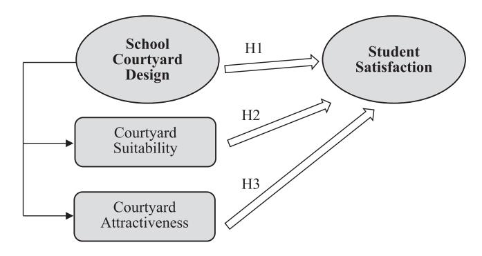
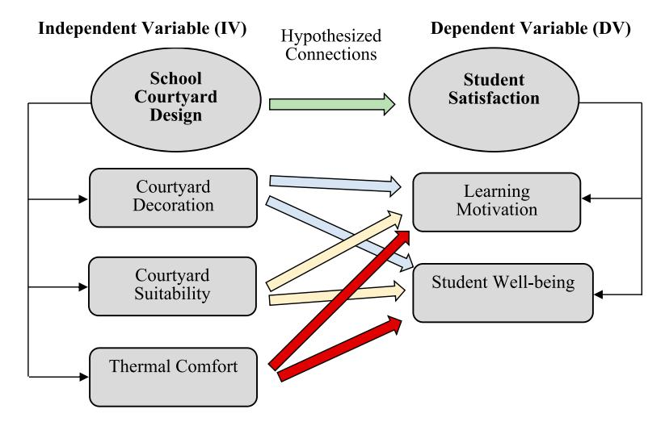

<!-- A3.R86 | source: papers_json/A3.R86/ -->

## **Architectural** **Engineering** **and** **Design** **Management**

**ISSN: 1745-2007 (Print) 1752-7589 (Online) Journal homepage:****[ www.tandfonline.com/journals/taem20](https://www.tandfonline.com/journals/taem20?src=pdf)**

## **Enhancing student satisfaction and academic** **performance** **through** **school** **courtyard** **design:** **a** **quantitative analysis**

**Muna** **Salameh,** **Basim** **Touqan** **&** **Abubakr** **Suliman**

**To** **cite** **this** **article:** Muna Salameh, Basim Touqan & Abubakr Suliman (2024) Enhancing student satisfaction and academic performance through school courtyard design: a quantitative analysis, Architectural Engineering and Design Management, 20:4, 911-927, DOI: [10.1080/17452007.2023.2295344](https://www.tandfonline.com/action/showCitFormats?doi=10.1080/17452007.2023.2295344)

**To** **link** **to** **this** **article:** [https://doi.org/10.1080/17452007.2023.2295344](https://doi.org/10.1080/17452007.2023.2295344)

| Published online: 20 Dec 2023. |
| --- |
| Submit your article to this journal |
| Article views: 163 |
| View related articles |
| View Crossmark data |
| Citing articles: 2 View citing articles |

<!-- page 2 -->

## Enhancing student satisfaction and academic performance through school courtyard design: a quantitative analysis

Muna Salameha, Basim Touqanb and Abubakr Sulimanc

aDepartment of Architecture, College of Architecture, Art and Design, Ajman University, Ajman, United Arab Emirates; bDepartment of Electrical Engineering, Faculty of Engineering and IT, The British University in Dubai, Dubai, United Arab Emirates; cFaculty of Business, The British University in Dubai, Dubai, United Arab Emirates

## **الملخص**

تقليديًا، كان يُقاس رضا الطلاب العام عن تجربتهم التعليمية عادةً باستخدام سؤال واحد أو إجابة بسيطة بـ "نعم" أو "لا". غير أن هذا النهج قد لا يعكس تقييمهم الكامل لجوانب أخرى من الرضا. ومن المتوقع أن يكون تصميم فناء المدرسة (School Courtyard) أحد هذه الجوانب، وسيكون موضوع هذا البحث الكمي. ولجمع البيانات، أُتيح استبيان ذاتي التطبيق لعينة من طلاب المرحلة الثانوية من مدرستين خاصتين. وللتحقيق في الصلة بين تصميم فناء المدرسة، وملاءمة الفناء، وجاذبية الفناء، وبين رضا الطلاب والتحقق منها، طُوِّرت ثلاث فرضيات. ولتقييم صلاحية الفرضيات المطوَّرة، استُخدم برنامج SPSS (الحزمة الإحصائية للعلوم) لإجراء عدة اختبارات، بما في ذلك تحليل الانحدار ومعامل الارتباط. وأظهرت النتائج دلالة علاقة عالية بين تصميم فناء المدرسة ورضا الطلاب باحتمال 37.5%. كما يمكن التنبؤ برضا الطلاب من خلال ملاءمة الفناء باحتمال 22.9%. وأخيرًا، يمكن التنبؤ برضا الطلاب إضافيًا من خلال جاذبية الفناء باحتمال 24.7%. ويكشف البحث عن احتياجات تصميم الفناء، مما يعزز رضا الطلاب وأداءهم الأكاديمي، ويفيد المعماريين والخبراء والممارسين.

## ARTICLE HISTORY

Received 14 September 2023 Accepted 11 December 2023

## **الكلمات المفتاحية**

Schools; courtyards; student satisfaction; quantitative research; UAE

## المقدمة

يُعد التعلم أساس النمو الاقتصادي والتنمية الاجتماعية. وأهم الموارد لتحقيق الأهداف الشخصية أو التنظيمية هي التعلم وتنمية الكفاءات والمهارات. غير أن تحقيق هدف التعلم النشط ليس بسيطًا أو بديهيًا (Niemi, 2002). وتنص الحجج في (Glickman & Scally, 2008) على أن المجتمعات القوية ذات الاقتصادات السليمة تعتمد على وجود مدارس ذات جودة. ويمكن القول إن الرغبة في إنشاء مبنى مدرسي يزيد من التحصيل التعليمي تضاهي أهمية التنمية الاجتماعية والاقتصادية. ويمكن أن يجعل تصميم المدارس بشكل جيد من حيث التخطيط والعمارة والمساحة والخدمات والمرافق أشبه بأماكن عمل تقدّر الجودة والإنتاجية (Samad & Macmillan, 2005). والمدارس مؤسسات مُصمَّمة لغرض محدد وفقًا لأهداف واضحة معروفة للجميع، ويمكن تقييم مدى نجاح المؤسسات القائمة في تحقيق أهدافها. وفي الممارسة العملية، يمكن تحليل فعالية مؤسسة ما في تحقيق أهدافها التعليمية بالارتباط مع تصميمها (Coleman, 1995). وقد شهد نظام تقديم التعليم تحولًا

<!-- page 3 -->

كبيرًا من رياض الأطفال إلى الجامعة، بما في ذلك كيفية النظر إلى المرفق التعليمي ومستخدمي هذه المنشآت، الذين تتراوح أعمارهم بين ثلاث وعشرين وعشرين عامًا، والذين يحددون عمارة المبنى المدرسي (Samanta, [2022)](#page-17-1).

ووفقًا لـ (Samanta, [2022](#page-17-1))، اليوم، ليست الفصول الدراسية فقط بل أيضًا الأفنية، والملاعب، والمسارح، والعديد من المساحات الأخرى، هي منشآت تُبنى وفق معايير ولوائح تدعم نمو الطلاب في جميع المجالات، سواء كانت جسدية أو معرفية. وتحظى أفنية المدارس، بوصفها الجزء الرئيسي من عمارتها، باهتمام متزايد بسبب فائدتها ودورها في التواصل الاجتماعي (El-Samea, Hassan, & Abdallah, [2020)](#page-16-3). وهي شائعة بشكل خاص في المناخات الحارة والجافة نظرًا لفعاليتها المناخية الحيوية المميزة والتهوية الطبيعية. وتُعد التهوية الطبيعية من أهم تقنيات توفير الطاقة لخفض استهلاك الطاقة في المباني (Beccali, Strazzeri, Germanà, Melluso, & Galatioto, [2018)](#page-16-4). ويعزز الفناء تدفق الرياح في الصيف، مما يخلق نظام تهوية جيدًا يحافظ على برودة الجسم وراحته. بالإضافة إلى ذلك، يحجب رياح الشتاء، مما يعزز تأثير الاحتفاظ بالحرارة خلال الشتاء البارد (Shi & Fan, [2014)](#page-17-2)، وGhorbani Naeini et al. [(2023)](#page-16-5)، وTeshnehdel, Soflaei, and Shokouhian ([2020](#page-17-3)). علاوة على ذلك، يعتمد نجاح أي نظام تعليمي على رضا الطلاب، وترتبط جودة المدارس إلى حد ما بفناء المدرسة. وقد نوقش من قبل (Brown & Mazzarol, [2009](#page-16-6)) أن رضا الطلاب وولاءهم انعكاس لصورة المؤسسة المضيفة. لذلك، يمكن أن يكون الفناء المصمم جيدًا جزءًا من صورة المدرسة وله عدة أدوار تؤدي إلى تحقيق رضا الطلاب. وقد حظي البحث في موضوع أفنية المدارس وملاءمتها وتأثيرها في المدارس باهتمام كبير في دراسات متنوعة. وبحث (Elgheznawy & Eltarabily, [2021)](#page-16-7) تطبيق مظلات الشمس لتحسين الراحة الحرارية الخارجية ضمن أفنية المدارس، مع تركيز خاص على مدرسة الصفوة في مصر. وتعمّق البحث في (Mahmoud & Abdallah, [2022](#page-16-8)) في الاستراتيجيات السلبية للتخفيف من عدم الراحة الحرارية الخارجية في المدارس الواقعة في مناخات حارة وجافة. واقترح دمج تظليل هجين مع زراعة الأشجار ضمن ممرات ضيقة لتقليل الإجهاد الحراري وتحسين راحة الطلاب. وادّعى (Cantón, Ganem, Barea, & Llano, [2014](#page-16-9)) أن مستوى التظليل في الأفنية له تأثير كبير في الظروف الحرارية وظروف الطاقة داخل الفصول الدراسية، ويبرز هذا فعالية الاستراتيجيات السلبية لتكييف المساحات الداخلية. ويمكن القول إن معظم الدراسات حول أفنية المدارس كانت مرتبطة بسلوكها البيئي، بينما أُجريت دراسات محدودة جدًا عليها من حيث تأثيرها في التحصيل التعليمي، وهو ما يحتاج إلى دراسة وإبراز. وتُظهر الأدلة أنه لم تُجرَ سوى دراسات قليلة جدًا عن تأثير أفنية المدارس في التعلم في دولة الإمارات العربية المتحدة، مما يجعل هذا المجال واعدًا ومثمرًا لمزيد من الدراسة.

وفي المشهد التعليمي، يُعد استقصاء تأثير تصميم فناء المدرسة في رضا الطلاب ودافعيتهم ورفاههم العام أمرًا بالغ الأهمية. ويُدمج هذا البحث استفساراتنا في ثلاثة أسئلة رئيسية لتسليط الضوء على العلاقة المعقدة بين تصميم فناء المدرسة ورضا الطلاب:

- . إلى أي مدى يؤثر تصميم فناء المدرسة، بما في ذلك الملاءمة والزخرفة والراحة الحرارية، في رضا الطلاب ودافعية التعلم والرفاه العام في البيئات التعليمية الإماراتية؟
- . كيف يمكن لتقنيات التحليل الإحصائي، مثل تحليل الانحدار والارتباط، أن تُقدّر كميًا تأثير تصميم فناء المدرسة في رضا الطلاب ودافعية التعلم والرفاه؟
- . ما الاستراتيجيات ومبادئ التصميم التي يمكن أن تُطبّقها المؤسسات التعليمية في مساحات أفنيتها لتحسين الرفاه الجسدي والنفسي للطلاب، مما يعزز في نهاية المطاف تجربتهم التعليمية في دولة الإمارات؟

وفي الوقت نفسه، من الممكن صياغة فرضيات معينة تشير إلى وجود صلة قوية بين تصميم فناء المدرسة، بوصفه المتغير المستقل (IV)، ورضا الطلاب، الذي يُعد المتغير التابع (DV). علاوة على ذلك، قد توجد فرضيات

<!-- page 4 -->

إضافية تقترح علاقات دالة بين أبعاد مختلفة لهذين المتغيرين المستقل والتابع. وضمن نطاق البحث، تُعد المتغيرات المستقلة تلك العوامل التي تُغيَّر عمدًا لفحص تأثيرها في المتغيرات التابعة. وعليه، تهدف الورقة الحالية إلى فحص دور تصميم فناء المدرسة في تشكيل رضا الطلاب في دولة الإمارات. ومن نتائج مراجعة الأدبيات ضمن المجال نفسه، يمكن تحديد عوامل معينة تنبثق من المتغيرات المستقلة والتابعة، وكذلك العلاقات المُقدَّرة بينها.

## مراجعة الأدبيات

رضا الطلاب هو الشعور الذي ينشأ من تقييم تجارب الطالب التعليمية والخدمات والمرافق التي توفرها المدرسة (Kanwar & Sanjeeva, [2022)](#page-16-10). ودفعت أهمية المدارس السلطات التعليمية إلى البحث عن أكثر الطرق فعالية لرفع مستوى العملية التعليمية. وفكّر بعضها في توفير دعم مالي. وكان هدف هذه الأموال الحصول على أجيال من الطلاب يمتلكون المعرفة والمهارات اللازمة لنهضة المجتمع ومواكبة التطور المستمر. غير أنه يجب إنفاق التمويل بحكمة وبعد دراسة الجوانب التي تُنفق عليها هذه الأموال. واستكشفت الدراسة التي أجراها (Martorell, Stange, & McFarlin, [2016)](#page-16-11) عائد الاستثمارات النمطية التي تقوم بها مقاطعات المدارس المحلية بنفسها، ووجدت أن الإنفاق لم يؤدِّ إلى نتائج أفضل بشكل ملحوظ للطلاب. وعلى الرغم من أن تحسين البنية التحتية للمدرسة قد يفيد أيضًا صحة الطلاب أو معنويات المعلمين أو مرافق الحي، فإن هذا الإنفاق من غير المرجح أن يسد فجوات التحصيل أو ينتج مكاسب أكاديمية ملحوظة. ويمكن أن يتأثر التحصيل التعليمي للطلاب بعوامل أخرى. وللجوانب التربوية المختلفة للمدرسة، مثل التدريس الفردي والتعلم في مجموعات صغيرة، تأثير في التحصيل الأكاديمي للطالب. وقد اكتُشف أن هذه العناصر تؤثر في مدى جودة أداء المدرسة ومدى أداء الطلاب (Bishara, [2017](#page-16-12)). وبعبارة أخرى، فإن كيفية تدريس التلاميذ وكيفية تنظيم تعليمهم تؤثر بشكل كبير في تحصيلهم (Ross, Smith, & Casey, [1999)](#page-17-4). ومن ناحية أخرى، ووفقًا لـ (Alhadi & Nanda Eka Saputra, [2017)](#page-16-13)، ترتبط نتائج تعلم طلاب المدارس الثانوية ارتباطًا وثيقًا بدافعية التعلم، وبالتالي، استنادًا إلى نتائج البحث، يُوصى بأن يشرف كل مستشار مدرسي على برنامج تعلم مدعوم يمكن أن يساعد الطلاب على أن يصبحوا أكثر دافعية للتعلم. ويمكن أن تؤثر عوامل أخرى أيضًا في التحصيل الأكاديمي للطالب. وفحصت الدراسة التي أجرتها (Justina, [2016](#page-16-14)) هذه المتغيرات واكتشفت أن المرافق والعوامل البيئية هي العناصر الرئيسية في تحصيلهم. والاهتمام، والهواء النظيف، والإضاءة الجيدة، وبيئة تعلم هادئة وآمنة، كلها ضرورية للتدريس والتعلم الفعالين. وينبغي التأكيد على أن أحد العناصر الرئيسية التي تحدد جودة وفعالية أي نتيجة تعلم هو دافعية الطالب للتعلم.

ووفقًا للبحث الذي أجراه (Hariyanto, Arafat, & Wardiah, [2021)](#page-16-15)، تؤثر بيئات التعلم والدافعية في نتائج تعلم الطلاب في المرحلة الثانوية إما في وقت واحد أو جزئيًا. ونتيجة لذلك، هناك تركيز أكبر على المرافق والحوافز لإنتاج نتائج تعلم عالية الجودة. وتُظهر نتائج الدراسة التي أجراها (Usman & Kusumaningsih, [2022)](#page-17-5) ارتباطًا قويًا بين التحصيل الدراسي ودافعية التعلم، ووجدت علاقة راسخة بين كل من التحصيل الدراسي والدافعية والذكاء العاطفي، مع بيئة التعلم. ومن ناحية أخرى، يرتبط تصميم توجيه المبنى المدرسي بالراحة الحرارية للطلاب، وقد بحث هذا الموضوع (Taleghani, Tenpierik, & van den Dobbelsteen, [2014)](#page-17-6) الذين وجدوا أن توجيه الفناء في المدرسة يمكن أن يحسّن الراحة الحرارية. وباستقصاء فناء المباني، وجد (Prakash, [2022)](#page-17-7) أن الأفنية الأوسع تلتقط هواءً أكثر من الغلاف الجوي. علاوة على ذلك، فحص (Soflaei, Shokouhian, Tabadkani, Moslehi, & Berardi, [2020)](#page-17-8) كيفية تأثير عناصر التصميم الرئيسية، مثل انزياح مركز الفناء، والتوجيه، والهندسة، والمواد، وأحجام النوافذ، في الراحة الحرارية، وباختصار، أظهر العمل أن استخدام تصميم محسّن للمنازل ذات الفناء في المناخات الجافة يمكن أن يزيد الراحة الحرارية بشكل كبير، مع مجيء معظم هذا التحسن من السمات الهندسية

<!-- page 5 -->

ونوع الجدار. ونتيجة لذلك، يمكن استخدام هذا كاستراتيجية فعالة لخفض الطلب على طاقة المباني للمنازل في هذا المناخ.

يمكن للطلاب أن يتعلموا وينموا ويستمتعوا بإبداع عندما يكونون في حالة من الرفاه. وبشكل أكثر تحديدًا، يشير هذا إلى الشعور بالانتماء إلى فصلهم ومدرستهم، والمشاركة بنشاط وبمعنى في الأنشطة الأكاديمية والاجتماعية، وامتلاك علاقات إيجابية مع المعلمين والأقران. ويُطلب من المدارس بشكل متزايد أن تركز على رفاه الطلاب إلى جانب الأهداف الأكاديمية والمهنية. ووفقًا للأبحاث المتاحة، من الضروري لتعزيز الرفاه الذاتي في مجتمعات المدرسة وجود روابط وثيقة وإحساس بالانتماء إلى مجتمع (Graham, Powell, & Truscott, [2016)](#page-16-16). وقد دُرس النجاح الأكاديمي والرفاه الذاتي تاريخيًا في أنماط أدبية متنوعة. ورفاه المراهقين الذاتي متغير لم يحظَ إلا مؤخرًا باهتمام أكبر في الدراسات التي تبحث في التحصيل الأكاديمي. واكتشف Bücker, Nuraydin, Simonsmeier, Schneider, and Luhmann [(2018)](#page-16-17) ارتباطًا دالًا إحصائيًا لكنه صغير إلى متوسط الحجم بين النجاح الأكاديمي والرفاه الذاتي. ومع ذلك، ترتبط التربية البدنية (PE) أيضًا برفاه الطالب. ووفقًا للتحليل الذي أجراه (Packham & Street, [2019](#page-17-9))، تسببت التربية البدنية في انخفاض نسبة الأطفال الذين يعانون من السمنة، لكن بالنسبة لطلاب الصفوف 6 حتى 8، لم يؤدِّ برنامج التربية البدنية إلى درجات أعلى في الاختبارات الموحدة أو حضور أعلى، ولم يستطع تغيير تركيبة الجسم النمطية للطلاب. ورفاه الطلاب في المدرسة قضية أخرى ذات صلة، وحاول (Powell, Graham, Fitzgerald, Thomas, & White, [2018)](#page-17-10) الإجابة عن السؤال "ماذا يقول الطلاب عن المدرسة ورفاههم؟" واكتُشف أن الطلاب شاركوا وجهات نظرهم بصراحة حول رفاههم. وذُكرت العلاقات مع الشريك المهم، والمعلمين، والأصدقاء، والأقران بوصفها أساسية للرفاه. ووفقًا لنتائج مراجعة الأبحاث، هناك مجال كبير للتحسين في المدارس عندما يتعلق الأمر بتحسين رفاه الطلاب من خلال الاستماع إلى آراء الأطفال والشباب واستخدامها. وللتحليل في هذه المنظورات، سيستخدم هذا البحث نهجًا بحثيًا كميًا واستبيانًا محددًا. واستُلهم المشروع من إدراك أن فناء المدرسة يؤدي وظيفة أعمق من مجرد وجوده ضمن جدران المدرسة وهياكلها. وفي الواقع، فإنه يمنح الأطفال والمعلمين والموظفين مكان عمل مريح وجذاب. وتُعد العناصر المستوحاة من الطبيعة، وترتيبات الجلوس، والممرات، والفصول الدراسية الخارجية، ومناطق الترفيه، واللمسات الزخرفية، وفرص التجمعات الخارجية، مكونات مهمة (Becki, Taskan, & Bogenç, [2013](#page-16-18)). ولتحسين النتائج التعليمية، من المهم تحديد أي من جوانب الفناء هذه يمكن أن تزيد رضا الطلاب وتفانيهم. ويُعد رضا الطلاب قوة دافعة ضرورية للتحصيل التعليمي (Afzal and Afzal [2015)](#page-16-19). ويتضح من الأدبيات وجود علاقة بين تصميم فناء المدرسة ودافعية الطلاب وراحتهم ورفاههم، من بين عوامل أخرى. وتحوّل تقليد بدأ بفناء إنشائي بسيط بوصفه مساحة مفتوحة محاطة كليًا أو جزئيًا بجدران أو مبانٍ، إلى دمج الوظائف على كل من الداخل والخارج للمبنى. وبافتراض أن رضا الطلاب يزيد أداءهم الأكاديمي، ستبحث هذه الدراسة كيف يؤثر تصميم فناء المدرسة في رضا الطلاب.

## أهمية الدراسة

تكمن أهمية هذه الدراسة في استجابتها لفجوة بحثية ملحوظة فيما يتعلق بتأثير أفنية المدارس في رضا الطلاب وتحصيلهم التعليمي. وفي حين ركزت الأبحاث السابقة بشكل أساسي على الجوانب البيئية لهذه المساحات، تبرز هذه الدراسة الحاجة إلى استكشاف أكثر شمولًا لكيفية تأثير أفنية المدارس في رضا الطلاب، وبالتالي جودة نتائج التعلم. وتُقدّم بيئة البحث في دولة الإمارات العربية المتحدة أرضية واعدة ومثمرة بشكل خاص لهذا الاستقصاء، إذ تُظهر الأدلة ندرة ملحوظة في الدراسات حول هذا الموضوع في المنطقة. وبالبحث في هذا المجال غير المستكشف، تقدّم الدراسة إمكانية الكشف عن رؤى قيّمة يمكن أن تُوجّه الممارسات التعليمية واعتبارات التصميم، بهدف تعزيز التجربة التعليمية العامة للطلاب في دولة الإمارات. الإطار المفاهيمي

<!-- page 6 -->

يمكن التعرف على مُخرج الأدبيات المتعلقة بتصميم فناء المدرسة ورضا الطلاب بوصفه المتغيرين الشاملين الرئيسيين. ويُمثَّل كل متغير شامل ويُشرح من خلال عدة مكونات. واستُند في تسمية العامل إلى أسئلة مرتبطة بالموضوع العام للعامل نفسه. وتُعرض العوامل بتسمياتها في النموذج في [Figure 1](#page-5-0) حيث يُوضَّح أيضًا تخطيط نموذج الدراسة الذي يُظهر المتغيرات الشاملة بمكوناتها. وفي هذه الدراسة، يُعد تصميم فناء المدرسة المتغير الشامل المستقل ويُمثَّل بعوامل ملاءمة الفناء، وزخرفة الفناء، والراحة الحرارية.

ومن ناحية أخرى، يُعد رضا الطلاب المتغير الشامل التابع ويُمثَّل بدافعية التعلم ورفاه الطالب. وتنص الفرضيات الرئيسية المطوَّرة على وجود علاقة قوية بين تصميم فناء المدرسة ورضا الطلاب. علاوة على ذلك، فُرضت أيضًا الروابط المتسلسلة بين أبعاد المتغيرين المستقل والتابع بعلاقات دالة. غير أن تعدد أبعاد المتغيرات والفرضيات النهائية سيُتحقق منها ويُؤكَّد من خلال تحليل العوامل باستخدام اختبار تقليل الأبعاد في SPSS خلال الأقسام القادمة.

## منهجية البحث

المنهجية البحثية المستخدمة في هذه الدراسة كمية. وأُرسي أساس البحث الكمي من خلال تحديد المتغيرات الشاملة وعواملها ونموذج الدراسة. وطُوِّرت أداة استبيان بأسئلة محددة تشرح المتغيرات الشاملة المستقلة والتابعة الممثَّلة بعواملها.

## عينة الدراسة

اختِيرت العينة بشكل منهجي بحيث يمكننا أن نستخلص بثقة بعض التضمينات حول خصائص المجتمع الذي أُخذت منه. واقتصرت العينة حصريًا على طلاب الصفوف 9 حتى 12. واستُبعدت الصفوف الأدنى من 9 من العينة إذ كان يُتوقع أنهم قد يواجهون صعوبة في فهم الاستبيان. وبالنظر إلى أن نسبة 30% تمثل تقديرًا تقريبيًا لنسبة السكان من طلاب الصفوف 9-12 في إمارة الشارقة، وبمراعاة مستوى ثقة 95% وهامش خطأ 5%، حُدِّد حجم العينة باستخدام الصيغة المقررة، مما أسفر عن حجم عينة قدره 289. وقدّمت مدرستان في إمارة الشارقة، في دولة الإمارات العربية المتحدة، البيانات الأولية لـ

*Figure 1. Model of study.*

<!-- page 7 -->

هذه الدراسة عبر أداة استبيان. وطُوِّر الاستبيان باللغة الإنجليزية إذ تعتمد كلتا المدرستين المنهج الأمريكي. ووُزِّع 450 استبيانًا استهدفت الطلاب من الصفوف 9 إلى 12 في كلتا المدرستين. وجُمعت 296 استبانة كاملة فقط بمعدل استجابة 65%، ليكون حجم العينة النهائي 291 طالبًا، وهو قريب من حجم العينة المحسوب. واستنادًا إلى هامش خطأ محسوب يطابق مستوى ثقة 95%، حُسب خطأ العينة ووُجد أنه يبلغ 5.7%.

## جمع البيانات

قُدِّم خطاب تغطية موقَّع من الجامعة البريطانية في دبي (BUiD) وموجَّه إلى إدارة المدرسة إلى مديري المدرستين لإتاحة توزيع الاستبيانات على الطلاب لتسهيل جمع البيانات وللحصول على موافقة مدير المدرسة على الحصول على البيانات من الطلاب المستهدَفين. وتضمّنت كل نسخة من الاستبيان خطاب تغطية إضافيًا يؤكد للمشاركين أن إجاباتهم الصادقة لن تُحكَم عليها بأنها صحيحة أو خاطئة وأن إجاباتهم ستُستخدم فقط لأغراض البحث وستظل خاصة. وتناول الجزء الأول من الأجزاء الثلاثة للاستبيان البيانات الديموغرافية. وكانت الجنس، والصف المدرسي، وأصل الطالب (الجنسية) هي المتغيرات الديموغرافية الثلاثة التي أُدرجت لفحص البيانات الديموغرافية مسبقًا. وشملت الأسئلة حول المتغيرات الشاملة وأبعادها الجزء الثاني (IV) والجزء الثالث (DV).

## قياس المتغيرات

قِيست المتغيرات الديموغرافية الثلاثة المُدرَجة في الجزء الأول من استبيان الدراسة من قبل الباحثين كما يلي:

- (أ) اختُبر جنس المستجيب باستخدام مقياس ثنائي النقاط، أي ذكر وأنثى.
- (ب) المتغير الثاني من البيانات الديموغرافية هو الصف المدرسي الذي اختُبر باستخدام مقياس رباعي النقاط، وهي الصف 9 والصف 10 والصف 11 والصف 12.
- (ج) قِيس أصل الطالب، الذي يشير إلى خلفية الطالب، باستخدام مقياس سداسي النقاط، مثل آسيا وأوروبا وأفريقيا.

وفي الوقت نفسه، طوّر الباحثون اثني عشر بندًا أو سؤالًا لقياس المتغير المستقل الشامل (تصميم الفناء). أما بالنسبة لأبعاد المتغير المستقل:

- (أ) استُخدمت ستة بنود لاختبار عامل ملاءمة الفناء.
- (ب) طُوِّرت ثلاثة بنود لقياس جانب زخرفة الفناء.
- (ج) صيغت ثلاثة بنود لفحص مكوّن الراحة الحرارية.

ومن ناحية أخرى، طوّر الباحثون سبعة عشر بندًا/سؤالًا لقياس المتغير التابع الشامل (رضا الطلاب). أما بالنسبة لمحاور المتغير التابع، فقد قِيست كما يلي:

- (أ) استُخدمت سبعة بنود من أصل السبعة عشر لاختبار البُعد الأول من المتغير التابع، أي دافعية التعلم.
- (ب) اقتصرت البنود المتبقية (10) على اختبار العامل الثاني من المتغير التابع وهو رفاه الطالب.

وقُيِّمت جميع الأسئلة في الجزأين الثاني والثالث باستخدام مقياس ليكرت الخماسي بدرجة قصوى قدرها خمسة لـ "أوافق بشدة" ودرجة دنيا قدرها واحد لـ "لا أوافق بشدة". وستُستخدم عدة اختبارات، بما في ذلك الاختبارات المعلمية وغير المعلمية، لفحص فرضيات الدراسة باستخدام SPSS/PASW (الحزمة الإحصائية للعلوم)، مثل تحليل الانحدار واختبار الارتباط.

<!-- page 8 -->

## النتائج والمناقشات

أُدخلت المعلومات التي جمعها الاستبيان في برنامج SPSS، حيث أُدخلت القيمتان 1 و2 كقيم للعامل الاسمي المتعلق بالجنس. أما بالنسبة للجنسية، فحُصل على ست جنسيات مختلفة، بقيم تتراوح من 1 إلى 6. وأما بالنسبة للصفوف المدرسية الأربعة المختلفة، فأُعطيت القيم من 1 إلى 4. وأخيرًا، أُدخلت أرقام تعكس مقياس ليكرت الخماسي للأسئلة الرئيسية المتعلقة بتصميم فناء المدرسة ورضا الطلاب، بأعلى قيمة 5 لـ "أوافق بشدة" وأدنى قيمة 1 لـ "لا أوافق بشدة".

## الإحصاء الوصفي

يمكن استخدام الإحصاء الوصفي لتلخيص البيانات باستخدام مقاييس كمية بسيطة مثل النسب المئوية والمتوسطات، وكذلك تمثيلات مرئية مثل مخططات الصندوق والمدرجات التكرارية (Kaliyadan & Kulkarni, [2019](#page-16-20)). وفي هذا القسم، يُحسب الإحصاء الوصفي المتعلق بالبيانات الديموغرافية مع التركيز على التكرارات، ويُوضَّح في [Table 1.](#page-7-0)

ومن حيث الجنس، استجابت طالبات أكثر من الطلاب الذكور للاستبيان، حيث شكّلت 174 طالبة نسبة 59.8% من إجمالي المستجيبين مقارنةً بـ 117 طالبًا شكّلوا نسبة 40.2%. وحُسبت أيضًا البيانات الديموغرافية للصف المدرسي، ووُجد أن الصفوف 9 و11 و10 و12 لها تكرارات تبلغ 25.4% و38.1% و26.5% و10% على التوالي.

وأخيرًا، فإن المدارس التي جُمعت منها البيانات الأولية هي مدارس دولية، وتكرارات أصول الطلاب ذات الصلة هي 14.8% لطلاب الخليج العربي، و48.1% من الشرق الأوسط، و18.9% من آسيا، و2.1% من أوروبا، و9.3% من أفريقيا، و6.9% من دول أخرى. ويمكن استنتاج النتائج من العلاقة بين المتغيرات الديموغرافية والمتغيرات الشاملة وأبعادها. ويمكن استقصاء هذه النتائج في القسم القادم.

## تحليل العوامل

يُستخدم تحليل العوامل للحد من عدد أبعاد متغير شامل. ومن خلال تحليل العوامل، تُجمَّع العوامل ذات الخصائص المتشابهة. لذلك، باستخدام تحليل العوامل، يمكن تنقيح عدد أكبر من البنود إلى عدد يمكن التحكم فيه ويفسّر التباين المُلاحظ في المجموعة الأوسع من العوامل. علاوة على ذلك، يمكن تأكيد ما إذا كان متغير ما متعدد الأبعاد أو أحادي البُعد من خلال نتيجة تحليل العوامل. وباختبار بنود تصميم فناء المدرسة مع مراعاة ثلاثة عوامل، خضعت البنود الاثنا عشر المرتبطة بهذا المتغير لتحليل العوامل. ويوضح [Table 2](#page-8-0) النتيجة، إذ حُمِّلت ثلاثة عوامل بنجاح بقيم 0.51 فأعلى باستخدام دوران varimax.

<!-- page 9 -->

Extraction Method: Principal Component Analysis. Rotation Method: Varimax with Kaiser Normalization.

وقيمة القطع التي يمكن أن تُحمَّل عندها البنود على عامل ما هي 0.5. وهذه العوامل هي ملاءمة الفناء (F1)، والراحة الحرارية (F2)، وزخرفة الفناء (F3). واستُبعدت البنود (Indep7_Courtyard Suitability (3))، و(Indep8_Courtyard Decoration (3)) و(Indep9_Thermal Comfort (3)) إذ سجلت أقل من 0.5. ويمكن دمج (F2) و(F3) لتصبح عاملًا واحدًا يحمل التسمية نفسها وهي ملاءمة الفناء. وفي الوقت نفسه، يُحمَّل بندان من (F1)، أي Indep3_Thermal Comfort (1) وIndep4_Thermal Comfort (2)، تحت عامل واحد مع بندين من (F2)، أي (Indep5_Courtyard Decoration (1)) و(Indep6_Courtyard Decoration (2))، بحيث يشكّلان متغيرًا جديدًا يمكن تسميته جاذبية الفناء. وأدت نتيجة اختبار تحليل العوامل لمتغير تصميم فناء المدرسة إلى استنتاج أن هذا المتغير يمكن قياسه بعدة عوامل، وبالتالي فهو متغير متعدد الأبعاد بعدد متبقٍ من البنود يساوي تسعة بنود.

Extraction Method: Principal Component Analysis. Rotation Method: Varimax with Kaiser Normalization.

> a Rotation converged in 5 iterations.

> a Rotation converged in 3 iterations.

<!-- page 10 -->

ومن ناحية أخرى، باختبار بنود رضا الطلاب مع مراعاة عاملين، خضعت البنود السبعة عشر المرتبطة بهذا المتغير أيضًا لتحليل العوامل. ويوضح [Table 3](#page-8-1) النتيجة؛ حُمِّل عاملان بنجاح بقيم 0.538 فأعلى باستخدام دوران varimax. وهذان العاملان هما رفاه الطالب (F1) ودافعية التعلم (F2). واستُبعدت البنود (Depen11_Student Wellbeing) و(Depen16_ Student Wellbeing) و(Depen17_ Student Wellbeing) إذ سجلت أقل من 0.5. علاوة على ذلك، يمكن ملاحظة أن البنود الأربعة عشر المتبقية دُوِّرت وحُمِّلت تحت العاملين، وكل عامل يحتوي على بنود من العامل الآخر. ويعطي هذا السيناريو مفهوم أن رضا الطلاب أحادي البُعد. لذلك، جُمعت البنود الأربعة عشر معًا تحت متغير واحد سُمِّي رضا الطلاب.

وختامًا، تقدّم نتائج تحليل العوامل فهمًا أوضح للبنية الكامنة لمتغيري تصميم فناء المدرسة ورضا الطلاب. ويمكن أن تُوجّه هذه النتائج القرارات العملية والتحسينات في تصميم المدارس وسياساتها لتعزيز رضا الطلاب ودافعيتهم ورفاههم، وهي أمور حاسمة للنجاح التعليمي.

## اختبار الموثوقية

القيمة الدنيا المقبولة لموثوقية الاتساق بين البنود هي 0.6. وستُستخدم هذه القيمة أيضًا في هذه الدراسة كنقطة قطع عند فحص قيم ألفا الموثوقية لمتغيرات الدراسة. وطُبِّق تحليل الموثوقية بواسطة برنامج SPSS على البنود التسعة المتبقية من المتغير المستقل. وأظهرت النتيجة قيمة منخفضة وأقل من 0.6. وفي الوقت نفسه، لتحسين قيمة ألفا كرونباخ، استُبعد البندان (Indep11_Courtyard Suitability (4)) و(Indep10_Courtyard Suitability (5)) بعد اختيار خيار "ألفا إذا حُذف البند" في الاختبار. وعليه، ارتفعت قيمة ألفا من 0.545 إلى 0.604، وهي موثوقة. وبالطريقة نفسها، طُبِّق اختبار الموثوقية أيضًا على البنود الأربعة عشر المتبقية من المتغير التابع الشامل (رضا الطلاب). ووُجدت قيمة الموثوقية مقبولة وتساوي 0.865.

وطُبِّق اختبار الموثوقية أيضًا على البُعد الأول من المتغير المستقل (ملاءمة الفناء). ووُجدت قيمة ألفا كرونباخ للموثوقية منخفضة جدًا وأقل من قيمة القطع البالغة 0.6. وكُرِّر الاختبار باستخدام خيار (ألفا كرونباخ إذا حُذف البند) لرفع قيمة الموثوقية. وبعد استبعاد بند إضافي من أصل ثلاثة، ارتفعت موثوقية قيمة ألفا كرونباخ إلى 0.788. لذلك، أُعيد حساب البُعد باستخدام بندين فقط، وهما (Indep1_- Courtyard Suitability (1)) و(Indep2_Courtyard Suitability (2)). وطُبِّق اختبار الموثوقية أيضًا على بنود البُعد الثاني من المتغير المستقل (جاذبية الفناء). ووُجدت قيمة ألفا كرونباخ للموثوقية مقبولة وأعلى من 0.6، أي 0.618.

وفي جوهر الأمر، تقدّم نتائج اختبار الموثوقية توجيهًا لتحسين قياس تصميم الفناء، وضمان موثوقية المتغيرات المتبقية، وإبراز الأهمية العملية لمراعاة العناصر الوظيفية والجمالية على حد سواء في تصميم فناء المدرسة لتعزيز رضا الطلاب.

واستنادًا إلى نتيجة تحليل العوامل واختبارات الموثوقية، يمكن إعادة هيكلة نموذج الدراسة الجديد كما في [Figure 2](#page-10-0) حيث يُسمَّى المتغير المستقل الشامل (تصميم الفناء) ممثلًا متغيرًا متعدد الأبعاد يتحدد ببعدين، أي (ملاءمة الفناء) و(جاذبية الفناء). والمتغير التابع أحادي البُعد ويُسمَّى (رضا الطلاب). وبالتالي، يمكن صياغة فرضيات البحث في العبارات التالية:

H1: هناك فرضية قوية بوجود صلة بين (تصميم فناء المدرسة) و(رضا الطلاب). غير أنه، على مستوى المكوّنات، يمكن أيضًا صياغة الفرضيات التالية:

H2: هناك فرضية قوية بوجود صلة بين (ملاءمة الفناء) و(رضا الطالب). ويُفهم تصور ملاءمة الفناء بأنه توفر منطقة جلوس، ومساحة واسعة، وملعب رياضي مناسب، وملاءمة للأنشطة البدنية.

H3: هناك فرضية قوية بوجود صلة بين "جاذبية الفناء" و"رضا الطالب". وتعني جاذبية الفناء مدى قدرة الفناء على توفير مناطق مظللة، وراحة حرارية، وزخرفة ومظهر جميلين.

<!-- page 11 -->

*Figure 2. Updated study model.*

## دلالة البيانات الديموغرافية

لاستكشاف تأثير البيانات الديموغرافية للمستجيبين في تصورهم لمتغيرات الدراسة وأبعادها، أُجري اختبار ارتباط غير معلمي إذ تُقاس البيانات الديموغرافية بمقياس اسمي بينما تُقاس متغيرات الدراسة بمقياس فتري. ويوضح [Table 4](#page-10-1) نتائج اختبار الارتباط غير المعلمي بين المتغيرات الديموغرافية، وهي أصل الطلاب، والجنس، وصف الطالب، مع المتغيرات الفترية بشكل رئيسي (ملاءمة الفناء)، و(جاذبية الفناء)، و(تصميم فناء المدرسة)، و(رضا الطالب). وبالنظر إلى النتائج، يمكن ملاحظة أن أصل الطلاب يؤثر فقط في تصور (ملاءمة الفناء)، و(تصميم الفناء)، و(جاذبية الفناء) بقيم دلالة تساوي (0.027) و(0.017) و(0.006) على التوالي. ويمكن تفسير هذه الدلالة بأن الأصول المختلفة لها ثقافات مختلفة وبالتالي لديها تصوراتها الخاصة عن الشكل الذي ينبغي أن يكون عليه الفناء. ويمكن أن يؤثر جنس الطالب أيضًا في تصور (ملاءمة الفناء) و(جاذبية الفناء) فقط بقيم دلالة (<.001). لذلك، يمكن الاستنتاج أن (ملاءمة الفناء) و(جاذبية الفناء) يمكن أن يُدرَكا بشكل مختلف من قبل الذكور والإناث. وبما أن الجنس مرتبط سلبًا بجاذبية الفناء (r = −.221)، يمكن الاستنتاج أن الطلاب الذكور يميلون إلى أن يكونوا أقل رضا عن جاذبية الفناء. بينما تميل الطالبات إلى إظهار رضا أعلى عن ملاءمة الفناء مقارنةً بنظرائهن الذكور. ولا يؤثر صف الطالب في تصور (جاذبية الفناء) وبالتالي لا يتأثر هذا المتغير بالصفوف المدرسية لكنه يؤثر في (ملاءمة الفناء)، و(رضا الطلاب)، و(تصميم الفناء) أيضًا بقيم دلالة (<.001). فمع اختلاف الصفوف، يكون للطلاب تصورات مختلفة، وبالتالي تؤثر الصفوف في (ملاءمة الفناء)، و(رضا الطالب)، و(تصميم الفناء).

> ^**^Correlation is significant at the 0.01 level (2-tailed).

<!-- page 12 -->

وختامًا، تُبرز نتائج تحليل البيانات الديموغرافية أهمية مراعاة أصل الطلاب وجنسهم ومستوى صفهم عند تصميم أفنية المدارس. ويمكن أن تؤدي هذه الاعتبارات إلى تصاميم أكثر شمولًا وتركيزًا على الطالب تعزز الرضا العام والراحة في البيئة المدرسية.

## اختبار التوزيع الطبيعي

طُرحت تقنيات إحصائية عديدة لفحص طبيعية البيانات بطرق متنوعة. وتتفاوت وفقًا لحجم العينة. وبما أن منهجيات مختلفة يمكن أن تنتج إجابات غير متسقة باستخدام البيانات نفسها، قد يحدث ارتباك. وللتغلب على هذه المشكلة، يمكن استخدام طريقة مختلفة لتحديد الطبيعية تستفيد من توزيعي "الالتواء" و"التفرطح". وقد تكون دقيقة إلى حد معقول لكل من العينات الصغيرة والكبيرة (Kim, [2013](#page-16-21)). ويُعد الالتواء والتفرطح مقياسين لعدم التماثل وحدة التوزيع، على التوالي. وتتضمن معظم برامج الإحصاء قيم الالتواء والتفرطح إلى جانب الأخطاء المعيارية المرتبطة بها. ولاختبار الطبيعية، يُستخدم "الالتواء" و"التفرطح" إلى جانب "اختبار z". وبقسمة "قيم الالتواء" أو "التفرطح الزائد" على أخطائها المعيارية، يمكن حساب "درجة z". وفي عينة الدراسة، وهي عينة متوسطة الحجم (50 > N > 300)، يمكن رفض الفرضية الصفرية عند قيمة z مطلقة أكبر من (3.29)، وهو ما يطابق قيمة دلالة (0.05)، ويمكن استخلاص استنتاج بأن توزيع العينة غير طبيعي. ويُظهر [Table 5](#page-11-0) اختبار التوزيع الطبيعي باستخدام الالتواء والتفرطح وقيمة z، وقيمة z للمتغيرات الأربعة في الجدول ضمن نطاق القيمة المطلقة (3.29)، وبالتالي فإن جميع المتغيرات موزَّعة توزيعًا طبيعيًا.

## اختبار الفرضيات

الارتباط، والانحدار، واختبارات t، وتحليل التباين هي تقنيات إحصائية تفترض توزيعًا طبيعيًا عند تحليل البيانات (Mishra et al., [2019)](#page-16-22). وقد جرى التحقق من البيانات في القسم السابق ووُجد أنها موزَّعة توزيعًا طبيعيًا. ويمكن استخدام كل من اختباري الارتباط والانحدار لاختبار الفرضيات. والهدف هو إيجاد أدلة إحصائية إما تؤكد الفرضيات المطوَّرة أو تدحضها.

وقد جرى التحقق من أن البيانات المتعلقة بعوامل ومتغيرات التوزيع الطبيعي، وبالتالي فإنها تؤهل الدراسة لتحليل معامل بيرسون. ويقع معامل بيرسون بين (−1) و(+1)، وبالتالي عندما يكون المعامل قريبًا من (−1) تكون العلاقة بين المتغيرين سلبية بقوة، وعندما يكون قريبًا من (+1) يكون المعامل إيجابيًا بقوة. وإذا كان صفرًا، فلا توجد علاقة بين المتغيرين. ولتحديد ما إذا كانت هناك علاقة دالة بين أي متغيرين أو عاملين، يمكن تشغيل اختبار الارتباط إحصائيًا باستخدام برنامج SPSS. وقيمة الدلالة المستهدفة هي 0.05 أو أقل. ويوضح [Table 6](#page-12-0) نتيجة اختبار الارتباط. وتختلف معاملات الارتباط التي تحكم العلاقات بين المتغيرات عن الصفر وجميعها موجبة، مما يُفسَّر بأنه عندما يرتفع متغير ما يرتفع أيضًا المتغير المرتبط الآخر.

وتُظهر قيم p الدالة للارتباط قيمة (<.001) لجميع العلاقات بين أي متغيرين. وبالتالي، هناك صلة قوية بين البُعد المستقل، أي (تصميم الفناء)، والمتغير التابع الشامل (رضا الطالب) بقيمة معامل ارتباط بيرسون (r) تساوي (.612) وقيمة دلالة ارتباط p تساوي

<!-- page 13 -->

(<.001). لذلك، يتبع التغير في (تصميم الفناء) تغيرًا إيجابيًا في (رضا الطالب) وبالتالي يتحرك كلا المتغيرين في الاتجاه نفسه. ولوحظ النمط نفسه من الارتباط أيضًا بين (ملاءمة الفناء) و(جاذبية الفناء) مع المتغير (رضا الطالب) بقيم (r = 0.481, p-value < .001) و(r = 0.497, p-value < .001) على التوالي. وبالتالي، هناك ارتباط قوي بين (ملاءمة الفناء) و(جاذبية الفناء) مع المتغير (رضا الطالب). ويُستقصى مزيد من التحقيق في العلاقات بين المتغير المستقل وعوامله والمتغير التابع في هذا القسم باستخدام اختبار تحليل انحدار إضافي معزِّز. والاختبار المتبع هنا هو اختبار الانحدار الخطي لمعرفة ما الذي يتنبأ برضا الطالب. وتشمل المعاملات المهمة التي تساعد في تفسير نموذج الانحدار F وt وR وR تربيع (Suliman & Kathairi, 2012). وتُعرض نتيجة اختبار انحدار خطي تُظهر إحصاءات التنبؤ لـ (تصميم فناء المدرسة) الذي يتنبأ بـ (رضا الطالب) في Table 7.

وبواسطة جدول ANOVA، يمكن الحكم بأن نموذج الانحدار دالٌّ ويمكن الإبلاغ عنه بصفته F(1, 289) = 173.117, p < .001. وفي ملخص النموذج، يعطي R تربيع المعدَّل نسبة التباين في (رضا الطالب) المفسَّر بالمتغير المتنبِّئ (تصميم فناء المدرسة). ويمكن القول إن 37.2% من التباين في (رضا الطالب) يمكن أن يتشكل بفعل (تصميم الفناء). ويُحدَّد خط الانحدار الذي يحكم العلاقة الخطية بين المتغير المستقل الممثَّل على المحور السيني والمتغير التابع الممثَّل على المحور الصادي بالميل المساوي لقيمة B (1.367) وتقاطع y عند (14.982). لذلك، فإن مستوى (تصميم فناء المدرسة) بذلك الميل دال، وبالتالي فإن اختبار t الذي يقارن الميل المحدد بميل يساوي صفرًا هو (13.157) بقيمة دلالة (<.001). ونتيجة لذلك، يوجد دعم إحصائي للفرضية H1، التي تنص على أن

Model summary

| Model | R | R Square | Adjusted R Square | Std. Error of the Estimate |  |
| --- | --- | --- | --- | --- | --- |
| 1 | .612^a^ | .375 | .372 | 7.39468 |  |

aPredictors: (Constant), Courtyard Design

|  | _ |  | - 2 |
| --- | --- | --- | --- |
| Coef | hr | ien | ıtc |
|  |  |  |  |

|  |  | Unstandardize | d coefficients | Standardized | coefficients |  |
| --- | --- | --- | --- | --- | --- | --- |
|  | Model | В | Beta | Beta | t | Sig. |
| 1 | (Constant) | 14.982 | 2.128 |  | 7.041 | <.001 |
|  | Courtyard Design | 1.367 | .104 | .612 | 13.157 | <.001 |

> ^**^Correlation is significant at the 0.01 level (2-tailed).

<!-- page 14 -->

aDependent Variable: Student Satisfaction

bPredictors: (Constant), Courtyard Suitability

Model summary

| Model | R | R Square | Adjusted R Square | Std. Error of the Estimate |
| --- | --- | --- | --- | --- |
| 1 | .481^a^ | .232 | .229 | 8.19597 |
| a Dradictore | (Constant) Courtya | rd Cuitability |  |  |

dPredictors: (Constant), Courtyard Suitability.

Coefficientsa

|  | Unstandardize | d coefficients | Standardized | l coefficients |  |  |
| --- | --- | --- | --- | --- | --- | --- |
|  | Model | В | Beta | Beta | t | Sig. |
| 1 | (Constant) Courtyard Suitability | 30.566 2.036 | 1.354 .218 | .481 | 22.571 9.337 | <.001 <.001 |

هناك علاقة دالة بين "تصميم فناء المدرسة" و"رضا الطالب"، استنادًا إلى النتائج من كل من اختباري الانحدار والارتباط.

ويعرض Table 8 نتائج اختبار الانحدار الخطي لفناء المدرسة الذي يتنبأ برضا الطالب. وفي جدول ANOVA، نموذج الانحدار دالٌّ ويمكن الإبلاغ عنه بصفته F (1, 289) = 87.175, p < .001. وفي ملخص النموذج، يعطي R تربيع المعدَّل نسبة التباين في (رضا الطالب) المفسَّر بـ (ملاءمة فناء المدرسة). ويمكن القول إن 22.9% من التباين في (رضا الطالب) يمكن أن يتشكل بفعل (ملاءمة الفناء).

ووفقًا لمعاملات الانحدار، يُشار إلى خط الانحدار الذي يحدد العلاقة الخطية بين المتغير المستقل على المحور السيني والمتغير التابع على المحور الصادي بالميل الذي له القيمة نفسها لبيتا (2.036) وتقاطع y عند (14.982). لذلك، فإن مستوى (تصميم فناء المدرسة) بذلك الميل دال، وبالتالي فإن اختبار t الذي يقارن الميل المحدد بميل يساوي صفرًا هو (9.337) بقيمة دلالة (<.001). وفي ضوء نتائج اختباري الانحدار والارتباط، يوجد دعم إحصائي للفرضية H2 التي تنص على أنه "توجد صلة قوية بين "ملاءمة فناء المدرسة" و"رضا الطالب"" وقد أُثبتت.

وبالمثل، في Table 9، تُعرض نتيجة اختبار انحدار خطي تُظهر أيضًا إحصاءات التنبؤ لـ (جاذبية فناء المدرسة) التي تتنبأ بـ (رضا الطالب).

وفي جدول ANOVA، نموذج الانحدار دالٌّ ويمكن الإبلاغ عنه بصفته F (1, 289) = 94.990, p <.001. وفي ملخص النموذج، يعطي R تربيع المعدَّل نسبة التباين في (رضا الطالب) المفسَّر بـ (جاذبية فناء المدرسة). ويمكن القول إن 24.5% من التباين في (رضا الطالب) يمكن أن يتشكل بفعل (جاذبية الفناء). وبالنظر إلى معاملات الانحدار، يُحدَّد خط الانحدار الذي يحكم العلاقة الخطية بين المتغير المستقل بوصفه المحور السيني والمتغير التابع بوصفه المحور الصادي بالميل المساوي لقيمة B (1.544) وتقاطع y عند (20.397). لذلك، فإن مستوى (تصميم فناء المدرسة) بذلك الميل دال، وبالتالي فإن اختبار t الذي يقارن الميل المحدد بميل يساوي صفرًا هو (9.746) بقيمة دلالة (<.001). ونتيجة لذلك، يوجد دعم إحصائي للفرضية H3، التي تنص على أن "هناك صلة دالة بين "جاذبية فناء المدرسة" و"رضا الطالب"" صحيحة، استنادًا إلى النتائج من كل من اختباري الانحدار والارتباط.

وباختصار، لا تدعم نتائج اختبارات الانحدار الفرضيات فحسب، بل تُبرز أيضًا أهمية تصميم فناء المدرسة وملاءمته وجاذبيته في التأثير في رضا الطلاب. ويمكن أن تُرشد هذه النتائج إداريي المدارس والمصممين في إنشاء بيئات تعزز رفاه الطلاب ونجاحهم الأكاديمي. وفي الوقت نفسه، تتوافق نتائج عملية اختبار الموثوقية في الدراسة مع الممارسات البحثية الراسخة والأدبيات

<!-- page 15 -->

## Model summary

| Model | R | R Square | Adjusted R Square | Std. Error of the Estimate |
| --- | --- | --- | --- | --- |
| 1 | .497^a^ | .247 | .245 | 8.11213 |

aPredictors: (Constant), Courtyard Attractiveness

Coefficientsa

|  | Model | Unstandardized Coefficients | Standardized Coefficients |  |  |  |
| --- | --- | --- | --- | --- | --- | --- |
|  |  | В | Beta | Beta | t | Sig. |
| 1 | (Constant) | 20.397 | 2.306 |  | 8.845 | <.001 |
|  | Courtyard Attractiveness | 1.544 | .158 | .497 | 9.746 | <.001 |

القائمة، مما يؤكد موثوقية قياسات الدراسة والاتساق الداخلي للمتغيرات والأبعاد ذات الصلة. ويسهم هذا في الصحة والمصداقية العامة لنتائج البحث.

## ربط النظرية بالتطبيق

بما أن رضا الطلاب ينشأ من تجاربهم التعليمية وخدماتهم ومرافقهم كما هو مذكور في (Kanwar & Sanjeeva, 2022)، فقد عززت هذه الدراسة الحالية أهمية رضا الطلاب وقدّمت نهجًا أكثر شمولًا للتقييم يتجاوز السؤال الواحد. وفي الوقت نفسه، أكد (Justina, 2016) في الأدبيات أن أحد العناصر الرئيسية التي تحدد جودة وفعالية أي نتيجة تعلم هو دافعية الطالب للتعلم. وتؤكد هذه الدراسة العلاقة بين تصميم الفناء ورضا الطلاب، رابطةً إياها بشكل غير مباشر بدافعية التعلم وتحقيق نتائج تعلم جيدة. وخلال الأدبيات، نُوقش أيضًا تأثير بيئات التعلم والدافعية في رفاه الطلاب من خلال دراسة (Graham et al., 2016). وأكدت دراستنا دور جاذبية الفناء في خلق دافعية للتعلم وتحقيق نتائج تعلم جيدة.

وتناول (Taleghani et al., 2014) تأثير تصميم المبنى المدرسي في الراحة الحرارية. وأبرزت دراستنا أهمية جاذبية الفناء، بما في ذلك العوامل المؤثرة في الظروف الحرارية والراحة البيئية.

وأخيرًا، عُولجت أيضًا أهمية الرفاه الجسدي والنفسي، إذ ناقش (Packham & Street, 2019) الصلة بين التربية البدنية ورفاه الطلاب. وأكدت دراستنا دور ملاءمة الفناء في توفير مساحة للنشاط البدني وتعزيز اللياقة البدنية والرفاه النفسي.

## الخاتمة

تقليديًا، استُخدم سؤال واحد أو إجابة بسيطة بـ "نعم" أو "لا" لتقييم رضا الطالب العام عن تجربته التعليمية. غير أنه، استنادًا إلى سؤال واحد، قد لا يأخذ الطلاب في الاعتبار الكامل السمات الأخرى للرضا. وعليه، ركزت هذه الدراسة الكمية على دور تصميم فناء المدارس وكيف يشكّل رضا الطلاب باستخدام استبيان يتألف من 32 سؤالًا/بندًا. واختُبرت مقاييس جميع المتغيرات والعوامل المُدرَجة في الدراسة من حيث الموثوقية باستخدام اختبار موثوقية الاتساق بين البنود لألفا كرونباخ. وتُقدّم الدراسة استقصاءً تجريبيًا لكيفية تأثير تصميم أفنية المدارس في

> ^&^lt;sup>bPredictors: (Constant), Courtyard Attractiveness.

<!-- page 16 -->

رضا الطلاب، وقد قدّمت فهمًا أفضل لكيفية تأثير تصميم فناء المدرسة في رضا الطلاب.

واستنادًا إلى التحليل الإحصائي، تشير النتائج الإحصائية للدراسة إلى أن تصميم الفناء له احتمال 37.2% للتأثير في رضا الطالب، وملاءمة الفناء لها احتمال 22.9%، وجاذبية الفناء لها احتمال 24.5%. وفي ضوء ذلك، ينبغي اعتبار تصميم الفناء عنصرًا هيكليًا حاسمًا للمرفق التعليمي بالإضافة إلى جميع الموارد الأخرى. وادّعى (Uline & Tschannen-Moran, [2008)](#page-17-12)، في دراستهما، أن البيئة المادية للمدرسة، بما في ذلك خصائص المباني والمرافق والتصميم، تؤثر في الجو الاجتماعي، وبالتالي في التحصيل التعليمي والرضا العام. لذلك، ينبغي أن تعتبر الإدارة التعليمية فناء المدرسة عنصرًا ماديًا على قدم المساواة مع الموارد التعليمية الأخرى مثل المنهج الدراسي وخبرة الموظفين.

وقد أُثبتت أيضًا إحصائيًا أهمية ملاءمة الفناء في تحديد رضا الطلاب. ووفقًا للاستبيان، تشير "ملاءمة الفناء" إلى تصور منطقة واسعة مثالية للعب والانخراط في النشاط البدني. وكاستنتاج، يجب تخطيط منطقة الفناء بحيث تستوعب عدد الطلاب، وتتيح لهم حرية الحركة، وتقلل التوتر الناجم عن المساحات المزدحمة. ويجب أن يكون الفناء كبيرًا بما يكفي ليكون منطقة ترفيه، مما يتيح للطلاب تلقي تربية بدنية مناسبة تؤدي في النهاية إلى لياقة بدنية ورفاه نفسي.

وثمة أمر آخر تجدر ملاحظته، وهو (جاذبية الفناء) التي أدركها الطالب أيضًا على أنها مناطق مظللة للتواصل الاجتماعي والاسترخاء، وراحة حرارية، وزخرفة جميلة، ومنطقة تمنح مشهدًا هادئًا. وأظهر هذا البُعد أيضًا علاقة دالة مع (رضا الطلاب). ولتحسين تدفق الهواء داخل الفناء، ينبغي تصميم الفناء من منظور معماري بالأبعاد المناسبة من حيث الطول والعرض والارتفاع مقارنةً بالكتل المجاورة.

وتؤثر أبعاد الفناء في كل من ظروفه الحرارية والظروف الحرارية للمساحات المحيطة به. وبالإضافة إلى اختيار مادة المظلة المناسبة لتعزيز مساحات التظليل، ينبغي تصميم الفناء بالهندسة المناسبة لتوفير قدر كافٍ من المناطق المظللة. وبالمثل، من الضروري التأكيد على الحاجة إلى تهوية متقاطعة كافية عند تصميم الفناء لتحسين تدفق الهواء وزيادة الراحة البيئية.

وتشمل جاذبية الفناء أيضًا تنسيق الحدائق المناسب الذي يزيد بشكل كبير من الراحة البيئية من خلال التبريد التبخيري. وترتبط جاذبية الفناء أيضًا بتحسين زخرفة الفناء.

وسيؤدي دمج الأشجار والزهور والشجيرات في الفناء إلى مشاهد ممتعة للطلاب، وتعزيز إبداعهم، وتحسين خيالهم، وإثارة حواسهم. وينبغي أيضًا تزيين الفناء بشكل مناسب، بمنطقة جلوس لطيفة للاسترخاء، وتناول وجبة استراحة، وتعزيز التفاعل الاجتماعي بين الطلاب. وينبغي إيلاء اهتمام خاص لاختيار اللون المناسب لجدران الفناء والمناطق الأخرى لأنه يمكن أن يزيد بشكل كبير من دافعية الطلاب للتعلم من خلال إلهامهم وتشجيعهم على التفكير الإبداعي.

وعلى الرغم من أن نتائج الدراسة تشير إلى علاقة قوية بين تصميم الفناء ورضا الطلاب، ينبغي النظر إلى هذه النتائج بشيء من الحذر. وكان القيد الأول أن عينة الدراسة اختِيرت فقط من مدارس خاصة وليس من مزيج من المدارس الخاصة والحكومية لأن الوصول إلى المدارس الحكومية يتطلب إذنًا رسميًا خاصًا، والإجراء نفسه يستغرق وقتًا طويلًا. وكان قيد آخر أنه لم يُدرَج في العينة سوى طلاب الصفوف 9 حتى 12؛ واستُبعدت الصفوف الأدنى من 9 نظرًا لاحتمال عدم قدرتهم على فهم الاستبيان. وبالتالي، يمكن للدراسات المستقبلية أن تأخذ هذه القيود في الاعتبار لاستهداف كل من القطاعين العام والخاص، وكذلك جميع المستويات الأكاديمية. أما بالنسبة للصفوف الأدنى (أقل من الصف 9)، فقد تحاول الدراسات المستقبلية استكشاف هذه العلاقة باستخدام منهج نوعي، مثل المقابلات أو الملاحظة. وعلى الرغم من أن الدراسة الحالية نجحت في إثبات صلة مباشرة بين تصميم فناء المدارس ورضا الطلاب، فقد تحاول الدراسات المستقبلية أيضًا دراسة متغيرات/عوامل أخرى قد تشكّل رضا الطلاب مثل مناخ المدرسة، وزملاء الطلاب، والعقد النفسي.

<!-- page 17 -->

## بيان الإفصاح

لم يُبلَّغ عن أي تضارب محتمل في المصالح من قبل المؤلف (المؤلفين).

## References

- Afzal, M. T., & Afzal, M. [(2015)](#page-4-0). Comparison of Students' Satisfaction and achievement at secondary level in Islamabad. American Journal of Educational Research, 3(12), 1524–1527. [https://doi.org/10.12691/education-3-12-7](https://doi.org/10.12691/education-3-12-7)
- Alhadi, S., & Nanda Eka Saputra, W. [(2017)](#page-3-0). The relationship between learning motivation and learning outcome of junior high school students in Yogyakarta. ATLANTIS PRESS, 66(Yicemap), 138–141. [https://doi.org/10.2991/](https://doi.org/10.2991/yicemap-17.2017.23) [yicemap-17.2017.23](https://doi.org/10.2991/yicemap-17.2017.23)
- Beccali, M., Strazzeri, V., Germanà, M. L., Melluso, V., & Galatioto, A. ([2018)](#page-2-0). Vernacular and bioclimatic architecture and indoor thermal comfort implications in hot-humid climates: An overview. Renewable and Sustainable Energy Reviews, 82, 1726–1736. [https://doi.org/10.1016/j.rser.2017.06.062](https://doi.org/10.1016/j.rser.2017.06.062)
- Becki, B., Taskan, G., & Bogenç, Ç. ([2013](#page-4-1)). The effect of courtyard designs on young people, which have been made according to different functional preferences: Barti{dotless}n university (Turkey). Journal of Food, Agriculture and Environment, 11(3–4), 1804–1813.
- Bishara, D. S. [(2017)](#page-3-1). School effectiveness and student achievement. International Journal of Contemporary Research and Review, 8(2), 20171–20188. [https://doi.org/10.15520/ijcrr/2017/8/02/123](https://doi.org/10.15520/ijcrr/2017/8/02/123)
- Brown, R. M., & Mazzarol, T. W. [(2009](#page-2-1)). The importance of institutional image to student satisfaction and loyalty within higher education. Higher Education, 58(1), 81–95. [https://doi.org/10.1007/s10734-008-9183-8](https://doi.org/10.1007/s10734-008-9183-8)
- Bücker, S., Nuraydin, S., Simonsmeier, B. A., Schneider, M., & Luhmann, M. ([2018](#page-4-2)). Subjective well-being and academic achievement: A meta-analysis. Journal of Research in Personality, 74, 83–94. [https://doi.org/10.1016/j.jrp.](https://doi.org/10.1016/j.jrp.2018.02.007) [2018.02.007](https://doi.org/10.1016/j.jrp.2018.02.007)
- Cantón, M. A., Ganem, C., Barea, G., & Llano, J. F. ([2014](#page-2-2)). Courtyards as a passive strategy in semi dry areas. Assessment of summer energy and thermal conditions in a refurbished school building. Renewable Energy, 69, 437–446. [https://doi.](https://doi.org/10.1016/j.renene.2014.03.065) [org/10.1016/j.renene.2014.03.065](https://doi.org/10.1016/j.renene.2014.03.065)
- Coleman, J. S. [(1995](#page-1-0)). Achievement-oriented school design In Restructuring schools: Promising practices and policies,. In Boston MA (Ed.)11–12). Springer Link. [https://doi.org/https://doi.org/10.1007978-1-4899-1094-3_2](https://doi.org/https://doi.org/10.1007978-1-4899-1094-3_2)
- Elgheznawy, D., & Eltarabily, S. [(2021)](#page-2-3). The impact of sun sail-shading strategy on the thermal comfort in school courtyards. Building and Environment, 202(May), 108046–108061. [https://doi.org/10.1016/j.buildenv.2021.108046](https://doi.org/10.1016/j.buildenv.2021.108046)
- El-Samea, A. M. A., Hassan, N. M., & Abdallah, A. S. H. ([2020](#page-2-4)). The effect of Courtyard ratio on energy consumption and thermal comfort in a Primary Governmental School in New Assiut City, Egypt (pp. 121–131). Springer. [https://link.](https://link.springer.com/chapter/10.1007/978-3-030-52584-2_9) [springer.com/chapter/10.1007978-3-030-52584-2_9](https://link.springer.com/chapter/10.1007/978-3-030-52584-2_9)
- Ghorbani Naeini, H., Norouziasas, A., Piraei, F., Kazemi, M., Kazemi, M., & Hamdy, M. ([2023](#page-2-5)). Impact of building envelope parameters on occupants' thermal comfort and energy use in courtyard houses. Architectural Engineering and Design Management, 1–27.
- Glickman, N. J., & Scally, C. P. ([2008](#page-1-1)). Can community and education organizing improve inner-city schools? Journal of Urban Affairs, 30(5), 557–577. [https://doi.org/10.1111/j.1467-9906.2008.00418.x](https://doi.org/10.1111/j.1467-9906.2008.00418.x)
- Graham, A., Powell, M. A., & Truscott, J. ([2016)](#page-4-3). Facilitating student well-being: relationships do matter. Educational Research, 58(4), 366–383. [https://doi.org/10.1080/00131881.2016.1228841](https://doi.org/10.1080/00131881.2016.1228841)
- Hariyanto, D., Arafat, Y., & Wardiah, D. [(2021)](#page-3-2). The effect of facilities and motivation on learning outcomes of high school students in Gelumbang, Indonesia. Journal of Social Work and Science Education, 2(1), 95–108. [https://doi.org/10.](https://doi.org/10.52690/jswse.v2i1.210) [52690/jswse.v2i1.210](https://doi.org/10.52690/jswse.v2i1.210)
- Justina, R. I. [(2016](#page-3-3)). Motivational factors that enhance students learning/achievement. SSRN Electronic Journal, 4(2), 323– 331. [https://doi.org/10.2139/ssrn.2714297](https://doi.org/10.2139/ssrn.2714297)
- Kaliyadan, F., & Kulkarni, V. ([2019](#page-7-1)). Types of variables, descriptive statistics, and sample size. Indian Dermatology Online Journal [Preprint], 10(1), 82.
- Kanwar, A., & Sanjeeva, M. [(2022)](#page-3-4). Student satisfaction survey: A key for quality improvement in the higher education institution. Journal of Innovation and Entrepreneurship, 11(1), 1–10. [https://doi.org/10.1186/s13731-022-00196-6](https://doi.org/10.1186/s13731-022-00196-6)
- Kim, H.-Y. ([2013](#page-11-1)). Statistical notes for clinical researchers: Assessing normal distribution (2) using skewness and kurtosis. Restorative Dentistry & Endodontics, 38(1), 52–54. [https://doi.org/10.5395/rde.2013.38.1.52](https://doi.org/10.5395/rde.2013.38.1.52)
- Mahmoud, R. M. A., & Abdallah, A. S. H. [(2022](#page-2-6)). Assessment of outdoor shading strategies to improve outdoor thermal comfort in school courtyards in hot and arid climates. Sustainable Cities and Society, 86(August), 104147–104160. [https://doi.org/10.1016/j.scs.2022.104147](https://doi.org/10.1016/j.scs.2022.104147)
- Martorell, P., Stange, K., & McFarlin, I. [(2016)](#page-3-5). Investing in schools: Capital spending, facility conditions, and student achievement. Journal of Public Economics, 140, 13–29. [https://doi.org/10.1016/j.jpubeco.2016.05.002](https://doi.org/10.1016/j.jpubeco.2016.05.002)
- Mishra, P., Pandey, C., Singh, U., Gupta, A., Sahu, C., & Keshri, A. ([2019](#page-11-2)). Descriptive statistics and normality tests for statistical data. Annals of Cardiac Anaesthesia, 22(1), 67–72. [https://doi.org/10.4103/aca.ACA_157_18](https://doi.org/10.4103/aca.ACA_157_18)
- Niemi, H. ([2002](#page-1-1)). Active learning - a cultural change needed in teacher education and schools. Teaching and Teacher Education, 18(7), 763–780. [https://doi.org/10.1016/S0742-051X(02)00042-2](https://doi.org/10.1016/S0742-051X(02)00042-2)

<!-- page 18 -->

- Packham, A., & Street, B. [(2019)](#page-4-4). The effects of physical education on student fitness, achievement, and behavior. Economics of Education Review, 72(April), 1–18. [https://doi.org/10.1016/j.econedurev.2019.04.003](https://doi.org/10.1016/j.econedurev.2019.04.003)
- Powell, M. A., Graham, A., Fitzgerald, R., Thomas, N., & White, N. E. [(2018)](#page-4-5). Wellbeing in schools: What do students tell us? The Australian Educational Researcher, 45(4), 515–531. [https://doi.org/10.1007/s13384-018-0273-z](https://doi.org/10.1007/s13384-018-0273-z)
- Prakash, D. [(2022)](#page-3-6). Ventilation performance analysis on low-rise courtyard building for various courtyard shape factors and roof topology. International Journal of Ventilation, 22(1), 56–76. [https://doi.org/https://doi.org/10.108014733315.](https://doi.org/https://doi.org/10.108014733315.2022.2036477) [2022.2036477](https://doi.org/https://doi.org/10.108014733315.2022.2036477)
- Ross, S. M., Smith, L. J., & Casey, J. P. [(1999)](#page-3-7). "Bridging the Gap": The effects of the success for all program on elementary school reading achievement as a function of student ethnicity and ability level. School Effectiveness and School Improvement, 10(2), 129–150. [https://doi.org/10.1076/sesi.10.2.129.3504](https://doi.org/10.1076/sesi.10.2.129.3504)
- Samad, Z. A., & Macmillan, S. [(2005](#page-1-2)). The valuation of intangibles: Explored through primary school design. The 2005 World Sustainable Building Conference, Tokyo, 27-29 September 2005 (SB05Tokyo), (December), pp. 39–46.
- Samanta, K. ([2022)](#page-2-7). 15 educational buildings that architects should know about. Rethinking The Future [Preprint]. [https://](https://www.re-thinkingthefuture.com/architects-lounge/a1287-15-educational-buildings-that-architects-should-know-about) [www.re-thinkingthefuture.com/architects-lounge/a1287-15-educational-buildings-that-architects-should-know](https://www.re-thinkingthefuture.com/architects-lounge/a1287-15-educational-buildings-that-architects-should-know-about)[about](https://www.re-thinkingthefuture.com/architects-lounge/a1287-15-educational-buildings-that-architects-should-know-about)
- Shi, Y., & Fan, Y. ([2014](#page-2-5)). Yunan typical courtyard type wind environmental analysis-zhu zigui courtyard, for example. Applied Mechanics and Materials, 641–642, 1117–1120. [https://doi.org/10.4028/www.scienti](https://doi.org/10.4028/www.scientific.net/AMM.641-642.1117)fic.net/AMM.641-642. [1117](https://doi.org/10.4028/www.scientific.net/AMM.641-642.1117)
- Soflaei, F., Shokouhian, M., Tabadkani, A., Moslehi, H., & Berardi, U. ([2020](#page-3-8)). A simulation-based model for courtyard housing design based on adaptive thermal comfort. Journal of Building Engineering, 31(October 2019), 101335– 101347. [https://doi.org/10.1016/j.jobe.2020.101335](https://doi.org/10.1016/j.jobe.2020.101335)
- Suliman, A., & Kathairi, M. A. ([2012](#page-12-2)). Organizational justice, commitment and performance in developing countries: The case of the UAE. Employee Relations, 35(1), 98–115. [https://doi.org/10.1108/01425451311279438](https://doi.org/10.1108/01425451311279438)
- Taleghani, M., Tenpierik, M., & van den Dobbelsteen, A. [(2014)](#page-3-9). Indoor thermal comfort in urban courtyard block dwellings in the Netherlands. Building and Environment, 82, 566–579. [https://doi.org/10.1016/j.buildenv.2014.09.028](https://doi.org/10.1016/j.buildenv.2014.09.028)
- Teshnehdel, S., Soflaei, F., & Shokouhian, M. [(2020)](#page-2-8). Assessment of solar shading performance of courtyard houses in desert climate of Kashan, Iran. Architectural engineering and design management, 16(6), 473–492.
- Uline, C., & Tschannen-Moran, M. ([2008](#page-15-0)). The walls speak: The interplay of quality facilities, school climate, and student achievement. Journal of Educational Administration, 46(1), 55–73. [https://doi.org/10.1108/09578230810849817](https://doi.org/10.1108/09578230810849817)
- Usman, O., & Kusumaningsih, A. [(2022)](#page-3-10). The effect of motivation, emotional intelligence, and learning environment on student learning achievement (Case study student of office administration education). SSRN Electronic Journal [Preprint]. [https://doi.org/10.2139/ssrn.3997069.](https://doi.org/10.2139/ssrn.3997069)
