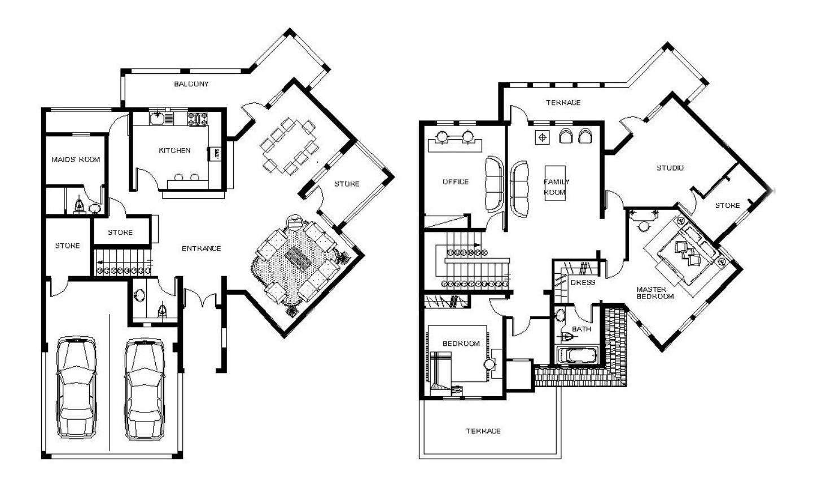
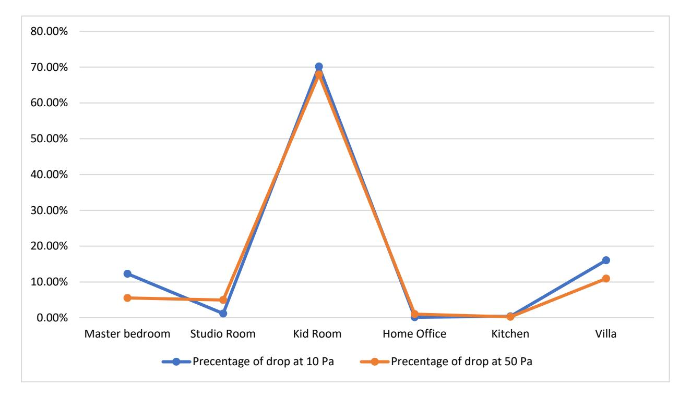
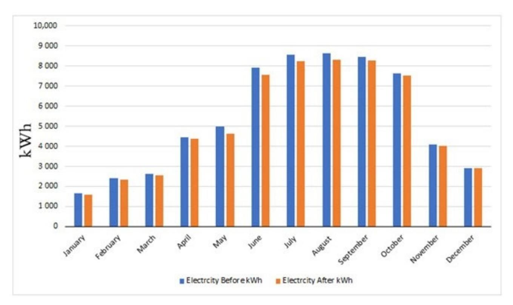

<!-- A3.R88 | source: papers_json/A3.R88/ -->

*Article*

## **Experimental Assessment of Different Sealing Methods for** **Windows to Improve Building Airtightness in UAE** **Residential Buildings**

**Hanan M. Taleb**

**الملخص:** إذا كانت التسرب (infiltration) غير مضبوطة وتسمح بدخول هواء غير مكيَّف، فستكون النتائج غير مرغوبة. سيؤدي ضبط هذه المشكلة إلى زيادة الراحة الحرارية وتقليل استهلاك الطاقة. هدف هذه الورقة هو تقييم أداء مواد مختلفة تُستخدم لتحسين إحكام الإغلاق الهوائي (airtightness)، الأمر الذي سيزيد كفاءة الطاقة. اعتمد هذا البحث بشكل أساسي على نهج تجريبي. اختير مبنى سكني نموذجي في دولة الإمارات العربية المتحدة كدراسة حالة. قِيست حالة إحكام الإغلاق الهوائي الحالية باستخدام اختبار باب النفخ (blower door test) وتقنية الأشعة تحت الحمراء. حُدِّدت ست مواد شائعة الاستخدام لإحكام الإغلاق الهوائي في دولة الإمارات وطُبِّقت في مناطق مختلفة من غلاف المبنى، بما في ذلك الجدران الخارجية والأبواب والنوافذ. أُجري الاختبار قبل تنفيذ استراتيجيات إحكام الإغلاق الهوائي، وبعد ذلك طُبِّقت هذه الاستراتيجيات لمدة عام واحد. رُوقِب الأداء العام وانخفاض استهلاك الطاقة لتحديد مقدار انخفاض الاستهلاك وأي طريقة كانت الأكثر كفاءة. تشير النتائج إلى أن استهلاك الطاقة انخفض بنسبة 3% عند تطبيق الاستراتيجيات الست المختلفة لإحكام الإغلاق الهوائي. كان استهلاك الطاقة في الحالة الأساسية 64,287 كيلوواط ساعة سنويًا. ثم انخفض استهلاك الطاقة بعد تطبيق المواد المانعة للتسرب إلى 62,341 كيلوواط ساعة سنويًا. وقُدِّمت توصيات مستقبلية لتعزيز إحكام الإغلاق الهوائي في المباني السكنية في مناخ حار وجاف.

**Keywords:** residential building; airtightness; energy efficiency; blower door; infrared technique; UAE

**Citation:** Taleb, H.M. Experimental Assessment of Different Sealing Methods for Windows to Improve Building Airtightness in UAE Residential Buildings. *Sustainability* **2022**, *14*, 14760. [https://doi.org/](https://doi.org/10.3390/su142214760) [10.3390/su142214760](https://doi.org/10.3390/su142214760)

Academic Editor: Avi Friedman

Received: 18 May 2022 Accepted: 30 September 2022 Published: 9 November 2022

**Publisher's Note:** MDPI stays neutral with regard to jurisdictional claims in published maps and institutional affiliations.

**Copyright:** © 2022 by the author. Licensee MDPI, Basel, Switzerland. This article is an open access article distributed under the terms and conditions of the Creative Commons Attribution (CC BY) license [(https://](https://creativecommons.org/licenses/by/4.0/) [creativecommons.org/licenses/by/](https://creativecommons.org/licenses/by/4.0/) 4.0/).

## **1. المقدمة**

يستمر الطلب على الطاقة الناتج عن إنشاء المباني في الازدياد، وتُعد قطاعات المباني مسؤولة عن 36% من استهلاك الطاقة العالمي وما يقارب 40% من إجمالي انبعاثات CO^2^ [[1]](#page-16-0). ومع استهلاك المباني في دولة الإمارات لـ 80% من طاقة الدولة، يلعب قطاع المباني دورًا رئيسيًا من حيث كفاءة الطاقة [[2]](#page-16-1). سيؤدي ضعف إحكام الإغلاق الهوائي داخل المباني إلى استهلاك مرتفع للطاقة. صُنِّفت دولة الإمارات في المرتبة الخامسة من حيث انبعاثات CO^2^ للفرد الواحد، حيث يأتي 40% من الأحمال الكهربائية السنوية من معدات التكييف (HVAC) وتحدث نسبة تصل إلى 60% من الانبعاثات خلال الصيف [[3]](#page-16-2). تُبرز هذه الحقيقة المثيرة للقلق الحاجة الملحّة إلى استراتيجيات عاجلة لزيادة كفاءة الطاقة في المباني. وبينما يُولى الاهتمام عمومًا لتركيب أنظمة تكييف الهواء الأكثر كفاءة والعزل الحراري في المباني، لم يُولَ سوى القليل من التركيز على الفقدان أو الاكتساب غير المقصود للهواء من هذه المباني. وفي العديد من الدول، يُعد التسرب (infiltration) المصدر السائد للهواء الخارجي. ويُعد توفير بيئة داخلية مريحة ومناسبة بأقل تكاليف طاقة عملية تحسين معقدة تشمل، لكنها قد لا تكون محكومة بالكامل بـ، اعتبارات إحكام الإغلاق الهوائي [[4]](#page-16-3). عرّف Sinnott (2011) [[5]](#page-16-4) إحكام الإغلاق الهوائي بأنه "التدفق عبر غلاف المبنى كدالة للضغط عبره، وبالتالي فإن اختبار التسرب يعتمد على الميكانيكا الأساسية لتدفق الهواء". وهذا يعني أن إحكام الإغلاق الهوائي يعبّر عن مقاومة غلاف المبنى لمسارات تدفق الهواء داخل المبنى. وجدت عدة دراسات أن إشغال المسكن يمكن أن يسبب زيادة تتراوح بين 20-100% في التسرب، وأن هناك تأثيرات كبيرة لظروف الطقس وكذلك عمر البناء على إحكام الإغلاق الهوائي [[6]](#page-16-5). وبالتالي، تتفاوت فاعلية استراتيجيات إحكام الإغلاق الهوائي بمرور الوقت. أفادت دراسة في بلجيكا حول متانة إحكام الإغلاق الهوائي للمنازل السلبية (ACH^50^ < 0.6 عند الإنجاز)

<!-- page 2 -->

*Sustainability* **2022**, *14*, 14760 2 of 18

بأن متوسط تسرب الهواء في المنازل ازداد بنسبة 30% بعد عامين فقط من إنجاز المشروع [[7]](#page-16-6). يحدث تسرب الهواء عادةً عبر الشقوق والوصلات في غلاف المبنى وعبر استخدام الأبواب. وفي الصيف، يمكن أن يجلب التسرب هواءً خارجيًا رطبًا إلى داخل المبنى، وهو ما يسببه أيضًا الرياح وتأثير المدخنة (stack effect) والمعدات الميكانيكية داخل المبنى. يمكن أن يؤدي ضعف إحكام الإغلاق الهوائي إلى معدلات تسرب كبيرة، مما يسبب في النهاية زيادة في استهلاك الطاقة [[8]](#page-16-7). ووفقًا لمجلس أعمال الطاقة النظيفة في عام 2018 [[9]](#page-16-8)، تستهلك المباني السكنية 18% من إجمالي استهلاك الطاقة في دول مجلس التعاون الخليجي و43% من كهربائه. وقد أكد عدة باحثين [[10]](#page-16-9) أن تحسين إحكام الإغلاق الهوائي للمباني سيؤدي إلى زيادة كفاءة الطاقة ووفوراتها. درس باحثون في دولة الإمارات [[11]](#page-16-10) تأثير خصائص المباني وسلوك الشاغلين على استهلاك الكهرباء للأسر في أبوظبي. ومع ذلك، لم تستند حساباتهم إلى التأثير المحتمل للتسرب. ولذلك أوصى الباحثون بإجراء دراسة مستقبلية لتقييم تأثير إحكام الإغلاق الهوائي لأنواع مختلفة من المباني. وبالتالي، هناك حاجة إلى مزيد من البحث في مجال إحكام الإغلاق الهوائي، وخاصةً في مباني دولة الإمارات. وبناءً على ذلك، كان هدف هذه الدراسة تعزيز كفاءة الطاقة في المباني مع مراعاة إحكام الإغلاق الهوائي للمباني السكنية في دولة الإمارات. يستعرض القسم التالي الأدبيات ذات الصلة في هذا المجال.

## **2. مراجعة الأدبيات**

## *2.1. أهمية إحكام الإغلاق الهوائي في المباني*

للتحكم في عوامل إحكام الإغلاق الهوائي، من الضروري أولاً فهم مساهمة مكونات حمل التبريد. ففي مبنى متوسط الحجم في الولايات المتحدة، تبلغ هذه النسب 10% لتسرب المجاري، و12% لاكتساب المجاري، و16% للأجهزة، و20% للسقف، و6% من الجدران، و30% من النوافذ، و6% عبر التسرب [[12]](#page-16-11). وهذا يُظهر أن للنوافذ إمكانية عالية لتبادل الحرارة، وأن معالجة ذلك ستساعد في تحقيق إحكام إغلاق هوائي أكبر. توقعت دراسات سابقة في مناخ حار أن يصل حمل التبريد السنوي المحتمل ووفورات الطاقة إلى 9.3% عند اقترانه بتحسن بنسبة 81% في أداء إحكام الإغلاق الهوائي [[13]](#page-16-12). أبرزت العديد من الدراسات مساوئ التنفيذ الإنشائي المنخفض الجودة فيما يتعلق بإحكام الإغلاق الهوائي، وخلصت إلى أن استهلاك الطاقة السنوي لمسكن معزول بمعدل ACH يبلغ 2.5 يعكس تنفيذًا رديئًا - وهو مماثل تقريبًا لحالة غير معزولة مشابهة كان فيها معدل ACH يبلغ 0.25 (29,942 كيلوواط ساعة مقارنة بـ 30,075 كيلوواط ساعة). بالإضافة إلى ذلك، عند تغيير معدل ACH، ظل الطلب على حمل التبريد ثابتًا عند حوالي 25,000 و20,000 كيلوواط ساعة للحالتين غير المعزولة والمعزولة على التوالي [[14]](#page-16-13). ومع ذلك، ساعد تحسين إحكام الإغلاق الهوائي أيضًا في تقليل حمل التدفئة، مما قلل استهلاك الطاقة بنسبة تصل إلى 36% من الاستهلاك السنوي للطاقة [[15]](#page-16-14). ورغم أن دولة الإمارات تنتج طاقتها الخاصة، فقد بلغ ميزانها الطاقوي في عام 2017 مستوى استهلاك إجمالي قدره 110.60 مليار كيلوواط ساعة من الطاقة الكهربائية سنويًا، بمتوسط 11,766 كيلوواط ساعة للفرد الواحد [[16]](#page-16-15). ووفقًا لمجلس الإمارات للأبنية الخضراء [[17]](#page-16-16)، تتوزع النقاط الشائعة لتسرب الهواء على النحو التالي: 2% في المآخذ الكهربائية، و36% في الأرضيات والجدران والأسقف، و17% في المجاري، و15% في السباكة، و13% في الأبواب، و12% في النوافذ. للأسف، لا تُعد لوائح إحكام الإغلاق الهوائي في دولة الإمارات صارمة بشكل خاص، وبالتالي لا تولي فرق التصميم اهتمامًا خاصًا بإحكام الإغلاق الهوائي للمباني (ما لم يحدده العميل). ولفهم ذلك، من المهم مراجعة التجربة العالمية في هذا المجال.

## *2.2. الوضع العالمي لإحكام الإغلاق الهوائي في المباني*

يحمل تحسين إحكام الإغلاق الهوائي فوائد متعددة. فمثلاً، ربطت إحدى الدراسات [[18]](#page-16-17) بين تحسّن الراحة الحرارية وجودة الهواء وتحسّن إحكام الإغلاق الهوائي في المساكن منخفضة الدخل في إسبانيا. وخلصت دراسة مهمة في فنلندا [[19]](#page-16-18) إلى أن طريقة البناء ومواد العزل في المباني السكنية لها تأثير على أداء إحكام الإغلاق الهوائي يختلف عن اختيار الهيكل والطوابق واستراتيجيات التهوية لتكنولوجيا البناء. واستنادًا إلى قياسات واسعة لإحكام الإغلاق الهوائي أُجريت في 159 مبنى إسكان اجتماعي في جنوب أوروبا، اقترحت دراسة أخرى [[20]](#page-16-19) المنطقة المناخية وعمر أو سنة البناء كعاملين إضافيين أساسيين في تحديد

<!-- page 3 -->

*Sustainability* **2022**, *14*, 14760 3 of 18

أداء إحكام الإغلاق الهوائي. خلصت دراسة تجريبية في كوريا [[21]](#page-16-20) لمباني مكتبية من طابقين إلى أن قيم إحكام الإغلاق الهوائي قد تختلف تبعًا لطريقة القياس وحجم المباني. يلخص الجدول [1](#page-3-0) نتائج الدراسات الحديثة حول إحكام الإغلاق الهوائي للمباني، والتي ستشكل نقطة مقارنة لنتائج الدراسة الحالية.

<!-- page 4 -->

*Sustainability* **2022**, *14*, 14760 4 of 18

## *2.3. طرق قياس إحكام الإغلاق الهوائي*

يمكن أن تسبب الشقوق والفجوات الصغيرة فجوة يحدث عندها تبادل الهواء. ويمكن استخدام طرق متعددة لقياس تسرب الهواء بدقة. وتُعد تقنية باب النفخ (blower door) الآن طريقة شائعة وموثوقة للغاية لقياس تسرب الهواء. تتألف هذه الطريقة من ثلاثة مكونات: مروحة معايَرة، ونظام لوحة باب، وجهاز لقياس تدفق المروحة وضغط المبنى. ينبغي إحكام إغلاق مروحة باب النفخ داخل مدخل خارجي باستخدام إطار لوحة الباب. ثم تنفخ المروحة الهواء إلى داخل أو خارج المنطقة أو خارج المبنى، مما يخلق فرقًا صغيرًا في الضغط بين البيئتين الداخلية والخارجية. والطريقة الأكثر شيوعًا هي شفط الهواء من الغرفة باستخدام باب النفخ. ونتيجة لذلك، يكون ضغط الهواء داخل الغرفة أقل منه في الخارج؛ وعادةً ما يكون الفرق حوالي 50 باسكال. وفي سياق أيرلندا، قيّم باحث آخر المساكن الأيرلندية باستخدام اختبار باب نفخ معياري ووجد أن تحسنًا بنسبة 22% في إحكام الإغلاق الهوائي قد يوفر ما يقدَّر بمتوسط 361 كيلوواط ساعة لكل مسكن [[29]](#page-17-2). كما استُخدمت طريقة باب النفخ في تركيا لاختبار تأثير إحكام الإغلاق الهوائي على استهلاك الطاقة في المنازل الحاوية (container houses). ووجد هؤلاء الباحثون أن تحسنًا بنسبة 81% قد يؤدي إلى انخفاض بنسبة 9.3% في الطلب السنوي على الطاقة [[13]](#page-16-12). وثمة طريقة بارزة أخرى هي استخدام الكاميرا الحرارية. فبسبب فروق الضغط بين البيئتين الداخلية والخارجية، يندفع الهواء الخارجي إلى داخل المبنى عبر الشقوق أو الوصلات. وسيبرّد هذا الهواء الموقع الذي يوجد فيه الشق. وسيظهر هذا التفاوت في درجة الحرارة بوضوح في الصورة الحرارية كبقعة أو منطقة باردة، مما يسمح للمشغّل بتحديد ورسم مسار تسرب الهواء بدقة. وستساعد هذه الطريقة المفتشين والباحثين على اكتشاف ليس فقط تسرب الهواء، بل أيضًا عيوب العزل والجسور الحرارية ومشكلات الرطوبة. وقد اعتمد العديد من الباحثين هذه الطريقة. فمثلاً، استخدمت دراسة في الصين الكاميرا تحت الحمراء لقياس معايير داخلية وخارجية مثل سرعة الهواء ودرجة الحرارة والضغط. ثم حُدِّدت الشقوق من خلال تحليل نظري لانتقال الحرارة وميكانيكا الموائع. وخلص الباحثون إلى أن الخطأ كان ضمن نسبة 3% [[30]](#page-17-3). واعتمد بعض الباحثين كلتا الطريقتين معًا؛ فمثلاً، استخدمت دراسة في

<!-- page 5 -->

*Sustainability* **2022**, *14*, 14760 5 of 18

أستراليا [[31]](#page-17-4) كلاً من باب النفخ والتصوير الحراري لاختبار 125 منزلاً، مما وفر للباحثين قياسات دقيقة لإحكام الإغلاق الهوائي. وأخيرًا، يمكن أيضًا استخدام برامج المحاكاة [[32]](#page-17-5) وكذلك الحسابات اليدوية [[33]](#page-17-6). وبعد مراجعة الأدبيات، يصف القسم التالي الطرق المعتمدة في هذا البحث.

## **3. المنهجية**

## *3.1. تصميم البحث*

اختير مبنى سكني متوسط، وهو فيلا في دبي، كحالة أساسية لهذا البحث. يوضح الشكل [1](#page-5-0) دراسة الحالة، ويعرض الجدول [2](#page-4-0) مواصفات الفيلا. جُمِع استهلاك الطاقة الفعلي من مالكي الفيلا من سبتمبر 2017 إلى أغسطس 2018. أحكم الباحث إغلاق جميع الشقوق والفجوات في المنازل باستثناء إطارات زجاج النوافذ/الأبواب، إذ كانت هذه هي المناطق الرئيسية التي احتاجت إلى الدراسة. لذا شملت الفجوات التي أُحكم إغلاقها: أطراف عوارض الأرضية، وحوامل العوارض، وحول الأبواب، وأسفل الأبواب وإطاراتها، وعلى طول الحواف العلوية والسفلية للوحات الحواف السفلية (skirting boards)، وبين وحول أقسام الأرضيات المعلقة، وحول فتحات العلية، وعبر الأفاريز، وحول منافذ الإضاءة في السقف، وعبر الفجوات خلف ألواح الجبس، والشقوق والثقوب، وحول التوصيلات القادمة من صناديق العدادات الخارجية، وحول مروحة مثبتة على الحائط، وحول مفاتيح السحب، ومداخن الغلاية وأنابيب التدفئة، وحول أنابيب الصرف المارة في فراغات الأرضية وعبر الإضاءة الغائرة (recessed spotlights). وبالتالي، كانت الأجزاء الوحيدة التي بقيت دون معالجة هي نوافذ الزجاج وأبواب الزجاج مع إطاراتها. وعقب هذا الإجراء، أُجري اختبار باب النفخ في 1 سبتمبر 2018 لتحديد إحكام الإغلاق الهوائي للمبنى. ووفقًا للمفوضية الأوروبية، استُخدم اختبار باب النفخ أولاً في أوروبا لقياس تسرب الهواء من غلاف المبنى، لكنه أصبح الآن موصوفًا صراحةً في المعايير الأوروبية EN-13829 [[34]](#page-17-7). أُجري اختبار باب النفخ على 6 مناطق عُولجت النافذة في كل منها باستخدام إحدى طرق الإغلاق الست، والتي شملت نوعين من المواد المانعة للتسرب، ونوعين من الأشرطة اللاصقة، وغشاءً رغويًا وسائلًا. يوضح الجدول [3](#page-7-0) كل منطقة من حيث مساحة الغرفة ومساحة الزجاج، ويعرض صورًا للمنتجات إلى جانب مواصفاتها. طُبِّق كل منتج داخل وخارج إطارات النوافذ في المناطق 1 و2 و3 و4 و5 بشكل منفصل. وطُبِّقت المواد المانعة للتسرب داخل وخارج حافة الزجاج. يوضح الشكل [2](#page-5-1) أقسام النافذة ويحدد الموقع الدقيق لتطبيق المادة المانعة للتسرب. ثم أُغلقت جميع هذه المناطق وأُجري الاختبار للمنزل بأكمله، بما في ذلك إطارات أبواب الزجاج في الطابق الأرضي. ثم جُمعت النتائج وقورنت، وبعد ذلك رُوقِب استهلاك الطاقة لمدة عام واحد لدراسة التأثير في كل منطقة.

<!-- page 6 -->

Sustainability **2022**, 14, 14760 6 of 18

GROUND FLOOR FIRST FLOOR

<!-- page 7 -->

Sustainability **2022**, 14, 14760 7 of 18

<!-- page 8 -->

Sustainability **2022**, 14, 14760 8 of 18

## 3.2. إجراء الاختبار

جرى الاختبار مبدئيًا في 1 سبتمبر 2018 دون أي تحسين للزجاج؛ وكانت هذه هي مرحلة "خط الأساس" (baseline). قِيس إحكام الإغلاق الهوائي لأغلفة الفيلا باستخدام اختبار ضغط المروحة (fan pressurization test) في كل منطقة على حدة، حيث استُخدمت المروحة لخلق سلسلة من فروق الضغط عبر غلاف المبنى بين داخل المبنى وخارجه. تطابقت طريقة الاختبار مع معيار ASTM E779 (ASTM, 2010) الذي يصف إجراء اختبار ضغط المروحة بالتفصيل، بما في ذلك مواصفات معدات الاختبار وتحليل بيانات الاختبار [35]. طُلب من السكان مغادرة المنزل لمدة ثلاثة أيام. اتُّخذت احتياطات لضمان الحد الأدنى من الضرر لنوافذ وأبواب الزجاج. أُغلق نظام تكييف الهواء بالكامل، وجُمعت جهات اتصال الطوارئ. تضمن الاختبار نفسه: (1) جمع بيانات ضغط الغلاف الأساسي والمستحث وتدفق مروحة الاختبار باستخدام حاسوب مركزي؛ (2) تحليل البيانات باستخدام الطرق الواردة في E779 أثناء التواجد في مبنى الاختبار مع بقاء معدات الاختبار مركبة؛ (3) تحديد المشكلات في بيانات الاختبار، وتصحيح المشكلات في ظروف اختبار المبنى إذا لزم الأمر (مثل انفتاح الأبواب بفعل الرياح)، وجمع بيانات إضافية لتصحيح المشكلة؛ (4) الإبلاغ عن البيانات من حيث CFM (m3/h) عند ضغط غلاف مستحث قدره 50 و75 باسكال، وCFM/ft2 (m3/h لكل m2) للمساحة المحاطة فوق مستوى الأرض عند 50 و75 باسكال، وCFM/ft2 (m3/h لكل m2) لإجمالي المساحة المحاطة عند 50 و75 باسكال؛ (5) الإبلاغ عن نتائج الاختبار للحالة الأساسية من حيث معدل تدفق الهواء عند فرق ضغط مرجعي معين مقسومًا على حجم المبنى ومساحة الأرضية ومساحة سطح الغلاف. وفي 2 سبتمبر 2018، استُقبلت شركة الإغلاق في الفيلا وأُحكم إغلاق كل منطقة. وكانت هذه مرحلة "الحالة الأساسية" (base case). يوضح الشكل 2 التفاصيل الإنشائية ومواقع الإغلاق لنوافذ الزجاج. وفي 3 سبتمبر 2018، أُجري الإجراء نفسه باستخدام باب النفخ (وعُرِّف بأنه مرحلة "الحالة المُحكمة الإغلاق"). رُوقِب انخفاض استهلاك الطاقة من 4 سبتمبر 2018 حتى 4 سبتمبر 2019. ثم جُمعت النتائج وحُلِّلت في القسم 4. وعندما غُطِّيت فتحات حركة الهواء مؤقتًا، وُصِّلت أجهزة القياس بأنابيب الضغط المرجعية الداخلية والخارجية. سُجِّلت الفروق في ضغط التدفق الصفري حيث (\Delta p_{0.1+}) هو متوسط القيم الموجبة المسجلة على مدى 30 ثانية على الأقل، و(\Delta p_{0.1}) هو متوسط القيم السالبة المسجلة على مدى 30 ثانية على الأقل، و(\Delta p_{0,1}) هو متوسط جميع القيم المسجلة على مدى 30 ثانية على الأقل. أُتيح وقت كافٍ لاستقرار الضغط المستحث في جميع أنحاء غلاف المبنى. وطُمئن السكان بأن الفيلا لن تصبح مضغوطة بشكل مفرط (>100 باسكال) لأن ذلك كان سيشكل خطرًا على التشطيب الداخلي وبنية الفيلا.

## 3.3. التصوير الحراري

يُعد اختبار التصوير الحراري إجراءً مهمًا لمراقبة الجودة فيما يتعلق بتقييم إحكام الإغلاق الهوائي للمباني. من الصعب تحديد الفجوات الهوائية الصغيرة باستخدام اختبار إحكام الإغلاق الهوائي وحده، لذا استُخدمت في هذا البحث كاميرا لتحديد أنماط فقدان الحرارة غير المرئية للعين المجردة [36]. ويكمّل التصوير الحراري واختبار باب النفخ

<!-- page 9 -->

Sustainability 2022, 14, 14760 9 of 18

بعضهما بعضًا، وقد أشار استخدامهما المشترك بسرعة إلى تسربات الهواء داخل دراسة الحالة. في البداية، ساعد التصوير الحراري الباحث على تحديد عيوب العزل في الأسقف والأرضيات وتسرب الهواء العام في كل مكان باستثناء النوافذ. وبعد إصلاح جميع هذه التسربات، أصبح الزجاج جاهزًا للاختبار. استُخدم التصوير الحراري لتقييم أداء النافذة قبل وبعد تطبيق المواد المانعة للتسرب المختلفة. الكاميرا المستخدمة في هذا البحث كانت كاميرا FLIR E95 الحرارية. وتتميز بحساسية 0.03~{\rm ^{\circ}C} وتقيس درجات حرارة من -4 إلى 2732~{\rm ^{\circ}F} (-20 إلى 1500~{\rm ^{\circ}C}).

## 3.4. الخلفية الرياضية

## 3.4.1. معدل تدفق الهواء

للتنبؤ بنفاذية الهواء عند 4 باسكال و50 باسكال، m^3/(h \cdot m^2)، استُخدمت معادلة قانون القوة (power law) التالية للتنبؤ بتسرب المبنى [37]:

$$ Q = C \times \Delta P^n \tag{1} $$

where:

Q = the air leakage rate (m3/s), C = the flow coefficient m3/(s.Pan), \Delta P = the building pressure (Pa), n = the pressure exponent.

## 3.4.2. ضغط المروحة (FP)

هذا هو ضغط المروحة المقاس عند استخدام مروحة ذاتية المرجعية أو عندما يكون ضغط المنطقة الداخلية سالبًا. وعند استخدام مروحة غير ذاتية المرجعية وتكون المنطقة موجبة، يُحسب ضغط المروحة بطرح ضغط المنطقة المقاس من القيمة المطلقة لضغط المروحة.

If the Pr A > 0 and fan are not self-referencing, then FP= |PrB| - PrA. If the PrA < 0 or fan is self-referencing, then FP = PrB.

## 3.4.3. إحكام الإغلاق الهوائي عند معدل تدفق محدد

يمكن التعبير عن إحكام الإغلاق الهوائي عند معدل تدفق محدد كمساحة تسرب معادلة ومساحة تسرب معيارية. ويمكن تعريف معدل التدفق المحدد w_{50} بأنه تدفق الهواء عبر غلاف المبنى عند 50 باسكال مقسومًا على مساحة الأرضية عند ضغط 50 باسكال [38]. وبالتالي:

$$ W_{50} = Q/A_{floor} \tag{2} $$

where:

W_{50} = specific flow rate at pressure differences of 50 Pa (cm2),

Q = the leakage air volume flow rate of a fan with a pressure difference of 50 Pa (m3/h),

A_{floor} = floor area (m2).

## 3.4.4. نفاذية الهواء

عُبِّر عن النتائج النهائية لتسرب الهواء كمعدل تسرب لكل ساعة لكل متر مربع من غلاف الفيلا عند فرق ضغط مرجعي قدره 50 باسكال (m^3 \cdot h^{-1} \cdot m^{-2} @50 Pa). وحُسب ذلك بقسمة إجمالي معدل تدفق التسرب (Q_{50}) على مساحة الغلاف (A_E) [39]. وبالتالي:

$$ AP_{50} = Q_{50}/A_E \tag{3} $$

where:

Q_{50} = C_L \times 50^n,

AP_{50} = air permeability,

Q_{50} = air leakage rate at a pressure differences of 50 Pa,

A_E = envelope area m^2,

C_L = air leakage coefficient,

<!-- page 10 -->

50^{n} = differential pressure.

## 4. النتائج

## 4.1. تحليل التصوير الحراري

استُخدمت الكاميرا تحت الحمراء لتحديد التسرب حول النوافذ. تظهر تسربات الهواء باللون الأزرق على شاشة الأشعة تحت الحمراء بينما تشير البقع الزرقاء إلى الاكتساب الحراري التوصيلي. يوضح الجدول 4 التصوير الحراري لخط الأساس حيث حُدِّدت الحرارة والتسربات. كما يقترح الجدول حلولًا ويقدم ملاحظات حول كل منطقة. ومن الواضح أن التسرب ظاهر في فجوات الإطار، مما يُحدث تسربًا كبيرًا.

<!-- page 11 -->

## 4.2. أداء إحكام الإغلاق الهوائي في خط الأساس

في هذه المرحلة، نُفِّذ اختبار باب النفخ لتقييم المناطق الست. تُلخَّص النتائج في الجدول 5 وتُظهر بوضوح أن تسرب الهواء كان مرتفعًا نسبيًا. وكانت الغالبية العظمى من تدفق الهواء عند 10 باسكال، وكانت Q_{10} تبلغ 592.45 m3/h والتي ظهرت في الفيلا باستثناء مناطق الاختبار، تلتها غرفة النوم الرئيسية التي تُظهر 201.41 m3.

<!-- page 12 -->

<!-- page 13 -->

## 4.3. أداء حالة الإحكام الهوائي

في هذه المرحلة، طُبِّقت المواد المانعة للتسرب وفقًا للجدول 3. وخُصِّصت لكل منطقة مادة مانعة للتسرب معينة لاختبار كفاءتها. يعرض الجدول 6 نتائج اختبار التسرب بعد تطبيق المواد المانعة للتسرب. وتشير هذه النتائج إلى انخفاض تسرب الهواء بنسبة مختلفة في كل منطقة. كان تدفق الهواء في الفيلا، باستثناء منطقة الاختبار، عند 10 باسكال، وكانت Q_{10} تبلغ 592.45 m3/h وانخفضت الآن إلى 497.30 m3/h. في حين انخفض المطبخ قليلاً من 179.41 m3/h إلى 178.65.

<!-- page 14 -->

<!-- page 15 -->

Sustainability **2022**, 14, 14760 15 of 18

## 5. المناقشة

تشير النتائج قبل وبعد تطبيق المواد المانعة للتسرب إلى انخفاض مُرضٍ لتسرب الهواء في الفيلا. يوضح الشكل 3 نسبة انخفاض تسرب الهواء. ويُظهر هذا أن غرفة الأطفال شهدت أكبر انخفاض بنسبة 70.15% في تدفق الهواء عند 10 باسكال، Q10 (\rm m^3/h)، و67.95% في تدفق الهواء عند 50 باسكال، Q10 (\rm m^3/h). وكان أصغر انخفاض في المكتب المنزلي بانخفاض قدره 0.16% في تدفق الهواء عند 10 باسكال، Q10 (\rm m^3/h)، و1.04% في تدفق الهواء عند 50 باسكال، Q10 (\rm m^3/h). وأظهرت غرفة النوم الرئيسية تفاوتًا كبيرًا بين 10 باسكال و50 باسكال. فمثلاً، عند 10 باسكال، Q10 (\rm m^3/h)، كان الانخفاض 12.30%، بينما عند تدفق الهواء عند 50 باسكال، Q10 (\rm m^3/h)، كان 5.54%. وكما هو مبيَّن في الجدول 3، يشير هذا إلى أن الرغوة كانت استراتيجية إحكام إغلاق هوائي فعالة للغاية.

*Figure 3. Percentage of air leakage drop.*

<!-- page 16 -->

Sustainability **2022**, 14, 14760 16 of 18

جرى رصد استهلاك الطاقة سنويًا ومعايرته مع العام السابق (عندما لم تُطبَّق المواد المانعة للتسرب). ويعرض الشكل 4 النتائج. ويشير هذا إلى أن استهلاك الطاقة في الحالة الأساسية كان 64,287 كيلوواط ساعة سنويًا. ثم انخفض استهلاك الطاقة بعد تطبيق المواد المانعة للتسرب إلى 62,341 كيلوواط ساعة سنويًا. ويمثل هذا انخفاضًا بنسبة 3% من الحالة الأساسية بسبب إحكام الإغلاق الهوائي. ووفقًا لمعايير المنزل السلبي (passive Haus)، ينبغي أن يكون إحكام الإغلاق الهوائي للمنزل أقل من 280 cfm 50. وقد تحقق ذلك في هذا البحث. علاوة على ذلك، توافق ذلك مع معايير لوائح البناء (Part L1A) بشأن إحكام الإغلاق الهوائي، والتي تنص على أن هذا التسرب لا يمكن أن يتجاوز 10 \, \text{m}^3/\text{h}/\text{m}^2@50 \, \text{pa} - أو 10 \, \text{m}^3/\text{h}. بالإضافة إلى ذلك، في دولة الإمارات، تتطلب لائحة دبي للأبنية الخضراء 10 \, \text{m}^3/\text{h}/\text{m}^2 @50 Pa للمباني ذات حمل تبريد 1 ميجاواط أو أكثر.

*Figure 4. Energy consumption before and after applying the sealants.*

## 6. الاستنتاجات

يُعد تسرب الهواء سببًا رئيسيًا لفقدان الطاقة. ويُعد تحسين إحكام الإغلاق الهوائي من أكثر الاستراتيجيات فعالية من حيث التكلفة لتقليل أحمال فقدان الطاقة الناتجة عن غلاف المبنى. علاوة على ذلك، فإن متانة المواد المستخدمة لتحقيق إحكام الإغلاق الهوائي أمر حيوي. كان هدف هذه الدراسة تطبيق ومقارنة أداء ست مواد مختلفة لإحكام الإغلاق الهوائي. واختير مبنى سكني نموذجي في دولة الإمارات كدراسة حالة. واستُخدمت تقنية الأشعة تحت الحمراء لتحديد مواقع تدفق الهواء. واستُخدمت تقنية باب النفخ قبل وبعد تطبيق المواد المانعة للتسرب. وأظهرت النتائج أن الرغوة كانت أفضل مادة مانعة للتسرب، إذ قللت تدفق الهواء عند 10 باسكال، Q10 (m³/h)، بنسبة 70.15%، وتدفق الهواء عند 50 باسكال، Q10 (m³/h)، بنسبة 67.95%. وبالتالي، انخفض استهلاك الطاقة بنسبة 3% على مدار عام واحد. وستُلهم نتائج هذا البحث أصحاب المصلحة في المباني في المناطق الحارة لاختيار مواد أفضل وأكثر متانة. وللبحث المستقبلي، تُقدَّم الاقتراحات التالية: (1) إجراء بحث في مواقع مختلفة بسياقات مناخية مختلفة؛ (2) اختبار مواد مانعة للتسرب مختلفة؛ (3) استخدام طريقة مماثلة لدراسة حالة مبنى بوظيفة مختلفة، مثل المباني التجارية؛ و(4) اختبار متانة المواد المانعة للتسرب لأكثر من عام واحد.

**Funding:** This research is funded by the Britih University in Dubia, Facluty of Engineering. **Informed Consent Statement:** Informed consent was obtained from all subjects involved in the study.

<!-- page 17 -->

*Sustainability* **2022**, *14*, 14760 17 of 18

**Acknowledgments:** The author would like to thank the BuildingDoctor company [[19]](#page-16-18) in the UAE who dedicated their time and efforts to help the author and contributed to the accuracy of the experimental work. The author thanks the British University in Dubai for providing the funds to run this research.

**Conflicts of Interest:** The author declares no conflict of interest.

## **References**

1. IEA. Energy Efficiency: The Global Exchange for Energy Efficiency Policies, Data and Analysis. 2019. Available online: [https://www.iea.org/topics/energyefficiency/buildings/](https://www.iea.org/topics/energyefficiency/buildings/) (accessed on 26 October 2019).

- 2. 2017 EmiratesGBC Report. Defining Nearly Zero Energy Buildings in the UAE. 2017. Available online: [https://emiratesgbc.org/](https://emiratesgbc.org/wp-content/uploads/2017/03/defining-nzebs-in-the-uae-2017.pdf) [wp-content/uploads/2017/03/defining-nzebs-in-the-uae-2017.pdf](https://emiratesgbc.org/wp-content/uploads/2017/03/defining-nzebs-in-the-uae-2017.pdf) (accessed on 21 October 2018).
- 3. Worldbank. CO^2^ Emissions. 2017. Available online: [https://data.worldbank.org/indicator/en.atm.co2e.pc](https://data.worldbank.org/indicator/en.atm.co2e.pc) (accessed on 21 October 2018).
- 4. Emmerich, S.J. *Investigation of the Impact of Commercial Building Envelope Airtightness on HVAC Energy Use*; Forgotten Books: Gaithersburg, MD, USA, 2018.
- 5. Sinnott, D.; Dyer, M. Air-tightness field data for dwellings in Ireland. *Build. Environ.* **2012**, *51*, 269–275. [[CrossRef]](http://doi.org/10.1016/j.buildenv.2011.11.016)
- 6. Bracke, W.; Laverge, J.; Bossche, N.V.D.; Janssens, A. Durability and Measurement Uncertainty of Airtightness in Extremely Airtight Dwellings. *Int. J. Vent.* **2016**, *14*, 383–393. [[CrossRef]](http://doi.org/10.1080/14733315.2016.11684095)
- 7. Bracke, W.; Bossche, N.V.D.; Janssens, A. Airtightness of Building Penetrations: Air Sealing Solutions, Durability Effects and Measurement Uncertainty. In Proceedings of the 35th Conference: Ventilation and Airtightness in Transforming the Building Stock to High Performance, Poznan, Poland, 24–25 September 2014; pp. 488–500.
- 8. Sherman, M.; Chan, R. Building airtightness: Research and practice. Lawrence Berkeley National Laboratory Report No. LBNI-53356. In *Building Ventilation*; Routledge: London, UK, 2004.
- 9. Clean Energy Business Council. Energy Efficiency in the GCC: Status and Outlook. 2019. Available online: [http://cebcmena.com/](http://cebcmena.com/wp-content/uploads/2018/03/CEBC-Energy-Efficiency-in-the-GCC-January-2018-REV2.pdf) [wp-content/uploads/2018/03/CEBC-Energy-Efficiency-in-the-GCC-January-2018-REV2.pdf](http://cebcmena.com/wp-content/uploads/2018/03/CEBC-Energy-Efficiency-in-the-GCC-January-2018-REV2.pdf) (accessed on 30 October 2019).
- 10. Chan, W.; Joh, J.; Sherman, M.H. Analysis of air leakage measurements of US houses. *Energy Build.* **2013**, *66*, 616–625. [[CrossRef]](http://doi.org/10.1016/j.enbuild.2013.07.047)
- 11. Giusti, L.; Almoosawi, M. Impact of building characteristics and occupants' behavior on the electricity consumption of households in Abu Dhabi (UAE). *Energy Build.* **2017**, *151*, 534–547. [[CrossRef]](http://doi.org/10.1016/j.enbuild.2017.07.019)
- 12. Energy-Efficient Florida Home Building Manual. Annual Cooling Load Components. Available online: [http://www.fsec.ucf.](http://www.fsec.ucf.edu/en/consumer/buildings/homes/priorities.htm) [edu/en/consumer/buildings/homes/priorities.htm](http://www.fsec.ucf.edu/en/consumer/buildings/homes/priorities.htm) (accessed on 21 October 2018).
- 13. Tanyer, A.M.; Tavukçuoglu, A.; Bekboliev, M. Assessing the airtightness performance of container houses in relation to its effect on energy efficiency. *Build. Environ.* **2018**, *134*, 59–73. [[CrossRef]](http://doi.org/10.1016/j.buildenv.2018.02.026)
- 14. Mohamadi, Y.; Mirnoori, S.V. The Impact of Airtightness on Energy Conservation of Conventional Cypriot Detached Houses. *Int.* *J. Eng. Technol.* **2012**, *4*, 705–712. [[CrossRef]](http://doi.org/10.7763/IJET.2012.V4.467)
- 15. Emmerich, S.J.; McDowell, T.P.; Anis, W. *Investigation of the Impact of Commercial Building Envelope Airtightness on HVAC Energy* *Use*; National Institute of Standards and Technology: Gaithersburg, MD, USA, 2009.
- 16. World Data. Energy Consumption in the United Arab Emirates. 2018. Available online: [https://www.worlddata.info/asia/arab](https://www.worlddata.info/asia/arab-emirates/energy-consumption.php)[emirates/energy-consumption.php](https://www.worlddata.info/asia/arab-emirates/energy-consumption.php) (accessed on 28 October 2018).
- 17. Emirates Green Building Council. Airtightness of Buildings in the Middle East. 2019. Available online: [https://emiratesgbc.](https://emiratesgbc.org/wp-content/uploads/2015/08/EGBC-TW_Brief_Airtightness-of-buildings-in-the-Middle-East-FINAL.pdf) [org/wp-content/uploads/2015/08/EGBC-TW_Brief_Airtightness-of-buildings-in-the-Middle-East-FINAL.pdf](https://emiratesgbc.org/wp-content/uploads/2015/08/EGBC-TW_Brief_Airtightness-of-buildings-in-the-Middle-East-FINAL.pdf) (accessed on 10 December 2019).
- 18. Fernández-Agüera, J.; Domínguez-Amarillo, S.; Alonso, C.; Martín-Consuegra, F. Thermal comfort and indoor air quality in low-income housing in Spain: The influence of airtightness and occupant behaviour. *Energy Build.* **2019**, *199*, 102–114. [[CrossRef]](http://doi.org/10.1016/j.enbuild.2019.06.052)
- 19. Vinha, J.; Manelius, E.; Korpi, M.; Salminen, K.; Kurnitski, J.; Kiviste, M.; Laukkarinen, A. Airtightness of Residential Buildings in Finland. *Build. Environ.* **2015**, *93*, 128–140. [[CrossRef]](http://doi.org/10.1016/j.buildenv.2015.06.011)
- 20. Fernández-Agüera, J.; Domínguez-Amarillo, S.; Sendra, J.J.; Suárez, R.; Oteiza, I. Social Housing Airtightness in Southern Europe. *Energy Build.* **2019**, *183*, 377–391. [[CrossRef]](http://doi.org/10.1016/j.enbuild.2018.10.041)
- 21. Lee, D.-S.; Jeong, J.-W.; Jo, J.-H. Experimental Study on Airtightness Test Methods in Large Buildings; Proposal of Averaging Pressure Difference Method. *Build. Environ.* **2017**, *122*, 61–71. [[CrossRef]](http://doi.org/10.1016/j.buildenv.2017.06.003)
- 22. Bossche, N.V.D.; Janssens, A. Airtightness and watertightness of window frames: Comparison of performance and requirements. *Build. Environ.* **2016**, *110*, 129–139. [[CrossRef]](http://doi.org/10.1016/j.buildenv.2016.09.034)
- 23. Ji, Y.; Duanmu, L. Airtightness Field Tests of Residential Buildings in Dalian, China. *Build. Environ.* **2017**, *119*, 20–30. [[CrossRef]](http://doi.org/10.1016/j.buildenv.2017.03.043)
- 24. Mortensen, L.H.; Bergsøe, N.C. Air tightness measurements in older Danish single-family houses. *Energy Procedia* **2017**, *132*, 825–830. [[CrossRef]](http://doi.org/10.1016/j.egypro.2017.10.016)
- 25. Colijn, M.; Entrop, A.; Toxopeus, M. Evaluating the effectiveness of improved workmanship quality on the airtightness of Dutch detached houses. *Energy Procedia* **2017**, *132*, 843–848. [[CrossRef]](http://doi.org/10.1016/j.egypro.2017.09.670)
- 26. Feijó-Muñoz, J.; González-Lezcano, R.A.; Poza-Casado, I.; Padilla-Marcos, M.Á.; Meiss, A. Airtightness of Residential Buildings in the Continental Area of Spain. *Build. Environ.* **2019**, *148*, 299–308. [[CrossRef]](http://doi.org/10.1016/j.buildenv.2018.11.010)

<!-- page 18 -->

*Sustainability* **2022**, *14*, 14760 18 of 18

27. Alev, U.; Uus, A.; Kalamees, T. Airtightness improvement solutions for log wall joints. *Energy Procedia* **2017**, *132*, 861–866. [[CrossRef]](http://doi.org/10.1016/j.egypro.2017.09.678)

- 28. Cuce, E. Role of airtightness in energy loss from windows: Experimental results from in-situ tests. *Energy Build.* **2017**, *139*, 449–455. [[CrossRef]](http://doi.org/10.1016/j.enbuild.2017.01.027)
- 29. Sinnott, D. Dwelling airtightness: A socio-technical evaluation in an Irish context. *Build. Environ.* **2016**, *95*, 264–271. [[CrossRef]](http://doi.org/10.1016/j.buildenv.2015.08.022)
- 30. Liu, W.; Zhao, X.; Chen, Q. A novel method for measuring air infiltration rate in buildings. *Energy Build.* **2018**, *168*, 309–318. [[CrossRef]](http://doi.org/10.1016/j.enbuild.2018.03.035)
- 31. Ambrose, M.; Syme, M. Air Tightness of New Australian Residential Buildings. *Procedia Eng.* **2017**, *180*, 33–40. [[CrossRef]](http://doi.org/10.1016/j.proeng.2017.04.162)
- 32. Ng, L.C.; Persily, A.K.; Emmerich, S.J. Improving infiltration modeling in commercial building energy models. *Energy Build.* **2015**, *88*, 316–323. [[CrossRef]](http://doi.org/10.1016/j.enbuild.2014.11.078)
- 33. Hassan, O.A. An alternative method for evaluating the air tightness of building components. *Build. Environ.* **2013**, *67*, 82–86. [[CrossRef]](http://doi.org/10.1016/j.buildenv.2013.05.007)
- 34. European Commission. Directive 2002/91/EC of the European Parliament and of Council of 16 December 2002 on Energy Performance of Buildings. 2003. Available online: [https://eur-lex.europa.eu/legal-content/en/ALL/?uri=CELEX%3A32002L0091](https://eur-lex.europa.eu/legal-content/en/ALL/?uri=CELEX%3A32002L0091) (accessed on 17 May 2022).
- 35. American Society of Testing & Materials. *Annual Book of ASTM Standards*, 1st ed.; Astm International: West Conshohocken, PA, USA, 2006. Available online: [https://infostore.saiglobal.com/en-us/american-society-for-testing-and-materials-astm](https://infostore.saiglobal.com/en-us/american-society-for-testing-and-materials-astm-standards/?gclid=CjwKCAjwzY2bBhB6EiwAPpUpZsrGn9Z5DblsBtZIwR9XfYm-T9bkzjzKYx9NjRfqlr8-x9bKpyvqfRoC_j4QAvD_BwE&gclsrc=aw.ds)[standards/?gclid=CjwKCAjwzY2bBhB6EiwAPpUpZsrGn9Z5DblsBtZIwR9XfYm-T9bkzjzKYx9NjRfqlr8-x9bKpyvqfRoC_j4](https://infostore.saiglobal.com/en-us/american-society-for-testing-and-materials-astm-standards/?gclid=CjwKCAjwzY2bBhB6EiwAPpUpZsrGn9Z5DblsBtZIwR9XfYm-T9bkzjzKYx9NjRfqlr8-x9bKpyvqfRoC_j4QAvD_BwE&gclsrc=aw.ds) [QAvD_BwE&gclsrc=aw.ds](https://infostore.saiglobal.com/en-us/american-society-for-testing-and-materials-astm-standards/?gclid=CjwKCAjwzY2bBhB6EiwAPpUpZsrGn9Z5DblsBtZIwR9XfYm-T9bkzjzKYx9NjRfqlr8-x9bKpyvqfRoC_j4QAvD_BwE&gclsrc=aw.ds) (accessed on 12 September 2021).
- 36. Lanzoni, D. *Building Thermography: Including Blower Door and Heat Flux Meter (Infrared Thermography)*; CreateSpace Independent Publishing Platform: Charleston, SC, USA, 2015; Volume 1.
- 37. Sherman, M. A Power-Law Formulation of Laminar Flow in Short Pipes. *J. Fluids Eng.* **1992**, *114*, 601–605. [[CrossRef]](http://doi.org/10.1115/1.2910073)
- 38. Airtightness Testing & Measurement Association. Technical Standards L1: Measuring Air Permeability of Building Envelopes (Deswellings). 2010. Available online: [www.bindt.org](www.bindt.org) (accessed on 30 January 2020).
- 39. Geleziunas, V.; Banioois, K.; Paukstys, V.; Kumziene, J. Development of Air Tightness Prediction Method of Masonry Walls. 2020. Available online: [https://www.e3s-conferences.org/articles/e3sconf/pdf/2020/32/e3sconf_nsb2020_05009.pdf](https://www.e3s-conferences.org/articles/e3sconf/pdf/2020/32/e3sconf_nsb2020_05009.pdf) (accessed on 20 September 2020).
