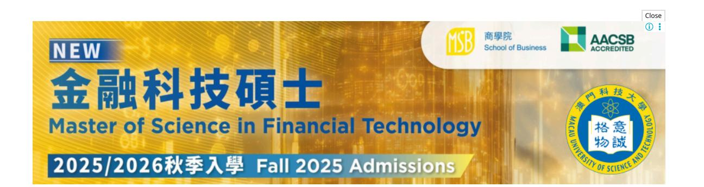
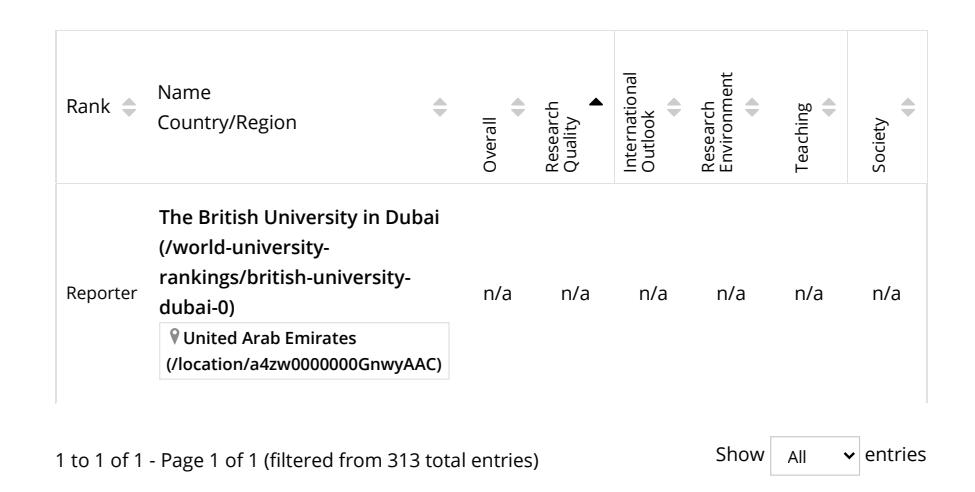
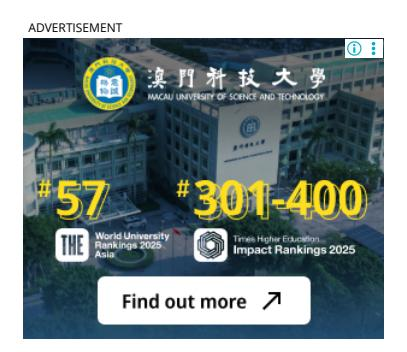
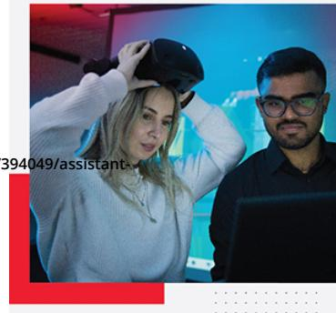
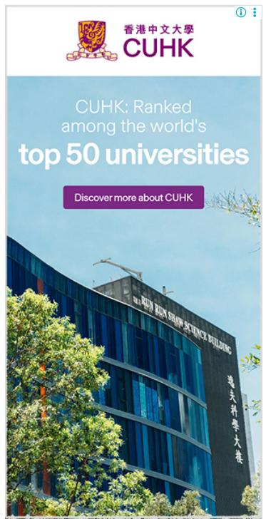

<!-- A3.R89 | source: papers_json/A3.R89/ -->

## Arab University Rankings 2023

يكشف تصنيف *Times Higher Education* للجامعات العربية لعام 2023 عن قوة التعليم العالي في المنطقة العربية. يعتمد المنهج على نفس إطار عمل تصنيف الجامعات العالمي الخاص بنا، لكن تم إجراء بعض التعديلات وإضافة بعض المقاييس الجديدة لتعكس خصائص ومهام الجامعات في منطقة الشرق الأوسط وشمال أفريقيا.

يتم تقييم الجامعات عبر جميع مهامها الأساسية – التدريس، والبحث، والمجتمع، والتوجه الدولي – لتوفير أشمل وأكثر المقارنات توازناً المتاحة.

اقرأ المزيد...

2023How to get your uni ranked (/submitting-data-times-higher-education-2020-world-university
rankings)أنت تشاهد حالياً تصنيف سنة سابقة.
شاهد أحدث التصنيفات: Arab University Rankings 2024 (/world-university

**بحث** british university in dubai **الدول / المناطق تقدم مواد دراسية في ** **ترتيب حسب** أي دولة / منطقة أي مادة دراسية إجمالي

[rankings/2024/arab-university-rankings)](https://www.timeshighereducation.com/world-university-rankings/2024/arab-university-rankings)

[1 (/world-university-rankings/2023/arab-university-rankings)](https://www.timeshighereducation.com/world-university-rankings/2023/arab-university-rankings)

<!-- page 2 -->

[(/hub/hsbc/p/deciding-universities-strategies](https://www.timeshighereducation.com/hub/hsbc/p/deciding-universities-strategies-sustainability-and-civic-engagement)[sustainability-and-civic-engagement)](https://www.timeshighereducation.com/hub/hsbc/p/deciding-universities-strategies-sustainability-and-civic-engagement)

**[Deciding universities' strategies for](https://www.timeshighereducation.com/hub/hsbc/p/deciding-universities-strategies-sustainability-and-civic-engagement)** **[sustainability and civic](https://www.timeshighereducation.com/hub/hsbc/p/deciding-universities-strategies-sustainability-and-civic-engagement)** **[engagement](https://www.timeshighereducation.com/hub/hsbc/p/deciding-universities-strategies-sustainability-and-civic-engagement)** **[(/hub/hsbc/p/deciding-universities](https://www.timeshighereducation.com/hub/hsbc/p/deciding-universities-strategies-sustainability-and-civic-engagement)****[strategies-sustainability-and-civic](https://www.timeshighereducation.com/hub/hsbc/p/deciding-universities-strategies-sustainability-and-civic-engagement)****[engagement)](https://www.timeshighereducation.com/hub/hsbc/p/deciding-universities-strategies-sustainability-and-civic-engagement)**

يمكن لقطاع التعليم العالي أن يؤدي دوراً كبيراً في دعم جهود السلطات المحلية للحد من انبعاثات الكربون

**برعاية HSBC** SPONSORED

**[Why adaptive universities will](https://www.timeshighereducation.com/hub/pa-consulting/p/why-adaptive-universities-will-emerge-stronger-times-change)** **[emerge stronger from times of](https://www.timeshighereducation.com/hub/pa-consulting/p/why-adaptive-universities-will-emerge-stronger-times-change)** **[change (/hub/pa-consulting/p/why](https://www.timeshighereducation.com/hub/pa-consulting/p/why-adaptive-universities-will-emerge-stronger-times-change)****[adaptive-universities-will-emerge](https://www.timeshighereducation.com/hub/pa-consulting/p/why-adaptive-universities-will-emerge-stronger-times-change)****[stronger-times-change)](https://www.timeshighereducation.com/hub/pa-consulting/p/why-adaptive-universities-will-emerge-stronger-times-change)**

المؤسسات المتميزة في التخطيط والتواصل وحل المشكلات مهيأة للاستجابة للتحديات العالمية من خلال تحسين طريقة عملها

**برعاية PA Consulting** SPONSORED

## **Read more about the Arab University Rankings 2023**

## **STUDENT INSIGHTS**

**Best universities in the Arab World** **[(/student/best-universities/best-universities](https://www.timeshighereducation.com/student/best-universities/best-universities-arab-world)****arab-world)**

## **ACADEMIC INSIGHTS**

**Arab University Rankings 2023: results** **[announced (/world-university-rankings/arab](https://www.timeshighereducation.com/world-university-rankings/arab-university-rankings-2023-results-announced)****university-rankings-2023-results-announced)**

**Arab University Rankings 2023: UAE leads on** **[collaboration (/world-university-rankings/arab](https://www.timeshighereducation.com/world-university-rankings/arab-university-rankings-2023-uae-leads-collaboration)****university-rankings-2023-uae-leads****collaboration)**

**Arab University Rankings 2023: a region of** **resilience and growth (/world-university****[rankings/arab-university-rankings-2023-region](https://www.timeshighereducation.com/world-university-rankings/arab-university-rankings-2023-region-resilience-and-growth)****resilience-and-growth)**

المزيد

## **METHODOLOGY:**

**[Arab University Rankings 2023: methodology](https://www.timeshighereducation.com/world-university-rankings/arab-university-rankings-2023-methodology)** **(/world-university-rankings/arab-university****rankings-2023-methodology)**

[(https://www.timeshighereducation.com/content/interdisciplinary](https://www.timeshighereducation.com/content/interdisciplinary-science-rankings-participation?utm_source=academic-website&utm_medium=link_embed&utm_campaign=interdisciplinary-science-research-rankings-24&utm_content=participation)[science-rankings-participation?](https://www.timeshighereducation.com/content/interdisciplinary-science-rankings-participation?utm_source=academic-website&utm_medium=link_embed&utm_campaign=interdisciplinary-science-research-rankings-24&utm_content=participation) [utm_source=academic](https://www.timeshighereducation.com/content/interdisciplinary-science-rankings-participation?utm_source=academic-website&utm_medium=link_embed&utm_campaign=interdisciplinary-science-research-rankings-24&utm_content=participation)[website&utm_medium=link_embed&utm_campaign=interdisciplinary](https://www.timeshighereducation.com/content/interdisciplinary-science-rankings-participation?utm_source=academic-website&utm_medium=link_embed&utm_campaign=interdisciplinary-science-research-rankings-24&utm_content=participation)[science-research-rankings-](https://www.timeshighereducation.com/content/interdisciplinary-science-rankings-participation?utm_source=academic-website&utm_medium=link_embed&utm_campaign=interdisciplinary-science-research-rankings-24&utm_content=participation)[24&utm_content=participation)](https://www.timeshighereducation.com/content/interdisciplinary-science-rankings-participation?utm_source=academic-website&utm_medium=link_embed&utm_campaign=interdisciplinary-science-research-rankings-24&utm_content=participation)

<!-- page 3 -->

## **FEATURED JOBS **

زميل ما بعد الدكتوراه في قسم الأحياء الدقيقة، كلية الطب السريري

香港大學 THE UNIVERSITY OF HONG KONG

(https://www.timeshighereducation.com/unijobs/listing/39**per.pste** and technology doctoral-fellow-in-the-

department-ofmicrobiology-school-of-clinical-medicine/? trackid=10&utm_source=the-

jobs-

service&utm_campaign=none&utm_score=0) THE UNIVERSITY OF HONG KONG

أستاذ مساعد / أستاذ مشارك / أستاذ في الاستدامة

SIT SINGAPORE INSTITUTE OF TECHNOLOGY

Engineering (https://www.timeshighereducation.com/unijobs/listing/394 professor-associate-

professor-professor-in-sustainability-

engineering/? trackid=10&utm_source=the-

service&utm_campaign=none&utm_score=0)

SINGAPORE INSTITUTE OF

TECHNOLOGY (SIT)

**برنامج MOE START** (جوائز المسيرة المهنية المبكرة) - تكنولوجيا المعلومات والاتصالات

(https://www.timeshighereducation.com/unijobs/listi start-scheme-early-

career-awardsinfocomm-technology/? trackid=10&utm_source=the-

jobs-service&utm_campaign=none&utm_score=0)

SINGAPORE INSTITUTE OF

TECHNOLOGY (SIT)

مساعد ما بعد الدكتوراه في قسم العلوم [الرياضيات]، دكتور

NYU ARU DHARI

doctoral-associate-in-the-division-of-sciencemathematics-drmostafa-sabri/?

trackid=10&utm_source=thejobs-

service&utm_campaign=none&utm_score=0)

NEW YORK UNIVERSITY ABU DHABI

مساعد بحث أول / مساعد بحث الأول/الثاني في قسم الطب

(https://www.timeshighereducation.com/unijobs/listing/3939887senior-

research-assistant-research-assistant-i-ii-inthe-department-ofmedicine/?

trackid=10&utm_source=the

jobs-service&utm_campaign=none&utm_score=0)

THE UNIVERSITY OF HONG KONG

عرض جميع الوظائف

(https://www.timeshighereducation.com/unijobs/listings/)

تحديث تفضيلات الوظائف

نعمل معاً لبناء عالم أفضل

Swinburne University of Technology

Mostafa Sabri (/hub/edx/p/leveraging-new-instructional-(https://www.timeshighereducation.com/unijobs/listing/393978/post-doctoral-associate-in-models-make-students-more-employable)

Leveraging new instructional models to make students more employable (/hub/edx/p/leveragingnew-instructional-models-makestudents-more-employable)

يمكن تكييف الأدوات التي تقدمها الجهات الرقمية للمساعدة في التعلم المستقل والتطوير المهني للمهارات المطلوبة

**برعاية edX** SPONSORED

ADVERTISEMENT

ADVERTISEMENT

<!-- page 4 -->

## **FEATURED UNIVERSITIES**

[(/world-university-rankings/al-mustaqbal](https://www.timeshighereducation.com/world-university-rankings/al-mustaqbal-university)[university)](https://www.timeshighereducation.com/world-university-rankings/al-mustaqbal-university)

[Al-Mustaqbal University (/world](https://www.timeshighereducation.com/world-university-rankings/al-mustaqbal-university)[university-rankings/al-mustaqbal](https://www.timeshighereducation.com/world-university-rankings/al-mustaqbal-university)[university)](https://www.timeshighereducation.com/world-university-rankings/al-mustaqbal-university)

Video (/world-university-rankings/al[mustaqbal-university?popupvideo=true)](https://www.timeshighereducation.com/world-university-rankings/al-mustaqbal-university?popupvideo=true)

[Explore (/world-university-rankings/al](https://www.timeshighereducation.com/world-university-rankings/al-mustaqbal-university)mustaqbal-university)

[(/world-university-rankings/huazhong](https://www.timeshighereducation.com/world-university-rankings/huazhong-university-science-and-technology)[university-science-and-technology)](https://www.timeshighereducation.com/world-university-rankings/huazhong-university-science-and-technology)

[Huazhong University of Science and](https://www.timeshighereducation.com/world-university-rankings/huazhong-university-science-and-technology) [Technology (/world-university](https://www.timeshighereducation.com/world-university-rankings/huazhong-university-science-and-technology)[rankings/huazhong-university-science](https://www.timeshighereducation.com/world-university-rankings/huazhong-university-science-and-technology)[and-technology)](https://www.timeshighereducation.com/world-university-rankings/huazhong-university-science-and-technology)

[Video (/world-university-rankings/huazhong](https://www.timeshighereducation.com/world-university-rankings/huazhong-university-science-and-technology?popupvideo=true)university-science-and-technology? popupvideo=true)

[Explore (/world-university-rankings/huazhong](https://www.timeshighereducation.com/world-university-rankings/huazhong-university-science-and-technology)university-science-and-technology)

[(/world-university-rankings/kiit-university)](https://www.timeshighereducation.com/world-university-rankings/kiit-university)

[KIIT University (/world-university](https://www.timeshighereducation.com/world-university-rankings/kiit-university)[rankings/kiit-university)](https://www.timeshighereducation.com/world-university-rankings/kiit-university)

[Video (/world-university-rankings/kiit](https://www.timeshighereducation.com/world-university-rankings/kiit-university?popupvideo=true)university?popupvideo=true)

[Explore (/world-university-rankings/kiit](https://www.timeshighereducation.com/world-university-rankings/kiit-university)university)

[(/world-university-rankings/university-east](https://www.timeshighereducation.com/world-university-rankings/university-east-anglia)[anglia)](https://www.timeshighereducation.com/world-university-rankings/university-east-anglia)

[University of East Anglia (/world](https://www.timeshighereducation.com/world-university-rankings/university-east-anglia)[university-rankings/university-east](https://www.timeshighereducation.com/world-university-rankings/university-east-anglia)[anglia)](https://www.timeshighereducation.com/world-university-rankings/university-east-anglia)

[Video (/world-university-rankings/university](https://www.timeshighereducation.com/world-university-rankings/university-east-anglia?popupvideo=true)east-anglia?popupvideo=true)

[Explore (/world-university-rankings/university](https://www.timeshighereducation.com/world-university-rankings/university-east-anglia)east-anglia)

<!-- page 5 -->

[Contact us (/contact-us)](https://www.timeshighereducation.com/contact-us)

[About us (/about-us)](https://www.timeshighereducation.com/about-us)

[Work for THE (https://careers.timeshighereducation.com/)](https://careers.timeshighereducation.com/)

[Terms & conditions (/terms-and-conditions)](https://www.timeshighereducation.com/terms-and-conditions)

[Privacy (/privacy-policy)](https://www.timeshighereducation.com/privacy-policy)

[Cookie policy (/cookie-policy)](https://www.timeshighereducation.com/cookie-policy)

[Accessibility statement (/content/online-accessibility-statement)](https://www.timeshighereducation.com/content/online-accessibility-statement)

[THE Connect (/our-partners)](https://www.timeshighereducation.com/our-partners)

[Media Centre (/media-centre)](https://www.timeshighereducation.com/media-centre)

[Modern slavery statement (/about-us/modern-slavery-act-2015)](https://www.timeshighereducation.com/about-us/modern-slavery-act-2015)

[University Directory (https://www.timeshighereducation.com/university-directory/a)](https://www.timeshighereducation.com/university-directory/a)

[English (/world-university-rankings/2023/arab-university-rankings)](https://www.timeshighereducation.com/world-university-rankings/2023/arab-university-rankings) [Simplied Chinese (](https://www.timeshighereducation.com/cn/world-university-rankings/2023/arab-university-rankings)简体中文)[ (/cn/world-university-rankings/2023/arab-university-rankings)](https://www.timeshighereducation.com/cn/world-university-rankings/2023/arab-university-rankings) حقوق النشر © 2025 THE - Times Higher Education

## **Subscribe to Times Higher Education**

بصفتها صوت التعليم العالي العالمي، تمثل THE مورداً يومياً لا يقدر بثمن. اشترك اليوم لتلقي أخبار وتحليلات غير محدودة، وتعليقات من أبرز العقول في الأكاديمية الدولية، وتحليلات تصنيف الجامعات المؤثرة، وأحدث الرؤى من سلسلة World Summit الخاصة بنا.

**[Find out more (/store)](https://www.timeshighereducation.com/store)**
