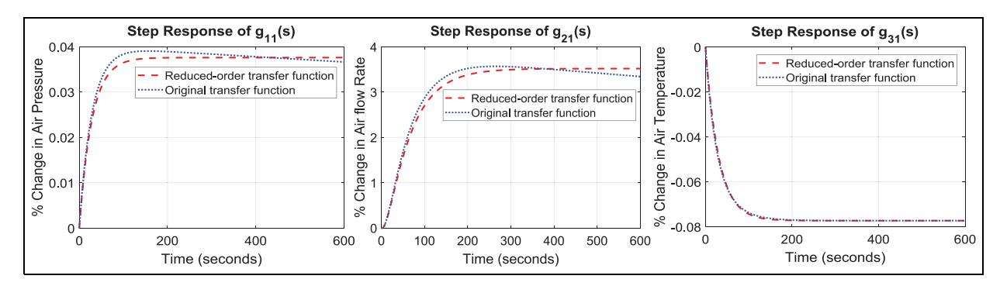
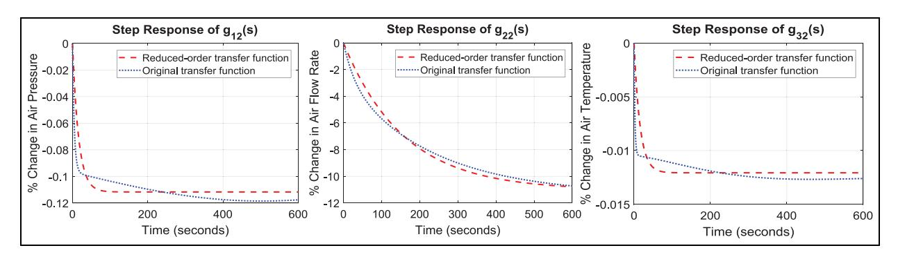
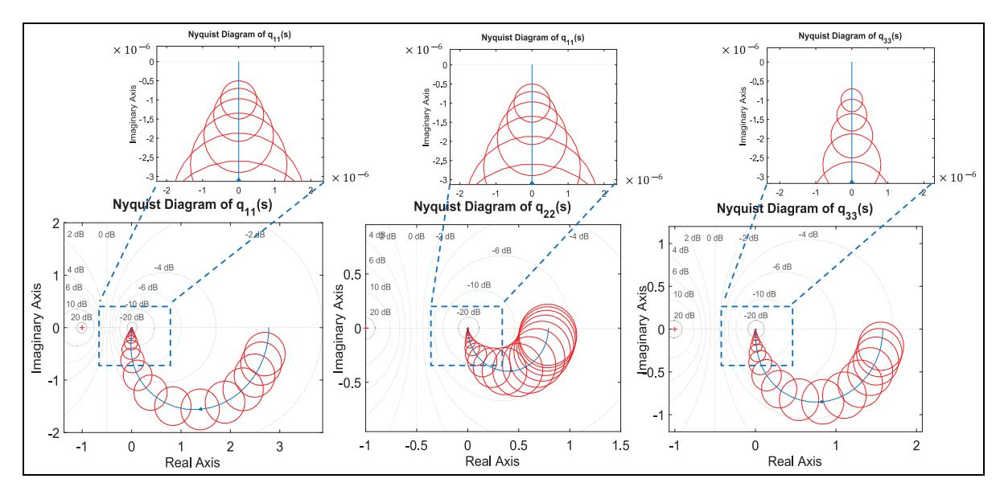
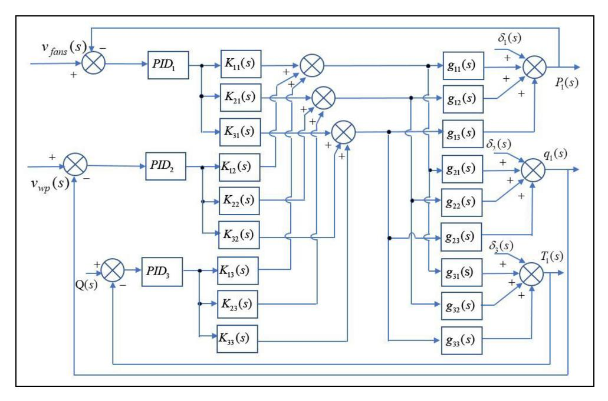
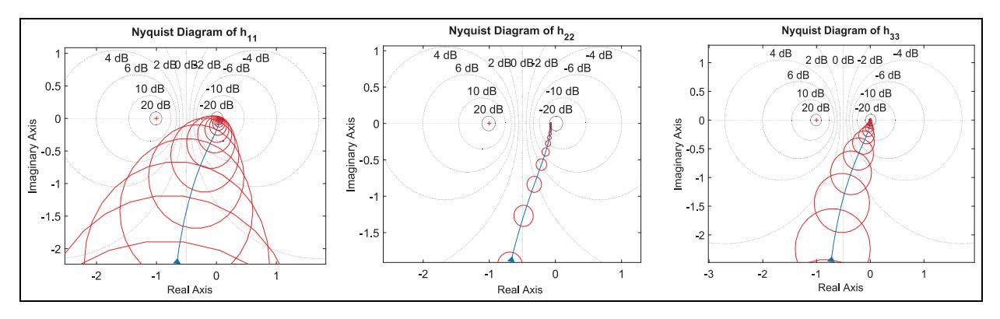
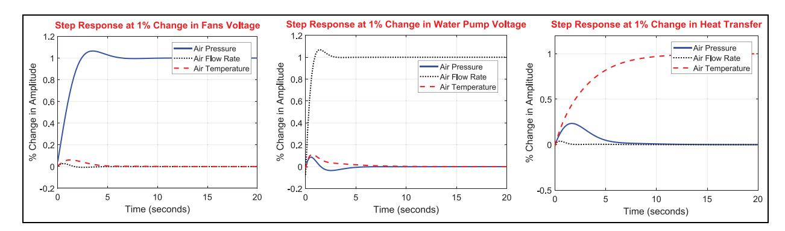
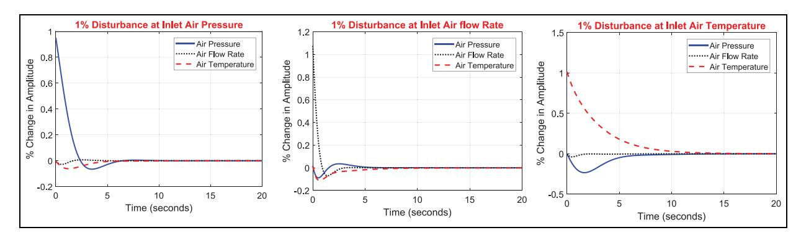

<!-- A3.R91 | source: papers_json/A3.R91/ -->

التحكم

## نمذجة والتحكم في نظام HVAC متعدد المتغيرات

Proc IMechE Part C: J Mechanical Engineering Science 2023, Vol. 237(9) 2049–2061 - IMechE 2022 Article reuse guidelines: [sagepub.com/journals-permissions](https://uk.sagepub.com/en-gb/journals-permissions) [DOI: 10.1177/09544062221138836](https://doi.org/10.1177/09544062221138836) [journals.sagepub.com/home/pic](journals.sagepub.com/home/pic)

## Basim Touqan1 , Alaa Abdul-Ameer1 and Muna Salameh2

## الملخص

نظام التدفئة والتهوية وتكييف الهواء (HVAC) هو عملية متعددة المتغيرات، بحيث يؤثر أي تغيير في أحد مدخلات النظام على معظم أو كل مخرجات النظام في آن واحد. ونظراً لشموليته، اختير في هذا العمل نموذج رياضي متعدد المتغيرات لنظام HVAC سبق اشتقاقه، وهو تحديداً نموذج هجين يجمع بين المعاملات الموزعة والمجمعة. وبما أن مصفوفة دالة النقل لم تكن قد أُنشئت في نموذج HVAC المختار، فقد طُوّرت حصرياً في هذه الدراسة باستخدام الاستجابات الرسومية للنموذج المختار في المجال الزمني. واستناداً إلى مصفوفة دالة النقل المطوَّرة، اتُّبع نهج مفاهيمي من خطوتين للتحكم في أداء نموذج HVAC. تمثلت الخطوة الأولى في فصل التفاعلات المؤثرة على جميع مخرجات النظام، وتمثلت الثانية في تصميم متحكمات PID مناسبة لكل حلقة مفصولة، على غرار تلك المستخدمة في أنظمة المدخل الواحد والمخرج الواحد (SISO). واستُخدمت لهذا الغرض استراتيجية تحكم متعددة المتغيرات تُعرف بمصفوفة Nyquist المباشرة (DNA)، ونجحت في فصل نظام HVAC إلى ثلاث حلقات (SISO) منفصلة. وبعد ذلك طُبِّق ثلاثة متحكمات PID على كل حلقة مفصولة. وأظهرت النتائج مخرجات نظام مفصولة إلى حد كبير مع نسبة تداخل بسيطة، بحيث لا يؤثر أي تغيير في أحد المدخلات إلا على المخرج المقابل له. كما أن استجابات المخرجات ناقصة الإخماد مع خطأ حالة مستقرة يقارب الصفر تقريباً، ما يؤكد فعالية معاملات PID المختارة. وتُحصَّل قيم استجابات الحالة المستقرة خلال (10-15) ثانية مقارنة بزمن استجابة (200-600) ثانية للحلقة المفتوحة. ومع ذلك، تظهر في الاستجابات نسب تجاوز مختلفة، لكنها صغيرة نسبياً وذات زمن استقرار قصير، ولذلك لا تؤثر على الراحة الحرارية للحيز المهوّى. كما فُحصت استقرارية النظام باستخدام معيار Nyquist وتبيّن أنها تحقق هذا المعيار. وقد أظهرت تقنية التحكم متعددة المتغيرات DNA ومتحكمات PID للحلقة المغلقة SISO القدرة على قمع الاضطرابات الخارجية وإعادة النظام إلى قيم الحالة المستقرة الوظيفية الأصلية.

## الكلمات المفتاحية

HVAC, transfer function matrix, multivariable control, Direct Nyquist Array, loops decoupling

Date received: 24 June 2022; accepted: 9 October 2022

## المقدمة

هناك أسباب عديدة تجعل أنظمة (HVAC) تُعد بالغة الأهمية. فهي أحد أكبر مستهلكي الطاقة في المباني، وتستحوذ على نحو 50% من إجمالي استهلاك الطاقة في المباني.1 علاوة على ذلك، فهي ضرورية للحفاظ على مستوى المعيشة لجزء كبير من سكان العالم.2 ويُتوقع أن تشهد العقود القادمة ارتفاعاً حاداً في عدد أنظمة HVAC المركّبة، ويعود ذلك بشكل أساسي إلى التوسع الاقتصادي، والاحترار العالمي، وتحسن مستويات المعيشة.3,4 ويمكن الحكم على فعالية أنظمة HVAC من خلال قدرتها على تحقيق الراحة الحرارية وجودة الهواء الداخلي بأقل استهلاك ممكن للطاقة. واستناداً إلى متطلبات كفاءة عمل HVAC هذه، اقتُرحت حلول غير مباشرة مثل الاستراتيجيات المعمارية السلبية لخفض الحمل الحراري لأنظمة HVAC بحيث يقل زمن تشغيلها وبالتالي يقل استهلاك الطاقة. وتشمل هذه الاستراتيجيات المعمارية، على سبيل المثال، اتجاه المبنى الملائم،

وزيادة عزل غلاف المبنى، واستخدام وسائل التظليل مثل الشاشات الخارجية والألواح، كما ورد في Palmero-Marrero and Oliveira.5 كما يمكن لأساليب هندسة النظم أن تسهم بشكل كبير في متطلبات كفاءة عمل HVAC. وجوهرياً، فإن سلامة نموذج النظام وتوافق نظام التحكم أمران أساسيان لتحقيق أفضل النتائج. ويتمثل النهج الأساسي لتحقيق سلامة نموذج نظام HVAC في فهم صحيح لبنية النظام والتفاعلات الداخلية وأداء النظام من خلال إدماج المعادلات

## Corresponding author:

Basim Touqan, The British University in Dubai, Block 10 & 11, 1st and 2nd Floor, PO Box: 345015, Dubai International Academic City, Dubai, United Arab Emirates.

Email: basem.tuqan@buid.ac.ae

> ^1^ The British University in Dubai, Dubai, United Arab Emirates

> ^2^ Ajman University, Ajman, United Arab Emirates

<!-- page 2 -->

الرياضية التي تصف وظائف المكونات الكهربائية والميكانيكية إلى جانب معادلات توازن الطاقة، وحفظ الكتلة، وانتقال الحرارة. وبهذا المعنى، فإن الحاجة إلى نمذجة شاملة لنظام HVAC واستخدام منهجية تصميم متحكم تغذية راجعة متعدد المتغيرات، منهجية وعلمية، تُعد شرطاً أساسياً. وإن لم يتحقق ذلك، فلن يتحقق توفير الطاقة والكفاءة التشغيلية، وهما أمران مهمان في بناء مبانٍ صديقة للبيئة.6

ووفقاً لـ Whalley and Abdul-Ameer، يمكن الحصول على نمذجة شاملة من خلال اعتبار مراوح الدخول والاستخراج تحققات ذات معاملات مجمّعة، توفر أساليب نمذجة دقيقة وموثوقة وتُبقي التعقيد عند الحد الأدنى. وهذا يسمح بضبط تغيرات الضغط عند مدخل ومخرج الحيز المهوّى من خلال تغيّرات الجهد الكهربائي عبر محركات المراوح. ومع ذلك، تستدعي أبعاد الحيز المهوّى نهج نمذجة معاملات موزعة، حيث تتوزع الخصائص الفيزيائية للنظام على طول امتداد النظام نفسه. ومع تطبيق التحكم الآلي المتقدم، تسمح أساليب النمذجة هذه بحساب ديناميكيات تدفق الهواء المتغيرة.

نظام التحكم هو تصميم هندسي يستخدمه مهندسو العمليات لضبط بعض أو كل المتغيرات أو الحالات المرتبطة بالعملية، بهدف تحقيق استجابات المخرجات المرغوبة من حيث السلوك الديناميكي وسلوك الحالة المستقرة. كما يجب أن تمتلك تصميمات نظام التحكم القدرة على التعامل مع التداخلات الخارجية غير المتوقعة، وتغيّر الأحمال، والاضطرابات، بحيث يمكنها إعادة سلوك النظام إلى المدخلات المرجعية المطلوبة أصلاً.8 ومن منظور نظرية التحكم الآلي، تبرز أهمية نظام التحكم عندما تكون هناك احتمالية ضئيلة وصعوبة عملية للحصول على متجه حالة لتنظيم عملية صناعية. علاوة على ذلك، فإن تقدير حالات العملية باستخدام المراقبات أو المرشحات قد ينطوي على تعقيد كبير ويُنتج يقيناً أقل. لذلك، فإن القياس المباشر لمتجه مخرجات النظام المتاح لأغراض التغذية الراجعة هو الطريقة الأفضل لتنظيم عملية صناعية. ومع ذلك، فإن استخدام متجه مخرجات غير مكتمل يحدّ من خيار طريقة تصميم المتحكم ويتضمن بعض القيود.9 ويمكن ملاحظة أمثلة على ذلك عند استخدام استراتيجية التحكم "تخصيص الأقطاب"؛ فكما أشار Davison، 10 يمكن إجبار جزء من أقطاب النظام في تشكيل الحلقة المفتوحة إلى موقع محدد مسبقاً في مستوى s باستخدام متحكم تناسبي فردي. وفي المقابل، تنتقل بقية الأقطاب بشكل عشوائي. لكن هذا الوضع يخلق فجوة أداء جدية ويقيّد كثيراً من دراسات التطبيق. لذلك، يمكن تحديد مواقع مجموعة الأقطاب الكاملة المرتبطة بنظام الحلقة المفتوحة باستخدام قياسات المخرجات وحدها، وهو ما أوصى به Patel and Munro.11 ومع ذلك، يستلزم هذا النهج استخدام متحكمات ديناميكية لأن هذه

الديناميكيات يمكن أن تؤثر بشكل جدي على أداء النظام قبل الوصول إلى استجابة الحالة المستقرة. علاوة على ذلك، تنحصر المشكلة في مسألة التنفيذ، إذ لا يمكن تحمّل الديناميكيات المحسوبة المرتبطة بالمتحكم بسبب الكسب المرتفع، ومشكلات تضخيم الضوضاء، وعناصر الطور غير الأدنى، وما إلى ذلك، وهي أمور تُعد غير مرغوبة. وبديلاً عن ذلك، يمكن للمصمم تحديد الأقطاب والأصفار التي تجذب أقطاب الحلقة المغلقة إلى موقع مرغوب في مستوى s باستخدام دوال متعددة الحدود تولّدها المتحكم المستخدم بالاقتران مع مخرجات النظام الطبيعية. وعملياً، يمكن تحديد جميع أقطاب وأصفار نظام الحلقة المغلقة باستخدام تقنيات مجال التردد المُثبتة جيداً. وبالتالي، يمكن استخدام تقنيات الحلقة المفردة والمتعددة المتغيرات معاً، مثل أسلوب مصفوفة Nyquist كما وضّحه Rosenbrock، 12 باستخدام شبكات تأخير-تقديم الطور، عند الحاجة لتحقيق أداء محسّن لنظام HVAC متعدد المتغيرات.

وبالتالي، فإن نموذج نظام HVAC الشامل الذي يستوعب جميع المكونات والديناميكيات والتفاعلات الداخلية الممكنة للنظام، وينتهي إلى نموذج HVAC متعدد المتغيرات مع استراتيجية تحكم تغذية راجعة متعددة المتغيرات مناسبة، يمكن أن يحقق كفاءة تشغيلية لنظام HVAC وبالتالي استهلاكاً محسّناً للطاقة.

## النموذج الرياضي لـ HVAC

تُستخدم النماذج الرياضية على نطاق واسع لجوانب عديدة، مثل تدريب المشغّلين، والمحاكاة، وتشخيص الأعطال. 13 كما يمكن استخدامها لبعض العمليات الصناعية التي لا يمكن إنشاؤها داخل المختبرات لقياس وتحليل سلوكها. ومع ذلك، استُخدم حيز اختبار صغير لوصف سلوكه الحراري والرطوبي كما درسه Virk et al.14 وعادةً ما تكون أنظمة HVAC كبيرة جداً بحيث لا تصلح للدراسات المخبرية بسبب حجم المكونات؛ على سبيل المثال، الممرات الهوائية الطويلة والأحجام المهوّاة الكبيرة، 15 لذا يُعد الحل العملي هو نمذجة النظام رياضياً. ومع ذلك، فإن دقة تمثيل النموذج أمر بالغ الأهمية للحصول على نتائج متوقعة موثوقة. وتُظهر نتيجة مراجعة أعمال نمذجة HVAC أن معظم نماذج HVAC كانت مجزأة إلى مكون واحد أو أكثر بشكل منفصل. وبالتالي، يمثّل نموذج HVAC حلقة واحدة أو عدة حلقات مستقلة، لكل منها متغير تحكم واحد، تفادياً للوصول إلى منشأة HVAC كاملة. وقد يكون سبب هذا التفادي هو التعقيد المتوقع الناتج عن نموذج رياضي شامل لـ HVAC. ومع ذلك، استُكشفت أيضاً بعض أساليب النمذجة متعددة المتغيرات، وإن كانت قليلة. ففي Preglei et al.، 16 اقتصرت نمذجة HVAC متعددة المتغيرات على منشأة اختبار تتكون من مروحة وملفات تسخين وتبريد ومرطّب بخاري، لكن نموذج الحيز المكيّف لم يُدرج صراحة بعد في نموذج رياضي نهائي. وقدّم الباحثون في Satyavada et al.17 نموذجاً متكاملاً

<!-- page 3 -->

لنظام HVAC يضم غلاياً ومشعاعاً ووحدة معالجة هواء AHU وحيزاً حرارياً وصماماً ومخمداً ومروحة ومضخة وأنابيب ومجاري هواء. كما صُمّم مخمد إعادة تدوير في النموذج للسماح بتغيير كمية الهواء العائد والهواء الطازج ومزجه وفق إشارة التحكم بالمخمد. وفي المقابل، لم تُعرض مصفوفة دالة النقل النهائية المحوَّلة من المعادلات التفاضلية الرياضية التي تفسر سلوك ديناميكيات النظام، مع تحليل تقنية التحكم المطبقة.

كما أن النمذجة القائمة على الفيزياء أو نمذجة الصندوق الأبيض لـ HVAC هي تقنية أخرى تستخدم معادلات حفظ الكتلة والطاقة، إضافة إلى معادلات انتقال الحرارة، مع الأخذ بعين الاعتبار المعرفة الكاملة بالعملية المعنية.18 واستُخدمت المعادلات، كما وصفها قانون Darcy (قانون تدفق الماء)، وFick (قانون التدفق الغازي)، وFourier (قانون انتقال الحرارة)، من قبل Lü19 لاشتقاق نموذج يتنبأ بالظروف الحرارية الداخلية. وبالمثل، طوّر المؤلفون في Tashtoush et al.20 نموذجاً ديناميكياً استناداً إلى معادلات توازن الطاقة والكتلة، يدمج مكونات نظام HVAC مثل حيز الغرفة والمبرّد والمسخّن والمروحة والمرطّب ومزيل الرطوبة ومجاري الهواء. وكانوا مدركين لخصائص النظام المتوزعة، لكنهم لم يبذلوا جهداً إضافياً لمراعاة الطبيعة المتوزعة للعملية الفيزيائية في إجراء النمذجة بسبب التعقيد المتضمن في طريقة اشتقاق النموذج.

ومع ذلك، ونظراً للبنية المعقدة لمنشآت HVAC الكاملة التي تنطوي على العديد من المعاملات الحاكمة لأدائها، تُفضَّل أحياناً منهجية النمذجة القائمة على البيانات أو الصندوق الأسود لكونها إجراءً مباشراً لاشتقاق نماذج نظام HVAC. وتُعد دوال الكثافة الاحتمالية (PDF) مثالاً على هذا النهج. وهي طريقة تنبؤ إحصائية تتناول التوزيع الاحتمالي لمتغير عشوائي مستمر لعملية ما. وقد اتُّبعت النمذجة عبر التنبؤ بالطقس وإشغال الغرف باستخدام تقنية دوال الكثافة الاحتمالية (PDF) لتحديد الحمل الحراري للمبنى من قبل Ma et al.، 21 وHong and Jiang، 22 وZlatanović et al. 23

وثمة نهج نمذجة آخر، هو تقنية نمذجة الصندوق الرمادي التي اتّبعها Wu and Sun24 وLi et al.25، واقتُرح فيه استخدام المعادلات القائمة على الفيزياء لبناء نموذج العملية، بينما يمكن تحديد قيم المعاملات من البيانات المقيسة، والتي يمكن الحصول عليها من بيانات التشغيل الخاصة بالشركة المصنّعة المدرجة في الكتالوج أو من خلال إجراء تشغيل تجريبي للنظام. ومن الجدير بالذكر أن مثل هذه النماذج قد تكون قادرة على استيعاب كامل الخصائص الفيزيائية لمنشأة HVAC للوصول إلى نموذج شامل، لكن تطوير مصفوفة دالة النقل للنموذج متعدد المتغيرات الناتج في مجال التردد كان دائماً مفقوداً، وهو أساس منهجيات تصميم متحكم تغذية راجعة متعدد المتغيرات، منهجية وعلمية.

من جهة، يتميز HVAC للأحجام المهوّاة الكبيرة بمكونات نظام متوزعة مكانياً وأبعادياً،

مثل حيز التهوية الطويل حيث تتوزع الخصائص الفيزيائية للهواء مثل التدفق ودرجة الحرارة والضغط على طول المكون. ويُعترف بنموذج مماثل لتدفق الهواء في نفق طريق طويل في Bartlett and Whalley. 26 أما المكونات الأخرى مثل المحركات فيمكن نمذجتها كمعاملات مجمّعة نقطية. ومن جهة أخرى، فإن مراعاة نمذجة غلاف المبنى والحيز الداخلي ومكونات HVAC الكهربائية والميكانيكية تُنشئ نموذج HVAC متعدد المتغيرات شاملاً. وتجدر الإشارة إلى أن مثل هذا النموذج سيؤدي إلى اقترانات ثقيلة بين المخرجات، ما يؤدي إلى حالة يؤثر فيها تغيّر أحد المدخلات على جميع مخرجات النظام. وبالرغم من الصعوبات والعمليات الرياضية المكثفة المستخدمة لفصل التفاعل بين مخرجات النظام الناتج عن نظام متعدد المتغيرات، يمكن أن يوفر نموذجاً يشكل، مع استراتيجية تحكم متوافقة، الأساس لضمان أداء محسّن لنظام HVAC، وبالتالي مبنى موفّر للطاقة.

واستناداً إلى المناقشات السابقة، فإن النموذج الهجين للمعاملات الموزعة-المجمّعة الذي طوّره Whalley and Abdul-Ameer نهج عملي جيد لتمثيل نظام HVAC عام، يتيح نمذجة مدمجة لأنظمة HVAC واسعة النطاق. وبما أن المؤلفين راعوا تأثير النحافة لبعض مكونات منشأة HVAC، مثل حيز التهوية النفقي الطويل، حيث تكون نسبة الطول إلى القطر مرتفعة، يمكن الحصول على نموذج دقيق قريب من الواقع. ويدمج هذا النموذج عناصر معاملات موزعة إضافة إلى عناصر نقطية مجمّعة مركّزة. وهو يتيح بناء تحققات النموذج التحليلي التي تدمج جميع الديناميكيات البارزة المتوزعة للنظام، بما في ذلك التأخير الزمني المحدود. وفي الوقت نفسه، ودون التأثير على الدقة، تُعد النمذجة المجمّعة مناسبة تماماً لأطراف المجاري، مثل محركات مراوح الدخول والخروج، ومحركات مضخة المياه المبرَّدة، نظراً لطبيعتها الفيزيائية النقطية. ويمكن تحقيق مزيد من كفاءة الطاقة من خلال تركيب مجرى إعادة تدوير يقلل الحمل الحراري على وحدة التبريد. ومع ذلك، تُدمج التأخيرات الزمنية في النموذج النهائي، ما يجعل تطبيق بعض استراتيجيات التحكم صعباً.

لذلك، يوجد نموذج مشتق جاهز بصيغة المجال الزمني في Whalley and Abdul-Ameer7 واعتُمد استخدامه في هذه الدراسة. كما دمج النموذج النهائي المعادلات الرياضية التي تحكم تغيرات درجة حرارة تيار الهواء مع النموذج الرياضي الهجين للمعاملات الموزعة-المجمّعة. وتنجم تغيرات درجة الحرارة هذه عن (1) تدفق الهواء وتغيرات الضغط عند مدخل الحيز الداخلي المهوّى، (2) تغيرات درجة حرارة الهواء الناتجة عن التدوير وتأثيرات تكييف الهواء، (3) تغيرات درجة الحرارة الناتجة عن تغيرات تدفق الهواء عند مخرج الحيز الداخلي المهوّى. كما راعى النموذج الخسائر النموذجية المرتبطة بشبكة التدوير، والمجاري، والممانعة الديناميكية، واحتكاك الحالة المستقرة.

<!-- page 4 -->

تتجنب هذه الدراسة إعادة اختراع النموذج الرياضي الكامل من جديد، إذ إنه متاح بالفعل في Whalley and Abdul-Ameer.7 واستناداً إلى شموليته، يُعد عملياً بما يكفي لمعالجة ومعالجة الاستجابات الرسومية في المجال الزمني لهذا النموذج، بهدف تحويلها إلى مصفوفة دالة نقل تمثّل مجال التردد للنظام. وإضافة إلى استراتيجية التحكم بالفصل متعدد المتغيرات المستخدمة كما هو موضح في الأقسام التالية، فإن تحديد دالة النقل في تحويل لابلاس هما الأهمية الأساسيتان لهذه الدراسة

## تقنيات التحكم متعددة المتغيرات

تُصمَّم أنظمة HVAC المتقدمة اليوم بمدخلات متعددة تتفاعل على مستويات مختلفة مع مخرجات متعددة. وفي الوقت نفسه، ووفقاً لـ MacFarlane،27 فإن تطبيق التحكم في النظام متعدد المتغيرات يتحدد بقيود معينة مثل التفاعلات الداخلية بين مخرجات النظام المختلفة، والتي تؤثر إحداها على الأخرى. ويمكن اتّباع نهج مفاهيمي من خطوتين للتحكم في نظام متعدد المتغيرات. تتمثل الأولى في فصل التفاعلات في دالة نقل النظام بحيث لا يؤثر أي تغيير في مدخل النظام إلا على المخرج المقابل له. أما الخطوة الثانية فهي تصميم تقنية تحكم مناسبة للمدخل الواحد والمخرج الواحد، على غرار تلك المستخدمة في عمليات SISO.28

استُخدمت تقنيات معينة لفصل النظام متعدد المتغيرات، مثل التقنية المستخدمة في O¨zgo¨ren،29 التي تفترض أن مدخلات التحكم الافتراضية سيكون لها تأثير مفصول وغير تفاعلي على المخرجات محل الاهتمام. وقد تناول Whalley and Ebrahimi30 فصل نموذج متعدد المتغيرات من خلال إدراج مصفوفة حالة مستقرة بنسبة اقتران منخفضة في قانون التحكم بالتغذية الراجعة. ومع ذلك، فإن النهج المألوف لفصل الحلقات الداخلية في نظام متعدد المتغيرات هو تصميم مصفوفة معوّضات لفصل النظام متعدد المتغيرات إلى حلقات فردية متعددة. واقتُرحت تقنيات عديدة لتحقيق هذه الخطوات الأساسية، مثل إجراء شبه القطرنة (pseudo-diagonalization) المستخدم في Hawkins.31

تُعد تقنية Nyquist-Array، سواء بصيغتها العكسية أو المباشرة، والتي تنتمي إلى مدرسة بريطانية، تقنية تحكم متعددة المتغيرات تجمع بين كفاءة الجبر الحديث والإجراءات التحليلية للتحكم الكلاسيكي. وهي تفحص ما إذا كان الاقتران الداخلي للنموذج متعدد المتغيرات قد انخفض أم لا. وإضافة إلى تقنية مصفوفة Nyquist، اتّبعت تقنية المحل المميز (characteristic loci) النهج نفسه في الفصل، وجرت مراجعتها في MacFarlane and Kouvaritakis.32 كما أن إجراء التصميم بتشكيل الحلقة H' يتضمن أيضاً تقنية فصل من خلال تطوير مصفوفة معوّض مسبق مبدئياً لإنشاء منشأة ذات خصائص مرغوبة. ويتمثل الفارق الأساسي في هذا النهج

في أن مصفوفة المعوّضات المسبقة المستخدمة في إجراء الفصل هي متحكم متعدد المتغيرات بالكامل، مصمَّم باستخدام التحسين.

وقد بُحثت عدة طرق لتحقيق الهيمنة (dominance) باستخدام مصفوفة معوّضات. ويتيح الحصول على مصفوفة مهيمنة إنشاء متحكمات بسيطة في حين تتطلب النُّهج الأخرى متحكمات أكثر تعقيداً. لكن الوصول إلى مصفوفة قطرية مهيمنة يعتمد عادة على التجربة والخطأ. لذلك، لا يزال من الضروري إحراز مزيد من التقدم في هذا الاتجاه. وتُعد استراتيجية التحكم متعددة المتغيرات Nyquist-Array أداة فعالة لتصميم وتحليل نظام التحكم متعدد المتغيرات. وباستخدام هذا النهج، تُقسَّم المشكلة متعددة المتغيرات عادة إلى مشكلات تغذية راجعة شبه غير تفاعلية للمدخل الواحد/المخرج الواحد، والتي يمكن حلها بعد ذلك باستخدام تقنيات تصميم التحكم التقليدية. وعلى الرغم من أن إيجاد مصفوفة المعوّضات ليس مهمة بسيطة، ستُستخدم تقنية Nyquist Direct Array في هذه الدراسة نظراً لقدرتها على تقليل التفاعلات الداخلية للنظام، ومن ثم يمكن تطبيق متحكمات تغذية راجعة كلاسيكية SISO قابلة للتحقيق عادة، بهدف الحصول على أداء جيد السلوك لنظام HVAC

## استخلاص مصفوفة دالة النقل لـ HVAC

في النموذج المختار الذي طوّره Whalley and Abdul-Ameer،7 استخدم المؤلفون برنامجي MATLAB وSIMULATION لمحاكاة الاستجابات الرسومية لمخرجات النظام في تشكيل الحلقة المفتوحة. ويمكن استخلاص مجال التردد للنموذج من خلال أخذ هذه الاستجابات الرسومية للنظام في تشكيل الحلقة المفتوحة في المجال الزمني وتحويلها إلى استجابات مجال التردد بتمثيل متغير لابلاس 's'، ما ينشئ نموذجاً متعدد المتغيرات بثلاثة مدخلات وثلاثة مخرجات. وتأخذ علاقة المدخل-المخرج متعددة المتغيرات الصيغة التالية:

$$
\begin{bmatrix} P(s) \\ q(s) \\ T(s) \end{bmatrix} = \begin{bmatrix} g_{11}(s) & g_{12}(s) & g_{13}(s) \\ g_{21}(s) & g_{22}(s) & g_{23}(s) \\ g_{31}(s) & g_{32}(s) & g_{33}(s) \end{bmatrix} \begin{bmatrix} v_{fans}(s) \\ v_{wp}(s) \\ Q(s) \end{bmatrix} (1)
$$

حيث:

P(s): المخرج الأول ويمثل ضغط الهواء عند مدخل الحيز الداخلي المهوّى

q(s): المخرج الثاني ويمثل معدل تدفق حجم الهواء عند مدخل الحيز الداخلي المهوّى

T(s): المخرج الثالث ويمثل درجة حرارة الهواء عند مدخل الحيز الداخلي المهوّى

vfans(s): المدخل الأول ويمثل الجهد الكهربائي المطبَّق على مدخل ومخرج المراوح في آن واحد

vwp(s): المدخل الثاني ويمثل الجهد الكهربائي المطبَّق على مضخة المياه المبرَّدة

<!-- page 5 -->

| Table I. (x, v | ) coordinates of air | flow rate response curve at unit | y % step change in the v_{fans}(s). |
| --- | --- | --- | --- |

| x | 0 | 25 | 50 | 75 | 100 | 125 | 150 | 175 | 500 | 525 | 550 | 575 | 600 |
| --- | --- | --- | --- | --- | --- | --- | --- | --- | --- | --- | --- | --- | --- |
| у | 0 | 0.68 | 1.68 | 2.37 | 2.87 | 3.17 | 3.33 | 3.47 | 3.42 | 3.4 | 3.38 | 3.36 | 3.34 |

***الشكل 1.** استجابات الخطوة للرتبة المخفضة مقارنة بدوال النقل المشتقة أصلاً لضغط الهواء ومعدل تدفق الهواء ودرجة حرارة الهواء عند مدخل الحيز الداخلي المهوّى عند تطبيق تغيير خطوة 1% في الجهد v_{fans}(s).*

Q(s): المدخل الثالث ويمثل انتقال الحرارة المحيطة إلى الحيز المهوّى

g_{ij}(s): عناصر دالة النقل لمنشأة HVAC

سيتم تحديد وحساب g_{ij}(s) باستخدام MATLAB في القسم التالي

## تحديد النظام

هذه هي أهم مرحلة بحثية، وهي تطوير مصفوفة دالة نقل للنموذج المختار. وسيكون نموذج دالة النقل المطوَّر بعد ذلك أساساً لتطبيق استراتيجية تحكم مناسبة. واستُخدمت حزمة أدوات System Identification في MATLAB لاستخلاص عناصر دالة النقل بتمثيل متغير لابلاس. ويتضمن الإجراء ثلاث خطوات. في الخطوة الأولى، تُعالَج الاستجابة الديناميكية الرسومية التي توضح مخرج النموذج في الحلقة المفتوحة، كما هو موضح في Whalley and Abdul-Ameer، لتحديد إحداثيات (x, y) لمنحنى الاستجابة نفسه. ويُفترض أن تجسّد هذه الاستجابة الخصائص الديناميكية البارزة لسلوك النظام. ثانياً، تُدخَل إحداثيات (x, y) المحدَّدة إلى MATLAB System Identification

المولَّدة بمعاملات محدَّدة، وهي بشكل أساسي معاملات كثيرة حدود البسط والمقام. كما يعطي هذا الإجراء نسبة ملاءمة البيانات، أي مدى تطابق نسبة دالة النقل مع بيانات المجال الزمني المُدخَلة إلى النظام. وإحداثيات استجابة النموذج الرسومي للحلقة المفتوحة هي في الواقع مجموعة من أزواج الإحداثي السيني والصادي. والإحداثي السيني لنقطة ما هو مدى بعدها عن نقطة الأصل على المحور الأفقي أو محور x، بينما الإحداثي الصادي لنقطة ما هو القيمة التي تبيّن مدى بعدها عن نقطة الأصل على المحور الرأسي أو محور v. ويوضح الجدول 1 إحداثيات (x, y) المحدَّدة في المجال الزمني لاستجابة معدل تدفق حجم الهواء عند حدوث تغيير خطوة بنسبة 1% في الجهد v_{fans}(t) الذي يشغّل محركي المروحة عند المدخل والمخرج في آن واحد. وتُدخَل البيانات بعد ذلك إلى تطبيق MATLAB System Identification:

جرى تحديد جداول مماثلة للاستجابات الرسومية الثماني المتبقية في المجال الزمني (لكنها غير معروضة في هذه الدراسة) وأُدخلت بالطريقة نفسها إلى حزمة أدوات MATLAB System Identification. وبناءً عليه، جرى الحصول على تسعة عناصر لمصفوفة دالة النقل لنظام HVAC متعدد المتغيرات، ممثِّلةً تشكيل الحلقة المفتوحة، في معادلة المصفوفة التالية:

$$
G(s) = \begin{bmatrix} \frac{0.001402s - 2.04e - 07}{s^2 + 0.03509s + 3.44e - 09} & \frac{-0.02075s^2 - 2.227e - 05s - 2.162e - 07}{s^3 + 0.2141s^2 + 8.726e - 05s + 2.189e - 06} & \frac{0.001252s + 2.159e - 05}{s^2 + 0.06249s + 0.0005558} \\ \frac{-0.007734s^2 + 0.004677s + 7.761e - 08}{s^3 + 0.08749s^2 + 0.001259s + 3.132e - 07} & \frac{-0.1314s - 0.001673}{s^2 + 0.0385s + 0.000147} & \frac{0.02071s + 6.281e - 05}{s^2 + 0.009175s + 1.64e - 05} \\ \frac{-0.02075s^2 - 4.227e - 05s - 3.085e - 07}{s^2 + 0.0385s + 0.000147} & \frac{0.000137s + 1.657e - 07}{s^2 + 0.009175s + 1.64e - 05} \\ \frac{-0.02075s^2 - 4.227e - 05s - 3.085e - 07}{s^3 + 0.4551s^2 + 0.003889s + 2.48e - 05} & \frac{0.000137s + 1.657e - 07}{s^2 + 0.05461s + 0.0003927} \end{bmatrix}
$$

يُطبَّق باعتباره مجموعة بيانات في المجال الزمني. وفي الخطوة الثالثة، تُقدَّر دالة نقل الاستجابة بواسطة تطبيق MATLAB استناداً إلى البيانات المُدخَلة. وسيكون عنصر دالة النقل الناتج

استجابات الخطوة لدالة النقل المشتقة لكل عنصر من عناصر معادلة المصفوفة (2) موضحة في الأشكال 1 إلى 3 مع الوسيلة الإيضاحية "دالة النقل الأصلية". وتُسمَّى دوال النقل هذه

<!-- page 6 -->

*الشكل 2. استجابات الخطوة للرتبة المخفضة مقارنة بدوال النقل المشتقة أصلاً لضغط الهواء ومعدل تدفق الهواء ودرجة حرارة الهواء عند مدخل الحيز الداخلي المهوّى عند تطبيق تغيير خطوة 1% في جهد مضخة المياه v_{wp}(s).*

*الشكل 3. استجابات الخطوة للرتبة المخفضة مقارنة بدوال النقل المشتقة أصلاً لضغط الهواء ومعدل تدفق الهواء ودرجة حرارة الهواء عند مدخل الحيز الداخلي المهوّى عند بدء تغيير خطوة 1% في انتقال الحرارة Q(s).*

أصلية لأنه في القسم التالي ستُخفَّض رتبتها لإنتاج دوال جديدة بهدف تقليل تعقيدها. وتحقق استجابات "دالة النقل الأصلية" ملاءمة تفوق 98% مع الاستجابات الرسومية في المجال الزمني المطوَّرة في Whalley and Abdul-Ameer. وتُرسَم الاستجابات بواسطة MATLAB عند تغيير 1% بينما تبقى المدخلات الأخرى دون تغيير عند الصفر، لذا تظهر الاستجابات في الأشكال 1 إلى 3

## عملية تخفيض دالة النقل

يُعد تخفيض رتبة دالة النقل ضرورياً لأن تقنيات التحكم متعددة المتغيرات تتضمن عمليات رياضية وجبرية معقدة. ويجب أن يراعي التخفيض الحفاظ على الديناميكيات والخصائص الرئيسية للنموذج الأصلي، وهي أمور بالغة الأهمية لأداء تطبيق العملية الصناعية. وهناك طرق عديدة يمكن استخدامها لتخفيض رتبة النموذج؛ والطريقة المستخدمة في هذه الدراسة هي تبسيط القطب-الصفر (Pole-Zero simplification) التي تحذف أزواج القطب-الصفر المتشابهة أو المتقاربة. وكنتيجة لتطبيق إجراء تبسيط القطب-الصفر بواسطة تطبيق MATLAB لتخفيض النموذج، تظهر عناصر G_{red}(s) المخفَّضة في معادلة المصفوفة (3). كما توضح الأشكال 1 إلى 3 استجابات عناصر دالة النقل لـ G_{red}(s) مضافةً فوق استجابات

عناصر دالة النقل الأصلية الأعلى رتبة G(s). وتظهر الاستجابات تطابقاً نسبياً مُرضياً بين دوال النقل المشتقة أصلاً مقارنة بدوال النقل المخفَّضة الرتبة، مع الحفاظ تقريباً على الخصائص العابرة وخصائص الحالة المستقرة نفسها. ويجب أن يكون هذا الفرق طفيفاً وبسيطاً كما هو موضح في الأشكال، مع الحفاظ على الديناميكيات الأصلية للحالة المستقرة وثابت الزمن، وإلا فلن يكون تخفيض الرتبة مفيداً.

$$
G_{red}(s) = \begin{bmatrix} \frac{0.001319}{s + 0.03509} & \frac{-0.02386}{3.5s + 0.2137} & \frac{0.002003}{2.8s + 0.05175} \\ \frac{-0.007193 + 0.004349}{s^2 + 0.08724s + 0.001237} & \frac{-0.06996}{s + 0.006335} & \frac{0.02223}{s + 0.006335} \\ \frac{-0.003539}{1.4s + 0.04581} & \frac{-0.005388}{7s + 0.4465} & \frac{0.0001918}{2.228s + 0.04609} \end{bmatrix}
(3)
$$

## أهداف التحكم

بالرجوع إلى استجابات نظام الحلقة المفتوحة في الأشكال 1 إلى 3، يمكن ملاحظة وجود اقتران كبير بين استجابات المخرجات، بحيث يتسبب أي تغيير خطوة في أي من مدخلات النظام في تغيرات مقابلة في جميع مخرجات النظام. والخطأ عند الحالة المستقرة واضح، لكن النظام مستقر، ولا يُظهر أي تذبذب حول قيمة الحالة المستقرة. ونتيجة لذلك، ينبغي أن يكون تقليل الاقتران بين المخرجات أحد أهداف التحكم. وفي الوقت نفسه،

<!-- page 7 -->

يجب أن يُظهر النظام في تحكم التغذية الراجعة المغلقة استقراراً وسلوكاً مُرضياً من حيث خطأ الحالة المستقرة وزمن الاستقرار.

علاوة على ذلك، تتعرض أنظمة HVAC للعديد من مصادر الاضطرابات. لذلك، يجب أن يكون تحكم التغذية الراجعة المغلقة قادراً على رفض هذه الاضطرابات بأقل زمن وأقل تبديد للطاقة.

## مصفوفة Nyquist المباشرة (DNA)

مصفوفة Nyquist المباشرة (DNA) هي تقنية تحكم متعددة المتغيرات تُختصر فيها مشكلة تحكم التغذية الراجعة المرتبطة بالنظام متعدد المتغيرات إلى مجموعة من تصميمات التحكم بحلقة مغلقة مفردة. ويقوم الإجراء على تقليل التفاعلات بين مخرجات النظام من خلال فصلها بحيث يمكن تطبيق تقنية تحكم الحلقة المغلقة على كل حلقة مفصولة بشكل مستقل.

## فصل النظام

يتضمن إجراء الفصل تصميم مصفوفة معوّضات K(s) بحيث عند ضربها في دالة نقل المنشأة G_{red}(s)، يكون الناتج مصفوفة مهيمنة قطرياً. وبعد ذلك، يمكن تطبيق تقنية تحكم الحلقة المغلقة على كل حلقة بشكل مستقل. ورياضياً، تعني الهيمنة القطرية أن سعة أي عنصر مصفوفة في الموقع القطري أكبر من مجموع سعات عناصر المصفوفة خارج القطر لصف أو عمود معين. فإذا كانت m \times m، وA(s) مصفوفة عناصر مركّبة، فإن:

يمكن القول إن A(s) مهيمنة صفياً قطرياً عندما:

$$ |a_{ii}(s)| > \sum_{\substack{j=1\\i\neq j}}^{m} |a_{ij}(s)| \tag{4} $$

لكل i = 1, 2, \dots, m وحيث a_{ii}(s) عنصر قطري.

ومع ذلك، يمكن القول إن A(s) مهيمنة عمودياً عندما:

$$ |a_{ii}(s)| > \sum_{\substack{j=1\\i\neq j}}^{m} |a_{ji}(s)| \tag{5} $$

لكل i = 1, 2, \dots, m.

لا يمكن تطبيق مزيج من الهيمنة الصفية والعمودية لاعتبار مصفوفة ما مهيمنة قطرياً، لذا يكفي تحقق أحد التعريفين.33 ويمكن أيضاً فحص المصفوفة المهيمنة قطرياً بيانياً. ويكون الصف في مصفوفة مهيمناً بيانياً عندما يستبعد اتحاد الدوائر المتمركزة حول a_{ii}(s) بنصف قطر تُحسب قيمته وفق المعادلة (6)، عند مدى ممتد من الترددات، نقطة الأصل في المستوى المركّب.

$$ r_i = \sum_{\substack{j=1\\i\neq j}}^m \left| a_{ij}(s) \right| \tag{6} $$

يُعد نهج التجربة والخطأ لتحديد معوّضات الفصل المسبقة، من دون ضمان الوصول إلى حل، هو النهج المألوف.23 ويزداد تعقيد هذا الإجراء مع نظام متعدد المتغيرات بحجم ثلاثة مدخلات وثلاثة مخرجات. وبديلاً عن ذلك، سيُتَّبع أسلوب منهجي لحل نظام معادلات ينتج عن ضرب المصفوفات كما في المعادلة (7) لحساب عناصر المعوّضات المسبقة بمساعدة MATLAB.

يمكن اختيار عناصر A(s) عمداً بحيث تحقق المعادلتين (4) و(6). وبناءً على ذلك، طُوِّرت معادلة المصفوفة (8) بحيث يمكن، بالنظر إلى هذه المصفوفة، ملاحظة أن قيمة العنصر القطري للمصفوفة عند أي تردد أعلى بوضوح من مجموع عناصر الصف خارج القطر عند التردد نفسه

وبما أن A(s) وG_{red}(s) مصفوفتان معروفتان حتى هذه المرحلة، يمكن حساب عناصر K(s) رياضياً بمساعدة برنامج MATLAB باستخدام المعادلة (7).

$$ A(s) = G_{red}(s)K(s) \tag{7} $$

$$
A(s) = \begin{bmatrix} \frac{50s + 100}{50s^2 + 85s + 36} & \frac{s + 5}{5s^2 + 35s + 60} & \frac{3s + 10}{10s^2 + 35s + 30} \\ \frac{s + 10}{10s^2 + 45s + 50} & \frac{200s + 200}{200s^2 + 450s + 253} & \frac{s + 5}{5s^2 + 35s + 60} \\ \frac{s + 10}{10s^2 + 45s + 50} & \frac{s + 5}{5s^2 + 35s + 60} & \frac{200s + 400}{200s^2 + 450s + 253} \end{bmatrix} 
(8)
$$

في ملف نص برمجي بلغة MATLAB يهدف إلى حل معادلات متزامنة، تُعتبر K_{ij}(s) متغيرات، وتُطوَّر المعادلات استناداً إلى المعادلة (7)، بحيث أدى استخدام الأمر 'solve' وتشغيل ملف النص البرمجي إلى الحصول على مجموعة المعوّضات التالية:

$$
K_{11}(s) = \frac{3.4737(s-50.13)(s+1.184)(s-0.657)(s+0.06942)(s+0.0573)(s+0.3509)(s+0.03271)(s+0.01782)}{(s+0.01381)(s-0.003315)} \\ K_{11}(s) = \frac{(s+0.01381)(s-0.003315)}{(s+2.5)(s+2)(s+0.9)(s+0.9)(s+0.03496)(s+0.02151)(s+0.01702)(s-0.00248)(s^2+0.1335s+0.004464)} \\ K_{11}(s) = \frac{(s+0.01381)(s-0.003315)}{(s+2.5)(s+2)(s+0.9)(s+0.9)(s+0.03271)(s+0.01702)(s-0.00248)(s^2+0.1335s+0.004464)} \\ K_{11}(s) = \frac{(s+0.01381)(s-0.003315)}{(s+2.5)(s+2)(s+0.9)(s+0.9)(s+0.03496)(s+0.01702)(s-0.00248)(s^2+0.1335s+0.004464)} \\ K_{11}(s) = \frac{(s+0.01381)(s-0.003315)}{(s+2.5)(s+2)(s+0.9)(s+0.9)(s+0.9)(s+0.03496)(s+0.01702)(s-0.00248)(s^2+0.1335s+0.004464)} \\ K_{11}(s) = \frac{(s+0.01381)(s-0.003315)}{(s+2.5)(s+2)(s+0.9)(s+0.9)(s+0.9)(s+0.9)(s+0.9)(s+0.9)(s+0.9)(s+0.9)(s+0.9)(s+0.9)(s+0.9)(s+0.9)(s+0.9)(s+0.9)(s+0.9)(s+0.9)(s+0.9)(s+0.9)(s+0.9)(s+0.9)(s+0.9)(s+0.9)(s+0.9)(s+0.9)(s+0.9)(s+0.9)(s+0.9)(s+0.9)(s+0.9)(s+0.9)(s+0.9)(s+0.9)(s+0.9)(s+0.9)(s+0.9)(s+0.9)(s+0.9)(s+0.9)(s+0.9)(s+0.9)(s+0.9)(s+0.9)(s+0.9)(s+0.9)(s+0.9)(s+0.9)(s+0.9)(s+0.9)(s+0.9)(s+0.9)(s+0.9)(s+0.9)(s+0.9)(s+0.9)(s+0.9)(s+0.9)(s+0.9)(s+0.9)(s+0.9)(s+0.9)(s+0.9)(s+0.9)(s+0.9)(s+0.9)(s+0.9)(s+0.9)(s+0.9)(s+0.9)(s+0.9)(s+0.9)(s+0.9)(s+0.9)(s+0.9)(s+0.9)(s+0.9)(s+0.9)(s+0.9)(s+0.9)(s+0.9)(s+0.9)(s+0.9)(s+0.9)(s+0.9)(s+0.9)(s+0.9)(s+0.9)(s+0.9)(s+0.9)(s+0.9)(s+0.9)(s+0.9)(s+0.9)(s+0.9)(s+0.9)(s+0.9)(s+0.9)(s+0.9)(s+0.9)(s+0.9)(s+0.9)(s+0.9)(s+0.9)(s+0.9)(s+0.9)(s+0.9)(s+0.9)(s+0.9)(s+0.9)(s+0.9)(s+0.9)(s+0.9)(s+0.9)(s+0.9)(s+0.9)(s+0.9)(s+0.9)(s+0.9)(s+0.9)(s+0.9)(s+0.9)(s+0.9)(s+0.9)(s+0.9)(s+0.9)(s+0.9)(s+0.9)(s+0.9)(s+0.9)(s+0.9)(s+0.9)(s+0.9)(s+0.9)(s+0.9)(s+0.9)(s+0.9)(s+0.9)(s+0.9)(s+0.9)(s+0.9)(s+0.9)(s+0.9)(s+0.9)(s+0.9)(s+0.9)(s+0.9)(s+0.9)(s+0.9)(s+0.9)(s+0.9)(s+0.9)(s+0.9)(s+0.9)(s+0.9)(s+0.9)(s+0.9)(s+0.9)(s+0.9)(s+0.9)(s+0.9)(s+0.9)(s+0.9)(s+0.9)(s+0.9)(s+0.9)(s+0.9)(s+0.9)(s+0.9)(s+0.9)(s+0.9)(s+0.9)(s+0.9)(s+0.9)(s+0.9)(s+0.9)(s+0.9)(s+0.9)(s+0.9)(s+0.9)(s+0.9)(s+0.9)(s+0.9)(s+0.9)(s+0.9)(s+0.9)(s+0.9)(s+0.9)(s+0.9)(s+0.9)(s+0.9)(s+0.9)(s+0.9)(s+0.9)(s+0.9
$$

$$
K_{21}(s) = \frac{-217.01(s + 3.624)(s + 0.07259)(s + 0.06379)(s + 0.06106)(s + 0.03501)(s + 0.02348)(s^2 + 0.03362s + 0.0002854)}{(s^2 + 3.161s + 2.703)}
K_{21}(s) = \frac{(s^2 + 3.161s + 2.703)}{(s + 2.5)(s + 2)(s + 0.9)(s + 0.8)(s + 0.03496)(s + 0.02151)(s + 0.01702)(s - 0.00248)(s^2 + 0.1335s + 0.004464)}
$$

<!-- page 8 -->

$$
K_{31}(s) = \frac{-676.69(s+3.797)(s+0.09354)(s+0.035)(s+0.02069)(s+0.01848)(s+0.01738)(s\frac{2}{2}+0.1115s+0.003114)}{(s+2.5)(s+2)(s+0.9)(s+0.8)(s+0.03496)(s+0.02151)(s+0.01702)(s-0.00248)(s^2+0.1335s+0.004464)}
K_{12}(s) = \frac{-66.6(s+5.001)(s+1.141)(s+1.107)(s+0.06942)(s+0.064)(s+0.03509)(s+0.03271)(s+0.02103)(s+0.01782)}{(s-0.002463)}
K_{12}(s) = \frac{(s-0.002463)}{(s+4)(s+3)(s+1.15)(s+1.1)(s+0.03496)(s+0.02151)(s+0.01702)(s-0.00248)(s^2+0.1335s+0.004464)}
K_{22}(s) = \frac{(s^2+2.103s+1.119)}{(s+4)(s+3)(s+1.15)(s+1.1)(s+0.03496)(s+0.02151)(s+0.01702)(s-0.00248)(s^2+0.1335s+0.004464)}
K_{32}(s) = \frac{(s^2+1.786s+0.8053)}{(s^2+4)(s+3)(s+1.15)(s+1.1)(s+0.03496)(s+0.02151)(s+0.01702)(s-0.00248)(s^2+0.1335s+0.004464)}
K_{33}(s) = \frac{(s^2+1.786s+0.8053)}{(s+4)(s+3)(s+1.15)(s+1.1)(s+0.03496)(s+0.02151)(s+0.01702)(s-0.00248)(s^2+0.1335s+0.004464)}
K_{13}(s) = \frac{-362.28(s+4)(s+3)(s+1.15)(s+1.1)(s+0.03496)(s+0.02151)(s+0.01702)(s-0.00248)(s^2+0.1335s+0.004464)}
K_{13}(s) = \frac{-362.28(s+4)(s+3)(s+1.473)(s+0.06942)(s+0.03496)(s+0.02151)(s+0.01702)(s-0.00248)(s^2+0.1335s+0.004464)}{(s+4)(s+3)(s+2)(s+1.5)(s+1.15)(s+1.1)(s+0.03496)(s+0.02151)(s+0.01702)(s-0.00248)(s^2+0.1335s+0.004464)}
K_{13}(s) = \frac{-362.28(s+4)(s+3)(s+1.473)(s+0.06942)(s+0.03496)(s+0.02151)(s+0.01702)(s-0.00248)(s^2+0.1335s+0.004464)}{(s+4)(s+3)(s+2)(s+1.5)(s+1.15)(s+1.1)(s+0.03496)(s+0.02151)(s+0.01702)(s-0.00248)(s^2+0.1335s+0.004464)}
K_{13}(s) = \frac{-362.28(s+4)(s+3)(s+2)(s+1.5)(s+1.15)(s+1.1)(s+0.03496)(s+0.02151)(s+0.01702)(s-0.00248)(s^2+0.1335s+0.004464)}{(s+4)(s+3)(s+2)(s+1.5)(s+1.15)(s+1.15)(s+0.03496)(s+0.02151)(s+0.01702)(s-0.00248)(s^2+0.1335s+0.004464)}
C_{13}(s) = \frac{-362.28(s+4)(s+3)(s+2)(s+1.5)(s+1.15)(s+1.15)(s+0.03496)(s+0.02151)(s+0.01702)(s-0.00248)(s^2+0.1335s+0.004464)}{(s+4)(s+3)(s+2)(s+1.5)(s+1.15)(s+1.15)(s+0.03496)(s+0.02151)(s+0.01702)(s-0.00248)(s^2+0.1335s+0.004464)}
C_{14}(s+3)(s+2)(s+3)(s+2)(s+1.5)(s+1.15)(s+1.15)(s+0.03496)(s+0.02151)(s+0.01702)(s-0.00248)(s^2+0.1335s+0.004464)}{(s+4)(s+3)(s+2)(s+1.5)(s+1.15)(s+1.15)(s
$$

تتراوح رتبة المعوّضات المحسوبة بين الرتبة العاشرة والرتبة الثانية عشرة. وكان يمكن أن تكون الرتب أعلى لو لم تُخفَّض عناصر دالة نقل HVAC الأصلية كما حدث في قسم "عملية تخفيض دالة النقل". ويمكن تخفيض هذه المعوّضات إلى حاصل ضرب من الكسب ومعوّضات تقديم-تأخير من الرتبة الأولى والثانية. وتتضمن بعض المعوّضات أصفاراً وأقطاباً غير مستقرة تقع مواقعها على الجانب الأيسر من مستوى s، بينما يقع بعضها على المحور التخيلي. وعملياً، ينبغي تجنب المعوّضات ذات الأقطاب غير المستقرة لأن دورها هو تثبيت النظام. ومع ذلك، فإن النهج المتبع هنا مختلف تماماً، إذ إن المعوّضات المصمَّمة تعمل فقط بمثابة "معوّضات فصل" بحيث يمكن تثبيت النظام المفصول بالكامل G_{red}(s)K(s) باستخدام متحكمات PID.

## دوائر Gershgorin

الخطوة التالية هي تصوير أثر الفصل من خلال رسم محيط Nyquist لكل عنصر قطري a_{ii}(s) من مصفوفة A(s)، وهو خط يصل بين نقاط تمثل مراكز دوائر Gershgorin عند كل نقطة تردد في المستوى المركّب. ويتراوح مدى الترددات المدروس في هذه الدراسة بين (0.1) و(10^6) راد/ثانية، وهو ما يمثل الترددات التي تعمل ضمنها العمليات الصناعية. وتُنشأ حزمة Gershgorin

بعد ذلك من الدوائر المتمركزة حول نقاط a_{ii}(j\omega) وبأنصاف أقطار تساوي:

$$
\sum_{\substack{j=1\\j\neq i}}^{3} a_{ji}(j\omega) \text{ for a row at the range from } (0.1) \text{ to}
$$

(106) راد/ثانية.

إذا لم تكن حزم Gershgorin محيطة بنقطة الأصل في المستوى المركّب، فإن مصفوفة A(s) تُعد مهيمنة قطرياً. وكلما زادت الهيمنة القطرية ضاقت حزمة Gershgorin، وبالتالي زاد الفصل المتقاطع بين مخرجات النظام. وفي المقابل، تقابل حزمة Gershgorin الأوسع هيمنة قطرية أقل، ما ينعكس على أثر فصل متقاطع أقل بين مخرجات النظام.

يوضح الشكل 4 حزمة Gershgorin ومخطط Nyquist لكل عنصر من عناصر المصفوفة a_{11}(s) وa_{22}(s) وa_{33}(s). وفي النهاية، لا تحيط دوائر Gershgorin لكل صف بنقطة الأصل في المستوى المركّب، ما يؤكد أن A(s) مصفوفة مهيمنة صفياً. ويُوضَّح هذا الوضع من خلال النافذة المكبَّرة في الشكل 4

ويمكن تفسير هذا الوضع البياني بأن مقدار العناصر القطرية للمصفوفة أعلى بكثير من مجموع مقادير كلا العنصرين المتبقيين خارج القطر. لذلك، تتحقق المعادلة التالية:

<!-- page 9 -->

*الشكل 4. حزم Gershgorin ومخططات Nyquist لعناصر المصفوفة، a_{11}(s) وa_{22}(s) وa_{33}(s).*

$$ |a_{ii}(s)| > \sum_{\substack{j=1\\i\neq i}}^{3} |a_{ij}(s)| $$

يتيح هذا التشكيل تصميم متحكم لكل حلقة مفصولة على حدة بهدف الحصول على أداء محسّن للنظام. وC(s) مصفوفة قطرية تحتوي على متحكمات PID للحلقات. وتُعطى مصفوفة دالة النقل لتشكيل الحلقة المغلقة بالمعادلة التالية:

$$ G_{cl}(s) = \frac{H(s)}{1 + H(s)} \tag{9} $$

حيث H(s) هي مصفوفة دالة النقل لتشكيل الحلقة المفتوحة وتُعطى بـ:

$$
H(s) = G_{red}(s)K(s)C(s) 
(10)
$$

## اختبار استقرارية النظام

يمكن فحص استقرارية النظام في تشكيل الحلقة المغلقة من خلال تشكيل حزم Gershgorin لمعادلة مصفوفة الحلقة المفتوحة في (10). ويُشرَح معيار استقرارية Nyquist للأنظمة متعددة المتغيرات على النحو التالي:

إذا أحاطت حزم Gershgorin بالنقطة المركّبة (-1,0J) عدداً من المرات يساوي (N_i)، فإن النظام في تشكيل الحلقة المغلقة يكون مستقراً إذا وفقط إذا:

$$ \sum_{i=1}^{m} N_i = p_0 \tag{11} $$

(p_0) هو عدد أقطاب H(s) في تشكيل الحلقة المفتوحة والواقعة إلى يمين المحور التخيلي لمستوى s. وعادةً ما تكون معظم العمليات الصناعية في الحلقة المفتوحة مستقرة بحيث (p_0 = 0)، وهو افتراض مماثل يُعتمد في هذه الورقة. وتتمركز حزم استقرارية Gershgorin حول العناصر القطرية h_{ii}(s) لدالة النقل للحلقة المفتوحة H(s)، حيث 1, 2, \dots, m بأنصاف أقطار تساوي مجموع جميع عناصر صف أو عمود معين باستثناء العنصر القطري h_{ii}(s).

بُني المخطط الصندوقي في الشكل 5 وأُدخل إلى برنامج MATLAB/SIMULATION، بينما جرى ضبط متحكمات PID من خلال تطبيق MATLAB PID Tuner Tool Box. وبناءً عليه، جرى تحديد معاملات متحكمات PID التالية باعتبارها تحقق استقرارية النظام وتحسّن استجابات النظام في الحلقة المغلقة.

i. متحكم PID للحلقة الأولى:

$$ PID_1 = \frac{0.05\,\mathrm{s}^2 + 0.58\,\mathrm{s} + 0.5}{\mathrm{s}}\tag{12} $$

حيث: Kp_1 = 0.58، Ki_1 = 0.5، Kd_1 = 0.05

ii. متحكم PID للحلقة الثانية:

$$
PID_2 = \frac{-0.07 \,\mathrm{s}^2 + 1.84 \,\mathrm{s} + 4.6}{\mathrm{s}} \tag{13}
$$

حيث: Kp_2 = 1.84، Ki_2 = 4.6، Kd_2 = 0.07

iii. متحكم PID للحلقة الثانية:

<!-- page 10 -->

*الشكل 5. المخطط الصندوقي لنظام HVAC متعدد المتغيرات تحت متحكم مصفوفة Nyquist المباشرة.*

*الشكل 6. حزم Gershgorin المتمركزة حول العناصر القطرية، وبأنصاف أقطار تساوي مجموع العناصر خارج القطر لنفس الصف.*

$$ PID_3 = \frac{0.93 \,\mathrm{s}^2 + 1.25}{s} \tag{14} $$

حيث: Kp^3^ = 0:93، Ki^3^ = 1:25، Kd^3^ = 0

يوضح الشكل 6 حزم Gershgorin للعناصر القطرية h11ð Þs وh22ð Þs وh33ð Þs، حيث تتمركز كل حزمة حول العناصر القطرية hiið Þs وبأنصاف أقطار تساوي مجموع العناصر خارج القطر لنفس الصف. ومن الواضح أن الحزم تستبعد النقطة المركّبة ð Þ -1, 0J محقِّقةً معيار الاستقرارية. ويؤكد تجنب إحاطة الحزم لنقطة ð Þ -1, 0J للعناصر القطرية h11ð Þs وh22ð Þs وh33ð Þs بيانياً استقرارية النظام تحت تشكيل تحكم التغذية الراجعة

## النتائج والمناقشة

ستُدرَس محاكاة المخطط الصندوقي في الشكل 5 بواسطة برنامج MATLAB/SIMULATION عند تغيرات مختلفة في المدخل

الخطوي. ويوضح الشكل 7 استجابات مخرجات النظام لضغط الهواء P sð Þ، ومعدل تدفق حجم الهواء q sð Þ، ودرجة حرارة الهواء T sð Þ عند مدخل الحيز المهوّى، بعد التطبيق المتتابع لتغيير 1% عند vfansð Þs، وvwpð Þs، وQ sð Þ واحداً تلو الآخر بينما يبقى المدخلان الآخران عند الصفر. في الحالة الأولى، عندما يكون التغيير 1% عند vfansð Þs بينما المدخلات الأخرى صفر، تكون مخرجات النظام مفصولة بنسبة تداخل صغيرة جداً وناقصة الإخماد مع خطأ حالة مستقرة يقارب الصفر تقريباً. وتصل استجابات الحالة المستقرة إلى قيمها خلال 10 ثوانٍ مقارنة بزمن استجابة (200-600) ثانية للحلقة المفتوحة. ونجح المتحكم في تسريع الاستجابات بنجاح، لكن ظهرت نسب تجاوز مختلفة في الاستجابات، وإن كانت صغيرة نسبياً وذات زمن استقرار قصير. ولا تؤثر هذه التجاوزات على الراحة الحرارية للحيز المهوّى ولا على وظيفة أجهزة HVAC. ويمكن ملاحظة النمط نفسه من الأداء عند تطبيق تغيير 1% عند vwpð Þt مع

<!-- page 11 -->

*الشكل 7. استجابات المخرجات نتيجة التطبيق المتتابع لتغيير خطوة بنسبة واحد بالمائة عند أحد مدخلات النظام بينما يبقى المدخلان الآخران عند الصفر، تحت متحكم مصفوفة Nyquist المباشرة في الحلقة المغلقة.*

*الشكل 8. استجابات المخرجات بعد التطبيق المتتابع لتغيير اضطراب خطوة بنسبة واحد بالمائة عند أحد مخرجات النظام بينما يبقى مدخلا الاضطراب الآخران عند الصفر، تحت متحكم مصفوفة Nyquist المباشرة في الحلقة المغلقة.*

بقاء التغيير عند المدخلات الأخرى عند الصفر. وتكون استجابات المخرجات أيضاً مفصولة بتداخل متبادل صغير جداً بين الحلقات. وفي الاستجابة الثالثة، يوجد اختلاف طفيف؛ فعند بدء تغيير 1% في انتقال الحرارة Q sð Þ، يكون التداخل بين الحلقات أيضاً صفراً، لكن درجة حرارة الهواء T sð Þ تستغرق 15 ثانية للوصول إلى قيمة الحالة المستقرة. ويعود هذا الزمن الأطول للاستجابة إلى اختيار معاملات PID لهذه الحلقة المفصولة تحديداً. ومن الجدير بالذكر أن معاملات PID عرضة للتغير مع مرور الوقت، ما قد يؤدي إلى تقليل هامش الاستقرارية، لذلك يُوصى بوجود هامش استقرارية كبير للحفاظ على استجابة نظام جيدة السلوك تحت استراتيجية التحكم المختارة لأطول فترة ممكنة. ومع ذلك، يمكن إجراء مزيد من ضبط PID لتحقيق مزيد من متانة أداء النظام، لكن على حساب تقليل هامش الاستقرارية والحصول على استجابات مخرجات نظام أبطأ.

سيُدرَس أيضاً تقييم الأداء عند التعرض لتأثير الاضطراب على مخرجاته. وسيُفحَص تأثير الاضطراب عندما لا تكون هناك تغيرات في مدخلات النظام المرجعية vfansð Þs وvwpð Þs وQ sð Þ. ويوضح الشكل 8 استجابات مخرجات النظام عند تطبيق إشارات اضطراب متتابعة d1ð Þs وd2ð Þs وd3ð Þs موضحة في الشكل 5 بالتناوب واحدة تلو الأخرى على مخرجات النظام P sð Þ وq sð Þ وT sð Þ عند مدخل الحيز المهوّى. في

الحالة الأولى، عندما يكون التغيير 1% عند d1ð Þs بينما إشارات الاضطراب الأخرى صفر، نجح النظام تحت متحكم مصفوفة Nyquist المباشرة في رفض الاضطراب، حيث عادت مخرجات النظام إلى ما يقارب الصفر بما يتوافق مع تغيرات المدخل المرجعي الصفرية. ويمكن ملاحظة الأداء نفسه في الحالة الثانية عند بدء تغيير اضطراب خطوة واحد عند d2ð Þs بينما إشارات الاضطراب الأخرى صفر. وفي الحالة الثالثة، عند بدء تغيير اضطراب خطوة واحد عند d3ð Þs بينما إشارات الاضطراب الأخرى صفر، يُحصَل أيضاً على نظام جيد السلوك في هذه الحالة، وتستعيد مخرجات النظام مرجعها الصفري الأصلي، لكن بشكل أبطأ قليلاً من الحالتين الأخريين. وبناءً عليه، أظهر المتحكم متعدد المتغيرات DNA للحلقة المغلقة إلى جانب متحكمات PID لـ SISO قدرة على قمع الاضطرابات الخارجية وإعادة النظام إلى القيم المرجعية الأصلية.

## الخاتمة

يُصنَّف نظام HVAC باعتباره أعلى مستهلك للطاقة في المبنى. وتُعد النماذج الرياضية الموثوقة والدقيقة لـ HVAC، إلى جانب استراتيجية تحكم مناسبة، جزءاً من الجهود المبذولة لتحقيق كفاءة أكبر في

<!-- page 12 -->

طاقة المبنى. واتّبعت هذه الدراسة أسلوب استكشاف شامل لتحديد نموذج رياضي دقيق وشامل لنظام HVAC، وهو تحديداً نموذج هجين للمعاملات الموزعة-المجمّعة. وهو يتيح بناء تحققات النموذج التحليلي التي تدمج جميع الديناميكيات البارزة المتوزعة للحيز طويل التهوية، بما في ذلك التأخير الزمني المحدود. وفي الوقت نفسه، ودون التأثير على الدقة، تُعد النمذجة المجمّعة مناسبة تماماً لأطراف المجاري، مثل محركات مراوح الدخول والخروج، وكذلك محركات مضخة المياه المبرَّدة. وبما أن مصفوفة دالة النقل لم تُطوَّر في المقالة المعتمدة المتعلقة بالنموذج، فقد طُوِّرت حصرياً في هذه الدراسة باستخدام تطبيق System Identification في MATLAB، وباستخدام الاستجابات الرسومية في المجال الزمني. وتصبح مصفوفة دالة النقل أساساً لتصميم متحكم تغذية راجعة متعدد المتغيرات، منهجي وعلمي. وباتّباع خطوتين تقليديتين، طُبِّقت استراتيجية تحكم مصفوفة Nyquist المباشرة (DNA) على مصفوفة دالة النقل المشتقة. وفي الخطوة الأولى، نجحت الاستراتيجية في فصل نظام HVAC إلى ثلاث حلقات منفصلة للمدخل الواحد والمخرج الواحد (SISO)، وبعد ذلك استُخدمت تقنية تحكم بالتغذية الراجعة، وهي أساساً PID، لكل حلقة على حدة في الخطوة الثانية. واستناداً إلى النتائج التي جرى الحصول عليها، تكون مخرجات النظام مفصولة بنسبة تداخل منخفضة جداً، ما يعني أن كل تغيير في مدخل النظام يؤثر فقط على المخرج المرتبط به. وتُظهر استجابات مخرجات النظام ناقصة الإخماد وخطأ الحالة المستقرة الضئيل عملياً فعالية معاملات PID المختارة.

وخلافاً لزمن استجابة الحلقة المفتوحة البالغ (200-600) ثانية، تُحصَّل قيم استجابات الحالة المستقرة في تشكيل الحلقة المغلقة خلال (10-15) ثانية، ما يسرّع الاستجابات. ومع ذلك، لوحظت نسب تجاوز مختلفة في الاستجابات، لكنها غالباً ما تكون ضئيلة وتستقر بسرعة. وبالتالي، فإن تأثيرها على الراحة الحرارية للحيز المهوّى محدود. كما جرى فحص معيار Nyquist لاستقرارية النظام وتأكيد استيفائه للمتطلب. وأظهرت متحكمات PID للحلقة المغلقة SISO وتقنية التحكم متعددة المتغيرات DNA القدرة على قمع الاضطرابات الخارجية وإعادة النظام إلى قيم الحالة المستقرة الوظيفية الأصلية.

## إقرار بتضارب المصالح

أقرّ المؤلف (المؤلفون) بعدم وجود أي تضارب محتمل في المصالح فيما يتعلق بالبحث أو التأليف أو نشر هذه المقالة.

## التمويل

لم يتلقَّ المؤلف (المؤلفون) أي دعم مالي للبحث أو التأليف أو نشر هذه المقالة.

## References

- 1. Chua KJ, Chou SK, Yang WM, et al. Achieving better energy-efficient air conditioning – A review of technologies and strategies. Appl Energy 2013; 104: 87–104.
- 2. Ma Z, Ren H and Lin W. A review of heating, ventilation and air conditioning technologies and innovations used in solar-powered net zero energy Solar Decathlon houses. J Clean Prod 2019; 240: 118158.
- 3. Isaac M and van Vuuren DP. Modeling global residential sector energy demand for heating and air conditioning in the context of climate change. Energy Policy 2009; 37(2): 507–521.
- 4. Pe´rez-Lombard L, Ortiz J and Pout C. A review on buildings energy consumption information. Energy Build 2008; 40(3): 394–398.
- 5. Palmero-Marrero AI and Oliveira AC. Effect of louver shading devices on building energy requirements. Appl Energy 2010; 87(6): 2040–2049.
- 6. Zaheer-uddin M. Temperature and humidity control of indoor environmental spaces. Energy Build 1993; 19(4): 275–284.
- 7. Whalley R and Abdul-Ameer A. Heating, ventilation and air conditioning system modelling. Build Environ 2011; 46(3): 643–656.
- 8. Albertos P and Sala Pea¨ rez A. Multivariable control systems: an engineering approach. London: Springer, 2004.
- 9. Whalley R and Ebrahimi M. Multivariable system regulation with minimum control effort. Proc IMechE, Part I: J Systems and Control Engineering 1999; 213(6): 505–514.
- 10. Davison E. On pole assignment in linear systems with incomplete state feedback. IEEE Trans Automat Contr 1970; 15(3): 348–351.
- 11. Patel RV and Munro N. Multivariable system theory and design. Oxford, New York, Toronto, Sydney, Paris, Frankfurt [Main I.E. Kronberg-Taunus]: Pergamon Press, 1982.
- 12. Rosenbrock HH. Discussion contributions. IFAC Proc Volumes 1974; 7(1): 143–147.
- 13. Homod RZ. Review on the HVAC system modeling types and the shortcomings of their application. J Energy 2013; 2013: 1–10.
- 14. Virk GS, Cheung JYM and Loveday DL. Occupancy and refurbishment effects on digital modelling for buildings. Proc IMechE, Part I: J Systems and Control Engineering 1994; 208(3): 169–175.
- 15. Whalley R and Abdul-Ameer A. Ventilation system modeling and turbulence minimization. Int J Model Simul Sci Comput 2014; 05(01): 1350017.
- 16. Preglej A, Rehrl J, Schwingshackl D, et al. Energy-efficient fuzzy model-based multivariable predictive control of a HVAC system. Energy Build 2014; 82: 520– 533.
- 17. Satyavada H, Babuska R and Baldi S. Integrated dynamic modelling and multivariable control of HVAC components. In: European Control Conference (ECC), 2016, pp.1171–1173.
- 18. Afram A and Janabi-Sharifi F. Theory and applications of HVAC control systems – A review of model predictive control (MPC). Build Environ 2014; 72: 343–355.
- 19. Lu¨ X. Modelling of heat and moisture transfer in buildings. Energy Build 2002; 34(10): 1045–1054.

<!-- page 13 -->

Tashtoush B, Molhim M and Al-Rousan M. Dynamic model of an HVAC system for control analysis. *Energy *2005; 30(10): 1729–1745.

- Ma Y, Matusko J and Borrelli F. Stochastic Model Predictive Control for building HVAC systems: Complexity and Conservatism. *IEEE Trans Control Syst Technol* 2015; 23(1): 101–116.
- Hong T and Jiang Y. Stochastic weather model for building HVAC systems. *Build Environ* 1995; 30(4): 521–532.
- Zlatanović I, Gligorević K, Ivanović S, et al. Energysaving estimation model for hypermarket HVAC systems applications. *Energy Build* 2011; 43(12): 3353– 3359.
- 24. Wu S and Sun J-Q. A physics-based linear parametric model of room temperature in office buildings. *Build Environ* 2012; 50: 1–9.
- 25. Li J, Poulton G, Platt G, et al. Dynamic zone modelling for HVAC system control. *Int J Model Identification Control* 2010; 9(1/2): 5.
- 26. Bartlett H and Whalley R. Analogue solution to the modelling and simulation of distributed-lumped parameter systems. *Proc IMechE, Part I: J Systems and Control Engineering* 1998; 212(2): 99–114.

- MacFarlane AG. Return-difference and return-ratio matrices and their use in analysis and design of multivariable feedback control systems. *Proc Inst Electr Eng *1970; 117(10): 2037.
- Bosgra H. Multivariable Feedback Control analysis and Design (Skogestad, S. and Postlewaite, I.; 2005) [book review]. *IEEE Control Syst* 2007; 27(1): 80–81.
- Özgören MK. An algebraic method for designing controllers for multi-input multi-output linear systems via s-domain input-output decoupling. *Proc IMechE, Part I: J Systems and Control Engineering* 2009; 223(2): 263–274.
- Whalley R and Ebrahimi M. Optimum multivariable wind tunnel system control. *Proc IMechE, Part I: J Sys*tems and Control Engineering 2005; 219(7): 519–531.
- Hawkins DJ. "Pseudodiagonalisation" and the inverse-Nyquist array method. Proc Inst Electr Eng 1972; 119(3): 337.
- 32. MacFarlane AGJ and Kouvaritakis B. A design technique for linear multivariable feedback systems. *Int J Control* 1977: 25(6): 837–874.
- Leininger GG. An interactive design suite for the multivariable Nyquist Array method. *IFAC Proc Volumes *1979; 12(7): 325–330.
