<!-- A3.R92 | source: papers_json/A3.R92/ -->

مقالة

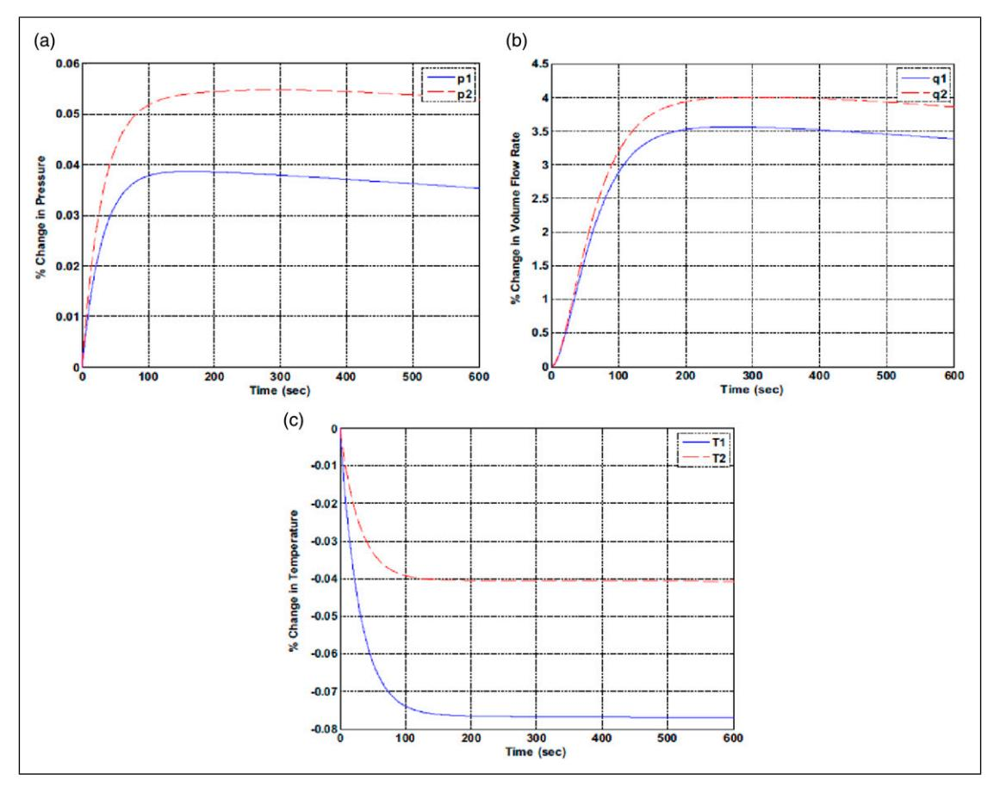

## تحسين أداء نظام التدفئة والتهوية وتكييف الهواء (HVAC) متعدد المتغيرات من خلال النمذجة الهجينة والتحكم بمصفوفة نايكويست المباشرة

Building Serv. Eng. Res. Technol. 2024, Vol. 45(6) 833–861 © The Author(s) 2024 Article reuse guidelines: [sagepub.com/journals-permissions](https://uk.sagepub.com/en-gb/journals-permissions) DOI:[ 10.1177/01436244241274107](https://doi.org/10.1177/01436244241274107) [journals.sagepub.com/home/bse](https://journals.sagepub.com/home/bse)

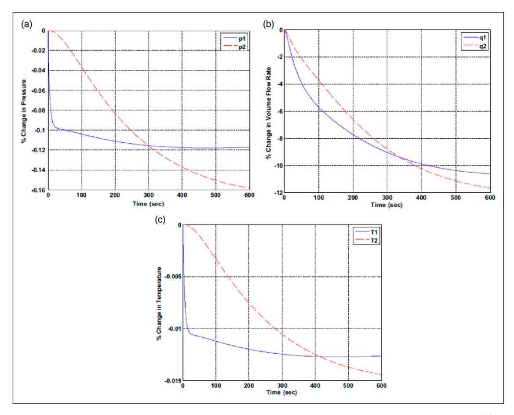

Basim Touqan1 and Alaa Abdul Ameer^1^

## الملخص

تستكشف هذه الدراسة نظام تحكم حلقة مغلقة متعدد المتغيرات لأنظمة HVAC. تم تطوير نموذج هجين يجمع بين المعامل الموزع والمعامل المُجمَّع باستخدام تطبيق System Identification في MATLAB، ما أسفر عن مصفوفة دالة تحويل. تم تطبيق استراتيجية التحكم Direct Nyquist Array (DNA)، التي تقسم نظام HVAC إلى حلقتين من نوع SISO، كل منهما مزودة بوحدات تحكم PID. أكد تحليل الاستقرار أن النظام مستقر وفق معيار نايكويست. أظهرت محاكاة النظام تحت تحكم DNA أداءً محسّنًا مقارنة بالإعداد ذي الحلقة المفتوحة، مع أزمنة استجابة أسرع تقارب 1 ثانية وتجاوزات (overshoot) تتراوح بين 7% و15%، مع الحفاظ على الراحة الحرارية ورضا الشاغلين. تعامل النظام بفعالية مع تغيرات انتقال الحرارة المحيطة، محافظًا على معدل تدفق الهواء ودرجة حرارته المطلوبين. أظهر إعداد الحلقة المغلقة متانة ضد الاضطرابات، إذ عاد بسرعة إلى قيم الحالة المستقرة. تراوحت أزمنة الاستقرار (settling time) بين 1 و2 ثانية بتأثير محدود على أداء HVAC. بشكل عام، أثبت التحكم متعدد المتغيرات ذو الحلقة المغلقة بنظام DNA مع وحدات تحكم PID من نوع SISO موثوقيته في تحسين كفاءة الطاقة والراحة الحرارية في أنظمة HVAC.

التطبيق العملي: تقدم هذه الدراسة إطارًا شاملًا للتحكم متعدد المتغيرات في أنظمة HVAC، ما يفيد بشكل كبير المتخصصين في البيئة العمرانية من خلال تحسين كفاءة الطاقة وراحة الشاغلين. من خلال تطبيق استراتيجيات تحكم متقدمة، يقدم البحث حلولًا عملية لتحسين أداء HVAC، وخفض التكاليف التشغيلية، وضمان الاستدامة في إدارة المباني. يمكن تطبيق التحليل والمنهجيات التفصيلية المقدَّمة مباشرة لتحسين موثوقية النظام واستجابته، ما يدعم المتخصصين في إنشاء بيئات عمرانية أكثر ذكاءً ومرونة وصداقة للبيئة.

## الكلمات المفتاحية

Multivariable control, system decoupling, direct nyquist array, PID control, system stability, disturbance rejection

Received 26 April 2024; Revised 21 July 2024; Accepted 28 July 2024

## المؤلف المراسل:

Basim Touqan, The British University in Dubai, Block 10 & 11, 1st and 2nd floor, Dubai International Academic City, Dubai 345015, United Arab Emirates.

Email: [basem.tuqan@buid.ac.ae](mailto:basem.tuqan@buid.ac.ae)

> ^1^ The British University in Dubai, Dubai, United Arab Emirates

<!-- page 2 -->

## المقدمة

تُعد أنظمة التدفئة والتهوية وتكييف الهواء (HVAC) عنصرًا أساسيًا في الحفاظ على الراحة الداخلية وجودة الهواء في مختلف البيئات، من السكنية إلى التجارية والصناعية. وقد صُممت هذه الأنظمة لتنظيم درجة الحرارة والرطوبة والتهوية وجودة الهواء، وهي حيوية للسلامة البدنية والراحة والإنتاجية وجودة الحياة عمومًا.1

تبرز عدة عوامل رئيسية أهمية أنظمة HVAC. فهي تستهلك ما يصل إلى 50% من طاقة المباني، ما يجعلها من كبار مستهلكي الطاقة.2 ومن المتوقع أن ينمو عدد تركيبات HVAC مدفوعًا بالتوسع الاقتصادي وتغير المناخ وارتفاع مستويات المعيشة.3,4

للحد من استهلاك الطاقة في قطاع المباني، تُقترح طرق غير مباشرة، مثل تقنيات العمارة السلبية،5 بما في ذلك العزل ووسائل التظليل والأسطح الخضراء.6 كما جرى استكشاف استراتيجيات تبريد مثل تحسين العزل والأسطح الخضراء وتقنية الخلايا الكهروضوئية.7 وتم أيضًا تناول إعادة تأهيل المباني من أجل كفاءة الطاقة والاستدامة.8 ورغم الجهود المبذولة لخفض استهلاك الطاقة في المباني، تبقى الحاجة إلى أنظمة HVAC حتمية بسبب ما توفره من راحة حرارية وجودة هواء عاليتين.

تتكون أنظمة HVAC، بطبيعتها المعقدة، من مكونات متعددة يجب أن تعمل بانسجام. إن الطابع متعدد المتغيرات لهذه الأنظمة، مع متغيرات مترابطة مثل معدل تدفق الهواء المؤثر في درجة الحرارة والضغط، يستلزم فهمًا شاملًا لتطبيق تحكم فعال في النظام. 10

تُعد أنظمة HVAC المصممة بشكل غير ملائم، بما في ذلك مشكلات التحكم، مصدرًا مستمرًا لعدم رضا المستخدمين فيما يتعلق بالأداء والصيانة واستهلاك الطاقة وارتفاع التكاليف التشغيلية. تسهم هندسة التحكم في الأنظمة بفعالية في تحقيق مبانٍ موفرة للطاقة من خلال مفاهيم وأساليب متعددة. ومن الضروري تطوير نموذج رياضي ديناميكي وموثوق يصف بدقة كيفية عمل مكونات النظام. وهذا ييسّر تطبيق نظام تحكم مناسب وفعال، ما يؤدي في النهاية إلى مبانٍ موفرة للطاقة. ومن المهم إدراك أن فعالية تقنيات

هندسة التحكم في الأنظمة تعتمد على موثوقية ودقة النموذج الرياضي للنظام، وكذلك على مدى ملاءمة وفعالية استراتيجية نظام التحكم.

ركزت عدة أبحاث على تحسين أداء وكفاءة أنظمة HVAC. فعلى سبيل المثال، استكشفت الدراسة 14 خوارزميات تحكم متقدمة لتعزيز كفاءة الطاقة، وقدمت نتائج بحثية عالجت بنجاح تفضيلات المستخدم من حيث الراحة الحرارية والإضاءة المثلى وجودة الهواء الداخلي وحفظ الطاقة. في الوقت نفسه، حسّنت صناعات مثل الثورة الصناعية الرابعة Industry 4.0، وهو مصطلح يشير إلى استخدام تقنيات متقدمة في مختلف الصناعات، موثوقية الأنظمة عبر الصيانة التنبؤية بالاستشعار الذكي والتقنيات المتقدمة. وتركز الدراسة 15 على تطبيق هذا النهج على أنظمة HVAC، مستهدفة في البداية درجة الحرارة واستهلاك الطاقة. وهذا يساعد الصناعات على إدارة آلاتها بكفاءة وفعالية أكبر، بما يتماشى مع مفهوم الثورة الصناعية الرابعة.

يُعد دمج الاستدامة في إدارة مشاريع HVAC أمرًا بالغ الأهمية مع تصاعد المخاوف البيئية. ورغم وجود تحديات مثل القيود التقنية والتكاليف والعوائق التنظيمية، تنشأ فرص من التقدم في أنظمة HVAC الموفرة للطاقة والشهادات الخضراء والمتطلبات التنظيمية. ومن خلال معالجة التحديات واستغلال الفرص، يمكن للمؤسسات تقليل الأثر البيئي وتحسين الكفاءة وقيادة إدارة مستدامة لمشاريع HVAC. 16

إضافة إلى ذلك، يُعد تصنيف تدفق المبرد المتغير (VRF) نظام HVAC مرنًا يضبط تدفق المبرد لتلبية احتياجات المستهلكين السكنيين. تهدف هذه المراجعة إلى تحديد مكونات أنظمة VRF المؤثرة في الأداء. تكشف التجارب السابقة أن ترتيبات الضاغط، وموضع صمام التمدد الإلكتروني (EEV)، وعمليات تدفق الهواء تؤثر في أداء النظام والراحة الحرارية. ويؤثر عدد المبخرات الداخلية المتصلة بالنظام في استجابته وحساسيته. ولأن أنظمة VRF السكنية واسعة النطاق لا تزال في مراحلها الأولى، يسهم البحث 17 في التطورات المستقبلية في هذا المجال.

<!-- page 3 -->

من جانب آخر، بحث الباحثون في دراسة حديثة[،18](#page-27-17) إمكانية تنسيق أنظمة تكييف الهواء السكنية لمواجهة ذروة الطلب على الكهرباء. ومن خلال تحليل بيانات من مجموعة متنوعة من المنازل، اكتشفوا أن تعديل توقيت ذروة الطلب يمكن أن يُحدث فرقًا كبيرًا في إجمالي استهلاك الطاقة. واستكشفوا مناهج مختلفة، منها الاستراتيجيات المركزية واللامركزية. ومن المثير للاهتمام أن الدراسة كشفت أن التحكم المركزي خفّض ذروة الطلب بنسبة 8.8%، لكنه أدى أيضًا إلى زيادة استهلاك الطاقة بنسبة 13.3%. في المقابل، حقق التحكم اللامركزي خفضًا بنسبة 5.7% في استهلاك الكهرباء. وتُبرز هذه النتائج أهمية تنسيق أنظمة تكييف الهواء لإدارة ذروة الطلب على الكهرباء بفعالية.

ورغم هذه التطورات، تبقى فجوة جوهرية في تطوير استراتيجيات تحكم قوية قادرة على إدارة الطابع الديناميكي متعدد المتغيرات لأنظمة HVAC. كانت النماذج التقليدية من نوع مدخل واحد-مخرج واحد (SISO) شائعة الاستخدام، لكنها تقصر عن استيعاب التفاعلات المعقدة داخل هذه الأنظمة. استكشفت دراسات حديثة، يُستعرض بعضها في مراجعة الأدبيات اللاحقة، نماذج من نوع مدخلات متعددة-مخرجات متعددة (MIMO). ورغم أن هذه النماذج تقدم تمثيلًا أكثر شمولًا، فإن تطبيقها العملي غالبًا ما تعيقه تحديات حسابية والحاجة إلى تقدير دقيق للمعاملات.

لمعالجة هذه الفجوات، تتبنى هذه الدراسة نهج نمذجة هجين يجمع بين المعامل الموزع والمعامل المُجمَّع لتمثيل ديناميكيات نظام HVAC بدقة. وبالاستفادة من استراتيجية التحكم Direct Nyquist Array (DNA)، يهدف البحث إلى فصل النظام متعدد المتغيرات إلى حلقات SISO يمكن إدارتها، ما يعزز الاستقرار والأداء. ويفتقر الأدب الحالي المتعلق باستخدام مصفوفة نايكويست متعددة المتغيرات للتحكم في HVAC إلى بحث محدد في هذا المجال. ويبني هذا النهج المبتكر على العمل التأسيسي لباحثين سابقين مع تقديم طريقة جديدة لتحقيق تحكم فعال وموثوق في نظام HVAC.

## تقنيات نمذجة HVAC

تُعد النماذج الرياضية مكونًا تصميميًا أساسيًا في هندسة التحكم بالأنظمة. فهي تحوّل

العمليات الصناعية الحقيقية إلى رياضيات. تُستخدم النماذج الرياضية على نطاق واسع في تطبيقات عديدة عبر مجالات متنوعة، منها الهندسة والبيئة والزراعة والطب والاقتصاد. ويكمن غرضها الأساسي في التنبؤ بأداء العمليات الواقعية المرتبطة بها وإدارته.[19](#page-27-18) إضافة إلى ذلك، تؤدي أدوارًا ثانوية متعددة مثل تدريب المشغلين والمحاكاة وتشخيص الأعطال، ومعالجة العمليات الصناعية التي يصعب تكرارها معمليًا لتحليل السلوك والقياس بسبب كبر حجم التطبيق الفعلي. وعلى وجه الخصوص، فإن حجم أنظمة HVAC، المعروفة بمكونات كبيرة مثل مجاري الهواء الطويلة وأحجام التهوية الكبيرة، غالبًا ما يجعلها غير مناسبة للدراسات المعملية التقليدية.[20](#page-28-0) والبديل العملي هو النمذجة الرياضية لهذه الأنظمة، رغم أن دقة هذه النماذج تؤثر بشكل كبير في موثوقية نتائج التنبؤ.

استعرض باحثون، أبرزهم[19](#page-27-18) و،[21](#page-28-1) ثلاثة أساليب نمذجة رياضية متمايزة. الأول يُعرف بالنموذج القائم على الفيزياء، أو ما يُسمى "النموذج الصندوق الأبيض". وفي هذا النهج، من المهم فهم كيفية عمل العملية بشكل جيد. تستخدم نماذج HVAC القائمة على الفيزياء عادةً معادلات حفظ الكتلة والطاقة، إلى جانب معادلات انتقال الحرارة. وتعتمد هذه الطريقة على فهم متين للعملية المدروسة. وقد اتبع هذا النهج[22](#page-28-2)، الذي يستخدم انتقال الرطوبة والحرارة المزدوج في جدران المبنى للتنبؤ بالظروف الحرارية الداخلية. يستخدم النموذج معادلات الحفظ وقوانين دارسي وفيك وفورييه لتحقيق الراحة الحرارية الداخلية. الميزة الرئيسية للنمذجة القائمة على الفيزياء هي قدرتها على التنبؤ الدقيق بكيفية عمل النظام وتقدير نتائجه. غير أن هناك عيبًا: يتطلب هذا النوع من النمذجة قدرًا كبيرًا من الحسابات الحاسوبية وجهدًا كبيرًا لإنشاء النموذج النهائي.[23](#page-28-3)

النهج الثاني للنمذجة هو النهج المعتمد على البيانات، ويُشار إليه غالبًا بـ"النموذج الصندوق الأسود". وقد اتبعه[24،](#page-28-4)[25](#page-28-5) و.[26](#page-28-6) تتسم أنظمة HVAC بالتعقيد وتتضمن العديد من المعاملات التي قد تجعل إنشاء نماذج بالطرق القائمة على الفيزياء أمرًا صعبًا. لذا، يُفضَّل أحيانًا استخدام النمذجة المعتمدة على البيانات أو "الصندوق الأسود" لأنها توفر طريقة أبسط لاشتقاق نماذج نظام HVAC. وهذا النهج،

<!-- page 4 -->

الذي يُطلق عليه غالبًا "عملية التعرف على الأنماط"، يركز على أداء النظام دون التعمق في التفاعلات الفيزيائية الداخلية. ومن خلال رصد المتغيرات عبر الزمن ووصف سلوك النظام، تُنشئ هذه المنهجية علاقة المدخل-المخرج لنموذج النظام. تُطبَّق بعد ذلك أساليب إحصائية وتعلم آلي متقدمة لتحليل البيانات بشكل شامل وتحديد الأنماط المميزة. وتشكل هذه الأنماط الأساس لاتخاذ تنبؤات أو قرارات مستنيرة بشأن سلوك نظام HVAC. ومن الجدير بالذكر أن الأساليب المعتمدة على البيانات، بتعلّمها من البيانات التاريخية، يمكنها التقاط علاقات معقدة يصعب وصفها عبر المعادلات التقليدية القائمة على الفيزياء. ويتفوق هذا النهج في التعامل مع السلوكيات المعقدة وغير الخطية، لكن أحد قيوده المحتملة هو اعتماده على جودة وكمية البيانات المتاحة، ما يؤثر في دقة التنبؤ.

أما التقنية الثالثة للنمذجة فهي نهج مركّب يدمج بين النمذجة المعتمدة على البيانات والنمذجة القائمة على الفيزياء، ويُطلق عليه غالبًا "النموذج الصندوق الرمادي". يتضمن الإجراء الموضح في الصندوق الرمادي استخدام معادلات قائمة على الفيزياء لبناء نموذج العملية. وفي الوقت نفسه، يمكن تحديد قيم المعاملات اللازمة لهذا النموذج من خلال بيانات مقاسة، متاحة إما من بيانات التشغيل الخاصة بالمُصنِّع في الكتالوج أو عبر إجراء تشغيل النظام. وقد ركز العمل في[27](#page-28-7) على نمذجة وحدات ملف التبريد، حيث استخدم المؤلفون معادلات متعلقة بانتقال الحرارة وكذلك توازن الكتلة والطاقة. اعتمد النموذج على ستة معاملات لالتقاط الخصائص غير الخطية للوحدة، ما يبسّط عملية معايرة النظام. ويمكن الحصول على هذه المعاملات إما من مواصفات المصنّع أو عبر وسائل تجريبية. لذا، فإن معرفة القوانين الفيزيائية للعملية الأساسية إلى جانب قيم المعاملات المناسبة هما الأساس الرئيسي لتقنية النمذجة بالصندوق الرمادي، التي توفر قدرة على التعميم ودقة جيدة تفوق تقنيات النمذجة الأخرى.

اعتمد جزء كبير من البحث في الأدبيات الحالية حول النماذج الرياضية لأنظمة HVAC بشكل أساسي على نهج نمذجة من نوع مدخل واحد-مخرج واحد (SISO). وتركز هذه النماذج بشكل أساسي على عزل مكونات محددة داخل نظام HVAC،

مثل الضاغط وملف التبريد ووحدة معالجة الهواء وغلاف المبنى، مع نمذجة كل مكون بشكل منفصل.[28،](#page-28-8)[29،](#page-28-9)[30](#page-28-10)[،31](#page-28-11) ومع ذلك، يُعرَّف نظام HVAC المتقدم بأنه نظام مركّب يضم مكونات وظيفية عديدة، ويشمل متغيرات مدخلات ومخرجات متعددة. ونظرًا لكونه أكثر خدمات المبنى استهلاكًا للطاقة، فمن الأجدى من الناحية العملية، ومن منظور استهلاك الطاقة، اعتبار نظام HVAC نظامًا متقدمًا ذا طابع متعدد المتغيرات. وأي تغيير في مدخل واحد للنظام له تأثير متسلسل على جميع مخرجات النظام، ما يبرر عملية نمذجة HVAC كنظام مدخلات متعددة-مخرجات متعددة (MIMO).[32](#page-28-12)

يكشف فحص مكونات منشأة HVAC أن أجزاءً معينة منها تتميز بأشكال نحيلة ذات نسب طول إلى قطر عالية. وهذا التمييز بالغ الأهمية لتطوير نماذج رياضية دقيقة، كما أكد.[33](#page-28-13) تُظهر العناصر النحيلة واسعة النطاق خصائص فيزيائية موزعة تُوصف بفعالية باستخدام نماذج أنظمة عناصر مترابطة وموزعة مكانيًا. وتستخدم هذه النماذج مجموعات من المعادلات الجبرية والتفاضلية لتمثيل العناصر الديناميكية، والتنبؤ باستجابات النظام للمدخلات أو الاضطرابات العشوائية. ونظرًا لأن الدقة في النماذج الرياضية أساسية لأداء النظام القوي في مواجهة المدخلات والاضطرابات المتغيرة، فإن تقنية النمذجة هذه تحقق هذا الهدف. تصبح نمذجة المعامل الموزع خيارًا عمليًا للنماذج الرياضية لـHVAC، وتشكل الأساس لتصميم التحكم والتحليل والدراسة. وينبع هذا الفهم من إدراك أن عناصر معينة في نظام HVAC، مثل مجاري الهواء والأحجام المهوّاة، تُظهر شكلًا نحيلًا. اتبع المؤلفون في[34](#page-28-14) هذا النهج، لذا فإن نموذجهم الهجين لـHVAC، الذي يجمع بين المعامل الموزع والمُجمَّع، يقدم نهجًا رياضيًا عمليًا يستخدم عناصر موزعة ومُجمَّعة معًا. يتضمن هذا النموذج عناصر معامل موزع موجَّهة بحجم التهوية الطويل، حيث تتوزع الخصائص الفيزيائية على طول نحافته. وتحاكي تقنية النمذجة هذه الواقع عن كثب من خلال تضمين عناصر تأخير زمني محدود، ما يسمح بانتشار الاستجابات عبر عناصر مترابطة وموزعة مكانيًا حتى تصل إلى الطرف النهائي للمخرج بتأخير زمني

<!-- page 5 -->

تراكمي في الانتشار. كما يتضمن النموذج نماذج مكونات مُجمَّعة، تركّز الخصائص الفيزيائية عند مركز الثقل. وهذه العناصر المُنمذَجة، مثل محركات المروحة ومضخة المياه المبرَّدة، تفتقر إلى الطابع النحيل ويمكن تمثيلها كعناصر مُجمَّعة بثوابت زمنية بسيطة دون المساس بالدقة.

وإذ تُقر هذه الدراسة بأهمية نموذج دقيق للغاية لنظام HVAC، فإنها تتبنى هذا التمييز بين النموذج الهجين للمعامل الموزع والمُجمَّع، وتنتقل إلى دراسة نموذج رياضي جاهز طوّره سابقًا.[34](#page-28-14) وسيكون هذا النموذج الأساس لتطبيق تقنية تحكم داخل محاكاة نظام HVAC.

ومع ذلك، يُظهر النموذج المختار الاستجابة الديناميكية للنظام لتغيرات المدخل عبر الزمن من خلال رسوم بيانية للاستجابة، لكنه لا يبني مصفوفة دالة التحويل، التي تشكل الأساس الجوهري لتطبيق تقنيات التحكم المناسبة لتنظيم أداء نظام HVAC بفعالية. سيتم توسيع نطاق العمل في[34](#page-28-14) في هذه الدراسة لاستخدام استجابات الزمن لاستخراج مصفوفة دالة التحويل المطلوبة.

وإذ تُقر هذه الدراسة بأهمية الدراسة المشار إليها في،[34](#page-28-14) التي تركز على اشتقاق تمثيل الأداء في المجال الزمني لنظام HVAC متعدد المتغيرات ذي الحلقة المفتوحة، فإنها تهدف إلى تقديم إسهام إضافي في هذا المجال. وقد تبيّن أنه رغم قيمة التمثيل في المجال الزمني، فمن الضروري بالقدر نفسه تطوير تمثيل للنظام في المجال الترددي لتمكين تطبيق استراتيجية تحكم مناسبة.

وتماشيًا مع هذا الهدف، تركز هذه الدراسة على توسيع فهم نموذج نظام HVAC عبر اشتقاق استجابات المجال الترددي. ولهذا الجانب من التحليل أهمية أكبر من حيث تطبيق استراتيجيات التحكم بفعالية. ومن خلال دراسة المجال الترددي، يمكن اكتساب رؤى أعمق حول سلوك النظام، ويمكن تصميم آليات تحكم فعالة لتحسين الأداء.

لذلك، تبني هذه الدراسة على الأساس الذي أرسته الدراسة في[34](#page-28-14) ليس فقط باشتقاق استجابات المجال الزمني بل أيضًا بالتركيز على اشتقاق تمثيل النظام في المجال الترددي. ويتيح هذا النهج لمهندسي التحكم

تقديم منظور أكثر شمولًا وصلة بديناميكيات نظام HVAC ومتطلبات التحكم به.

## تقنيات التحكم في HVAC

استراتيجية التحكم لا تقل أهمية عن النمذجة الرياضية لأنها تتجاوز التنبؤ إلى التشكيل الفعلي لسلوك النظام في الزمن الحقيقي. تتنبأ النماذج الرياضية بكيفية عمل الأنظمة، لكن استراتيجيات التحكم تحسّن الأداء، وتتكيف مع التغيرات، وتصحح الأخطاء، وتضمن السلامة، وتوفر الطاقة، وتتعامل مع التعقيد، وتجري تعديلات في الزمن الحقيقي. فهي تربط بين النظرية والتطبيق، وتضمن عمل الأنظمة بفعالية رغم أوجه عدم اليقين، وهو أمر بالغ الأهمية خصوصًا في أنظمة معقدة مثل HVAC.

استُخدمت وحدات تحكم كلاسيكية في أنظمة HVAC بتقنيات تحكم بسيطة. الإجراء الكلاسيكي "تشغيل-إيقاف" (ON-OFF) بالتغذية الراجعة عبر الثرمستور شائع في بعض المباني السكنية حيث يمكن أن يكون نظام التحكم إما "إيقاف" أو "تشغيل". يُغلق الثرمستور عندما تصل درجة الحرارة إلى نقطة معايرة، ويعمل عندما تكون درجة الحرارة الداخلية أعلى من تلك النقطة. غير أنه على الرغم من بساطة طريقة التحكم البديهية هذه، فإنها تعطي أداءً ضعيفًا بسبب خطأ الحالة المستقرة والتذبذب حول نقطة الضبط الذي يحدث في معظم الحالات.

يُعد التحكم النسبي-التكاملي-التفاضلي (PID) استراتيجية تحكم كلاسيكية أكثر تقدمًا وقد استُخدم في أنظمة HVAC. وهو يعطي نتائج جيدة عند ضبطه وفق ظروف تشغيل محددة. ومثال على تقنية التحكم هذه اتبعه.[27](#page-28-7) فقد طوّروا نموذجًا رياضيًا لملف تبريد HVAC وقاموا بتخطيطه (linearize) بطريقة مصفوفة جاكوبيان، ثم طبقوا تحكم PID كنظام تحكم خطي. هيمنت وحدات تحكم PID على مشكلة التحكم بالعمليات لنحو 50 عامًا.[35](#page-28-15) وبإمكانها توفير سلوك جيد للنظام من حيث خطأ الحالة المستقرة، والتذبذب، وهامش الاستقرار، وزمن الاستجابة، ورفض الاضطرابات. غير أن ضبط وحدة تحكم PID قد يكون صعبًا ومكلفًا ومستهلكًا للوقت.[36](#page-28-16) يمكن أن تكون وحدة تحكم PID حلًا جيدًا عندما تكون مقيدة بظرف تشغيل ثابت محدد، لكن مع تغير ظروف التشغيل بسبب تغيرات في بعض الخصائص الفيزيائية

<!-- page 6 -->

مع مرور الوقت، يجب إعادة ضبطها للظرف (أو الظروف) الجديدة، وهذا يصبح عملية مرهقة تستهلك جهدًا إضافيًا.

يتكون نظام HVAC المتقدم من عمليات مترابطة عديدة ذات مدخلات ومخرجات متنوعة. وهذا يعني أن مدخلات مختلفة تؤثر في مخرجات مختلفة، لذا فإن كون HVAC نظامًا ذا مدخلات ومخرجات متعددة (MIMO) هو خاصية متأصلة فيه. ويأتي التحدي الرئيسي في التحكم بنظام معقد كهذا من التفاعل الداخلي بين حلقات النظام. ويمكن لهذه التفاعلات أن تؤثر في استقرار النظام، بخلاف الأنظمة الأبسط ذات مدخل ومخرج واحد فقط (SISO).

استُخدمت وحدات تحكم MIMO عديدة في أنظمة HVAC. وستُجرى في المناقشات التالية مراجعة أدبيات بشأنها. التحكم القوي (Robust control) هو جزء من نظريات التحكم يركز على تصميم أنظمة تحكم قادرة على الحفاظ على أداء واستقرار جيدين في وجود أوجه عدم يقين وتغيرات في مدخلات النظام. وتشمل التقنيات الشائعة في التحكم القوي: التحكم H-infinity، وتقنية mu-synthesis، وتصميم عناصر تحكم قوية استنادًا إلى تحليل أسوأ الحالات. وتتيح هذه الأساليب معالجة أوجه عدم اليقين في النظام وتطوير وحدات تحكم يمكنها التعامل معها بفعالية، مع ضمان الاستقرار والأداء القوي.

بحثت الورقة في[37](#page-28-17) فعالية وحدات تحكم MIMO القوية في تحسين أداء نظام HVAC مقارنة بحلقات تحكم من نوع مدخل واحد-مخرج واحد. ومن خلال المحاكاة والتجريب، حللت الفوائد والقيود المحتملة لمنهجية التحكم MIMO. وأظهرت النتائج تحسينات كبيرة في الأداء، بما في ذلك خفض بنسبة تزيد على 300% في زمن استقرار درجة حرارة هواء التصريف، دون الحاجة إلى تغييرات كبيرة في بنية النظام. غير أن أحد التحديات المحتملة لوحدات تحكم MIMO القوية هو تعقيد تصميمها وتنفيذها، ما يتطلب فهمًا عميقًا لديناميكيات النظام وأوجه عدم اليقين. وقد يشكل هذا التعقيد تحديات في التطبيقات الواقعية، بما في ذلك متطلبات حسابية أكبر، وتكاليف تطوير أعلى، والحاجة إلى خبرة متخصصة. كما يمكن أن يكون ضبط هذه الوحدات لتحقيق الاستقرار عبر ظروف تشغيل متنوعة مهمة صعبة.

حظي التحكم التكيفي (Adaptive control)، كتقنية متعددة المتغيرات، باهتمام أيضًا في أدبيات التحكم الآلي. بحثت الورقة في [38](#page-28-18) تطبيق وحدة تحكم تكيفية متعددة المتغيرات قائمة على نظرية LQR في أنظمة HVAC، مع التركيز تحديدًا على نظام تدفئة ذي منطقتين بوحدة مروحة-ملف (fan-coil). وأبرزت النتائج الرئيسية قدرة وحدة التحكم على الحفاظ على درجات حرارة المناطق ودرجات حرارة الغلاية قريبة من نقاط ضبطها رغم تغيرات الاضطرابات، كما تبيّن من نتائج المحاكاة. وتكمن مشكلة رئيسية في هذه الطريقة في أنها تحتاج إلى معرفة دقيقة لكيفية عمل النظام. تعمل وحدات تحكم LQR على أفضل وجه عندما نعرف بدقة كيفية تصرف كل شيء في النظام. لكن في الواقع، يصعب امتلاك نموذج مثالي لأن الأمور قد تتغير، أو قد لا نعرف كل شيء عن كيفية عمل النظام.

وفي السياق نفسه، جرى أيضًا استكشاف التحكم التنبؤي لمعالجة التحكم متعدد المتغيرات في HVAC.[39](#page-28-19) قدّم العمل نهج تحكم تنبؤي جديدًا متعدد المتغيرات ومقيَّدًا لإدارة الحمل المباشر السكني لـHVAC، بهدف تحسين الأهداف الاقتصادية والتقنية مع مراعاة راحة العملاء وقيود النظام. ومن خلال نظام حلقة مغلقة، تعدّل خوارزمية التحكم ملف الحمل المستهدف ديناميكيًا في الزمن الحقيقي، ما يقلل الانحرافات عن منحنيات الحمل المحددة مسبقًا. ويبرز التطبيق العملي عبر سيناريوهات متنوعة متانة النظام وقدرته على التكيف. ويكمن التحدي في تنفيذ استراتيجية تحكم تنبؤي متعدد المتغيرات للتحكم المباشر بالحمل السكني لـHVAC في تحقيق التوازن بين الأهداف الاقتصادية والتقنية وأهداف العملاء، ما يتطلب ضبطًا دقيقًا وقدرة على التكيف ونمذجة دقيقة ومعالجة للأخطاء.

جرى بحث تقنية أخرى للتحكم متعدد المتغيرات في HVAC في[،40](#page-28-20) حيث استخدم المؤلفون إجراء فصل (decoupling). فقد استخدموا تقنية تشكيل الحلقة H-infinity ضمن تصميم التحكم التنبؤي بالنموذج (MPC) التي تقترح شكلًا من الفصل. ومن خلال تشكيل الحلقة في المجال الترددي وتحسين هوامش الاستقرار، هدف التصميم إلى تخفيف التفاعلات بين المتغيرات المختلفة في النظام، وهو هدف شائع لاستراتيجيات الفصل. وقد صمم العمل بنية تغذية راجعة للحالة مبنية على مراقب (observer-based) من خلال تركيب تشكيل الحلقة، وهي تقنية غالبًا ما

<!-- page 7 -->

تُستخدم لتقليل التفاعلات وتحسين أداء التحكم في الأنظمة متعددة المتغيرات. غير أن تطبيق تشكيل الحلقة H-infinity والاعتماد على تغذية راجعة للحالة مبنية على مراقب غالبًا ما يجعل التصميم والإعداد أكثر تعقيدًا. وقد يتطلب هذا مهارات متخصصة للضبط والاستخدام العملي. إضافة إلى ذلك، فإن حل مسألة التحكم الأمثل العكسي والتعامل مع التعديلات القائمة على التردد لأوزان المدخل والمخرج قد يستلزم متطلبات حسابية. وهذا بدوره قد يخلق صعوبات في قدرة التقنية على التكيف والعمل بسلاسة في سيناريوهات الزمن الحقيقي.

طريقة التحكم بمصفوفة نايكويست (Nyquist-Array)، التي نشأت في خلفية تعليمية بريطانية وتُقدَّم بصيغتين مباشرة وعكسية، هي استراتيجية تحكم متعددة المتغيرات تدمج الجبر الحديث مع العمليات التحليلية لنظرية التحكم الكلاسيكية. تقلل هذه الطريقة بفعالية الاقتران الداخلي ضمن الحلقات الداخلية للنموذج متعدد المتغيرات، وتوفر نهجًا عمليًا وفعالًا للتحكم في العمليات الصناعية مثل أنظمة HVAC. وتتضمن الخطوة الأولية فصل التفاعلات الداخلية بين مخرجات النظام، ما ينتج عنه عدد من أنظمة مدخل واحد-مخرج واحد (SISO) يساوي عدد مخرجات النظام. ويتطلب تطبيق استراتيجية التحكم بمصفوفة نايكويست متعددة المتغيرات لفصل التفاعلات الداخلية بين مخرجات النظام تطوير مصفوفة معوّض فصل. ويمكن بعد ذلك تطبيق وحدات تحكم PID على كل نظام SISO منفصل، ما يؤدي إلى نظام حسن السلوك يتميز بأزمنة استجابة سريعة، وخطأ حالة مستقرة ضئيل، ورفض عالٍ للاضطرابات.

يفتقر الأدب الحالي المتعلق باستخدام مصفوفة نايكويست متعددة المتغيرات للتحكم في HVAC إلى بحث محدد في هذا المجال. ونظرًا للمزايا التي توفرها، هناك دافع لمزيد من الدراسة عند تطبيقها على نموذج HVAC متعدد المتغيرات. ورغم أن إيجاد مصفوفة المعوّض ليس أمرًا مباشرًا، تختار هذه الدراسة تقنية التحكم Direct Nyquist Array (DNA) بسبب فعاليتها في تقليل التفاعلات الداخلية للنظام، ما يعزز الاستقرار والاستجابات العابرة وفي الحالة المستقرة. ويتيح DNA تطبيق وحدات تحكم تغذية راجعة قياسية من نوع مدخل واحد-مخرج واحد (SISO) عبر تقليل التفاعلات الداخلية.

وبمجرد إرساء استراتيجية التحكم DNA، فإنها تمتلك إمكانية الأتمتة والدمج في أنظمة إدارة المباني لتشغيل ذاتي لـHVAC. وينبغي أن يتضمن العمل المستقبلي مقارنة احترافية مع تقنيات أخرى لإبراز مزاياها وعيوبها المحتملة.

## منهجية البحث

يوضح هذا القسم النهج المنهجي والأساليب المستخدمة في الدراسة، بما في ذلك عملية استخراج مصفوفة دالة التحويل، وتطبيق تقنية تحكم متعددة المتغيرات، والحصول على النتائج لتقييم أداء النظام.

## اشتقاق مصفوفة دالة التحويل

سيتم تناول ومعالجة نموذج نظام HVAC متعدد المتغيرات المقدَّم في الدراسة المشار إليها كـ34. يمثل الشكل 1 بصريًا مختلف مكونات وروابط نظام HVAC متعدد المتغيرات ذي الصلة. ويوضح المكونات الوظيفية للنظام إضافة إلى مدخلاته ومخرجاته، ما يتيح فهمًا أفضل لعمله.

يعتمد نظام HVAC متعدد المتغيرات في هذا النموذج على مدخلين رئيسيين: الجهد الكهربائي عند مروحتي الدخول والخروج v_{fans}(s)، والجهد عند مضخة المياه المبرَّدة v_{wp}(s). ويؤدي هذان المدخلان دورًا مهمًا في تنظيم أداء النظام. إضافة إلى ذلك، يخضع النظام لمدخل اضطراب، وهو انتقال الحرارة إلى الحجم المُهوَّى Q(s). ويمكن أن يؤثر هذا الاضطراب في الأداء العام للنظام ويجب أخذه في الاعتبار أثناء التحليل والتحكم. ويمكن سرد هذه المخرجات على النحو التالي:

v_{fans}(s): الجهد المُدخَل المطبَّق في آن واحد عند دخول وخروج المراوح [V].

v_{wp}(s): الجهد المُدخَل المطبَّق عند مضخة المياه المبرَّدة [V].

Q(s): مدخل الاضطراب الناتج عن انتقال الحرارة المحيطة إلى الحجم المُهوَّى [J].

تتعلق مخرجات نظام HVAC متعدد المتغيرات بشكل أساسي بتدفق الهواء داخل النظام.

<!-- page 8 -->

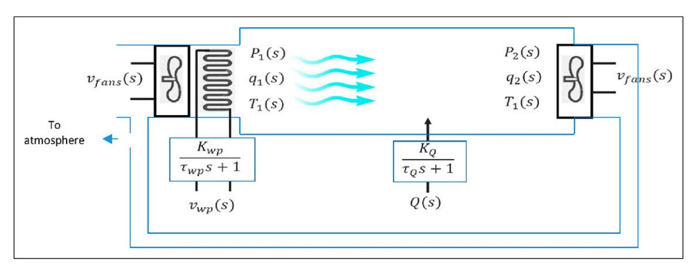
*Figure 1. HVAC long ventilated volume plant.*

تشمل هذه المخرجات معدل تدفق الهواء وضغطه ودرجة حرارته عند مدخل الحجم المُهوَّى ومخرجه. وتوفر هذه القياسات معلومات قيّمة عن كفاءة النظام وفعاليته. ويمكن سرد هذه المخرجات على النحو التالي:

P_1(s): مخرج ضغط الهواء عند مدخل الحيز الداخلي المُهوَّى [Pa]

P_2(s): مخرج ضغط الهواء عند مخرج الحيز الداخلي المُهوَّى [Pa]

q_1(s): مخرج معدل حجم تدفق الهواء عند مدخل الحيز الداخلي المُهوَّى [m^3/_{S}].

q_2(s): مخرج معدل حجم تدفق الهواء عند مخرج الحيز الداخلي المُهوَّى \left[m^3/s\right].

T_1(s): مخرج درجة حرارة الهواء عند مدخل الحجم الداخلي المُهوَّى. [°C].

T_2(s): مخرج درجة حرارة الهواء عند مخرج الحجم الداخلي المُهوَّى. [{}^{\circ}C].

في الدراسة المشار إليها بـ34، تُوصَف النتائج الرئيسية عبر رسوم بيانية للاستجابة الزمنية تمثل تغير متغيرات مخرجات معدل حجم تدفق الهواء والضغط ودرجة الحرارة عبر الزمن. وتخدم هذه الرسوم غرض تصور السلوك الديناميكي لأنظمة HVAC.

توضح الأشكال 2 و3 و4 استجابات نظام منشأة HVAC المبيّنة في الشكل 1. توفر هذه

الاستجابات رؤى مهمة حول ديناميكيات النظام وسلوكه، وهي ضرورية لفهم عمله. ومع ذلك، ورغم أهمية هذه الرؤى، فهي وحدها لا تكفي لتطبيق تقنية تحكم مناسبة لضمان الراحة الحرارية الداخلية المثلى وكفاءة الطاقة. ومن هنا، يصبح اشتقاق مصفوفة دالة التحويل ضروريًا لتحقيق هذه الأهداف. وتُعد هذه المصفوفة عنصرًا رئيسيًا في تحقيق تنظيم ومعالجة دقيقين لهذه السلوكيات من خلال تطبيق نظام تحكم بحلقة مغلقة، يعتمد بشكل أساسي على مصفوفة دالة التحويل. وهي تمثل العلاقة بين مخرج ومدخل نظام خطي في متغير لابلاس "s". وتُظهر كيف يرتبط تحويل لابلاس لإشارة المخرج بتحويل لابلاس لإشارة المدخل. وتساعد دوال التحويل مهندسي الأنظمة في تحليل ديناميكيات النظام، وتصميم وحدات التحكم، وتقييم الاستقرار، وتقييم الأداء بكفاءة. وتوفر رؤى بالغة الأهمية حول سلوك النظام، ما ييسّر جهود التحسين.

ستكون برمجيات WebPlotDigital وMATLAB الأدوات البحثية الرئيسية المستخدمة لإجراء الحسابات المتعلقة باشتقاق مصفوفة دالة التحويل.

WebPlotDigitizer، وهو برنامج متعدد الاستخدامات، يبسّط استخراج البيانات بدقة من صيغ رسوم بيانية متنوعة. وسيُستخدم لاستخراج بيانات رقمية، وتحديدًا إحداثيات (x,y)، من الرسوم البيانية الزمنية

<!-- page 9 -->

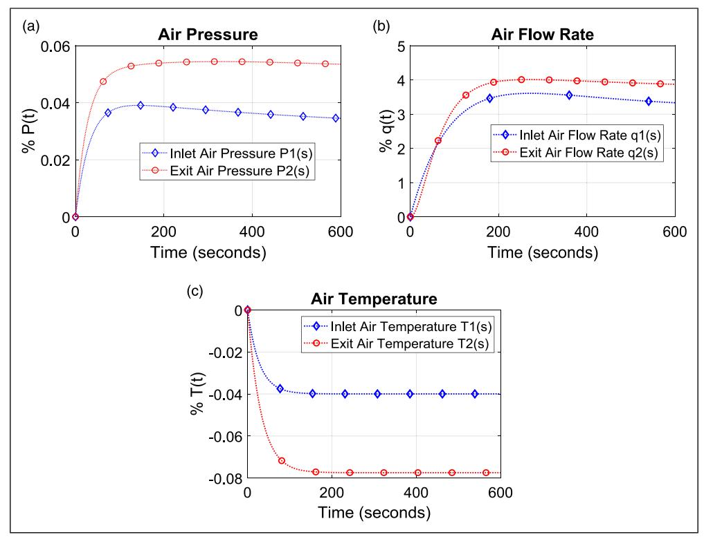
*Figure 2. System output responses when a 1% change is applied to the fans' voltage vfansðsÞ. (a) Air Pressure P1ðsÞ and ^P^2ðsÞ: (b) Air flow Rate ^q^1ðs^Þ^ and ^q^2ðsÞ. (c) Air Temperature ^T^1ðs^Þ^ and ^T^2ðsÞ.*

الواردة في [الأشكال 2،](#page-8-0) [3](#page-9-0)، و[4.](#page-10-0) وتتيح هذه الأداة سهلة الاستخدام تحميل الصور بسهولة، وضبط مقاييس المحاور، وتحديد نقاط الإحداثيات، وتحويل البيانات إلى جداول Excel لمزيد من التحليل. توضح [الجداول 1،](#page-11-0) [2](#page-12-0) و[3](#page-13-0) البيانات الرقمية لهذه الاستجابات المستخرجة بواسطة WebPlotDigitizer.

الخطوة التالية هي استيراد البيانات الرقمية إلى برنامج MATLAB لاشتقاق عنصر دالة التحويل لكل منحنى استجابة زمنية.

MATLAB هو لغة برمجة عالية المستوى وبيئة تفاعلية مخصصة أساسًا للحساب العددي والتصور وتطوير الخوارزميات. ويتضمن مجموعة متنوعة من الحزم المتخصصة

الموجَّهة لمهام مثل معالجة الإشارات، وتعريف الأنظمة (system identification)، ومعالجة الصور، وتصميم أنظمة التحكم، والتحسين، والإحصاء، ما يوسّع قدراته. تُستخدم حزمة System Identification Toolbox في MATLAB لاستخراج عناصر دالة التحويل بتمثيلات متغير لابلاس "s". وتتألف عملية الاستخراج هذه من خطوتين رئيسيتين. أولًا، تُدخَل إحداثيات (x, y) المحددة التي تم الحصول عليها من برنامج WebPlotDigitizer إلى تطبيق System Identification Toolbox في MATLAB كمجموعة بيانات معلومات في المجال الزمني. بعد ذلك، في الخطوة الثانية، يقدّر تطبيق MATLAB دالة التحويل للاستجابة استنادًا إلى اختيار المستخدم لـ

<!-- page 10 -->

***Figure 3.** System output responses when a 1% step input change is applied to the voltage of chilled water pump v_{wp}(s). (a) Air Pressure P_1(s) and P_2(s). (b) Air flow Rate q_1(s) and q_2(s). (c) Air Temperature T_1(s) and T_2(s).*

عدد الأصفار والأقطاب. وتتألف دالة التحويل الناتجة من معاملات محددة، أهمها معاملات كثيرات حدود البسط والمقام. إضافة إلى ذلك، تقدم نسبة ملاءمة للبيانات، تشير إلى مدى تطابق دالة التحويل مع بيانات المجال الزمني المُدخَلة إلى النظام.

باستخدام إحداثيات (x, y) المستخلصة من WebPlotDigitizer الجدول (1) وباستخدام حزمة System Identification Toolbox في MATLAB وفقًا لذلك، قدّر MATLAB دوال تحويل استجابات نظام HVAC. وهذه المخرجات هي ضغط الهواء P_1(t)، ومعدل تدفق الهواء q_1(t)، ودرجة حرارة الهواء T_1(t) عند المدخل، وكذلك ضغط الهواء P_2(t)، ومعدل تدفق الهواء q_2(t)، ودرجة حرارة الهواء T_2(t) عند مخرج الحجم المُهوَّى. وللتمييز بين تكوينَي

نظام HVAC، من الضروري ملاحظة أن عناصر دالة التحويل ذات الصلة تُشار إليها بـ g_{ij}(s) عند اعتبار P_1(t) وq_1(t) وT_1(t) متغيرات المخرج المُتحكَّم بها عند مدخل الحجم المُهوَّى، في حين تُشار إليها بـ G_{ij}(s) عند اعتبار P_2(t) وq_2(t) وT_2(t) متغيرات المخرج المُتحكَّم بها عند مخرج الحجم المُهوَّى

يقدّر MATLAB System Identification Toolbox استجابات المخرج عند تطبيق تغيير بنسبة 1% في مدخل جهد مروحتي الدخول والخروج v_{fans}(t) مع بقاء المدخلات الأخرى صفرًا، على النحو التالي:

$$
g_{P_1}(s) = g_{11}(s) = \frac{0.001297 s + 1.346 \times 10^{-6}}{s^2 + 0.03282 s + 4.602 \times 10^{-5}}
$$

<!-- page 11 -->

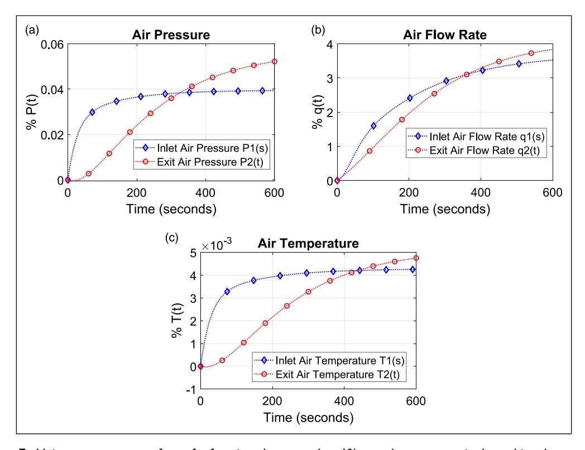
***Figure 4.** System output responses when a 1% change is occurred to ambient heat transfer Q(s). (a) Air Pressure P_1(s) and P_2(s). (b) Air flow Rate q_1(s) and q_2(s). (c) Air Temperature T_1(s) and T_2(s).*

$$
g_{q_1}(s) = g_{21}(s) = \frac{0.04869 s + 0.0001581}{s^2 + 0.01503 s + 4.971 \times 10^{-5}}
g_{T_1}(s) = g_{31}(s) = \frac{-0.001442 s - 0.0003499}{s^2 + 0.2794 s + 0.008757}
g_{P_2}(s) = G_{11}(s)
= \frac{0.001913 + 8.542 \times 10^{-6} s + 6.868 \times 10^{-8}}{s^3 + 0.04089 s^2 + 0.0001887 s + 1.291 \times 10^{-6}}
g_{q_2}(s) = G_{21}(s)
= \frac{-0.002699 s^2 + 0.003785 s + 5.021 \times 10^{-6}}{s^3 + 0.06604 s^2 + 0.001003 s + 1.389 \times 10^{-6}}
$$

$$
g_{T_2}(s) = G_{31}(s) = \frac{-0.002396 \,\mathrm{s} \,-\, 9.278 \times 10^{-5}}{s^2 + 0.06843 \,\mathrm{s} + 0.001198}
$$

حيث:

g_{P_1}(s): عنصر دالة التحويل لاستجابة معدل تدفق الهواء P_1(t) عند مدخل الحجم المُهوَّى عندما v_{fans}(s) = 1 وباقي المدخلات صفر

g_{q_1}(s): عنصر دالة التحويل لاستجابة معدل تدفق الهواء q_1(t) عند مدخل الحجم المُهوَّى عندما v_{fans}(s)=1 وباقي المدخلات صفر

<!-- page 12 -->

g_{T_1}(s): عنصر دالة التحويل لاستجابة درجة حرارة الهواء T_1(t) عند مدخل الحجم المُهوَّى عندما v_{fans}(s) = 1 وباقي المدخلات صفر

g_{P_2}(s): عنصر دالة التحويل لاستجابة ضغط الهواء P_2(t) عند مخرج الحجم المُهوَّى عندما v_{fans}(s) = 1 وباقي المدخلات صفر

g_{q_2}(s): عنصر دالة التحويل لاستجابة معدل تدفق الهواء q_2(t) عند مخرج الحجم المُهوَّى عندما v_{fans}(s) = 1 وباقي المدخلات صفر

g_{T_2}(s): عنصر دالة التحويل لاستجابة درجة حرارة الهواء T_2(t) عند مخرج الحجم المُهوَّى عندما v_{fans}(s) = 1 وباقي المدخلات صفر

يصف كل عنصر من عناصر دالة التحويل سلوك الاستجابة، ومن المتوقع أن

يتوافق مع نظيره في الشكل 2. ولفحص ذلك، يُطبَّق مدخل خطوة وحدوية على كل عنصر من دالة التحويل لتحليل سلوكه الديناميكي، ثم يُصوَّر باستخدام MATLAB. رُسمت استجابات الخطوة لدوال التحويل هذه وعُرضت في الشكل 5.

عند فحص هذه الاستجابات الرسومية، يتضح أنها تتطابق تقريبًا مع نظيراتها في الشكل 2، ما يؤكد التمثيل الدقيق لاستجابات النظام بواسطة عناصر دالة التحويل.

باستخدام نهج موحد استنادًا إلى بيانات الجدول (2)، قُدِّرت دوال التحويل بواسطة System Identification Toolbox في MATLAB لاستجابات ضغط الهواء ومعدل التدفق ودرجة الحرارة عند كل من مدخل الحجم المُهوَّى ومخرجه. وقد نتجت هذه الاستجابات عن تغيير بنسبة 1% في الجهد

<!-- page 13 -->

| Table 2. | **HVAC** | numeric | responses | when | unity | step | input i | s applied | on | chilled | water | pump | voltage 1 | v_{wb}(t). |
| --- | --- | --- | --- | --- | --- | --- | --- | --- | --- | --- | --- | --- | --- | --- |
|  |  |  |  |  |  |  |  |  |  |  |  |  |  |  |

| t | Pı | P~2~ | qı | q_2 | Tı | T~2~ |
| --- | --- | --- | --- | --- | --- | --- |
| 0 | 0 | 0 | 0 | 0 | 0 | 0 |
| 25 | −0.0983 I | -0.00443 | -2.02105 | -1.09474 | -0.01051 | -0.00027 |
| 50 | -0.10053 | -0.01326 | -3.87368 | -2.10526 | -0.01074 | -0.00109 |
| 75 | -0.10231 | -0.02386 | -4.96842 | -2.90526 | -0.01097 | -0.0022\mathrm{I} |
| 100 | -0.10453 | -0.03754 | -5.72632 | -3.74737 | -0.01117 | -0.00326 |
| 125 | -0.10587 | -0.04946 | -6.35789 | -4.46316 | -0.0114 | -0.00435 |
| 150 | -0.10809 | -0.06005 | -6.86316 | -5.22105 | -0.01156 | -0.00547 |
| 175 | -0.10988 | -0.07197 | -7.32632 | -5.97895 | -0.01176 | -0.00652 |
| 200 | -0.11122 | -0.0830\mathrm{I} | -7.74737 | -6.65263 | -0.01195 | -0.00749 |
| 225 | -0.113 | -0.09184 | -8.16842 | **-7.2** | -0.01211 | -0.00835 |
| 250 | -0.1139 | -0.10068 | -8.46316 | -7.83158 | -0.01219 | -0.00916 |
| 275 | -0.1148 | -0.10819 | -8.75789 | -8.33684 | -0.01234 | -0.0099 |
| 300 | -0.1157 | -0.11614 | -9.09474 | -8.8 | -0.0125 | -0.01048 |
| 325 | -0.1166 | -0.12189 | -9.30526 | -9.22105 | -0.0125 | -0.01103 |
| 350 | -0.1175 | -0.12719 | -9.51579 | -9.64211 | -0.01258 | -0.01157 |
| 375 | -0.11752 | -0.1325 | -9.76842 | -10.0211 | -0.01262 | -0.01204 |
| 400 | -0.11842 | -0.13737 | -9.93684 | -10.2737 | -0.01262 | -0.01243 |
| 425 | -0.118 | -0.14136 | -10.1053 | -10.5263 | -0.01266 | -0.01278 |
| 450 | -0.11845 | -0.1449 | -10.1895 | -10.7789 | -0.01266 | -0.01313 |
| 475 | -0.11847 | -0.14756 | -10.2737 | -10.9895 | -0.01271 | -0.01344 |
| 500 | -0.11849 | -0.15067 | -10.3579 | -11.2 | -0.01271 | -0.01368 |
| 525 | -0.11851 | -0.15333 | -10.5263 | -11.3684 | -0.01267 | -0.01391 |
| 550 | -0.11765 | -0.15555 | -10.5263 | -11.4526 | -0.01263 | -0.01407 |
| 575 | -0.11767 | -0.15689 | -10.5684 | **-11.5789** | -0.01263 | -0.01422 |
| 600 | -0.11768 | -0.15824 | -10.6105 | −I1.7053 | -0.0126 | -0.01438 |

لمضخة المياه المبرَّدة v_{wp}(t) بينما بقيت المدخلات الأخرى صفرًا.

$$
\begin{split} \mathbf{g}_{P_1}(s) &= \mathbf{g}_{12}(s) \\ &= \frac{-0.02354 \, s^2 \, - \, 0.0001643 \, \mathbf{s} \, - \, 1.037 \times 10^{-6}}{s^3 + 0.249 \, s^2 + 0.00155 \, \mathbf{s} + 9.039 \times 10^{-6}} \\ \mathbf{g}_{q_1}(s) &= \mathbf{g}_{22}(s) = \frac{-0.1125 \, \mathbf{s} \, - \, 0.00131}{s^2 + 0.03056 \, \mathbf{s} + 0.0001161} \end{split}
$$

$$
g_{T_1}(s) = g_{32}(s)
= \frac{-0.002324 \,\text{s}^2 - 2.025\text{e} - 05\,\text{s} - 1.349 \times 10^{-7}}{s^3 + 0.2317 \,s^2 + 0.001843\,\text{s} + 1.086 \times 10^{-5}}
$$

$$
g_{P_2}(s) = G_{12}(s)
= \frac{7.519 \times 10^{-5} s^2 - 5.647 \times 10^{-5} s - 1.29 \times 10^{-5}}{s^2 + 0.02025 s + 7.497 \times 10^{-5}}
$$

$$
g_{q_2}(s) = G_{22}(s) = \frac{-0.04063 \,\mathrm{s} \, - \, 8.813 \mathrm{e} - 05}{s^2 + 0.003966 \,\mathrm{s} + 9.501 \mathrm{e} - 06}
$$

$$
g_{T_2}(s) = G_{32}(s) = \frac{1.863 \times 10^{-6} s - 1.27 \times 10^{-6}}{s^2 + 0.02171 s + 8.132 \times 10^{-5}}
$$

حيث:

g_{P_1}(s): عنصر دالة التحويل لاستجابة ضغط الهواء P_1(t) عند مدخل الحجم المُهوَّى عندما v_{wp}(s) = 1 وباقي المدخلات صفر

\mathbf{g}_{q_1}(s): عنصر دالة التحويل لاستجابة معدل تدفق الهواء q_1(t) عند مدخل الحجم المُهوَّى عندما v_{wp}(s)=1 وباقي المدخلات صفر

<!-- page 14 -->

g_{T_1}(s): عنصر دالة التحويل لاستجابة درجة حرارة الهواء T_1(t) عند مدخل الحجم المُهوَّى عندما v_{wp}(s) = 1 وباقي المدخلات صفر

g_{P_2}(s): عنصر دالة التحويل لاستجابة ضغط الهواء P_2(t) عند مخرج الحجم المُهوَّى عندما v_{wp}(s) = 1 وباقي المدخلات صفر

g_{q_2}(s): عنصر دالة التحويل لاستجابة معدل تدفق الهواء q_2(t) عند مخرج الحجم المُهوَّى عندما v_{wp}(s) = 1 وباقي المدخلات صفر

g_{T_2}(s): عنصر دالة التحويل لاستجابة درجة حرارة الهواء T_2(t) عند مخرج الحجم المُهوَّى عندما v_{wp}(s) = 1 وباقي المدخلات صفر

يميز كل عنصر من دالة التحويل سلوك الاستجابة، ومن المتوقع أن يطابق نظيره في الشكل 3. ولتقييم هذا التشابه، يخضع كل عنصر من دالة التحويل لمدخل خطوة وحدوية لتحليل سلوكه الديناميكي، مُصوَّرًا عبر MATLAB. وتظهر استجابات الخطوة الناتجة لدوال التحويل هذه في الشكل 6، حيث تشبه إلى حد كبير نظيراتها في الشكل 3.

يمكن تطبيق الإجراء نفسه على الجدول (3)؛ إذ جرى أيضًا الحصول على دوال التحويل التي قدّرها MATLAB لاستجابات ضغط الهواء ومعدل التدفق ودرجة الحرارة عند كل من مدخل الحجم المُهوَّى ومخرجه. وقد بدأت هذه الاستجابات بتغيير خطوة بنسبة 1% لانتقال الحرارة المحيطة إلى الحجم المُهوَّى Q(t) بينما بقيت المدخلات الأخرى صفرًا.

<!-- page 15 -->

***Figure 5.** Unity step responses of transfer function elements when 1% step change occurs in voltage of inlet and exit fans v_{fans}(t).*

$$
\begin{split} \mathbf{g}_{P_1}(s) &= \mathbf{g}_{13}(s) = \frac{0.001115 \, \mathrm{s} + 1.171 \times 10^{-5}}{s^2 + 0.04676 \, \mathrm{s} + 0.0002963} \\ \mathbf{g}_{q_1}(s) &= \mathbf{g}_{23}(s) \\ &= \frac{0.002217 \, s^2 + 0.001252 \, \mathrm{s} + 2.806 \times 10^{-5}}{s^3 + 0.05935 \, s^2 + 0.001829 \, \mathrm{s} + 7.548 \times 10^{-6}} \\ \mathbf{g}_{T_1}(s) &= \mathbf{g}_{33}(s) = \frac{0.0001193 \, \mathrm{s} + 1.077 \times 10^{-6}}{s^2 + 0.0442 \, \mathrm{s} + 0.0002518} \\ \mathbf{g}_{P_2}(s) &= \mathbf{G}_{13}(s) \frac{-6.515 \times 10^{-5} \, \mathrm{s} + 4.031 \times 10^{-6}}{s^2 + 0.01942 \, \mathrm{s} + 7.027 \times 10^{-5}} \end{split}
$$

g_{q_2}(s) = G_{23}(s) \frac{0.007769 \text{ s} + 0.000156}{s^2 + 0.01138 \text{ s} + 3.852 \times 10^{-5}}

g_{T_2}(s) = G_{33}(s) = \frac{-4.827 \times 10^{-6} \, s + 3.363 \times 10^{-7}}{s^2 + 0.01774 \, s + 6.5 \times 10^{-5}}

حيث:

- \mathbf{g}_{P_1}(s): عنصر دالة التحويل لاستجابة ضغط الهواء P_1(t) عند مدخل الحجم المُهوَّى عندما Q(s)=1 وباقي المدخلات صفر
- \mathbf{g}_{q_1}(s): عنصر دالة التحويل لاستجابة معدل تدفق الهواء q_1(t) عند مدخل الحجم المُهوَّى عندما Q(s)=1 وباقي المدخلات صفر
- \mathbf{g}_{T_1}(s): عنصر دالة التحويل لاستجابة درجة حرارة الهواء T_1(t) عند مدخل الحجم المُهوَّى عندما Q(s)=1 وباقي المدخلات صفر
- g_{P_2}(s): عنصر دالة التحويل لاستجابة ضغط الهواء P_2(t) عند مخرج الحجم المُهوَّى عندما Q(s)=1 وباقي المدخلات صفر

<!-- page 16 -->

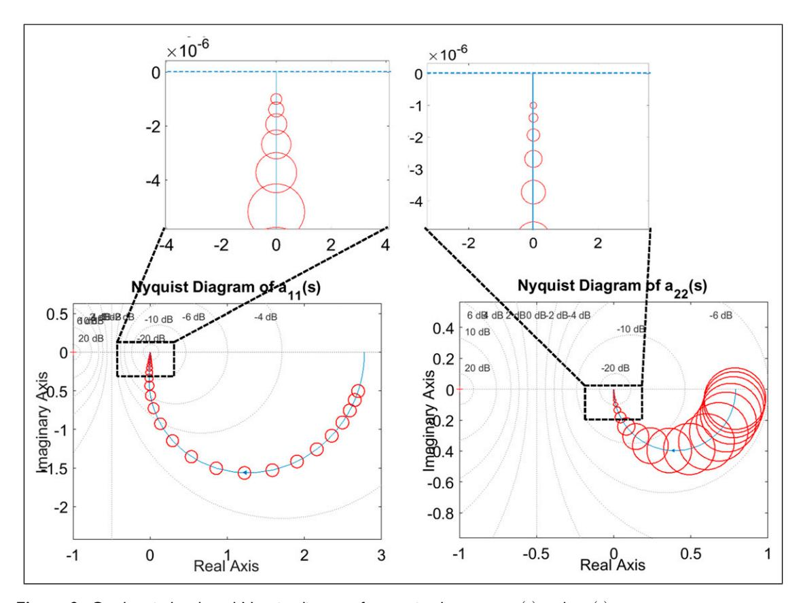
***Figure 6.** Unity step responses of transfer function elements when 1% step change occurs in voltage of chilled water pump v_{wp}(t).*

g_{q_2}(s): عنصر دالة التحويل لاستجابة معدل تدفق الهواء q_2(t) عند مخرج الحجم المُهوَّى عندما Q(s)=1 وباقي المدخلات صفر g_{T_2}(s): عنصر دالة التحويل لاستجابة درجة حرارة الهواء T_2(t) عند مخرج الحجم المُهوَّى عندما Q(s)=1 وباقي المدخلات صفر

يوضح كل عنصر من دالة التحويل سلوك الاستجابة، المتوقع أن يطابق نظيره في الشكل 4. ولتقييم هذا الاتساق، يخضع كل عنصر من دالة التحويل لمدخل خطوة وحدوية لفحص سلوكه الديناميكي، مُصوَّرًا باستخدام MATLAB.

تظهر استجابات الخطوة الناتجة لدوال التحويل هذه في الشكل 7. ومن الواضح أيضًا أنها تشبه إلى حد كبير نظيراتها في الشكل 4، ما يؤكد صحة التمثيل الدقيق لاستجابات النظام بواسطة عناصر دالة التحويل.

في العملية السابقة، اشتُقت عناصر دالة التحويل التي تصف سلوك نظام HVAC متعدد المتغيرات لجميع المخرجات الممكنة استنادًا إلى المدخلات المحددة. وتوفر هذه الاشتقاقات مرونة لمهندس تصميم النظام لتعديل وتكوين النظام المراد التحكم به وفق الحاجة. وهكذا، يعود له أمر تكوين عناصر دالة التحويل النهائية للمدخل-المخرج، بهدف تحديد أبعاد محددة لمصفوفة دالة التحويل. وتُختار معظم التكوينات بمصفوفة دالة تحويل مربعة *a* لأن العمل ذا الصلة يصبح أسهل في المعالجة والتحليل.

## نموذج HVAC بمدخلين ومخرجين

مع مراعاة المدخلات والمخرجات الأساسية لنظام HVAC الأكثر صلة بتشغيله و

<!-- page 17 -->

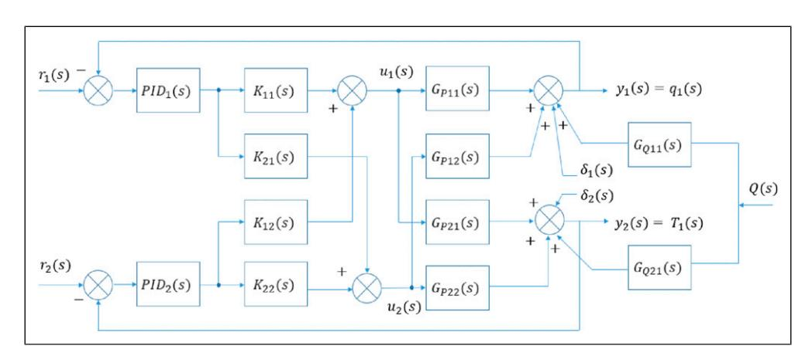
***Figure 7.** Unity step responses of transfer function elements when 1% step change occurs in the ambient heat transfer into the ventilated volume Q(t).*

وظيفته، سيقتصر النموذج متعدد المتغيرات على تكوين محدد يتألف من مدخلين ومخرجين فقط. تُعرَّف المدخلات الرئيسية لهذا النموذج بـ v_{fans}(s) وv_{wp}(s) ويمكن الإشارة إليهما بـ u_1(s) وu_2(s) على التوالي. وضمن نطاق ترتيب هذا النموذج 2 \times 2، تشمل المخرجات الناتجة معدل تدفق الهواء q_1(s) عند مدخل الحجم المُهوَّى ودرجة حرارة الهواء T_1(s) عند نقطة الدخول نفسها، ويمكن الإشارة إليهما بـ y_1(s) وy_2(s) على التوالي. علاوة على ذلك، يمثل \delta_1(s) وδ_2(s) الاضطرابات الفيزيائية العشوائية التي يمكن أن تؤثر في معدل تدفق الهواء q_1(s) ودرجة حرارة الهواء T_1(s) على التوالي. يمكن للانسدادات أو القيود في نظام التهوية، والفتح المفاجئ للنوافذ والأبواب، وكذلك الأعطال في مكونات مثل المراوح أو المخمِّدات أو أجهزة الاستشعار، أن تعطل تدفق الهواء. ويمكن لتقلبات الإشغال داخل الحيز المكيَّف أن تغيّر الأحمال الحرارية واحتياجات التهوية، ما يؤثر في كلا مخرجي

النظام. علاوة على ذلك، فإن أي تعديلات أو انسدادات في مجاري الهواء، مثل فتح أو إغلاق المخمِّدات، يمكن أن تؤثر في معدلات تدفق الهواء وتوزيع درجة الحرارة، ما قد يسبب تقلبات في أداء نظام HVAC.

يشير Q(s) إلى مدخل الاضطراب المستمر المتأصل الذي يخترق المنطقة المُهوَّاة. وبالتالي، سيبدو مخطط الكتل الناتج كما هو موضح في الشكل 8.

يمكن التعبير عن علاقة مدخل-مخرج النظام استنادًا إلى الشكل 8 بالمعادلة التالية:

$$ y(s) = G_p(s)u(s) + Q(s)G_Q(s) + \delta(s) (2.1) $$

حيث

y(s): متجه مخرجات النظام ويمكن كتابته كالتالي:

$$ y(s) = \begin{bmatrix} q(s) \\ T(s) \end{bmatrix} (2.2) $$

<!-- page 18 -->

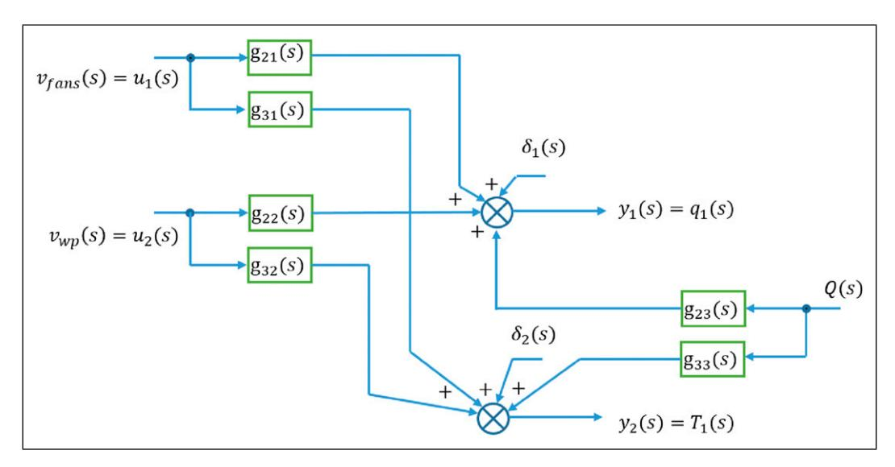
*Figure 8. HVAC final open loop model block diagram.*

GpðsÞ: مصفوفة دالة تحويل منشأة HVAC ويمكن كتابتها كالتالي:

$$
G_p(s) = \begin{bmatrix} G_{P11}(s) & G_{P12}(s) \\ G_{P21}(s) & G_{P22}(s) \end{bmatrix} (2.3)
$$

QðsÞ: مدخل الاضطراب الناتج عن انتقال الحرارة المحيطة إلى الحجم المُهوَّى ويمكن كتابته كالتالي:

يمكن لهذه الحرارة أن تؤثر في درجة حرارة الهواء ومعدل تدفقه على حد سواء. وهي بالفعل تعكس تغيرات الطقس الخارجي

GQðsÞ: متجه دالة التحويل لانتقال الحرارة المحيطة إلى الحجم المُهوَّى ويمكن كتابته كالتالي:

$$
G_{\mathcal{Q}}(s) = \begin{bmatrix} G_{\mathcal{Q}11}(s) \\ G_{\mathcal{Q}21}(s) \end{bmatrix} (2.4)
$$

uðsÞ: متجه مدخلات النظام المُكوَّنة ويمكن كتابته كالتالي:

$$ u(s) = \begin{bmatrix} v_{fans}(s) \\ v_{wp}(s) \end{bmatrix} (2.5) $$

δðsÞ: متجه اضطرابات النظام الخارجية ويمكن كتابته كالتالي:

$$ \delta(s) = \begin{bmatrix} \delta_1(s) \\ \delta_2(s) \end{bmatrix} (2.6) $$

يمكن كتابة المعادلة (2.1) بصيغة المصفوفة التالية

$$
\begin{bmatrix} q(s) \\ T(s) \end{bmatrix} = \begin{bmatrix} G_{P11}(s) & G_{P12}(s) \\ G_{P21}(s) & G_{P22}(s) \end{bmatrix} \begin{bmatrix} v_{fans}(s) \\ v_{wp}(s) \end{bmatrix} + Q(s) \begin{bmatrix} G_{Q11}(s) \\ G_{Q21}(s) \end{bmatrix} + \begin{bmatrix} \delta_1(s) \\ \delta_2(s) \end{bmatrix} (2.7)
$$

$$ G_{P11}(s) = g_{21}(s); G_{P21}(s) = g_{31}(s); G_{P12}(s) = g_{22}(s) $$

$$ G_{P22}(s) = g_{32}(s); G_{Q11}(s) = g_{23}(s); G_{Q21}(s) = g_{33}(s) $$

مع تعويض قيم عناصر دالة التحويل في المعادلة (2.7):

<!-- page 19 -->

$$
\begin{bmatrix} q(s) \\ T(s) \end{bmatrix} = \begin{bmatrix} \frac{0.04869 \, s + 0.0001581}{s^2 + 0.01503 \, s + 4.971 \times 10^{-5}} & \frac{-0.1125 \, s - 0.00131}{s^2 + 0.03056 \, s + 0.0001161} \\ \frac{-0.001442 \, s - 0.0003499}{s^2 + 0.2794 \, s + 0.008757} & \frac{-0.002324 \, s^2 - 2.025e - 05 \, s - 1.349 \times 10^{-7}}{s^3 + 0.2317 \, s^2 + 0.001843 \, s + 1.086 \times 10^{-5}} \end{bmatrix} \begin{bmatrix} v_{fans}(s) \\ v_{wp}(s) \end{bmatrix} \\ + Q(s) \begin{bmatrix} \frac{0.002217 \, s^2 + 0.001252s + 2.806 \times 10^{-5}}{s^3 + 0.05935s^2 + 0.001829s + 7.548 \times 10^{-6}} \\ \frac{0.0001193s + 1.077 \times 10^{-6}}{s^2 + 0.0442s + 0.0002518} \end{bmatrix} + \begin{bmatrix} \delta_1(s) \\ \delta_2(s) \end{bmatrix} (2.8)
$$

## أهداف التحكم

يتمثل أحد الأهداف الأساسية لهذه الدراسة في تقليل الاقتران الداخلي بين استجابات المخرجات في نظام HVAC متعدد المتغيرات. ويضمن هذا الهدف أنه عند حدوث تغيير في خطوة أي من مدخلات المرجع للنظام، يتأثر المخرج ذو الصلة مباشرة فقط، مع تأثير ضئيل في المخرجات الأخرى. ويجب أن يُظهر النظام في التحكم متعدد المتغيرات ذي الحلقة المغلقة استجابة أسرع من نظيره ذي الحلقة المفتوحة. علاوة على ذلك، من الضروري أن يكون خطأ الحالة المستقرة الناتج عن أي مدخل مرجعي صغيرًا للغاية لتحقيق المستوى المطلوب من دقة نظام التحكم. وفي النهاية، ينبغي أن يُخمِّد النظام في التحكم متعدد المتغيرات ذي الحلقة المغلقة بفعالية تأثيرات الاضطراب العشوائي التي قد تؤثر في المخرجات، مُعيدًا النظام إلى إعدادات المدخل المرجعي المحددة مسبقًا.

ولتحقيق هذه الأهداف، سيتضمن النهج المتبع التركيز على مصفوفة دالة تحويل المنشأة، G_p(s)، في ظروف غير متأثرة بالاضطرابات أثناء مرحلة تصميم وحدة التحكم. وبعد ذلك، سيتم تصميم وحدة التحكم استنادًا إلى هذه المصفوفة، وسيُجرى تقييم لأداء النظام، مع أخذ الاضطرابات في الاعتبار، بحيث يمكّن هذا التقييم من تحليل سلوك النظام بشكل شامل.

## التحكم بمصفوفة نايكويست المباشرة (DNA)

Direct Nyquist Array (DNA) هو تقنية تحكم متعددة المتغيرات يستند إجراؤها إلى

تقليل التفاعلات بين مخرجات النظام من خلال فصلها إلى حلقات مدخل واحد-مخرج واحد يساوي عددها عدد مخرجات النظام، بحيث يمكن تطبيق تقنية تحكم بحلقة مغلقة على كل حلقة منفصلة على حدة.

يتضمن إجراء الفصل تصميم مصفوفة معوّضات K(s) بحيث عند ضربها في مصفوفة دالة تحويل المنشأة G_p(s)، يكون الناتج مصفوفة ذات هيمنة قطرية (diagonally dominant). ورياضيًا، تعني الهيمنة القطرية أن سعة أي عنصر قطري في المصفوفة أكبر من مجموع سعات العناصر خارج القطر لصف أو عمود معين.

يمكن القول إن A(s) تُظهر هيمنة قطرية للصف عندما:

$$ |a_{ii}(s)| > \sum_{\substack{j=1\\i\neq j}}^{m} a_{ij}(s) (2.9) $$

لجميع i وj = 1, 2, \dots, m وحيث يمثل a_{ii}(s) عنصرًا قطريًا

في الوقت نفسه، تكون A(s) ذات هيمنة عمودية عندما:

$$ |a_{ii}(s)| > \sum_{\substack{j=1\\i\neq j}}^{m} a_{ji}(s) (2.10) $$

لجميع i وj = 1, 2, \dots, m

لا يُشترط الجمع بين هيمنة الصف والعمود معًا لكي تُظهر المصفوفة هيمنة قطرية؛ لذا يكفي أحد التعريفين. 41 إضافة إلى ذلك، يمكن فحص الهيمنة القطرية في المصفوفة

<!-- page 20 -->

بصريًا. يُعد صف داخل المصفوفة مهيمنًا بيانيًا عندما يستبعد اتحاد الدوائر المتمركزة حول كل عنصر a_{ii}(s) بنصف قطر محدد وفق المعادلة (2.11) أدناه، عبر مدى واسع من الترددات، نقطة الأصل على المستوى المركب.

$$ r_i = \sum_{\substack{j=1\\ i \neq i}}^{m} |a_{ij}(s)| \tag{2.11} $$

الطريقة التقليدية لتحديد معوّضات الفصل المسبق عبر عملية تجربة وخطأ، والتي لا تضمن الوصول إلى حل، هي نهج معروف شائع.26 وبدلًا من ذلك، سيُستخدم نهج منهجي يتضمن حل مجموعة من المعادلات الناتجة عن ضرب المصفوفات، كما هو موضح في المعادلة (2.12) أدناه، لحساب عناصر المعوّض المسبق بمساعدة MATLAB.

$$ A(s) = G_p(s)K(s) \tag{2.12} $$

يمكن اختيار عناصر A(s) عمدًا لتحقيق المعادلتين (2.9) و(2.11). ونتيجة لذلك، تُصاغ A(s) في المعادلة (2.12) بحيث تُظهر، عند فحص هذه المصفوفة،

أن قيم العنصر القطري للمصفوفة عند نطاق ترددات مُستبدَل تكون أكبر باستمرار من مجموع العناصر خارج القطر ضمن الصف نفسه عند نطاق الترددات نفسه. وبالتالي، يمكن صياغة A(s) كمصفوفة هيمنة قطرية عمدًا على النحو التالي:

$$
A(s) = \begin{bmatrix} \frac{50 s + 100}{50 s^2 + 85 s + 36} & \frac{s + 5}{5 s^2 + 35 s + 60} \\ \frac{s + 10}{10 s^2 + 45 s + 50} & \frac{200 s + 200}{200 s^2 + 450 s + 250} \end{bmatrix} 
(2.13)
$$

بما أن A(s) وG_p(s) مصفوفتان معروفتان حتى هذه المرحلة، يمكن حساب عناصر K(s) رياضيًا بمساعدة برنامج MATLAB باستخدام المعادلة (2.12). وفي ملف نصي برمجي في MATLAB مصمم لحل معادلات متزامنة، تُمثَّل المتغيرات في الملف بـ K_{ij}(s)، وتُبنى المعادلات وفقًا للمعادلة (2.12). وبتنفيذ ملف النص البرمجي باستخدام أمر "solve"، حُسِبت مصفوفة K(s) وتم الحصول عليها كالتالي:

$$
K_{11}(s) = \frac{-32.413 (s + 11.51)(s + 1.05)(s + 0.2434)(s + 0.03597)(s + 0.01179)(s + 0.01012)}{(s + 0.004914)(s^2 + 0.007998s + 4.846 \times 10^{-5})(s^2 + 0.7726s + 0.1636)}{(s + 2.5)(s + 2)(s + 0.9)(s + 0.8)(s + 0.2433)(s + 0.1491)(s + 0.01413)}{(s + 0.007694)(s + 0.004981)(s^2 + 0.008216s + 4.975e - 05)}
$$

$$
K_{21}(s) = \frac{-22.917 (s + 8.667)(s + 0.2431)(s + 0.2237)(s + 0.02865)(s + 0.02611)}{(s + 0.004446)(s + 0.003378)(s^2 + 0.008022s + 4.855e - 05)}
K_{21}(s) = \frac{(s^2 + 1.846s + 0.9097)}{(s + 2.5)(s + 2)(s + 0.9)(s + 0.8)(s + 0.2433)(s + 0.1491)(s + 0.01413)}{(s + 0.007694)(s + 0.004981)(s^2 + 0.008216s + 4.975e - 05)}
$$

<!-- page 21 -->

$$
K_{12}(s) = \frac{-406.84 (s + 3.988)(s + 3.016)(s + 0.2434)(s + 0.2241)(s + 0.03597)}{(s + 0.01165) (s + 0.01012) (s + 0.004914) (s^2 + 0.008022s + 4.855e - 05)}{(s + 4)(s + 3)(s + 1.25)(s + 0.2433)(s + 0.1491)(s + 0.01413)(s + 0.007694)}{(s + 0.004981) (s^2 + 0.008216s + 4.975e - 05)}
$$

$$
K_{22}(s) = \frac{-177.86 (s + 4.016)(s + 2.98)(s + 0.2434)(s + 0.2237)(s + 0.0359)(s + 0.02611)}{(s + 0.004446) (s + 0.003248) (s^2 + 0.008022s + 4.855e - 05)}\frac{(s + 4)(s + 3)(s + 1.25)(s + 0.2433)(s + 0.1491)(s + 0.01413)(s + 0.007694)(s + 0.004981)}{(s^2 + 0.008216s + 4.975e - 05)}
$$

$$
K(s) = \begin{bmatrix} K_{11}(s) & K_{12}(s) \\ K_{21}(s) & K_{22}(s) \end{bmatrix} (2.14)
$$

حيث

يقع ترتيب المعوّضات المحسوبة عادةً بين الرتبة العاشرة والحادية عشرة. ويمكن اختزال هذه المعوّضات إلى مجموعات من الكسب ومعوّضات lead-lag من الدرجة الأولى والثانية. وتؤدي المعوّضات المصممة بشكل أساسي وظيفة "معززات الفصل" لتيسير تثبيت دالة التحويل المنفصلة الكاملة A(s) باستخدام وحدات تحكم PID.

## دوائر جيرشغورين

تتضمن الخطوة التالية إظهار تأثير الاقتران بين مخرجات نظام HVAC متعدد المتغيرات عن طريق بناء دوائر جيرشغورين بمراكز وأنصاف أقطار محددة. بالنسبة للمخرج الأول لنظام HVAC متعدد المتغيرات، تتوافق مراكز هذه الدوائر مع العنصر القطري لمصفوفة A(s)، a_{11}(s) = a_{11}(j\omega)، بينما تُحدَّد أنصاف الأقطار بالعنصر خارج القطر a_{12}(s) = a_{12}(j\omega) عبر نطاق تردد محدد (\omega = 0.1 - 10^{-6}) يمثل الترددات التشغيلية للعمليات الصناعية. تمثل قيم المراكز وأنصاف الأقطار مقادير a_{11}(j\omega) وa_{12}(j\omega) على التوالي لمصفوفة 2×2 عبر نطاق التردد المحدد. وإذا لم تُحِط الدائرة الناتجة

بنقطة الأصل على المستوى المركب، فإن ذلك يشير إلى أن مقدار العنصر القطري a_{11}(j\omega) أكبر من مقدار العنصر خارج القطر a_{12}(j\omega). وبتطبيق المنطق نفسه على العنصر القطري الثاني a_{22}(j\omega) والعنصر خارج القطر a_{21}(i\omega)، يمكننا تقييم ما إذا كانت المصفوفة تُظهر هيمنة قطرية. تساعد دوائر جيرشغورين هذه على تصور ما إذا كانت مصفوفة دالة التحويل لعملية صناعية ذات هيمنة قطرية، ما يشير إلى ما إذا كانت المخرجات منفصلة بما يكفي لتحقيق تحكم واستقرار قويين. وتعني المصفوفة ذات الهيمنة القطرية أيضًا أنه عند ضرب مصفوفة المنشأة في متجه المدخل، يتأثر المخرج بشكل أساسي بالعناصر القطرية، مع تأثير ضئيل من العناصر خارج القطر، ما يضمن أن كل مدخل يؤثر بشكل أساسي في مخرجه المقابل، ما يؤدي إلى مخرجات نظام منفصلة.

يمكن أيضًا تسمية دوائر جيرشغورين بأشرطة جيرشغورين، وتُنشأ برسم دوائر متمركزة حول النقاط a_{ii}(j\omega) بأنصاف أقطار:

$$ r_i = \sum_{\substack{j=1\\i\neq j}}^2 \left| a_{ij}(j\omega) \right| $$

ترتبط الهيمنة القطرية الأكبر بشريط جيرشغورين أضيق، ما ينتج عنه فصل متبادل أكثر وضوحًا بين مخرجات

<!-- page 22 -->

***Figure 9.** Gershgorin bands and Nyquist diagrams for matrix elements, a_{11}(s) and a_{22}(s).*

النظام. من ناحية أخرى، يشير شريط جيرشغورين الأوسع إلى هيمنة قطرية أقل، ما يؤدي إلى تأثير فصل متبادل أقل بين مخرجات النظام.

يعرض الشكل 9 شريط جيرشغورين ومخطط نايكويست لعنصرَي المصفوفة a_{11}(s) وa_{22}(s) كل على حدة. ومن الواضح أن دوائر جيرشغورين لكل صف لا تحيط بنقطة الأصل ضمن المستوى المركب، ما يؤكد أن A(s) مصفوفة ذات هيمنة صفية. ويُفصَّل هذا التمثيل البصري أكثر في النافذة المكبَّرة المعروضة أيضًا في الشكل 9. ويشير هذا التوضيح الرسومي إلى أن مقدار العناصر القطرية في المصفوفة يتجاوز بشكل كبير مجموع مقادير بقية العناصر خارج القطر. وبالتالي، تظل المعادلة التالية صحيحة:

$$ |a_{ii}(s)| > \sum_{\substack{j=1\\i\neq j}}^{2} |a_{ij}(s)| $$

يتيح هذا الإعداد تصميم وحدة تحكم لكل حلقة منفصلة على حدة، بهدف تحسين الأداء العام للنظام. وتمثل C(s) مصفوفة قطرية تتألف من وحدات تحكم PID للحلقات الفردية.

$$ C(s) = \begin{bmatrix} PID_1 & 0\\ 0 & PID_2 \end{bmatrix} (2.15) $$

تمثل H(s) مصفوفة دالة التحويل لتكوين الحلقة المفتوحة، وهي معرَّفة في المعادلة التالية:

<!-- page 23 -->

$$ H(s) = G_n(s)K(s)C(s) (2.16) $$

تتضمن الخطوة التالية تحديد معاملات وحدات تحكم PID ضمن تكوين الحلقة المغلقة، مع التركيز على تحقيق نظام حسن السلوك بأزمنة استجابة أسرع مقارنة بتكوين الحلقة المفتوحة، وضمان أداء مستقر. تُضبَط وحدات تحكم PID بدقة باستخدام أداة MATLAB PID Tuner لضمان خطأ حالة مستقرة صفري، خصوصًا عندما تؤثر اضطرابات انتقال الحرارة في الحجم المُهوَّى. ووفقًا لأداة MATLAB PID Tuner، تُحدَّد دوال تحويل وحدات تحكم PID التالية:

(i) وحدة تحكم PID للحلقة الأولى:

$$ PID_1(s) = \frac{-0.1754s^2 + 9.84s + 18.45}{s} (2.17) $$

حيث: K_{n1} = 9.84; K_{i1} = 18.45; K_{d1} = -0.175

(ii) وحدة تحكم PID للحلقة الثانية:

$$ PID_1(s) = \frac{-0.0081s^2 + 4s + 10.3}{s} (2.18) $$

حيث: K_{p2} = 4; K_{i2} = 10.3; K_{d2} = -0.0081

يوضح الشكل 10 مخطط الكتل لنظام التحكم بالحلقة المغلقة لـHVAC باستخدام وحدات تحكم Direct Nyquist Array، التي تدمج أيضًا وحدات تحكم PID.

سيُبحث أداء النظام تحت DNA متضمنًا وحدات تحكم PID في القسم التالي.

## اختبار استقرار النظام

لتقييم استقرار النظام في تكوين الحلقة المغلقة، يمكن أيضًا تحليل أشرطة جيرشغورين لمعادلة مصفوفة الحلقة المفتوحة الموصوفة في (2.16). يمكن تلخيص معيار استقرار نايكويست في الأنظمة متعددة المتغيرات على النحو التالي: إذا أحاطت أشرطة جيرشغورين بالنقطة المركبة (-1,0J) لعدد إجمالي من المرات (N_i)، فإن النظام في تكوين الحلقة المغلقة يكون مستقرًا إذا وفقط إذا:

$$ \sum_{i=1}^{m} N_i = p_0 \tag{2.19} $$

يشير المصطلح p_0 إلى عدد أقطاب H(s) في تكوين الحلقة المفتوحة، وعادةً ما تقع هذه الأقطاب إلى يمين المحور التخيلي في مستوى s. من الافتراضات الشائعة أن معظم العمليات الصناعية ذات الحلقة المفتوحة مستقرة، وبالتالي (p_0 = 0)، وقد اعتُمد هذا الافتراض في هذه الورقة أيضًا. ولتقييم الاستقرار، تُمركَز أشرطة جيرشغورين حول العناصر القطرية h_{ii}(s) لدالة التحويل بالحلقة المفتوحة H(s)، حيث يتراوح i من 1 إلى m. ويكون لهذه الأشرطة أنصاف أقطار تساوي مجموع جميع العناصر في صف أو عمود معين، باستثناء العنصر القطري h_{ii}(s).

يعرض الشكل 11 أشرطة جيرشغورين المتعلقة بالعنصرين القطريين h_{11}(s) وh_{22}(s) لـ

*Figure 10. Block Diagram for HVAC multivariable system under Direct Array Nyquist closed loop controller.*

<!-- page 24 -->

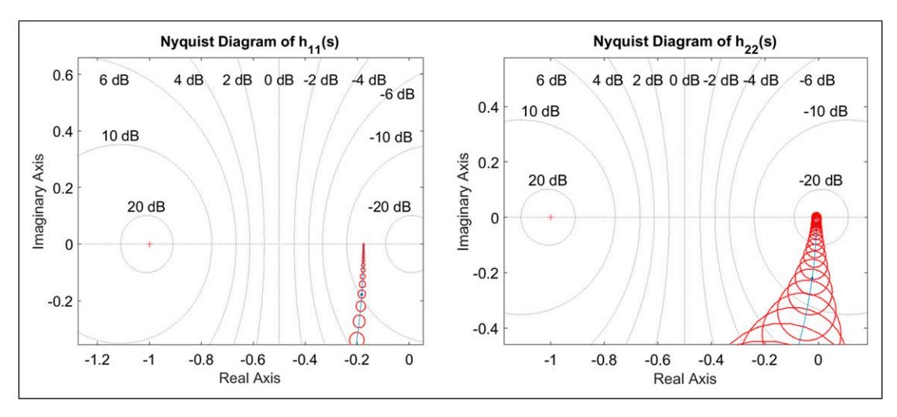
***Figure 11.** Gershgorin bands for the open loop diagonal elements h_{11}(s) and h_{22}(s).*

مصفوفة H(s) الموصوفة في المعادلة (2.6). يتمركز كل شريط حول عنصره القطري المقابل، h_{ii}(s)، بنصف قطر يساوي مجموع العناصر خارج القطر ضمن الصف نفسه. والمهم أن هذه الأشرطة لا تشمل النقطة المركبة (-1, 0J)، بما يتوافق مع معيار الاستقرار. ويوفر غياب إحاطة النقطة المركبة (-1, 0J) بأشرطة جيرشغورين المرتبطة بالعنصرين القطريين h_{11}(s) وh_{22}(s) تأكيدًا بصريًا على استقرار النظام ضمن إعداد التحكم بالتغذية الراجعة.

## النتائج والمناقشة

يعرض هذا القسم نتائج الدراسة ويفسرها. وهو أمر بالغ الأهمية لأنه يتيح لنا فهم النتائج وتداعيات الدراسة.

## بنية نظام التحكم

صُمِّمت بنية نظام التحكم الموضحة في الإجراءات والأقسام السابقة لمعالجة التعقيدات المتأصلة في العمليات الصناعية متعددة المتغيرات، بما في ذلك أنظمة HVAC متعددة المتغيرات. وهي تدمج بين نماذج المعامل الموزع ونماذج HVAC المُجمَّعة، وتحوّلها إلى نماذج في المجال الترددي، ما يضمن التقاط النظام بدقة للسلوك الديناميكي لـ

النظام. وتُعد استراتيجية التحكم Direct Nyquist Array (DNA) محورية في هذه البنية، إذ تيسّر فصل النظام متعدد المتغيرات إلى حلقات SISO يمكن إدارتها. ويوضح الشكل 10 البنية، مبيّنًا كيفية تفاعل مكونات النظام المختلفة للحفاظ على الاستقرار وتحسين الأداء. ويظهر بوضوح إدراج حلقات التغذية الراجعة ووحدات التحكم، ما يبرز النهج الشامل للنظام في إدارة المتغيرات المترابطة.

## نتائج المحاكاة

تقدم الدراسة عرضًا شاملًا لنتائج المحاكاة، يُظهر بفعالية أداء النظام عبر ظروف متنوعة. ويجدر بالذكر أن الشكل 9 يصور بصريًا استجابة النظام عند تحويل النموذج لتحقيق الهيمنة القطرية، ما يؤكد تقليل تأثير الاقتران في مخرجات النظام. ويتيح هذا الفصل بين المخرجات تحكمًا مستقلًا في كل مخرج دون أي تأثير في الآخرين، ما يُظهر الميزة الكبيرة لاستخدام تقنية DNA متعددة المتغيرات في سياق أنظمة HVAC. إضافة إلى ذلك، يُظهر الشكل 11 بفعالية التحسينات الملحوظة في استقرار النظام وزمن الاستجابة الناتجة عن التطبيق الناجح لاستراتيجية التحكم DNA.

<!-- page 25 -->

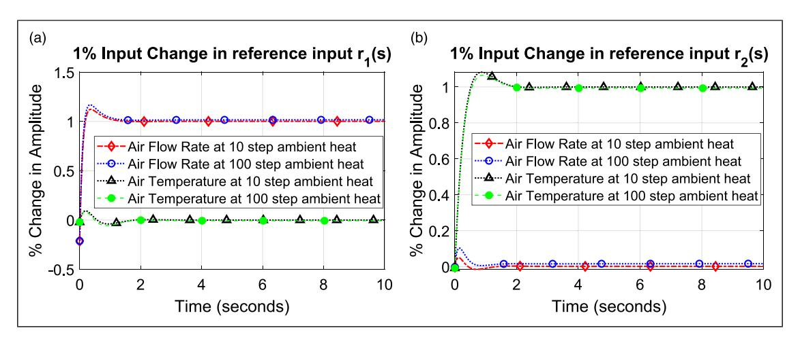
***Figure 12.** HVAC System Responses. (a) when unity step change is applied at r_1(s) (b) when unity step change is applied at r_2(s).*

سيُبحث أيضًا في نتائج نظام التحكم بالحلقة المغلقة متعدد المتغيرات لـHVAC. وسيتضمن البحث محاكاة مخطط الكتل الموضح في الشكل 10 باستخدام برنامج SIMULINK، مع مدخلات خطوة متغيرة.

تعرض أشكال هذا القسم استجابات النظام لمعدل تدفق الهواء q(s) ودرجة حرارة الهواء T(s) عند مدخل الحجم المُهوَّى. وقد جرى الحصول على هذه الاستجابات في السيناريو الأول عند حدوث تغيير خطوة بنسبة 1% في المدخل المرجعي r_1(s) بينما بقي r_2(s) صفرًا، كما هو موضح في الشكل 12-(a)، وفي السيناريو الثاني عند حدوث تغيير خطوة بنسبة 1% في المدخل المرجعي r_2(s) بينما بقي r_1(s) صفرًا، كما هو موضح في الشكل 12-(b). وقد جرى الحصول على هذه السيناريوهات أيضًا عند حالتين متطرفتين لانتقال الحرارة المحيطة إلى الحجم المُهوَّى: خطوة بقيمة 10 تشير إلى انتقال حرارة منخفض، وخطوة بقيمة 100 تشير إلى انتقال حرارة مرتفع. ويتضح من الشكلين 12-(a) و12-(b) أنه عند حدوث تقلبات كبيرة في انتقال الحرارة المحيطة، ما يعكس أساسًا تغيرات في ظروف الطقس الخارجية، يمكن لوحدة التحكم إدارة هذه التغيرات بفعالية، ما يضمن حفاظ المخرج على القيم المرجعية المطلوبة من حيث تدفق الهواء ودرجة الحرارة. علاوة على ذلك، فإن استجابات النظام أسرع بشكل ملحوظ في كلا السيناريوهين مقارنة باستجابات الحلقة المفتوحة، بزمن استقرار يقارب 1 ثانية، مقارنة بأزمنة استقرار تتراوح بين 200 و600 ثانية لاستجابات الحلقة المفتوحة. وتنطوي هذه

الاستجابات على بعض التجاوزات (overshoots) الناتجة عن وحدة تحكم PID، لكن تأثيرها ضئيل في أداء HVAC من حيث الراحة الحرارية ورضا الشاغلين.

سيُبحث أيضًا في أداء النظام استجابةً للاضطرابات المؤثرة في مخرجاته. وسيركز هذا التقييم على الاضطرابات المُدخَلة عندما لا تُجرى أي تغييرات في مدخلات النظام المرجعية، وتحديدًا r_1(s) وr_2(t). ويوضح الشكل 13 استجابات مخرجات النظام عند إدخال إشارتي اضطراب متتاليتين \delta_1(s) وδ_2(s) بالتناوب إلى مخرجَي النظام q_1(s) وT_1(s) على التوالي عند مدخل الحجم المُهوَّى. وفي السيناريو الأول، الشكل 13-(a)، عند إدخال تغيير بنسبة 1% في \delta_1(s) بينما تبقى إشارة الاضطراب الأخرى δ_2(s) صفرًا، تخفف وحدة تحكم مصفوفة نايكويست المباشرة إلى جانب وحدات تحكم PID الاضطراب بفعالية. وتعود مخرجات النظام إلى حالة قريبة من التغيير الصفري، بما يتوافق مع غياب تغييرات في المدخل المرجعي. ويمكن ملاحظة أداء مماثل في السيناريو الثاني، الشكل 13-(b)، عند بدء تغيير اضطراب بخطوة وحدوية في δ_2(s) بينما تبقى إشارة الاضطراب الأخرى \delta_1(s) صفرًا. وختامًا، تُظهر وحدة تحكم DNA متعددة المتغيرات بالحلقة المغلقة، مقترنة بوحدات تحكم PID من نوع SISO، قدرتها على تخميد الاضطرابات الخارجية وإعادة النظام إلى قيمه المرجعية الأصلية في فترة زمنية قصيرة تتراوح بين 1 و2 ثانية.

<!-- page 26 -->

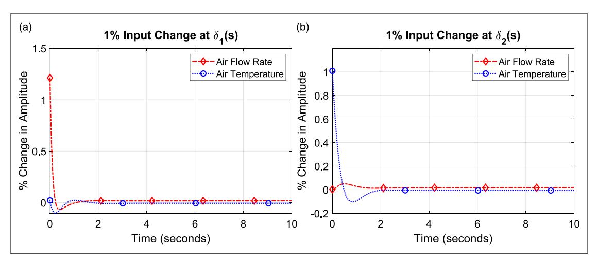
*Figure 13. System Output responses following consecutive application of unity percent step disturbance change at a system output (a) when δ1ðsÞ ¼ 1% while δ2ðsÞ ¼ 0%. (b) when δ2ðsÞ ¼ 1% while δ1ðsÞ ¼ 0%.*

توفر نتائج المحاكاة دليلًا مقنعًا على متانة النظام في التعامل مع التحديات التشغيلية الشائعة، إذ يحقق باستمرار مستويات الأداء المطلوبة رغم الاضطرابات الكبيرة. علاوة على ذلك، تتضمن النتائج مقارنات ثاقبة لسلوك النظام قبل (راجع [الشكل 5](#page-14-0)، [الشكل 6،](#page-15-0) و[الشكل 7](#page-16-0)) وبعد تطبيق استراتيجية التحكم (راجع [الشكل 12](#page-24-0))، حيث يكون خطأ الحالة المستقرة قريبًا من الصفر وتتحقق الاستجابات بشكل أسرع من ذي قبل. ويُظهر النظام تحسينات في أزمنة استجابته، محققًا خفضًا كبيرًا يقارب 1 ثانية. علاوة على ذلك، لوحظت خلال المحاكاة تجاوزات (overshoots) تتراوح بين 7% و15%. غير أنه من المهم ملاحظة أنه رغم هذه التجاوزات، يحافظ النظام بفعالية على الراحة الحرارية ويضمن رضا الشاغلين. وتُبرز هذه النتائج التأثير الإيجابي الكبير لاستراتيجية التحكم المطبَّقة، التي تعزز ديناميكيات النظام وتحقق النتائج المرجوة بموثوقية. وتُظهر هذه التحليلات المقارنة بوضوح المزايا الملموسة التي يوفرها النهج المقترح، ما يعزز فعاليته وفوائده المحتملة في الممارسة العملية.

## الموثوقية والتحقق

يعرض هذا القسم التحقق من صحة النموذج المقترح، متبوعًا بتحليل مفصل لاستجابات

الحلقة المغلقة. وتُظهر المقارنة الأولية لاستجابات المجالين الترددي والزمني دقة النموذج. وبعد ذلك، جرى بحث أداء النظام تحت ظروف متنوعة لإبراز أهم الرؤى المستخلصة من عمليات المحاكاة. ولضمان موثوقية النموذج المقترح، يُجرى التحقق بمقارنة استجابات المجال الترددي المحسوبة من النموذج الرياضي لهذه الدراسة مع استجابات المجال الزمني الموثَّقة في المرجع[34](#page-28-14) التي سبق التحقق منها ونشرها. وتعتمد هذه الدراسة نموذجًا رياضيًا في المجال الترددي، تمت محاكاته عبر MATLAB، للتنبؤ بسلوك النظام. وقُورنت نتائج المحاكاة الموضحة في [الأشكال 5،](#page-14-0) [6](#page-15-0) و[7](#page-16-0) بدقة مع استجابات المجال الزمني الواردة في المرجع[34](#page-28-14) كما هو موضح في [الأشكال 2،](#page-8-0) [3](#page-9-0) و[4](#page-10-0)، ما يُظهر درجة تطابق ومواءمة عاليتين. ويشير هذا التطابق إلى أن نموذجنا يلتقط بدقة الخصائص الديناميكية لنظام HVAC. ويشير التطابق الكبير بين الاستجابات المُحاكاة والمرجعية إلى أن تنبؤات نموذجنا متسقة مع البيانات المرصودة. ويؤكد هذا التحقق متانة نموذجنا ودقته، ما يعزز الثقة في قدراته التنبؤية ويُظهر قابليته للتطبيق في سيناريوهات تتوفر فيها بيانات المجال الزمني. وبمجرد التحقق من

<!-- page 27 -->

نموذج البحث، يمكن اعتباره موثوقًا وقريبًا من الأداء الواقعي في سيناريوهات الحلقة المغلقة اللاحقة.

## تحليل الحساسية والاستقرار

لمزيد من التحقق من متانة نموذج التحكم المقترح لـHVAC، سيُجرى تحليل حساسية. ويفحص هذا التحليل كيفية تأثير التغيرات في المعاملات الرئيسية في أداء النموذج تحت استراتيجية التحكم المقترحة، ما يوفر رؤى أعمق حول استقراره وموثوقيته. يوضح [الشكل 12](#page-24-0) حساسية النظام تحت تغيرات واضحة في الحرارة المحيطة؛ إذ يؤدي النظام أداءً جيدًا في الحفاظ على الاستقرار والأداء المطلوب رغم التغيرات. وهذه سمة مرغوبة، إذ تشير إلى أن النظام موثوق وقابل للتكيف في الظروف الواقعية حيث قد تتقلب المعاملات، وبالتالي فإن النظام أقل حساسية للتغيرات، ما يؤكد المتانة والموثوقية. ويمكن أيضًا ملاحظة حساسية أقل للنظام في [الشكل 13](#page-25-0) حيث يُعاد النظام إلى مدخلاته المرجعية المطلوبة رغم الاضطرابات المُطبَّقة على المخرجات.

تعزز الدراسة بفعالية فهم نظام التحكم متعدد المتغيرات بالحلقة المغلقة من خلال تقديم فحص مفصل لبنيته، وإظهار تحسينات الأداء عبر نتائج المحاكاة، والتحقق من المتانة عبر تحليل الحساسية والاستقرار. ويضمن تكامل هذه العناصر أن النظام مُجهَّز بشكل جيد لإدارة تعقيدات العمليات الصناعية، محققًا تحكمًا موثوقًا وفعالًا.

## الخاتمة

يقدم البحث الذي أُجري في هذه الدراسة تحليلًا شاملًا لنظام تحكم بالحلقة المغلقة متعدد المتغيرات لأنظمة التدفئة والتهوية وتكييف الهواء (HVAC). ومن خلال استخدام نموذج هجين يجمع بين المعامل الموزع والمُجمَّع، والاستفادة من تطبيق System Identification في MATLAB، جرى اشتقاق مصفوفة دالة تحويل. وتشكل هذه المصفوفة الأساس للتصميم المنهجي لنظام تحكم بالتغذية الراجعة متعدد المتغيرات.

تُظهر الدراسة فعالية استراتيجية التحكم Direct Nyquist Array (DNA)،

التي تفكك نظام HVAC إلى حلقتين متمايزتين من نوع مدخل واحد-مخرج واحد (SISO). وبعد ذلك، تُطبَّق وحدات تحكم PID على كل حلقة منفردة، ما ينتج عنه مخرجات نظام منفصلة بشكل كبير مع تأثيرات اقتران ضئيلة. علاوة على ذلك، يؤكد تحليل الاستقرار باستخدام معيار نايكويست أن تكوين الحلقة المغلقة يستوفي معايير الاستقرار المطلوبة.

تُظهر نتائج المحاكاة الأداء المتفوق لتكوين الحلقة المغلقة مقارنة بنظام الحلقة المفتوحة، بأزمنة استجابة أسرع وتجاوزات ضئيلة. ويدير نظام الحلقة المغلقة بفعالية تغيرات العوامل الخارجية، مثل انتقال الحرارة المحيطة، ما يضمن حفاظ النظام على القيم المرجعية المطلوبة لمعدل تدفق الهواء ودرجة حرارته. إضافة إلى ذلك، يُظهر النظام متانة ضد الاضطرابات، إذ يعود بسرعة إلى قيم حالته المستقرة الأصلية. وتكشف نتائج المحاكاة عن تحسينات كبيرة في أداء النظام مقارنة بإعداد الحلقة المفتوحة. ومن اللافت أن النظام يُظهر أزمنة استجابة أسرع، بخفض يقارب 1 ثانية. إضافة إلى ذلك، تتراوح التجاوزات المرصودة بين 7% و15%. ورغم هذه التجاوزات، يحافظ النظام بفعالية على الراحة الحرارية ورضا الشاغلين. وتُبرز هذه النتائج التأثير الإيجابي لاستراتيجية التحكم المطبَّقة، ما يُظهر قدرتها على تعزيز ديناميكيات النظام وضمان النتائج المرجوة.

وختامًا، تثبت تقنية التحكم DNA متعددة المتغيرات بالحلقة المغلقة، مقترنة بوحدات تحكم PID من نوع SISO، أنها نهج موثوق وفعال لأنظمة HVAC. فهي لا تعزز كفاءة الطاقة والراحة الحرارية داخل المباني فحسب، بل تُظهر أيضًا القدرة على تخميد الاضطرابات الخارجية وضمان استقرار النظام.

## الشكر والتقدير

أُنجز هذا العمل بجهود المؤلفَين فقط، وبالتالي لا يوجد شكر خاص

## مساهمة المؤلفين

Dr Basim Touqan: Process Mathematical Modeling, theory application and MATLAB software demonstration to obtain the responses. Professor Alaa Abdul-Ameer, Theory revision, research structure and results validation

<!-- page 28 -->

## إقرار بشأن تعارض المصالح

لم يُعلن المؤلف (المؤلفون) عن أي تعارض محتمل في المصالح فيما يتعلق بالبحث أو التأليف أو نشر هذه المقالة.

## التمويل

لم يتلقَّ المؤلف (المؤلفون) أي دعم مالي لأبحاث هذه المقالة أو تأليفها أو نشرها.

## ORCID iD

Basim Touqan [https://orcid.org/0000-0002-2442-951X](https://orcid.org/0000-0002-2442-951X)

## بيان إتاحة البيانات

لا ينطبق تبادل البيانات على هذه المقالة، إذ لم يتم إنشاء أو تحليل أي مجموعات بيانات خلال الدراسة الحالية.

## References

- 1. Asim N, Badiei M, Mohammad M, et al. Sustainability of heating, ventilation and air-conditioning (HVAC) systems in buildings—an overview. Int J Environ Res Publ Health 2022; 19(2): 1016. DOI: [10.](https://doi.org/10.3390/ijerph19021016) [3390/ijerph19021016.](https://doi.org/10.3390/ijerph19021016)
- 2. Chua KJ, Chou SK, Yang WM, et al. Achieving better energy-efficient air conditioning–a review of technologies and strategies. Appl Energy 2013; 104: 87–104. DOI: [10.1016/j.apenergy.2012.10.037](https://doi.org/10.1016/j.apenergy.2012.10.037).
- 3. Isaac M and Van Nuuren DP, "Modeling global residential sector energy demand for heating and air conditioning in the context of climate change," vol. 37, pp. 507–521, 2009, DOI: [10.1016/j.enpol.2008.](https://doi.org/10.1016/j.enpol.2008.09.051) [09.051](https://doi.org/10.1016/j.enpol.2008.09.051).
- 4. Pe L, "A review on buildings energy consumption information ´," vol. 40, pp. 394–398, 2008, DOI: [10.](https://doi.org/10.1016/j.enbuild.2007.03.007) [1016/j.enbuild.2007.03.007.](https://doi.org/10.1016/j.enbuild.2007.03.007)
- 5. Palmero-marrero AI and Oliveira AC. Effect of louver shading devices on building energy requirements. Appl Energy 2010; 87(6): 2040–2049. DOI: [10.1016/](https://doi.org/10.1016/j.apenergy.2009.11.020) [j.apenergy.2009.11.020](https://doi.org/10.1016/j.apenergy.2009.11.020).
- 6. Castleton HF, Stovin V, Beck SBM, et al. Green roofs; Building energy savings and the potential for retrofit. Energy Build 2010; 42(10): 1582–1591. DOI: [10.](https://doi.org/10.1016/j.enbuild.2010.05.004) [1016/j.enbuild.2010.05.004.](https://doi.org/10.1016/j.enbuild.2010.05.004)
- 7. Touqan B, Taleb H and Salameh M. Low carbon cooling approach for the residences in the UAE: a case study in Dubai. World Congress on Civil, Structural,

- and Environmental Engineering 2017: 1–9. DOI: [10.](https://doi.org/10.11159/awspt17.127) [11159/awspt17.127](https://doi.org/10.11159/awspt17.127).
- 8. Ma Z, Cooper P, Daly D, et al. Existing building retrofits: methodology and state-of-the-art. Energy Build 2012; 55: 889–902. DOI: [10.1016/j.enbuild.](https://doi.org/10.1016/j.enbuild.2012.08.018) [2012.08.018](https://doi.org/10.1016/j.enbuild.2012.08.018).
- 9. Seyam S. Types of HVAC systems. HVAC System 2018. DOI: [10.5772/intechopen.78942.](https://doi.org/10.5772/intechopen.78942)
- 10. Touqan B, Abdul-Ameer A and Salameh M. HVAC multivariable system modelling and control. Proc IMechE Part C: J Mech Eng Sci 2022: 65–75. DOI: [10.1177/09544062221138836.](https://doi.org/10.1177/09544062221138836)
- 11. Angel WL. HVAC design sourcebook. McGraw Hill, 2011, p. 283.
- 12. Subbaram Naidu D and Rieger CG. Advanced control strategies for heating, ventilation, air-conditioning, and refrigeration systems - an overview: Part I: hard control. HVAC R Res 2011; 17(1): 2–21. DOI: [10.](https://doi.org/10.1080/10789669.2011.540942) [1080/10789669.2011.540942.](https://doi.org/10.1080/10789669.2011.540942)
- 13. Li J, Poulton G, Platt G, et al. Dynamic zone modelling for HVAC system control. Int J Model Ident Control 2010; 9(1–2): 5–14. DOI: [10.1504/IJMIC.](https://doi.org/10.1504/IJMIC.2010.032354) [2010.032354](https://doi.org/10.1504/IJMIC.2010.032354).
- 14. Dounis AI and Caraiscos C. Advanced control systems engineering for energy and comfort management in a building environment-A review. Renew Sustain Energy Rev 2009; 13(6–7): 1246–1261. DOI: [10.](https://doi.org/10.1016/j.rser.2008.09.015) [1016/j.rser.2008.09.015](https://doi.org/10.1016/j.rser.2008.09.015).
- 15. Goyal N, Gupta N, Bhatnagar P, et al. Predictive maintenance of HVAC systems using machine learning. [Online]. Available: [https://ssrn.com/](https://ssrn.com/abstract=4366923) [abstract=4366923](https://ssrn.com/abstract=4366923)
- 16. Constance Obiuto N, Ebirim W, Ninduwezuor-Ehiobu N, et al. Integrating sustainability into HVAC management: challenges and opportunities. Engineering Science & Technology Journal 2024; 5(3): 873–887. DOI: [10.51594/estj/v5i3.943.](https://doi.org/10.51594/estj/v5i3.943)
- 17. Hernandez AC and Fumo N. A review of variable refrigerant flow HVAC system components for residential application. Int J Refrig 2020; 110: 47–57. DOI: [10.1016/J.IJREFRIG.2019.11.005.](https://doi.org/10.1016/J.IJREFRIG.2019.11.005)
- 18. Cole WJ, Rhodes JD, Gorman W, et al. Communityscale residential air conditioning control for effective grid management. Appl Energy 2014; 130: 428–436. DOI: [10.1016/J.APENERGY.2014.05.067](https://doi.org/10.1016/J.APENERGY.2014.05.067).
- 19. Homod RZ. Review on the HVAC system modeling types and the shortcomings of their application.

<!-- page 29 -->

J Energy 2013; 2013: 1–10. DOI: [10.1155/2013/](https://doi.org/10.1155/2013/768632) [768632.](https://doi.org/10.1155/2013/768632)

- 20. Whalley R and Abdul-Ameer A. Ventilation system modeling and turbulence minimization. International Journal of Modeling, Simulation, and Scientific Computing 2014; 5(1): 1350017. DOI: [10.1142/](https://doi.org/10.1142/S1793962313500177) [S1793962313500177](https://doi.org/10.1142/S1793962313500177).
- 21. Afram A and Janabi-Sharifi F. Review of modeling methods for HVAC systems. Appl Therm Eng 2014; 67(1–2): 507–519. DOI: [10.1016/j.applthermaleng.](https://doi.org/10.1016/j.applthermaleng.2014.03.055) [2014.03.055.](https://doi.org/10.1016/j.applthermaleng.2014.03.055)
- 22. Lü X. Modelling of heat and moisture transfer in buildings: II. Applications to indoor thermal and moisture control. Energy Build 2002; 34(10): 1045–1054. DOI: [10.1016/S0378-7788(02)00022-1](https://doi.org/10.1016/S0378-7788(02)00022-1).
- 23. Yiu JCM and Wang S. Multiple ARMAX modeling scheme for forecasting air conditioning system performance. Energy Convers Manag 2007; 48(8): 2276–2285. DOI: [10.1016/j.enconman.2007.03.018](https://doi.org/10.1016/j.enconman.2007.03.018).
- 24. Ma Y, Matusko J and Borrelli F. Stochastic model predictive control for building HVAC systems: complexity and conservatism. IEEE Trans Control Syst Technol 2015; 23(1): 101–116. DOI: [10.1109/](https://doi.org/10.1109/TCST.2014.2313736) [TCST.2014.2313736.](https://doi.org/10.1109/TCST.2014.2313736)
- 25. Hong T and Jiang Y. Stochastic weather model for building HVAC systems. Build Environ 1995; 30(4): 521–532. DOI: [10.1016/0360-1323(95)](https://doi.org/10.1016/0360-1323(95)00007-S) [00007-S](https://doi.org/10.1016/0360-1323(95)00007-S).
- 26. Zlatanovic I, Gligorevi ´ c K, Ivanovi ´ c S, et al. Energy- ´ saving estimation model for hypermarket HVAC systems applications. Energy Build 2011; 43(12): 3353–3359. DOI: [10.1016/j.enbuild.2011.08.035.](https://doi.org/10.1016/j.enbuild.2011.08.035)
- 27. Jin GY, Tan PY, Ding XD, et al. Cooling Coil Unit dynamic control of in HVAC system. In: Proceedings of the 2011 6th IEEE conference on industrial electronics and applications, ICIEA 2011, Beijing, China, 2011, pp. 942–947. DOI: [10.1109/ICIEA.2011.](https://doi.org/10.1109/ICIEA.2011.5975722) [5975722](https://doi.org/10.1109/ICIEA.2011.5975722).
- 28. Jin GY, Cai WJ, Wang YW, et al. A simple dynamic model of cooling coil unit. Energy Convers Manag 2006; 47(15–16): 2659–2672. DOI: [10.1016/j.](https://doi.org/10.1016/j.enconman.2005.10.020) [enconman.2005.10.020](https://doi.org/10.1016/j.enconman.2005.10.020).
- 29. Kusiak A and Li M. Cooling output optimization of an air handling unit. Appl Energy 2010; 87(3): 901–909. DOI: [10.1016/j.apenergy.2009.06.010](https://doi.org/10.1016/j.apenergy.2009.06.010).
- 30. Li P, Qiao H, Li Y, et al. Recent advances in dynamic modeling of HVAC equipment. Part 1: equipment

- modeling. HVAC R Res 2014; 20(1): 136–149. DOI: [10.1080/10789669.2013.836877](https://doi.org/10.1080/10789669.2013.836877).
- 31. Lapinskiene V and Martinaitis V. The framework of an optimization model for building envelope. Procedia Eng 2013; 57: 670–677. DOI: [10.1016/j.proeng.2013.04.085](https://doi.org/10.1016/j.proeng.2013.04.085).
- 32. Hassan MR and Al-Samarraie SA. Robust nonlinear control design for the HVAC system based on adaptive sliding mode control. J Eur Systèmes Automatises´ 2022; 55(5): 593–601. DOI: [10.18280/jesa.550504](https://doi.org/10.18280/jesa.550504).
- 33. Whalley R. Interconnected spatially distributed systems, IMechE 1990; 1(1): 262–270. DOI: [10.1177/](https://doi.org/10.1177/014233129001200505) [014233129001200505](https://doi.org/10.1177/014233129001200505).
- 34. Whalley R and Abdul-Ameer A. Heating, ventilation and air conditioning system modelling. Build Environ 2011; 46(3): 643–656. DOI: [10.1016/j.buildenv.2010.](https://doi.org/10.1016/j.buildenv.2010.09.010) [09.010](https://doi.org/10.1016/j.buildenv.2010.09.010).
- 35. Wang Q-G, Zou B, Lee T-H, et al. Auto-tuning of multivariable PID controllers from decentralized relay feedback. Automatica 1997; 33(3): 319–330. DOI: [10.](https://doi.org/10.1016/S0005-1098(96)00177-X) [1016/S0005-1098(96)00177-X.](https://doi.org/10.1016/S0005-1098(96)00177-X)
- 36. Bi Q, Wang Q-G, Cai W-J, et al. Advanced controller auto-tuning and its application in HVAC systems. Control Eng Pract 2000; 8(6): 633–644. DOI: [10.](https://doi.org/10.1016/S0967-0661(99)00198-7) [1016/S0967-0661(99)00198-7.](https://doi.org/10.1016/S0967-0661(99)00198-7)
- 37. Anderson M, Young PM, Buehner M, et al. MIMO robust control for HVAC systems. IEEE Trans Control Syst Technol 2008; 16(3): 475–483. DOI: [10.](https://doi.org/10.1109/TCST.2007.903392) [1109/TCST.2007.903392.](https://doi.org/10.1109/TCST.2007.903392)
- 38. Singh G, Zaheer-Uddin M and Patel RV. Adaptive control of multivariable thermal processes in HVAC systems. Energy Convers Manag 2000; 41(15): 1671–1685. DOI: [10.1016/S0196-8904(99)00182-X](https://doi.org/10.1016/S0196-8904(99)00182-X).
- 39. Molina A, Gabaldón A, Fuentes JA, et al. Approach to multivariable predictive control applications in residential HVAC direct load control. Proceedings of the IEEE Power Engineering Society Transmission and Distribution Conference 2000; 3(c): 1811–1816. DOI: [10.1109/pess.2000.868809](https://doi.org/10.1109/pess.2000.868809).
- 40. Bortoff S, Schwerdtner P, Danielson C, et al. H-infinity loop-shaped model predictive control with HVAC application. IEEE 2022: 2188–2203. DOI: [10.](https://doi.org/10.1109/TCST.2022.3141937) [1109/TCST.2022.3141937](https://doi.org/10.1109/TCST.2022.3141937).
- 41. Leininger GG. An interactive design suite for the multivariable nyquist array method. IFAC Proc Vol 1979; 12(7): 325–330. DOI: [10.1016/s1474-6670(17)](https://doi.org/10.1016/s1474-6670(17)65616-7) [65616-7](https://doi.org/10.1016/s1474-6670(17)65616-7).
