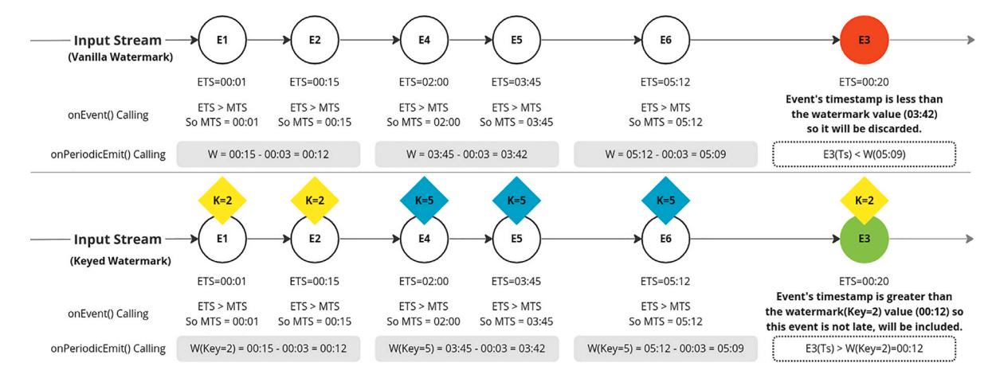
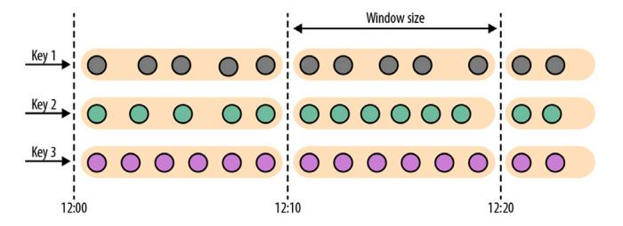
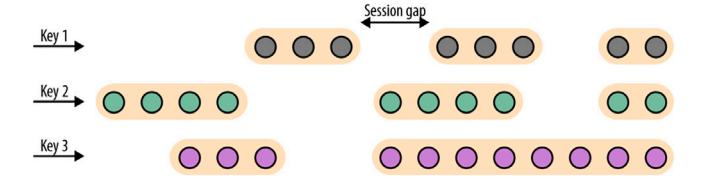
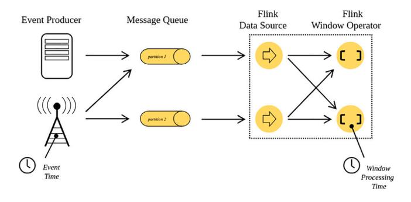
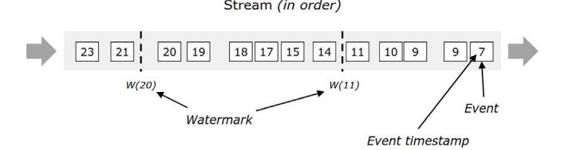
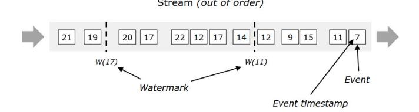
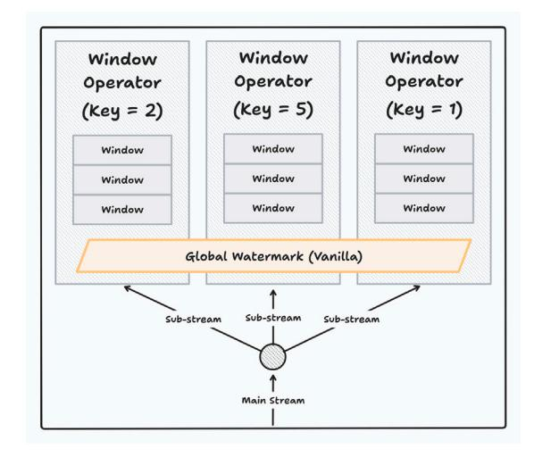
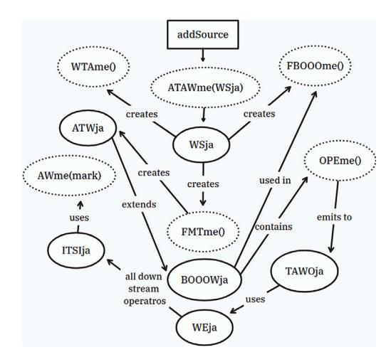
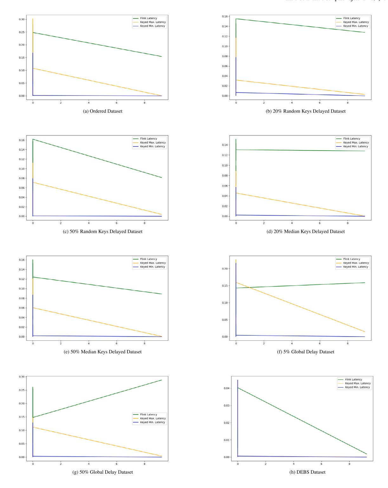
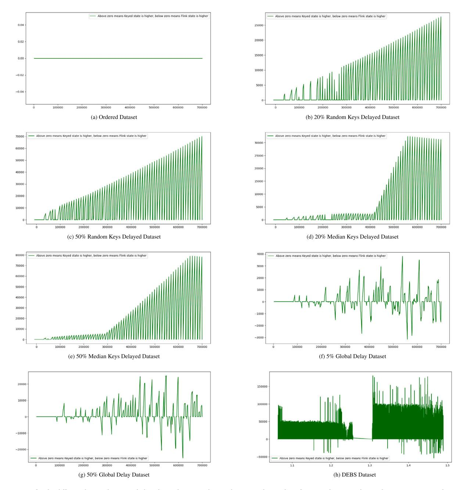

<!-- A3.R94 | source: papers_json/A3.R94/ -->

المحتويات متاحة على [ScienceDirect](https://www.elsevier.com/locate/fgcs)

## Future Generation Computer Systems

الصفحة الرئيسية للمجلة: [www.elsevier.com/locate/fgcs](https://www.elsevier.com/locate/fgcs)





## العلامات المائية المفتاحية: توليد علامات مائية دقيقة التحبب لـ Apache Flink

[Tawfik](#page-12-0) [Yasser](#page-12-0) [a](#page-0-0) ,[∗](#page-0-1) , [Tamer](#page-12-1) [Arafa](#page-12-1) [a](#page-0-0) , [Mohamed](#page-12-2) [ElHelw](#page-12-2) [a](#page-0-0) , [Ahmed](#page-12-3) [Awad](#page-12-3) [b](#page-0-2),[c](#page-0-3)

- ^a^ *School* *of* *Information* *Technology* *and* *Computer* *Science,* *Nile* *University, Giza, Egypt*
- ^b^ *The* *British* *University* *in* *Dubai, Dubai, United* *Arab* *Emirates*
- ^c^ *Cairo* *University, Giza, Egypt*

## معلومات المقالة

*الكلمات المفتاحية:* العلامات المائية المفتاحية، معالجة تدفق البيانات الضخمة، تتبع زمن الحدث، Apache Flink

## الملخص

تستخدم محركات معالجة تدفق البيانات الضخمة، ومنها Apache Flink، تقنيات النوافذ لإدارة تدفقات الأحداث غير المحدودة. يُعد تجميع البيانات ذات الصلة داخل النوافذ أمراً مهماً في نوافذ زمن الحدث لأن له تأثيراً على دقة النتائج. وتؤدي العلامات المائية دوراً محورياً في هذه العملية، فهي طوابع زمنية فريدة تدل على تقدم زمن الحدث. مع ذلك، تُظهر طريقة توليد العلامات المائية المتبعة حالياً في Apache Flink، والتي تعمل على مستوى تدفق الإدخال، تحيزاً نحو التدفقات الفرعية الأسرع، مما يؤدي إلى إسقاط أحداث التدفقات الفرعية الأبطأ. أظهر تحليلنا أن طريقة Apache Flink القياسية لتوليد العلامات المائية تؤدي إلى فقدان نحو 33% من البيانات عندما يتأخر 50% من المفاتيح القريبة من الوسيط. علاوة على ذلك، يتجاوز هذا الفقدان 37% عندما يتأخر 50% من المفاتيح المختارة عشوائياً. في هذه الورقة، نقدّم نهجاً رائداً يُسمى *العلامات* *المائية* *المفتاحية* لمعالجة مشكلة فقدان البيانات ورفع دقة المعالجة إلى ما لا يقل عن 99% في معظم الحالات. تتيح استراتيجيتنا تتبعاً مستقلاً للتقدم عبر إنشاء علامات مائية خاصة بكل تدفق فرعي (مفتاح). في دراستنا، نوضح التعديلات المعمارية وتعديلات واجهة البرمجة اللازمة لدمج العلامات المائية المفتاحية، كما نستعرض تجربتنا في التعامل مع قاعدة شيفرة Apache Flink الواسعة. علاوة على ذلك، نُجري تقييماً مقارناً بين فعالية نهجنا وتقنية توليد العلامات المائية التقليدية من حيث دقة تتبع زمن الحدث، وزمن معالجة العلامة المائية، ونمو الحالة التي يحتفظ بها Flink.

## **1.** **المقدمة**

يطرح النمو الهائل لأجهزة إنترنت الأشياء (IoT) المترابطة، والتي تجاوز عددها 70 مليار جهاز، مجموعة من التحديات الصعبة والاعتبارات الجوهرية في مجال معالجة تدفق البيانات والبنية التحتية الحاسوبية [[1]](#page-11-0). واستجابة لذلك، شهدنا ظهور عدة أنظمة موزعة لمعالجة التدفقات، يُشار إليها غالباً باسم محركات معالجة التدفقات (SPE)، نظراً للتعقيدات المتزايدة المرتبطة بالمعالجة السريعة لأحجام بيانات ضخمة. ومن أمثلة هذه الأنظمة Apache Spark Streaming [[2]](#page-11-1)، وApache Flink [[3]](#page-11-2)، وApache Samza [[4](#page-11-3)]، على سبيل الذكر لا الحصر. توفر هذه الأنظمة قدرات معالجة قابلة للتوسع وموزعة لتدفقات البيانات، وتتحمل الأعطال، وتعمل بأسلوب شبه آني يتماشى مع سرعة توليد البيانات.

نظراً للطبيعة شبه اللانهائية لتدفقات البيانات، يجب على محركات معالجة التدفقات تقسيمها إلى مقاطع محدودة. وفي هذا السياق، يواصل النظام توليد تحديثات للنتائج المرتبطة بهذه المقاطع [[5](#page-11-4)]. ويتم تقطيع التدفق بتطبيق ما يُسمى النوافذ الزمنية [[6,](#page-11-5)[7]](#page-11-6) على تدفق البيانات. ومثال على تطبيقات معالجة التدفقات

حساب متوسط قيم درجة الحرارة التي توفرها المستشعرات المنتشرة في مناطق جغرافية محددة. ولتحقيق هذا الهدف، تُحدّث محركات معالجة التدفقات حساباتها باستمرار عبر تقسيم البيانات إلى، مثلاً، نافذة مدتها خمس دقائق من قراءات درجة الحرارة، وحساب متوسط جديد لمحتوى النافذة. ويستند تقطيع أحداث درجة الحرارة الواردة إلى ما يُسمى *زمن* *الحدث*. أي عبر تتبع سمة الطابع الزمني في حمولة الحدث.

باتباع نموذج معالجة قائم على زمن الحدث [[8]](#page-11-7)، تستمر محركات معالجة التدفقات في تخزين البيانات الواردة مؤقتاً إلى أن تحصل على درجة من اليقين بأن أحداث التدفق الواردة لاحقاً لن تنتمي إلى النافذة الحالية. أي أن محرك المعالجة يعتقد أن ساعة زمن الحدث قد تجاوزت نهاية النافذة. والأسلوب الشائع لتتبع تقدم زمن الحدث يُسمى العلامات المائية [[8](#page-11-7)[,9]](#page-11-8). وتُعتبر السجلات الجديدة الواردة بطابع زمني أقدم من العلامة المائية الحالية متأخرة، وتُتجاهل عموماً من قبل محركات معالجة التدفقات.

تُعد العلامات المائية تقنية شائعة لتتبع تقدم زمن الحدث عبر تدفقات البيانات. وبشكل أساسي، تعمل العلامة المائية كطابع زمني يدل على عدم وجود أي

*البريد* *الإلكتروني:* [tawfekyassertawfek@gmail.com](mailto:tawfekyassertawfek@gmail.com) (T. Yasser).

> ^∗^ الباحث المراسل.

<!-- page 2 -->


***الشكل** **1.** تتبع العلامات المائية وتوليدها في Apache Flink وفي معظم محركات معالجة التدفقات في الأعلى (النهج التقليدي). تتبع العلامات المائية المفتاحية وتوليدها في الأسفل (إسهامنا). ETS تعني الطابع الزمني للحدث وMTS تعني الطابع الزمني الأقصى. وW تشير إلى قيمة العلامة المائية. في هذا المثال، ضُبط التأخير على ثلاث ثوان.*

بيانات لاحقة لزمن العلامة المائية. وعند استقبال علامة مائية، تتضمن العملية إغلاق جميع النوافذ التي تنتهي قبل العلامة المائية، واستخدام محتواها لتحديث النتائج التحليلية. ويؤثر تقدم العلامات المائية تأثيراً مزدوجاً على مقاييس معالجة التدفق: الكمون، وتأخر وصول عناصر البيانات، مما يؤثر في النهاية على الدقة. ويظهر التوازن بين تكرار توليد العلامات المائية والدقة في صورة مفاضلة. فتوليد عدد قليل جداً من العلامات المائية يرفع الكمون، بينما يؤدي التوليد المفرط إلى تأخر وصول عناصر البيانات. وبالتالي، تتأثر الدقة سلباً لأن كثرة العلامات المائية تؤدي إلى إهمال العناصر وحذفها لاحقاً، مما يقلل الدقة. ويُعد حساب تقدم العلامة المائية أساساً نهجاً استدلالياً يعتمد على معرفة المجال. وبشكل عام، يختار مطوّر التطبيق زمن تأخير ثابتاً يعتقد أن البيانات لن تصل بعده أبداً. وتتم مقارنة الطابع الزمني لكل سجل (حدث) وارد بالعلامة المائية الحالية. فإذا كان أكبر من أو يساوي العلامة المائية، يُضاف الحدث إلى المخزن المؤقت ويُستخدم طابعه الزمني لتحديث قيمة العلامة المائية، عبر اختيار القيمة الأكبر بينهما. وإلا، يُعتبر السجل متأخراً ويُسقط من المعالجة اللاحقة. وتوفر بعض محركات معالجة التدفقات سياسات علامات مائية أكثر تطوراً. مع ذلك، فهي مجرد صيغ مختلفة للنهج الموصوف أعلاه. ويوضح [الشكل](#page-1-0) [1](#page-1-0) حساب العلامات المائية وتتبعها. ويُظهر الجزء العلوي من الشكل كيفية تتبع محركات معالجة التدفقات المتقدمة للعلامات المائية. والحدث 3، بالأحمر، يصل متأخراً وبالتالي سيُستبعد من المعالجة اللاحقة.

توفر غالبية محركات معالجة التدفقات مفتوحة المصدر (SPEs) دعماً للعلامات المائية، وتزوّد مطوري التطبيقات بمجموعة من السياسات لتنظيم تقدمها. مع ذلك، يمارس تقدم العلامات المائية تأثيره على التدفق عند مستوى أكثر دقة. ففي حالة تدفق درجة الحرارة مثلاً، تساهم مستشعرات فيزيائية عديدة بقراءاتها في محرك معالجة تدفق واحد عبر تدفق منطقي موحد. وبالتالي، تتحكم قيمة العلامة المائية اللاحقة (الطابع الزمني) في البيانات القادمة من كل هذه التدفقات الفيزيائية الفردية. وهنا، يمثل تدفق درجة الحرارة الإجمالي التدفق المنطقي، بينما تُعتبر قراءات درجة الحرارة من كل مستشعر، والتي يميزها معرّف يُعرف بالمفتاح، تدفقاً فرعياً فيزيائياً. ونتيجة لذلك، تُسقط القياسات من المستشعرات ذات معدلات الإبلاغ الأبطأ بسبب وصولها المتأخر. لذا، تتضرر التدفقات الفرعية الفيزيائية الأبطأ وتصبح النتائج التحليلية المبنية عليها غير دقيقة.

تقدّم هذه الورقة نهجاً جديداً لتتبع العلامات المائية وتوليدها بمستوى أدق من التحبب، يُسمى *العلامات* *المائية* *المفتاحية*. وينطوي هذا الأسلوب على إنشاء ومراقبة علامات مائية مستقلة لكل تدفق فرعي فيزيائي مميز (انظر الجزء السفلي من [الشكل](#page-1-0) [1](#page-1-0)). وباتباع العلامات المائية المفتاحية، سيظل الحدث 3، الذي يُسقط بواسطة التمييز التقليدي للعلامات المائية (الجزء العلوي من [الشكل](#page-1-0) [1](#page-1-0))، خاضعاً للمعالجة.

تم تنفيذ نهجنا المقترح في Apache Flink، وهي منصة رائدة في مجال معالجة التدفقات الموزعة. مع ذلك، يمكن تطبيق الإسهام على محركات معالجة تدفقات أخرى تدعم المعالجة القائمة على زمن الحدث وتتبع تقدمه عبر العلامات المائية. وتتمثل إسهاماتنا في هذه الورقة فيما يلي:

- تُعد العلامات المائية المفتاحية نهجاً دقيق التحبب لتتبع تقدم زمن الحدث يتيح نتائج أكثر دقة بفضل تقليل الأحداث المُسقطة.
- نظراً لأن التنقل في قاعدة شيفرة Apache Flink الضخمة وفهمها استغرقا وقتاً طويلاً في هذا العمل بسبب نقص التوثيق [[10](#page-11-9)]، نُبلغ عن الإسهام التقني المتمثل في توسيع Flink لتحقيق العلامات المائية المفتاحية. ونعتقد أن هذا سيمهد الطريق لإسهامات مستقبلية تهدف إلى توسيع Flink.
- نقدّم تقييماً موسعاً لنهج العلامات المائية المفتاحية مقارنة بالنهج التقليدي في Flink. وباستخدام مجموعات بيانات مختلفة بحالات عدم ترتيب اصطناعية وطبيعية، نقارن دقة النتائج المولدة، وكمون معالجة العلامة المائية، ونمو الحالة التي يحتفظ بها Flink (استهلاك الذاكرة). وتُظهر نتائجنا أن العلامات المائية المفتاحية يمكن أن تحقق فقداناً للبيانات يقارب 0%، بينما يمكن أن تصل العلامات المائية التقليدية إلى فقدان 37% من البيانات، مع عبء إضافي ضئيل على معالجة العلامة المائية وحجم حالة معتدل.

تُنظَّم الأقسام اللاحقة من هذه الورقة على النحو التالي: يشرح القسم [2](#page-1-1) المفاهيم المتعلقة بمعالجة التدفقات، ومفاهيم الزمن، والنوافذ، والعلامات المائية. ويتناول القسم [3](#page-4-0) تفاصيل العلامات المائية المفتاحية، ويوضح التعديلات اللازمة على الآلية الداخلية وواجهات برمجة Flink. ويُناقَش التقييم التجريبي مقارنة بالعلامة المائية التقليدية لـFlink في القسم [4](#page-6-0). ويُعرض العمل ذو الصلة في القسم [5](#page-8-0) قبل أن نختم الورقة ونناقش العمل المستقبلي في القسم [6](#page-10-0).

## **2.** **الخلفية**

تدور معالجة تدفق البيانات [[11](#page-11-10)[–13](#page-11-11)] حول تحليل البيانات فور توليدها. لذا، فهي تتبع صورة مستمرة من معالجة الاستعلامات [[5](#page-11-4)]. ويمكن أن يكون الاستعلام بسيطاً كحساب التجميعات، أو معقداً كتدريب نموذج تعلّم آلي عبر الإنترنت. ويتمثل التحدي الرئيسي في الطبيعة شبه اللانهائية للتدفق. وتُحدَّث نتائج الاستعلام باستمرار مع وصول بيانات جديدة. والهدف هو الحصول على نتائج حديثة بأقل تأخير ممكن (القسم [2.1](#page-2-0)). وبما أننا نعيش في عصر البيانات الضخمة، فنحن بحاجة إلى تعظيم عدد السجلات المعالجة في وحدة الزمن (القسم [2.2](#page-2-1)). وتحقق أنظمة البيانات الضخمة كموناً منخفضاً وإنتاجية عالية عبر استخدام بنية معالجة موزعة يتم فيها تقسيم البيانات إلى أجزاء صغيرة تُعالج بالتوازي.

<!-- page 3 -->

في معالجة تدفق البيانات، يكون التقسيم على مستويين. أولاً، يُقسَّم التدفق المنطقي، مثل تدفق درجة الحرارة في القسم [1](#page-0-4)، إلى عدد من التدفقات الفيزيائية باستخدام معرّف المستشعر (المفتاح). ثانياً، يُقسَّم التدفق الفيزيائي شبه اللانهائي كذلك إلى مجموعات محدودة باستخدام النوافذ [2.3](#page-2-2). وعادة ما تكون النوافذ زمنية. وتؤثر مفاهيم الزمن المختارة (القسم [2.4](#page-2-3)) المستخدمة لتقسيم البيانات إلى نوافذ في دقة النتائج وقابلية إعادة إنتاجها.

وبما أن Flink سيكون محرك المعالجة المستخدَم لتحقيق نهجنا وتنفيذه، سيقدم القسم [2.5](#page-3-0) نظرة عامة على خطوط معالجة Flink لتدفق البيانات.

## *2.1.* *الكمون*

يُعد الكمون [[14]](#page-11-12) مقياس أداء أساسياً في محركات معالجة تدفق البيانات. فهو يقيس الزمن اللازم لمعالجة كل حدث. وتتنافس محركات معالجة التدفقات على تقديم كمون أقل لأن ذلك يؤثر مباشرة في سرعة الحصول على تحديثات الاستعلامات المستمرة. ويمكن قياس الكمون على مستوى كلي أو جزئي. أي الكمون من طرف إلى طرف، أو الكمون عند مشغّل معين في خط المعالجة، مثل الكمون في مشغلات النوافذ والتجميع. ويرتبط الكمون عكسياً بقابلية توسع المشغلات. أي باستخدام انشطار المشغل (التكرار) [[15](#page-11-13)]، يمكن توزيع الحمل على عدد أكبر من نُسخ المشغل، مما يقلل نصيب النسخة الفردية ويُخفض الكمون الإجمالي [[16]](#page-11-14). وفي هذه الورقة، يهمنا قياس كمون مشغّل توليد العلامات المائية. وبما أن نهجنا، كما سيُناقَش في القسم [3](#page-4-0)، سيطبق انشطار المشغل على مشغّل توليد العلامة المائية، فنتوقع أثراً إيجابياً في تقليل الكمون.

## *2.2.* *الإنتاجية*

تُعد الإنتاجية [[17](#page-11-15)] مقياس أداء آخر لأنظمة معالجة البيانات. وهي إرث من أنظمة معالجة البيانات غير الآنية. مع ذلك، تبقى ذات صلة بتقييم أداء محركات معالجة التدفقات. وتقيس الإنتاجية عدد السجلات المُعالجة في وحدة الزمن. وكلما ارتفعت الإنتاجية كان ذلك أفضل. مع ذلك، في محركات معالجة التدفقات، لا يعني الانخفاض في الإنتاجية دوماً ضعف أداء النظام، لأن ذلك يعتمد على معدل وصول الأحداث الذي يعتمد بدوره على معدل توليد المصدر. وعلى غرار الكمون، نريد في هذه الورقة دراسة أثر انشطار مشغّل العلامة المائية على الإنتاجية.

## *2.3.* *النوافذ*

بما أن محركات معالجة التدفقات تتعامل مع تدفقات بيانات غير محدودة، فمن أجل إنتاج تحويلات من هذه التدفقات، يعالج النظام التدفقات الواردة غير المحدودة كفواصل زمنية محددة تُسمى *النوافذ* [[18](#page-11-16)]. والنافذة [[19](#page-11-17)[,20](#page-11-18)] هي فاصل زمني أو عددي محدد، يتيح تجميع الأحداث في حاوية محدودة معرّفة. وتتيح النوافذ إجراء حسابات على تدفقات بيانات محدودة ضمن تدفقات بيانات غير محدودة.

تُعد النوافذ الزمنية الأكثر شيوعاً في معالجة التدفقات [[18](#page-11-16)]. ويمكن أن تكون ذات عرض ثابت أو متغير، ومحتوى متداخل أو منفصل. وفيما يلي، نستعرض أكثر مشغلات النوافذ الزمنية شيوعاً، والمعروفة بالمُخصِّص في سياق Apache Flink.

## *2.3.1.* *النوافذ* *المتدحرجة*

النافذة المتدحرجة [[21]](#page-11-19) هي نافذة زمنية أو عددية ثابتة وغير متداخلة. ويقسّم مشغّل النافذة المتدحرجة التدفق إلى نوافذ ثابتة الحجم. وحجم كل جزء هو معامل للمشغل يُحدَّد وقت تعريف التطبيق. ويوضح [الشكل](#page-2-4) [2](#page-2-4) [1](#page-2-5) كيفية تقسيم النوافذ المتدحرجة للتدفق.


***الشكل** **2.** النوافذ المتدحرجة حيث يُقسَّم التدفق إلى نوافذ ثابتة الحجم غير متداخلة. علاوة على ذلك، يُقسَّم التدفق المنطقي إلى تدفقات فيزيائية حيث يمثل كل صف تدفقاً فيزيائياً، وتمثل الخطوط الرأسية المتقطعة حدود كل نافذة.*


***الشكل** **3.** النوافذ المنزلقة حيث يُقسَّم التدفق إلى نوافذ ثابتة الحجم متداخلة. علاوة على ذلك، يُقسَّم التدفق المنطقي إلى تدفقات فيزيائية حيث يمثل كل صف تدفقاً فيزيائياً.*


***الشكل** **4.** نوافذ الجلسة حيث يُقسَّم التدفق إلى نوافذ متغيرة الحجم غير متداخلة. علاوة على ذلك، يُقسَّم التدفق المنطقي إلى تدفقات فيزيائية حيث يمثل كل صف تدفقاً فيزيائياً.*

## *2.3.2.* *النوافذ* *المنزلقة*

النافذة المنزلقة [[23]](#page-11-21) هي نافذة زمنية أو عددية ثابتة ومتداخلة. ويقسّم مشغّل النافذة المنزلقة التدفق وفق معاملين، حجم النافذة، مماثل للنافذة المتدحرجة، وانزلاق النافذة. فإذا كان انزلاق النافذة مساوياً لعرضها، تختزل النافذة المنزلقة إلى نافذة متدحرجة. وحيث إن انزلاق النافذة عادة أقل من عرضها، تتداخل النوافذ. أي يمكن أن ينتمي الحدث نفسه إلى نافذة واحدة أو أكثر. ويوضح [الشكل](#page-2-6) [3](#page-2-6) كيفية تقسيم النوافذ المنزلقة للتدفق.

## *2.3.3.* *نوافذ* *الجلسة*

نافذة الجلسة [[24](#page-11-22)] هي نافذة زمنية متغيرة وغير متداخلة، وتنتهي النافذة عندما تُبلغ فجوة المهلة المحددة مسبقاً، مما يعني عدم استقبال مزيد من الأحداث ضمن الفاصل المحدد، انظر [الشكل](#page-2-7) [4](#page-2-7) للتوضيح.

## *2.4.* *مفاهيم* *الزمن*

في القسم السابق، ناقشنا الصور الأساسية *للنوافذ* على أساس الزمن. مع ذلك، توجد مفاهيم مختلفة للزمن [[25]](#page-11-23). ويُعد زمن المعالجة وزمن الحدث المفهومين الشائعين للزمن ([الشكل](#page-3-1) [5](#page-3-1)).

في وضع زمن المعالجة [[26](#page-11-24)]، يستخدم محرك معالجة التدفق ساعته الداخلية لتتبع تقدم الزمن وتحديد فتح النوافذ الزمنية وإغلاقها. وفي هذا الوضع، لا يحتاج محرك المعالجة إلى طابع زمني في البيانات الواردة أو يتجاهله ببساطة. وهذا الوضع أسهل في التنفيذ.

> ^1^ [الأشكال](#page-2-4) [2،](#page-2-4) [3،](#page-2-6) [4](#page-2-7) مقتبسة من كتاب Apache Flink [[22]](#page-11-20).

<!-- page 4 -->


***الشكل** **5.** مفاهيم الزمن: زمن المعالجة - حيث تكون الساعة داخلية في محرك المعالجة - وزمن الحدث - حيث تكون الساعة خارجية عن محرك المعالجة وتحتاج آلية، مثل العلامات المائية، لتتبع تقدم الزمن.*


***الشكل** **6.** الأحداث المرتبة: يتطابق الطابع الزمني للأحداث مع ترتيب وصولها.*


***الشكل** **7.** الأحداث غير المرتبة: تصل بعض الأحداث بترتيب غير صحيح. فمثلاً، يصل الحدث ذو الطابع الزمني 9 بعد الحدث ذي الطابع الزمني 11.*

مع ذلك، فهو غير حتمي بمعنى أن تكرار التدفق قد يؤدي إلى تجميع مختلف للعناصر وبالتالي نتائج مختلفة.

من ناحية أخرى، تعتمد معالجة زمن الحدث [[27]](#page-11-25) على الطابع الزمني المضمّن في الحدث من مصدره وقت التوليد. ومعالجة زمن الحدث حتمية وأكثر موثوقية. ويكمن التحدي في أن محرك المعالجة يحتاج إلى الاستدلال على تقدم زمن الحدث من أجل، مثلاً، فتح النوافذ وإغلاقها. علاوة على ذلك، تحتاج أوجه القصور مثل معالجة عدم الترتيب والوصول المتأخر إلى سياسات صريحة للتعامل معها [[28](#page-11-26)].

النتائج بدقة أكبر.

في البيئات الموزعة، قد تتأخر الأحداث بسبب ازدحام الشبكة أو أعطال العقد، مما ينتج عنه أحداث غير مرتبة. وهذا يعني أن الأحداث لا تصل بنفس ترتيب طوابعها الزمنية. وتحتاج محركات معالجة التدفقات إلى آلية للتعامل مع هذه الأحداث غير المرتبة ومعالجتها عبر تقنيات معالجة عدم الترتيب [[29](#page-11-27)[,30](#page-11-28)] لضمان دقة النتائج. ويوضح [الشكلان](#page-3-2) [6](#page-3-2) و[7](#page-3-3) الفرق بين الأحداث المرتبة وغير المرتبة على التوالي.

كما ذُكر سابقاً، يحتاج محرك معالجة التدفق إلى آلية لتتبع تقدم زمن الحدث. وفي الأدبيات، توجد آليات عديدة استخدمتها بنى محركات معالجة تدفقات مختلفة للاستدلال على تقدم زمن الحدث والتصدي للوصول غير المرتب. ومن أمثلة هذه الآليات: الترخي (slack) [[31](#page-11-29)]، ونبضات القلب (heartbeats) [[32]](#page-11-30)، وعلامات الترقيم (punctuations) [[33]](#page-11-31)، والعلامات المائية المنخفضة (low-watermarks) [[34](#page-11-32)]. وتُعد العلامات المائية المنخفضة تعميماً لجميع الآليات الأخرى، ولذلك تُنفَّذ في محركات معالجة التدفقات الحديثة ومفتوحة المصدر، مثل Apache Flink.

## *2.5.* *خطوط* *معالجة* *Flink*

في هذا القسم، نستعرض الوحدات الرئيسية في Apache Flink المتعلقة بتوليد العلامات المائية واستخدامها، بما في ذلك واجهة DataStream API. ونبحث العلاقة بين الأصناف والطرق شائعة الاستخدام، مع التركيز على وظائفها ضمن هذه الوحدات. علاوة على ذلك، نقدّم نظرة عامة مفصّلة عن إنشاء العلامة المائية القياسية في Apache Flink، بما في ذلك مناقشة الأصناف والطرق ذات الصلة. وفي القسم [3](#page-4-0) التالي، نستعرض تعديلاتنا على عملية توليد العلامة المائية التقليدية ونقدّم نهجنا المعدَّل، *العلامات* *المائية* *المفتاحية*.

في Apache Flink، توجد عدة وحدات مهمة مثل FSJmo وFCmo. وتحتوي وحدة FSJmo على أصناف مثل DS وKS وSOSO؛ كما تحتوي على أصناف تُستخدم في عملية توليد العلامة المائية وآليات النوافذ، مثل TAWO وWO وITSI وغيرها. وتحتوي وحدة FCmo أيضاً على عدة أصناف تُستخدم في توليد العلامة المائية، مثل WS وBOOOW وWG وWO وغيرها. ولمزيد من التبسيط في الإشارة إلى الوحدات والأصناف والطرق، نستخدم اختصارات كما في [الجدول](#page-3-4) [1](#page-3-4)

يمثل صنف DS تدفق العناصر، ويحتوي التحويل الذي يمكن إجراؤه على التدفق طرقاً مثل KBme وMme وPROme وATAWme وPRIme. تستخدم الطريقة KBme(key) المفتاح الممرَّر لإنشاء *KS* جديد، وهو تدفق فرعي فيزيائي، مقسَّم بحسب ذلك المفتاح من DS المنطقي المُدخَل؛ ويطبّق التحويل Mme دالة معالجة لإنشاء تدفق محوَّل جديد، ويستخدم التحويل ATAWme(WS) استراتيجية WS الممرَّرة لتعيين الطوابع الزمنية للعناصر وتوليد العلامات المائية. ويحتوي صنف KS الذي يمثل التدفق المقسَّم عدة طرق مهمة مثل: Wme وRme، بالإضافة إلى الطريقة ATAKWme التي أضفناها والتي سنناقشها بالتفصيل لاحقاً في الأقسام التالية. يُستخدم التحويل Wme لإنشاء تدفق ذي نوافذ لـKS المُدخَل؛ ويُختزل التحويل Rme البيانات المُدخَلة على تدفق البيانات المُجمَّع بحسب موضع المفتاح المُعطى. انظر القائمة البرمجية [1](#page-3-5) التي توضح مثالاً على خط أنابيب واجهة برمجة Apache Flink.

```
env. addSource (source).
 assignTimestampsAndWatermarks (
 watermarkStrategy ).keyBy(key).window(
 windowType ).reduce( reduceFunction )...
```

*القائمة البرمجية 1: واجهة برمجة خط أنابيب Flink*

<!-- page 5 -->


***الشكل** **9.** البنية عالية المستوى للعلامة المائية التقليدية.*

## **3.** **العلامات** **المائية** **المفتاحية**

في هذا القسم، نُفصّل إسهامنا في تعزيز وتوسيع توليد العلامة المائية المنخفضة وتتبعها في محركات معالجة التدفقات. وبما أننا حققنا إسهامنا فوق Apache Flink، سنبدأ بوصف آلية العلامة المائية التقليدية في Flink. بعد ذلك،

## *3.1.* *العلامات* *المائية*

من أجل السماح بمعالجة منخفضة الكمون في محركات معالجة التدفقات، قد يواجه النظام أحداثاً متأخرة تصل بترتيب غير صحيح مما يؤثر على النوافذ فتبقى مفتوحة إلى حين استقبال الأحداث المتأخرة. وتُعد العلامة المائية [[9,](#page-11-8)[34](#page-11-32)[,35](#page-11-33)] تقنية موجودة في معظم محركات معالجة التدفقات لحل هذه المشكلة والسماح بإغلاق النافذة لإصدار نتائجها. والعلامة المائية هي طابع زمني يُحقن في تدفق الأحداث ([الشكل](#page-4-1) [8](#page-4-1)). وعندما يلاحظ مشغّل ذو حالة في خط المعالجة، مثل مشغّل نافذة، العلامة المائية، يعلم أنه لا يُتوقع وصول مزيد من الأحداث بطوابع زمنية أقل من العلامة المائية مستقبلاً. لذا، يمكن للمشغّل، مثلاً، إغلاق كل النوافذ المفتوحة التي طابعها الزمني الختامي أقل من العلامة المائية، وتسليم محتوى النافذة للمعالجة اللاحقة، مثل حساب متوسط.

العلامة المائية أحادية الاتجاه. أي أنها قيمة غير متناقصة للطابع الزمني. ويمكن تحقيق ذلك عبر أخذ القيمة الأكبر بين قيمة العلامة المائية الحالية والطابع الزمني للسجل الجديد الوارد على التدفق. وبشكل دوري، تُصدَر علامة مائية جديدة على التدفق لتُلاحَظ وتُعالَج من بقية المشغلات في خط المعالجة.

## *3.2.* *العلامة* *المائية* *التقليدية* *في* *محركات* *معالجة* *التدفقات*

يتتبع توليد العلامة المائية التقليدي في محركات معالجة التدفقات، مثل Apache Flink، تقدم زمن الحدث على مستوى مصدر البيانات. وفي سياق المثال الجاري، مصدر البيانات هو تدفق درجة الحرارة


***الشكل** **10.** تدفق الاعتماديات لخط الأنابيب والعلامة المائية التقليدية. البيضاوات ذات الحدود الصلبة تمثل الأصناف، بينما ذات الحدود المتقطعة تمثل الطرق.*

مصدر البيانات. وكما هو الحال مع جميع أنظمة معالجة التدفقات الموزعة، يدعم Flink تقسيم تدفق المصدر (المنطقي) إلى عدة تدفقات فيزيائية فرعية. ويُعد هذا التقسيم أساس توسيع نطاق الحسابات والتحليلات على تدفق البيانات. مع ذلك، يبقى مشغّل العلامة المائية WO مشغّلاً وحيداً حيث تُنشأ نسخة واحدة فقط تتتبع تقدم زمن الحدث على مستوى التدفق المنطقي. ويقدّم [الشكل](#page-4-2) [9](#page-4-2) نظرة معمارية عالية المستوى على توليد العلامة المائية التقليدية.

في Apache Flink، نقطة البداية لتوليد العلامة المائية التقليدي هي الطريقة ATAWme(WS)؛ وتُعرِّف WS كيفية توليد العلامات المائية، وتوفر أيضاً TA المستخدَمة لتعيين الطوابع الزمنية لعناصر التدفق. وتحتوي على طرق مثل WTAme وFMTme وFBOOOme. وتنشئ الطريقة WTAme صنف WS جديداً يستخدم TA لتعيين طابع زمني لكل عنصر؛ وتنشئ الطريقة FMTme صنف WS جديداً من النوع ATW الذي يولّد علامات مائية دورية. ويرث الصنف ATW من الصنف BOOOW، الذي يُستخدم أيضاً في الطريقة FBOOOme لتوليد علامات مائية بسياسة WS معرَّفة من قبل المستخدم.

يحتوي BOOOW على طرق مثل الطريقة OPEme، التي تُستدعى افتراضياً كل 200 ميلي ثانية؛ وتستخدم الطريقة متغير maxTimestamp المعرَّف في BOOOW لتوليد علامة مائية جديدة تُمرَّر إلى BOOOW. بعد ذلك، قد يُصدَر صنف WE العلامة المائية لإيصالها إلى جميع المشغلات اللاحقة التي قد تستخدمها؛ ويحدث هذا في صنف TAWO؛ ويحتوي هذا الصنف على عدة طرق مثل OELme التي تصل إلى كل عنصر جديد وترسله إلى BOOOW للحفاظ على maxTimestamp المُلاحَظ حتى الآن. انظر القائمة البرمجية [2](#page-4-3) و[الشكل](#page-4-4) [10](#page-4-4).

```
onPeriodicEmit ():
 emitWatermark ( watermark (maxTimestamp -
 outOfOrderness -1))
emitWatermark ():
 if mark > currentWatermark :
 currentWatermark = mark
 emit( watermark (mark))
```

*القائمة البرمجية 2: توليد العلامة المائية التقليدية*

من زاوية أخرى، يستخدم صنف WO خدمة المؤقت ITSI التي تحتفظ بطابور مؤقتات (المؤقت هو طابع الانتهاء الزمني لنافذة). وتستقبل الطريقة AWme(watermark) العلامة المائية المُصدَرة سابقاً وتحافظ على متغير currentWatermark. ويتكرر WO على جميع المؤقتات والنوافذ الجارية. ولكل مؤقت، إذا كانت قيمته أقل من أو تساوي قيمة العلامة المائية، فهذا يعني وجوب إغلاق النافذة وتمرير محتواها للمعالجة المناظرة، مثل التجميع، انظر القائمة البرمجية [3](#page-5-0) لمثال على إطلاق العلامة المائية التقليدية.

<!-- page 6 -->


***الشكل** **11.** البنية عالية المستوى للعلامة المائية المفتاحية.*


***الشكل** **12.** تدفق الاعتماديات لخط الأنابيب والعلامات المائية المفتاحية.*

```
advanceWatermark (mark):
 currentWatermark = mark
 while queue != empty:
 if queue.timer.ts <= mark:
 pop(timer)
 onEventTime (timer)
```

*القائمة البرمجية 3: إطلاق نافذة العلامة المائية التقليدية*

## *3.3.* *توسيع* *نطاق* *العلامات* *المائية* *(العلامات* *المائية* *المفتاحية)*

كما نوقش في القسم [1](#page-0-4)، تعاني بنية توليد العلامة المائية التقليدية المُفصَّلة في القسم السابق من عدة عيوب. أولاً، بما أن محركات معالجة التدفقات، مثل Flink، تحتفظ بنسخة مشغّل وحيدة، فهذا يتعارض مع الطبيعة القابلة للتوسع لهذه الأنظمة الضخمة. ثانياً، بما أن قيمة العلامة المائية تُحفَظ على مستوى التدفق المنطقي، تتضرر التدفقات الفيزيائية الأبطأ بحكم التصميم لأن بياناتها تميل إلى الإسقاط بواسطة محرك المعالجة نظراً لأن السجلات الواردة من التدفقات الفيزيائية الأسرع الأخرى ستُقدّم العلامة المائية بوتيرة أعلى. وأخيراً وليس آخراً، يكون التعافي من الأعطال في النهج التقليدي أبطأ وأكثر كلفة. ففي حال تعطل العقدة المستضيفة لمشغّل العلامة المائية، ستتوقف جميع المشغلات اللاحقة، منتظرة تعافي مشغّل العلامة المائية.

يحل إسهامنا المتمثل في *العلامات* *المائية* *المفتاحية*[2](#page-5-1) القيود المذكورة أعلاه. مع ذلك، نسمح لمطوّر التطبيق بضبط توليد العلامة المائية باستخدام النهج التقليدي (المنطقي) أو النهج المفتاحي (الفيزيائي). وفي سياق Flink، يمثل إسهامنا تغييراً جوهرياً في واجهات البرمجة.

مع العلامات المائية المفتاحية، يُتتبَّع تقدم زمن الحدث للتدفقات الفيزيائية المختلفة بشكل مستقل. لذا، سيُسقَط عدد أقل من السجلات من التدفقات الفيزيائية الأبطأ. ويؤكد تقييمنا التجريبي في القسم [4](#page-6-0) هذا الادعاء تجريبياً. ولتتبع العلامات المائية المفتاحية، نسمح بتوسيع نطاق مشغّل العلامة المائية. أي نشر عدة نسخ من المشغّل. ونتيجة لذلك، ينخفض كمون معالجة العلامة المائية لأن جميع نسخ المشغّل تعمل بالتوازي، أي التوازي على مستوى البيانات. وتؤكد تجاربنا هذا الادعاء تجريبياً أيضاً. وأخيراً، ينبغي أن يكون التعافي من الأعطال أسرع لأن المشغلات اللاحقة فقط لنسخة مشغّل العلامة المائية المتعطلة ستتوقف. وينبغي أن تستمر جميع المشغلات الأخرى في العمل بشكل طبيعي. ويوضح [الشكل](#page-5-2) [11](#page-5-2) بنية العلامات المائية المفتاحية المقترحة.

```
env. addSource (source).keyBy(key).
 assignTimestampsAndKeyedWatermarks (
 keyedWatermarkStrategy ).window(
 windowType )...
```

*القائمة البرمجية 4: واجهة برمجة العلامة المائية المفتاحية*

ولتنفيذ *العلامات* *المائية* *المفتاحية* في Apache Flink، وسّعنا جميع أصناف العلامات المائية لقبول المفتاح، وصنف KBOOOW باعتباره النسخة المفتاحية من صنف BOOOW. علاوة على ذلك، أنشأنا الطريقة ATAKWme لـKS. وتوضح القائمة البرمجية [4](#page-5-3) التغييرات في واجهات البرمجة التي سيستخدمها مطورو التطبيقات. ومقارنة بخط الأنابيب التقليدي في القائمة البرمجية [1](#page-3-5)، يمكننا ملاحظة انتقال موضع سياسة العلامة المائية إلى ما بعد الطريقة KBme. وهذا يشير إلى توليد العلامات المائية وتتبعها على المستوى الفيزيائي (المفتاحي) بدلاً من عالمياً على مستوى المصدر (المنطقي). وحدّثنا الطريقة OEVme للحفاظ على خريطة تجزئة (Hash Map) من المفاتيح وأقصى الطوابع الزمنية. وهذا يتيح تتبع أقصى طابع زمني مُلاحَظ لكل مفتاح بدلاً من عالمياً. وحدّثنا OPEme لإصدار علامة مائية جديدة لكل مفتاح عبر التكرار على خريطة التجزئة، انظر القائمة البرمجية [5](#page-5-4). ونُصدر ليس فقط الطابع الزمني بل المفتاح نفسه أيضاً. وفي [الشكل](#page-5-5) [12](#page-5-5) يمكننا رؤية تدفق خط أنابيب Flink في حالة استخدام العلامات المائية المفتاحية؛ إذ تُستدعى الطريقة KBme مباشرة بعد الطريقة addSource لتقسيم التدفق الرئيسي إلى تدفقات فرعية، ثم تستخدم الطريقة ATAKWme صنف KeyedWatermarkStrategy لتوليد علامة مائية منفصلة لكل تدفق فرعي وارد. ويستخدم صنف KeyedWatermarkStrategy عدة طرق، مثل الطريقة FMTme، لتحديد آلية التوليد. وتُعرَّف إحدى هذه الآليات بواسطة صنف KBOOOW، الذي يستخدم OPEme، والذي يولّد ويُصدر علامة مائية جديدة لكل مفتاح (تدفق فرعي) كل 200 ميلي ثانية افتراضياً. وتُرسَل العلامة المائية المولَّدة إلى صنف KTAWO، الذي يستخدم صنف KWE لإصدار العلامة المائية المستلَمة لجميع المشغلات اللاحقة. ومن المشغلات اللاحقة التي ستستخدم العلامة المائية صنف ITSI، الذي يستخدم العلامة المائية لإطلاق وبدء الحسابات بمساعدة صنف WO لجميع النوافذ التي طابعها الزمني الختامي أقل من قيمة العلامة المائية لذلك المفتاح المحدد. أقل من قيمة العلامة المائية لذلك المفتاح المحدد.

```
onPeriodicEmit ():
 for each k in maxTimestamps :
 emitWatermark ( watermark (
 maxTimestamps .get(k),k))
emitWatermark (mark , key):
 if mark > keysAndWatermarks .get(key):
 keysAndWatermarks .put(key , mark)
```

> ^2^ سُميت مفتاحية لأنها تتتبع العلامة المائية لكل *مفتاح* تقسيم للتدفق الفرعي الفيزيائي.

<!-- page 7 -->

```
emitWatermark ( watermark (mark , key
 ))
```

*القائمة البرمجية 5: توليد العلامة المائية المفتاحية*

أضفنا طريقة جديدة AKWme(key, watermark) في صنف ITSI، تُستدعى من المشغّل الأصل في حال لم يكن مفتاح العلامة المائية فارغاً، أي في حالة العلامات المائية المفتاحية؛ وتحافظ الطريقة على خريطة تجزئة لكل مفتاح وطابعه الزمني المناظر للعلامة المائية، وتتكرر فقط على طابور المؤقتات الخاص بذلك المفتاح. ونُطلق النوافذ إذا كان طابع المؤقت الزمني أقل من أو يساوي قيمة العلامة المائية؛ انظر القائمة البرمجية [6](#page-6-1).

```
advanceKeyedWatermark (mark , key):
 watermarksAndKeys .put(key , mark)
 queue = hashmapOfQueue .get(key)
 while queue != empty:
 if queue.timer.ts <= mark:
 pop(timer)
 onEventTime (timer) #trigger
 to fire the window
```

*القائمة البرمجية 6: إطلاق نافذة العلامة المائية المفتاحية*

## **4.** **التقييم** **التجريبي**

لمعالجة العلامة المائية؟

نفَّذنا نهجنا على نسخة متفرعة (fork) من Apache Flink. ولتقييم قيمة توليد العلامات المائية المفتاحية مقارنة بتوليد العلامة المائية التقليدية (دقيقة التحبب)، أجرينا عدة تجارب للإجابة عن أسئلة البحث التالية:

- **RQ1**: هل تقلل العلامات المائية المفتاحية عدد الصفوف المُسقطة؟
- **RQ2**: كيف يؤثر توليد العلامات المائية المفتاحية على الكمون
- **RQ3**: كيف يؤثر توليد العلامات المائية المفتاحية على نمو حجم الحالة المحفوظة؟

يقيّم **RQ1** ما إذا كنا قد حققنا الهدف النهائي المتمثل في تقليل عدد السجلات المُسقطة الناجمة عن معالجة عدم الترتيب. ويتمثل الأثر المباشر لذلك في زيادة دقة أي حساب يُجرى على هذه العناصر، مثل تجميعها في نوافذ وحساب قيمة تجميعية. ويُتوقع أن يولّد تتبع العلامة المائية المفتاحية عدداً أكبر بكثير من العلامات المائية. ويُعنى **RQ2** بقياس أثر معالجة هذا العدد الأكبر من العلامات المائية على كمون معالجتها، بينما يُعنى **RQ3** بالزيادة المحتملة في حجم الحالة، إذ يُتوقع أن يحتفظ المحرك بعدد أكبر من النوافذ المفتوحة مقارنة بتتبع العلامة المائية دقيق التحبب.

## *4.1.* *الإعداد* *التجريبي*

للإجابة عن سؤال البحث المذكور أعلاه، طوّرنا خط أنابيب بسيط نقرأ فيه من مصدر تدفقي ونحسب عدد العناصر في نافذة مدتها 10 ثوان. وشغّلنا خط الأنابيب لتتبع العلامة المائية الأصلي لـFlink ولعلاماتنا المائية المفتاحية.

شغّلنا تجاربنا على جهاز افتراضي على Google Cloud Platform يحتوي على 8 أنوية معالج Intel Cascade Lake من فئة x86/64-bit، مع 32 جيجابايت ذاكرة رئيسية، يعمل بنظام Ubuntu 22.10، وحجم قرص 100 جيجابايت. واستخدمنا Docker لبناء عنقود Apache Flink. وأنشأنا صورة Docker من نسخة Flink المعدَّلة بإضافة العلامات المائية المفتاحية، وأنشأنا من تلك الصورة ثلاثة حاويات. تعمل واحدة كمدير مهام، بذاكرة 4 جيجابايت ونواة معالج واحدة، والأخريان كمديري مهام، بذاكرة 12 جيجابايت وأربع نوى معالج لكل منهما.

استخدمنا مجموعة بيانات معيار Linear Road.[3](#page-6-2) وLinear Road هي محاكاة لمدينة كبرى مساحتها 100 ميل عرضاً و

طولاً، وتتكون من 10 طرق سريعة متوازية. ويصف كل صف في مجموعة البيانات معرّف سيارة، وسرعة، وطريقاً، واتجاهاً، والطابع الزمني للسجل. وتحتوي مجموعة البيانات على نحو 6 سجلات. وفي تجاربنا، نستخدم فقط معرّف السيارة (كمفتاح مصدر البيانات)، والطابع الزمني للسجل، والسرعة. وتحتوي مجموعة البيانات على أكثر من

بيانات Linear Road مرتبة. ولإدخال بيانات غير مرتبة، أعددنا ست نسخ مختلفة من مجموعة البيانات. في النسختين الأولى والثانية، اخترنا عشوائياً 20% و50% من معرّفات السيارات الفريدة وأخّرنا طوابعها الزمنية عمداً بمقدار 10 ثوان. وفي النسختين الثالثة والرابعة، أدخلنا تأخيراً عاماً مدته 10 ثوان ضمن 5% و50% من السجلات على التوالي. وفي النسختين الخامسة والسادسة، رتّبنا البيانات بحسب عدد العناصر الموجودة لكل مفتاح، ثم اخترنا 20% و50% من المفاتيح حول الوسيط وأخّرنا طوابعها الزمنية عمداً بمقدار 10 ثوان لإدخال التأخير.

استخدمنا أيضاً تحدي DEBS 2013 [[36](#page-11-34)]، الذي يحتوي على شكل غير معروف من عدم الترتيب. وتحتوي مجموعة البيانات على نحو 50 سجلاً. وأسقطنا كذلك فقط المفتاح والطابع الزمني وقيمة حمولة الحدث.

أجرينا التجارب باستخدام إعدادات مختلفة للتوازي لمشغلي العلامة المائية والنافذة. واستخدمنا درجات توازي 2، 4، 8. ويحتوي مستودعنا على GitHub[4](#page-6-3) على كامل شيفرة Apache Flink المعدَّلة والموسَّعة إلى جانب خطوط الأنابيب التجريبية.

## *4.2.* *النتائج*

في هذا القسم، نُبلغ عن التجارب التي أجريناها للإجابة تجريبياً عن أسئلة البحث الثلاثة التي طرحناها في القسم السابق.

## *4.2.1.* *RQ1:* *هل* *تقلل* *العلامات* *المائية* *المفتاحية* *عدد* *الصفوف* *المُسقطة؟*

كنقطة انطلاق، استخدمنا مجموعة بيانات Linear Road المرتبة للتحقق من أن العلامات المائية التقليدية والمفتاحية تحسب العدد نفسه من النوافذ بالعدد نفسه من العناصر. وعالجت النوافذ المحسوبة باتباع النهجين 6،178،736 عنصراً بدقة ∼99.99%. وتُظهر النتيجة أنه على البيانات المرتبة، يعمل مشغّل العلامة المائية المفتاحية بسلاسة، مماثلاً لمشغّل العلامة المائية التقليدي. ونستخدم هذه النتائج كخط أساس، عند بدء معالجة مجموعات البيانات غير المرتبة المختلفة.

يلخّص [الجدول](#page-7-0) [2](#page-7-0) نتائج الدقة للوصول غير المرتب. وتُحسب الدقة كنسبة إجمالي عدد السجلات المُلتقَطة ضمن النوافذ المولَّدة إلى إجمالي عدد السجلات في مجموعة البيانات.

بالنسبة لمجموعات البيانات غير المرتبة، يُسقط مشغّل العلامة المائية المفتاحية عدداً أقل من السجلات المتأخرة في معظم الحالات. وثمة استثناء هو مجموعة بيانات التأخير العام بنسبة 5%. والفرق في الدقة في هذه المجموعة ضئيل مقارنة بالحالة التقليدية. وبتحليل البيانات، وجدنا أن التأخير موزَّع بين جميع المفاتيح بنمط شبه منتظم. لذا، يتأثر توليد العلامة المائية المفتاحية بهذا الوصول غير المرتب المنتظم.

وملاحظة أخرى مثيرة للاهتمام تتعلق بأثر التوازي على الدقة. فبالنسبة للبيانات غير المرتبة، ترتبط معالجة Flink للنوافذ استجابة للعلامات المائية سلبياً بشكل عام بدرجة التوازي، بينما تستفيد معالجة العلامات المائية المفتاحية للنوافذ من زيادة التوازي. ويعود ذلك إلى أن Flink ينشر مشغّل علامة مائية واحداً فقط لكل مصدر. من ناحية أخرى، يمكن للعلامات المائية المفتاحية نشر عدد من مشغلات العلامة المائية بقدر درجة التوازي. مع ذلك، يخصص كلا النهجين عدداً من مشغلات النوافذ بقدر درجة التوازي. وفي حالة Flink، تُبلَّغ العلامة المائية نفسها لجميع مشغلات النوافذ اللاحقة. لذا، في نهاية معالجة التدفق، يبقى عدد أكبر من النوافذ لكل عملية (خيط) مفتوحاً، بانتظار العلامة المائية التالية. وفي حالة العلامة المائية المفتاحية، يخصص Flink مشغّل العلامة المائية ومشغّل النافذة لنفس العملية، لذا لا يكاد يوجد نقل للعلامة المائية

> ^3^ [http://infolab.stanford.edu/stream/cql-benchmark.html](http://infolab.stanford.edu/stream/cql-benchmark.html)

> ^4^ [https://github.com/TawfikYasser/Keyed-Watermarks-in-Apache-Flink](https://github.com/TawfikYasser/Keyed-Watermarks-in-Apache-Flink)

<!-- page 8 -->

بين العمليات، وبالتالي عدد أقل من النوافذ غير المُعالَجة المتبقية على كل عملية في النهاية. وقد يبرر هذا السلوك جزئياً سبب انخفاض دقة العلامة المائية المفتاحية أحياناً عن دقة علامات Flink المائية عند درجة توازي منخفضة، مثل حالة التأخير العام بنسبة 5%. وتحتوي مجموعة بيانات DEBS على نسبة غير معروفة من البيانات غير المرتبة. مع ذلك، يمكن لنهج العلامات المائية المفتاحية معالجة كل الصفوف تقريباً في مجموعة البيانات، بينما يُسقط النهج التقليدي 5% من الصفوف في أفضل الحالات.

المكسب في الدقة للعلامات المائية المفتاحية ليس خطياً مع درجة التوازي. ودراسة السبب بعمق أكبر تتطلب مجموعة أخرى من التجارب المخصصة بأنماط أكثر تحكماً لإدخال عدم الترتيب في بيانات الإدخال لفهم السلوك بشكل أفضل. وهذا موضوع للعمل المستقبلي.

تجيب النتائج في [الجدول](#page-7-0) [2](#page-7-0) تجريبياً عن **RQ1** بالإيجاب لأن توليد العلامة المائية المفتاحية يُسقط عموماً عدداً أقل من السجلات مقارنة بتوليد العلامة المائية التقليدية.

## *4.2.2.* *RQ2:* *كيف* *يؤثر* *توليد* *العلامات* *المائية* *المفتاحية* *على* *كمون* *معالجة* *العلامة* *المائية؟*

بالانتقال إلى **RQ2**، يولّد مشغّل العلامة المائية التقليدية عدداً أقل من العلامات المائية مقارنة بالمشغّل المفتاحي. والسلوك الافتراضي لـFlink هو التحقق من قيمة علامة مائية جديدة كل 200 ميلي ثانية. وبافتراض 10 مفاتيح فريدة لكل مصدر تصل باستمرار، سيولّد مشغّل العلامة المائية المفتاحية 10 علامات مائية كل 200 ميلي ثانية مقارنة بعلامة مائية واحدة فقط من مشغّل العلامة المائية التقليدي. من ناحية أخرى، عند استقبال علامة مائية، يُتوقع أن يعالج مشغّل النافذة التقليدي، وليس بالضرورة يُغلق، عدداً أكبر من نسخ النوافذ مقارنة بمشغّل نافذة في حالة العلامة المائية المفتاحية. وبناء على هذه الملاحظة، أجرينا مجموعتنا الثانية من التجارب لتتبع الكمون في معالجة العلامات المائية. ونحسب كمون زمن المعالجة [[37]](#page-11-35). ونحسب الفرق بين الطابع الزمني عند توليد علامة مائية عند مشغّل العلامة المائية المعني والطابع الزمني عند معالجة مشغّل النافذة المستقبِل لآخر نافذة استجابة لاستقبال العلامة المائية.

يحتوي [الجدول](#page-8-1) [3](#page-8-1) على الكمون بالثواني لجميع مجموعات البيانات بدرجات توازي 2 و4 و8. حسبنا النتائج عبر تسجيل الطابع الزمني عند توليد العلامة المائية والطابع الزمني لآخر استخدام لها. وفي حالة Flink التقليدية، سجّلنا قيمة العلامة المائية وطابعها الزمني. وسجّلنا قيمة العلامة المائية والمفتاح والطابع الزمني للعلامة المائية المفتاحية. لذا، نميّز بين

القيمة الدنيا والقيمة القصوى للعلامات المائية المفتاحية لأن قيمة العلامة المائية نفسها قد تظهر لمفاتيح مختلفة. وأخيراً، حسبنا مئينيات الكمون *.، .، .*، و(90، 95، 99) لـFlink عبر تجميع النتائج بحسب قيمة العلامة المائية، وبالنسبة للعلامات المائية المفتاحية، جمّعنا النتائج بحسب العلامة المائية والمفتاح وأنتجنا كمون *.* و*.* الموجود لكل علامة مائية. وكما هو موضح في [الجدول](#page-8-1) [3](#page-8-1)، تفرض معالجة العلامة المائية المفتاحية عبئاً أقل. أي كموناً أقل. علاوة على ذلك، ينخفض الكمون مع زيادة التوازي. ومقارنة بالحالة التقليدية، تتحسن مئينية الكمون بأكثر من 50% في معظم الحالات. وفي حالات قليلة جداً، يكون كمون معالجة العلامة المائية المفتاحية، في الحالة القصوى، أعلى قليلاً من الحالة التقليدية. مع ذلك، يبقى KMINWM دائماً أقل من الحالة التقليدية. وهذا يعني أن خط الأنابيب سيبدأ في إنتاج نتائج أبكر من خط الأنابيب التقليدي.

ولمعرفة كيفية تطور كمون المعالجة مع تقدم التدفق، رسمنا السلوك لأعلى درجة توازي في تجاربنا، أي 8. ونقارن كمون العلامة المائية لـFlink بالكمون الأدنى والأقصى لكمون العلامة المائية المفتاحية. ويُحسب كمون Flink كالفرق بين وقت توليد العلامة المائية عند مشغّلها والوقت الذي أنهى فيه مشغّل النافذة اللاحق معالجة آخر نافذة أُطلقت بواسطة العلامة المائية المناظرة. ويُحسب كمون العلامة المائية المفتاحية، من ناحية أخرى، بنفس الطريقة لكن لكل مفتاح، لذا قد تظهر العلامة المائية أكثر من مرة بمفاتيح مختلفة؛ وفي هذه الحالة، جمّعنا نتائج الكمون بحسب العلامة المائية والمفتاح، ولكل علامة مائية لدينا قيمة كمون بمفاتيح مختلفة. لذا، نحسب أقصى كمون مفتاحي كالعلامة المائية بمفتاح ذي أقصى كمون، وأدنى كمون مفتاحي ككمون نفس العلامة المائية لكن بالمفتاح ذي أدنى كمون.

بالنسبة لمجموعة البيانات المرتبة في [الشكل](#page-9-0) [13(أ)](#page-9-0) يمكننا ملاحظة أنه حتى أقصى كمون مفتاحي بدأ أعلى من كمون Flink، لكن مع الوقت (عبر العلامات المائية)، ينخفض أقصى كمون مفتاحي ليصل إلى الصفر تقريباً، وأيضاً يصبح أقل من كمون Flink. وتقريباً نفس الشيء بالنسبة لمجموعة بيانات 5% في [الشكل](#page-9-1) [13(و)](#page-9-1) يمكننا ملاحظة أن أقصى كمون مفتاحي بدأ أعلى من كمون Flink؛ مع ذلك، انخفض الكمون مع الوقت.

بالنسبة لمجموعات البيانات ذات المفاتيح العشوائية المتأخرة بنسبة 20% و50%، ومجموعة بيانات المفاتيح المتأخرة حول الوسيط بنسبة 50%، يمكننا ملاحظة أن أقصى كمون مفتاحي يبدأ أقل من كمون Flink وينخفض أيضاً مع الوقت في [الشكل](#page-9-1) [13(ب)](#page-9-1)، و[الشكل](#page-9-1) [13(ج)](#page-9-1)، و[الشكل](#page-9-1) [13(د)](#page-9-1) على التوالي.

بالنسبة لمجموعة بيانات المفاتيح المتأخرة حول الوسيط بنسبة 20%، يمكننا ملاحظة أن كمون Flink أعلى من أقصى كمون مفتاحي وبنفس الكمون تقريباً مع الوقت، وفي الوقت نفسه أقصى كمون مفتاحي أقل من كمون Flink وينخفض مع الوقت، كما في [الشكل](#page-9-1) [13(د)](#page-9-1).

بالنسبة لمجموعة بيانات التأخير العام بنسبة 50%، وجدنا أن أقصى كمون مفتاحي أقل من كمون Flink وينخفض مع الوقت، إضافة إلى أن كمون Flink يزداد مع الوقت، كما في [الشكل](#page-9-1) [13(ز)](#page-9-1). وأخيراً، بالنسبة لمجموعة بيانات DEBS، نرى أنه رغم انخفاض كمون Flink مع الوقت، فإن أقصى كمون مفتاحي يقارب أدنى كمون مفتاحي، وبشكل عام أقل من 10 ميلي ثانية، كما في [الشكل](#page-9-1) [13(ح)](#page-9-1).

للإجابة عن **RQ2**، يمكننا أن نستنتج أن معالجة العلامة المائية المفتاحية تفرض عبئاً أقل، أي كموناً أقل، من معالجة العلامة المائية التقليدية.

## *4.2.3.* *RQ3:* *كيف* *يؤثر* *توليد* *العلامات* *المائية* *المفتاحية* *على* *نمو* *حجم* *الحالة* *المحفوظة؟*

بالانتقال إلى **RQ3**، وعلى غرار **RQ2**، يحتفظ مشغّل العلامة المائية التقليدية بعناصر النافذة نفسها في حالة، أي في الذاكرة، وعندما يتجاوز زمن الحدث الطابع الزمني الختامي للنافذة، ينظّف مشغّل النافذة حالتها. ويُتوقع أن تحتفظ العلامات المائية المفتاحية بمزيد من العناصر في الحالة لأن لدينا أكثر من علامة مائية واحدة للمفاتيح الفريدة. وبناء على هذه الملاحظة، أجرينا مجموعتنا الثالثة من التجارب لتتبع حجم حالة مشغّل النافذة عبر الطوابع الزمنية أثناء تشغيل خط الأنابيب. وعند وصول كل عنصر جديد، نخزّن عدد العناصر المحفوظة في الحالة ونرسل هذه القيمة إلى الإخراج الجانبي الذي يُكتب في ملف. وأخيراً، نحسب الفرق بين حجم الحالة في علامة Flink المائية والعلامات المائية المفتاحية. ونتوقع أن العلامات المائية

<!-- page 9 -->

المفتاحية ستحافظ عموماً على حالة أكبر لأن مزيداً من النوافذ سيبقى مفتوحاً. وتؤكد الرسوم البيانية في [14](#page-10-1) توقعنا بشكل عام. بالنسبة لمجموعة البيانات المرتبة، [الشكل](#page-10-2) [14(أ)](#page-10-2)، يمكننا ملاحظة خط أفقي عند 0، مما يدل على أن كلا النهجين يحافظان على حجم الحالة نفسه. أما بالنسبة لمجموعات البيانات ذات التأخيرات لمفاتيح محددة، فيمكننا ملاحظة أن العلامات المائية المفتاحية تحافظ على حالة أكبر، [الأشكال](#page-10-3) [14(ب)](#page-10-3)، [14(ج)](#page-10-3)، [14(د)](#page-10-3)، [14(هـ)](#page-10-3). وبطبيعة الحال، يزداد حجم الحالة مع زيادة نسبة عدم الترتيب. مع ذلك، فإن أكبر حجم حالة تحافظ عليه العلامات المائية المفتاحية يبلغ نحو 70 ألف صف أكثر من العلامة المائية التقليدية، وهو ما يُعد إجمالاً عبئاً غير كبير. ونلاحظ نمواً مختلفاً في حجم الحالة لمجموعات البيانات ذات التأخير العام، [الأشكال](#page-10-3) [14(و)](#page-10-3) و[14(ز)](#page-10-3). ففي بعض الحالات، يحافظ خط أنابيب النهج التقليدي على حالة أكبر من خط أنابيب العلامات المائية المفتاحية. ويتأثر ذلك بتوزيع عدم الترتيب عبر المفاتيح المختلفة وأثره على إغلاق النوافذ وتفريغ الحالة. والقيمة القصوى لفرق الحالة قابلة للمقارنة وغير كبيرة إجمالاً، بفارق 2 ألف صف فقط. ونلاحظ صورة أضعف من هذا السلوك في مجموعة بيانات DEBS، [الشكل](#page-10-3) [14(ح)](#page-10-3). ويحافظ خط أنابيب العلامة المائية المفتاحية عادة على حالة أكبر بما يصل إلى 170 ألف صف إضافي. ومرة أخرى، يعتمد ذلك على توزيع الوصول غير المرتب للصفوف عبر المفاتيح المختلفة.

للإجابة عن **RQ3**، يمكننا أن نستنتج أن معالجة العلامة المائية المفتاحية تفرض عبء حالة أكبر مقارنة بالنهج التقليدي. وهذا متوقع، كما ناقشنا سابقاً. مع ذلك، فإن العبء في معظم الحالات ليس كبيراً. ومن المثير للاهتمام دراسة أثر توزيع عدم الترتيب داخل المفاتيح وعبرها على نمو حجم الحالة. مع ذلك، هذا موضوع للبحث المستقبلي.

## **5.** **الأعمال** **ذات** **الصلة**

جذب التعامل مع البيانات المتأخرة وغير المرتبة على تدفق البيانات اهتمام الباحثين منذ زمن طويل. وبشكل عام، توجد ثلاث تقنيات أساسية لمراعاة البيانات المتأخرة: علامات الترقيم [[33]](#page-11-31)، وزمن الترخي [[38]](#page-11-36)، المعروف أيضاً بالتخزين المؤقت، والعلامات المائية الأحادية الاتجاه [[8](#page-11-7),[39–](#page-11-37)[41]](#page-11-38)، والمعالجة غير المعتمدة على الترتيب [[42]](#page-11-39)، والمعالجة المرتبة [[43](#page-11-40)[–46](#page-12-4)]، [[47]](#page-12-5)، وحدود الطوابع الزمنية [[48](#page-12-6)].

يمكن لعلامات الترقيم الاستدلال على الاكتمال عبر افتراض عدم وصول مزيد من الأحداث التي تحقق شرطاً أو محمولاً معيناً مستقبلاً باستخدام تقنية علامات الترقيم. ومن ناحية أخرى، يمكن لعلامات الترقيم الجمع بين استخدام العلامات المائية وحدود الطوابع الزمنية مع وظائف أخرى مثل تحديد القيود. ويمكن لمحرك معالجة التدفق الاستدلال على الاكتمال بملاحظة وجود أو غياب الشروط والعلامات وما شابه. ولا يمكن تعميم علامات الترقيم لأنها تعتمد على دلالات البيانات.

التخزين المؤقت جامد. فالتقدير غير الدقيق لزمن التخزين المؤقت يمكن أن يُدخل تأخيرات غير ضرورية، عندما يكون المخزن كبيراً، أو يؤثر بشدة على الدقة عندما يكون المخزن صغيراً.

تُستخدَم العلامات المائية الأحادية الاتجاه لمعالجة مشكلة عدم الترتيب في الأحداث التي يستقبلها محرك معالجة التدفق. ويمكن لمحرك المعالجة استخدام العلامات المائية لضمان عدم حدوث مزيد من الأحداث بطوابع زمنية أقدم من طابع العلامة المائية مستقبلاً. بحيث يمكن لمحرك المعالجة بث محتوى النافذة للمعالجة اللاحقة.

يمكن لمحرك معالجة التدفق في المعالجة غير المعتمدة على الترتيب التعامل مع الأحداث بغض النظر عن ترتيبها باستخدام هذه الاستراتيجية. وهذه قدرة مهمة للاستدلال على الاكتمال، لأن تحديد معالجة جميع الأحداث ذات الصلة يمكن تحقيقه باستخدام عدة طرق مثل التخزين المؤقت، وتوسيم زمن الحدث، والنوافذ، لذا يجب على محرك المعالجة جمع الأحداث وترتيبها قبل معالجتها بحسب طوابعها الزمنية ثم تجميعها في نافذة محددة. ونتيجة لذلك، في حالة الأحداث غير المرتبة، يمكن لمحرك المعالجة معالجة الأحداث والاستدلال على الاكتمال.

<!-- page 10 -->


***الشكل** **13.** نتائج الكمون لمجموعات البيانات المختلفة. على المحور السيني لوغاريتم عدد العلامات المائية المولَّدة؛ وعلى المحور الصادي الكمون بالثواني.*

عالجت عدة نُهج أخرى مسألة التعامل مع عدم الترتيب. ففي [[49](#page-12-7)]، يقترح المؤلفون نهجاً متطوراً موازياً للبيانات ينشئ نسخاً مستقلة من التطبيق عند استقبال البيانات المتأخرة. لاحقاً، تدمج طبقة توحيد النتائج.

اقتُرح في [[50](#page-12-8)] نهج قائم على التخزين المؤقت وإعادة الحساب الفوري للتعامل مع البيانات المتأخرة في سياق تطبيقات معالجة الأحداث المعقدة.

استُخدم التعلّم الآلي في [[51](#page-12-9)] للتنبؤ بموعد إصدار علامة مائية جديدة عبر التعلّم من عدة سمات في تدفق البيانات المُدخَل. ويمكن دمج العلامات المائية المفتاحية بسهولة مع هذا النهج.

استعرض المؤلفون في [[9]](#page-11-8) النُهج المختلفة لتوليد العلامات المائية لمعالجة زمن الحدث. وأشاروا إلى غياب التتبع الدقيق للعلامات المائية. ويسد نهجنا هذه الفجوة.

<!-- page 11 -->


***الشكل** **14.** حجم الحالة لمجموعات البيانات المختلفة بين Flink والعلامات المائية المفتاحية. على المحور السيني، عدد العلامات المائية المولَّدة؛ وعلى المحور الصادي، القيم الموجبة تعني أن العلامات المائية المفتاحية تحافظ على حالة أكبر والقيم السالبة تعني أن Flink يحافظ على حالة أكبر.*

## **6.** **الخاتمة**

في هذه الورقة، نقترح طريقة جديدة تُسمى "العلامات المائية المفتاحية"، تُعزز دقة معالجة البيانات في أنظمة تدفق البيانات الضخمة. وعبر تقديم علامات مائية مستقلة لكل تدفق فرعي منطقي، نتيح تتبعاً منفصلاً للتقدم عبر مصادر البيانات المختلفة مع تخفيف مشكلة فقدان البيانات الملاحَظة في طريقة توليد العلامة المائية الافتراضية لـApache Flink. ويُظهر تحليلنا أنه عند تأخر 50% من المفاتيح حول الوسيط، تسبب النهج القياسي في فقدان كبير للبيانات بنحو 33%، وارتفع إلى أكثر من 37% عند تأخر 50% من المفاتيح العشوائية. وتستطيع تقنيتنا تقليل فقدان البيانات إلى أقل من 1%. ولتنفيذ العلامات المائية المفتاحية، نستعرض التعديلات المعمارية وتعديلات واجهة البرمجة اللازمة، ونناقش تجربتنا في توسيع قاعدة شيفرة Apache Flink الكبيرة. وينبغي أن تركز الأبحاث المستقبلية على تقييم قابلية توسع العلامات المائية المفتاحية وأدائها عبر مجموعات بيانات متنوعة، وكذلك فعاليتها

في التعامل مع أحجام أكبر من البيانات. كذلك، فإن استكشاف تقنيات تكيّفية لضبط فاصل توليد العلامة المائية ديناميكياً بحسب الخصائص الفريدة لكل تدفق فرعي يحمل إمكانية تحسين دقة وكفاءة معالجة زمن الحدث في أنظمة تدفق البيانات الضخمة أكثر فأكثر.

## **بيان** **إسهام** **المؤلفين** **وفق** **CRediT**

**Tawfik** **Yasser:** Writing – review & editing, Writing – original draft, Visualization, Validation, Software, Investigation, Data curation. **Tamer** **Arafa:** Writing – review & editing, Supervision, Methodology. **Mohamed** **ElHelw:** Writing – review & editing, Supervision, Methodology. **Ahmed** **Awad:** Writing – review & editing, Writing – original draft, Supervision, Methodology, Conceptualization.

<!-- page 12 -->

## **إقرار** **بشأن** **تضارب** **المصالح**

يقر المؤلفون بأنه لا توجد لديهم أي مصالح مالية متضاربة معروفة أو علاقات شخصية يمكن أن تكون قد أثّرت في العمل المُبلَّغ عنه في هذه الورقة.

## **شكر** **وتقدير**

لا ينطبق.

## **إتاحة** **البيانات**

استخدمنا بيانات عامة مثل Linear Road وسيكون رابط مصدر البيانات في مستودع GitHub.

## **References**

- [1] Y. Wu, Cloud-edge orchestration for the internet-of-things: Architecture and AIpowered data processing, IEEE Internet Things J. (2020) 1, [http://dx.doi.org/](http://dx.doi.org/10.1109/JIOT.2020.3014845) [10.1109/JIOT.2020.3014845.](http://dx.doi.org/10.1109/JIOT.2020.3014845)
- [2] M. [Armbrust,](http://refhub.elsevier.com/S0167-739X(25)00091-3/sb2) R.S. Xin, C. Lian, Y. Huai, D. Liu, J.K. Bradley, X. Meng, T. Kaftan, M.J. Franklin, A. Ghodsi, M. Zaharia, Spark sql: Relational data [processing](http://refhub.elsevier.com/S0167-739X(25)00091-3/sb2) in spark, in: SIGMOD, ACM, 2015, pp. [1383–1394.](http://refhub.elsevier.com/S0167-739X(25)00091-3/sb2)
- [3] P. Carbone, A. [Katsifodimos,](http://refhub.elsevier.com/S0167-739X(25)00091-3/sb3) S. Ewen, V. Markl, S. Haridi, K. Tzoumas, Apache flink™: Stream and batch [processing](http://refhub.elsevier.com/S0167-739X(25)00091-3/sb3) in a single engine, IEEE Data Eng. Bull. 38 (2015) [28–38.](http://refhub.elsevier.com/S0167-739X(25)00091-3/sb3)
- [4] M. Pathirage, J. Hyde, Y. Pan, B. Plale, Samzasql: Scalable fast data [management](http://refhub.elsevier.com/S0167-739X(25)00091-3/sb4) with streaming SQL, in: IPDPSW, 2016, pp. [1627–1636.](http://refhub.elsevier.com/S0167-739X(25)00091-3/sb4)
- [5] A. Arasu, et al., The CQL continuous query language: semantic [foundations](http://refhub.elsevier.com/S0167-739X(25)00091-3/sb5) and query [execution,](http://refhub.elsevier.com/S0167-739X(25)00091-3/sb5) VLDB J. 15 (2006) 121–142.
- [6] N. Dindar, N. Tatbul, R.J. Miller, L.M. Haas, I. Botan, Modeling the [execution](http://refhub.elsevier.com/S0167-739X(25)00091-3/sb6) semantics of stream [processing](http://refhub.elsevier.com/S0167-739X(25)00091-3/sb6) engines with secret, VLDB J. 22 (2013).
- [7] M. Hirzel, G. Baudart, A. Bonifati, E. Della Valle, S. Sakr, A. [Vlachou,](http://refhub.elsevier.com/S0167-739X(25)00091-3/sb7) Stream [processing](http://refhub.elsevier.com/S0167-739X(25)00091-3/sb7) languages in the big data era, SIGMOD Rec. 47 (2018) 29.
- [8] T. Akidau, et al., The dataflow model: a practical approach to [balancing](http://refhub.elsevier.com/S0167-739X(25)00091-3/sb8) correctness, latency, and cost in [massive-scale,](http://refhub.elsevier.com/S0167-739X(25)00091-3/sb8) unbounded, out-of-order data [processing,](http://refhub.elsevier.com/S0167-739X(25)00091-3/sb8) Process. PVLDB 8 (2015).
- [9] E. Begoli, T. Akidau, S. [Chernyak,](http://refhub.elsevier.com/S0167-739X(25)00091-3/sb9) F. Hueske, K. Knight, K.L. Knowles, D. Mills, D. Sotolongo, Watermarks in stream processing systems: Semantics and [comparative](http://refhub.elsevier.com/S0167-739X(25)00091-3/sb9) analysis of apache flink and Google cloud [dataflow,](http://refhub.elsevier.com/S0167-739X(25)00091-3/sb9) Proc. VLDB Endow. 14 (2021) [3135–3147.](http://refhub.elsevier.com/S0167-739X(25)00091-3/sb9)
- [10] I. Steinmacher, M.A.G. Silva, M.A. Gerosa, D.F. Redmiles, A systematic literature review on the barriers faced by newcomers to open source software projects, Inf. Softw. Technol. 59 (2015) 67–85, [http://dx.doi.org/10.1016/J.INFSOF.2014.11.](http://dx.doi.org/10.1016/J.INFSOF.2014.11.001) [001](http://dx.doi.org/10.1016/J.INFSOF.2014.11.001).
- [11] R. Stephens, A survey of stream [processing,](http://refhub.elsevier.com/S0167-739X(25)00091-3/sb11) Acta Inform. 34 (1997) 491–541.
- [12] M. Cherniack, H. [Balakrishnan,](http://refhub.elsevier.com/S0167-739X(25)00091-3/sb12) M. Balazinska, D. Carney, U. Cetintemel, Y. Xing, S.B. Zdonik, Scalable distributed stream [processing,](http://refhub.elsevier.com/S0167-739X(25)00091-3/sb12) in: CIDR, Citeseer, 2003, pp. [257–268.](http://refhub.elsevier.com/S0167-739X(25)00091-3/sb12)
- [13] H. Isah, T. Abughofa, S. Mahfuz, D. Ajerla, F. [Zulkernine,](http://refhub.elsevier.com/S0167-739X(25)00091-3/sb13) S. Khan, A survey of distributed data stream processing [frameworks,](http://refhub.elsevier.com/S0167-739X(25)00091-3/sb13) IEEE Access 7 (2019) [154300–154316.](http://refhub.elsevier.com/S0167-739X(25)00091-3/sb13)
- [14] P. Córdova, Analysis of Real Time Stream Processing Systems [Considering](http://refhub.elsevier.com/S0167-739X(25)00091-3/sb14) Latency, [University](http://refhub.elsevier.com/S0167-739X(25)00091-3/sb14) of Toronto patricio@ cs. toronto. edu, 2015.
- [15] M. Hirzel, R. Soulé, S. Schneider, B. Gedik, R. Grimm, A catalog of stream processing optimizations, ACM Comput. Surv. (2013) 46:1–46:34, [http://dx.](http://dx.doi.org/10.1145/2528412) [doi.org/10.1145/2528412](http://dx.doi.org/10.1145/2528412).
- [16] P. Basanta-Val, N.F. García, L.S. Fernández, Predictable remote invocations for distributed stream processing, Future Gener. Comput. Syst. 107 (2020) 716–729, [http://dx.doi.org/10.1016/J.FUTURE.2017.08.023](http://dx.doi.org/10.1016/J.FUTURE.2017.08.023).
- [17] F. Guirado, C. Roig, A. Ripoll, Enhancing throughput for streaming [applications](http://refhub.elsevier.com/S0167-739X(25)00091-3/sb17) running on cluster systems, J. Parallel Distrib. Comput. 73 (2013) [1092–1105.](http://refhub.elsevier.com/S0167-739X(25)00091-3/sb17)
- [18] J. [Verwiebe,](http://refhub.elsevier.com/S0167-739X(25)00091-3/sb18) P.M. Grulich, J. Traub, V. Markl, Survey of window types for [aggregation](http://refhub.elsevier.com/S0167-739X(25)00091-3/sb18) in stream processing systems, VLDB J. (2023) 1–27.
- [19] I. Botan, R. [Derakhshan,](http://refhub.elsevier.com/S0167-739X(25)00091-3/sb19) N. Dindar, L. Haas, R.J. Miller, N. Tatbul, Secret: a model for analysis of the execution semantics of stream [processing](http://refhub.elsevier.com/S0167-739X(25)00091-3/sb19) systems, Proc. the VLDB Endow. 3 (2010) [232–243.](http://refhub.elsevier.com/S0167-739X(25)00091-3/sb19)
- [20] J. Verwiebe, P.M. Grulich, J. Traub, V. Markl, [Algorithms](http://refhub.elsevier.com/S0167-739X(25)00091-3/sb20) for windowed [aggregations](http://refhub.elsevier.com/S0167-739X(25)00091-3/sb20) and joins on distributed stream processing systems, Datenbank-[Spektrum](http://refhub.elsevier.com/S0167-739X(25)00091-3/sb20) 22 (2022) 99–107.
- [21] J. Traub, P.M. Grulich, A.R. Cuellar, S. Breß, A. [Katsifodimos,](http://refhub.elsevier.com/S0167-739X(25)00091-3/sb21) T. Rabl, V. Markl, Scotty: Efficient window aggregation for [out-of-order](http://refhub.elsevier.com/S0167-739X(25)00091-3/sb21) stream processing, in: 2018 IEEE 34th [International](http://refhub.elsevier.com/S0167-739X(25)00091-3/sb21) Conference on Data Engineering, ICDE, IEEE, 2018, pp. [1300–1303.](http://refhub.elsevier.com/S0167-739X(25)00091-3/sb21)
- [22] F. Hueske, V. Kalavri, Stream Processing with Apache Flink: [Fundamentals,](http://refhub.elsevier.com/S0167-739X(25)00091-3/sb22) [Implementation,](http://refhub.elsevier.com/S0167-739X(25)00091-3/sb22) and Operation of Streaming Applications, O'Reilly Media, 2019.

- [23] L. Golab, Sliding Window Query Processing over Data Streams, (Ph.D. thesis), University of Waterloo, Ontario, Canada, 2006, URL [https://hdl.handle.net/](https://hdl.handle.net/10012/2930) [10012/2930.](https://hdl.handle.net/10012/2930)
- [24] A. [Maslennikova,](http://refhub.elsevier.com/S0167-739X(25)00091-3/sb24) D. Rotelli, A. Monreale, Session-based time-window identification in virtual learning [environments,](http://refhub.elsevier.com/S0167-739X(25)00091-3/sb24) J. Learn. Anal. 10 (2023) [7–27.](http://refhub.elsevier.com/S0167-739X(25)00091-3/sb24)
- [25] N. Tatbul, Streaming data integration: Challenges and [opportunities,](http://refhub.elsevier.com/S0167-739X(25)00091-3/sb25) in: 2010 IEEE 26th [International](http://refhub.elsevier.com/S0167-739X(25)00091-3/sb25) Conference on Data Engineering Workshops, ICDEW 2010, IEEE, 2010, pp. [155–158.](http://refhub.elsevier.com/S0167-739X(25)00091-3/sb25)
- [26] A.A. Safaei, Real-time [processing](http://refhub.elsevier.com/S0167-739X(25)00091-3/sb26) of streaming big data, Real-Time Syst. 53 [(2017)](http://refhub.elsevier.com/S0167-739X(25)00091-3/sb26) 1–44.
- [27] S. Shahrivari, Beyond batch [processing:](http://refhub.elsevier.com/S0167-739X(25)00091-3/sb27) towards real-time and streaming big data, [Computers](http://refhub.elsevier.com/S0167-739X(25)00091-3/sb27) 3 (2014) 117–129.
- [28] M. Fragkoulis, P. Carbone, V. Kalavri, A. Katsifodimos, A survey on the evolution of stream processing systems, VLDB J. 33 (2024) 507–541, [http://dx.doi.org/10.](http://dx.doi.org/10.1007/S00778-023-00819-8) [1007/S00778-023-00819-8.](http://dx.doi.org/10.1007/S00778-023-00819-8)
- [29] M. Li, M. Liu, L. Ding, E.A. [Rundensteiner,](http://refhub.elsevier.com/S0167-739X(25)00091-3/sb29) M. Mani, Event stream processing with out-of-order data arrival, in: 27th [International](http://refhub.elsevier.com/S0167-739X(25)00091-3/sb29) Conference on Distributed Computing Systems Workshops, [ICDCSW'07,](http://refhub.elsevier.com/S0167-739X(25)00091-3/sb29) IEEE, 2007, p. 67.
- [30] I.E. Kuralenok, N. [Marshalkin,](http://refhub.elsevier.com/S0167-739X(25)00091-3/sb30) A. Trofimov, B. Novikov, An optimistic approach to handle [out-of-order](http://refhub.elsevier.com/S0167-739X(25)00091-3/sb30) events within analytical stream processing, in: Software Engineering and Information [Management,](http://refhub.elsevier.com/S0167-739X(25)00091-3/sb30) CEUR Workshop, 2018, pp. 22–29.
- [31] D.J. Abadi, D. Carney, U. Çetintemel, M. Cherniack, C. Convey, S. Lee, M. Stonebraker, N. Tatbul, S.B. Zdonik, Aurora: a new model and architecture for data stream management, VLDB J. ^12^ (2003) 120–139, [http://dx.doi.org/10.](http://dx.doi.org/10.1007/S00778-003-0095-Z) [1007/S00778-003-0095-Z](http://dx.doi.org/10.1007/S00778-003-0095-Z).
- [32] J. Spenger, C. Huang, P. Haller, P. Carbone, Portals: A showcase of multidataflow stateful serverless, Proc. VLDB Endow. 16 (2023) 4054–4057, [http://dx.](http://dx.doi.org/10.14778/3611540.3611619) [doi.org/10.14778/3611540.3611619,](http://dx.doi.org/10.14778/3611540.3611619) URL [https://www.vldb.org/pvldb/vol16/](https://www.vldb.org/pvldb/vol16/p4054-spenger.pdf) [p4054-spenger.pdf](https://www.vldb.org/pvldb/vol16/p4054-spenger.pdf).
- [33] P.A. Tucker, D. Maier, T. Sheard, L. Fegaras, Exploiting [punctuation](http://refhub.elsevier.com/S0167-739X(25)00091-3/sb33) semantics in [continuous](http://refhub.elsevier.com/S0167-739X(25)00091-3/sb33) data streams, IEEE Trans. Knowl. Data Eng. ^15^ (2003) 555–568.
- [34] J. Li, K. Tufte, V. Shkapenyuk, V. Papadimos, T. Johnson, D. Maier, Out-of-order processing: a new architecture for high-performance stream systems, Proc. VLDB Endow. 1 (2008) 274–288, [http://dx.doi.org/10.14778/1453856.1453890,](http://dx.doi.org/10.14778/1453856.1453890) URL [http://www.vldb.org/pvldb/vol1/1453890.pdf](http://www.vldb.org/pvldb/vol1/1453890.pdf).
- [35] T. Yasser, T. Arafa, M. El-Helw, A. Awad, Keyed [watermarks:](http://refhub.elsevier.com/S0167-739X(25)00091-3/sb35) A fine-grained tracking of [event-time](http://refhub.elsevier.com/S0167-739X(25)00091-3/sb35) in apache flink, in: 2023 5th Novel Intelligent and Leading Emerging Sciences [Conference,](http://refhub.elsevier.com/S0167-739X(25)00091-3/sb35) NILES, IEEE, 2023, pp. 23–28.
- [36] C. Mutschler, H. Ziekow, Z. Jerzak, The DEBS 2013 grand challenge, in: S. Chakravarthy, S.D. Urban, P.R. Pietzuch, E.A. Rundensteiner (Eds.), The 7th ACM International Conference on Distributed Event-Based Systems, DEBS '13, Arlington, TX, USA - June 29 - July 03, 2013, ACM, 2013, pp. 289–294, [http://dx.doi.org/10.1145/2488222.2488283](http://dx.doi.org/10.1145/2488222.2488283).
- [37] J. Karimov, T. Rabl, A. [Katsifodimos,](http://refhub.elsevier.com/S0167-739X(25)00091-3/sb37) R. Samarev, H. Heiskanen, V. Markl, Benchmarking [distributed](http://refhub.elsevier.com/S0167-739X(25)00091-3/sb37) stream data processing systems, in: ICDE, IEEE Computer Society, 2018, pp. [1507–1518.](http://refhub.elsevier.com/S0167-739X(25)00091-3/sb37)
- [38] S. Babu, U. Srivastava, J. Widom, Exploiting k-constraints to reduce memory overhead in continuous queries over data streams, ACM Trans. Database Syst. 29 (2004) 545–580, [http://dx.doi.org/10.1145/1016028.1016032,](http://dx.doi.org/10.1145/1016028.1016032) URL [http://](http://doi.acm.org/10.1145/1016028.1016032) [doi.acm.org/10.1145/1016028.1016032.](http://doi.acm.org/10.1145/1016028.1016032)
- [39] T. Akidau, A. Balikov, K. Bekiroğlu, S. Chernyak, J. Haberman, R. Lax, S. McVeety, D. Mills, P. Nordstrom, S. Whittle, Millwheel: Fault-tolerant stream processing at internet scale, Proc. VLDB Endow. 6 (2013) 1033–1044, [http:](http://dx.doi.org/10.14778/2536222.2536229) [//dx.doi.org/10.14778/2536222.2536229.](http://dx.doi.org/10.14778/2536222.2536229)
- [40] U. Srivastava, J. Widom, Flexible time management in data stream systems, in: Proceedings of the Twenty-Third ACM SIGMOD-SIGACT-SIGART Symposium on Principles of Database Systems, Association for Computing Machinery, New York, NY, USA, 2004, pp. 263–274, [http://dx.doi.org/10.1145/1055558.1055596.](http://dx.doi.org/10.1145/1055558.1055596)
- [41] G. Wang, L. Chen, A. Dikshit, J. Gustafson, B. Chen, M.J. Sax, J. Roesler, S. Blee-Goldman, B. Cadonna, A. Mehta, V. Madan, J. Rao, Consistency and completeness: Rethinking distributed stream processing in apache kafka, in: Proceedings of the 2021 International Conference on Management of Data, Association for Computing Machinery, New York, NY, USA, 2021, pp. 2602–2613, [http://dx.doi.org/10.1145/3448016.3457556](http://dx.doi.org/10.1145/3448016.3457556).
- [42] H.M. Gomes, J.P. Barddal, F. Enembreck, A. Bifet, A survey on ensemble learning for data stream classification, ACM Comput. Surv. 50 (2017) 23:1–23:36, [http:](http://dx.doi.org/10.1145/3054925) [//dx.doi.org/10.1145/3054925](http://dx.doi.org/10.1145/3054925).
- [43] B. Babcock, S. Babu, M. Datar, R. Motwani, J. Widom, Models and issues in data stream systems, in: L. Popa, S. Abiteboul, P.G. Kolaitis (Eds.), Proceedings of the Twenty-First ACM SIGACT-SIGMOD-SIGART Symposium on Principles of Database Systems, June 3-5, Madison, Wisconsin, USA, ACM, 2002, pp. 1–16, [http://dx.doi.org/10.1145/543613.543615](http://dx.doi.org/10.1145/543613.543615).
- [44] D. Anicic, S. Rudolph, P. Fodor, N. Stojanovic, Stream reasoning and complex event processing in ETALIS, Semant. Web 3 (2012) 397–407, [http://dx.doi.org/](http://dx.doi.org/10.3233/SW-2011-0053) [10.3233/SW-2011-0053](http://dx.doi.org/10.3233/SW-2011-0053).
- [45] B. Chandramouli, J. Goldstein, M. Barnett, R. DeLine, D. Fisher, J.C. Platt, J.F. Terwilliger, J. Wernsing, Trill: A high-performance incremental query processor for diverse analytics, Proc. VLDB Endow 8 (2014) 401–412, [http://dx.doi.org/](http://dx.doi.org/10.14778/2735496.2735503) [10.14778/2735496.2735503.](http://dx.doi.org/10.14778/2735496.2735503)

<!-- page 13 -->

- [46] J. Teich, L. Thiele, E.A. Lee, Modeling and simulation of heterogeneous real-time systems based on a deterministic discrete event model, in: Proceedings of the 8th International Symposium on System Synthesis, Association for Computing Machinery, New York, NY, USA, 1995, pp. 156–161, [http://dx.doi.org/10.1145/](http://dx.doi.org/10.1145/224486.224535) [224486.224535](http://dx.doi.org/10.1145/224486.224535).
- [47] E. Wu, Y. Diao, S. Rizvi, High-performance complex event processing over streams, in: Proceedings of the 2006 ACM SIGMOD International Conference on Management of Data, Association for Computing Machinery, New York, NY, USA, 2006, pp. 407–418, [http://dx.doi.org/10.1145/1142473.1142520.](http://dx.doi.org/10.1145/1142473.1142520)
- [48] D.G. Murray, F. McSherry, R. Isaacs, M. Isard, P. Barham, M. Abadi, Naiad: A timely dataflow system, in: Proceedings of the Twenty-Fourth ACM Symposium on Operating Systems Principles, Association for Computing Machinery, New York, NY, USA, 2013, pp. 439–455, [http://dx.doi.org/10.1145/2517349.](http://dx.doi.org/10.1145/2517349.2522738) [2522738.](http://dx.doi.org/10.1145/2517349.2522738)
- [49] S. [Krishnamurthy,](http://refhub.elsevier.com/S0167-739X(25)00091-3/sb49) M.J. Franklin, J. Davis, D. Farina, P. Golovko, A. Li, N. Thombre, Continuous analytics over [discontinuous](http://refhub.elsevier.com/S0167-739X(25)00091-3/sb49) streams, in: SIGMOD, ACM, 2010, pp. [1081–1092.](http://refhub.elsevier.com/S0167-739X(25)00091-3/sb49)
- [50] C. Mutschler, M. Philippsen, Adaptive speculative processing of [out-of-order](http://refhub.elsevier.com/S0167-739X(25)00091-3/sb50) event streams, ACM Trans. Internet [Technol.](http://refhub.elsevier.com/S0167-739X(25)00091-3/sb50) 14 (2014) 1–24.
- [51] A. Awad, J. Traub, S. Sakr, Adaptive [watermarks:](http://refhub.elsevier.com/S0167-739X(25)00091-3/sb51) A concept drift-based approach for predicting [event-time](http://refhub.elsevier.com/S0167-739X(25)00091-3/sb51) progress in data streams, in: EDBT, [OpenProceedings.org,](http://refhub.elsevier.com/S0167-739X(25)00091-3/sb51) 2019, pp. 622–625.


**Tawfik** **Yasser** حصل على درجة الماجستير في المعلوماتية من Nile University عام 2024. ويركّز بحثه حالياً على البيانات الضخمة ومعالجة التدفقات. كما يهتم بهندسة البيانات.


**د.** **Tamer** **Arafa** حصل على البكالوريوس والماجستير في الإلكترونيات والاتصالات من Cairo University عامي 1993 و1997، ثم حصل على ماجستير في نظم المعلومات وماجستير إدارة الأعمال من California State University عامي 2004 و2005 على التوالي. وأخيراً، حصل على الدكتوراه من Cairo University عام 2020.

د. Arafa حالياً أستاذ مساعد في ITCS بجامعة Nile University وأستاذ مساعد مساعد للحوسبة في University of North Florida. وتشمل اهتماماته البحثية معالجة الصور، والتحليل الجنائي الرقمي، والتعلّم الآلي، والأنظمة الذكية، وإنترنت الأشياء.

يمتلك د. Arafa أكثر من 25 عاماً من الخبرة في تقنية المعلومات في أدوار متنوعة، منها تطوير برمجيات تقنية المعلومات، وإدارة مشاريع تقنية المعلومات، وإدارة برامج تقنية المعلومات، وتميّز تسليم خدمات تقنية المعلومات. وعمل د. Arafa في منظمات دولية مختلفة، منها IBM وEjada وSBM وEdmunds.com وKaiser Permanente ومركز معلومات ودعم اتخاذ القرار المصري.


**د.** **Mohamed** **El-Helw** مدير CIS. انضم إلى Nile University كأستاذ مساعد عام 2008 حيث قاد مجموعة الحوسبة المرئية والمنتشرة (UbiComp) في مركز علوم المعلوماتية (CIS). وقبل انتقاله إلى NU، عمل د. El-Helw باحثاً ما بعد الدكتوراه في قسم الحوسبة ومعهد الهندسة الطبية الحيوية في Imperial College London، حيث أجرى أعمالاً حول استخدام تقنيات النمذجة والعرض القائمة على الصور للمحاكاة الطبية، وفهم الإدراك البصري، وتطوير شبكات استشعار الجسم اللاسلكية.

تتركز اهتماماته البحثية على الأنظمة المنتشرة، ورؤية الحاسوب، والرسوميات الحاسوبية ثلاثية الأبعاد، والشبكات العصبية العميقة، والحوسبة العلمية. وله سجل بحثي وتطويري حافل في هذه المجالات بأكثر من 60 منشوراً محكّماً ومنحاً بحثية كبرى بلغ إجماليها أكثر من 10 ملايين جنيه مصري. وحصل د. El-Helw على بكالوريوس علوم الحاسوب من الجامعة الأمريكية بالقاهرة، وماجستير علوم الحاسوب من University of Hull بالمملكة المتحدة، ودكتوراه علوم الحاسوب من Imperial College London، University of London عام 2006. كما يحمل دبلوماً في معالجة المعلومات المرئية (DIC) من Imperial College London. وهو أستاذ كامل وعضو أول في جمعية IEEE.


**د** **Ahmed** **Awad** أستاذ مشارك في الذكاء الاصطناعي في الجامعة البريطانية في دبي (British University in Dubai). وكان سابقاً أستاذاً للبيانات الضخمة في معهد علوم الحاسوب، University of Tartu، إستونيا. وقبل ذلك، كان د. Awad أستاذاً مشاركاً في نظم المعلومات بكلية الحاسبات والذكاء الاصطناعي، جامعة القاهرة، مصر.
