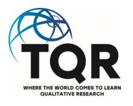
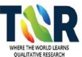

<!-- A3.R95 | source: papers_json/A3.R95/ -->

## [The Qualitative Report ](https://nsuworks.nova.edu/tqr)

[Volume 20](https://nsuworks.nova.edu/tqr/vol20) [Number 2](https://nsuworks.nova.edu/tqr/vol20/iss2) [Teaching and Learning 12 ](https://nsuworks.nova.edu/tqr/vol20/iss2/12)

2-23-2015

## Three Approaches to Case Study Methods in Education: Yin, Merriam, and Stake

Bedrettin Yazan University of Alabama, byazan@ua.edu

Follow this and additional works at: [https://nsuworks.nova.edu/tqr ](https://nsuworks.nova.edu/tqr?utm_source=nsuworks.nova.edu%2Ftqr%2Fvol20%2Fiss2%2F12&utm_medium=PDF&utm_campaign=PDFCoverPages)

Part of the[ Quantitative, Qualitative, Comparative, and Historical Methodologies Commons,](https://network.bepress.com/hgg/discipline/423?utm_source=nsuworks.nova.edu%2Ftqr%2Fvol20%2Fiss2%2F12&utm_medium=PDF&utm_campaign=PDFCoverPages) and the [Social Statistics Commons ](https://network.bepress.com/hgg/discipline/1275?utm_source=nsuworks.nova.edu%2Ftqr%2Fvol20%2Fiss2%2F12&utm_medium=PDF&utm_campaign=PDFCoverPages)

## Recommended APA Citation

Yazan, B. (2015). Three Approaches to Case Study Methods in Education: Yin, Merriam, and Stake. The Qualitative Report, 20(2), 134-152.[ https://doi.org/10.46743/2160-3715/2015.2102](https://doi.org/10.46743/2160-3715/2015.2102)

This Teaching and Learning is brought to you for free and open access by the The Qualitative Report at NSUWorks. It has been accepted for inclusion in The Qualitative Report by an authorized administrator of NSUWorks. For more information, please contact [nsuworks@nova.edu.](mailto:nsuworks@nova.edu)

<!-- page 2 -->

## Three Appr ee Approaches t oaches to Case Study Methods in E o Education: Yin, Merriam, and Stak ducation: Yin, Merriam, Stake

## Abstract

طالما كانت منهجية دراسة الحالة مجالاً متنازعاً عليه في أبحاث العلوم الاجتماعية، ويتميز بأساليب متباينة، وأحياناً متعارضة، يتبناها العديد من منهجيّي البحث. وعلى الرغم من أنها إحدى أكثر منهجيات البحث النوعي استخداماً في البحث التربوي، لا يوجد إجماع كامل بين المنهجيّين حول تصميم دراسة الحالة وتطبيقها، مما يعيق تطورها الكامل. وبالتركيز على الأعمال البارزة لثلاثة منهجيّين مرموقين، وهم روبرت يين، وشاران ميريام، وروبرت ستيك، أحاول تفحّص المجالات التي تتباين فيها وجهات نظرهم وتتقارب وتتكامل في أبعاد مختلفة من بحث دراسة الحالة. وأهدف إلى مساعدة الباحثين الناشئين في مجال التعليم على التعرّف على الآراء المتنوعة حول دراسة الحالة، التي تؤدي إلى مجموعة واسعة من التقنيات والاستراتيجيات، والتي يمكنهم من خلالها الوصول إلى منظور مركّب يخدم غرضهم البحثي على أفضل وجه.

## Keywords

Qualitative Research, Case Study Methods, Epistemological Foundations.

## Creative Commons License

This work is licensed under a [Creative Commons Attribution-Noncommercial-Share Alike 4.0 International ](https://creativecommons.org/licenses/by-nc-sa/4.0/) [License](https://creativecommons.org/licenses/by-nc-sa/4.0/).

## Acknowledgements

أنا ممتن لأستاذتي العزيزة، الدكتورة بيتي مالن، على ملاحظاتها حول مسودة سابقة لهذه الورقة وعلى دعمها القيّم طوال هذه العملية. كما أشكر رئيس تحرير TQR، الدكتور رونالد شينايل، على مراجعته وملاحظاته البنّاءة، التي جعلت هذه الورقة أقوى بكثير.

<!-- page 3 -->

## **Three Approaches to Case Study Methods in Education: ** **Yin, Merriam, and Stake**

Bedrettin Yazan University of Alabama, Tuscaloosa, Alabama

*طالما كانت منهجية دراسة الحالة مجالاً متنازعاً عليه في أبحاث العلوم الاجتماعية، ويتميز بأساليب متباينة، وأحياناً متعارضة، يتبناها العديد من منهجيّي البحث. وعلى الرغم من أنها إحدى أكثر منهجيات البحث النوعي استخداماً في البحث التربوي، لا يوجد إجماع كامل بين المنهجيّين حول تصميم دراسة الحالة وتطبيقها، مما يعيق تطورها الكامل. وبالتركيز على الأعمال البارزة لثلاثة منهجيّين مرموقين، وهم روبرت يين، وشاران ميريام، وروبرت ستيك، أحاول تفحّص المجالات التي تتباين فيها وجهات نظرهم وتتقارب وتتكامل في أبعاد مختلفة من بحث دراسة الحالة. وأهدف إلى مساعدة الباحثين الناشئين في مجال التعليم على التعرّف على الآراء المتنوعة حول دراسة الحالة، التي تؤدي إلى مجموعة واسعة من التقنيات والاستراتيجيات، والتي يمكنهم من خلالها الوصول إلى منظور مركّب يخدم غرضهم البحثي على أفضل وجه. الكلمات المفتاحية: البحث النوعي، مناهج دراسة الحالة، الأسس الإبستمولوجية.*

تُعد دراسة الحالة إحدى أكثر منهجيات البحث النوعي استخداماً. ومع ذلك، ما زالت تفتقر إلى وضع شرعي كاستراتيجية بحث في العلوم الاجتماعية لأنها لا تملك بروتوكولات محددة وواضحة البنية (Yin, 2002)، لذا فإن الباحثين الناشئين الذين يخططون لاستخدام دراسة الحالة غالباً ما يصابون بالحيرة "بشأن ماهية دراسة الحالة وكيف يمكن تمييزها عن الأنواع الأخرى من البحث النوعي" (Merriam, 1998, p. xi). ولا يملك منهجيّو البحث إجماعاً حول تصميم دراسة الحالة وتطبيقها، مما يجعلها مجالاً متنازعاً عليه ويعيق تطورها الكامل. وفي هذه الورقة، أهدف إلى تقديم تحليل وتوليف لوجهات النظر المختلفة التي يتبناها ثلاثة منهجيّين بارزين، وهم روبرت ك. يين، وشاران ميريام، وروبرت إ. ستيك، حول استخدام منهج دراسة الحالة في مجال البحث التربوي. وسأركز على الأعمال التالية: كتاب روبرت ك. يين *Case Study Research: Design and Methods* (2002)، وكتاب شاران ب. ميريام *Qualitative Research and Case Study Applications in Education* (1998)، وكتاب روبرت إ. ستيك *The Art of Case Study Research* (1995).

اخترت هؤلاء المنهجيين الثلاثة وكتبهم تحديداً للأسباب التالية. أولاً، يُعد يين وميريام وستيك المؤلفين الرواد الثلاثة الذين يقدمون إجراءات ينبغي اتباعها عند إجراء بحث دراسة الحالة (Creswell, Hanson, Plano, & Morales, 2007)، مما يساعد الباحثين التربويين على بناء خارطة طريق في استخدامهم لدراسة الحالة. وهم يُنظر إليهم كثلاثة منهجيّين تأسيسيّين في مجال بحث دراسة الحالة، تؤثر اقتراحاتهم المنهجية بشكل كبير في قرارات الباحثين التربويين بخصوص تصميم دراسة الحالة. ثانياً، تناولت أعمال سابقة حول دراسة الحالة تصميمها (Baxter & Jack, 2008)، ومقدمة عنها (Tellis, 1997a)، وتطبيق منهجيتها (Tellis, 1997b) لجمهور أوسع من الباحثين النوعيين المبتدئين. وأعتقد أن هذه الورقة ستكون الأكثر فائدة وإثماراً من خلال تعريف الباحثين المبتدئين بطيف من الآراء والمفاهيم المختلفة لدراسة الحالة التي يقدمها منهجيّو بحث بارزون من زوايا نظر متباينة. وسيساعدهم هذا التعرض على بناء أو تحديد موقع فهمهم الخاص ضمن هذا الطيف حتى يتمكنوا من إجراء بحثهم بتصميم موثوق ومدافع عنه. لذلك، أقدم كل موقف من المواقف الثلاثة المتمايزة حول القضايا

<!-- page 4 -->

المعقدة في تصميم منهجية دراسة الحالة من خلال نقاط التباين والتقارب والتكامل. وأخيراً، اخترت التركيز على كتبهم تحديداً للمقارنة في هذه الورقة، لأنهم في هذه المجلدات الرائدة يشرحون بعناية بحث دراسة الحالة بأكمله، ويقدمون رؤى قيّمة في كل خطوة منه، من كيفية تصوره إلى كيفية توصيله للقراء. وبذلك، سيحصل قراء هذه الورقة على توليف وتحليل لثلاثة أدلة كاملة حول أساليب دراسة الحالة، يمكنهم من خلالها اختيار الأدوات الأكثر ملاءمة وفائدة لأغراض بحثهم الخاصة.

في هذه الورقة، أسعى إلى تفحص المجالات التي تتباين فيها هذه المنظورات الثلاثة وتتقارب وتتكامل في أبعاد مختلفة من بحث دراسة الحالة. وسأتبع ستة أبعاد تصنيفية يتقارب فيها الباحثون الثلاثة إلى حد كبير في نصوصهم الرائدة حول منهج دراسة الحالة: الالتزامات الإبستمولوجية، وتعريف الحالة ودراسة الحالة، وتصميم دراسة الحالة، وجمع البيانات، وتحليل البيانات، والتحقق من صحة البيانات.

## **Researcher's Position**

قبل الانتقال إلى تقديم مقارنة بين ثلاثة منظورات لدراسة الحالة، أعتقد أن القراء بحاجة إلى معرفة هويتي كباحث، واهتمامي بهذا الموضوع، ونواياي في هذا المشروع. لقد أنهيت للتو درجتي الدكتوراه في مجال اللغويات التطبيقية بأطروحة تركز على تطور الهوية المهنية لمرشحي تدريس الإنجليزية كلغة ثانية (ESL). وبصفتي طالب دكتوراه في جامعة ميريلاند، قادني بحثي عن منهجية بحث إلى تطوير اهتمام بدراسة الحالة، إحدى أكثر المناهج جدلاً في البحث التربوي. وقد شاركت في عملية تكرارية لتضييق موضوع بحثي، وصقل أسئلتي، ومحاولة إيجاد أنسب طريقة بحث أثناء تصور وتصميم مشروع أطروحتي. ثم سجّلت في مقرر دراسة الحالة الذي عرّفني على تصورات يين وميريام وستيك لمنهجية دراسة الحالة. وأتيحت لي الفرصة ليس فقط لتقييم أهمية دراسة الحالة لبحث أطروحتي، بل أيضاً لتحديد أي منهج لدراسة الحالة يناسب توجهي الإبستمولوجي بوصفي باحثاً ناشئاً. وهذه الورقة هي نتاج عملية اتخاذ القرار هذه.

نيتي في هذه الورقة هي تقديم عرض مقارن لثلاثة نصوص تأسيسية في بحث دراسة الحالة للباحثين الناشئين الذين هم في طور اتخاذ قرارات بشأن خياراتهم المنهجية. ومن خلال هذه الورقة، يمكنهم التعرف على مناهج دراسة الحالة المختلفة التي يمكنهم الاختيار من بينها لجعل تصميم بحثهم متوافقاً مع ميولهم الإبستمولوجية وقوياً بما يكفي لمعالجة أسئلة بحثهم. ويمكنهم إما اختيار استخدام الأدوات التي يقدمها منهجيّ واحد أو بناء مزيج من الأدوات من اثنين أو ثلاثة منهم.

## **Challenges of Comparative Analysis **

قبل تقديم مقارنة المنظورات الثلاثة حول منهج دراسة الحالة، ينبغي أن أذكر التحديات الرئيسية المرتبطة بتأليف هذا العمل المقارن. يبدو أن للمؤلفين الثلاثة أغراضاً مختلفة في كتابة الأعمال الرائدة التي أحاول تحليلها في هذه الورقة. وقد منعني هذا الاختلاف جزئياً من مقارنة ومقابلة المنظورات الثلاثة لدراسة الحالة على نفس الأساس في جميع جوانب منهج دراسة الحالة. فعلى سبيل المثال، في كتاب ستيك (1995) *The Art of Case Study Research،* المخاطَب الرئيسي هو الطلاب الذين يخططون لاستخدام دراسة الحالة كمنهجية في مشاريعهم البحثية. والغرض الرئيسي من كتابه هو شرح مجموعة من التوجهات التفسيرية تجاه دراسة الحالة والتي تشمل "المناهج الطبيعية، والشمولية، والإثنوغرافية، والظاهراتية، والسيرية

<!-- page 5 -->

في البحث" (Stake, 1995, p. xi). ويبدو أن يين يهدف إلى تقديم تصميم وأساليب دراسة الحالة والدعوة إلى اعتبار دراسة الحالة في العلوم الاجتماعية منهجية مشروعة لإجراء تحقيقات في افتراض نظري. ويرى أن جميع المحاولات السابقة تفتقر إلى دليل شامل لاستخدام منهج دراسة الحالة. لذلك، يريد لنصه أن يملأ "فراغاً في منهجية العلوم الاجتماعية، الذي هيمنت عليه نصوص ... تقدم إرشادات قليلة حول كيفية بدء دراسة حالة، وتحليل البيانات، أو حتى تقليل مشكلات تأليف تقرير دراسة الحالة" (Yin, 2002, p. 3). وبعد أن لاحظت ميريام، مثل يين، قلة الموارد المتاحة لباحثي دراسة الحالة، كان هدفها المساهمة في أدبيات دراسة الحالة التي "لا تزال متأخرة عن [أدبيات] أنواع أخرى" من البحث (Merriam, 1998, p. 19). ويتمحور نص ميريام بشكل أساسي حول المبادئ والاستخدامات العامة للبحث النوعي مع تركيز ثانوي على كيفية تطبيقها في دراسة الحالة كأحد مناهج البحث النوعي. وهي تنوي توضيح المجالات "الغامضة" الموجودة في دراسة الحالة. والغرض من كتابها هو إزالة الالتباس حول دراسة الحالة في البحث النوعي وتوضيح "ما الذي يشكل دراسة حالة، وكيف تختلف عن أساليب البحث النوعي الأخرى، ومتى يكون استخدامها الأنسب" (Merriam, 1998, p. 19). وقد تفسّر هذه الاختلافات الأسئلة المتعلقة بتباين تركيز المؤلفين والتي قد تنشأ في بقية التحليل. وسيسلّط القسم التالي الضوء على نوع آخر من التباين ينبغي أن أتناوله قبل الشروع في التحليل.

ولوصف المنهج الذي اتبعته في هذا التحليل، قادني الفحص الأولي للنصوص الثلاثة إلى اختيار مجموعة من المعايير للتركيز عليها أثناء إجراء تحليلي المقارن والمقابل. وتشمل هذه المجموعة من المعايير ما يلي: الالتزامات الإبستمولوجية، وتعريف الحالة ودراسة الحالة، وتصميم دراسة الحالة، وجمع البيانات، وتحليل البيانات، والتحقق من صحة البيانات. وكانت خطوتي الثانية إنشاء مخطط أدرجت فيه ما وجدته من أوجه تشابه واختلاف بين هذه المناهج الثلاثة لدراسة الحالة. وقد بنيت هذا المخطط من خلال مراجعة الأقسام ذات الصلة من كل نص لفهم كيفية تباينها وتقاربها في كل معيار. وبعد إتمام هذا المخطط، أردت التحقق من صحة تحليلي مع باحثين نوعيين أكثر خبرة أسميهم "الأصدقاء الناقدين". وأجريت لقاءات فردية مع ثلاثة طلاب دكتوراه متقدمين وأستاذ مقرر دراسة الحالة الذي حضرته. وأعطتني محادثاتي معهم الشكل النهائي للمخطط الذي وجّه هذه الورقة.

## **Epistemological Commitments**

آراء الباحثين حول طبيعة المعرفة وإنتاجها، أي ميولهم الإبستمولوجية باختصار، تُشكّل أساس مشروع البحث الذي يتصورونه ويديرونه. وهي تتغلغل في كل خطوة من عملية التحقيق بأكملها، من اختيار الظاهرة محل الاهتمام التي تخضع للفحص إلى طريقة تأليف التقرير النهائي. وكما تلاحظ ميريام، "البحث، في النهاية، هو إنتاج معرفة عن العالم – في حالتنا، عالم الممارسة التعليمية" (Merriam, 1998, p. 3). وبصفتهم باحثين ومنهجيّي بحث، يملك يين وميريام وستيك التزاماتهم الإبستمولوجية الخاصة التي تؤثر في منظوراتهم حول منهجية دراسة الحالة والمبادئ والخطوات التي يوصون بها الباحثين الناشئين للالتزام بها أثناء استخدام منهج دراسة الحالة في مساعيهم البحثية. وتتجلى هذه الالتزامات إما صراحة أو ضمنياً في نصوصهم الرائدة حول بحث دراسة الحالة، وتحدد زوايا النظر التي يتصورون من خلالها دراسة الحالة. لذلك، قبل تحليلي، سأستفيد من التوجه الإبستمولوجي الخاص بيين وميريام وستيك، الذي سيُطلع التحليل اللاحق.

يُظهر يين ميولاً وضعية في منظوره حول دراسة الحالة. ويشير Crotty (1998) إلى أن ثلاثة مفاهيم أساسية في التوجه الوضعي في البحث هي: الموضوعية، والصحة، وقابلية التعميم. فإذا زعم الباحثون أن النتائج التي ستسفر عنها دراستهم المقترحة

<!-- page 6 -->

ستكون "حقائق ثابتة، أو على الأقل أقرب ما يمكن إلى حقيقة ثابتة حسبما مكّنهم بحثهم من الوصول إليه"، فإن ذلك يعني، من وجهة نظر Crotty (1998)، أن التقليد الفلسفي الذي يستند إليه بحثهم هو الوضعية (p. 41). لا يوضّح يين صراحة توجهه الإبستمولوجي في نصه، لكن طريقة تعامله مع دراسة الحالة أو البحث بشكل عام والجوانب التي يركز عليها أكثر تشير إلى أن موقفه الفلسفي يميل نحو التقليد الوضعي. فعلى سبيل المثال، من منظور يينيّ، من المفترض أن يقوم باحث دراسة الحالة "بتعظيم أربعة شروط متعلقة بجودة التصميم: صحة البناء، والصحة الداخلية، والصحة الخارجية، والموثوقية. وكيفية تعامل الباحثين مع هذه الجوانب من مراقبة الجودة" (Yin, 2002, p. 19) أمر بالغ الأهمية في كل خطوة من خطوات بحث دراسة الحالة. وفي نصه، يقترح يين باستمرار أن يضع الباحثون الناشئون هذه "المقاييس" الأربعة في اعتبارهم في كل مرحلة من عملية تحقيقهم لضمان الجودة في تحقيقهم. وبذلك، من فهم Crotty، يستند المنظور اليينيّ حول بحث دراسة الحالة إلى توجه وضعي. علاوة على ذلك، قد يكون رأي يين حول الثنائية بين تقاليد البحث الكمي والنوعي مؤشراً على سبب عدم رغبته في التطرق علناً إلى توجهه الفلسفي. فهو يجادل ضد أولئك الذين يميزون بين التوجهات النوعية والكمية بسبب الاختلافات الفلسفية غير القابلة للتوفيق: "بغض النظر عمّا إذا كان المرء يفضل البحث النوعي أو الكمي، هناك أرضية مشتركة قوية وأساسية بين النهجين" (Yin, 2002, p. 15). وهو يهتم بأوجه التشابه بين التقليدين البحثيين ويبرز عملياً الأدوات المشتركة التي يمكن أن تكون فعّالة ومفيدة في تصميم وأساليب دراسة الحالة التي يقترحها، لذا فهو لا يميّز بين أساليب دراسة الحالة الكمية والنوعية.

على عكس يين الذي يبدو أنه يتجنب الإدلاء بتصريحات حول التزاماته المعرفية أو الإبستمولوجية المفضلة التي ينبغي أن توجّه منهجية دراسة الحالة، يخصص ستيك جزءاً كبيراً من فصل في نصه لشرح التقليد الإبستمولوجي الذي يقترح أن يلتزم به باحثو دراسة الحالة النوعية. فهو يرى أن "كيفية مساهمة باحثي دراسة الحالة في تجربة القارئ تعتمد على تصوراتهم للمعرفة والواقع" (Stake, 1995, p. 100). ومن وجهة نظر ستيكية، ينبغي أن تكون البنائية والوجودية (اللاحتمية) هما الإبستمولوجيتان اللتان توجهان بحث دراسة الحالة النوعية وتُطلعانه، لأن "معظم الباحثين النوعيين المعاصرين يرون أن المعرفة تُبنى بدلاً من أن تُكتشف" (Stake, 1995, p. 99). وبذلك، فهو يتصور بشكل رئيسي أن باحثي دراسة الحالة النوعية مفسرون، وجامعو تفسيرات، مما يتطلب منهم الإبلاغ عن تأويلهم أو بنائهم للواقع أو المعرفة المبنية التي يجمعونها من خلال تحقيقهم. وفي المنظور الستيكيّ، ينبغي أن يتوقع الباحثون النوعيون حدوث مستوى آخر من بناء الواقع أو المعرفة على جانب قراء تقريرهم، إضافة إلى المستويين المذكورين أعلاه. وهذا الاستنتاج مرتبط أيضاً بحجته بأن "هناك منظورات أو وجهات نظر متعددة للحالة يجب تمثيلها، لكن لا توجد طريقة لتحديد، دون جدال، أفضل وجهة نظر" (Stake, 1995, p. 108).

من حيث موقفها الإبستمولوجي، يبدو أن ميريام أقرب بكثير إلى وجهة نظر ستيك منها إلى يين. فمن منظورها، ينبغي أن تكون الإبستمولوجيا التي توجّه دراسة الحالة النوعية هي البنائية، إذ ترى أن "الافتراض الفلسفي الأساسي الذي تستند إليه جميع أنواع البحث النوعي هو أن الواقع يُبنى من قبل الأفراد المتفاعلين مع عوالمهم الاجتماعية" (Merriam, 1998, p. 6). وفي السياق نفسه، تعلّق بأن "الواقع ليس كياناً موضوعياً؛ بل هناك تفسيرات متعددة للواقع" (Merriam, 1998, p. 22). لذلك، وبتبني هذا الافتراض الفلسفي، فإن الاهتمام الأساسي للباحثين النوعيين هو فهم المعنى أو المعرفة التي يبنيها الناس. بعبارة أخرى، ما يثير اهتمام الباحثين النوعيين حقاً هو الطريقة التي يفهم بها الناس عالمهم وتجاربهم في هذا العالم. علاوة على ذلك، يتماشى تصور ميريام لصناعة المعنى في عملية البحث مع مفهوم ستيك متعدد

<!-- page 7 -->

الطبقات لبناء الواقع أو المعرفة، لكن الأولى لا تتوقع من القراء المشاركة في هذا البناء أو التفسير. وهي توضح خطي التفسير أو صناعة المعنى اللذين مرّ بهما الواقع في التقرير النهائي:

يجلب الباحث بناءً للواقع إلى موقف البحث، والذي يتفاعل مع بناءات أو تفسيرات الآخرين للظاهرة قيد الدراسة. والمنتج النهائي لهذا النوع من الدراسة هو تفسير آخر من الباحث لآراء الآخرين، مصفّاة عبر رؤيته الخاصة. (Merriam, 1998, p. 22)

بعد مناقشة الالتزامات الإبستمولوجية المختلفة لمنهجيّي دراسة الحالة الثلاثة التي تتغلغل في النصوص الثلاثة، أعتقد أن هذا القسم ينبغي أن يُختتم بوصف موجز لموقفي الإبستمولوجي وكيف يؤثر في الطريقة التي أتعامل بها مع تصورات يين وميريام وستيك لدراسة الحالة. وبصفتي باحثاً تربوياً ناشئاً، أضع نفسي إبستمولوجياً قريباً جداً من النموذج البنائي. وأتصور المعرفة على أنها مبنية اجتماعياً وناشئة من الممارسات الاجتماعية للناس؛ لذا، أتصور الواقع الاجتماعي على أنه يُولَّد ويُبنى من قبل الناس وموجود إلى حد كبير داخل عقول الناس. وأعتقد أن المساعي البحثية موجهة نحو البحث "عن تفسيرات مستمدة ثقافياً ومحددة تاريخياً للعالم الاجتماعي المُعاش" (Crotty, 1998, p. 67). وبسبب هذا الموقف الفلسفي، أجد نفسي غير متسق إبستمولوجياً مع يين وأكثر انسجاماً بكثير مع ميريام وستيك. ومع ذلك، بما أن توجهي أيضاً أكثر تماشياً مع البراغماتية الديويّة، فإن التحليل الحالي يتبنى فائدة مجموعات الاستراتيجيات والإرشادات والأدوات التي يقترحها يين. أي أن ميولي البنائية لم تدفعني إلى الالتزام حصرياً بتصورات ستيك وميريام. على العكس، حاولت تحليل وتوليف أعمال المؤلفين الثلاثة جميعاً من خلال مراعاة مساهماتهم في تصور وتصميم وإجراء "تحقيق منضبط" (Shulman, 1988).

## **Defining Case and Case Study**

في نصوصهم حول منهجية دراسة الحالة، يتباين المؤلفون الثلاثة في تعريف الحالة ودراسة الحالة. فعلى سبيل المثال، يعرّف Yin (2002) الحالة بأنها "ظاهرة معاصرة ضمن سياقها الحياتي الواقعي، خاصة عندما تكون الحدود بين الظاهرة والسياق غير واضحة ويكون للباحث سيطرة قليلة على الظاهرة والسياق" (p. 13). ويعكس تعريفه للحالة أيضاً دفاعه عن دراسة الحالة كمنهجية بحث مشروعة. والافتراض الكامن وراء التعريف هو أن استراتيجيات البحث الأخرى مثل التاريخ والتجربة والمسوحات غير قادرة على التحقيق في الحالة التي تهم الباحثين. لذلك، يحتاجون إلى "استراتيجية بحث شاملة" جديدة تماماً تُسمى دراسة الحالة (Yin, 2002, p. 14). وبناءً على هذا التعريف، ومن وجهة النظر اليينية، دراسة الحالة هي تحقيق تجريبي يستقصي الحالة أو الحالات المطابقة للتعريف المذكور أعلاه من خلال معالجة أسئلة "كيف" أو "لماذا" المتعلقة بالظاهرة محل الاهتمام. ويجد أنها مفيدة بشكل خاص لتقييم البرامج. ويلفت باقي تعريفه التقني الانتباه إلى جوانب جمع البيانات وتحليلها فيما يتعلق بالحالة قيد الدراسة: من أجل التحقيق في موقف متمايز يتضمن "متغيرات ذات أهمية أكثر بكثير من نقاط البيانات"، تستمد دراسة الحالة من خطوط أدلة متعددة لأغراض التثليث وتستفيد من "التطوير المسبق للافتراضات النظرية لتوجيه جمع البيانات وتحليلها" (Yin, 2002, pp. 13-14). ويشير هذا الاهتمام إلى مدى دقة نهجه من حيث التماسك والاتساق بين مكونات ومراحل تصميم دراسة الحالة كاستراتيجية بحث. ومن موقفه، عند اتخاذ كل خطوة أو قرار في عملية البحث، ينبغي أن يكون الباحثون قادرين على تقديم

<!-- page 8 -->

المنطق وراءه بما يتوافق مع الافتراضات النظرية وخصائص الحالة.

من منظور ستيكيّ لدراسة الحالة، لا يمكن تقديم تعريف دقيق للحالات أو دراسات الحالة لأنه من المرجح جداً ألا يتوافق التعريف الدقيق للحالات أو الدراسات الذي يمكنه صياغته مع التعريف الذي يستخدمه مستخدمو دراسة الحالة في تخصصات أخرى. أما بالنسبة لتعريف الحالة، فيتفق Stake (1995) مع تصور Louis Smith (1978): ينبغي أن يرى الباحثون الحالة كـ "نظام محدود" ويستقصونها "كموضوع وليس كعملية" (p. 2). ويصف هو نفسه بعض سمات الحالة في تصوره: الحالة هي "شيء محدد ومعقد وفعّال"، وبشكل أكثر تحديداً "نظام متكامل" له "حدود وأجزاء عاملة" وهادف (في العلوم الاجتماعية والخدمات الإنسانية) (p. 2). وبناءً على ذلك، وبالنظر إلى هذا التعريف، يلاحظ أن الأساليب التي يحددها في كتابه ستكون أكثر فائدة لدراسة البرامج والأشخاص وأقل فائدة لدراسة الأحداث والعمليات، وهو ما يمثل جزئياً نقطة تقاطع مع يين الذي يرى أن أساليب دراسة الحالة مناسبة تماماً لتقييم البرامج. علاوة على ذلك، يذكر ستيك أربع خصائص محددة للبحث النوعي تنطبق أيضاً على دراسات الحالة النوعية: "شمولية"، و"تجريبية"، و"تفسيرية"، و"تعاطفية". وتعني الشمولية أنه ينبغي على الباحثين مراعاة العلاقة المتبادلة بين الظاهرة وسياقاتها، وهو ما يشبه الرابط غير القابل للفصل الذي يشير إليه يين عند تعريف الحالة. وتعني التجريبية أن الباحثين يبنون الدراسة على ملاحظاتهم الميدانية. وتعني التفسيرية أن الباحثين يعتمدون على حدسهم ويرون البحث أساساً كتفاعل بين الباحث والموضوع، وهو ما يتوافق مع الإبستمولوجيا البنائية. وأخيراً، تعني التعاطفية أن الباحثين يعكسون التجارب البديلة للموضوعات من منظور داخلي.

بالنسبة لميريام (1998)، فإن الخاصية المحددة لبحث دراسة الحالة هي تحديد حدود الحالة. ويتماشى تعريفها مع رؤية Smith (1978) للحالة كنظام محدود ومع رؤية ستيك للحالة كنظام متكامل. فهي ترى "الحالة ككيان، وحدة واحدة، وحدة تحيط بها حدود" (p. 27). وعندها، يمكن أن تكون الحالة شخصاً، أو برنامجاً، أو مجموعة، أو سياسة محددة وما إلى ذلك، مما يمثل قائمة أكثر شمولاً بكثير من قوائم يين وستيك. وفي رؤية ميريام، المتأثرة بفهم Miles and Huberman (1994) لـ "الحالة كظاهرة من نوع ما تحدث في سياق محدود" (مقتبس في Merriam, 1998, p. 27)، طالما استطاع الباحثون تحديد الظاهرة محل الاهتمام ورسم حدودها أو "تسييجها"، فإنهم يستطيعون تسميتها حالة. باختصار، التعريف الذي تقدمه أوسع من تعريفي يين وستيك، ويوفر مرونة في استخدام استراتيجية دراسة الحالة النوعية لبحث مجموعة أوسع بكثير من الحالات. أما بالنسبة لتعريف بحث دراسة الحالة، فتتصور ميريام دراسة الحالة النوعية بأنها "وصف وتحليل مكثف وشمولي لظاهرة محدودة مثل برنامج، أو مؤسسة، أو شخص، أو عملية، أو وحدة اجتماعية" (p. xiii). ومن أجل زيادة التمييز بين منهج دراسة الحالة والعمل الحالي، والمنهج الحالي، وتاريخ الحالة (سجلات الحالة)، تشدد على سماتها المميزة والفريدة: خاصية (تركز على موقف أو حدث أو برنامج أو ظاهرة معينة)؛ وصفية (تقدم وصفاً غنياً وثرياً للظاهرة قيد الدراسة)؛ استكشافية (تنير فهم القارئ للظاهرة قيد الدراسة). وكما هو الحال مع دفاع يين عن دراسة الحالة كاستراتيجية بحث مشروعة، يبدو أن ميريام تتحمل مسؤولية مساعدة دراسة الحالة على أن تصبح منهجية بحث محددة وواضحة البنية، إذ تبرز سماتها الجوهرية والفريدة حتى يتمكن الباحثون الناشئون من استخدامها كاستراتيجية بحث منفصلة عن منهجيات البحث النوعي الأخرى.

<!-- page 9 -->

## **Designing Case Study **

يولي يين اهتماماً كبيراً لتصميم دراسة الحالة كما يشير العنوان الفرعي لكتابه. وكما ذكرت أثناء وصف الغرض من كتابه، فقد لاحظ أن دراسة الحالة لا تملك "تصميماً مقنّناً" كما هو الحال في استراتيجيات البحث الأخرى التي يستخدمها علماء الاجتماع، وهو السبب في عدم منح بعض الباحثين لها مزايا كمنهج بحث بارز. بعبارة أخرى، يستنتج أنه "على عكس استراتيجيات البحث الأخرى، لم يُطوَّر بعد "كتالوج" شامل لتصاميم البحث الخاصة بدراسات الحالة" (Yin, 2002, p. 19) ويلتزم بوضوح بهذا التطوير. لذلك، يقدم نهجاً مفصلاً وشاملاً بوضوح لتشكيل التصميم مع نظرة دقيقة للغاية إلى كل خطوة من خطوات عملية البحث، من صياغة أسئلة البحث إلى جمع وتحليل البيانات في ضوء الافتراضات النظرية المسبقة وصولاً إلى تقرير التحقيق بأكمله.

وبتعريف التصميم أساساً بأنه "التسلسل المنطقي الذي يربط البيانات التجريبية بأسئلة البحث الأولية للدراسة، وفي النهاية باستنتاجاتها" (p. 20)، يقترح Yin (2002) أربعة أنواع من التصميم يمكن لباحثي دراسة الحالة الاستفادة منها. وتشمل: التصميم الشمولي الفردي، والتصميم المضمّن الفردي، والتصميم الشمولي المتعدد، والتصميم المضمّن المتعدد. وتتطلب التصاميم الشمولية وحدة تحليل واحدة، بينما تتطلب التصاميم المضمّنة وحدات تحليل متعددة. وينصح يين الباحثين المبتدئين باختيار التصميم الذي يوفر لهم أقصى فائدة للإجابة عن أسئلة بحثهم، ومراعاة نقاط القوة والقيود لكل تصميم والمخاطر المحددة التي ينبغي تجنبها أثناء تطبيق كل منها.

من منظور يينيّ، يتكون تصميم بحث دراسة الحالة من خمسة مكونات: أسئلة الدراسة؛ وافتراضاتها، إن وُجدت؛ ووحدة (وحدات) التحليل؛ والمنطق الذي يربط البيانات بالافتراضات؛ ومعايير تفسير النتائج. وأثناء تصميم التحقيق، يُفترض أن يتأكد الباحث من تماسك هذه المكونات واتساقها فيما بينها. ويوجه يين اهتماماً إضافياً للمكونين الرابع والخامس اللذين يشيران إلى التخطيط لخطوات تحليل البيانات في منهج دراسة الحالة. كما ينصح بأن يخطط باحثو دراسة الحالة لهذه "المكونات الأقل تطوراً" بعناية ودقة شديدتين حتى يكون لتحقيقهم أساس متين للعمليات التحليلية (Yin, 2002, p. 26). وفيما يتعلق بهذه المكونات، يشدد يين على ضرورة أن يراجع الباحثون الأدبيات ذات الصلة ويدرجوا افتراضات نظرية بخصوص الحالة قيد الدراسة قبل البدء في إجراء أي جمع للبيانات، مما يميزها عن منهجيات مثل النظرية المتجذرة والإثنوغرافيا. وكنقطة أخرى حول تصور يين لتصميم دراسة الحالة، يقترح قياس جودة التصميم مقابل أربعة معايير تشمل صحة البناء، والصحة الداخلية، والصحة الخارجية، والموثوقية. وتحقيق أقصى قدر من هذه الشروط في كل مرحلة من عملية التحقيق واجب على الباحثين الذين يريدون تطوير تصاميم دراسة حالة صارمة وقوية. وأخيراً، يولي يين اهتماماً كبيراً لإعداد تصميم مفصل في بداية البحث وينصح بأن يجري الباحثون تغييرات طفيفة في التصميم بعد بدء جمع البيانات. ومع ذلك، إذا احتاجوا إلى إجراء تعديلات كبيرة، فمن منظور يين، يُفترض أن يعود الباحثون إلى الخطوة الأولى من التصور ويبدأوا من جديد في تصميم الدراسة.

على عكس يين الذي يقترح تصميماً محكماً ومنظماً حقاً لمنهج دراسة الحالة، يدافع ستيك عن تصميم مرن يتيح للباحثين إجراء تغييرات كبيرة حتى بعد الانتقال من التصميم إلى البحث. والتصميم الأولي الوحيد الذي يقترحه يتعلق بالقضايا وأسئلة القضايا، والتي ستؤدي إلى تصميم أسئلة البحث. ومن وجهة نظر ستيكية، يستخدم الباحثون "القضايا كبنية مفاهيمية من أجل فرض الانتباه على التعقيد والسياقية [و] ... لأن القضايا تجذبنا نحو ملاحظة، بل واستخلاص، مشكلات الحالة، والانفعالات المتضاربة، والخلفيات

<!-- page 10 -->

المعقدة للاهتمام الإنساني" (pp. 16-17). ويقدم ستيك نصيحة مهمة حول بدء نوعين من دراسات الحالة: "في دراسة الحالة الجوهرية، الحالة هي المهيمنة؛ والحالة هي الأعلى أهمية. أما في دراسة الحالة الأداتية، فالقضية هي المهيمنة؛ نبدأ وننتهي والقضية هي المهيمنة" (Stake, 1995, p. 16).

على الرغم من أن Stake (1995) لا يقترح نقطة محددة أثناء عملية البحث ينبغي أن يبدأ فيها جمع البيانات وتحليلها، فإن نصيحته حول أسئلة البحث تشير إلى أن باحثي دراسة الحالة يحتاجون إلى مجموعة من سؤالين أو ثلاثة أسئلة قضية مصقولة أو متطورة (أسئلة بحث) "تساعد على هيكلة الملاحظة والمقابلات ومراجعة الوثائق" (p. 20). ويُختزل عشرة أو عشرون سؤالاً جوهرياً إلى سؤالين أو ثلاثة من خلال "اتصالات" الباحثين الأولية "بالحالة أو من الخبرة أو الأدبيات ذات الصلة" (p. 20). وينبع مرونة ستيك الواضحة من حيث تصميم دراسة الحالة من تبنيه لمفهوم "التركيز التدريجي" الذي طرحه Parlett and Hamilton (1972) أولاً. ويقوم هذا المفهوم على افتراض أن "مسار الدراسة لا يمكن رسمه مسبقاً" (مقتبس في Stake, 1998, p. 22)، وهو ما سيعارضه يين بالتأكيد. ويعلق Parlett and Hamilton بأن "الانتقال من مرحلة إلى أخرى، أثناء تطور التحقيق، يحدث عندما تتضح المجالات المشكلة وتُعاد صياغتها تدريجياً" (مقتبس في Stake, 1998, p. 22). وعندما يتعرف الباحثون المبتدئون على نهج ستيك المرن، قد يجدونه مناسباً لأنه لا يتطلب إعداد تصميم بقدر ما يتطلبه نهج يين. ومع ذلك، إذا انطلقوا في رحلة بحثهم الأولية دون خارطة طريق مفصلة وإطار زمني، فقد يشعرون بالضياع أو يتعثرون في مرحلة ما أثناء العملية. وحتى الباحثون الخبراء قد يحتاجون إلى تصميم مُعَدّ بشكل جيد جداً قبل إجراء تحقيقهم. ونصيحة ستيك، بصفته مناصراً للبحث النوعي، قد تؤدي إلى عدم اليقين والغموض لدى الباحثين الناشئين لأن الإرشادات الواضحة مفقودة.

ويتضمن نص ميريام (1998) فصلاً بعنوان "تصميم الدراسة واختيار العينة"، والذي يكمّل ليس فقط تصور ستيك لتصميم البحث النوعي بل أيضاً تصميم دراسة الحالة المنظم لدى يين. وهي تقدم إرشادات ونصائح واضحة ومفيدة جداً بخصوص مراجعة الأدبيات ذات الصلة لبناء الإطار النظري الذي سيوجّه التحقيق. ولا يتضمن قسما يين ولا ستيك حول تصميم دراسة الحالة مثل هذه الإرشادات والنصائح. ويحتاج باحثو دراسة الحالة المبتدئون إلى كتابة مراجعات أدبيات لمشاريعهم البحثية أو في النهاية لأطروحاتهم. وتساعدهم هذه المراجعة على تصور تحقيقهم وبناء إطار نظري يمكنهم البناء عليه في عملية بحثهم بأكملها. ويمكنهم الرجوع إلى نص ميريام لتعلم الإرشادات الضرورية لإجراء مراجعة أدبيات مناسبة تُطلع إطارهم النظري.

وتقدم ميريام (1998) خطوة بخطوة عملية تصميم البحث النوعي بأسلوب مفصل إلى حد ما. وتشمل مناقشتها إجراء مراجعة الأدبيات، وبناء الإطار النظري، وتحديد مشكلة البحث، وصياغة وصقل أسئلة البحث، واختيار العينة (المعاينة الغرضية). ولا يقترب منهج ميريام في تصميم دراسة الحالة من منهج يين أو ستيك؛ بل هو مزيج من النهجين. والتصميم الذي توصي به مرن إلى حد معين، وهو ما يعكس تأثير قدومها من تقليد نوعي، لكنه ليس مرناً بقدر منهج ستيك. فعلى سبيل المثال، تقترح Merriam (1998) أن "المعاينة الغرضية أو الهادفة تحدث عادة قبل جمع البيانات، بينما تُجرى المعاينة النظرية بالتزامن مع جمع البيانات" (p. 66). وهذا الاقتراح غير مقبول من منظور يين لأنه يرى أن تصميم دراسة الحالة ينبغي أن يسبق جمع البيانات. ولا يذكر ستيك أي استراتيجيات أو إجراءات للمعاينة في بحث دراسة الحالة النوعية؛ بل يتجنب تحديد نقطة دقيقة لبدء جمع البيانات، وهو ما يعتبره سمة من سمات التقليد النوعي.

<!-- page 11 -->

## **Gathering Data**

يتفق الباحثون الثلاثة على أنه يقع على عاتق باحثي دراسة الحالة استمداد بياناتهم من مصادر متعددة للإحاطة بالحالة قيد الدراسة بتعقيدها وشمولها. أما بالنسبة لأدوات جمع البيانات، فإن التقليد الإبستمولوجي الذي ينتمون إليه يؤثر في اختيارهم وفي طريقة تصورهم لعملية جمع البيانات بأكملها. ويصبح يين مناصراً للجمع بين المصادر الدلالية الكمية والنوعية لأنه يراها متساوية الفائدة، بينما يقترح ستيك وميريام الاستخدام الحصري للبيانات النوعية.

بعد وصف الإجراءات التي يُفترض أن يتبعها باحث دراسة الحالة أثناء تصميمها، يدرج يين فصلاً يشرح الخطوات التحضيرية أو مرحلة التخطيط لجمع البيانات قبل مناقشة إجراءات جمع البيانات الفعلية. ويشير هذا مرة أخرى إلى مدى الأهمية التي يوليها للعملية التي تسبق جمع البيانات الفعلي أو خارطة الطريق التي تتضمن التوجيهات المفصلة التي سيحتاجها الباحثون عند شروعهم في رحلة تحقيقهم. ويرتبط تركيزه على التخطيط لدراسة الحالة بالتحذير الذي يذكره مراراً: "في الواقع، تكون مطالب دراسة الحالة على فكرك وذاتك وعواطفك أكبر بكثير من مطالب أي استراتيجية بحث أخرى. وهذا لأن إجراءات جمع البيانات ليست روتينية" (Yin, 2002, p. 58). وأثناء وصف التحضير لجمع البيانات، يستفيد يين من المهارات المطلوبة لباحث دراسة الحالة، والتدريب لدراسة حالة محددة، وتطوير بروتوكول للتحقيق، وفحص ترشيحات دراسة الحالة (اتخاذ القرار النهائي بخصوص اختيار الحالة)، وإجراء دراسة تجريبية (طيّارة). وفي هذا التحضير، يبرز بشكل خاص دراسة الحالة التجريبية لأنه يفترض أنها "ستساعدك على تحسين خطط جمع بياناتك فيما يتعلق بمحتوى البيانات والإجراءات المتبعة" (Yin, 2002, p. 79). وفي هذا الجانب، يكمّل يين ستيك وميريام اللذين لا يشددان على الوظيفة الحاسمة لدراسة الحالة التجريبية. بل يركزان بشكل كبير على اختبار كل أداة من أدوات جمع البيانات.

من منظور يينيّ، ينبغي أن يستند بحث دراسة الحالة إلى مصادر أدلة متعددة، مع حاجة البيانات إلى التقارب بطريقة تثليثية، والاستفادة من التطوير المسبق للافتراضات النظرية لتوجيه تحليل البيانات وجمعها. ويقترح يين أن يستفيد الباحثون من ستة مصادر دلالية: التوثيق، والسجلات الأرشيفية، والمقابلات، والملاحظات المباشرة، والملاحظة بالمشاركة، والقطع الأثرية المادية، ولكل منها نقاط قوة وضعف خاصة بها. ويلاحظ أيضاً أن هذه هي الأكثر استخداماً وأن القائمة الكاملة أوسع بكثير. ويشمل شرحه لأدوات جمع البيانات "الإجراءات المرتبطة باستخدام كل مصدر من مصادر الأدلة" (Yin, 2002, p. 96)، أي خصوصيات أدوات جمع البيانات التي يُفترض أن يتعرف عليها الباحثون كجزء من تدريبهم. ثم يناقش المبادئ العامة التي تنطبق على جميع الأدوات الستة وعلى عملية جمع البيانات بأكملها. وتشمل هذه المبادئ العامة، التي يزعم أنها أُهملت في الماضي وناقشها بالتفصيل في كتابه، استخدام (أ) مصادر أدلة متعددة (أدلة من مصدرين أو أكثر، لكنها تتقارب حول نفس مجموعة الحقائق أو النتائج لغرض التثليث)، (ب) قاعدة بيانات دراسة الحالة (تجميع رسمي للأدلة منفصل عن تقرير دراسة الحالة النهائي يساعد الباحثين المبتدئين على فهم كيفية التعامل مع البيانات أو إدارتها)، و(ج) سلسلة أدلة (روابط صريحة بين الأسئلة المطروحة والبيانات المجمّعة والاستنتاجات المستخلصة تساعد على "تتبع اشتقاق أي دليل، بدءاً من أسئلة البحث الأولية وصولاً إلى استنتاجات دراسة الحالة النهائية"؛ Yin, 2002, p. 83). وهذه "المبادئ الشاملة"، كما يذكر، تفضي إلى التحقق من صحة البيانات الذي يشكل أولوية يين الأولى في كل مرحلة من العملية لتحقيق أقصى قدر من جودة التحقيق.

<!-- page 12 -->

يختلف جمع البيانات في المنظور الستيكيّ اختلافاً شديداً عن منظور يين. فعلى سبيل المثال، على عكس يين الذي يدافع عن التخطيط الدقيق لكل خطوة من خطوات التحقيق، يجادل Stake (1995) بأنه "لا توجد لحظة محددة يبدأ فيها جمع البيانات" (p. 49) لأن جمع البيانات يمكن أن يؤدي إلى بعض التغييرات الجوهرية في عملية التحقيق. ومن منظور يين، وخاصة من أجل تجنب هذه التعديلات الكبرى، ينبغي أن يبني باحثو دراسة الحالة تصميماً وتحضيراً دقيقين قبل جمع البيانات. علاوة على ذلك، فإن تعريف ستيك للبيانات المشروعة لدراسة الحالة أوسع بكثير من تعريف يين. وبينما يرى الأول أن "نسبة كبيرة من جميع البيانات انطباعية، تُلتقط بشكل غير رسمي عندما يتعرف الباحث للمرة الأولى على الحالة" (Stake, 1995, p. 49)، فإن الأخير لن يعترف بهذه "النسبة الكبيرة" كبيانات يمكن للباحثين جمعها واستخدامها لأغراض التحليل. ومن وجهة نظري، فإن اعتبار البيانات انطباعية قد يسبب مشكلات جدية للباحثين الناشئين مثلي. والانطباع مفهوم يصعب تعريفه بشكل ملموس نوعاً ما، لذا فإن استخلاص البيانات من انطباعاتنا حول الحالة قد يكون مضللاً تماماً بالنسبة لي وللباحثين المبتدئين الآخرين. ويكاد يكون من المستحيل رسم تمييز واضح بين ما هو انطباعي وما ليس كذلك ضمن مجموعة من البيانات.

على الرغم من أنه ليس بنفس درجة تأكيد يين، فإن تصور ستيك يبرز أهمية المهارات التي يحتاجها الباحثون لإجراء بحث نوعي. وتشمل "معرفة ما يؤدي إلى فهم مهم، والتعرف على مصادر جيدة للبيانات، واختبار صدق أعينهم ومتانة تفسيراتهم بوعي ودون وعي. وهذا يتطلب حساسية وشكاً" (Stake, 1995, p. 50). وبعد هذه الحجة، كنت أتوقع منه وصف الاستراتيجيات التي يمكن أن تساعد الباحثين المبتدئين على تطوير هذه المهارات التي أجد صعوبة في تعريفها وشرحها. فعلى سبيل المثال، عندما يوصي شخص ما بأن نكون حسّاسين وشكّاكين عند التعامل مع الحالة وجمع البيانات، لن أعرف درجة الحساسية والشك أو كيف يمكنني اكتساب هذه المهارات إذا لم تكن لدي. لذلك، في فهمي، يكمّل تصور يين تصور ستيك من حيث تدريب الباحثين لأن الأول يقدم استراتيجيات أكثر تحديداً لاكتساب مهارات التحقيق الضرورية.

وعلى الرغم من أن بروتوكول ستيك ليس منظماً ومفصلاً بقدر بروتوكول يين لدراسة الحالة، فإنه يقترح إعداد خطة لجمع البيانات ينبغي أن تتضمن "تعريف الحالة، قائمة أسئلة البحث، تحديد المساعدين، مصادر البيانات، تخصيص الوقت، النفقات، الإبلاغ المقصود" (Stake, 1995, p. 51). ومع ذلك، فإن السؤال حول هذه الخطة حسنة النية هو "متى يجب أن يكون لدى الباحثين هذه الخطة جاهزة للتنفيذ؟" فستيك لا يحدد نقطة دقيقة لبدء جمع البيانات من الحالة. علاوة على ذلك، لا يقدم ستيك دليلاً مفصلاً وكافياً لإعداد خطة العمل هذه وتنفيذها. أما بالنسبة لأدوات جمع البيانات، فيقترح ستيك استخدام الملاحظة والمقابلة ومراجعة الوثائق في بحث دراسة الحالة النوعية. وعلى عكس يين، فهو يرفض استخدام مصادر البيانات الكمية لأن نسخته من دراسة الحالة نوعية بشكل حصري.

وفي منظورها حول جمع البيانات، تستمر Merriam (1998) في تناول الاختلافات بين البحث الكمي والنوعي، وهو ما يعود بشكل رئيسي إلى أن التركيز الأساسي في كتابها هو البحث النوعي بشكل عام. ومع ذلك، عند مقارنته بنهج دراسة الحالة النوعية الستيكيّ، يقدم تصور ميريام إرشادات أكثر شمولاً واتساعاً لإجراءات جمع البيانات. فعلى سبيل المثال، كما تشير عناوين أقسام كتابها (إجراء مقابلات *فعّالة*، وكونك ملاحظاً *دقيقاً*، *استخلاص* البيانات من الوثائق)، تقدم ميريام التقنيات والإجراءات التي يحتاجها الباحثون ليصبحوا مستخدمين فعّالين لأدوات الجمع التي تقترحها. ولتوضيح ذلك، أثناء وصفها للمقابلات كأدوات لجمع البيانات، تركز على الجوانب التالية للمقابلات وتقدم مقتطفات من مقابلات مفرّغة أُجريت في دراسة حالة: الأنواع، وطرح الأسئلة الجيدة، والأسئلة التي ينبغي تجنبها، والاستقصاءات، ودليل المقابلة، وبدء المقابلة، والتفاعل بين المُقابَل والمُستجيب، والتسجيل و

<!-- page 13 -->

تقييم بيانات المقابلة. ولا يركز Stake (1995) ولا Yin (2002) على هذه الجوانب من عملية المقابلة في جمع البيانات بقدر ما تفعل ميريام. لذلك، فإن الباحثين المبتدئين الذين يخططون لإجراء دراسة حالة نوعية سيجدون تصور ميريام أكثر فائدة وأهمية بشكل ملحوظ من حيث إرشادات جمع البيانات.

بعد فحص المنظورات الثلاثة المختلفة حول دراسة الحالة، يبدو لي كباحث ناشئ أن تصوري يين وميريام حول جمع البيانات في دراسة الحالة يكمّلان بعضهما البعض. وسيكون مزيج مبادئ يين الثلاثة مع إرشادات ميريام الشاملة لإجراءات جمع البيانات الأكثر فائدة لي. وللتوضيح أكثر، بما أنني سأتصور دراسة حالة نوعية، فإنني أخطط للالتزام بمنهج ميريام من حيث إجراءات جمع البيانات. ومع ذلك، أحتاج إلى الاستعارة من تصور يين لأن مبادئه ستساعدني على التركيز المستمر على الرابط بين جمع البيانات والأسئلة والافتراضات النظرية التي كانت لدي عند بداية البحث، مما سيعزز التحقق من صحة البيانات والتماسك الشمولي للتحقيق. وأخيراً، سيؤدي تحليل الآراء الثلاثة حول دراسة الحالة إلى الاستنتاج التالي: يولي ميريام وستيك اهتماماً كبيراً جداً لالتزاماتهما المعرفية كباحثين نوعيين، لذا فهما لا يعتبران مصادر البيانات الكمية طرقاً مشروعة لجمع البيانات لدراسة الحالة. وبذلك، يبدو تعريفهما للتثليث محدوداً من حيث جمع البيانات. من ناحية أخرى، من منظور يينيّ، تتوقف جودة التحقيق على تعزيز الصحة والموثوقية في كل مرحلة من عملية البحث، لذا، لغرض التثليث، الذي يؤثر في الصحة على وجه الخصوص، يقترح يين ست أدوات.

## **Analyzing Data**

يبدو أن المواقف الإبستمولوجية للمنهجيّين الثلاثة أثّرت أيضاً في نهجهم تجاه تحليل بيانات دراسة الحالة. أي أن سبب تقديمهم لاقتراحات متباينة بخصوص تحليل بيانات دراسة الحالة هو اختلافاتهم في تصور الواقع والمعرفة. ويتوافق تعريف Yin (2002) للتحليل بأنه "يتضمن فحص وتصنيف وجدولة واختبار أو إعادة دمج الأدلة الكمية والنوعية بطريقة أخرى لمعالجة الافتراضات الأولية للدراسة" (p. 109) مع معارضته للانقسام بين البحث الكمي والنوعي. ولأن الباحثين سيتعاملون مع أدلة نوعية وكمية معاً في تصوره لدراسة الحالة، فينبغي أن يكونوا أكفاء في تحليل كلا النوعين من الأدلة. علاوة على ذلك، من منظور يينيّ، يحتاج الباحثون إلى إرشادات ومبادئ تحليلية عالية التنظيم لأن دراسة الحالة كمنهجية بحث ما زالت في طور التطور وتعاني من قلة الاستراتيجيات والتقنيات المحددة بوضوح. ولمعالجة هذه القضية، يصف يين استراتيجيات عامة واستراتيجيات محددة. ويُفترض أن يطبق الباحثون الأولى على كل واحدة من الأخيرة. ثم يقترح أن يلتزم الباحثون بأربعة مبادئ شاملة للضغط من أجل تحليل عالي الجودة. ويمكن للباحث المبتدئ أن يجد هذا النهج الموجَّه بشدة تجاه تحليل البيانات مفيداً جداً. وبينما يخطون نحو عالم البحث دون خبرة أو تجربة، سيحتاجون إلى الكثير من التوجيه.

يتناول يين معاييره للبحث عالي الجودة، وهما الصحة والموثوقية، أثناء مناقشة الإجراءات التحليلية في دراسة الحالة. وتفضي جميع التقنيات والاستراتيجيات التي يقترحها إلى تعزيز الصحة والموثوقية أثناء التحليل. ومن منظور يينيّ، يتحكم الباحثون في هذه المعايير من خلال إجراءات تحليل بيانات محددة وواضحة البنية. ويبدو أن يين يفترض أنه من خلال الخطوات والتقنيات التحليلية التي يصفها، يستطيع الباحثون الوصول إلى الحقيقة الموضوعية حول الحالة أو أقرب تقريب لها. ويعكس هذا الافتراض بوضوح التقليد الفلسفي الذي ينحدر منه.

ويعرّف Stake (1995) التحليل بأنه "مسألة إعطاء معنى للانطباعات الأولية وكذلك للتجميعات النهائية" (p. 71). وفي المنظور الستيكيّ، "التحليل يعني أساساً أخذ ...

<!-- page 14 -->

انطباعاتنا وملاحظاتنا وتفكيكها" (p. 71). وتتسق حججه حول تحليل البيانات مع تلك المتعلقة بجمع البيانات. فهو يستفيد من انطباعات الباحثين كمصدر رئيسي للبيانات ومن فهمها كتحليل. وعلى الرغم من أنه يعترف باستخدام بروتوكولات تحليل "تساعد [الباحثين] على الاستفادة بشكل منهجي من المعرفة السابقة وتقليل سوء الإدراك"، فإنه يعطي الأولوية للحدس والانطباع بدلاً من توجيه البروتوكول (Stake, 1995, p. 72). وكاتجاه شائع في التقليد النوعي، يقترح أن يُجري الباحثون عمليتي جمع البيانات والتحليل في وقت واحد. لذلك، لا توجد نقطة دقيقة في عملية البحث لبدء التحليل لأنه لا توجد نقطة دقيقة لبدء جمع البيانات. علاوة على ذلك، يواصل ستيك تأكيد التمييز بين التوجهين النوعي والكمي في تحليل بيانات دراسة الحالة. ويؤكد أن مرحلة التحليل هي النقطة التي يتباين فيها هذان التوجهان أكثر ما يكون. ويعارض هذا التأكيد حجة يين للتركيز على أوجه التشابه بدلاً من الاختلافات الفلسفية بين النهجين من أجل بحث صارم.

ويصف ستيك طريقتين استراتيجيتين لتحليل البيانات: التجميع الفئوي والتفسير المباشر، اللذين يقدمهما كاستراتيجيتين عامتين للتعامل مع بيانات دراسة الحالة. ثم يقدم تقنيات محددة لإيجاد الأنماط التي تشكل جزءاً أساسياً من الاستراتيجيتين العامتين. ومع ذلك، يعترف بأن هاتين الاستراتيجيتين لا تشكلان الطريقة الصحيحة لإجراء تحليل دراسة الحالة، ويضيف أن "كل باحث يحتاج، من خلال التجربة والتأمل، إلى إيجاد أشكال التحليل التي تناسبه" (Stake, 1995, p. 77). ومع ذلك، سيحتاج الباحثون المبتدئون إلى توجيه أكثر من نظرائهم الخبراء لأنهم لا يملكون خبرة كبيرة بعد. ولن يكون اقتراح الاعتماد على انطباعاتهم وحدسهم نوع التوجيه الذي يحتاجونه. من ناحية أخرى، وعلى عكس ستيك، يبدو أن يين يقر بأن المنهج والتصميم اللذين يقدمهما في كتابه هما الطريقة الصحيحة أو الأقرب إلى الصحيحة لإجراء أساليب دراسة الحالة، وهو ما يتضح أيضاً في عنوان كتابه.

وبسبب الغرض من كتابها الذي أثّر في طريقة تنظيمها له، تناقش ميريام التقنيات التحليلية وإدارة البيانات في البحث النوعي قبل أن تعرض السمات الخاصة لمنهج دراسة الحالة في الاستقصاءات النموذجية الثلاثة. ويبدو أن نموذجها لتحليل البيانات النوعية لدراسة الحالة مكمّل بشكل أساسي ليس فقط لتصور ستيك بل أيضاً لتصور يين لدراسة الحالة. أولاً، تعرّف تحليل البيانات بأنه "عملية فهم البيانات. وفهم البيانات يتضمن توحيد وتقليص وتفسير ما قاله الناس وما رآه الباحث وقرأه – إنها عملية صناعة المعنى" (Merriam, 1998, p. 178). ومقارنة بتعريف ستيك الذي يشدد على انطباع الباحثين وحدسهم في التحليل، يبدو تعريف ميريام لتحليل البيانات النوعي تطبيقاً أكثر شمولاً للإبستمولوجيا البنائية في البحث ويقدم توجيهاً أكثر تحديداً للباحثين. ويساعد التوحيد والتقليص والتفسير على التطبيق الواضح والملموس للبنائية في العملية التحليلية أكثر من الانطباع والحدس.

ثانياً، تشرح ميريام تزامن جمع البيانات وتحليلها، وهو ما يذكره ستيك بإيجاز. وهي تخصص قسماً من الفصل لشرح لماذا وكيف يمكن/ينبغي جمع البيانات وتحليلها في وقت واحد. كما تبرز أن هذه سمة أساسية لتصميم البحث النوعي تميزه عن البحث الموجَّه بالإبستمولوجيا الوضعية. علاوة على ذلك، تضع تحذيراً: الدفاع عن جمع وتحليل بيانات تكراريّين وديناميكيّين "لا يعني أن التحليل ينتهي عندما تُجمع جميع البيانات. بل العكس تماماً. يصبح التحليل أكثر كثافة مع تقدم الدراسة، وبمجرد أن تكتمل جميع البيانات" (Merriam, 1998, p. 155). وتنبع هذه العملية المتزامنة والتفاعلية من حقيقة أن منهجيّي البحث النوعي يدافعون عن تصميم ناشئ. وقد يؤدي التحليل الأولي للبيانات إلى تغييرات في المراحل اللاحقة من البحث.

<!-- page 15 -->

ثالثاً، تخصص ميريام قسماً للاستراتيجيات الخاصة بإدارة البيانات التي تكمّل تصوري يين وستيك معاً. وسيجد الباحثون المبتدئون الذين يرغبون في استخدام برنامج حاسوبي للتعامل مع البيانات هذا القسم من الفصل مفيداً جداً على وجه الخصوص. ويوعّي هذا الجزء الباحثين المبتدئين باستخدام البرامج الحاسوبية لخدمة إدارة البيانات. وكآخر نقطة، يكمّل تصور ميريام لمستويات التحليل مناقشة ستيك حول التجميع الفئوي والبحث عن الأنماط في البيانات النوعية. وهي تقدم وصفاً أكثر شمولاً وتوجيهاً أكثر اكتمالاً لتحليل البيانات النوعية. وهو مزيج من "الإقناع والوصفات" بحسب تعبير ستيك، إذ تقدم توجيهات خطوة بخطوة لتطبيق كل واحدة من التقنيات والإجراءات التحليلية النوعية التي يحتاجها الباحثون لتطوير نظرية من البيانات التي يحللونها.

## **Validating Data**

للمنهجيّين الثلاثة آراء متباينة حول التحقق من صحة البيانات، وهو ما يرتبط بمفهومي الصحة والموثوقية في التحقيق. وعلى وجه الخصوص، يتباين منظور ميريام وستيك بشكل واضح عن منظور يين، وهو ما يعكس الاختلافات في وجهات نظرهم الفلسفية. ومن خلال ضبط الصحة والموثوقية، يهدف التقليد البحثي الوضعي إلى التقاط أو اكتشاف معرفة دقيقة أو تقريبية حول الحالة قيد الفحص. ومع ذلك، تطرح البنائية فكرة أن هناك نسخاً متعددة من المعرفة لأنها نتاج بناء بين "العارف" و"المعروف". ويدرك ميريام وستيك حقيقة أنه يكاد يكون من المستحيل تطبيق مفهومي الصحة والموثوقية على البحث النوعي لأنهما وُلدا أصلاً في التقليد الوضعي. وتطبيق هذين المفهومين الوضعيين أصلاً في بحث نوعي موجَّه بإبستمولوجيا بنائية أمر غير ممكن. لذلك، يختلف تصور ميريام وستيك للصحة والموثوقية اختلافاً كبيراً عن تصور يين.

ويشرح يين الصحة (البنائية والداخلية والخارجية) والموثوقية بالمعنى التقليدي في بداية نصه قبل وصف إجراءات تصميم دراسة الحالة ويعتبرها المعايير للحكم على جودة البحث. ويذكّر القراء مراراً بالأهمية القصوى لهذه المعايير التي "مشتركة بين جميع مناهج العلوم الاجتماعية" (Yin, 2002, p. 34) في بقية نصه. ويقترح أن يتأكد باحثو دراسة الحالة من مراعاة هذه المعايير أثناء تصميم التحقيق بأكمله وتنفيذه. ولأن جودة البحث ودقته تعني تحقيق هذه المعايير، فإن "أحد الابتكارات المهمة لهذا الكتاب هو تحديد عدة تكتيكات للتعامل مع هذه الاختبارات الأربعة عند إجراء دراسات الحالة" (Yin, 2002, p. 34). ووفقاً ليين، يحتاج باحثو دراسة الحالة إلى ضمان صحة البناء (من خلال تثليث مصادر أدلة متعددة، وسلاسل الأدلة، والتحقق من الأعضاء)، والصحة الداخلية (من خلال استخدام تقنيات تحليلية راسخة مثل مطابقة الأنماط)، والصحة الخارجية (من خلال التعميم التحليلي)، والموثوقية (من خلال بروتوكولات وقواعد بيانات دراسة الحالة). وبقدومه من تقليد إبستمولوجي يولي اهتماماً كبيراً لهذه الاختبارات، يقدم يين تكتيكات لهذه الاختبارات الأربعة ليس فقط في مرحلة التصميم بل أيضاً في مراحل جمع البيانات والتحليل والتأليف. وليس لديه فصل مخصص لهذه المفاهيم على عكس ميريام وستيك، لكن تركيزه يتغلغل في الكتاب بأكمله.

ويناقش ستيك القضايا المتعلقة بالتحقق من صحة البيانات المجمّعة في فصل بعنوان "التثليث". ويقدم أربع استراتيجيات لتثليث البيانات: تثليث مصدر البيانات، وتثليث الباحثين، وتثليث النظرية، وتثليث المنهجية. كما يطرح الأسئلة التالية بخصوص التحقق من صحة البيانات: "طوال عملنا في دراسة الحالة، نتساءل، 'هل نفهمها بشكل صحيح؟' ليس فقط 'هل نُنتج وصفاً

<!-- page 16 -->

شاملاً ودقيقاً للحالة؟' بل 'هل نطور التفسيرات التي نريدها؟'" (Stake, 1995, p. 107) وللمرة الأولى في هذا الفصل، يذكر اهتمامه بالدقة والتفسيرات البديلة والانضباط: "في بحثنا عن الدقة والتفسيرات البديلة على حد سواء، نحتاج إلى الانضباط، ونحتاج إلى بروتوكولات لا تعتمد على مجرد الحدس والنية الحسنة لـ'فهمها بشكل صحيح'." (Stake, 1995, p. 107). ويبدو أنه يتخلى عن وجهة نظره الحدسية والانطباعية أثناء مناقشة قضية التحقق من الصحة، لكن هذا النهج لا يبدو منتشراً في تصوره لكل مرحلة من مراحل تصميم دراسة الحالة مثل جمع البيانات وتحليلها.

علاوة على ذلك، تتجلى الإبستمولوجيا البنائية لدى ستيك في رؤيته للتحقق من صحة البيانات، وهو ما يتعارض مع رؤية Yin (2002). فهو يلاحظ أن "معظم الباحثين النوعيين لا يعتقدون فقط أن هناك منظورات أو وجهات نظر متعددة للحالة يجب تمثيلها، بل يعتقدون أيضاً أنه لا توجد طريقة لتحديد، دون جدال، أفضل وجهة نظر" (p. 108). ويضيف أيضاً أنه بسبب الالتزامات الأخلاقية، يحتاج الباحثون النوعيون إلى "تقليل سوء التمثيل وسوء الفهم" (p. 109). ولغرض هذا التقليل، يقترح ستيك استخدام بعض البروتوكولات والإجراءات التي تشكل "جهوداً تتجاوز مجرد تكرار جمع البيانات إلى جهد متعمد لإيجاد صحة البيانات الملاحظة" (Stake, 1995, p. 109). ومن خلال هذه البروتوكولات إلى جانب التحقق من الأعضاء، يهدف الباحثون إلى "الحصول على التأكيد المطلوب، وزيادة الثقة في التفسير، وإظهار الطابع المشترك للتأكيد" (Stake, 1995, p. 112). ومن المفترض أن يسعوا إلى التفسير أو المعرفة الأكثر مصداقية حول الحالة، وهو ما سيعارضه يين بشدة.

ويعكس رأي ميريام حول التحقق من صحة البيانات أيضاً التزاماتها المعرفية. وهي تلاحظ أن "أحد الافتراضات الكامنة وراء البحث النوعي هو أن الواقع شمولي ومتعدد الأبعاد ودائم التغير؛ وهو ليس ظاهرة واحدة ثابتة وموضوعية بانتظار أن تُكتشف وتُلاحظ وتُقاس كما في البحث الكمي" (Merriam, 1998, p. 202). وفي ضوء هذا الافتراض، توضح كيف يتعامل البحث النوعي مع مفهومي الصحة والموثوقية، وتقارن هذا النهج بالافتراضات ذات الصلة الكامنة وراء البحث الكمي. ويتماشى تصور ميريام للتحقق من صحة البيانات مع تصور ستيك. وهي ترى أن "الدراسة النوعية تزوّد القارئ بتصوير تفصيلي كافٍ لإظهار أن استنتاج المؤلف 'منطقي'" (Merriam, 1998, p. 199)، مما يزيد من مصداقية تفسيره.

الصحة والموثوقية مفهومان طُرحا أولاً في العلوم الطبيعية واستعارهما البحث الكمي في العلوم الاجتماعية. لذلك، فإن التوفيق بين هذين المصطلحين والإبستمولوجيا البنائية التي تستند إليها البحوث النوعية مهمة شائكة لمنهجيّي البحث النوعي، وهو ما تناقشه ميريام في نصها باستفاضة. وتلاحظ ميريام أن تطبيق معايير التحقق من صحة البيانات على تحقيق يجريه باحثون قادمون من إبستمولوجيا مختلفة كلياً ومتعارضة هو "نوع من عدم الملاءمة" (Merriam, 1998, p. 206). لذلك، تلخّص كيف يتصور منهجيّو البحث النوعي هذه المفاهيم وما البدائل التي يقدمونها. ثم تقدم تقنيات أو استراتيجيات يمكن للباحثين النوعيين استخدامها لتعزيز الصحة والموثوقية بالمعنى الذي تُصوَّر به في التقليد النوعي. وبشكل عام، مقارنة بستيك، تقدم ميريام نهجاً أكثر شمولاً للفهم النوعي للتحقق من صحة البيانات. من ناحية أخرى، فإن مناقشة ستيك للتثليث هي الجزء الوحيد الذي يمكن أن يكمّل تصور ميريام للتحقق من صحة البيانات. والباحثون المبتدئون الذين يخططون لإجراء دراسة حالة نوعية حصرية سيستفيدون أكثر من الأوصاف والإرشادات التي تقدمها ميريام في نصها، إلى جانب تصور ستيك للتثليث.

<!-- page 17 -->

## **Conclusion**

في ختام مقابلة المناهج الثلاثة لدراسة الحالة، أقدم جدولاً (انظر الجدول 1)، الذي يمكن أن يخدم بشكل أفضل تقديم تقييم شامل مركّب لتلك المناهج.

***Table 1.** Juxtaposition of three case study approaches*

design include single holistic design, single

|  |  |  |  |
| --- | --- | --- | --- |
| Dimension of interest | Robert Yin's Case Study Research: Design and Methods | Robert Stake's The Art of Case Study Research | Sharan Merriam's Qualitative Research and Case Study Applications in Education |
| Epistemological Commitments | Positivism | Constructivism and existentialism (non determinism) | Constructivism |
| Defining Case and Case Study | Case is "a contemporary phenomenon within its real life context, especially when the boundaries between a phenomenon and context are not clear and the researcher has little control over the phenomenon and context" (p. 13). Case study is an empirical inquiry that investigates the case or cases conforming to the abovementioned definition by addressing the "how" or "why" questions concerning the phenomenon of interest. | Case is "a specific, a complex, functioning thing," more specifically "an integrated system" which "has a boundary and working parts" and purposive (in social sciences and human services) (p. 2). Qualitative case study is a "study of the particularity and complexity of a single case, coming to understand its activity within important circumstances" (p. xi). Defining characteristics: Holistic (considering the interrelationship between the phenomenon and its contexts); Empirical (basing the study on their observations in the field); Interpretive (resting upon their intuition and see research basically as a researcher-subject interaction); Emphatic (reflecting the vicarious experiences of the subjects in an emic perspective). | Case is "a thing, a single entity, a unit around which there are boundaries" (p. 27) and it can be a person, a program, a group, a specific policy and so on. Qualitative case study is "an intensive, holistic description and analysis of a bounded phenomenon such as a program, an institution, a person, a process, or a social unit" (p. xiii). Defining characteristics: Particularistic (focusing on particular situation, event, program, or phenomenon); Descriptive (yielding a rich, thick description of the phenomenon under study); Heuristic (illuminating the reader's understanding of phenomenon under study). |
| Designing Case Study | Design refers to "the logical sequence that connects the empirical data to a study's initial research questions and, ultimately, to its conclusions" (p. 20). Four types of case study | Flexible design which allows researchers to make major changes even after they proceed from design to research. Researchers need a set of two or three sharpened issue questions | Literature review is an essential phase contributing to theory development and research design. Theoretical framework emerging from literature review helps mold research questions and points |

(research questions) that will "help structure the

of emphasis.

<!-- page 18 -->

embedded design, multiple holistic design, and multiple embedded design.

Case study design has **five ** **components**: a study's questions; its propositions, if any; its unit(s) of analysis; the logic linking the data to the propositions; and the criteria for interpreting the findings.

Quantitative and qualitative evidentiary sources should be combined.

Data gathering is influenced by case study investigator's skills, training for a specific case study, the development of a protocol for the investigation, the screening of the case study nominations (making the final decision regarding the selection of the case), and the conduct of a pilot study.

Case study researchers make use of six data gathering tools: **documentation, archival ** **records, interviews, direct ** **observations, participant ** **observation and physical ** **artifacts**.

Data analysis "consists of examining, categorizing, tabulating, testing, or otherwise recombining both quantitative and qualitative evidence to address the initial propositions of a study" (p. 109).

**Five dominant techniques ** **for data analysis**: pattern matching, explanation building, time-series analysis, program logic

observation, interviews, and document review" (p. 20). He relies on Parlett and Hamilton's (1972) notion of "progressive focusing" which builds upon the assumption that "the course of the study cannot be charted in advance" (cited in Stake, 1998, p. 22).

Exclusive use of qualitative data sources.

Being a qualitative case study researcher requires "Knowing what leads to significant understanding, recognizing good sources of data, and consciously and unconsciously testing out the veracity of their eyes and robustness of their interpretations. It requires sensitivity and skepticism" (Stake, 1995, p. 50).

Qualitative case study researchers exploit **observation, interview and ** **document review** as data gathering tools.

Data analysis is "a matter of giving meaning to first

impressions as well as to final compilations" (p. 71).

Simultaneity of data collection and analysis.

**Two strategic ways to ** **analyze data**: Categorical Aggregation and Direct Interpretation.

"Each researcher needs,

**Five steps of research design**:

conducting literature review, constructing a theoretical framework, identifying a research problem, crafting and sharpening research questions, and selecting the sample (purposive sampling).

Exclusive use of qualitative data sources.

Qualitative case study researcher needs to acquire the necessary skills and follow certain procedures to conduct effective interviews and careful observations and mine data from documents.

Qualitative case study researchers utilize three data collection techniques conducting **interviews, ** **observing,** **and analyzing ** **documents**.

Data analysis is "the process of making sense out of the data... [which] involves consolidating, reducing, and interpreting what people have said and what the researcher has seen and read – it is the process of making meaning" (p. 178).

Simultaneity of data collection and analysis.

**Six analytic strategies**: ethnographic analysis,

*Gathering Data*

*Analyzing Data*

<!-- page 19 -->

models, and cross-case synthesis.

Case study researchers need to guarantee **construct validity** (through the triangulation of multiple sources of evidence, chains of evidence, and member checking), **internal ** **validity** (through the use of established analytic techniques such as pattern matching), **external ** **validity** (through analytic generalization), and **reliability** (through case study protocols and databases).

through experience and reflection, to find the forms of analysis that work for him or her" (p. 77).

Issues of data validation are involved in the notion of triangulation.

**Four strategies for ** **triangulation**: data source triangulation, investigator triangulation, theory triangulation, and methodological triangulation.

narrative analysis, phenomenological analysis, constant comparative method, content analysis, and analytic induction.

Qualitative methodology approaches differently to validity and reliability of the knowledge produced in research.

## **Six strategies to enhance ** **internal validity**:

triangulation, member checks, long-term observation, peer examination, participatory research, and disclosure of researcher bias.

**Three techniques to ensure ** **reliability**: explanation of investigator's position with regards to the study, triangulation, and use of an audit trail.

**Three techniques to enhance ** **external validity**: use of thick description, typicality or modal categories, and multi-site designs.

سيسعى الباحثون الطموحون إلى إيجاد منهجية بحث لإجراء دراستهم بعد أو أثناء اتخاذ قرارهم بشأن ظاهرتهم محل الاهتمام وسؤال (أسئلة) بحثهم. وإذا اختاروا استخدام دراسة الحالة، فإن ما يواجهونه عادة هو تعدد المناهج ومجال متنازع عليه يتسم بتنوع وجهات النظر. وبالنية الأساسية لمساعدتهم أثناء شق طريقهم في هذا المجال، يمكن أن تكون هذه الورقة مفيدة لهم بثلاث طرق رئيسية على الأقل تختلف عن نصوص دراسة الحالة العامة. أولاً، سيفهم باحثو دراسة الحالة المبتدئون العلاقة بين توجهاتهم المعرفية ومناهج دراسة الحالة التي يميلون إليها. بعبارة أخرى، سيدركون أن قراراتهم المتعلقة بالبحث ستُظهر هوياتهم الناشئة كباحثين تربويين. ثانياً، في هذه الورقة، سيرون منظور باحث آخر مبتدئ في دراسة الحالة مرّ بعمليات (تصميم وإجراء بحث دراسة حالة) مشابهة لما يمرون به (أو سيمرون به). ثالثاً، بتعرضهم لمناهج مختلفة لدراسة الحالة في هذه الورقة، ستتاح لهم الفرصة لدمج عناصر بانتقائية (مثل تقنيات واستراتيجيات بحث مختلفة) من كل منهج بما يخدم ويدعم تصميمهم بأفضل شكل. لذلك، أعتقد أن هذا التحليل المقارن لثلاثة تصورات مختلفة لأساليب دراسة الحالة يمكن أن يكون مفيداً للباحثين الناشئين كمرجع سريع أثناء تصورهم وتصميمهم لمشاريعهم البحثية.

*Validating Data*

<!-- page 20 -->

## **References**

- Baxter, P., & Jack, S. (2008). Qualitative case study methodology: Study design and implementation for novice researchers. *The Qualitative Report*, *13*(4), 544-559. Retrieved from[ http://www.nova.edu/ssss/QR/QR13-4/baxter.pdf](http://www.nova.edu/ssss/QR/QR13-4/baxter.pdf)
- Creswell, J. W., Hanson, W. E., Plano, V. L. C., & Morales, A. (2007). Qualitative research designs selection and implementation. *The Counseling Psychologist*, *35*(2), 236-264.
- Crotty, M. (1998). *The foundations of social research*. Thousand Oaks, CA: SAGE Publications.
- Merriam, S. B. (1998). *Qualitative research and case study applications in education*. San Francisco, CA: Jossey-Bass.
- Miles, M. B., & Huberman, A. M. (1994). *Qualitative data analysis: An expanded * *sourcebook*. Thousand Oaks, CA: SAGE Publications.
- Parlett, M., & Hamilton, D. (1976). Evaluation as illumination: A new approach to the study of innovative programmes. In G. Glass (Ed.), *Evaluation studies review annual*, *I* (pp. 140-157). Beverly Hills, CA: SAGE Publications.
- Smith, L. (1978). An evolving logic of participant observation, educational ethnography, and other case studies. In L. Shulman (Ed.), *Review of researching education* (pp. 316- 377). Itasca, IL: F. E. Peacock.
- Stake, R. E. (1995). *The art of case study research*. Thousand Oaks, CA: SAGE Publications.
- Tellis, W. (1997a). Introduction to case study [68 paragraphs]. *The Qualitative Report*, *3*(2). Retrieved from http://www.nova.edu/ssss/QR/QR3-2/tellis1.html
- Tellis, W. (1997b). Application of a case study methodology [81 paragraphs]. *The Qualitative * *Report*, *3*(3). Retrieved from http://www.nova.edu/ssss/QR/QR3-3/tellis2.html.
- Yin, R. K. (2002). *Case study research:* *Design and methods*. Thousand Oaks, CA: SAGE Publications.

## **Author Note**

Bedrettin Yazan is an assistant professor at the Department of Curriculum and Instruction at the University of Alabama, Tuscaloosa. His research interests include language teacher identity, case study methodology, English as an international language, collaboration between ESL and mainstream teachers, and sociocultural theories in second language acquisition. Correspondence regarding this article can be addressed directly to: Bedrettin Yazan at, 223B Graves Hall, University of Alabama, Tuscaloosa, Alabama 35487 or via Email at byazan@bamaed.ua.edu.

Copyright 2015: Bedrettin Yazan and Nova Southeastern University.

## **Acknowledgement**

أنا ممتن لأستاذتي العزيزة، الدكتورة بيتي مالن، على ملاحظاتها حول مسودة سابقة لهذه الورقة وعلى دعمها القيّم طوال هذه العملية. كما أشكر رئيس تحرير TQR، الدكتور رونالد شينايل، على مراجعته وملاحظاته البنّاءة، التي جعلت هذه الورقة أقوى بكثير.

<!-- page 21 -->

## **Article Citation**

Yazan, B. (2015). Three approaches to case study methods in education: Yin, Merriam, and Stake. *The Qualitative Report, 20*(2), 134-152. Retrieved from http://www.nova.edu/ssss/QR/QR20/2/yazan1.pdf
