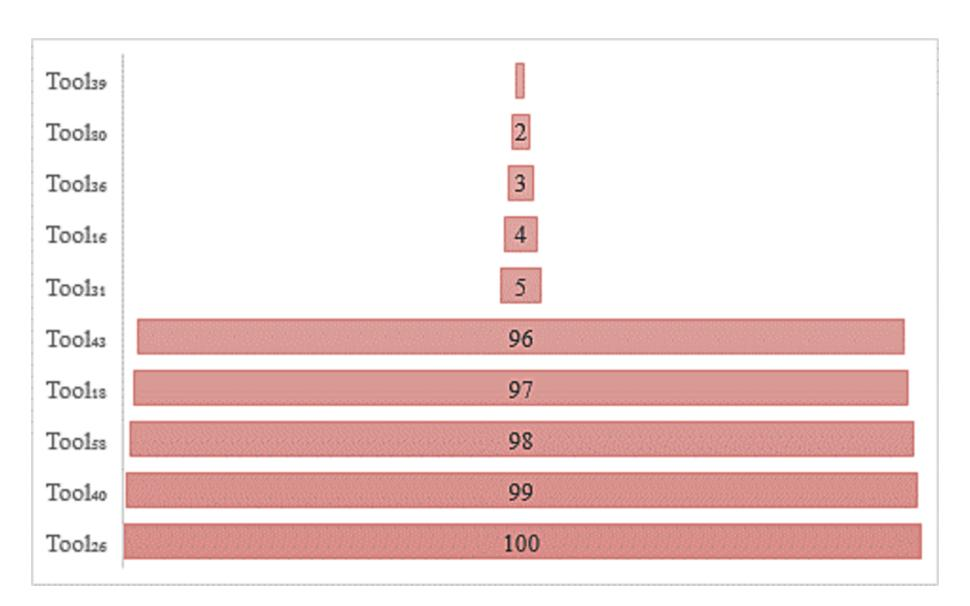
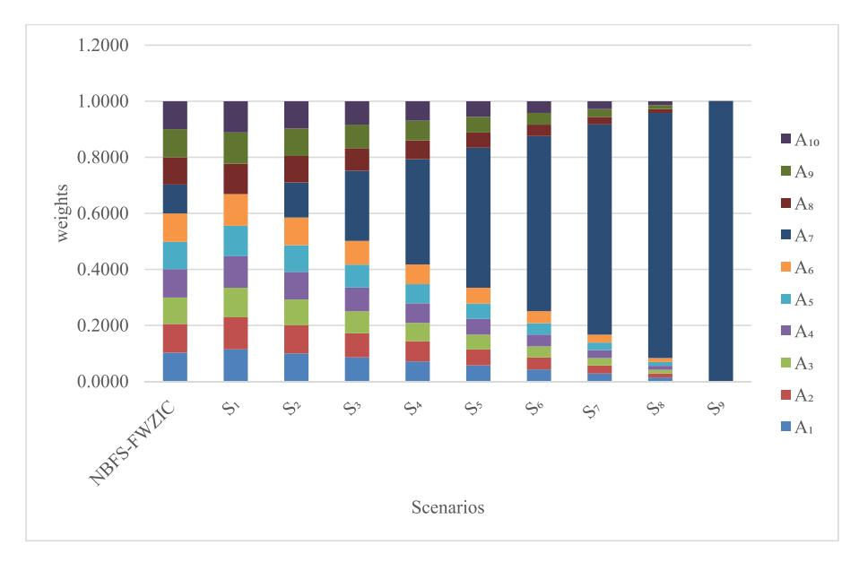
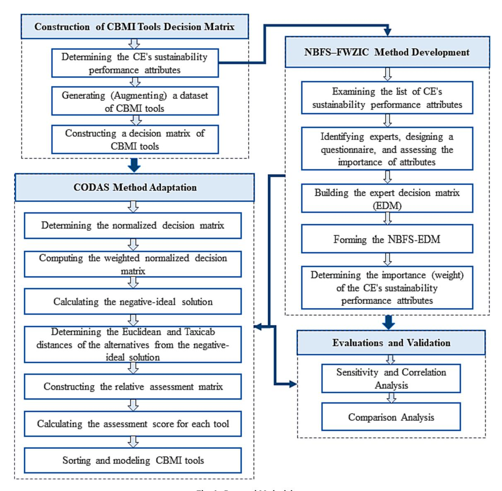
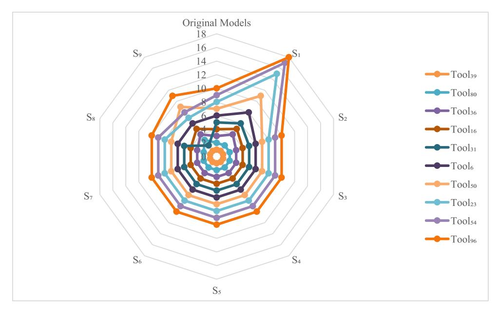
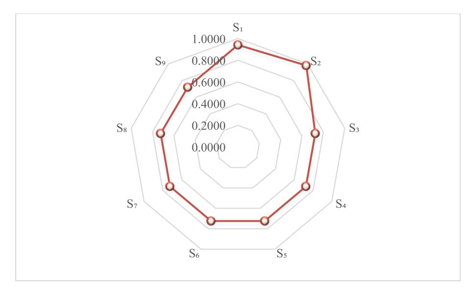

<!-- A3.R97 | source: papers_json/A3.R97/ -->

توجد قوائم المحتويات على ScienceDirect

## Computers & Industrial Engineering

الصفحة الرئيسية للمجلة: www.elsevier.com/locate/caie

## نهج قرار عصبوسوفي ثنائي القطبية ضبابي لتطوير أدوات ابتكار نموذج الأعمال الدائري المستدام

Aws Alaa Zaidan a, Muhammet Deveci b, c, d, *, Hassan A. Alsattar e, Sarah Qahtan f, Wen-Long Shang g, l, Dursun Delen h, i, *, Nahia Mourad j, Zainab Khalid Mohammed k

- a SP Jain School of Global Management, Lidcombe, Sydney, NSW 2141, Australia
- b Department of Industrial Engineering, Turkish Naval Academy, National Defense University, 34942 Tuzla, Istanbul, Turkey
- c The Bartlett School of Sustainable Construction, University College London, 1-19 Torrington Place, London WC1E 7HB, UK
- d Department of Electrical and Computer Engineering, Lebanese American University, Byblos, Lebanon
- e 1-Research Center, Mazaya University College, Nasiriyah, Iraq 2-MEU Research Unit, Middle East University, Amman, Jordan
- f Department of Computer Center, College of Health and Medical Techniques, Middle Technical University, 10047 Baghdad, Iraq
- g Beijing Key Laboratory of Traffic Engineering, College of Metropolitan Transportation, Beijing University of Technology, Beijing 100124, China
- h Center for Health Systems Innovation, Department of Management Science and Information Systems, Spears School of Business, Oklahoma State University, Stillwater 74078. OK. USA
- i Department of Industrial Engineering, Faculty of Engineering and Natural Sciences, Istinye University, Sariyer 34396, Istanbul, Turkey
- j Faculty of Engineering & IT, British University in Dubai, Dubai, United Arab Emirates
- k Department of Information and Communication Technology/UNITEN University, Malaysia
- 1 Centre for Transport Studies, Imperial College London, SW7 2AZ London, UK

## معلومات المقالة

## الكلمات المفتاحية: ابتكار نموذج الأعمال الدائري CODAS

FWZIC MADM

مجموعات ضبابية ثنائية القطبية عصبوسوفية

## الملخص

حُدد الاقتصاد الدائري (CE) كحافز محتمل للتنمية المستدامة من قبل قطاع الأعمال والأكاديميين وصانعي السياسات. ولمساعدة مطوري الشركات على إنشاء وتحسين نماذج أعمال تتضمن الدائرية، اقتُرحت مجموعة متنوعة من أدوات ابتكار نموذج الأعمال الدائري (CBMI). ومع ذلك، فشلت الأدوات الحالية في مراعاة الاستدامة أو الاقتصاد الدائري عند تطويرها. وحتى الآن، لا يوجد بحث قدّم مجموعة بيانات كاملة تشمل جميع الأدوات المحتملة التي يمكن إنشاؤها بناءً على سمات الأداء الاستدامي للاقتصاد الدائري. علاوة على ذلك، هناك ندرة في البحوث التي أُجريت لتقييم ونمذجة هذه الأدوات بهدف تحديد الأكثر كفاءة منها، مما أدى إلى وجود فجوة بحثية. تبني هذه الورقة مصفوفة قرار لأدوات CBMI عبر تقاطع 100 أداة CBMI مع 10 سمات أداء استدامي للاقتصاد الدائري. وتندرج نمذجة أدوات CBMI ضمن اتخاذ القرار متعدد السمات (MADM) بسبب وجود سمات عديدة، ومستويات أهمية متفاوتة لهذه السمات، وتباين في البيانات. لذلك، أُعيدت صياغة طريقة الوزن الضبابي بعدم تناقض صفري (FWZIC) ضمن إطار المجموعات الضبابية ثنائية القطبية العصبوسوفية (NBFS) لتحديد وزن سمات الأداء الاستدامي للاقتصاد الدائري. وتُغذى المصفوفة المبنية وقيم الأوزان الناتجة في طريقة CODAS من أجل نمذجة أدوات CBMI وتحديد الأداة الأكثر استدامة. تشير النتائج إلى أن طريقة NBFS-FWZIC أعطت قيمة وزن قدرها 0.1031 للسمة A_7، وهي أعلى قيمة وزن. في المقابل، حصلت A_3 على أقل قيمة وزن بلغت 0.0944. ونمذجت طريقة CODAS الأدوات المئة الخاصة بـ CBMI، حيث حُددت Tool39 كأكثر أداة استدامة وTool26 كأقل أداة استدامة. وقُيّمت متانة الطريقة المقترحة ومتانتها باستخدام تحليل حساسية، واختبار ارتباط الرتب لسبيرمان (Spearman)، وتحليل مقارن.

## 1. المقدمة

يُعترف على نطاق واسع بأن الاستدامة تمثل

هاجساً أساسياً وميزة محتملة للشركات في آن واحد (Satyro et al., 2022). وقد جادل بعض الباحثين بأن تبني استراتيجيات أكثر ابتكاراً، مثل إعادة تصميم توليفات المنتج والخدمة ونماذج الأعمال،

> ^* ^Corresponding authors at: Department of Industrial Engineering, Turkish Naval Academy, National Defense University, 34942 Tuzla, Istanbul, Turkey (M. Deveci). Department of Management Science and Information Systems, Spears School of Business, Oklahoma State University, USA (D. Delen).

> E-mail addresses: muhammetdeveci@gmail.com (M. Deveci), wenlong.shang12@imperial.ac.uk (W.-L. Shang), dursun.delen@okstate.edu (D. Delen), zainabkhmohammed@gmail.com (Z.K. Mohammed).

<!-- page 2 -->

قد يؤدي إلى فوائد بيئية أكبر ([Bocken et al., 2013; ](#page-17-0) [Tuladhar et al., 2022](#page-17-0)). ويمثل الاقتصاد الدائري (CE) طريقة تفكير مختلفة في الاقتصاد مقارنةً بالاقتصاد الخطي الحالي، الذي يتبع نموذج "خذ-اصنع-تخلص". ويهدف الاقتصاد الدائري إلى إبطاء دورات الموارد وإغلاقها وتقليصها [(Geissdoerfer et al., 2017; ](#page-18-0) Rashid & [Malik, 2023](#page-18-0)). وقد اكتسب نموذج الاقتصاد الدائري، الذي نشأ في ستينيات القرن الماضي (Blomsma & [Brennan, 2017; Ghisellini et al., 2016](#page-17-0))، شعبية في السنوات الأخيرة وأصبح موضوعاً للنقاش في قطاعي الأعمال والسياسات [(Geng et al., 2012; Ghisellini et al., 2016)](#page-18-0).

اعتُبر ظهور نماذج الأعمال الدائرية الجديدة (CBMs) حافزاً محتملاً للانتقال إلى اقتصاد دائري [(Accenture strategy, ](#page-17-0) [2019; Ghisellini et al., 2016)](#page-17-0). وتؤدي نماذج الأعمال الدائرية دوراً في إبطاء دورات الموارد من خلال تعزيز إطالة عمر المنتجات وتشجيع إعادة استخدامها. كما تساعد على إغلاق دورات الموارد عبر استخلاص القيمة المتبقية من المنتجات الثانوية أو النفايات من خلال نماذج أعمال مبتكرة. علاوة على ذلك، تساعد نماذج الأعمال الدائرية على تضييق دورات الموارد من خلال تحسين تصميم المنتج وكفاءة التصنيع [(Bocken et al., 2016](#page-17-0)). ومع ذلك، يظل تبني نماذج الأعمال الدائرية في ممارسات الأعمال محدوداً بسبب الحاجة إلى تعديل مكونات أساسية للأعمال وتحدي النماذج السائدة ([Bocken et al., 2017; ](#page-17-0) [Ritala et al., 2018](#page-17-0)).

عند هذه النقطة، من الضروري البدء في "تفعيل" مفهوم الاقتصاد الدائري (Blomsma & [Brennan, 2017)](#page-17-0) بطريقة تلبي توقعات الاستدامة ([Geissdoerfer et al., 2017; Nu](#page-18-0)ßholz et al., 2019) وتمنع أي نتائج سلبية (Zink & [Geyer, 2017](#page-19-0)). ويتطلب ذلك تحولاً على مستوى الأفراد والشركات والحكومات ([Ghisellini et al., 2016](#page-18-0)). ويأتي تحديد واستكشاف أدوات نموذج الأعمال الدائري التي يمكن أن تسهّل تفعيل الاقتصاد الدائري [(Antikainen ](#page-17-0)& Val[kokari, 2016)](#page-17-0).

في أدبيات الإدارة (Martin & [Hoffmann, 2012](#page-18-0))، من المسلم به أن عملية الابتكار تتطلب "هيكلاً وتوجيهاً لتأطير الفكر وتركيزه" من أجل المساعدة في تصميم نموذج الأعمال. ومن أجل مساعدة مطوري الأعمال في تصميم وابتكار نماذج أعمال نحو الدائرية، طُورت مجموعة من أدوات ابتكار نموذج الأعمال الدائري (CBMI). وتهدف أدوات CBMI إلى تقديم التوجيه والمساعدة في تجاوز تحديات مثل التواصل بشأن العروض، وتحسين اللوجستيات العكسية، ومعالجة التأخير الزمني بين توفر المنتجات والطلب عليها ([Whalen, Milios, ](#page-19-0) [et al., 2018](#page-19-0)). ومن أمثلة هذه الأدوات تلك التي طُورت في دراسات (Antikainen & [Valkokari, 2016; Bocken et al., 2013; Leising ](#page-17-0) [et al., 2018; Nu](#page-17-0)ßholz, 2018).

تشير الدراسات المتعلقة بتطوير الأدوات إلى أن العديد من الأدوات قد اخترعت لكنها لم تُستخدم بفعالية، ربما بسبب غياب الشفافية في عملية تطوير الأداة وعدم كفاية الاختبار مع المستهلكين المحتملين لهذه الأدوات [(Baumann et al., 2002; Tyl et al., 2015](#page-17-0)). ومؤخراً، قدّم [(Bocken et al., 2019](#page-17-0)) تحليلاً شاملاً لأدوات CBMI الحالية واقترح عشر سمات محتملة لأداء الاستدامة الخاص بالاقتصاد الدائري من أجل التطوير المستقبلي لأداة CBMI المستدامة. وعلى الرغم من توفر بعض أدوات CBMI في الأدبيات، إلا أن أياً منها لم يأخذ بعين الاعتبار سمات الأداء الاستدامي للاقتصاد الدائري عند تطويرها.

لذلك، تقدم هذه الدراسة مجموعة شاملة من الأدوات التي يمكن تطويرها وفقاً للسمات العشر المذكورة، من خلال توفير مصفوفة قرار لأدوات CBMI. علاوة على ذلك، تقدم هذه الورقة طريقة لتقييم هذه الأدوات فيما يتعلق بسمات الأداء الاستدامي للاقتصاد الدائري لتحديد الأدوات الأكثر كفاءة لمساعدة المهنيين في عملية CBMI.

## *1.1.* *المشكلات والفجوات البحثية *

وفقاً لـ ([Bocken et al., 2019](#page-17-0))، فإن للأداء الاستدامي تأثيراً مباشراً على أدوات CBMI. وتُعرض سمات الأداء الاستدامي للاقتصاد الدائري المتعلقة بالتطوير المحتمل لأداة CBMI في الجدول 1، كما ذكرها ([Bocken et al., 2019)](#page-17-0). وحتى الآن، لم يقدم أي بحث مصفوفة قرار شاملة تضم جميع الأدوات المحتملة التي يمكن اشتقاقها من السمات المذكورة أعلاه.

علاوة على ذلك، هناك نقص في الدراسات التي أُجريت لتقييم ونمذجة هذه الأدوات من أجل تحديد الأمثل منها، وهو ما اعتُبر فجوة بحثية.

ومع ذلك، توجد مخاوف مرتبطة بعملية نمذجة واختيار أداة CBMI الأكثر استدامة، والتي تعتمد على سمات متعددة للأداء الاستدامي للاقتصاد الدائري. وهناك ثلاثة مخاوف رئيسية يجب معالجتها عند نمذجة أدوات CBMI: تعدد سمات الأداء الاستدامي للاقتصاد الدائري ([Mahmoud et al., 2022)](#page-18-0)، ومستوى أهمية هذه السمات [(Ibrahim et al., 2023)](#page-18-0)، وتباين البيانات ([Qahtan et al., 2023)](#page-18-0). ولذلك، من الضروري مراعاة تعدد سمات الأداء الاستدامي للاقتصاد الدائري عند نمذجة أدوات CBMI. ويمكن أن يُعقّد دمج سمات الأداء الاستدامي للاقتصاد الدائري في تطوير أدوات CBMI عملية التقييم. وتشير هذه التفاوتات إلى أنه لا ينبغي أبداً تقييم أدوات CBMI بناءً على سمة واحدة فقط. إضافة إلى ذلك، يجب مراعاة أهمية سمات التقييم، إذ لا تحمل جميع السمات الوزن والتأثير ذاته على أدوات CBMI. كذلك، عندما تتفوق أداة CBMI معينة على غيرها من حيث سمات محددة للأداء الاستدامي للاقتصاد الدائري، فقد تُختار باعتبارها الأفضل. وفي المقابل، قد تفضّل سمات أداء استدامي أخرى للاقتصاد الدائري أدوات مغايرة، مما يؤدي إلى تباين في البيانات. وبالتالي، فإن مشكلة اتخاذ القرار المعقدة بسمات متعددة تنشأ في سياق نمذجة أدوات CBMI عند أخذ هذه المخاوف بعين الاعتبار. ولذلك، يُعد حل اتخاذ القرار متعدد السمات (MADM) [(Albahri et al., 2022; Dhalmahapatra et al., 2022](#page-17-0)) ضرورياً لمعالجة المشكلة والمخاوف المحددة وسد الفجوة البحثية القائمة.

## *1.2.* *التحديات النظرية لـ MADM *

يمثل MADM مجالاً بحثياً بينياً شديد الديناميكية ضمن حقلي بحوث العمليات وعلوم الإدارة ([Zayat et al., ](#page-19-0) [2023)](#page-19-0). وقد اقترح الباحثون العديد من تقنيات وأساليب MADM خلال السنوات القليلة الماضية [(Dhalmahapatra et al., 2022; Mardani ](#page-18-0) [Shahri et al., 2021; Zayat et al., 2023, Kazemi et al., 2024, Wang et al., ](#page-18-0) [2024; Bouraima et al., 2024; Dagıstanlı ](#page-18-0)˘ and Kurtay, 2024). ومن أبرز الطرق المعروفة: نموذج المجموع الموزون (WSM)، ونموذج الحاصل الموزون (WPM)، وطريقة التقييم بالحاصل المجمع الموزون (WASPAS)، وأسلوب ترتيب الأفضلية بالتشابه مع الحل المثالي (TOPSIS)، وطريقة ELECTRE، وطريقة تنظيم تفضيل الترتيب لإثراء التقييمات (PROMETHEE)، وطريقة VIKOR، وأسلوب التقييم النسبي المركب (COPRAS)، وأسلوب التحسين متعدد الأهداف بنسبة التحليل مع الصيغة الضربية الكاملة (MULTIMOORA)، والتقييم القائم على المسافة من متوسط

<!-- page 3 -->

الحل (EDAS)، وأسلوب التقييم بالنسبة الإضافية (ARAS) ([Keshavarz ](#page-18-0) [Ghorabaee et al., 2016; Zayat et al., 2023](#page-18-0)).

تمتلك جميع طرق MADM هذه مزاياها وقوتها ونقاط ضعفها الخاصة في تطبيقات معينة. ومع ذلك، لا يركز هذا العمل على تقييم دقتها. وبشكل عام، يظل اختيار أداة CBMI المثلى مشكلة تفتقر إلى تعريف واضح. وغالباً ما يعتمد ذلك على بيانات غامضة، يصعب تمثيلها وتُستمد من خبرة المهنيين. وقد اعتمدت هذه الورقة طريقة حُديثة التطوير اقترحها ([Keshavarz Ghorabaee et al., 2016)](#page-18-0)، تُعرف بالتقييم القائم على المسافة (CODAS)، لمعالجة مشكلة MADM. وتمتلك CODAS بعض الخصائص التي لم تُؤخذ بعين الاعتبار في طرق MADM السابقة [(Kausar et al., 2023; Keshavarz ](#page-18-0) [Ghorabaee et al., 2016](#page-18-0)).

تستخدم طريقة CODAS مسافة إقليدس كمعيارها الرئيسي للتقييم. وإذا كانت المسافات الإقليدية لخيارين متقاربة جداً، تُستخدم مسافة التاكسي كاب للمقارنة بينهما. ويحدد معلمة العتبة مستوى تقارب المسافات الإقليدية. علاوة على ذلك، أجرى [(Keshavarz Ghorabaee et al., 2016)](#page-18-0) دراسة حساسية مقارنة لإثبات استقرار وصلاحية CODAS. ويقارن هذا التحليل نتائج طريقة CODAS بنتائج خمس طرق MADM أخرى، هي WASPAS وCOPRAS وTOPSIS وVIKOR وEDAS. وخلص المؤلفون إلى أن CODAS فعالة في معالجة مشكلات MADM. وبناءً على ذلك، طُبّقت CODAS في مجالات متنوعة لنمذجة مزود خدمات لوجستية، ونمذجة مركبة صهريجية، واختيار مواقع مستشفيات محتملة، وترتيب أولويات جوانب التكنولوجيا في الصناعة 4.0 لتحسين تبني الاقتصاد الدائري في شبكة سلسلة التوريد [(Agarwal et al., 2022](#page-17-0))، ونمذجة ممارسات الاقتصاد الدائري المهمة التي تسهم في تحقيق أهداف التنمية المستدامة في إدارة سلسلة التوريد الدائرية (Lahane & [Kant, 2022](#page-18-0)).

بناءً على الوصف السابق، يمكن استخدام طريقة CODAS لنمذجة أداة CBMI الأكثر استدامة. ومع ذلك، تُقيَّد طريقة CODAS بعيب أساسي، وهو تحديداً عجزها عن تقديم أوزان للسمات بناءً على مستوى أهميتها. ويستلزم ذلك استخدام طريقة إضافية لترجيح السمات. وقد استُخدمت عملية التحليل الهرمي التقليدية، وعملية الشبكة التحليلية، وطريقة أفضل-أسوأ على نطاق واسع في الأدبيات الأكاديمية لهذا الغرض ([Zaidan et al., 2023)](#page-19-0). ومع ذلك، تبقى نتائج الأوزان غير المتسقة لهذه الطرق دون حل. ومؤخراً، اقترح [(Mohammed et al., ](#page-18-0) [2022)](#page-18-0) طريقة الوزن الضبابي بعدم تناقض صفري (FWZIC) التي يمكنها تحديد أهمية السمات في عملية النمذجة دون أي تناقض. ومع ذلك، اتسمت النسخة الأولى من FWZIC بعدم الوضوح واستخدام الأعداد الضبابية المثلثية. لذلك، وُسّعت طريقة FWZIC لتشمل أنواعاً مختلفة من المجموعات الضبابية (FS)، مثل بيثاغورس [(Qahtan et al., 2023)](#page-18-0)، والعصبوسوفية ([Alamoodi et al., 2022)](#page-17-0)، وفيرماتيان ([AlSattar et al., 2022)](#page-17-0)، وبيثاغورس متعدد الأقطاب ([Albahri et al., ](#page-17-0) [2022)](#page-17-0). وعلى الرغم من هذه الجهود، لا تزال هناك مخاوف غير محلولة بشأن المعلومات غير المؤكدة والغامضة.

يُنسب إلى ([Zadeh, 1965)](#page-19-0) الفضل في تأسيس نظرية المجموعات الضبابية (FS). وقد وُسّع مفهوم نظرية FS ليشمل أنواعاً أخرى من المجموعات مثل FS الغامضة (Alhazaymeh & [Hassan, 2015](#page-17-0))، وFS ذات القيمة الفاصلية، وFS الحدسية ([Alhazaymeh et al., 2012)](#page-17-0)، وL-FS، وQ-FS (Adam & [Hassan, ](#page-17-0) [2015)](#page-17-0)، وFS الاحتمالية، وأخرى ([Alsattar et al., 2024; Ghailani et al., ](#page-17-0) [2023; Truck, 2015](#page-17-0)). وقد أظهرت كل نسخة من هذه النسخ محدوديات في سيناريوهات مختلفة. بعد ذلك، قدّم [(Smarandache, 1999](#page-18-0)) مفهوم المجموعة العصبوسوفية، التي تمثل تعميماً لجميع النسخ السابقة من FS. ولسوء الحظ، عالجت جميع أنواع FS المذكورة القضايا المتعلقة بالآراء والتفضيلات الإيجابية حصراً، متجاهلة حقيقة أن العقل البشري يعمل في الاتجاهين الإيجابي والسلبي عند اتخاذ القرارات. لذلك، ومن أجل معالجة هذا القصور، اقترح [(Zhang, 1994)](#page-19-0) مفهوم المجموعات الضبابية ثنائية القطبية. وقد فحص [(Yaqoob et al., 2014, 2016](#page-19-0)) خصائص المجموعات الضبابية ثنائية القطبية بشكل مستفيض واستكشفوها.

تجد نظرية المجموعة العصبوسوفية تطبيقات في مجالات متنوعة مثل الهندسة، وعلوم الحاسوب، والعلوم الطبية، والعلوم الفيزيائية، والعلوم الاجتماعية (Otay & [Kahraman, 2019)](#page-18-0). وتُعد المجموعات العصبوسوفية مجموعات أوسع وأكثر شمولاً لمعالجة قضايا

المعلومات غير المؤكدة والغامضة، مقارنة بالنسخ الأخرى من FS ([Hashim et al., ](#page-18-0) [2020)](#page-18-0). وقد ثبت أن المجموعات الضبابية ثنائية القطبية مفيدة في التعامل مع المواقف الغامضة التي تنطوي على جوانب إيجابية وسلبية معاً ([Deli et al., ](#page-17-0) [2015)](#page-17-0). ومؤخراً، قدّم [(Hashim et al., 2018)](#page-18-0) مفهوم المجموعات الضبابية ثنائية القطبية العصبوسوفية (NBFS)، وهي امتداد عام لـ FS والمجموعات الضبابية ثنائية القطبية والمجموعات الحدسية الضبابية والمجموعات العصبوسوفية. وتنطوي NBFS على اتخاذ قرارات تأخذ بعين الاعتبار التفضيلات الإيجابية والسلبية معاً. لذلك، صيغت طريقة FWZIC باستخدام NBFS لتحديد أهمية كل سمة من سمات الأداء الاستدامي للاقتصاد الدائري.

## *1.3.* *الدافع *

عند هذه النقطة، لا يوجد بحث حالي قدّم مصفوفة قرار شاملة تضم جميع الأدوات المحتملة التي يمكن تطويرها بناءً على سمات الأداء الاستدامي للاقتصاد الدائري. علاوة على ذلك، هناك ندرة في البحوث التي أُجريت لتقييم ونمذجة هذه الأدوات بهدف تحديد الأكثر كفاءة منها، كما ذُكر سابقاً. وعلى حد علمنا، لا توجد أبحاث سابقة وسّعت FWZIC ضمن إطار NBFS. كذلك، لم يُنفَّذ دمج طريقتي NBFS-FWZIC وCODAS في أي دراسة حالة. لذا، فإننا مدفوعون لاقتراح طريقتي NBFS-FWZIC وCODAS الجديدتين لنمذجة أداة CBMI وتحديد الأكثر استدامة منها. وقد صيغت وطُورت NBFS-FWZIC لحساب وزن سمات الأداء الاستدامي للاقتصاد الدائري قيد التقييم. وتُعتمد طريقة CODAS لنمذجة أدوات CBMI باستخدام الأوزان المستخلصة ومصفوفة القرار المبنية.

## *1.4.* *الأهداف الرئيسية للبحث *

بناءً على الأقسام السابقة، يمكن تلخيص أهداف هذه الورقة بإيجاز على النحو التالي: (i) بناء مصفوفة قرار لأدوات CBMI توضّح التقاطع بين أدوات CBMI وسمات الأداء الاستدامي للاقتصاد الدائري. (ii) إعادة صياغة امتداد جديد لطريقة FWZIC ضمن بيئة NBFS، يتضمن آلية ترجيح لسمات الأداء الاستدامي للاقتصاد الدائري ويعالج أوجه القصور في الطرق الحالية. (iii) دمج نهج NBFS-FWZIC المقترح مع طريقة CODAS لنمذجة أدوات CBMI وتحديد الأكثر استدامة منها.

## *1.5.* *مساهمات البحث *

يمكن تلخيص مساهمات الورقة في المعرفة بإيجاز على النحو التالي:

- 1. تبني هذه الورقة مصفوفة قرار CBMI من خلال تقاطع أدوات CBMI مع سمات الأداء الاستدامي للاقتصاد الدائري. ويمكن أن يحل بناء مصفوفة كهذه مشكلة تقييم ونمذجة أداة CBMI بناءً على سمات تقييم متعددة.
- 2. تُعيد هذه الورقة صياغة وتطوير امتداد جديد لطريقة FWZIC، أُطلق عليه اسم طريقة NBFS-FWZIC، وهو مصمم لإسناد أوزان إلى سمات الأداء الاستدامي للاقتصاد الدائري. وتعالج طريقة NBFS-FWZIC قضية مستوى أهمية سمات التقييم من خلال إسناد قيمة وزن لكل سمة بناءً على تأثيرها في تطوير أدوات CBMI الأكثر استدامة.
- 3. تعتمد هذه الورقة طريقة CODAS لنمذجة أدوات CBMI من أجل معالجة قضية تباين البيانات.
- 4. تقترح هذه الورقة منهجية اتخاذ قرار تجمع بين طريقتي NBFS-FWZIC وCODAS لنمذجة أدوات CBMI وتحديد الخيارات الأكثر استدامة بناءً على مصفوفة القرار المبنية.

يُنظّم باقي هذه الورقة على النحو التالي: يقدم [القسم 2](#page-3-0) نظرة عامة على أدوات CBMI الحالية. ويقدم [القسم 3 ](#page-3-0)ملخصاً موجزاً للتعريفات ذات الصلة بـ NBFS. ويقدم [القسم 4 ](#page-4-0)

<!-- page 4 -->

شرحاً شاملاً لطرق البحث. ويعرض القسم 5 نتائج التجارب ويقدم تحليلاً وشرحاً مفصلاً للنتائج. وتُبرز فعالية الطرق المقترحة وتفوقها في القسم 6 من خلال إجراء تحليل الحساسية، واختبار معامل ارتباط سبيرمان، والتحليل المقارن. وأخيراً، يقدم القسم 7 من الورقة استنتاجاً وتوصيات للبحوث المستقبلية.

## 2. نحو أدوات لـ CBMI

طُورت أدوات وتقنيات متنوعة في المجالات التي تدعم مفهوم CBMI في الأدبيات. ومؤخراً، شهد العمل المتعلق بالتصميم البيئي والأدوات المبتكرة ارتفاعاً في الشعبية (Bocken et al., 2019). ويشمل ذلك العديد من المساهمات التي تركز على تطوير أساليب متنوعة، مثل المعالجة وإعادة التدوير (Chiu & Chu, 2012). ومع مرور الوقت، أصبح المزيد من الأساليب والأدوات لتسهيل إنشاء أنظمة خدمة المنتج المستدامة مقبولاً على نطاق واسع (Keskin et al., 2013). وقُدّمت العديد من "الأدوات المستدامة" الأخرى لتصميم نماذج الأعمال في السنوات الأخيرة (Bocken et al., 2019; Pigosso & McAloone, 2015). وتشمل الأنواع السائدة من الأدوات إرشادات، مثل معايير الاستدامة التي وضعتها المنظمة الدولية للتوحيد القياسي (ISO)، إضافة إلى قوائم التحقق وأدوات تحليلية أكثر مثل تقييم دورة الحياة. وتوفر هذه الأدوات تحليلاً شاملاً ومنهجياً في مراحل مختلفة من دورة حياة تطوير المنتج (Vallet et al., 2013). ويمكن أن تكون ذات بنية نوعية أو كمية (Bovea & Pérez-Belis, 2012) وبالتالي يمكن أن تغطي مرحلة واحدة أو أكثر خلال عمر المنتج (Rossi et al., 2016). ويتمثل هدف مشترك لهذه الأدوات في معالجة اهتمامات أصحاب المصلحة والعملاء والإدارة، مع التركيز بشكل خاص على التصميم المفاهيمي، وتوليد الأفكار، ومشاركة سلسلة التوريد (Bocken

وعلى الرغم من توفر العديد من الأدوات، تشير الأبحاث إلى غياب أدوات تلبي احتياجات الأعمال وتوقعاتها بشكل كافٍ (Rossi et al., 2016). ويبدو أن عدة أساليب وأدوات أساسية معروفة، مثل نموذج الأعمال التجاري (business model canvas) (Johnson, 2012) أو أسلوب الشركة الناشئة الرشيقة (lean startup method) (Ries, 2011)، تُستخدم بطريقة مرنة في الممارسة العملية، دون تركيز محدد على CBMI. وفي غياب دعم كافٍ، قد يؤدي الاستخدام الواسع لهذه الأدوات الأساسية إلى إضعاف التركيز على الاستدامة أو الاقتصاد الدائري (Bocken et al., 2018) ويؤدي إلى تبني أدوات أعمال تقليدية إضافية لا تقدم أي فائدة واضحة للمجتمع أو البيئة.

باختصار، هناك مجموعة واسعة من الأدوات المصممة للابتكار الدائري والاستدامة لا تُستخدم للأسف بكامل إمكاناتها (Bocken et al., 2019). وقد يحدث هذا للأسباب التالية: (i) لم يُجرَ الاختبار التجريبي لهذه الأساليب، ولم تأخذ تقنية CBMI بعين الاعتبار احتياجات المستخدمين، وخاصة مطوري الأعمال في المنظمات (Bocken et al., 2019). (ii) قد تكون الأدوات مرهقة للغاية من حيث المدة والتعقيد (Kubzansky, 2013). (iii) تُبنى الأدوات عادةً ضمن مجالات محددة، مثل الهندسة أو الأعمال أو التصميم (Bocken et al., 2019). ومع ذلك، فإنها غالباً ما تفشل في الاستفادة من الخبرة القيّمة متعددة التخصصات التي قد تعزز وظيفتها. وقد أصبح علم التصميم مهماً بشكل متزايد في تطوير أدوات الأعمال الموجهة نحو الاستدامة. ويهدف إلى دمج تخصصات متنوعة من خلال تبني منظور أصحاب المصلحة والمستخدمين (Heyes et al., 2018). ويتحقق ذلك من خلال استخدام أساليب علم التصميم مثل النمذجة الأولية (Geissdoerfer et al., 2016). كذلك، تُختبر الأدوات وتُصقل بانتظام بإسهام المستهلكين من الناحية العملية (Baldassarre et al., 2017).

طُورت الأساليب الحديثة (Bocken et al., 2017; Weissbrod & Bocken, 2017) لـ CBMI بناءً على منهجيات ابتكار راسخة مثل التفعيل (التعلم من الممارسة الريادية) (Bocken et al., 2019) والشركة الناشئة الرشيقة (التي تركز على الاختبار السريع والتكراري للأفكار الجديدة عملياً). وتستمر أمثلة عدة فئات من الأدوات التي تركز على توليد أفكار لنماذج الأعمال الدائرية، مثل الألعاب الجادة (Whalen, 2017; Whalen, Berlin, et al., 2018)، وقواعد بيانات الحالات (CIRCULATOR, 2018)، والتصنيفات (Bakker et al., 2014)، في التوسع باستمرار. وفي

سبيل تبني أدوات CBMI بفعالية وتحسينها أكثر، من الضروري أولاً فهم وضعها الحالي فهماً شاملاً وكيفية إسهامها في عملية ابتكار نموذج الأعمال. وأُجريت عدة مراجعات لأدوات التصميم البيئي (Bocken et al., 2019; Bovea & Pérez-Belis, 2012; Pigosso & McAloone, 2015). وتركز هذه الدراسات على تقييم الأدوات استناداً إلى معيارين: (i) الغرض من الأداة، الذي يحدد نوعها وهدفها (مثل قائمة التحقق، أو التحليلية) (Knight & Jenkins, 2009)؛ وطبيعة الأداة (مثل نوعية، أو كمية) (Bovea & Pérez-Belis, 2012)، و(ii) شكل الأداة وخصائصها، مثل الرسوم البيانية أو الأدوات الحاسوبية (Rossi et al., 2016)، وتقييم تطور الأداة عبر الزمن (Pigosso et al., 2015).

وعلى حد علمنا، لا توجد سوى دراستين تبحثان تحديداً في الأساليب والأدوات الخاصة بـ CBMI (Bocken et al., 2019). ومع ذلك، ومن أجل البدء في تنفيذ مفهوم الاقتصاد الدائري كما وصفه (Blomsma & Brennan, 2017)، من الضروري فحص الأدوات المستخدمة بدقة. وهذا مهم بشكل خاص لأن هناك أدوات ابتكار مستدامة عديدة متاحة لم تُستخدم في الممارسة العملية (Bocken et al., 2019). وثمة مخاوف من أن استخدام "أدوات عامة" مثل تلك التي اقترحها (Johnson, 2012; Ries, 2011) قد لا يؤدي إلى نماذج الأعمال الدائرية المرغوبة ذات الفوائد البيئية الواضحة (Manninen et al., 2018). وحتى الأدوات المطورة في الأوساط الأكاديمية غالباً ما تفتقر إلى منهجية علمية محددة، وغالباً ما يغيب تقييم الأداة (Madani et al., 2017). في هذه الورقة، بُنيت مصفوفة قرار تضم جميع التطويرات المحتملة لأدوات CBMI بناءً على سمات الأداء الاستدامي للاقتصاد الدائري.

## 3. مبادئ تمهيدية

لضمان اكتفاء هذه الدراسة ذاتياً، يُقدَّم في هذا الجزء تمهيد موجز للتعريفات ذات الصلة بالمحتوى المتبقي.

**تعريف 1.** ((*Hashim et al.*, 2020)) ليكن X مجموعة غير خالية. المجموعة الضبابية ثنائية القطبية هي كائن من الشكل B = \langle x, \mu^+(x), \mu^-(x) : x \in X \rangle، حيث \mu^+: X \rightarrow [0,1] دالة عضوية موجبة، و\mu^-: X \rightarrow [-1,0] دالة عضوية سالبة.

**تعريف 2.** ((Hashim et al., 2020)) ليكن X مجموعة غير خالية. المجموعة العصبوسوفية أحادية القيمة هي كائن من الشكل N = \{\langle x, T_N(x), I_N(x), F_N(x) \rangle : x \in X \}، حيث تُعرَّف N بدالة عضوية الصدق T_N : X \longrightarrow [0,1]، ودالة عضوية عدم التحدد I_N : X \longrightarrow [0,1]، ودالة عضوية الزيف F_N : X \longrightarrow [0,1]. ولا توجد قيود على مجموع T_N، T_N و T_N، لذا T_N : T_N = T_N = T_N = T_N = T_N = T_N = T_N = T_N = T_N = T_N = T_N = T_N = T_N = T_N = T_N = T_N = T_N = T_N = T_N = T_N = T_N = T_N = T_N = T_N = T_N = T_N = T_N = T_N = T_N = T_N = T_N = T_N = T_N = T_N = T_N = T_N = T_N = T_N = T_N = T_N = T_N = T_N = T_N = T_N = T_N = T_N = T_N = T_N = T_N = T_N = T_N = T_N = T_N = T_N = T_N = T_N = T_N = T_N = T_N = T_N = T_N = T_N = T_N = T_N = T_N = T_N = T_N = T_N = T_N = T_N = T_N = T_N = T_N = T_N = T_N = T_N = T_N = T_N = T_N = T_N = T_N = T_N = T_N = T_N = T_N = T_N = T_N = T_N = T_N = T_N = T_N = T_N = T_N = T_N = T_N = T_N = T_N = T_N = T_N = T_N = T_N = T_N = T_N = T_N = T_N = T_N = T_N = T_N = T_N = T_N = T_N = T_N = T_N = T_N = T_N = T_N = T_N = T_N = T_N = T_N = T_N = T_N = T_N = T_N = T_N = T_N = T_N = T_N = T_N = T_N = T_N = T_N = T_N = T_N = T_N = T_N = T_N = T_N = T_N = T_N = T_N = T_N = T_N = T_N = T_N = T_N = T_N = T_N = T_N = T_N = T_N = T_N = T_N = T_N = T_N = T_N = T_N = T_N = T_N = T_N = T_N = T_N = T_N = T_N = T_N = T_N = T_N = T_N = T_N = T_N = T_N = T_N = T_N = T_N = T_N = T_N = T_N = T_N = T_N = T_N = T_N = T_N = T_N = T_N = T_N = T_N = T_N = T_N = T_N = T_N = T_N = T_N = T_N = T_N = T_N = T_N = T_N = T_N = T_N = T_N = T_N = T_N = T_N = T_N = T_N = T_N = T_N = T_N = T_N = T_N = T_N = T_N = T_N = T_N = T_N = T_N = T_N = T_N = T_N = T_N = T_N = T_N = T_N = T_N = T_N = T_N = T_N = T_N = T_N = T_N = T_N = T_N = T_N = T_N = T_N = T_N = T_N = T_N = T_N = T_N = T_N = T_N = T_N = T_N = T_N = T_N = T_N = T_N = T_N = T_N = T_N = T_N = T_N = T_N = T_N = T_N = T_N = T_N = T_N = T_N = T_N = T_N = T_N = T_N = T_N = T_N = T_N = T_N = T_N = T_N

**تعريف 3.** ((*Hashim et al.*, 2020)) ليكن *X* مجموعة غير خالية. NBFS هي كائن من الشكل NB = \{\langle x, NB^+(x), NB^-(x) \rangle : x \in X \}، حيث NB^+(x) = (T_{NB}^+(x), I_{NB}^+(x), F_{NB}^+(x)) وNB^-(x) = (T_{NB}^-(x), I_{NB}^-(x), F_{NB}^-(x)) بحيث T_{NB}^+, I_{NB}^+, F_{NB}^+ : X \rightarrow [0, 1] وT_{NB}^-, I_{NB}^-, F_{NB}^- : X \rightarrow [-1, 0].

عضو NBFS هو عدد ضبابي ثنائي القطبية عصبوسوفي (NBFN) ويُرمز له بـ \gamma = \langle NB^+, NB^- \rangle = \langle T_{NB}^+, I_{NB}^+, F_{NB}^+, T_{NB}^-, I_{NB}^-, F_{NB}^- \rangle للتبسيط.

**تعريف 4.** ((*Deli et al., 2015*)) ليكن \gamma_j = \langle T_j^+, I_j^+, F_j^+, T_j^-, I_j^-, F_j^- \rangle لـ j=1,\cdots,n مجموعة من NBFN، وw=(w_j)_{1\leq j\leq n} متجه معاملات الوزن، أي w_j\in [0,1] و\sum_{j=1}^n w_j=1. يمكن تعريف مشغل المتوسط الموزون الضبابي ثنائي القطبية العصبوسوفي بـ:

$$
A_{w}(\gamma_{1}, \gamma_{2}, \dots, \gamma_{n}) = \bigoplus_{j=1}^{n} w_{j} \gamma_{j} = \langle 1 - \prod_{j=1}^{n} \left( 1 - T_{j}^{+} \right)^{w_{j}}, \ \prod_{j=1}^{n} \left( I_{j}^{+} \right)^{w_{j}}, \ \prod_{j=1}^{n} \left( F_{j}^{+} \right)^{w_{j}}, - \prod_{j=1}^{n} \left( - T_{j}^{-} \right)^{w_{j}}, - \left( 1 - \prod_{j=1}^{n} \left( 1 + I_{j}^{-} \right)^{w_{j}} \right), - \left( 1 - \prod_{j=1}^{n} \left( 1 + F_{j}^{-} \right)^{w_{j}} \right) \rangle. 
(1)
$$

**تعريف 5.** ((*Deli et al.*, 2015)) يمكن تعريف دالة النتيجة لـ NBFS

<!-- page 5 -->

بـ:

$$
S_{NB}(\gamma) = (T^{+} + (1 - I^{+}) + (1 - F^{+}) + (1 + T^{-}) - I^{-} - F^{-})/6 (2)
$$

*لـ **γ* = 〈*T*^+^*,* *I* ^+^*,* *F*^+^*,* *T*^−^ *,* *I* ^−^ *,* *F*^−^ 〉 *لأي NBFN*.

## **4.** **الطرق والمواد **

يستخدم الحساب المقترح لـ MADM دمجاً تسلسلياً لطريقتي NBFS-FWZIC وCODAS لنمذجة أدوات CBMI، كما هو موضح في الشكل 1. يقدم القسم 4.1 تعليمات مفصلة حول كيفية بناء مصفوفة القرار لأدوات CBMI. وطُورت طريقة NBFS-FWZIC في [القسم 4.2](#page-5-0) لتقدير أوزان سمات الأداء الاستدامي للاقتصاد الدائري، من أجل نمذجة أدوات CBMI واختيار الأكثر استدامة منها، ويوضح [القسم 4.3](#page-6-0) دمج الوزن المحدد للسمات ومصفوفة القرار المبنية ضمن طريقة CODAS. ويقدم [القسم 4.4](#page-7-0) تطبيق تحليل الحساسية والتحليل المقارن.

## *4.1.* *بناء مصفوفة قرار أدوات CBMI *

في هذا القسم، تُبنى مصفوفة القرار لأدوات CBMI على النحو التالي:

- i. تحليل وتحديد سمات الأداء الاستدامي للاقتصاد الدائري التي يمكن استخدامها لتطوير أو تقييم أدوات CBMI. اقترح ([Bocken et al., 2019)](#page-17-0) استخدام عشر سمات لأداء استدامي الاقتصاد الدائري لهذا الغرض، وهي موضحة في [الجدول 1](#page-1-0). وفي هذه الورقة، اختيرت هذه السمات لتقييم أدوات CBMI المحتملة.
- ii. في هذه الخطوة، تُحدَّد بدائل أدوات CBMI. ويقترح ([Qahtan ](#page-18-0) [et al., 2022](#page-18-0)) أنه في حال عدم توفر بيانات حقيقية، يمكن زيادة أو توليد مجموعة البيانات لدراسة حالة معينة. لذلك، تولّد هذه الورقة مجموعة بيانات لأدوات CBMI بناءً على السمات المحددة. وتُولَّد مجموعة البيانات باستخدام لغة Python وتتألف من إجمالي 1024 أداة CBMI.
- iii. تُقاطَع أدوات CBMI وسمات الأداء الاستدامي للاقتصاد الدائري المحددة لبناء مصفوفة قرار لأدوات CBMI، كما هو موضح في [الجدول 2.](#page-5-0) وكإثبات للمفهوم، أُجري اختيار عشوائي لـ 100 أداة من أصل 1024 أداة CBMI. ولتعزيز دقة البيانات، أجرى فريق من ثلاثة خبراء تقييماً ذاتياً لمجموعة البيانات بعد إنشائها. واختير أعضاء الفريق الثلاثة بناءً على خبرتهم في مجالات ذات صلة مثل الاقتصادات الدائرية، أو الاقتصادات المستدامة، أو الصناعات.

***Fig. 1.** Proposed Methodology.*

<!-- page 6 -->

من الجدير بالذكر أن جميع السمات مفيدة. وتفرض إجراءات تقييم أدوات CBMI ونمذجتها عقبات كبيرة، إن لم تكن مستحيلة التجاوز، عند الاعتماد على الحكم البشري. علاوة على ذلك، تُعيق نمذجة أدوات CBMI بثلاث قضايا رئيسية: تعدد سمات الأداء الاستدامي للاقتصاد الدائري، ومستوى أهمية هذه السمات، وتباين البيانات، كما ذُكر سابقاً في القسم 1.1. وفي القسم التالي، تُستخدم طريقة NBFS-FWZIC لإسناد قيم الأوزان إلى سمات الأداء الاستدامي للاقتصاد الدائري. بعد ذلك، تُدخَل مصفوفة القرار المبنية وقيم الأوزان المقدّرة في طريقة CODAS.

## 4.2. تطوير طريقة NBFS-FWZIC

يعزز هذا القسم طريقة FWZIC ويوسّعها من خلال دمج NBFS. وتتألف طريقة NBFS-FWZIC المقترحة من النقاط الخمس التالية.

- i. يتضمن تقييم ونمذجة أدوات CBMI المختارة فحص قائمة سمات الأداء الاستدامي للاقتصاد الدائري.
- iii. تُشكَّل مجموعة من الأحكام الخبيرة المنظمة، تتألف من ثلاثة خبراء على الأقل في مجالات مثل الاقتصادات الدائرية، أو الاقتصادات المستدامة، أو الصناعات. وبعد ذلك، يوافق الخبراء المختارون على استبيان صُمم لغرض جمع البيانات. إضافة إلى ذلك، يقيّم الخبراء أهمية سمات الأداء الاستدامي للاقتصاد الدائري باستخدام استبيان معتمد وخمسة مقاييس لغوية للأهمية (مثل مقياس ليكرت الخماسي)، كما هو موضح في الجدول 3.
- iii. تُقاطَع مجموعة الأحكام الخبيرة المنظمة وسمات تقييم الأداء الاستدامي للاقتصاد الدائري لأدوات CBMI لبناء مصفوفة القرار الخبيرة (EDM). وفقاً للمعادلة (3)، حيث تُستبدل المقاييس اللغوية من الخطوة السابقة بمقياس عددي، مبين في الجدول 3، لمزيد من التحليل. نرمز بـ \{A_j\}_{1\leq j\leq n} لمجموعة سمات الأداء الاستدامي للاقتصاد الدائري، التي يقيّمها كل خبير E_i، لـ i=1,\cdots,m.

$$
EDM = \begin{bmatrix} E_1 & \cdots & A_n \\ \vdots & \vdots & \ddots & \vdots \\ E_m & e_{m1} & \cdots & e_{mn} \end{bmatrix} 
(3)
$$

iv. تُشكَّل NBFS-EDM من خلال تطبيق عضوية NBFS على EDM. ويُستبدل المقياس العددي في EDM بـ NBFN المكافئ (المبين في الجدول 3). وهذه الخطوة أساسية عند التعامل مع معلومات غير مؤكدة وغامضة. ويقدم **التعريفات 1–3** تعريفات NBFS وNBFN. وتنتج عملية تحويل EDM إلى تمثيل ضبابي باستخدام NBFN مصفوفة NBFS-EDM كما هو موضح في المعادلة (4).

$$
NBFS - EDM = \begin{bmatrix} E_1 \\ \widetilde{e}_{11} & \cdots & \widetilde{e}_{1n} \\ \vdots & \ddots & \vdots \\ E_m & \widetilde{e}_{m1} & \cdots & \widetilde{e}_{mn} \end{bmatrix} 
(4)
$$

حيث \tilde{e}_{ij} هو NBFN المرتبط بـ e_{ij} لـ i=1,\cdots,m وj=1,\cdots,n.

v. تتضمن هذه الخطوة تحديد أهمية (وزن) سمات الأداء الاستدامي للاقتصاد الدائري. ويُحدَّد ترجيح كل سمة بناءً على NBFS-EDM المولَّدة في الخطوة السابقة. أولاً، يُستخدم مشغل المتوسط المُعرَّف في التعريف 4 لدمج NBFN عبر الخبراء الثلاثة، كما هو مبين في المعادلة (5). NBFN المجمّع للسمة الـ *j* من سمات الأداء الاستدامي للاقتصاد الدائري هو:

$$
A_{w}\left(\widetilde{e}_{1j},\widetilde{e}_{2j}\cdots,\widetilde{e}_{nj}\right), \text{for} w = \left(\frac{1}{m},\cdots,\frac{1}{m}\right) 
(5)
$$

بعد ذلك، تُستخدم دالة النتيجة لـ NBFS، المُعرَّفة في التعريف 5، لحساب الوزن النهائي الحاسم لسمات الأداء الاستدامي للاقتصاد الدائري، كما هو مبين في المعادلة (6). الوزن الأولي للسمة الـ *j* هو

$$
s_{j} = S_{NB} \left( A_{w} \left( \widetilde{e}_{1j}, \widetilde{e}_{2j} \cdots, \widetilde{e}_{nj} \right) \right) (6)
$$

وأخيراً، تُسند الأوزان الإجمالية لسمات الأداء الاستدامي للاقتصاد الدائري إلى واحد صحيح. وإذا لم يُستوفَ هذا المعيار، تُستخدم المعادلة (7) لإعادة قياس الأوزان المحسوبة.

$$ w_j = s_j / \sum_{j=1}^n s_j (7) $$

يُقدَّم الرمز الوهمي لطريقة NBFS-FWZIC في الخوارزمية 1.

Algorithm1: NBFS-FWZIC Method

Step Define the CE's Sustainability

1: Performance Attributes:
Identify A[j]

A is the Set of the Specified CE's sustainability performance attributes.
 (continued on next page)

<!-- page 7 -->

## (continued)

| (continue | ed) |  |
| --- | --- | --- |
| Algorith | m1: NBFS-FWZIC Method |  |
| Step | Structured Expert Judgment: |  |
| 2: |  |  |
| =- | Define EX[i] | • EX is the Set of Potential Nominated |
|  | 2 9 210 221[1] | Expert Panels. |
|  | Define Ques,NS | (Ques) is the Questionnaire for CE's sustainability performance attributes as well as the Numeric Scale (NS) were defined and built in this step. |
|  | m = length(EX) | The Ques of CE's sustainability |
|  | For i from 1 to m | performance attributes assigns to the |
|  | if EX[i] is true then EX[i] \leftarrow | appointed experts who had previously |
|  | Ques | accepted (i.e., true) to participate. |
|  | Endif |  |
|  | Endfor |  |
| Step | Building the Expert Decision |  |
| 3: | Matrix (EDM): |  |
| _ | Initialize EDM[i,j] \leftarrow EX \oplus A | The EDM Matrix is created by the |
|  | n = length(A) | Crossover established between selected |
|  | m = length(EX) | Expert Panels with CE's sustainability performance attributes |
|  | For j from 1 to n | • |
|  | For i from 1 to m |  |
|  | EDM[i,j] \leftarrow NS(EX[i]/A[j]) | In EDM, the selected Expert's Importance Score for each CE's sustainability performance attributes are allocated. |
|  | Endfor |  |
|  | Endfor |  |
| Step | Application of NBFS |  |
| 4: | Membership Function: |  |
|  | For j from 1 to n | By Using Fuzzy Number, convert the |
|  | For i from 1 to m | EDM's Linguistic Term into NBFS EDM. |
|  | NBFS\_EDM[i,j] \leftarrow EDM[i,j] |  |
|  | Endfor |  |
|  | Endfor |  |
| Step - | Compute the weight for each |  |
| 5: | Evaluation Attributes: | A d Ammy d d |
| Step | Application of NBFS | Aggregating the NBFN across the three |
| 5.1: | Aggregation Equation | experts using Eq. (5). |
|  | For j from 1 to n |  |
|  | A_j = \bigoplus_{i=1}^m NBFS\_EDM[i,j] |  |
|  | Endfor |  |
| Step | Find the Score Value | A Defuzzication is conducted to find the |

## 4.3. تكييف طريقة CODAS

For i from 1 to n

Endfor

Endfor

s[j] = S_{NB}(\widetilde{A}_j)

For j from 1 to n

Find the Final Weight

w[j] = s[j] / \sum_{j=1}^{n} s[j]

5 2.

Step

5.3:

تعتمد هذه الورقة طريقة CODAS لنمذجة أدوات CBMI بفعالية وتحديد الأداة الأكثر استدامة للاقتصاد الدائري. وتتلقى CODAS مدخلين: الأوزان المحسوبة لسمات الأداء الاستدامي للاقتصاد الدائري (القسم 4.2) ومصفوفة قرار أدوات CBMI، والمُرمز لها بـ X = (x_{ij})_{1 \le i \le s}، حيث يمثل s العدد الإجمالي لـ 1 \le s \le s

Score Value for each CE's sustainability

performance attributes using Eq. (6).

sustainability performance attributes

computed according to Eq. (7).

• The final weight for each CE's

أدوات CBMI، أي أن s = 100، (القسم 4.1). ويمكن تنفيذ طريقة CODAS باتباع الخطوات التالية:

**الخطوة 1**: تحديد مصفوفة القرار الموحّدة (المطبَّعة). يُستخدم التطبيع الخطي لتطبيع قيم السمات على النحو التالي:

$$ y_{ij} = \frac{x_{ij}}{\sqrt{\sum_{i=1}^{s} x_{ij}^2}} (8) $$

لـ i = 1, \dots, s وj = 1, \dots, n.

**الخطوة 2**: حساب مصفوفة القرار الموحّدة الموزونة. تُحسب قيم السمات الموحّدة الموزونة على النحو التالي:

$$ r_{ii} = w_i(y_{ii} + 1) \tag{9} $$

حيث يشار إلى وزن السمة الـ *j* بـ w_j (0 < w_j < 1)، و\sum_{j=1}^{m} w_j = 1.

الخطوة 3: حساب الحل المثالي السلبي على النحو التالي:

$$ y^* = \begin{bmatrix} y_j^* \end{bmatrix}_{1 \le n} \tag{10} $$

$$ y_i^* = \min_i r_{ij} \tag{11} $$

**الخطوة 4**: تحديد مسافتي إقليدس والتاكسي كاب للبدائل من الحل المثالي السلبي، كما هو موضح أدناه:

$$ E_{i} = \sqrt{\sum_{j=1}^{m} \left(r_{ij} - y_{j}^{*}\right)^{2}} (12) $$

$$ T_i = \sum_{i=1}^{m} |r_{ij} - y_j^*| \tag{13} $$

**الخطوة 5**: بناء مصفوفة التقييم النسبي، وتُعبَّر عنها كما يلي:

$$ H = \left[ h_{ik} \right]_{s \times s} \tag{14} $$

$$
h_{ik} = (E_i - E_k) + \psi(E_i - E_k, \tau)(T_i - T_k) 
(15)
$$

حيث k عنصر من المجموعة \{1, 2, \dots, n\} ويمثل \psi دالة عتبة تُستخدم لتحديد ما إذا كانت المسافتان الإقليديتان لبديلين متكافئتين. وتُعرَّف الدالة على النحو التالي:

$$ \psi(x,\tau) = \begin{cases} 1if|x| \ge \tau \\ 0if|x| < \tau \end{cases} (16) $$

يمكن لصانع القرار تعديل معلمة العتبة، المرموز لها بـ \tau، لهذه الدالة. ويوصى بتعديل هذه المعلمة ضمن النطاق من 0.01 إلى 0.05 (Keshavarz Ghorabaee et al., 2016). ويُفحص بديلان باستخدام مسافة التاكسي كاب إذا كان الفرق بين مسافتيهما الإقليديتين أقل من \tau.

**الخطوة 6:** حساب درجة التقييم لكل بديل كما هو موضح أدناه:

$$ S_i = \sum_{k=1}^{s} h_{ik} \text{ for } i = 1, \dots, s (17) $$

**الخطوة 7**: ترتيب البدائل بترتيب تنازلي بناءً على درجة التقييم (S_i)_{1 \le i \le s}. ويُعتبَر البديل الذي يحصل على أعلى قيمة S_i من بين جميع البدائل الأمثل.

يُقدَّم الرمز الوهمي لطريقة CODAS في الخوارزمية 2.

Algorithm 2: CODAS Method

**Input:** Alternatives, CE's sustainability performance attributes, and Attributes Weights

Output: Select the Best Alternative Identify A[i]

A is the Set of the identified affected CE's sustainability performance attributes of CBMI.

<!-- page 8 -->

## (*continued* )

|  |  |  |
| --- | --- | --- |
|  | Algorithm 2: CODAS Method |  |
|  | Identify CBMI[i] | • CBMI is the Set of the identified CBMI Alternatives. |
|  | Identify x[i, j] | • X is the binary decision matrix of CBMI alternatives in comparison with the CE's sustainability performance attributes. |
|  | Identify τn = length(A)s = length(CBMI) | • τ is the threshold parameters identified by decision makers as in Section 3.3. |
| Step1: | Normalize the decision matrix, then |  |
|  | calculate a weighted decision matrix. |  |
|  | For j from 1 to m For i from 1 to | • The Normalized Decision |
|  | y[i, j]←x[i, j] r[i,j] = w[j](y[i, j] + s 1)EndforEndfor | Matrix is calculated according to Eq. (8). |
|  |  | • The Weights of CE's |
|  |  | sustainability performance |
|  |  | attributes are determined through NBFS-FWZIC |
|  |  | referring to Algorithm 1. |
| Step | Compute the Negative Ideal Solution (NIS) |  |
| 2: |  |  |
|  | NIS [j] = minir[i, For j from 1 to m | • NIS is calculated according |
| Step | j]Endfor Calculate the Euclidean and Taxicab | to Eqs. (10) and (11). |
| 3: | Distances |  |
|  | E[i] = For i from 1 to s | • Compute Euclidean and |
|  | √ ̅̅̅̅̅̅̅̅̅̅̅̅̅̅̅̅̅̅̅̅̅̅̅̅̅̅̅̅̅̅̅̅̅̅̅̅̅̅̅̅̅̅̅ 2 sumj(r[i, j] − NIS[j]) T[i] = | Taxicab Distances of |
|  | sumj\|r[i, j] − NIS[j] \|Endfor | alternatives from NIS by using Eqs. (12) and (13). |
| Step | Construct the Relative Assessment Matrix |  |
| 4: |  |  |
|  | For i from 1 to s For k from 1 to | • Construct the Relative |
|  | H[i, k] = (E[i] − E[k]) + s | Assessment Matrix |
|  | ψ(E[i] − E[k], τ )(T[i] − T[k]) | according to Eqs. (14) and (15). |
| Step 5: | Compute the Assessment Score for each Alternative |  |
|  | S[i] = sumkH[i, k] | • Compute the Assessment Score according to Eq. (16). |
| Step | Order the Alternatives according to |  |
| 6: | Decreasing Values of Assessment Score (S[i]) |  |

## *4.4.* *التقييم والتحقق *

- 1. إجراء تحليل حساسية لإظهار مقدار التباين في النتائج وترتيب البدائل المختلفة، وكذلك دقة المنهجية المقترحة وفقاً لسيناريوهات محاكاة مختلفة.
- 2. إجراء تحليل مقارن مع دراسة مرجعية واحدة لتوضيح قوة المنهجية المقترحة ومتانتها.

## **5.** **النتائج والمناقشة **

## *5.1.* *الآثار النظرية *

توفر المجموعات العصبوسوفية، على النقيض من الأنواع الأخرى من FS، مجموعات أوسع وأكثر شمولاً للتعامل مع المعلومات غير المؤكدة والغامضة. ومع ذلك، فهي لا تعالج السيناريوهات التي تنطوي على جوانب إيجابية وسلبية معاً. لذلك، استُخدمت NBFS، كما اقترحها ([Hashim ](#page-18-0)

[et al., 2018](#page-18-0))، في هذه الدراسة. وتساعد على نقل وجهة نظر الخبراء الفعلية بدقة وإدارة الغموض المتأصل في الإدراك البشري. ولا تستلزم طريقة FWZIC المستخدمة في هذه الدراسة إجراء مقارنات ثنائية بين السمات. وبالتالي، فإن حدوث أخطاء ذاتية أثناء جمع استجابات الخبراء يكاد يكون معدوماً. علاوة على ذلك، تعالج طريقتا NBFS-FWZIC وCODAS المدمجتان بفعالية قضيتي تباين البيانات ومستوى عدم اليقين المرتبط بتحديد أوزان السمات. وتُستخدم منهجية NBFS-FWZIC وCODAS المتكاملة بنجاح لنمذجة أدوات CBMI، مما يؤدي إلى اختيار الأداة الأكثر استدامة.

## *5.2.* *المساهمات النظرية *

تُعرض نتيجة مصفوفة قرار أدوات CBMI في القسم 5.2.1. وتُعرض نتائج سمات الأداء الاستدامي للاقتصاد الدائري، المقاسة باستخدام طريقة NBFS-FWZIC، في القسم 5.2.2. وتُقدَّم نتائج نمذجة أدوات CBMI التي حُصل عليها باستخدام طريقة CODAS في [القسم 5.2.3.](#page-9-0)

## *5.2.1.* *نتائج مصفوفة قرار أدوات CBMI *

تُنشئ هذه الورقة مجموعة بيانات لأدوات CBMI بناءً على سمات الأداء الاستدامي للاقتصاد الدائري المحددة. وتضم مجموعة البيانات المولَّدة إجمالي 1024 أداة CBMI، كما هو موضح في [القسم 4.1.](#page-4-0) وتُذكر مجموعة البيانات في [الجدول S.1 في الملف التكميلي.](#page-12-0) وتُبنى مصفوفة قرار أدوات CBMI من خلال تقاطع الأدوات المئة (المختارة عشوائياً من مجموع 1024 أداة CBMI) مع سمات الأداء الاستدامي للاقتصاد الدائري. وتوجد مصفوفة قرار أدوات CBMI في [الجدول A.1 في الملحق A.](#page-12-0) ويعرض [الجدول 4 ](#page-6-0)عينة من مصفوفة قرار أدوات CBMI، تحديداً الأدوات العشر الأولى.

استند التقييم في [الجدول 4](#page-6-0) إلى وجود سمات الأداء الاستدامي للاقتصاد الدائري في كل أداة أو غيابها. وتشير القيمة "0" إلى غياب هذه السمات، بينما تشير القيمة "1" إلى وجودها. ويناقش القسم التالي نتائج ترجيح سمات الأداء الاستدامي للاقتصاد الدائري.

## *5.2.2.* *نتائج ترجيح سمات الأداء الاستدامي للاقتصاد الدائري *

يعرض هذا القسم النتائج الموزونة لسمات الأداء الاستدامي للاقتصاد الدائري التي حُصل عليها بطريقة NBFS-FWZIC. ومن أهم مزايا هذه الطريقة غياب التناقضات في أوزان سمات الأداء الاستدامي التي تقدمها NBFS-FWZIC. وطُلب من ثلاثة خبراء تقييم أهمية كل سمة من سمات الأداء الاستدامي للاقتصاد الدائري باستخدام استبيان وخمسة مقاييس لغوية للأهمية. ويعرض الجدول 5 مصفوفة EDM الناتجة عن تقاطع سمات الأداء الاستدامي للاقتصاد الدائري المحددة مسبقاً مع الخبراء المعينين.

بعد ذلك، تُستبدل تقييمات الخبراء لأهمية كل سمة، كما هو مبين بالمقاييس اللغوية للأهمية في الجدول 5، بمقياس عددي. الجدول 6

<!-- page 9 -->

| Attributes | A1 | A2 | A3 | A4 | A5 | A6 | A7 | A8 | A9 | A10 |
| --- | --- | --- | --- | --- | --- | --- | --- | --- | --- | --- |
| Scores | 0.5217 | 0.5199 | 0.4783 | 0.5126 | 0.4950 | 0.5133 | 0.5224 | 0.4917 | 0.5083 | 0.5061 |
| Weights | 0.1029 | 0.1026 | 0.0944 | 0.1011 | 0.0976 | 0.1013 | 0.1031 | 0.0970 | 0.1003 | 0.0998 |

يقدم EDM بمقياس عددي.

تُستخدم EDM ذات المقياس العددي لإنتاج NBFS-EDM من خلال استبدال المقياس العددي في EDM بـ NBFN المقابل. وبعد ذلك، تُجمَع NBFN من الخبراء الثلاثة باستخدام مشغل المتوسط، كما هو محدد في المعادلة (5)، وتوجد النتائج في الجدول 7.

تُفكَّك ضبابية NBFN المحصَّلة باستخدام دالة النتيجة لـ NBFS، وتُحسب الأوزان النهائية وتُذكر في الجدول 8.

وفقاً للنتائج المذكورة في الجدول 8، حصلت السمة السابعة (A7) للأداء الاستدامي للاقتصاد الدائري على أعلى قيمة وزن بلغت 0.1031، تلتها السمة الأولى (A1) بقيمة وزن 0.1029، والسمة الثانية (A2) بقيمة وزن

***Fig. 2.** Top and last five tools based on modeling outcomes across all *τ *values.*

<!-- page 10 -->

***Fig. 3.** New weight sets for sensitivity analysis.*

بلغت 0.1026. وأُسندت للسمة السادسة (A6) قيمة وزن بلغت 0.1013، بينما أُسندت للسمة الرابعة (A4) والسمة التاسعة (A9) قيم وزن بلغت 0.1011 و0.1003 على التوالي. علاوة على ذلك، أُسندت للسمة A10 قيمة وزن بلغت 0.0998، بينما حصلت السمة A5 على قيمة وزن بلغت 0.0976. وأُسندت للسمة A8 قيمة وزن بلغت 0.0970. وحصلت السمة الثالثة A3 على أقل قيمة وزن، وهي 0.0944. وتُغذى قيم الأوزان هذه في طريقة CODAS لنمذجة أدوات CBMI المختارة.

## *5.2.3.* *نتائج نمذجة أدوات CBMI *

تُستخدم الأوزان المكتسبة بواسطة نهج NBFS-FWZIC، كما هي مبينة في

[الجدول 8](#page-8-0)، ومصفوفة قرار أدوات CBMI في [الجدول A.1 في الملحق A،](#page-12-0) في طريقة CODAS لنمذجة 100 أداة CBMI وتحديد الخيار الأكثر استدامة. وتُطبَّع مصفوفة القرار مبدئياً ثم تُحسب مصفوفة القرار الموحّدة الموزونة. ويُحدَّد الحل المثالي السلبي لكل سمة بناءً على قيم مصفوفة القرار الموحّدة الموزونة. بعد ذلك، تُحسب مسافتا إقليدس والتاكسي كاب للأدوات من الحل المثالي السلبي. وبعد ذلك، تُحدَّد مصفوفة التقييم النسبي. وتُحدَّد درجة التقييم لكل أداة بناءً على هذه المصفوفة. وتُرتَّب الدرجات ترتيباً تنازلياً، وتُعتبَر الأداة التي تحصل على أعلى درجة هي الأداة الأمثل. ومن

***Fig. 4.** Modeling results of the top ten CBMI tools based on the new weight sets.*

<!-- page 11 -->

***Fig. 5.** Correlations between the new scenarios and original modeling outcomes.*

الجدير بالذكر أن هذا البحث يختبر خمس قيم لـ *τ*. ويوضح [الشكل 2 ](#page-8-0)الأدوات الخمس الأولى والأخيرة كما تشير إليها نتائج النمذجة. وتُعرض النتائج الكاملة في [الجدول A.2 ](#page-12-0)المُدرج في [الملحق A.](#page-12-0)

حُسبت نتائج النمذجة بناءً على خمس قيم لـ *τ* تتراوح من 0.01 إلى 0.05، كما هو موضح في [الشكل 2](#page-8-0) و[الجدول A.2 في الملحق A](#page-12-0). لذلك، تُعرض نمذجة الأدوات، بناءً على قيم درجات تقييمها، بترتيب تنازلي. وبناءً على ملاحظتنا، كانت نتائج نمذجة 94 أداة متسقة عبر جميع قيم *τ*. ومع ذلك، أظهرت نتائج نمذجة ست أدوات (Tool99، وTool53، وTool42، وTool51، وTool81، وTool32) اختلافات طفيفة عند *τ* = 0.02، و*τ* = 0.03، و*τ* = 0.04، و*τ* = 0.05 مقارنة بنتائج النمذجة عند *τ* = 0.01. وحققت Tool39 أعلى نمذجة بقيم درجات تقييم بلغت 5.2624، و1.4836، و1.0873، و1.0873، و1.0873 عبر قيم *τ* الخمس على التوالي. تلتها Tool80، وTool36، وTool16، وTool31، وTool6، وTool50، وTool23، وTool54، وTool96. وكانت Tool26 الأداة الأقل استدامة، تلتها Tool40، وTool58، وTool18، وTool43، وTool9، وTool52، وTool41، وTool22، وTool67. وتوزعت نتائج نمذجة الأدوات المتبقية بين الأدوات العشر الأولى والعشر الأخيرة. وكان تأثير وزن السمات على نتائج النمذجة ملحوظاً بوضوح. فعلى سبيل المثال، استوفت Tool39، التي نُمذجت كأكثر أداة استدامة، تسعاً من أصل عشر سمات، بينما استوفت Tool26، التي نُمذجت كأقل أداة استدامة، سمتين فقط. وتُتحقَّق النتائج وتُقيَّم الطريقة المقترحة في القسم التالي.

## **6.** **التقييمات والتحقق **

## *6.1.* *تحليل الحساسية والارتباط *

يتضمن تحليل الحساسية فحص مستوى عدم اليقين في مخرجات طرق MADM عند تغيير المدخلات المختلفة. ويُجرى هذا الفحص لتقييم اتساق النتائج المستمدة من نُهج MADM في ظل إعدادات متنوعة، مواتية أو غير مواتية. وتُظهر النتائج المواتية المستمدة من تحليل الحساسية متانة الحل وقوته. وباتباع الأسلوب المستخدم من قبل ([Ghailani et al., 2023; Mourad et al., ](#page-18-0) [2023)](#page-18-0)، أُجري تحليل حساسية على نتائج طريقتي NBFS-FWZIC وCODAS. ويتضمن هذا التحليل توليد مجموعات أوزان مختلفة وفحص كيفية تأثيرها على النمذجة الإجمالية لأدوات CBMI. وتُحدَّد مجموعات الأوزان الجديدة ضمن سيناريوهات مختلفة تُولَّد باستخدام معامل الوزن المرن (∝*c*). ويُتيح ∝*c* هذا تعديل معاملات الوزن بناءً على التغيرات في وزن السمة الأكثر أهمية، مما يضمن تعويضاً نسبياً لجميع القيم.

كما هو موضح في [الجدول 8،](#page-8-0) حُددت السمة "تدمج الأداة مبادئ الاقتصاد الدائري وأهداف الاستدامة الأوسع، مما يضمن الحفاظ على هذه الأهداف حتى عند استخدام الأداة من قبل أي شخص غير مخترعها (A7)" باعتبارها السمة الأكثر أهمية لأنها تحمل أعلى قيمة وزن، أي *w*^A^^7^ = 0.1031. وبناءً على ذلك، حُسب ∝*c* لـ A7، وكذلك حدود تغيير معامل الوزن (Δ*x*) لـ A7، استناداً إلى الفترة [− 0.1031, 0.8969]. وتُعرَض قيم ∝*c* لجميع السمات في [الجدول 9](#page-9-0). وبعد الحصول على فترة التباين، تُحسب الأوزان الجديدة للسمات المتبقية باستخدام المعادلة (18).

$$
w_c = (1 - w_s) \times \left(\frac{w_c^0}{W_c^0}\right) = w_c^0 - \alpha_c \times \Delta x, \tag{18}
$$

حيث يمثل *ws* وزن السمة الأكثر أهمية، ويشير *w**^o^* *^c^* إلى الأوزان الأصلية للسمات التي حددتها طريقة NBFS-FWZIC، ويشير *W*^0^ *^c^* إلى مجموع الأوزان الأصلية.

وُلِّد إجمالي 9 سيناريوهات لتحليل الحساسية، بناءً على تغيير Δ*x* لـ A7. وتُعرَض معاملات الأوزان الجديدة لجميع السمات في السيناريوهات التسعة في [الشكل 3.](#page-9-0) وتُمثَّل السيناريوهات بـ *S*1،⋯، *S*9.

يُجرى تحليل الحساسية باستخدام نتائج النمذجة عند *τ* = 0.01، حيث لم تُلاحَظ إلا فروق طفيفة بين قيم *τ* الخمس. وفي S1، أُسندت للسمة الأكثر أهمية (A7) كما حددتها طريقة NBFS-FWZIC وزن يساوي صفراً، مما يشير إلى انعدام أهميتها. وفي المقابل، في S9، أُسندت للسمة A7 وزن يساوي 1، بينما ضُبطت أوزان السمات الأخرى على 0. وبناءً على ذلك، تخضع نتائج نمذجة أدوات CBMI لتعديلات كبيرة. ويمكن الاطلاع على النتائج الكاملة للنمذجة في [الجدول A.3 ](#page-12-0)الموجود في [الملحق A](#page-12-0). ويُوضَّح في [الشكل 4](#page-9-0) نمذجة الأدوات العشر الأولى من CBMI، بناءً على مجموعات الأوزان المُعدَّلة.

ووفقاً لـ[الشكل 4](#page-9-0)، حافظت Tool39، وهي الأداة الأكثر استدامة، على ترتيبها الأول باستمرار عبر السيناريوهات التسعة. وحافظت Tool80 على مركزها الثاني طوال 8 سيناريوهات (S1-S8)، لكنها تراجعت إلى المرتبة الثالثة في S9. وحافظت Tool6 على مركزها السادس في 8 من أصل 9 سيناريوهات (S2-S9)، رغم أنها تراجعت إلى المركز الثامن في S1. وحافظت الأدوات الثماني المتبقية على مراكزها في S2-S8. وتراجعت Tool36 وTool16 إلى المركزين الرابع والخامس، على التوالي، في S1 وS9. وتراجعت نمذجة Tool31 إلى المركز السادس في S1، لكنها تحسنت لاحقاً إلى المركز الثاني في S9. وتراجعت نمذجة Tool50 إلى المركز الحادي عشر في S1، لكنها تحسنت لاحقاً إلى المركز التاسع في S9. وتراجعت نمذجة Tool23 إلى المركز الخامس عشر في S1، لكنها تحسنت لاحقاً إلى المركز السابع في S9. وتراجعت نمذجة Tool54 إلى المركز السابع عشر، لكنها تحسنت لاحقاً إلى المركز الثامن

<!-- page 12 -->

في S9. وتراجعت نمذجة Tool96 إلى المركز الثامن عشر في S1 والمركز الحادي عشر في S9. وتُظهر النتائج المحصَّلة بوضوح أن تغيير أوزان السمات له عواقب جسيمة على نتائج النمذجة.

وأخيراً وليس آخراً، اختُبرت العلاقة بين مجموعات نتائج النمذجة المستمدة من السيناريوهات الجديدة والطريقة المقترحة باستخدام اختبار إحصائي، وهو اختبار ارتباط الرتب لسبيرمان. ويقيس معامل سبيرمان درجة الارتباط بين مجموعتين أو أكثر من نتائج النمذجة. ويمكن إجراء حساب رتبة سبيرمان (*rs*) باستخدام المعادلة (19).

$$ r_s = 1 - \frac{6\sum d^2}{n(n^2 - 1)}, -1 \le r_s \le +1 (19) $$

حيث يشير *n* إلى عدد الأدوات، بينما يعكس *d* التفاوت بين نتيجتي نمذجة. وتشير الدرجة الناتجة إلى الارتباط بين نتيجتي النمذجة. وتشير الدرجة الأقرب إلى +1 إلى ارتباط إيجابي قوي، بينما تشير القيمة الأقرب إلى − 1 إلى ارتباط سلبي قوي. وتُعرَض الارتباطات بين نمذجة السيناريوهات الجديدة والطريقة المقترحة في [الشكل 5](#page-10-0).

ووفقاً لنتائج الارتباط المعروضة في [الشكل 5](#page-10-0)، أظهرت نتائج النمذجة الأصلية والجديدة ارتباطاً إيجابياً قوياً في سيناريوهين (S1 وS2)، بمعاملات ارتباط *rs* بلغت 0.9411 و0.9813 على التوالي. إضافة إلى ذلك، لُوحظت ارتباطات إيجابية معتدلة بين نتائج النمذجة الأصلية والجديدة في S3-S9. وبلغت قيم معامل الارتباط *rs* 0.7244 في S3-S8 و0.7203 في S9. وبلغ متوسط قيم *rs* 0.7766، مما يشير إلى ارتباط إيجابي قوي.

## *6.2.* *تحليل مقارن *

في هذا القسم، أُجري تحليل مقارن لتقييم استقرار وصلاحية طرق MADM (وتحديداً طريقتي NBFS-FWZIC وCODAS) المقترحة في هذا العمل. وقُورنت طرق MADM قيد النظر بدراسة سابقة أجراها ([Alamoodi et al., 2022)](#page-17-0). واختير عمل ([Alamoodi et al., 2022)](#page-17-0) لأنه وثيق الصلة بالطرق المقترحة. ووسّع المؤلفون طريقة FWZIC من خلال دمج المجموعات العصبوسوفية لحساب أوزان مفاتيح ذكية متعددة. كما استخدموا طريقة اتخاذ القرار الضبابي برأي النتيجة (FDOSM) لنمذجة تطبيقات السياحة الذكية الإلكترونية. وعلى الرغم من اختلاف الحالات قيد الفحص، تشترك كلتا الدراستين في قضايا مماثلة تتعلق بالتقييم والنمذجة. وتشمل هذه المخاوف وجود سمات تقييم عديدة، ومستويات أهمية متفاوتة لهذه السمات، ووجود تباين في البيانات. لذلك، أُجريت المقارنة باستخدام جانبين: مقارنة قائمة على التطبيق وأخرى نظرية. ويعرض الجدول 10 نقاط المقارنة المعتمدة في هذه الدراسة.

استندت المقارنة القائمة على التطبيق إلى ثلاث نقاط مقارنة محددة، بينما ركزت المقارنة القائمة على النظرية على إحدى عشرة نقطة مقارنة، مدرجة في الجدول 10. وعالجت كلتا الدراستين النقاط الثلاث القابلة للمقارنة في الجانب التطبيقي بنسبة نجاح 100%. وفيما يتعلق بالمقارنة النظرية، استوفت دراسة [(Alamoodi et al., 2022)](#page-17-0) أربعاً من ست نقاط ضمن مقارنة طرق الترجيح، أي ما يعادل 66.7%. في المقابل، استوفت هذه الدراسة النقاط الست جميعها، محققةً نسبة 100%. إضافة إلى ذلك، لم تستوفِ دراسة ([Alamoodi et al., ](#page-17-0) [2022)](#page-17-0) أياً من نقاط المقارنة الخمس ضمن مقارنة طرق النمذجة، بنتيجة 0%. في المقابل، استوفت هذه الدراسة بنجاح أربعاً من النقاط الخمس، بنتيجة 80%. وإجمالاً، استوفت دراسة ([Alamoodi et al., 2022)](#page-17-0) 7 من أصل 14 نقطة، أي ما يمثل 50% من مجموع النقاط. غير أنها لم تستوفِ النقاط السبع المتبقية، أي ما يمثل أيضاً 50%. في المقابل، حققت هذه الدراسة نتيجة أعلى من 13 من أصل 14 نقطة، بنسبة نجاح بلغت 92.9%، لكنها لم تستوفِ نقطة واحدة، أي ما يمثل 7.1%. وتشير هذه النتائج إلى أن هذه الدراسة طوّرت طريقة فعالة لنمذجة أدوات CBMI واختيار الأكثر استدامة منها للاقتصاد الدائري بناءً على نقاط المقارنة الرئيسية.

<!-- page 13 -->

## **7.** **الخاتمة **

تدمج هذه الورقة طريقتين من طرق MADM، هما NBFS-FWZIC وCODAS، لنمذجة أدوات CBMI بناءً على سمات متعددة للأداء الاستدامي للاقتصاد الدائري. وصيغ نهج NBFS-FWZIC لحساب قيم أوزان السمات، بينما استُخدمت طريقة CODAS لنمذجة أدوات CBMI بناءً على مصفوفة القرار المبنية. ويوفر دمج منهجيتي NBFS-FWZIC وCODAS عدة فوائد، مثل تقليل التعقيد، والقدرة على حساب أوزان الأولوية لسمات الأداء الاستدامي للاقتصاد الدائري، ومراعاة تباين البيانات. إضافة إلى ذلك، تُقيَّم صلاحية الطرق المقترحة باستخدام تحليل الحساسية، واختبار ارتباط الرتب لسبيرمان، والمقارنة مع الدراسة الأوثق صلة. ويمكن أن تساعد نمذجة أدوات CBMI أصحاب المصلحة على اتخاذ قرارات مستنيرة. وتُشكِّل نمذجة أدوات CBMI أساساً للتحسين المستمر من خلال تحديد المجالات التي قد تفتقر إليها أدوات CBMI الحالية. ويمكن للمديرين الاستفادة من هذه المعرفة لتحسين الأدوات وتطويرها تدريجياً، مع الحفاظ على المرونة استجابةً لمشكلات الاستدامة المتغيرة. علاوة على ذلك، يمكن للمديرين الاستفادة من نمذجة أدوات CBMI لتحديد المخاطر وأوجه عدم اليقين المحتملة المرتبطة بكل أداة. وييسر ذلك وضع أساليب للتخفيف من المخاطر، بما يضمن أن تكون الأدوات المختارة قوية وقادرة على تجاوز المشكلات المحتملة. علاوة على ذلك، يمكن للباحثين والمطورين المستقبليين الاستفادة من نمذجة أدوات CBMI لاقتراح أدواتهم الخاصة.

وعلى الرغم من فوائد العمل المقترح، توجد قيود معينة: صيغت طريقة NBFS-FWZIC باستخدام مشغل تجميع ودالة نتيجة واحدة. علاوة على ذلك، وبصرف النظر عن مستوى خبرتهم، مُنح جميع الخبراء أهمية متساوية. كذلك، وُلِّدت EDM باستخدام خمسة مقاييس أهمية فقط. علاوة على ذلك، هناك اعتماد على مجموعة بيانات مُعزَّزة.

ولمعالجة هذه القيود مستقبلاً، يمكن اتخاذ الخطوات التالية: يمكن صياغة طريقة NBFS-FWZIC باستخدام

مشغلات تجميع ودوال نتيجة إضافية. علاوة على ذلك، من الممكن تقييم الخبراء وإسناد قيمة لهم بناءً على درجة خبرتهم. علاوة على ذلك، يمكن دمج سبعة أو أحد عشر مقياساً للأهمية في بناء EDM. ومستقبلاً، يمكن للباحثين والمطورين اقتراح مجموعات بيانات حقيقية إذا التزموا بسمات الأداء الاستدامي للاقتصاد الدائري في إنشاء أدوات CBMI الخاصة بهم.

## **بيان مساهمة التأليف وفق CRediT **

**Aws Alaa Zaidan: **Conceptualization, Data curation, Formal analysis, Writing – original draft. **Muhammet Deveci: **Conceptualization, Formal analysis, Investigation, Validation, Writing – review & editing. **Hassan A. Alsattar: **Formal analysis, Investigation, Methodology, Writing – original draft. **Sarah Qahtan: **Conceptualization, Formal analysis, Investigation, Validation, Writing – original draft. **Wenlong ** **Shang: **Formal analysis, Investigation, Methodology, Writing – review & editing. **Dursun Delen: **Conceptualization, Investigation, Supervision, Validation, Writing – review & editing. **Nahia Mourad: **Formal analysis, Investigation, Methodology, Validation, Writing – review & editing. **Zainab Khalid Mohammed: **Investigation, Methodology, Validation, Visualization, Writing – original draft.

## **إقرار بعدم وجود تضارب في المصالح **

يقر المؤلفون بعدم وجود أي مصالح مالية معروفة أو علاقات شخصية قد تبدو مؤثرة على العمل المُبلَّغ عنه في هذه الورقة.

## **توافر البيانات **

ستُتاح البيانات عند الطلب.

<!-- page 14 -->

<!-- page 15 -->

<!-- page 16 -->

<!-- page 17 -->

<!-- page 18 -->

## **الملحق B.** **بيانات تكميلية **

يمكن الاطلاع على البيانات التكميلية لهذه المقالة عبر الإنترنت على[ https://doi.org/10.1016/j.cie.2024.109966.](https://doi.org/10.1016/j.cie.2024.109966)

## **References **

- Accenture Strategy. (2019). *Circular advantage. Innovative business models and technologies * *to create value in a world without limits to growth*. [https://www.accenture.com/t20150 ](https://www.accenture.com/t20150523T053139__w__/us-) [523T053139__w__/us-.](https://www.accenture.com/t20150523T053139__w__/us-)
- Adam, F., & Hassan, N. (2015). Multi q-fuzzy soft set and its application. *Far East Journal * *of Mathematical Sciences, 97*(7), 871–881.[ https://doi.org/10.17654/FJMSAug2015_ ](https://doi.org/10.17654/FJMSAug2015_871_881) [871_881](https://doi.org/10.17654/FJMSAug2015_871_881)
- Agarwal, S., Tyagi, M., & Garg, R. K. (2022). Framework development and evaluation of Industry 4.0 technological aspects towards improving the circular economy-based supply chain. *Industrial Robot, 49*(3), 555–581.[ https://doi.org/10.1108/IR-10-2021- ](https://doi.org/10.1108/IR-10-2021-0246) [0246 ](https://doi.org/10.1108/IR-10-2021-0246)
- Alamoodi, A. H., Mohammed, R. T., Albahri, O. S., Qahtan, S., Zaidan, A. A., Alsattar, H. A., Albahri, A. S., Aickelin, U., Zaidan, B. B., Baqer, M. J., & Jasim, A. N. (2022). Based on neutrosophic fuzzy environment: A new development of FWZIC and FDOSM for benchmarking smart e-tourism applications. *Complex **& **Intelligent * *Systems, 1*–*25*. [https://doi.org/10.1007/s40747-022-00689-7 ](https://doi.org/10.1007/s40747-022-00689-7)
- Albahri, O. S., Garfan, S., Ahmaro, I. Y. Y., Al-Samarraay, M. S., Jasim, A. N., & Baqer, M. J. (2022). Combination of fuzzy-weighted zero-inconsistency and fuzzy decision by opinion score methods in Pythagorean m-polar fuzzy environment: A case study of sing language recognition systems. *International Journal of Information * *Technology **& **Decision Making, 1*–*29*. [https://doi.org/10.1142/s0219622022500183 ](https://doi.org/10.1142/s0219622022500183) [Alhazaymeh, K., Halim, S. A., Salleh, A. R., & Hassan, N. (2012). Soft intuitionistic fuzzy ](http://refhub.elsevier.com/S0360-8352(24)00087-1/h0030) sets. *[Applied Mathematical Sciences, 6](http://refhub.elsevier.com/S0360-8352(24)00087-1/h0030)*(54).
- Alhazaymeh, K., & Hassan, N. (2015). Vague soft set relations and functions. *Journal of * *Intelligent **& **Fuzzy Systems, 28*(3), 1205–1212.[ https://doi.org/10.3233/IFS-141403 ](https://doi.org/10.3233/IFS-141403)
- AlSattar, H. A., Kou, G., Zaidan, B. B., Al-Samarraay, M. S., Malik, R. Q., & Jasim, A. N. (2022). Integration of FDOSM and FWZIC under homogeneous Fermatean fuzzy environment: A prioritization of COVID-19 patients for mesenchymal stem cell transfusion. *International Journal of Information Technology **& **Decision Making*. [https://doi.org/10.1142/S0219622022500511](https://doi.org/10.1142/S0219622022500511)
- Alsattar, H. A., Deveci, M., Martinez, L., Pamucar, D., & Pedrycz, W. (2024). Developing deep transfer and machine learning models of chest X-ray for diagnosing COVID-19 cases using probabilistic single-valued neutrosophic hesitant fuzzy. *Expert Systems * *with Applications, 236*, Article 121300.[ https://doi.org/10.1016/j.eswa.2023.121300 ](https://doi.org/10.1016/j.eswa.2023.121300)
- Antikainen, M., & Valkokari, K. (2016). A framework for sustainable circular business model innovation. In: *Technology innovation management review *(Vol. 6, Issue 7). [www.timreview.ca.](http://www.timreview.ca)
- Bakker, C., Wang, F., Huisman, J., & Den Hollander, M. (2014). Products that go round: Exploring product life extension through design. *Journal of Cleaner Production, 69*, 10–16. [https://doi.org/10.1016/j.jclepro.2014.01.028](https://doi.org/10.1016/j.jclepro.2014.01.028)
- Baldassarre, B., Calabretta, G., Bocken, N. M. P., & Jaskiewicz, T. (2017). Bridging sustainable business model innovation and user-driven innovation: A process for

- sustainable value proposition design. *Journal of Cleaner Production, 147*, 175–186. [https://doi.org/10.1016/j.jclepro.2017.01.081](https://doi.org/10.1016/j.jclepro.2017.01.081)
- Baumann, H., Boons, F., & Bragd, A. (2002). Mapping the green product development field: Engineering, policy and business perspectives. *Journal of Cleaner Production, 10 * (5), 409–425.[ https://doi.org/10.1016/S0959-6526(02)00015-X](https://doi.org/10.1016/S0959-6526(02)00015-X)
- Blomsma, F., & Brennan, G. (2017). The emergence of circular economy: A new framing around prolonging resource productivity. *Journal of Industrial Ecology, 21*(3), 603–614. [https://doi.org/10.1111/jiec.12603 ](https://doi.org/10.1111/jiec.12603)
- Bocken, N., de Pauw, I., Bakker, C., & van der Grinten, B. (2016). Product design and business model strategies for a circular economy. *Journal of Industrial and Production * *Engineering, 33*(5), 308–320. [https://doi.org/10.1080/21681015.2016.1172124 ](https://doi.org/10.1080/21681015.2016.1172124)
- Bocken, N. M. P., Miller, K., Weissbrod, I., Holgado, M., & Evans, S. (2017). Business model experimentation for circularity: Driving sustainability in a large international clothing retailer. *Economics and Policy of Energy and the Environment, 2017*(1), 85–122. [https://doi.org/10.3280/EFE2017-001006](https://doi.org/10.3280/EFE2017-001006)
- Bocken, N., Ritala, P., & Huotari, P. (2017). The circular economy: Exploring the introduction of the concept among S&P 500 firms. *Journal of Industrial Ecology, 21 * (3), 487–490.[ https://doi.org/10.1111/jiec.12605 ](https://doi.org/10.1111/jiec.12605)
- Bocken, N., Schuit, C. S. C., & Kraaijenhagen, C. (2018). Experimenting with a circular business model: Lessons from eight cases. *Environmental Innovation and Societal * *Transitions, 28*, 79–95.[ https://doi.org/10.1016/j.eist.2018.02.001](https://doi.org/10.1016/j.eist.2018.02.001)
- Bocken, N., Short, S., Rana, P., & Evans, S. (2013). A value mapping tool for sustainable business modelling. *Corporate Governance: The International Journal of Business in * *Society, 13*(5), 482–497.[ https://doi.org/10.1108/CG-06-2013-0078 ](https://doi.org/10.1108/CG-06-2013-0078)
- Bocken, N., Strupeit, L., Whalen, K., & Nußholz, J. (2019). A review and evaluation of circular business model innovation tools. *Sustainability (Switzerland), 11*(8). [https:// ](https://doi.org/10.3390/su11082210) [doi.org/10.3390/su11082210](https://doi.org/10.3390/su11082210)
- Bouraima, M. B., Ibrahim, B., Qiu, Y., Kridish, M., & Dantonka, M. (2024). Integrated Spherical Decision-Making Model for Managing Climate Change Risks in Africa. *Journal of Soft Computing and Decision Analytics, 2*(1), 71–85. [https://doi.org/](https://doi.org/10.31181/jscda21202435) [10.31181/jscda21202435 ](https://doi.org/10.31181/jscda21202435)
- Bovea, M. D., & P´erez-Belis, V. (2012). A taxonomy of ecodesign tools for integrating environmental requirements into the product design process. *Journal of Cleaner * *Production, 20*(1), 61–71. [https://doi.org/10.1016/j.jclepro.2011.07.012 ](https://doi.org/10.1016/j.jclepro.2011.07.012)
- Chiu, M. C., & Chu, C. H. (2012). Review of sustainable product design from life cycle perspectives. *International Journal of Precision Engineering and Manufacturing, 13*(7), 1259–1272.[ https://doi.org/10.1007/s12541-012-0169-1](https://doi.org/10.1007/s12541-012-0169-1)
- CIRCULATOR. (2018). *Find a circular business model that fits*. [http://www.circulator.eu/.](http://www.circulator.eu/) Dagıstanlı, ˘ H. A., & Kurtay, K. G. (2024). Facility Location Selection for Ammunition Depots based on GIS and Pythagorean Fuzzy WASPAS. *Journal of Operations * *Intelligence, 2*(1), 36–49.[ https://doi.org/10.31181/jopi2120247 ](https://doi.org/10.31181/jopi2120247)
- Deli, I., Ali, M., & Smarandache, F. (2015). Bipolar neutrosophic sets and their application based on multi-criteria decision making problems. In *International * *conference on advanced mechatronic systems*.[ https://doi.org/10.1109/](https://doi.org/10.1109/ICAMechS.2015.7287068) [ICAMechS.2015.7287068 ](https://doi.org/10.1109/ICAMechS.2015.7287068)

<!-- page 19 -->

- Dhalmahapatra, K., Garg, A., Singh, K., Xavier, N. F., & Maiti, J. (2022). An integrated RFUCOM – RTOPSIS approach for failure modes and effects analysis: A case of manufacturing industry. *Reliability Engineering & System Safety*, 221, Article 108333. https://doi.org/10.1016/j.ress.2022.108333
- Geissdoerfer, M., Bocken, N. M. P., & Hultink, E. J. (2016). Design thinking to enhance the sustainable business modelling process – A workshop based on a value mapping process. *Journal of Cleaner Production*, 135, 1218–1232. https://doi.org/10.1016/j. iclepro.2016.07.020
- Geissdoerfer, M., Savaget, P., Bocken, N. M. P., & Hultink, E. J. (2017). The Circular Economy – A new sustainability paradigm? *Journal of Cleaner Production*, 143, 757–768. https://doi.org/10.1016/j.jclepro.2016.12.048
- Geng, Y., Fu, J., Sarkis, J., & Xue, B. (2012). Towards a national circular economy indicator system in China: An evaluation and critical analysis. *Journal of Cleaner Production*, 23(1), 216–224. https://doi.org/10.1016/j.jclepro.2011.07.005
- Ghailani, H. A., Al-Emran, M., Deveci, M., & Delen, D. (2023). Developing sustainable management strategies in construction and demolition wastes using a q-rung orthopair probabilistic hesitant fuzzy set-based decision modelling approach. *Applied Soft Computing*., Article 110606. https://doi.org/10.1016/j.asoc.2023.110606
- Ghisellini, P., Cialani, C., & Ulgiati, S. (2016). A review on circular economy: The expected transition to a balanced interplay of environmental and economic systems. Journal of Cleaner Production, 114, 11–32. https://doi.org/10.1016/j.iclepro.2015.09.007
- Hashim, R. M., Gulistan, M., Rehman, I., Hassan, N., & Nasruddin, A. M. (2020). Neutrosophic bipolar fuzzy set and its application in medicines preparations. Neutrosophic Sets and Systems, 31, 86–100. https://books.google.com/books?hl=en&lr=&id=u2L5DwAAQBAJ&oi=fnd&pg=PA86&dq=Neutrosophic+Bipolar+fuzzy+&ots=wohoMpcwao&sig=nkHOW0Zaz6rqX3_fFUH0B0i8y0w.
- Hashim, R. M., Gulistan, M., & Smarandache, F. (2018). Applications of neutrosophic bipolar fuzzy sets in HOPE foundation for planning to build a children hospital with different types of similarity measures. *Symmetry*, 10(8). https://doi.org/10.3390/ sym10080331
- Heyes, G., Sharmina, M., Mendoza, J. M. F., Gallego-Schmid, A., & Azapagic, A. (2018). Developing and implementing circular economy business models in service-oriented technology companies. *Journal of Cleaner Production*, 177, 621–632. https://doi.org/ 10.1016/j.jclepro.2017.12.168
- Ibrahim, H. A., Zaidan, A. A., Qahtan, S., & Zaidan, B. B. (2023). Sustainability assessment of palm oil industry 4.0 technologies in a circular economy applications based on interval-valued Pythagorean fuzzy rough set-FWZIC and EDAS methods. Applied Soft Computing., Article 110073. https://doi.org/10.1016/J. ASOC.2023.110073
- Johnson, E. A. J. (2012). Business model generation: A handbook for visionaries, game changers, and challengers by Alexander Osterwalder and Yves Pigneur. *Journal of Product Innovation Management*, 29(6), 1099–1100. https://doi.org/10.1111/j.1540-5885.2012.00977 2.x
- Kausar, R., Farid, H. M. A., Riaz, M., & Gonul Bilgin, N. (2023). Innovative CODAS algorithm for q-rung orthopair fuzzy information and cancer risk assessment. Symmetry, 15(1), 205. https://doi.org/10.3390/sym15010205
- Keshavarz Ghorabaee, M., Zavadskas, E. K., Turskis, Z., & Antucheviciene, J. (2016). A new combinative distance-based assessment (CODAS) method for multi-criteria decision-making. *Economic Computation and Economic Cybernetics Studies and Research*, 50(3), 25–44. ftp://www.ipe.ro/RePEc-old/cys/ecocyb_pdf/ecocyb3_2016p25-44.pdf.
- Keskin, D., Diehl, J. C., & Molenaar, N. (2013). Innovation process of new ventures driven by sustainability. *Journal of Cleaner Production*, 45, 50–60. https://doi.org/ 10.1016/j.jclepro.2012.05.012
- Knight, P., & Jenkins, J. O. (2009). Adopting and applying eco-design techniques: A practitioners perspective. *Journal of Cleaner Production*, 17(5), 549–558. https://doi. org/10.1016/j.jclepro.2008.10.002
- Kubzansky, M. (2013). Why business models matter. Getting to Scale: How to Bring Development Solutions to Millions of Poor People, 33–68. http://designblog.uniandes edu.co/blogs/dise2102pc/files/2013/08/Why_Business_Models_Matter2.pdf.
- Lahane, S., & Kant, R. (2022). Investigating the sustainable development goals derived due to adoption of circular economy practices. Waste Management, 143, 1–14. https://doi.org/10.1016/j.wasman.2022.02.016
- Kazemi, A., Kazemi, Z., Heshmat, H., Nazarian-Jashnabadi, J., & Tomášková, H. (2024). Ranking factors affecting sustainable competitive advantage from the business intelligence perspective: Using content analysis and F-TOPSIS. *Journal of Soft Computing and Decision Analytics*, 2(1), 39–53. https://doi.org/10.31181/ iscda21202430
- Leising, E., Quist, J., & Bocken, N. (2018). Circular economy in the building sector: Three cases and a collaboration tool. *Journal of Cleaner Production*, 176, 976–989. https://doi.org/10.1016/j.jclepro.2017.12.010
- Madani, K., Pierce, T. W., & Mirchi, A. (2017). Serious games on environmental management. Sustainable Cities and Society, 29, 1–11. https://doi.org/10.1016/j. scs.2016.11.007
- Mahmoud, U. S., Talal, A. A. M., & Mohammed, R. T. (2022). DAS benchmarking methodology based on FWZIC II and FDOSM II to support industrial community characteristics in the design and implementation of advanced driver assistance systems in vehicles. *Journal of Ambient Intelligence and Humanized Computing*. https:// doi.org/10.1007/s12652-022-04201-4
- Manninen, K., Koskela, S., Antikainen, R., Bocken, N., Dahlbo, H., & Aminoff, A. (2018). Do circular economy business models capture intended environmental value propositions? *Journal of Cleaner Production*, 171, 413–422. https://doi.org/10.1016/ i.iclepro.2017.10.003
- Mardani Shahri, M., Eshraghniaye Jahromi, A., & Houshmand, M. (2021). Failure Mode and Effect Analysis using an integrated approach of clustering and MCDM under

- pythagorean fuzzy environment. *Journal of Loss Prevention in the Process Industries*, 72, Article 104591. https://doi.org/10.1016/j.jlp.2021.104591
- Martin, J. E., & Hoffmann, F. (2012). Does method matter? An experiment on collaborative business model idea generation in teams. *Innovation: Management Policy and Practice*, 14(3), 388–403.
- Mohammed, R. T., Zaidan, A. A., Yaakob, R., Sharef, N. M., Abdullah, R. H., Zaidan, B. B., Albahri, O. S., & Abdulkareem, K. H. (2022). Determining importance of many-objective optimisation competitive algorithms evaluation criteria based on a novel fuzzy-weighted zero-inconsistency method. *International Journal of Information Technology and Decision Making*, 21(1), 195–241. https://doi.org/10.1142/S0219622021500140
- Mourad, N., Sangaiah, A. K., & Pedrycz, W. (2023). Optimising control engineering tools using digital twin capabilities and other cyber-physical metaverse manufacturing system components. *IEEE Transactions on Consumer Electronics*, 1–1. https://doi.org/ 10.1109/TCE.2023.3326047
- Nußholz, J. L. K. (2018). A circular business model mapping tool for creating value from prolonged product lifetime and closed material loops. *Journal of Cleaner Production*, 197, 185–194. https://doi.org/10.1016/j.jclepro.2018.06.112
- Nußholz, J. L. K., Nygaard Rasmussen, F., & Milios, L. (2019). Circular building materials: Carbon saving potential and the role of business model innovation and public policy. *Resources, Conservation and Recycling*, 141, 308–316. https://doi.org/ 10.1016/j.resconrec.2018.10.036
- Otay, İ., & Kahraman, C. (2019). A state-of-the-art review of neutrosophic sets and theory (pp. 3–24). https://doi.org/10.1007/978-3-030-00045-5_1.
- Pigosso, D. C. A., & McAloone, T. C. (2015). Supporting the development of environmentally sustainable PSS by means of the ecodesign maturity model. *Procedia *CIRP, 30, 173–178. https://doi.org/10.1016/j.procir.2015.02.091
- Pigosso, D. C. A., McAloone, T. C., & Rozenfeld, H. (2015). Characterization of the state-of-the-art and identification of main trends for ecodesign tools and methods: Classifying three decades of research and implementation. *Journal of the Indian Institute of Science*, 95(4), 405–427. http://journal.library.iisc.ernet.in/index.php/iisc/article/view/4587.
- Qahtan, S., Zaidan, A. A., & Martinez, L. (2023). A comparative study of evaluating and benchmarking sign language recognition system-based wearable sensory devices using a single fuzzy set. Knowledge-Based Systems., Article 110519. https://doi.org/ 10.1016/J.KNOSYS.2023.110519
- Qahtan, S., Yatim, K., Zulzalil, H., Osman, M. H., & Alsattar, H. A. (2022). Review of healthcare industry 4.0 application-based blockchain in terms of security and privacy development attributes: Comprehensive taxonomy, open issues and challenges and recommended solution. *Journal of Network and Computer Applications*, 209, Article 103529, https://doi.org/10.1016/J.JNCA.2022.103529
- Rashid, S., & Malik, S. H. (2023). Transition from a linear to a circular economy. In Renewable energy in circular economy. Circular economy and sustainability (pp. 1–20). Circular Economy and Sustainability. https://doi.org/10.1007/978-3-031-42220-1_1
- Ries, E. (2011). The Lean Startup: How today's entrepreneurs use continuous innovation to create radically successful businesses. *Currency*. http://en.wikipedia.org/wiki/Lean Startup.
- Ritala, P., Huotari, P., Bocken, N., Albareda, L., & Puumalainen, K. (2018). Sustainable business model adoption among S&P 500 firms: A longitudinal content analysis study. *Journal of Cleaner Production*, 170, 216–226. https://doi.org/10.1016/j. jclepro.2017.09.159
- Rossi, M., Germani, M., & Zamagni, A. (2016). Review of ecodesign methods and tools. Barriers and strategies for an effective implementation in industrial companies. *Journal of Cleaner Production*, 129, 361–373. https://doi.org/10.1016/j. iclepro.2016.04.051
- Satyro, W. C., de Almeida, C. M. V. B., Pinto, M. J. A., Jr, Contador, J. C., Giannetti, B. F., de Lima, A. F., & Fragomeni, M. A. (2022). Industry 4.0 implementation: The relevance of sustainability and the potential social impact in a developing country. *Journal of Cleaner Production*, 337, Article 130456. https://doi.org/10.1016/j.jclepro.2022.130456
- Smarandache, F. (1999). A unifying field in logics: Neutrosophic logic. Neutrosophy, Neutrosophic Set, Neutrosophic Probability.
- Truck, I. (2015). Comparison and links between two 2-tuple linguistic models for decision making. Knowledge-Based Systems, 87, 61–68. https://doi.org/10.1016/j. knosys.2015.05.030
- Tuladhar, A., Iatridis, K., & Dimov, D. (2022). History and evolution of the circular economy and circular economy business models. In *Circular economy and *sustainability (pp. 87–106). Elsevier. https://doi.org/10.1016/B978-0-12-819817-9.00031-4
- Tyl, B., Vallet, F., Bocken, N. M. P., & Real, M. (2015). The integration of a stakeholder perspective into the front end of eco-innovation: A practical approach. *Journal of Cleaner Production*, 108, 543–557. https://doi.org/10.1016/j.jclepro.2015.07.145
- Vallet, F., Eynard, B., Millet, D., Mahut, S. G., Tyl, B., & Bertoluci, G. (2013). Using ecodesign tools: An overview of experts' practices. *Design Studies*, 34(3), 345–377. https://www.sciencedirect.com/science/article/pii/S0142694X12000634.
- Wang, Y., Han, X., & Wang, W. (2024). A Fermatean Fuzzy ORESTE method for evaluating the resilience of the food supply chain. *Journal of Operations Intelligence*, 2 (1), 78–94. https://doi.org/10.31181/jopi2120249
- Weissbrod, I., & Bocken, N. M. P. (2017). Developing sustainable business experimentation capability – A case study. *Journal of Cleaner Production*, 142, 2663–2676. https://doi.org/10.1016/j.jclepro.2016.11.009
- Whalen, K. (2017). Risk & Race: Creation of a finance-focused circular economy serious game. In Product lifetimes and the environment 2017 - Conference proceeding, pp. 422–425. https://doi.org/10.3233/978-1-61499-820-4-422.

<!-- page 20 -->

- Whalen, K. A., Berlin, C., Ekberg, J., Barletta, I., & Hammersberg, P. (2018). 'All they do is win': Lessons learned from use of a serious game for Circular Economy education. *Resources, Conservation and Recycling, 135*, 335–345. [https://doi.org/10.1016/j.](https://doi.org/10.1016/j.resconrec.2017.06.021) [resconrec.2017.06.021](https://doi.org/10.1016/j.resconrec.2017.06.021)
- Whalen, K. A., Milios, L., & Nussholz, J. (2018). Bridging the gap: Barriers and potential for scaling reuse practices in the Swedish ICT sector. *Resources, Conservation and * *Recycling, 135*, 123–131. [https://doi.org/10.1016/j.resconrec.2017.07.029 ](https://doi.org/10.1016/j.resconrec.2017.07.029)
- Yaqoob, N., Aslam, M., Davvaz, B., & Ghareeb, A. (2014). Structures of bipolar fuzzy Γ-hyper ideals in Γ-semihyper groups. *Journal of Intelligent **& **Fuzzy Systems, 27*(6), 3015–3032.[ https://doi.org/10.3233/IFS-141260 ](https://doi.org/10.3233/IFS-141260)
- Yaqoob, N., Aslam, M., Rehman, I., & Khalaf, M. M. (2016). *New types of bipolar fuzzy sets * *in **Γ**-semihypergroups*. [http://www.sjst.psu.ac.th](http://www.sjst.psu.ac.th).
- Zadeh, L. A. (1965). Fuzzy sets. *Information and Control, 8*(3), 338–353.[ https://doi.org/ ](https://doi.org/10.1016/S0019-9958(65)90241-X) [10.1016/S0019-9958(65)90241-X](https://doi.org/10.1016/S0019-9958(65)90241-X)
- Zaidan, A. A. M., Pamucar, D., & Hajiaghaei-keshteli, M. (2023). uncertainty decision modeling approach for control engineering tools to support industrial cyber-physical metaverse smart manufacturing systems. *IEEE Systems Journal, 1*–*12*. [https://doi.](https://doi.org/10.1109/JSYST.2023.3266842) [org/10.1109/JSYST.2023.3266842](https://doi.org/10.1109/JSYST.2023.3266842)
- Zayat, W., Kilic, H. S., Yalcin, A. S., Zaim, S., & Delen, D. (2023). Application of MADM methods in Industry 4.0: A literature review. *Computers **& **Industrial Engineering, 177*, Article 109075. [https://doi.org/10.1016/j.cie.2023.109075 ](https://doi.org/10.1016/j.cie.2023.109075)
- Zhang, W. R. (1994). Bipolar fuzzy sets and relations: A computational framework for cognitive modeling and multiagent decision analysis. *The Industrial Fuzzy Control and * *Intelligent, 305*–*309*. [https://doi.org/10.1109/ijcf.1994.375115 ](https://doi.org/10.1109/ijcf.1994.375115)
- Zink, T., & Geyer, R. (2017). Circular economy rebound. *Journal of Industrial Ecology, 21 * (3), 593–602.[ https://doi.org/10.1111/jiec.12545 ](https://doi.org/10.1111/jiec.12545)
