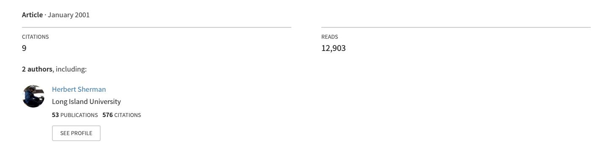

<!-- A3.R98 | source: papers_json/A3.R98/ -->

## [قضايا التنفيذ الاستراتيجي في التعليم العالي: الاهتمامات الخاصة](https://www.researchgate.net/publication/237769653_Issues_of_Strategic_Implementation_in_Higher_Education_The_Special_Concerns_for_Institutions_in_Developing_Economies?enrichId=rgreq-ed43af9f267cefc3995b2fe6d38984ed-XXX&enrichSource=Y292ZXJQYWdlOzIzNzc2OTY1MztBUzoxMTg5NTk2ODg5MTY5OTNAMTQwNTM3MzYwODcwNQ%3D%3D&el=1_x_3&_esc=publicationCoverPdf) لمؤسسات التعليم في الاقتصادات النامية

<!-- page 2 -->

**قضايا التنفيذ الاستراتيجي في التعليم العالي: الاهتمامات ** **الخاصة لمؤسسات التعليم في الاقتصادات النامية ** **Daniel James Rowley, Ph.D. **

University of Northern Colorado

**Herbert Sherman, Ph.D. **

Southampton College, Long Island University

## **الملخص **

التخطيط الاستراتيجي عملية صعبة في حد ذاتها. لكن، للأسف، تنفيذ الخطة الاستراتيجية يحمل مجموعة من القضايا المعقدة جداً. في التعليم العالي، حدد كثير من الباحثين أن عملية التخطيط الاستراتيجي أكثر تعقيداً، وأن التنفيذ نادراً ما ينجح. في كتاب صدر عام 2001، تحدثنا عن الصعوبات التي تواجهها مؤسسات التعليم العالي عند تنفيذ خططها الاستراتيجية، واقترحنا إحدى عشرة طريقة يمكن أن تجعل هذه العملية أكثر واقعية. في هذه الورقة، نأخذ هذا النقاش خطوة أبعد، وندرس الظروف الخاصة للاقتصادات الناشئة، وكيف تتحدى هذه البيئات التخطيط الاستراتيجي في التعليم العالي في تلك الدول. كما نربط عدداً من طرق التنفيذ الإحدى عشرة بهذه الظروف، ونقدم توصيات حول طرق محددة قد تساعد في ضمان نجاح التخطيط الاستراتيجي في التعليم العالي بالدول النامية.

## **مشكلات التنفيذ الاستراتيجي **

سواء كانت الكليات والجامعات تقع في دول صناعية متقدمة أو في دول نامية، فإن عملية التخطيط الاستراتيجي محفوفة بالتحديات. أولاً، كما اقترح Rowley, Lujan, and Dolence (1997)، غالباً ما تقوم الجامعات بـ

<!-- page 3 -->

تخطيط استراتيجي ليس في حقيقته تخطيطاً استراتيجياً. بل هو تخطيط قصير المدى أو تخطيط لحل مشكلات. ثانياً، تقوم كثير من الكليات والجامعات بذلك لسبب خاطئ. تفعل ذلك لأنه أصبح رائجاً أو لأنها تعرف مدى نجاحه في بيئات الأعمال. ثالثاً، لا تدرك أن التخطيط الاستراتيجي في الكليات والجامعات يختلف بالضرورة عن العملية التي تستخدمها الشركات.

ومع ذلك، من المفهوم على نطاق واسع أن التخطيط الاستراتيجي يزداد أهمية للكليات والجامعات بسبب التغيرات السريعة في الاقتصاد العالمي والتكنولوجيا والنقل والاتصالات. الأدوار التقليدية للمؤسسة الأكاديمية أصبحت تواجه تحدياً متزايداً لتطوير برامج جديدة، وطرائق تدريس جديدة، وأساليب توصيل جديدة تلبي احتياجات عصر المعلومات الناشئ (Rowley, Lujan, & Dolence, 1998). يبدو أن هذا الواقع مؤثر بشكل خاص للكليات والجامعات في الدول النامية، لأنها في الأصل في موقع أضعف من حيث القدرة على تقديم بحث وتعليم متقدمين، بسبب تناقص الموارد الشحيحة أصلاً وازدياد المشكلات الإدارية التي تواجهها في بلدانها (Lillis, K. M. 1990).

## **القضية الخاصة بالتنفيذ **

من المشكلات المزعجة الإضافية في التخطيط الاستراتيجي، عجز الكلية أو الجامعة الواسع الانتشار عن تنفيذ خطتها بعد وضعها (Rowley & Sherman, 2001). ورغم وجود أسباب متعددة لذلك، تبقى الحقيقة أن كثيراً من الجامعات تمر بعملية مكلفة من حيث الوقت، وغالباً مكلفة مادياً ومربكة، في وضع خطة استراتيجية لتنتهي بوضعها على الرف وتجاهلها كأداة فعلية مفيدة. تشير الأدلة إلى أن هذا ليس بالضرورة مشكلة أفراد على

<!-- page 4 -->

الحرم الجامعي يقاومون أو يخشون عملية ما (رغم أن هذا صحيح في بعض الحالات)، بل هو غالباً مشكلة عدم وجود استراتيجية تنفيذ قادرة على تحريك الخطة بنجاح.

في معالجة هذه القضية، اقترح Rowley and Sherman (2001) أن هناك مجموعة متنوعة من الخيارات التي يمكن لمخططي الاستراتيجية وقادة الحرم الجامعي الاختيار من بينها. تخاطب كل طريقة من طرق التنفيذ الإحدى عشرة ظروفاً مختلفة قد تجعل بعضها أكثر فعالية من غيرها. ورغم أنهما لا يقترحان أن تختار الجامعات طريقة واحدة فقط وتتجاهل البقية، إلا أنهما يقترحان أن ظروفاً معينة تستدعي استراتيجيات معينة. وفي كثير من الجامعات، حيث تكون تلك الظروف معقدة، قد يكون الجمع بين عدة استراتيجيات ضرورياً لتحريك الخطة الاستراتيجية بفعالية.

## **إحدى عشرة طريقة لتنفيذ الاستراتيجية **

لا يتناول النقاش التالي الخطة الاستراتيجية نفسها، بل يتناول فقط الاستراتيجيات المتاحة لقادة الحرم الجامعي ومخططي الاستراتيجية لتنفيذ تلك الخطط. ورغم أن الخطة مهمة بالطبع، فإن هدفنا هنا هو مناقشة الخطوة التالية بعد صياغة خطة ديناميكية وطويلة المدى ومبتكرة لتحقيق البقاء والأهمية على المدى الطويل. الطرق الإحدى عشرة التي يمكن لقادة الحرم الجامعي الاختيار من بينها لتنفيذ التغيير الاستراتيجي بفعالية موضحة في الجدول 1 أدناه.

تقدم كل طريقة من هذه الطرق الإحدى عشرة مجموعة محددة من الأنشطة التي يمكن لقادة الحرم الجامعي استخدامها للتأكد من أن الخطة الاستراتيجية أصبحت جزءاً من حياة الحرم الجامعي، بدءاً من المدى القصير، واستمراراً حتى المساعدة على ضمان النجاح على المدى الطويل. أدناه، نصف بإيجاز كل من هذه الاستراتيجيات. كما نتكهن

<!-- page 5 -->

بالظروف التي قد تحيط بكل من هذه الحالات في كلية أو جامعة في دولة نامية.

## **الجدول 1 **

## **إحدى عشرة طريقة للتنفيذ **

**1 استخدام الميزانية لتمويل التغيير الاستراتيجي **

**2 استخدام المشاركة **

**3 استخدام القوة **

**4 وضع أهداف ومؤشرات أداء رئيسية **

**5 العمل ضمن نظام إدارة الموارد البشرية في ** **الحرم الجامعي للتخطيط للتغيير وخلقه **

**6 استخدام نظام المكافآت لتعزيز التغيير ودعمه **

**7 تطوير أعضاء هيئة التدريس والموظفين **

**8 العمل مع الثقافة المؤسسية أو تغييرها **

**9 العمل مع التقاليد أو الابتعاد عنها **

**10 تطوير واستخدام أبطال التغيير **

**11 البناء على الأنظمة الجاهزة أو القابلة للتكيف بسهولة مع ** **التغيير الاستراتيجي. **

**استخدام الميزانية لتمويل التغيير الاستراتيجي**. كتب كل من Detweiler (1997) وRoach (1988) وSwain (1988) عن فعالية هذا الأسلوب في تنفيذ الخطة الاستراتيجية للكلية أو الجامعة. يصل هذا الأسلوب إلى جوهر وظائف الحرم الجامعي، أي موارده المالية. طريقته هي ربط التمويل بالبنود التي تدعم تقدم الخطة الاستراتيجية، وعدم تمويل (أو ربما تقليص التمويل بشكل كبير عن) المجالات أو البرامج أو الأنشطة التي لا تدعم الاتجاه الاستراتيجي الذي حددته قيادة الحرم الجامعي. هذه طريقة واضحة ومباشرة لوضع الخطط موضع التنفيذ، وتتطلب دعماً ثابتاً من مجالس الحوكمة وكبار قادة الحرم الجامعي للتنفيذ والمتابعة.

بالنسبة للمؤسسات في الدول النامية، تكمن القضية هنا في وجود موارد كافية لاستخدامها بهذه الطريقة. في كثير من الدول، حيث تكون قاعدة الموارد صغيرة أصلاً وغالباً في تراجع، قد يكون هذا الخيار أصعب لأنه

<!-- page 6 -->

قد لا توجد حتى موارد كافية لتمويل التشغيل الأساسي للحرم الجامعي. ومع ذلك، ورغم صعوبة هذا الخيار، يبقى له دور مهم في مساعدة الحرم الجامعي على تحديد اتجاه استراتيجي أساسي.

**استخدام المشاركة**. يشيد كثير من الباحثين في مجال السلوك التنظيمي بأهمية المشاركة في أنشطة اتخاذ القرارات الكبرى في المؤسسة. كان Birnbaum أحد الباحثين الذين ركزوا بشكل خاص على الكليات والجامعات باعتبارها بيئات مهمة تحدث فيها المشاركة (1991). في التقليد الأمريكي للحوكمة المشتركة، هناك شرط أساسي مفاده أن القرارات الاستراتيجية التي يتخذها كبار الإداريين بشأن اتجاه الحرم الجامعي يجب أن توافق عليها هيئة التدريس، خصوصاً في المسائل الأكاديمية. في دول أخرى قد يكون هذا التقليد مشابهاً أو مختلفاً بشكل كبير. ومع ذلك، وكما اقترح Birnbaum، فإن من أكثر الطرق فعالية لضمان القبول العام في الحرم الجامعي للقرارات الاستراتيجية الكبرى، هو التأكد من أن لكل شخص صوتاً وأن ذلك الصوت يُسمع بجدية كجزء من النظام الشامل للتخطيط الاستراتيجي.

ليست الدول النامية وحدها، بل كثير من الدول لا تملك تقليداً للمشاركة في القرارات رفيعة المستوى. مر أحد كاتبي هذه الورقة بتجربة شخصية في العمل مع جامعة في آسيا، حيث كانت إحدى المشكلات الرئيسية التي أدرك الحرم الجامعي وجودها هي التأثير القوي للكونفوشيوسية وميلها إلى الحد من الاعتراض من الأشخاص ذوي المناصب الأدنى. في كثير من الدول النامية، أهمية الأسرة (التي يهيمن عليها عادة رب أسرة قوي)، والالتزام بحكم الدولة، وحتى الممارسة الدينية، كثيراً ما تعلّم أفراد المجتمع أنهم لا يملكون حقاً مشروعاً في التشكيك في السلطة. هذه الظروف يمكن أن تعيق المشاركة بشدة.

<!-- page 7 -->

**استخدام القوة**. يمكن أن تكون القوة فعالة، لكن استخدامها يجب أن يكون محدوداً. يصف Steeples (1988) كيف استخدم القوة لخلق تغيير في حرم جامعي تدهورت أوضاعه إلى درجة أن الحرم كان يفكر في الإغلاق. هذا ظرف استثنائي، ويكون استخدام تدابير استثنائية منطقياً هنا. لكن، يجب استخدام القوة بحذر. فإذا كانت القوة هي الأسلوب الوحيد المستخدم في حرم جامعي، يُخنق الإبداع، وتضعف الهوية العامة للحرم أو تنعدم، والأسوأ من ذلك، تُدمَّر الثقة.

في كثير من الدول النامية، خصوصاً تلك التي لها تاريخ شمولي، قد تكون المشكلة أن كثيرين لا يعرفون كيف يتقدمون إلا من خلال التهديد بالقوة. ومع الاعتراف بأن كثيراً من هذه الدول طورت أيضاً قادة جدداً أقوياء لديهم أجندات ديمقراطية أوسع، تستمر هذه الدول في التعامل مع بيروقراطيات ومسؤولين محليين لا يثقون إلا باستخدام القوة (أو التهديد بها) ليكون فعالاً. مرة أخرى، نحذر من أن استخدام القوة في العالم الحديث يجب أن يكون فقط كملاذ أخير، لأن عواقبها غالباً ما تكون أسوأ بكثير من فوائدها.

**وضع أهداف ومؤشرات أداء رئيسية**. تعود أهمية وضع الأهداف ومؤشرات الأداء الرئيسية (KPIs) في تاريخها إلى أساليب إدارية قديمة، وصولاً إلى الإدارة بالأهداف (MBO). في التخطيط الاستراتيجي للكليات والجامعات، اقترح Rowley (1997) أن مؤشرات الأداء الرئيسية توفر طريقة ممتازة لتنفيذ الاستراتيجيات، لأنها تحدد أنشطة مرتبطة بأهداف محددة يساعد الأفراد والأقسام في مختلف أنحاء الحرم الجامعي على وضعها وتنفيذها ومتابعتها. يجب أن تكون مؤشرات الأداء الرئيسية قابلة للقياس، ومحددة زمنياً، ومحددة بوضوح كجزء من الخطة الاستراتيجية. (على سبيل المثال، إذا أرادت جامعة زيادة وقفها المالي بمقدار 250 مليون دولار، فإنها تقسم ذلك إلى

<!-- page 8 -->

أهداف سنوية معقولة، ربما 25 مليون دولار، ثم تقيس تقدمها نحو ذلك الهدف. إذا تحقق الهدف، يمكن للمخططين افتراض أن الخطة دقيقة. وإذا لم يتحقق، يحتاج المخططون إلى إعادة النظر في أهدافهم أو استراتيجياتهم.)

يبدو هذا نهجاً معقولاً لأي كلية أو جامعة، بما في ذلك تلك الموجودة في الاقتصادات الناشئة. النهج لطيف؛ وموضوعي؛ ويُنفَّذ على المدى الطويل؛ ويعترف بأهمية التغيير في الطريق إذا تغيرت النتائج المرجوة أو ثبت أن أساليب تحقيقها غير فعالة. كما أنه يقسم الخطة الاستراتيجية للحرم الجامعي إلى وحدات يتحمل الأفراد مسؤوليتها.

**العمل ضمن نظام إدارة الموارد البشرية في الحرم الجامعي للتخطيط ** **للتغيير وخلقه**. إلى جانب الميزانية، يعد العمل ضمن نظام إدارة الموارد البشرية (HRM) لتحقيق التغيير من أكثر الطرق فعالية المتاحة للجامعات حول العالم. ببساطة، لا يوجد حرم جامعي أفضل من جودة أعضاء هيئة التدريس والإدارة وموظفي الدعم فيه. وكما أشار Shirley، فإن هذا الأسلوب يُنفَّذ بشكل أفضل على المدى الطويل، مما يسمح بالاستنزاف الطبيعي، أو التدريب الإضافي، أو إعادة التوزيع (1988). كما وصف كيف يمكن أن يخلق إلغاء برامج معينة مع تعزيز أو إضافة برامج أخرى فوضى في الحرم الجامعي إذا تم في حدث تغيير واحد أو حتى على المدى القصير. لكن مع منظور طويل المدى، الذي يجب أن يكون من سمات الخطة الاستراتيجية القوية للحرم الجامعي، يمكن أن يثبت أن هذا وسيلة إنسانية وفعالة جداً لإحداث التغيير.

ربما تكمن أكبر مخاوف الكليات والجامعات في الدول النامية بشأن هذه الاستراتيجية في عجزها عن التنافس على استقطاب كبار أعضاء هيئة التدريس أو

<!-- page 9 -->

الإداريين؛ والقواعد البيروقراطية التي تجعل من الصعب تغيير هيكل الحرم الجامعي؛ وضرورة التقدم بسرعة. مع ذلك، حتى في نمط قصير المدى، يجب ألا يتجاهل قادة الكليات والجامعات تخطيط الموارد البشرية. هنا، يجب أن تكون هناك خطة استراتيجية قوية تحدد الاتجاه المحدد الذي يحتاج الحرم الجامعي لاتخاذه، قبل أن يقرر قادة الحرم الجامعي احتياجات تغييرات الموظفين المحددة.

**استخدام نظام المكافآت لتعزيز التغيير ودعمه**. الإشراط الإجرائي (Skinner, 1969) طريقة إدارية يحتاج جميع المديرين إلى استخدامها بحذر. يتناول استخدام المكافآت في خلق الدافعية داخل القوى العاملة، كما يتناول استخدام العقاب (أو المكافآت السلبية) للتحكم في السلوك. وهو أيضاً طريقة، أو ربما سلسلة من الطرق، تجد سبيلها إلى كل مؤسسة تقريباً اليوم.

يمكن أن يكون استخدام المكافآت لتحقيق السلوكيات المرغوبة التي تؤدي إلى تنفيذ الخطة الاستراتيجية إما استراتيجية جيدة جداً أو ضعيفة جداً. بالتأكيد أحد الجوانب الإيجابية هو أن الناس عموماً يدعمون التغيير الذي يفيدهم، فإذا أدرك أفراد الحرم الجامعي أن الخطة الاستراتيجية ستفيدهم، فمن المرجح أن يدعموها. هذا جيد. من ناحية أخرى، إذا خشي الناس أن يتأذوا (مكافآت سلبية) أو يُعاقَبوا (كاستخدام القوة الذي وصفناه سابقاً)، فمن المرجح ألا يدعموا الخطة. مرة أخرى، النهج طويل المدى مهم هنا، لأنه مع الوقت، ومع تنفيذ الخطة الاستراتيجية وبدء ظهور نجاحها، ستنمو الموارد وتصبح أكثر وضوحاً وملموسية، وستظهر فوائد غير ملموسة أيضاً. عند استخدامها بشكل عادل في مختلف أنحاء الحرم الجامعي، يمكن لهذه الفوائد أن تولّد دعماً أكبر لاستمرار تنفيذ الخطة الاستراتيجية. شرط مهم آخر لهذا الأسلوب هو أن يكون مفتوحاً وعادلاً وموضوعياً وشاملاً

<!-- page 10 -->

للحرم الجامعي بأكمله. أي خطة تنفيذ تكافئ البعض بينما تعاقب آخرين لن تكون فعالة، خصوصاً حيث توجد هيئة تدريس ذات طابع خلافي.

توجد مشكلة واضحة هنا وهي وضع نظام مكافآت في الحالات التي قد يكون فيها التقليص أو إعادة الهيكلة أو الفصل ضرورياً. كيف يتناسب نظام المكافآت مع ذلك؟ يجب أن تكون الصراحة جزءاً من أي عملية كهذه. ليس الفصل مكافأة أبداً، لكن إذا جاء ذلك الفصل مع مساعدة للحصول على منصب مماثل أو أفضل في مكان آخر، فيجب أن يفهم الشخص المفصول بموضوعية سبب حدوث ذلك، لكن أيضاً يشعر بأنه لم يتضرر. ربما يشعر هذا الشخص أيضاً بأنه استفاد من التغيير.

بالنسبة للاقتصادات النامية، قد تكون المكافآت التي يملكها الحرم الجامعي للعمل بها غير ملموسة أكثر من كونها ملموسة، لكن هذه الأنواع من المكافآت لها قيمتها بالمثل. أن يكون المرء عامل تغيير ناجحاً يمكن أن يكون مُرضياً جداً، خصوصاً عندما يعترف الحرم الجامعي بأكمله بذلك التغيير. أن يكون المرء جزءاً من حرم جامعي متنامٍ، من حيث عدد الطلاب وجودة التدريس، يمكن أن يكون مُرضياً جداً أيضاً. وبينما يشارك المرء في نجاحات الخطة الاستراتيجية، تخدم هذه الأمور غير الملموسة غرضاً قيماً جداً. كذلك، مع تحقق الخطة الناجحة، ستصبح مكافآت أكثر ملموسية متاحة أيضاً.

**تطوير أعضاء هيئة التدريس والموظفين**. أصبحت استراتيجية تطوير أعضاء هيئة التدريس والموظفين قضية أكثر أهمية باطراد، مع بدء تغير طبيعة المعرفة نفسها في القرن الجديد. لم يعد مفهوم التعلم مدى الحياة قضية تخص الطالب فقط، بل أصبح قضية تخص موفر المعرفة أيضاً – الكلية أو الجامعة نفسها. وكما وصف Rowley, Lujan, and Dolence (1998)، لم يعد حرم القرن الحادي والعشرين يخدم الاحتياجات المجتمعية نفسها التي خدمها في

<!-- page 11 -->

القرون السابقة. يتطلب عصر المعلومات قواعد معرفية جديدة، وطرائق توصيل جديدة، وحتى مستويات جديدة من المشاركة في التجربة الأكاديمية. لذلك، إذا كان على المؤسسة الأكاديمية أن تتغير، فمن المعقول أن يستنتج المرء أن الأكاديميين والإداريين وموظفي الدعم سيحتاجون إلى التغيير معها. أفضل طريقة للقيام بذلك هي من خلال تطوير وظيفة تدريب وتعليم مستمرة، مرتبطة بالخطة الاستراتيجية، تتيح لكل فرد في الحرم الجامعي الحفاظ على قواعد معرفية ومنهجيات حديثة.

الجانب السلبي في تطوير أعضاء هيئة التدريس والموظفين هو أنه مكلف. لا تشارك كثير من الجامعات في برامج كهذه بسبب التكلفة؛ فهي ببساطة لا تعتقد أن لديها الموارد الكافية للتفرغ لهذه البرامج. قد تدرك جامعات أخرى أهمية تطوير هيئة التدريس والموظفين، لكنها ترى أن الأمر مسؤولية الفرد أكثر من كونه مسؤولية المؤسسة في اكتساب مهارات أو قواعد معرفية جديدة. بالنسبة للكليات والجامعات في الدول النامية، يجعل نقص الموارد اختيار هذا الخيار صعباً جداً. ورغم وجود بعض المؤسسات التي أدركت قيمة هذه الاستراتيجية واختارتها رغم مشكلة الموارد، تضع معظم الجامعات هذا الخيار في أسفل قائمة أولوياتها.

**العمل مع الثقافة المؤسسية أو تغييرها**. الثقافة التنظيمية هي النمط العام للسلوك المقبول الذي يحكم كيفية تصرف الأفراد داخل المؤسسة. وهي أساسية لفهم كيف ولماذا يتصرف الناس كما يتصرفون. أحياناً، تكون الثقافة جيدة – فتدعم التغيير الذي يحسّن الرفاهية العامة للمؤسسة. وأحياناً، تكون الثقافة ضعيفة – فتكون طبقية ومحدودة الأفق،

<!-- page 12 -->

وغير مهتمة بالمؤسسة ككل أو برفاهية الآخرين داخل نفس المؤسسة. هذا الوضع العام صحيح أيضاً بالنسبة للكليات والجامعات.

يمكن لقادة استراتيجية الحرم الجامعي استخدام ثقافة جيدة لتنفيذ خطة استراتيجية جيدة عندما تكون تلك الثقافة داعمة لأنواع الأنشطة والتغييرات التي تدعو إليها الخطة. ورغم أن الجميع لن يكون داعماً بالكامل طوال الوقت، ففي ثقافة كهذه، يمكن للموضوعية والمنطق أن يقطعا شوطاً طويلاً في مساعدة الناس على فهم سبب ضرورة مساعدتهم في تنفيذ الخطة ودعمها. عندما تكون الثقافة ضعيفة، تصبح مشكلة التنفيذ أصعب بكثير. هنا، يمكن أن تتخذ الثقافة أشكالاً متنوعة، من اللامبالاة التامة إلى الفوضى. خصوصاً حيث تكون الثقة قضية، وحيث توترت العلاقات بين الإداريين وهيئة التدريس والموظفين، وحيث يوجد تقليد من القرارات السيئة والنتائج السيئة.

هذا الظرف هو في الحقيقة الأصعب أمام تنفيذ الاستراتيجية بفعالية، لأنه يحمل عبء إعادة بناء الثقة وخلق ساحة عمل جديدة. هذا صعب، وأحياناً مستحيل تحقيقه. توجد طرق متاحة، مثل التطوير التنظيمي (OD)، يمكن أن تساعد في محاولة تغيير الثقافة. أحياناً أيضاً، يمكن أن تكون القيادة الجديدة فعالة في إحداث التغيير المطلوب. لكن مرة أخرى، هذه خيارات صعبة. إنها طرق مكلفة جداً وتستهلك وقتاً طويلاً، ولا تعتقد كثير من الجامعات أنها تستطيع تحمل تكلفتها. نتيجة لذلك، فإن أكثر الظروف تدميراً التي ستمنع قادة الحرم الجامعي من تنفيذ خطة استراتيجية بنجاح هي ثقافة الحرم الجامعي الضعيفة.

بالنسبة للاقتصادات النامية، خصوصاً تلك الخارجة من عهد الحكم الشيوعي، قد تكون الثقافة قضية مهمة. بالنسبة لبعض الجامعات، قد توجد ثقافة إيجابية، حيث يحافظ أفراد الحرم الجامعي على التغيير الإيجابي ويتطلعون بحماس إلى أن يكونوا

<!-- page 13 -->

جزءاً من الأساليب الجديدة التي يمكن أن توفرها خطة استراتيجية قوية. بالنسبة لجامعات أخرى، قد توجد ثقافة ضعيفة، وهنا، لن يؤدي نقص الموارد إلا إلى تفاقم وضع سيء أصلاً. لا يمكن للمرء أن يكون متفائلاً بشأن نجاح التغيير هنا، ولا يمكنه إلا أن يأمل أن تساعد القيادة القوية في إحداث فرق وتحويل الوضع السيء إلى الأفضل.

**العمل مع التقاليد أو الابتعاد عنها**. مرتبطاً بالثقافة، تحتل التقاليد مكانة مؤثرة بشكل خاص في الكليات والجامعات. تُبنى التقاليد عبر الزمن وقد تعكس الفخر بالإنجازات والتقديرات السابقة. قد تدفع خريجي الكلية أو الجامعة إلى دعم المؤسسة بإصرار ومالياً على مدى فترة طويلة. يمكن أن تكون قوة داعمة للخطة الاستراتيجية، خصوصاً عندما يرى الداعمون أن الخطة ستجعل كلياتهم أو جامعاتهم أكثر مكانة وقوة فقط. يعتقد المرء أن جامعة مثل Harvard أو Cambridge أو Oxford قد لا تواجه صعوبة تُذكر في وضع خطة استراتيجية موضع التنفيذ، حيث يرى خريجوها وداعموها الخارجيون قيمتها.

مع ذلك، ليست التقاليد إيجابية دائماً. تُعد البيروقراطيات مثالاً جيداً على كيفية استمرار الأساليب التقليدية التي لا مكان لها في العالم الحديث رغم ذلك. تملك البيروقراطيات القدرة على دعم نفسها والتقوي بمرور الوقت، خصوصاً إذا لم تُراجع أو تُعدَّل. في التخطيط الاستراتيجي، قد يكون من المهم تقليل أو إلغاء كثير من الممارسات والإجراءات البيروقراطية للمساعدة في جعل المؤسسة أكثر مرونة وقدرة على التكيف مع التغيير أو خلقه. بالتأكيد، قد يتحدى كثيرون داخل البيروقراطية محاولات الحد منها، لكن سيكون هناك كثيرون آخرون يدعمون الخطة ببساطة لأنها تقترح فعلاً الحد من ممارسات عفا عليها الزمن أو مقيدة بشكل غير ضروري أو إلغاءها.

<!-- page 14 -->

مرة أخرى، تقليد كثير من الاقتصادات الناشئة هو تقليد بيروقراطيات صارمة خلقت تقاليد يصعب التغلب عليها. علاوة على ذلك، فإن كثيراً من هذه البيروقراطيات خارجية عن المؤسسة نفسها، وتخلق ظروفاً خارج سيطرة الكلية أو الجامعة المحلية على تغييرها. هنا، تحتاج الخطة الاستراتيجية إلى تبني نظرة أطول والسعي إلى إقامة روابط سياسية وتعليمية يمكن أن تساعد في تقليل سلبيات السيطرة الخارجية مع الوقت. امتلاك اتجاه استراتيجي قوي هو أحد أفضل خطوط الدفاع في مواقف كهذه.

**تطوير أبطال التغيير واستخدامهم**. يحدد Brown (1988) أهمية وجود بطل للتغيير كوسيلة فعالة لتنفيذ التغيير الاستراتيجي في حرم جامعي. بطل التغيير هو شخص لديه رؤية جديدة، لكنه أيضاً شخص لديه القدرة على تقديم القيادة للآخرين. قد يكون هذا عضو هيئة تدريس اكتشف منهجية تدريس جديدة ونجح في إقناع زملائه بتجربتها. قد يكون هذا موظف اكتشف طريقة أكثر فعالية لتسهيل طلبات المساعدة المالية للطلاب واستطاع تنفيذ التغيير داخل القسم. قد يكون هذا إدارياً يرى الحاجة إلى إعادة هيكلة قسمه ليعمل بكفاءة وفعالية أكبر، واستطاع كسب دعم مرؤوسيه وكذلك دعم الإداريين الأعلى منه. حيث يمكن للكلية أو الجامعة توليد بطل تغيير أو أكثر، تسير العملية بسلاسة أكبر من التخطيط إلى التنفيذ. تصبح حماسة أبطال التغيير معدية، ومن خلال صفات القيادة الشخصية للبطل، يصبح الناس فعلياً متحمسين لإجراء التغييرات الاستراتيجية المطلوبة.

<!-- page 15 -->

بطل التغيير الاستراتيجي هو شخص يؤمن بمزايا الخطة ويريد أن يراها تتحقق. يحتاج هذا الشخص إلى الشعور بأنه عضو كامل في فريق الحرم الجامعي، ويريد أن ينضم إليه زملاؤه في تحسين الأمور للجميع، استناداً إلى مبادئ الخطة الاستراتيجية. عادة ما يعرف قادة الحرم الجامعي بالفعل أشخاصاً كهؤلاء في جامعاتهم، ويحتاجون إلى إشراكهم مبكراً في العملية للمساعدة على ضمان أن هؤلاء الأشخاص سيعودون بعد ذلك إلى بقية الحرم الجامعي ويقومون بالأمور التي تولّد الحماس والدافعية. مع وجود هؤلاء الأشخاص، يصبح تنفيذ الخطة مؤكداً بشكل سليم.

بخلاف القضيتين السابقتين المتعلقتين بالثقافة السلبية والتقاليد الضعيفة (حيث يندر وجود أبطال تغيير بسبب دروس سابقة حول قيمة عدم الدعم)، ينبغي أن تكون الكليات والجامعات في الاقتصادات الناشئة قادرة على تطوير ظروف يظهر ضمنها أبطال التغيير. تمتلك الكليات والجامعات حول العالم مورداً جيداً بشكل خاص، هو وجود أفراد أذكياء ولامعين قادرين بوضوح على أن يصبحوا مبتكرين ويتولوا أدواراً قيادية. ومع إدراك أهمية هذا الدور بالذات، يمكن لقادة الحرم الجامعي المساعدة في خلق البيئة التي سيصبح ضمنها أبطال التغيير أكثر وضوحاً باطراد. من تلك النقطة، يصبح الأمر مجرد مسألة إشراك هؤلاء الأشخاص في عملية التخطيط الاستراتيجي ودعم جهودهم لخلق التغيير وتنفيذه.

**البناء على الأنظمة الجاهزة أو القابلة للتكيف بسهولة مع التغيير ** **الاستراتيجي**. هناك مثل قديم يقول إن لا شيء يولّد النجاح مثل النجاح. هذه حقيقة تنطبق على عملية تنفيذ التخطيط الاستراتيجي في الكليات والجامعات. حدد Rowley and Sherman (2001) أنه عندما يستطيع أفراد الحرم الجامعي رؤية دليل على أن جزءاً من خطة استراتيجية قد نجح، يكونون أكثر ميلاً إلى

<!-- page 16 -->

دعم مبادرات استراتيجية أخرى. علاوة على ذلك، بما أن نشاط التخطيط الاستراتيجي لا يُقصد به إنتاج حدث تنفيذ لمرة واحدة (Rowley, Lujan, and Dolence, 1997)، فإن التنفيذ التدريجي طريقة مقبولة تماماً للمضي قدماً. من التكتيكات الشائعة أن تختار الجامعة مجالاً بارزاً جداً يقل فيه احتمال وجود منتقدين كثر، وتعلن ذلك الجزء من الخطة، وتنفذه، ثم تُطلع بقية الحرم الجامعي على التقدم المحرز. على سبيل المثال، إذا أرادت جامعة تحسين صناديق منحها بمقدار 50 مليون دولار خلال 10 سنوات، يمكنها الإعلان عن خطتها (حملة رأسمالية، أو حملة خريجين، أو حملة كبار المتبرعين، أو حملة منظمات أعمال، أو مزيج من كل ذلك)، وتبدأها، ثم تقدم تقريراً عن تقدمها. بنهاية السنة الأولى، إذا استطاعت الجامعة الإعلان عن نجاحها في جمع أموال منح إضافية بمقدار 6 ملايين دولار وأنها متقدمة على التوقعات، سيلاحظ بقية الحرم الجامعي أمرين. أولاً، لم يتضرر أحد من الخطة؛ وثانياً، أن هذه الخطة تنجح على ما يبدو. هذا بعد ذلك يتيح لقادة الحرم الجامعي ومخططي الاستراتيجية تنفيذ أجزاء أخرى من الخطة، ومع إظهار كل قسم نتائج إيجابية (وعدم وجود مكافآت سلبية)، يصبح تنفيذ الخطة بأكملها أسهل باطراد.

بالنسبة للجامعات في الاقتصادات الناشئة التي طورت خططاً استشرافية ومثيرة، ينبغي أن يكون تبني طريقة التنفيذ هذه سهلاً. ورغم أن فكرة التغيير الاستراتيجي قد تكون غير مرحب بها في حرم جامعي أكثر جموداً أو أقل موارد، فمع إثبات الخطة أنها تعمل ببطء ودون ألم وبفعالية مع الوقت، ينبغي أن يتنامى الدعم، ويمكن لقيادة الحرم الجامعي أن تتطلع إلى تنفيذ الخطة بأكملها.

<!-- page 17 -->

## **اختيار استراتيجية التنفيذ المناسبة **

توفر الخيارات التي وصفناها في القسم السابق مجموعة من الاختيارات لأي كلية أو جامعة تبحث عن طريقة فعالة لتنفيذ خطتها الاستراتيجية. في هذا القسم، ننظر في بعض القضايا المحيطة بقرار تحديد الاستراتيجية (أو الاستراتيجيات) المناسبة لجامعة معينة، مع اهتمام خاص بالكليات والجامعات في الدول النامية.

## **الهدف المركزي **

قد يبدو هذا بياناً بسيطاً، لكن الهدف المركزي لاختيار طريقة تنفيذ هو فعلياً تنفيذ الخطة. مع ذلك، هناك مضمون أعمق لهذا البيان عندما يدرك المرء أن بعض الكليات والجامعات، يمر أفرادها بمراحل وضع خطة استراتيجية دون أي نية حقيقية لتنفيذها أبداً. لا يتناول النقاش هنا هذه الجامعات بالذات. بل، بالنسبة للجامعات المتحمسة لتنفيذ خططها وإحداث فروقات استراتيجية، يركز النقاش هنا على عملية اتخاذ القرار بشأن أي خيار من الأرجح أن يكون فعالاً في جامعة معينة.

علاوة على ذلك، يتضمن الهدف اكتساب فهم أفضل لقاعدة الموارد وطبيعة أي جامعة معينة، لأن هذه العناصر تؤثر مباشرة على فعالية الخيارات المختلفة. لا يمكن للمرء اختيار طريقة تنفيذ لأنها تبدو جيدة أو تشعره بالرضا. يجب أن يُبنى القرار على حقائق مادية موجودة في التحليل الداخلي للحرم الجامعي، والذي ينبغي أن يكون قد أُجري خلال مرحلة التخطيط.

<!-- page 18 -->

## **المحددات الحاسمة **

توجد مجموعة متنوعة من المحددات التي تؤثر على فعالية كل طريقة. تشمل هذه الموارد، والثقافة والسياسة، وصحة الحرم الجامعي والوقت، والسيطرة الخارجية، والحوكمة. يوضح الجدول 2 أدناه كيف تؤثر هذه المحددات على الخيارات المختلفة.

<!-- page 19 -->

**الموارد**. رغم أن الموارد قضية مهمة، إلا أنها ليست القضية الوحيدة في تنفيذ الخطط الاستراتيجية. فهي تساعد بالتأكيد، والجامعات التي لديها موارد سائلة أكثر متاحة لها تكون في وضع أفضل من تلك التي لا تملكها. في الوقت نفسه، من المهم أن نفهم أنه لا توجد جامعة في عالم اليوم لديها وفرة من الموارد الحرة المتاحة في انتظار أفكار حول كيفية استخدامها. علاوة على ذلك، جامعة كهذه على الأرجح لن تنخرط في تمرين تخطيط استراتيجي أصلاً. هذا يترك الجميع، أي ما يقارب 99% من كل الجامعات حول العالم.

الخيار رقم 1 (الميزانية) ينظر إلى الموارد التشغيلية للحرم الجامعي ويتخذ قرارات بشأن أفضل طريقة لتطبيقها لتحقيق الغايات المرغوبة. بغض النظر عن حالة الحرم الجامعي سواء في الدول المتقدمة أو النامية، يجب أن تحدث عملية الميزانية. القضية هي ما ستكون عليه قواعد القرار، وإذا كانت قواعد القرار مرتبطة بالخطة الاستراتيجية، فإن هذه الطريقة تعمل في أي جامعة. هذا يعكس بياننا السابق بأن السيطرة على الميزانية هي بوضوح إحدى أهم الطرق لتطبيق خطة استراتيجية بفعالية.

الخيار رقم 5 (إدارة الموارد البشرية) يفحص نقاط القوة والضعف في الموارد البشرية لجامعة معينة، ويعيد هندسة قاعدة الموارد هذه على المدى الطويل باتجاه يدعم الأهداف الاستراتيجية للخطة. هذا مهم ويرتبط بنظرية التنفيذ الأساسية التي تقول إن التخطيط الاستراتيجي يُنفَّذ من خلال الهيكل. تصميم أو إعادة تصميم ذلك الهيكل هو ما يروج له هذا الخيار، ومرة أخرى، إذا كانت الحالة طويلة المدى لوظيفة إدارة الموارد البشرية في الكلية أو الجامعة محددة بالخطة الاستراتيجية ومُنفَّذة مع تغير قوائم الموظفين، فهذا يصبح ثاني أكثر وسيلة فعالية لتنفيذ الاستراتيجية. مثل الخيار رقم 1، تتعامل كل

<!-- page 20 -->

جامعة مع هذه القضية، لذا لا تنطبق الظروف الاقتصادية على القدرة على اختيار هذا الخيار.

الخيار رقم 6 (استخدام نظام المكافآت) يعكس فعلياً قاعدة الموارد الحرة للحرم الجامعي أكثر بكثير من الخيارين الآخرين. من الخطأ دائماً افتراض أن الناس سيستجيبون للمكافآت الجوهرية بنفس الطريقة التي يستجيبون بها للمكافآت الخارجية. الثناء وقت يصعب فيه دفع الإيجار ليس فعالاً بوضوح مثل شكل ما من أشكال المكافأة المادية. هذا لا يعني أن كل المكافآت يجب أن تكون خارجية، وندرك أن هذا الأمر إشكالي جداً. مع ذلك، إذا بدا أنه لا توجد فوائد مادية للحرم الجامعي نتيجة المرور بعملية تخطيط استراتيجي، سيكون من الأصعب بكثير توليد الدعم. ورغم أننا نرى أن المكافآت الجوهرية يجب أن تكون بوضوح جزءاً سطحياً من كل عملية تنفيذ، تحتاج الجامعات إلى تذكّر وجود التزام ما بمكافأة الأداء المقبول (حتى لو كان ذلك فقط مع الوقت) بمستوى ما من المكافأة الخارجية الإيجابية. إذا لم يكن هذا ممكناً، وفي بعض الدول النامية قد لا يكون كذلك، فهذا ليس خياراً يمكن لتلك الجامعات استخدامه بفعالية.

**الثقافة والسياسة**. يعتمد الخيار رقم 2 (المشاركة)، والخيار 8 (الثقافة)، والخيار 9 (التقاليد)، والخيار 10 (أبطال التغيير) على الثقافة السائدة في الحرم الجامعي وكذلك على قوة واتجاه الأنظمة السياسية المختلفة التي يمكن للمرء إيجادها في كل جامعة. قد تكون المشاركة مرغوبة للغاية (لأنها، حيث توجد، تساعد على ضمان تنفيذ ناجح)، لكن لا يمكن فرضها. الروابط بالثقافة والتقاليد قوية وتنبؤية. إذا كانت الثقافة داعمة والتقليد قائماً على التعاون، يمكن للمشاركة أن تنجح. أما إذا كانت الثقافة قائمة على انعدام الثقة والتقليد قائماً على "نحن ضدهم" (على سبيل المثال،

<!-- page 21 -->

هيئة التدريس ضد الإدارة والعكس)، فإن المشاركة لا تحدث فعلياً. من الممكن أن يطلب رئيس الجامعة أو المستشار من أشخاص من مختلف أنحاء الحرم الجامعي الانضمام إلى لجنة تخطيط استراتيجي، وسيفعل هؤلاء الأشخاص ذلك. مع ذلك، يكون هذا القائد الإداري واهماً إذا اعتقد أن الناس سيشاركون طبيعياً على أعلى مستوى. لن يفعلوا ذلك. سيشغلون المقاعد، وسيضيفون تعليقات، وقد يؤيدون النتائج النهائية حتى. بغض النظر، لن تكون هذه النتائج مثالية، بل ستكون مشوبة، ومتحفظة، ومتوسطة. لذا قد يكون من الضروري لجامعة في بيئة كهذه معالجة الثقافة والتقاليد قبل الأمل في الاعتماد على المشاركة كأفضل طريقة لتنفيذ الاستراتيجية.

حالة بطل التغيير مختلفة قليلاً. تملك كل جامعة فرداً أو مجموعة من الأفراد يعتبرون مرشحين أقوياء لدور كهذا في عملية التنفيذ. هؤلاء أشخاص يريدون رؤية تغيير إيجابي ومستعدون للعمل بجد لتحقيقه. مع ذلك، يعيش هؤلاء الأشخاص أيضاً داخل ثقافة الحرم الجامعي ويتأثرون بتقاليده. لذلك، ما لم تسمح هذه العناصر الأكبر لفرد أو مجموعة من الأفراد بالتقدم وقيادة حدث تغيير كبير، فمن غير المرجح أن يحدث ذلك.

**صحة الحرم الجامعي والوقت**. مدى تعرض الجامعة لمشكلات يحدد أيضاً استخدام خيارات معينة دون غيرها. الجامعات التي لا تعاني من مشكلات ضاغطة على نطاق واسع تستطيع تحمل قضاء وقت أطول في عملية التنفيذ. الخيارات رقم 2 (المشاركة)، ورقم 4 (مؤشرات الأداء الرئيسية)، ورقم 5 (إدارة الموارد البشرية)، ورقم 7 (التطوير)، ورقم 8 (الثقافة)، ورقم 9 (التقاليد)، ورقم 11 (البناء على النجاح)، كلها خيارات تعمل عندما لا يكون الوقت عاملاً حاسماً.

<!-- page 22 -->

الجامعات التي تعاني من مشكلات كبرى على نطاق واسع ولا تستطيع قضاء وقت طويل في محاولة حلها يجب أن تنظر إلى خيارات أخرى. الخيارات رقم 1 (الميزانية)، ورقم 3 (القوة)، ورقم 5 (إدارة الموارد البشرية)، ورقم 6 (المكافآت)، ورقم 10 (أبطال التغيير)، كلها طرق يمكن تطبيقها فوراً لتحقيق آثار مرغوبة معينة على المهمة المتعلقة بحل المشكلة. تحذير هنا، مع ذلك. تماماً كما وصفنا قلقنا بشأن استخدام القوة (الخيار رقم 3)، يحتاج قادة الحرم الجامعي إلى الحذر الشديد والدقة في تحديد ما يجب فعله وكيفية فعله. على سبيل المثال، إذا كانت المشكلة أن قاعدة الموارد ستستمر في التراجع خلال السنوات القليلة القادمة، ويجب أن يحدث تخفيض في القوى العاملة (بافتراض أن تخفيض الأجور غير ممكن)، وأن ميزانية الفترة القادمة لن تدعم ببساطة التوظيف الحالي للجامعة، عندها يجب تطوير وتنفيذ حل يتعلق بإدارة الموارد البشرية. القلق هنا هو أن أي خطة تقررها الجامعة، يجب صياغتها بعناية لتتناسب مع الخطة الاستراتيجية للمؤسسة، لتجنب إلغاء وظائف أو أشخاص سيكونون ضروريين لتحقيق أهداف أطول مدى. لن يكون من الحكمة أن تلغي جامعة قسم علوم الحاسوب فيها (الذي عادة ما تكون تكاليف رواتبه أعلى من متوسط رواتب الحرم الجامعي) فقط لتوفير المال. نظراً لاتجاه الاقتصاد العالمي، فإن أي جامعة تتخذ هذه الخطوة بالذات ربما تكون قد وقّعت على حكم إعدامها الخاص أيضاً.

**السيطرة الخارجية**. لا توجد كلية أو جامعة دون بعض مستويات السيطرة من الخارج. سواء كانت مؤسسات، أو هيئات اعتماد، أو وكالات حكومية، أو مجموعات خريجين، أو جهات أعمال، تملك كل جامعة روابط خارج الحرم الجامعي تؤثر على قدرتها على التحرك في اتجاه أو آخر. في العالم النامي، تجد كثير من الكليات والجامعات نفسها خاضعة لسيطرة كبيرة من الوكالات الحكومية والبيروقراطيات، ويجب أن تجد طرقاً لتطوير و

<!-- page 23 -->

تنفيذ خطط استراتيجية ذات معنى ضمن التعقيدات التي تفرضها هذه الجهات الخارجية عليها. الخيارات رقم 2 (المشاركة)، ورقم 10 (أبطال التغيير)، ورقم 11 (البناء على النجاح) هي ثلاثة خيارات تحمل وعداً بالنسبة للجامعات التي تصبح فيها السيطرة الخارجية قضية رئيسية.

فيما يتعلق بالمشاركة (الخيار رقم 2)، لا يوجد سبب لقصر هذا الخيار على أفراد الحرم الجامعي فقط. قد يكون التوجه نحو المجتمع الأوسع لطلب المشورة، وربما الموافقة، منطقياً جداً لبعض الجامعات. أبطال التغيير (الخيار رقم 10) مرة أخرى ليسوا اهتماماً داخلياً بالضرورة. يمكن أن يكون إيجاد وتجنيد أبطال تغيير من بين هيئات السيطرة الخارجية للجامعة طريقة مفيدة للغاية لتجاوز الحيل التي قد تضعها بعض هيئات السيطرة الخارجية. البناء على النجاح (الخيار رقم 11) تكتيك يُظهر نية وقدرة جيدتين في تحقيق تغيير سيفيد ليس فقط الحرم الجامعي، بل البيئة الخارجية الأوسع أيضاً.

**الحوكمة**. يجب أن تشارك الحوكمة في أي عملية تخطيط استراتيجي وكذلك في عملية التنفيذ. أي جامعة لا تحظى بموافقة هيئتها الحاكمة على القيام بالتخطيط الاستراتيجي أو تنفيذه قد تجد أنشطتها محكوماً عليها بالفشل. مع ذلك، في كثير من الجامعات، الواقع هو أن مجلس الحوكمة هو من يفرض التخطيط الاستراتيجي ويتوق لمعرفة ما سيفعله قادة الحرم الجامعي لتنفيذ خطة مقبولة.

القلق هنا يتعلق بجودة المجلس وطبيعته. المجالس الحاكمة بشرية وخاضعة لمجموعة متنوعة من الضغوط الشخصية والمهنية. في الولايات المتحدة، معظم مجالس حوكمة الكليات والجامعات العامة إما منتخبة أو معينة – وفي كلتا الحالتين، نتيجة عملية سياسية. تملك الكليات والجامعات

<!-- page 24 -->

الخاصة مجالس حاكمة تُختار بطرق متنوعة، تتراوح من قوى خارجية قوية تريد مجالس تعكس مصالحها، إلى قوى داخلية قوية قد تختار مجلساً يعمل ببساطة كواجهة شكلية. حول العالم، سيجد المرء انعكاساً لهذه الطرق وكذلك مجموعة من الطرق الإضافية لوضع الحوكمة موضع التنفيذ. بشكل عام، معظم المجالس الحاكمة الأكاديمية تضم أشخاصاً ذوي جودة عالية، لكن بسبب طريقة اختيارهم، قد يكون لديهم أو لا يكون لديهم مصلحة الحرم الجامعي في صميم اهتمامهم. علاوة على ذلك، تمارس معظم المجالس سيطرة على الخيار رقم 1 (الميزانيات)، وليس من غير المعتاد أن تضع سياسات بشأن كثير من الخيارات الأخرى، خصوصاً رقم 5 (إدارة الموارد البشرية).

كل هذا يتحدث عن أهمية وجود مجالس حاكمة على استعداد لأن تصبح شريكة في عملية التخطيط الاستراتيجي ومواصلة دعمها عندما يحين وقت تنفيذ الخطة. دون هذا النوع من الدعم، من غير المرجح مرة أخرى أن تنجح الخطة.

## **حالة الدول النامية **

رغم أننا حددنا طوال العرض عدداً من القضايا المحددة التي تؤثر على الكليات والجامعات في الدول النامية، من المهم أيضاً تمييزها كمجموعة – مجموعة لديها مجموعتها الخاصة من المشكلات والتحديات التي تجعل تنفيذ حتى أفضل خطة استراتيجية أمراً إشكالياً. يخبرنا Lillis أن الكليات والجامعات في الدول النامية تواجه مشكلات خاصة في الحصول على مديرين مدربين بشكل كافٍ لتوفير إدارة عالية الجودة لجامعاتها، وتسعى أيضاً إلى روابط رئيسية مع مؤسسات في الدول المتقدمة لتوفير تعاون مفيد (1990). قد تكون المؤسسات في العالم المتقدم مفيدة أو لا، وغالباً ما يعتمد ذلك على اتجاهاتها الخاصة وقيود مواردها. يخبرنا Samli (1992) أن التخطيط

<!-- page 25 -->

الاستراتيجي في الدول النامية غالباً ما يخلط بين الأهداف والإنجازات، ويدعو إلى نهج إدارة المخاطر لمحاولة التغلب على هذا الخلط الضيق الأفق. وجد Ojo (1996) أنه في كثير من الدول النامية، تعيق حكومات تلك الدول قدرات الكليات والجامعات على تقديم التدريس وإجراء البحث في مواد رئيسية، مثل العلوم والتكنولوجيا. تكررت هذه النتيجة أيضاً في تقرير من ERIC (2000)، حيث لم يخلصوا فقط إلى ضرورة تحسين تعليم العلوم والتكنولوجيا في الدول الأجنبية، بل إلى ضرورة تحسين الحوكمة بشكل كبير أيضاً.

تحدد كل هذه الدراسات كثيراً من الاحتياجات الخاصة للكليات والجامعات في الدول النامية. كما تتحدث عن أهمية الانخراط في ممارسة تخطيط استراتيجي ذي معنى، وكذلك عن بعض عوائق التنفيذ. من الواضح من عدة هذه الدراسات أن السيطرة الخارجية عائق رئيسي أمام التخطيط والتنفيذ الفعالين. من الواضح أيضاً أن هناك فرصة للانخراط في نوع التخطيط والتنفيذ الذي سيبدأ في السماح لهذه الجامعات بالانتقال إلى التيار الأوسع للتعليم العالي، الضروري لمساعدة بلدانها على أن تصبح جزءاً مهماً من الاقتصاد العالمي الجديد.

## **اختيار استراتيجية تنفيذ **

بالنسبة للكليات والجامعات في الاقتصادات الناشئة، نعتقد أن كثيراً من الخيارات التي حددناها في هذه الورقة ستكون فعالة في السماح لها بتنفيذ خطط استراتيجية استشرافية ومدروسة جيداً وذات معنى، لضمان البقاء على المدى الطويل. مع ذلك، لا تعمل كل الاستراتيجيات بنفس الفعالية في كل الأماكن. المطلوب هو فحص داخلي كامل وشامل يساعد كل جامعة على تحديد الطبيعة الدقيقة لقدراتها الداخلية على التعامل مع القوى الخارجية بنفسها. هذا

<!-- page 26 -->

يجب أن يكون جزءاً من عملية التخطيط الاستراتيجي نفسها. مع تحديد كل جامعة لبيئتها الخارجية والداخلية (يُعرف أحياناً بتحليل SWOT – نقاط القوة، ونقاط الضعف، والفرص، والتهديدات)، يمكنها البدء في رسم أفضل الخيارات المتاحة لها. استناداً إلى هذه النتائج، يحدد جزء من الخطة الاستراتيجية عملية التنفيذ من حيث الخيارات التي ستتبناها وكذلك متى وكيف سيحدث التنفيذ.

كذلك، من المهم تذكّر أن التخطيط الاستراتيجي عملية مستمرة ومرنة في آن واحد. يجب أن تتغير الخطة مع توفر معرفة جديدة. الأمر نفسه صحيح بالنسبة للتنفيذ. يمكن تطبيق خيارات التنفيذ على مراحل، مما يسمح للمخططين باختبار خياراتهم لتحديد ما إذا اختاروا بشكل مناسب أم لا. إذا كان الأمر كذلك، فحسناً. وإذا لم يكن كذلك، فيجب أن يشعروا بحرية الانتقال إلى خيارات أخرى. هذا النوع من العقلية سيساعد على ضمان تحقق فوائد الخطة الاستراتيجية داخل الكلية أو الجامعة.

## **References **

- Birnbaum, R. 1991. "The Latent Organizational Functions of the Academic Senate: Why Senates Do Not Work but Will Not Go Away." New Directions for Higher Education*.* No. 75, Fall, pp.s 7-25.
- Brown, D. G. 1988. "The University of North Carolina at Asheville." New Directions for Higher Education*.* No. 64. San Francisco: Jossey-Bass, Winter, pp.s 23-32.
- Detweiler, R. A. 1997. "Case Study: How a Commitment to Technology Advanced Our Strategic Plan." AGB Occasional Paper No. 32. Washington, D.C.: Association of Governing Boards of Universities and Colleges, 1997.

<!-- page 27 -->

- ERIC, 2000. "Higher Education in Developing Countries: Peril and Promise." ERIC document # ED440560. Washington, D.C.: ERIC.
- Lillis, K. M. 1990. "Training for Planning and Management: Improved Management Systems in Higher Education in Developing Countries." ERIC No. ED440560. Washington, D. C.: ERIC. Also presented as a paper at the International Congress of Planning and Management of Educational Development in Mexico City, Mexico, March 26-30, 1990.
- Roach, E. D. 1988. "West Texas State University." New Directions for Higher Education. No. 64. San Francisco: Jossey-Bass, Winter, pp.s 55-65.
- Rowley, D. J. 1997. "Using KPIs to Start Planning." Planning for Higher Education, Winter, 25(2), pp.s 29-32.
- Rowley, D. J., Lujan, H. D., & Dolence, M. 1998. Strategic Choices for the Academy: How Demand for Lifelong Learning Will Re-Create Higher Education*.* San Francisco: Jossey-Bass Publishers, Inc.
- Rowley, D. J., Lujan, H. D., & Dolence, M. 1997. Strategic Change in Colleges and Universities: Planning to Survive and Prosper*.* San Francisco: Jossey-Bass Publishers, Inc.
- Rowley, D. J., & Sherman, H. 2001. From Strategy to Change: Implementing the Plan in Higher Education. San Francisco: Jossey-Bass Publishers, Inc.
- Salmi, J. 1992. "The Higher Education Crisis in Developing Countries: Issues, Problems, Constraints, and Reforms," International Review of Education. 38(1), pp.s 19-33.

<!-- page 28 -->

- Shirley, R. C. 1988. "Strategic Planning: An Overview." New Directions for Higher Education*.* No. 64, Winter, pp.s 5-14.
- Skinner, B. F. 1969. Contingencies for Reinforcement. New York: Appleton-Centry-Crofts.
- Steeples, D. W. 1990. "Concluding Observations." New Directions for Higher Education. No. 71. San Francisco: Jossey-Bass, Fall, pp.s 101-107.
- Swain, D. C. 1988. "The University of Louisville." New Directions for Higher Education*.* No. 64. San Francisco: Jossey-Bass, Winter, pp.s 45-54.
